# Stock Analysis Report — Aarti Industries Limited (NSE: AARTIIND | BSE: 524208)
**Date:** 2026-10-10
**Analyst:** Claude (Stock Fundamental Analysis Skill v3.3)
**Investment Horizon:** 2–3 Years
**CMP:** ₹460 (9-Oct-2026) | **Market Cap:** ₹16,692 Cr (36.24 Cr shares) | **P/E (TTM):** 32.0× | **P/B:** 2.8× | **EV/EBITDA (TTM):** 15.8× | **ROCE (FY26):** 6.9%
**Recommendation:** AVOID (at ₹460). Re-look at ₹330–350.
**Conviction Score:** 3.8 / 10

## Revision Log
| Version | Date | Recommendation | Conviction | Price | Key change |
|---|---|---|---|---|---|
| Current | 2026-10-10 | AVOID | 3.8/10 | ₹460 | Initial report |

*No previous report exists for this company, so there is no validation table. Every number below comes from fresh sources (Screener consolidated as of 10-Oct-2026, BSE filings for scrip 524208 from Jan-2024 to Oct-2026, five concall transcripts Q1FY26–Q1FY27, and Yahoo prices).*

---

## Executive Summary
Aarti Industries is India's largest benzene-derivative chemistry platform (nitrochlorobenzene/NCB, dichlorobenzene/DCB, hydrogenation and the downstream agro, pharma, polymer and dye intermediates) and has a growing energy/fuel-additives business. Over 10 years, revenue grew 2.8× and gross block (net fixed assets + CWIP) grew 5.5×, but EBITDA only doubled and PAT grew 1.6×. **ROCE fell from ~20% to 6–7% and has been below the ~11% WACC for four straight years (FY23–26).** The recovery is real at the operating level: Q1FY27 EBITDA was ₹382 Cr (+80% YoY) and OPM 16%. But (a) about ₹50–60 Cr of that quarter came from FX and inventory gains, (b) FY26 PAT was flattered by a −15% tax rate, (c) debt rose to ₹4,966 Cr (4.3× EBITDA, interest cover 2.0×), and (d) a ~₹1,000 Cr QIP (~6% dilution) is planned to repair the balance sheet. At ₹460 the market already prices a return to 13–16% NOPAT margins (actual: 7.2%). Probability-weighted value is ₹470, so **U/D is 1.35:1, below the 1.5:1 hard stop. Avoid.** The business is good enough to own at the right price; this is not that price.

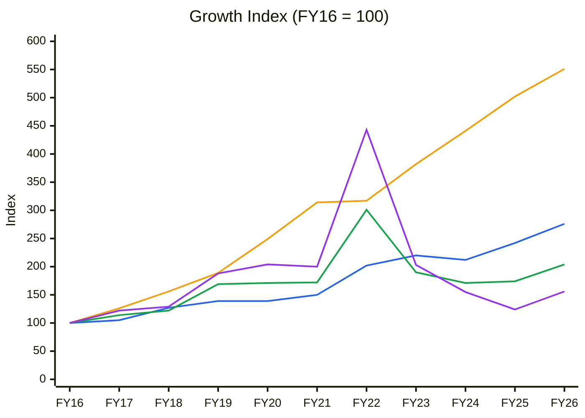
🟦 Revenue (10-yr CAGR 10.7%) · 🟧 Net fixed assets + CWIP (18.6%) · 🟩 EBITDA (7.4%) · 🟪 PAT (4.6%). Consolidated, Screener.
**Read:** Gross block grew 5.5× while revenue grew 2.8×, EBITDA 2.0× and PAT only 1.6×. The FY22 PAT spike (index 443) was a one-off: the ₹1,186 Cr profit included contract-termination compensation.

**Business inference:** Aarti has been building capacity far faster than it can turn that capacity into profit. Each rupee of new assets now earns less than the last, which is the core reason ROCE has collapsed. The investment case depends entirely on the ₹2,187 Cr of CWIP and the FY23–26 capex finally producing earnings, which management has repeatedly pushed out.

**Order book tracking:** no order book is disclosed. The two Reg 30 contract filings (USD 150 mn supply agreement to Mar-2030; a 15-year contract amendment with ₹200–250 Cr capex) are recorded as a mini ledger in Module 10. The full tracker was not run because no snapshot series exists.

---

## BUSINESS PRIMER
Aarti Industries (Mumbai; Gogri/Mehta promoter family; FY26 revenue ₹8,286 Cr) makes benzene-based specialty chemicals in Gujarat (Vapi, Jhagadia, Dahej) and Maharashtra (Tarapur). Revenue = volume × spread over benzene, chlorine, nitric acid and hydrogen. Its moat is integration and scale: it is #1–#4 globally in several NCB/DCB chains, it feeds 100+ downstream products, and it has long-term contracts with global agro/pharma and polymer majors. **Exports were 59% of Q1FY27 revenue** (concall). Since the 2021 demerger of the pharma business (Aarti Pharmalabs), it has two engines: (1) **specialty chemicals**: agro, pharma, polymer, pigment and dye intermediates, plus the multi-purpose plant (MPP) and Zone IV chlorination capex; and (2) **energy/fuel additives**, currently a 360 KTPA capacity whose West Asia exports collapsed from ~15% to ~2% of revenue during the 2026 West Asia crisis (Q1FY27 concall). Key value driver: **utilisation of the new capex at decent spreads**. Key risks: China pricing in benzene derivatives, execution delays and leverage.

**Segment check:** existing **Specialty Chemicals** block ✓ (KPI reference line 449; peer EV/EBITDA 18–30× for quality names).

---

## MODULE 1 — Broad Market Cycle
Nifty is at 22,520 (−12.4% YoY), below a declining 30-week MA (23,718): **Stage 4**. India VIX is rising, so the backdrop is risk-off. In Stage 4 markets, a mid-cap with high leverage and a QIP overhang is usually re-priced lower before it is re-rated.

## MODULE 1b — Sector Cycle (Indian specialty chemicals)
The sector went through destocking in FY24 (global agro inventory correction) and a Chinese pricing collapse. It began recovering in FY26 as volumes returned, but realisations have only started to improve. China suspended export tax rebates on some chains (positive for Aarti's NCB chain, per the Q1FY27 concall). Peers like Navin Fluorine (fluoro and CDMO) are in an upcycle, while benzene-chain players (Aarti, Deepak) are early in theirs. **Sector position: early recovery (margins below the 10-year mean, volumes back).**

## MODULE 1c — Stock Cycle
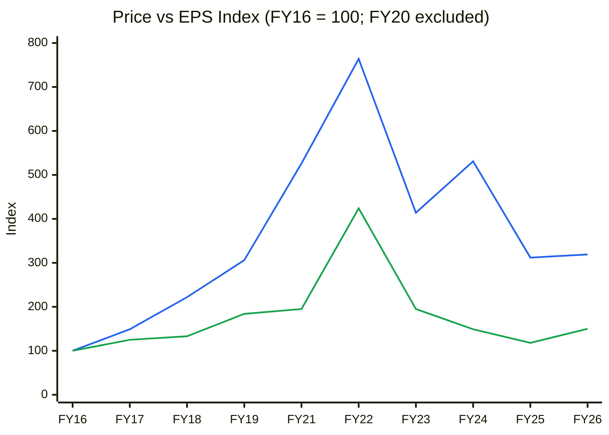
🟦 March-end share price (Yahoo monthly) · 🟩 EPS (Screener). FY20 is excluded because the Yahoo March-2020 close is identical to March-2019 (data error).
**Read:** The price index ran to 764 at FY22 against EPS of 424, then fell to 312–319 by FY25–26 while EPS sat at 118–150. Since FY23, the price has been tracking earnings more closely.

**Business inference:** Most of the FY21–22 re-rating was multiple expansion on "China+1" hopes, and it has been unwound. Today's price (index ~367 at ₹460) is still 2.4× the EPS index (150), so the stock carries a growth premium, just a smaller one than in FY22 (1.8× on a much stronger EPS base).

### Cycle Position Dashboard
| Dimension | Current | 10-yr median | Percentile | Signal |
|---|---|---|---|---|
| P/E (TTM) | 32.0× | 31.9× | ~50% | Fair, but on a depressed-quality base with tax-flattered EPS |
| P/B | 2.8× | 4.76× | ~15% | Cheap vs history (but ROE has fallen from 20%+ to 7%) |
| EBITDA margin | 16.0% (Q1) / 14.8% (TTM) | 19.5% avg | ~25% | **Below mid-cycle, recovering** |
| ROCE | 6.9% (FY26) | 13.9% avg | ~10% | **Trough** |
| Debt / EBITDA | 4.3× (FY26) | 2.5× | 100% | **Worst in a decade** |
| Industry cycle | Early recovery | — | — | Volumes up, spreads lagging |
| **Overall** | | | | **Early in the business cycle, but valuation is not at trough** |

---

## MODULE 2 — Industry Structure & Capital Cycle
- **Supply:** China is the price-setter in benzene derivatives. Chinese capacity additions in 2022–24 crushed spreads. Indian players (Aarti, Deepak, Atul, Gujarat Fluoro for chlorinated aromatics) all added capacity in the same window, a classic capital-cycle overbuild.
- **Demand:** Agro intermediates (largest end market) went through destocking FY24–25. Polymer and pharma intermediates were steadier. The energy/fuel additives line depends on refinery and export markets.
- **Capital cycle signal:** Aarti's capex/revenue was 14–29% every year FY19–FY26 (cumulative 10-year capex ~₹11,200 Cr from CFI) against FY26 revenue of ₹8,286 Cr. Per the KPI block, capex >25% of revenue for a sustained period is an over-investment flag. Aarti passed that line in FY20–FY23. **Phase: late investment, early harvest.** New supply is still landing (Zone IV, MPP), so the harvest phase has not begun.

## MODULE 3 — Business Quality, Moat & Management
**Moat (moderate):** scale and integration in NCB/DCB chains (#1–#4 globally), sticky long-term contracts (a 15-year contract amendment and a USD 150 mn supply agreement in Mar-2026), and process know-how. It is a cost moat, not a pricing moat. Margins dropped from 28% to 14% when China cut prices.

**Management and governance:**
- **Promoter holding:** 42.6% (Sep-24) → 41.8% (Jun-26), helped by the reclassification of Ratanben Gogri from promoter to public (BSE filing). No pledge.
- **Institutional flow:** FIIs 9.7% → 7.0% over 8 quarters (selling). DIIs 18.1% → 21.1% (buying).
- **Capital allocation:** 10-year cumulative FCF is **−₹2,080 Cr**. Every rupee of CFO and more went into capex, funded by ₹3,700 Cr of extra borrowing and the 2019 QIP. The planned ~₹1,000 Cr QIP (EGM approval sought) is to fund the balance sheet, not new growth.
- **Disclosure quality:** the company **removed segment volume disclosure from its investor presentation** in FY27. That is a negative for a company whose case rests on utilisation.

### Walk-the-Talk Scorecard
| Commitment (made when) | Promise | Outcome | Score |
|---|---|---|---|
| FY26 capex (Q1FY26 call) | < ₹1,000 Cr | ₹1,125 Cr | ❌ Miss (0) |
| Zone IV chlorination (FY25 calls) | Commission H2FY26 | Phase I commissioned 7-Sep-26; remaining phases delayed 3–6 months | ❌ Miss (0) |
| MPP (multi-purpose plant) (FY25–26 calls) | Q4FY26 start | Slipped into FY27 | ❌ Miss (0) |
| Calcium chloride project | FY26 | Not delivered | ❌ Miss (0) |
| Re Aarti (waste/recycling) | FY26 | Not delivered | ❌ Miss (0) |
| Augene (JV/ventures) | FY26 milestones | Partial | ◑ Near miss (0.5) |
| Margin trajectory (Q2FY26 call) | Steady improvement through FY26 | OPM 12.7% → 15.5% across FY26 (but from a lower base than guided) | ◑ Near miss (0.5) |
| Fuel additives capacity | 360 KTPA | Delivered | ✅ Hit (1) |
| **Score** | | **2.0 / 8** | **0.25: unreliable** |

**Business inference on management:** Projects arrive 2–4 quarters late and capex arrives above budget. Investors should discount the FY28 EBITDA guidance (₹1,800–2,200 Cr) by at least one year.

---

## MODULE 4 — Financial Forensics
| Test | Value | Read |
|---|---|---|
| Beneish M (proxy, FY26) | −2.00 | Grey zone (> −2.22 threshold), driven by DSRI 1.59 (debtor days 39 → 62) |
| Altman Z'' | 2.7–3.7 (FY24–26) | Grey to safe |
| Piotroski F | 6 / 9 | Average |
| Sloan accrual | 6.4% | Acceptable (< 10%) |
| Tax rate | FY26 −15% (credits/MAT/deferred tax); Q1FY27 +14% | **PAT flattered by ~₹145 Cr vs a 25% normal rate (₹419 Cr reported vs ~₹273 Cr)** |
| CFO / PAT (10-yr) | 1.69 | Strong cash conversion (D&A heavy) |
| Working capital | Days payable 24 → 137 (FY23 → FY26); CCC 143 → 54 | **Supplier credit is funding working capital**; reversal risk |

**Forensic flags (3):** (1) the receivables jump in FY26 (DSRI 1.59); (2) the stretch in payables (137 days); (3) negative tax for 3 years. None shows manipulation, but together they make reported FY26 earnings and CFO look better than the underlying business.

---

## MODULE 5 — Earnings Quality & Financial Statements
| FY | Sales | EBITDA | OPM % | PAT | PAT % | ROCE % | CFO | EPS ₹ |
|---|---|---|---|---|---|---|---|---|
| FY16 | 3,006 | 572 | 19.0 | 268 | 8.9 | 20 | 574 | 7.71 |
| FY17 | 3,163 | 654 | 20.7 | 328 | 10.4 | 19 | 470 | 9.62 |
| FY18 | 3,806 | 700 | 18.4 | 346 | 9.1 | 16 | 335 | 10.24 |
| FY19 | 4,168 | 965 | 23.2 | 504 | 12.1 | 18 | 736 | 14.18 |
| FY20 | 4,186 | 977 | 23.3 | 547 | 13.1 | 15 | 1,102 | 15.39 |
| FY21 | 4,506 | 982 | 21.8 | 535 | 11.9 | 13 | 873 | 15.02 |
| FY22 | 6,086 | 1,720 | 28.3 | 1,186 | 19.5 | 22 | 519 | 32.71 |
| FY23 | 6,619 | 1,089 | 16.5 | 545 | 8.2 | 10 | 1,319 | 15.04 |
| FY24 | 6,371 | 978 | 15.4 | 416 | 6.5 | 7 | 1,210 | 11.49 |
| FY25 | 7,269 | 997 | 13.7 | 331 | 4.6 | 6 | 1,238 | 9.13 |
| FY26 | 8,286 | 1,168 | 14.1 | 419 | 5.1 | 7 | 781 | 11.56 |
| TTM | 9,010 | 1,335 | 14.8 | 531 | 5.9 | — | — | 14.64 |
*(₹Cr, consolidated, Screener 10-Oct-2026. FY16–FY21 figures include the pharma business demerged in 2021.)*

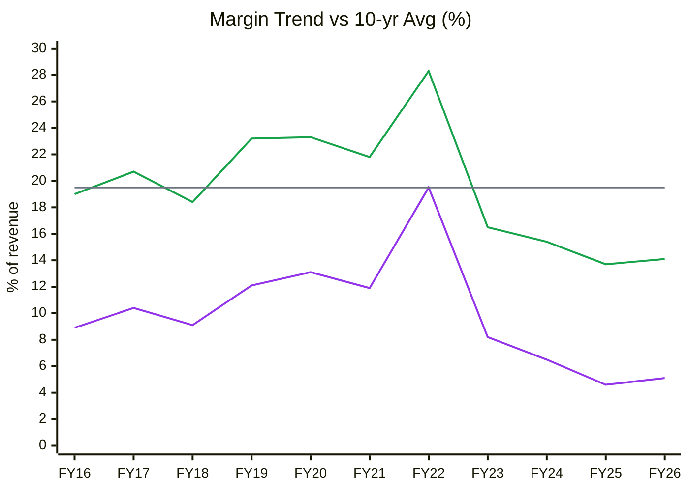
🟩 EBITDA margin · 🟪 PAT margin · ⬜ 11-yr average OPM 19.5% (SD 4.3)
**Read:** OPM held 18–23% for FY16–FY21, spiked to 28.3% in FY22, then fell to 13.7–14.1% in FY25–26, more than 1SD below average. PAT margin fell from 12–13% to ~5%.

**Business inference:** Part of the decline is structural: the higher-margin pharma business left in 2021, and China now sets prices in Aarti's core chains. Part is cyclical. A full return to 19.5% is unlikely; a mid-cycle ~16–17% is a realistic target, and Q1FY27 (16%) is already close to it.

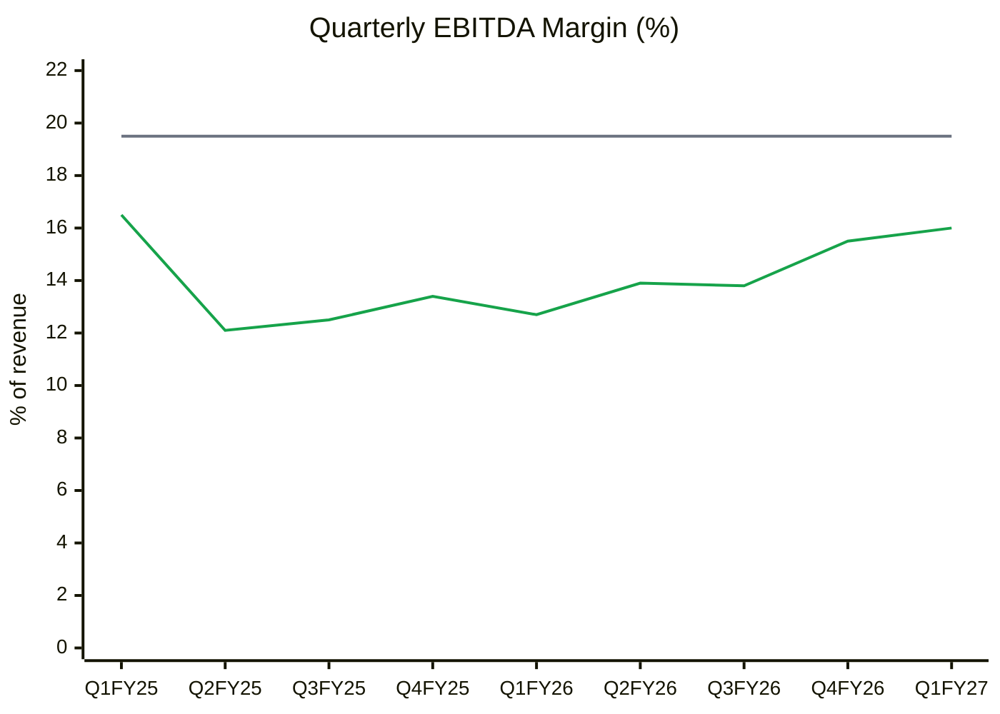
🟩 Quarterly OPM (Screener) · ⬜ 10-yr average 19.5%.
**Read:** OPM dropped from 16.5% (Q1FY25) to 12.1% (Q2FY25), then climbed steadily to 16.0% by Q1FY27. That is four straight quarters of improvement.

**Business inference:** The operating recovery is genuine and broad, but Q1FY27 included ~₹50–60 Cr of FX and inventory gains (concall). Without them, OPM would be ~13.7–14%, so the run-rate is closer to FY26's exit than the headline suggests.

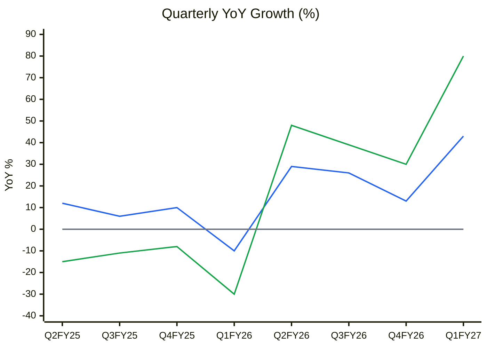
🟦 Revenue YoY · 🟩 EBITDA YoY · ⬜ zero line
**Read:** EBITDA YoY went from −30% (Q1FY26) to +80% (Q1FY27). Revenue YoY ran +13% to +43% for four quarters.

**Business inference:** The growth numbers look spectacular because they are measured against the FY25 trough. Q1FY27 EBITDA of ₹382 Cr is still below the ₹430 Cr quarterly run-rate of FY22, despite 75% more gross block, so the recovery is a rebound, not new earnings power yet.

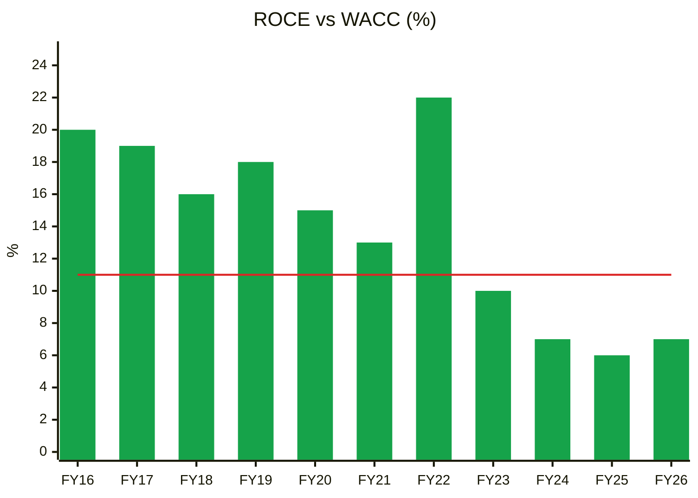
🟩 ROCE (bars, Screener) · 🟥 WACC 11%
**Read:** ROCE was above WACC every year FY16–FY22 (13–22%), then fell below it for four straight years: 10%, 7%, 6% and 7% for FY23–26.

**Business inference:** Aarti is currently destroying value on its capital base. ROCE of ~7% on ₹11,000 Cr of capital means ~₹450 Cr per year less than the cost of that capital. FY27 is likely to be the fifth year below WACC (estimated ~8–9%), which would trigger the ROIC < WACC hard stop unless Zone IV and MPP ramp quickly.

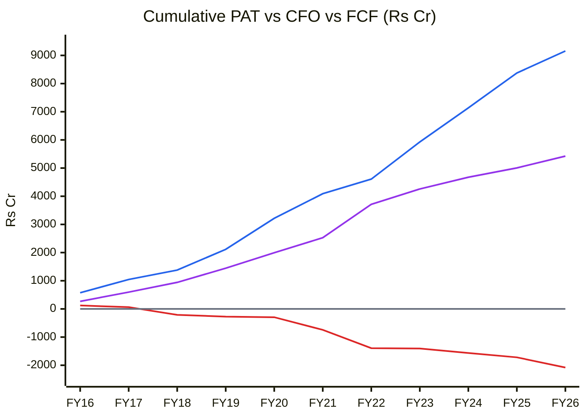
🟪 Cumulative PAT · 🟦 Cumulative CFO · 🟥 Cumulative FCF (CFO + CFI) · ⬜ zero line
**Read:** Over 11 years, Aarti reported ₹5,425 Cr of PAT and ₹9,157 Cr of CFO (1.69×), but cumulative FCF was **−₹2,080 Cr**. It has been negative every year since FY18.

**Business inference:** Earnings are real cash, but all of that cash and ₹2,000+ Cr more went back into plants. Shareholders have never seen free cash from this decade of investment. The QIP is the bill for that: when FCF is negative for 9 years, someone has to fund it, and now it is minority shareholders through dilution.

### DuPont (average balances)
| FY | EBIT margin | Asset turnover | Equity multiplier | Interest burden | Tax burden | ROE |
|---|---|---|---|---|---|---|
| FY24 | 9.5% | 0.68× | 1.83× | 0.65 | 1.05 | 8.1% |
| FY25 | 8.0% | 0.68× | 1.95× | 0.53 | 1.08 | 6.1% |
| FY26 | 8.5% | 0.68× | 2.11× | 0.52 | 1.15 | 7.2% |

**Read:** ROE of 6–8% is propped up by rising leverage (equity multiplier 1.83 → 2.11) and a tax burden above 1.0 (tax credits). Interest now takes ~half of EBIT.

**Business inference:** Strip out the tax credit and the leverage creep, and the underlying ROE is ~5%. The fix has to come from margin and asset turnover (new plants filling up), not from financial engineering.

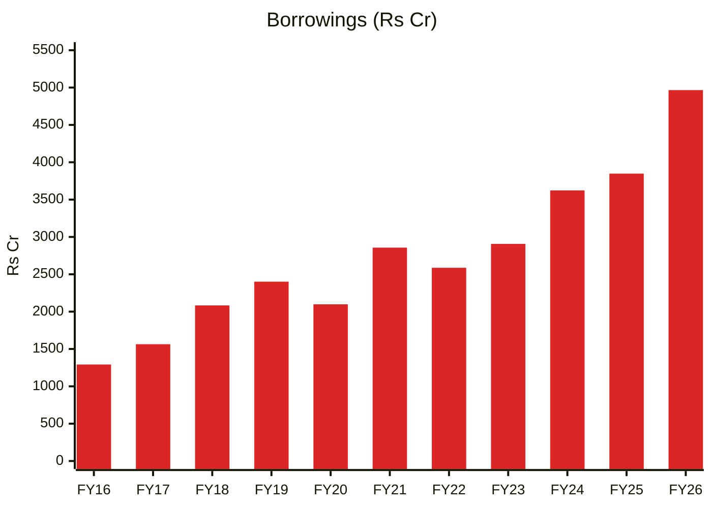
🟥 Gross borrowings (Screener)
**Read:** Borrowings grew 3.8× over the decade, from ₹1,292 Cr to ₹4,966 Cr, with ₹1,118 Cr added in FY26 alone.

**Business inference:** The FY26 jump came from working capital (higher feedstock prices and export volumes, Q1FY27 concall) on top of capex. With interest cover at 2.0×, Aarti has little room for another downturn, which is why the QIP is needed now rather than after the ramp-up.

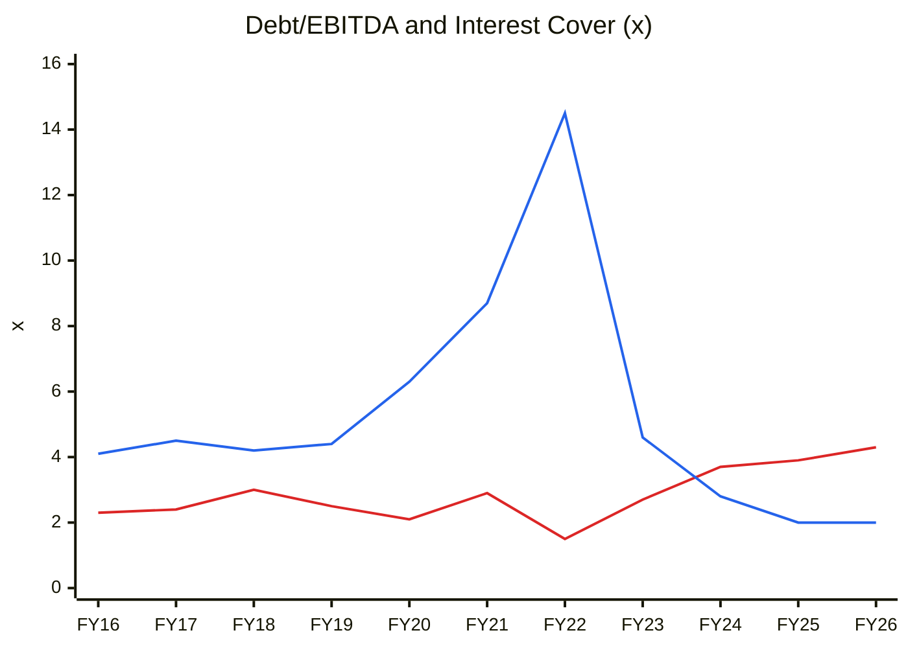
🟥 Gross debt / EBITDA · 🟦 Interest cover ((EBITDA − D&A) / interest)
**Read:** Debt/EBITDA rose for four years to 4.3× (a 10-year high), and interest cover fell from 14.5× (FY22) to 2.0× (FY25–26).

**Business inference:** The balance sheet has gone from a strength to a constraint. Lenders and rating agencies will keep the company focused on deleveraging over growth, so expect slower capex, a QIP, and possibly asset monetisation over the next 2 years.

---

## MODULE 6 — Industry KPIs & Peer Analysis
| KPI (Specialty Chemicals block) | Aarti | Healthy range | Status |
|---|---|---|---|
| Order book / revenue | Not disclosed (contracts only) | > 1.5× | ⚠️ |
| Export revenue % | 59% (Q1FY27) | > 50% | ✅ |
| EBITDA margin | 14.8% TTM | 20–30% | ❌ (< 15% = commoditisation flag) |
| R&D / revenue | ⚠️ not sourced | > 3% | ⚠️ |
| Capacity utilisation | NCB 86%, DCB 80%, hydrogenation 85% (FY26) | > 75% | ✅ (core chains) |
| Client concentration | ⚠️ not disclosed | < 40% | ⚠️ |
| Capex / revenue | 13.6% (FY26) | 8–15% | ✅ (was > 25% FY20–23) |

### Volumes (company disclosures, FY22 → FY26)
| Chain | FY22 (KT) | FY26 (KT) | CAGR | FY26 utilisation |
|---|---|---|---|---|
| Nitrochlorobenzene (NCB) | 76.6 | 92.7 | 4.9% | ~86% |
| Dichlorobenzene (DCB) | 74.6 | 96.5 | 6.6% | ~80% |
| Hydrogenation | 35.7 | 50.8 | 9.2% | ~85% |

**Read:** Core-chain volumes grew 5–9% a year, and utilisation is already 80–86%.

**Business inference:** The existing core plants are nearly full, so further growth has to come from Zone IV, MPP and downstream value-addition, exactly the projects that keep slipping. *Volume disclosure has been removed from FY27 slides, so this tracking may no longer be possible.*

### Peers (Screener, 10-Oct-2026)
| Company | P/E | P/B | ROCE | OPM | Borrowings (₹Cr) |
|---|---|---|---|---|---|
| **Aarti Industries** | 32.0× | 2.8× | 6.9% | 14% | 4,966 |
| Deepak Nitrite | 27.9× | 3.8× | 11.4% | 13% | 1,638 |
| Atul | 21.8× | 2.78× | 14.9% | 16% | 183 |
| Navin Fluorine | 53.9× | 10.8× | 21.0% | 33% | 1,272 |

**Business inference:** Aarti has the lowest ROCE and the highest debt in its peer set, yet trades at a higher P/E than Deepak and Atul. Atul offers similar margins with double the ROCE and no debt at a 32% lower P/E. Aarti's premium is purely the "recovery ahead" bet.

---

## MODULE 7 — Market Size & Market Share
Aarti is #1–#4 globally in several benzene-derivative chains (company claims; ⚠️ no independent market-share data). The Indian specialty-chemicals market is estimated at ~USD 40–50 bn (industry estimates; ⚠️ not independently verified). Aarti's share is material in NCB/DCB but small in the overall pool. Market size is not the constraint; spreads and execution are.

---

## MODULE 8 — Valuation & Margin of Safety
### 8A. PIE (reverse DCF, sales-to-capital model)
Market EV ₹21,060 Cr (market cap ₹16,692 + net debt ₹4,366); TTM revenue ₹9,010 Cr; WACC 11%; 10-year growth stage, then 6% terminal.

| Sales-to-capital | Growth 8% | Growth 10% | Growth 12% |
|---|---|---|---|
| 0.9 | 16.6% NOPAT margin | 16.0% | 15.5% |
| 1.2 | 14.9% | 14.2% | 13.6% |
| 1.5 | 13.9% | 13.1% | 12.4% |

**Read:** At any reasonable growth rate and capital intensity, ₹460 needs a sustained **13–16% NOPAT margin**. TTM NOPAT margin is ~7.2% (EBIT ~₹866 Cr × 75% / ₹9,010 Cr). The best-ever year (FY22) was ~17%, and even the FY16–21 average was ~11–12%.

**Business inference:** The price assumes Aarti gets back to better-than-pre-demerger profitability and holds it for a decade. That is possible but would need the new capex to earn ~20% ROIC, which it has not yet shown at all. **The market is paying for the bull case.**

### 8B. Intrinsic value
| Method | Value / share | Notes |
|---|---|---|
| DCF: bear (6.5% NOPAT margin, S/C 1.0, 8% growth) | negative (₹−98) | Growth at sub-WACC returns destroys value |
| DCF: base (8.0%, S/C 1.1, 10%) | ₹16 | |
| DCF: bull (9.5%, S/C 1.3, 12%, 7% terminal) | ₹218 | |
| EPV (no-growth, NOPAT ₹650 Cr / 11%) | ₹43 | Current earnings capitalised |
| Relative: P/E 27× FY29E EPS ₹18.4 | ₹497 | Peer/historical multiple on recovered earnings |
| Relative: EV/EBITDA 15× FY28E EBITDA ₹2,000 Cr | ₹434 | (post-QIP net debt ~₹3,900 Cr, 38.4 Cr shares) |

**Read:** Cash-flow-based methods give ₹16–218; only multiple-based methods on 2028–29 recovered earnings reach ₹430–500.

**Business inference:** Fundamental cash-flow value is well below the price, because the business has not earned its cost of capital for four years. Any valuation that supports ₹460 rests on borrowing a peer multiple and applying it to earnings three years out that management has historically delivered late.

### 8C. Scenarios (2–3 year horizon; post-QIP shares 38.4 Cr)
| Scenario | Probability | FY29E EPS | Multiple | Value | Key assumptions |
|---|---|---|---|---|---|
| Bull | 20% | ₹27.5 | 30× | ₹825 | FY28 EBITDA at top of guidance (₹2,200 Cr), Zone IV/MPP full by FY28, China spreads recover |
| Base | 50% | ₹18.4 | 27× | ₹497 | EBITDA ~₹2,000 Cr in FY29 (guidance one year late), 25% tax, 16–17% OPM |
| Bear | 30% | ₹8.6 | 22× | ₹189 | Spreads stay flat, projects slip again, EBITDA ~₹1,350 Cr, higher interest |
| **Expected value** | | | | **₹470** | |

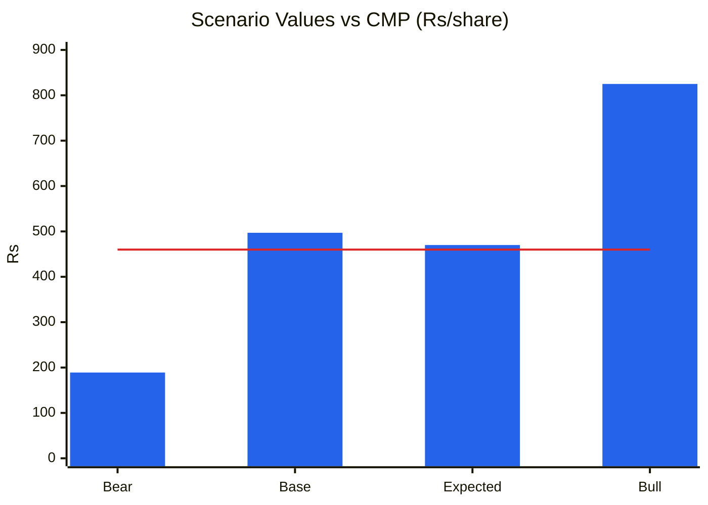
🟦 Scenario value · 🟥 CMP ₹460
**Read:** Upside to bull is ₹365 (+79%) and downside to bear is ₹271 (−59%), so U/D is **1.35:1**. The expected value of ₹470 is only 2% above the CMP.

**Business inference:** At ₹460 the investor is taking almost as much downside as upside for a stock whose management has missed most of its timelines. This is the classic hard-stop case: the business may well recover, but there is no margin of safety in the price.

**Hard stops:**
- ❌ **U/D 1.35:1 < 1.5:1 → AVOID.**
- ❌ **SVAR 47% (> 40%)**: the scenario standard deviation is ₹222 on an expected value of ₹470.
- ⚠️ ROIC < WACC for 4 years (FY23–26). Not yet 5; FY27 is likely to be the fifth.

**Re-look price:** ₹330–350, where bull-vs-bear U/D clears 1.5:1 (e.g., ₹340: (825−340)/(340−189) = 3.2:1, with EV ₹470 = +38%).

---

## MODULE 9 — Technical Stage
| Item | Reading |
|---|---|
| Nifty | **Stage 4** (22,520, below a declining 30-week MA) |
| Stock | **Stage 3 (topping).** ₹460 vs 30-week SMA ₹478 (MA 450 → 470 → 478: flattening after rising). Peak ₹552; price has broken below the MA |
| 52-week range | ₹338–552 (now −17% from high, +36% from low) |
| Returns | 4-wk −6.3%, 13-wk −6.8%, 26-wk +4.4%, 52-wk +22.8% |
| Volume | 4-wk average 1.9m vs 20-wk 6.2m (0.30×): selling dried up, but so has buying |
| Pattern | Lower highs since ₹540 (Aug); failed to hold ₹478–490 |
| Stop (if held) | ₹430 weekly close |

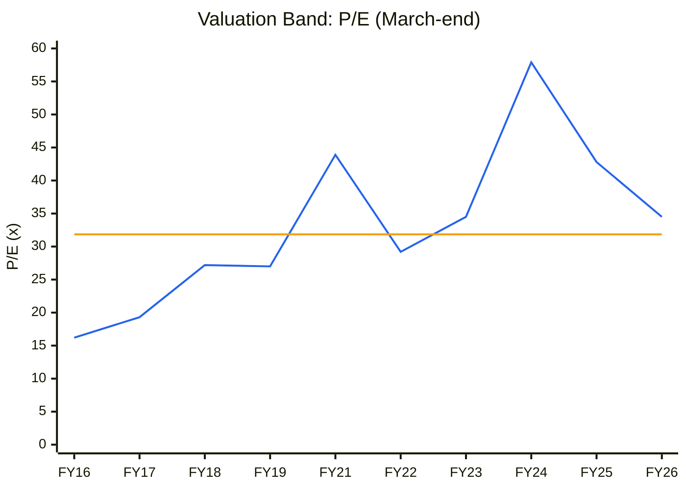
🟦 P/E at March close · 🟧 median 31.9× (FY20 excluded, bad price data). Current TTM P/E 32.0×.
**Read:** P/E has ranged from 16× to 58× and sits right at the median now. The FY24 peak of 57.9× was a depressed-EPS effect.

**Business inference:** The median P/E was set when ROCE was 15–20%. Paying the same multiple for a business earning 7% ROCE is effectively paying a premium. A P/E in the low 20s would match today's quality.

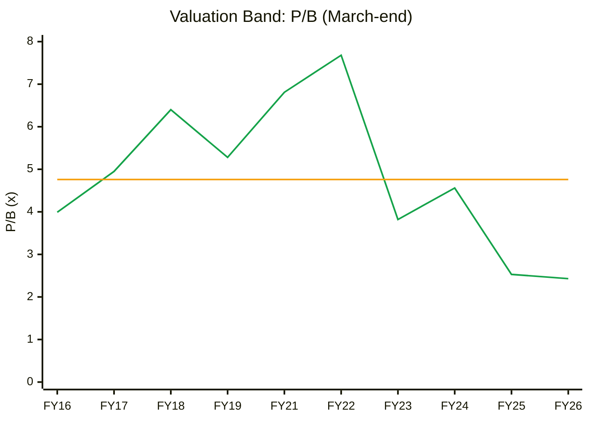
🟩 P/B at March close · 🟧 median 4.76× (FY20 excluded). Current 2.8×.
**Read:** P/B fell from 7.7× (FY22) to 2.4× (FY26). Today's 2.8× is near the bottom of the 10-year range.

**Business inference:** P/B looks cheap only because book value has kept rising through low-return investment. With ROE at 7% vs a cost of equity of ~13%, fair P/B is close to 0.5–1.0× on current returns. 2.8× already assumes ROE climbs back to the mid-teens.

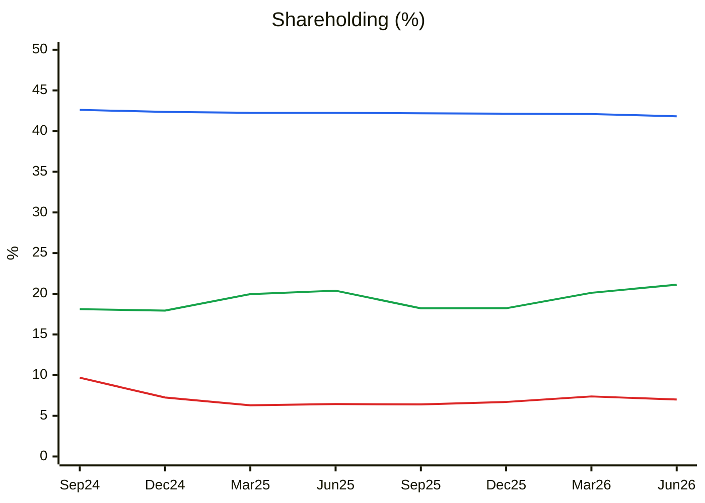
🟦 Promoters · 🟥 FIIs · 🟩 DIIs (Screener)
**Read:** Promoters drifted from 42.6% to 41.8%, FIIs fell from 9.7% to 7.0%, and DIIs rose from 18.1% to 21.1%.

**Business inference:** Domestic funds are absorbing foreign selling, which supports the price, but there is no promoter buying despite a 50%+ fall from the 2022 high. The QIP will dilute promoters further, below 40%.

**CANSLIM:** C 1 (Q1 EPS +260%) · A 0 (3-yr EPS CAGR negative) · N 1 (Zone IV/MPP) · S 0 (QIP supply) · L 0 · I 0 (FII selling) · M 0 → **2/7**.

---

## MODULE 10 — Forward View
### Capacity / capex model
| Item | Value |
|---|---|
| Net fixed assets + CWIP (FY26) | ₹8,586 Cr (CWIP ₹2,187 Cr = 25% of gross block) |
| Revenue / net fixed assets | 2.41× (FY16) → 1.29× (FY26) |
| CWIP coming on stream FY27–28 | Zone IV chlorination (Phase I commissioned 7-Sep-26), MPP, 15-year contract capex (₹200–250 Cr) |
| Incremental revenue potential (at 1.2–1.3× asset turnover on ₹2,187 Cr CWIP) | ₹2,600–2,850 Cr at full utilisation (FY29+) |

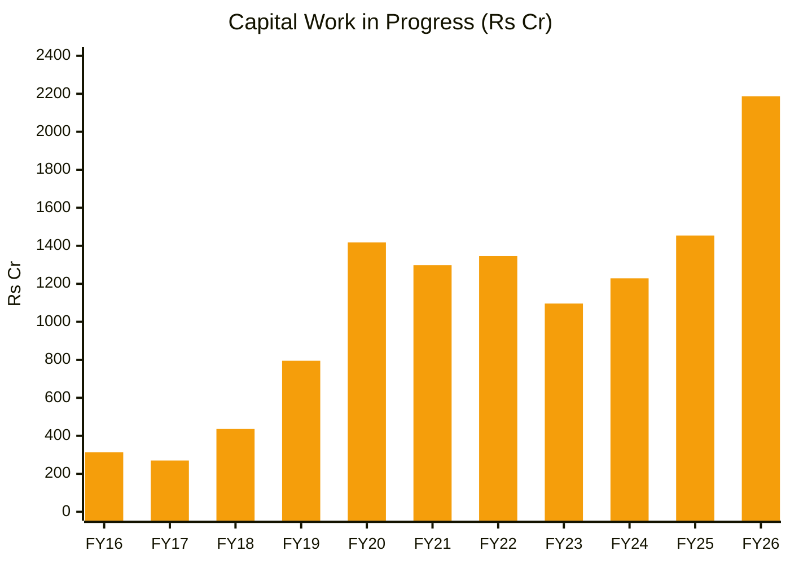
🟧 CWIP at year-end (Screener)
**Read:** CWIP has stayed above ₹1,000 Cr for seven years and hit a record ₹2,187 Cr in FY26, up 50% in one year.

**Business inference:** Rising CWIP while projects are "about to commission" is a sign of delays and cost overruns. If Zone IV and MPP are commissioned in FY27 as now guided, CWIP should fall sharply by FY27-end. If it does not, that is the clearest early sign that the FY28 guidance will slip too.

### Earnings path (normalised 25% tax; post-QIP 38.4 Cr shares)
| Metric | FY26A | FY27E | FY28E | FY29E |
|---|---|---|---|---|
| Revenue (₹Cr) | 8,286 | 9,600 | 10,800 | 12,000 |
| EBITDA | 1,168 | 1,500 | 1,800 | 2,000 |
| EBITDA margin | 14.1% | 15.6% | 16.7% | 16.7% |
| PAT | 419 (tax credit) | 411 | 564 | 707 |
| EPS (₹) | 11.56 | 10.7 | 14.7 | 18.4 |

*FY27E EPS is lower than TTM because the tax rate normalises from −15% to ~25% and the share count rises with the QIP.*

### Contracts ledger (Reg 30 filings; no order book disclosed)
| Date | Filing | Value | Tenure | Notes |
|---|---|---|---|---|
| 5-Mar-2026 | Amendment to a 15-year contract with a global customer | Capex ₹200–250 Cr (contract value not disclosed) | 15 years | Customer-backed capacity; returns depend on undisclosed pricing |
| 12-Mar-2026 | Long-term supply agreement | USD 150 mn (~₹1,300 Cr) | to Mar-2030 | ~₹320 Cr/year ≈ 3.5% of TTM revenue |

*Order Book Tracker not run: there is no disclosed order book or snapshot series. The two contracts give ~4–5% revenue visibility, not a backlog.*

**Catalysts:** QIP pricing and size (H2FY27); Q2FY27 results (Nov-26), showing whether OPM holds ≥ 15% without FX gains; Zone IV Phase II commissioning; CWIP reduction at FY27-end; China rebate policy; West Asia normalisation for the energy business.
**Risks:**
1. Chinese overcapacity keeps benzene-chain spreads low (**High**).
2. Further project delays and cost overruns, given a WTT score of 0.25 (**High**).
3. A QIP at a discount, or larger than ~₹1,000 Cr (**Medium**).
4. A working-capital reversal: payables of 137 days fall back toward 75 days, absorbing ~₹1,400 Cr of cash (**Medium**).
5. The tax rate normalising, cutting reported EPS (**Certain**, priced in by consensus?).

---

## Checklist Summary
**Section 0:** n/a (initial report). **A:** 15/18 (WTT done; R&D and client concentration not sourced) · **B:** 8/9 · **C:** 11/12 · **D:** 5/7 (no order book) · **E:** 5/7 · **F:** 10/10 · **G:** 7/8 · **H:** 24/30 · **I:** 5/5. Includes 14 Mermaid charts (C1, CY1, C2, quarterly OPM/CY4, CY2 YoY, C4 ROCE vs WACC, C5 cash conversion, debt, leverage, scenario, C7 P/E band, CY7 P/B band, C13 shareholding, CWIP), each with Read plus Business inference, and the Cycle Position Dashboard.
**Order Book Tracker:** not applicable (no disclosed order book; two Reg 30 contracts recorded as a mini ledger).
**Hard stops triggered:** ❌ U/D 1.35:1 (< 1.5:1) · ❌ SVAR 47% (> 40%) · ⚠️ ROIC < WACC 4 years (FY23–26), so a fifth year in FY27 would trigger it too.

---

## Investment Decision
**Recommendation: AVOID at ₹460**
**Conviction score:** 3.8 / 10 (cycle 0.6 · industry 0.5 · moat 0.6 · management 0.3 · financial quality 0.6 · valuation 0.5 · technical 0.4 · catalysts 0.3)
**Position size:** 0%
**Why not now:** The recovery is real, but the price already discounts the bull case on margins (PIE), management misses most deadlines (WTT 0.25), the balance sheet needs a QIP, and the market is in Stage 4.
**Re-look levels:** ₹330–350 (U/D > 3:1 on current scenarios; near the 52-week low of ₹338), **or** two consecutive quarters of OPM ≥ 16% *excluding* FX/inventory gains together with a falling CWIP balance.
**If held:** ₹430 weekly-close stop; consider taking part in the QIP only at ≤ ₹400.
**Review triggers:** QIP launch; Q2FY27 results; Zone IV Phase II date; FY27 CWIP; any return of volume disclosure.

---
*Report generated by Stock Fundamental Analysis Skill v3.3 | Indian Markets Context*
*Primary sources: Screener.in (consolidated, 10-Oct-2026); BSE announcements for scrip 524208 (Jan-2024 to Oct-2026): concall transcripts Q1FY26–Q1FY27, Q1FY27 and Sep-2026 investor presentations, press releases (23/30-May-24, 2-Sep-25, 18-Dec-25, 5-Mar-26, 12-Mar-26, 4-Jun-26, 7-Sep-26), EGM notice (QIP), promoter reclassification, fund-raise intimation; Yahoo Finance weekly/monthly prices (AARTIIND.NS, ^NSEI); Screener peer pages (Deepak Nitrite, Atul, Navin Fluorine).*
*Save path: C:\Users\anubh\Documents\Anubhav\Stock Analysis\Stock Analysis\AARTIIND_AartiIndustries_2026-10-10.md*
