# Stock Analysis Report — Aarti Surfactants Ltd (NSE: AARTISURF · BSE: 543210)
**Date:** 2026-10-10
**Analyst:** Claude (Stock Fundamental Analysis Skill v3.3)
**Investment Horizon:** 2–3 Years
**Recommendation:** AVOID (two hard stops triggered: ROIC below WACC for 7 straight years, and probability-weighted upside/downside of 0.8:1)
**Conviction Score:** 3 / 10
**CMP:** ₹483.75 (NSE close, 9-Oct-2026, Yahoo Finance) · **Market cap:** ₹410 Cr · **EV:** ~₹501 Cr (FY26 net debt ₹91 Cr)

## Revision Log
| Version | Date | Recommendation | Conviction | Price | Key change |
|---|---|---|---|---|---|
| **Current** | 2026-10-10 | AVOID | 3/10 | ₹483.75 | Q1FY27 OPM rose to 7.4% and PAT to ₹9.0 Cr, and the stock is up 20%. The price now implies an ~8% EBIT margin held for 10 years, above the company's best-ever year (7.8%). Two hard stops are now computed and triggered. New governance flags: a customs penalty order against the company and the MD, an independent director leaving after 11 months, and a switch of rating agency. |
| Previous | 2026-07-28 | AVOID | 3/10 | ₹402 | Initial report (skill v2.0). Summary-level analysis: no U/D, PIE, WTT ledger or forensic scores. Full text is in git history. |

**What changed in the thesis:** the conclusion is the same and the evidence is stronger. The July report called this a "price-taking commodity toller earning single-digit returns". The new data adds three things. (1) Gross profit in rupees has been flat at ₹120–143 Cr for five years while revenue rose 43%. FY26 revenue growth was raw-material pass-through, not value. (2) Top-3 customers rose to 68% of sales in FY24 (HUL, P&G, Dabur, per CARE), so buyer power, not "no captivity", is the binding constraint. (3) The stock now trades at 1.7× book, versus 1.4× in July, after a one-quarter margin bump that matches an industry-wide feedstock-inventory gain (Galaxy's OPM went from 9% to 14% and Standard Surfactants' from 6% to 14% in the same quarter).

**Did the previous report apply the hard-stop rule correctly?** **Only partly.** It reached AVOID on quality and moat judgement and said there was "no MoS", but it **never computed the upside/downside ratio**, so the U/D < 1.5:1 hard stop was never tested. It also **did not explicitly test the "ROIC < WACC for 5+ years" hard stop**, even though its own numbers (ROCE 8.6% vs cost of capital) implied it. Its one technical claim ("likely Stage 4") was wrong (see ❌ below). The verdict was right, but the process was incomplete. This update computes both stops: **both are triggered.**

**Validation of previous report (every material carried-forward item):**
| # | Item | Previous (28-Jul-2026) | Now (10-Oct-2026) | Status |
|---|---|---|---|---|
| 1 | FY26 revenue | ₹859 Cr, +30% YoY | ₹859.13 Cr, +30.4% (FY26 AR p.114; AGM presentation 29-Sep-2026) | ✅ Validated |
| 2 | FY26 net profit | ₹12.7 Cr | Standalone ₹12.68 Cr / consolidated ₹12.34 Cr (AGM presentation) | ✅ Validated (standalone basis) |
| 3 | OPM | ~5%, Q4 5.2% | FY26 5.5% (Screener cons.), Q4FY26 5.15%; **Q1FY27 7.44%** | 🔄 Updated |
| 4 | ROE / ROCE | ROE ~5.3%, ROCE ~8.6% | ROE 5.27% (company) / 5.2% on avg equity; ROCE 8.4% on avg capital employed (company states 9.72% on its own definition) | ✅ Validated |
| 5 | Profit history FY21→FY26 | ₹22 / 6 / 13 / 22 / 15 / 13 Cr | Standalone ✅. Note: FY25 PAT includes a ₹4.2 Cr exceptional gain (FY26 AR p.114), so FY25 core PAT was ~₹12 Cr | ✅ Validated + caveat |
| 6 | "Revenue tripled since FY19; profit flat" | — | FY19 ₹264 Cr → FY26 ₹859 Cr (3.25×); FY19 was a loss (–₹6 Cr) | ✅ Validated |
| 7 | EPS / P/E | EPS ₹14.98, P/E ~27× | Standalone EPS ₹14.99 ✅; at ₹402 that was 26.8× ✅. Now TTM consolidated EPS ₹21.73 → **P/E 22.3×** | 🔄 Updated |
| 8 | Book value / P/B | ₹292, ~1.4× | Standalone ₹292 / consolidated ₹289 (Screener); now **1.68×** | 🔄 Updated |
| 9 | Promoter / FII / DII | 49.84% / 0.08% / 0.00% | Same at Jun-2026 (Screener). Shareholders fell from 43,091 (Mar-24) to 35,149 (Jun-26) | ✅ Validated |
| 10 | Pledge | not stated | **Nil.** No encumbrance in the SAST Reg 29(2) disclosure (Sep-2024); none disclosed since | 🔄 Updated (gap closed) |
| 11 | Debt / D/E | ₹104 Cr, ~0.42× | ₹104 Cr incl. ₹23 Cr redeemable preference shares; company D/E 0.38×. Preference shares redeemed 5-Aug-2026 (~₹18 Cr principal + 4% p.a. return) | 🔄 Updated |
| 12 | OCF FY25 / FY26 | ₹11 / ₹77 Cr | ₹11 / ₹77 Cr (Screener) | ✅ Validated |
| 13 | Working capital | CCC 43 d; debtors 44, inventory 60 | Same (Screener FY26) | ✅ Validated |
| 14 | Dividend | ₹1/share, 0.24% yield | FY26 payout 7% of EPS (≈₹1); yield now 0.21% at ₹484 | 🔄 Updated |
| 15 | DuPont | 1.5% × 1.66 × 2.11 on closing balances | Re-done on **average** balances: 1.4% PAT margin, AT 1.73×, EM 2.09× → ROE 5.2% | 🔄 Updated (method) |
| 16 | Business characterisation | "price-taking commodity **toller**" | **Not a toller.** ASL buys palm-derived fatty alcohol / HCFA / alpha-olefin and sells finished surfactants to FMCG MNCs as a preferred supplier. RM was ~84% of FY26 revenue; top-3 customers 68% (CARE Jun-2024) | ❌ **Corrected** |
| 17 | Moat: "no customer captivity" | No captivity | Partly wrong. Approved-supplier status with HUL/P&G/Dabur is real, but it is captivity *of the supplier by the buyer*, not the reverse. The economic result (no pricing power) is unchanged | 🔄 Updated (nuance) |
| 18 | Technical stage | "likely Stage 4 / weak base" at ₹402 | On 27-Jul-2026 the price was ₹401 vs a **flat** 30-wk SMA of ₹390 (391 four weeks earlier), i.e. **Stage 1 base, not Stage 4**. Now ₹484 vs a rising 30-wk SMA of ₹442 → Stage 2 (late / pulling back) | ❌ **Corrected** |
| 19 | 52-wk range / 1-yr return | ₹576 / ₹316; –26% | At 28-Jul: ₹575.85 / ₹316, 1-yr –28%. Now ₹677.7 / ₹316; 1-yr **+6.6% vs Nifty –12.4%** | ✅ (approx.) → 🔄 |
| 20 | "Modest capex" | — | FY26 cash capex ₹45 Cr (2.6× depreciation), CWIP up from ₹11 Cr to ₹40 Cr. Capex is stepping up, not modest | 🔄 Updated |
| 21 | Walk-the-Talk | "LOW-to-MODERATE (unproven)" | Ledger built (8 scored points): **0.44 → LOW** | 🔄 Updated (gap closed) |
| 22 | Beneish / Sloan | "not flagged (directional)" | Computed: M = –2.55 (–2.22 with the ex-CWIP AQI), Sloan –3.8%, Z'' 3.34, Piotroski 5/9 | 🔄 Updated (gap closed) |
| 23 | PIE | "market implies a margin/return inflection" | Quantified: at 5–7% revenue CAGR the price needs a **sustained ~8.3% EBIT margin** (best year: 7.8%) | ✅ Validated + quantified |
| 24 | Galaxy comparison | ~9% OPM, 18% through-cycle ROE, 71% promoter | FY26 OPM 8.9% ✅; ROE TTM 10.9% (Screener), 10-yr average higher; promoter 70.91% (companion report) | ✅ / ⚠️ (through-cycle ROE not re-derived) |
| 25 | Surfactant KPIs (EBITDA/MT, specialty mix) | Asserted | **No volume or specialty-mix disclosure** in ARs FY20–FY26, presentations or rating letters | ⚠️ Unverifiable (gap still open) |

**❌ items:** (16) "toller" was the wrong business-model label: ASL buys its own raw material and carries inventory and price risk, so the risk profile is a converter-supplier's, with 68% top-3 customer concentration. (18) "Likely Stage 4" was wrong: in late July the stock was basing above a flat 30-week MA (Stage 1).

**Old data gaps re-attempted:** WTT ledger (closed); forensic scores (closed); pledge (closed, nil); customer concentration (closed); capacity (partly closed: 1,32,600 MTPA installed per CARE Nov-2022, but current utilisation is not disclosed); volume, EBITDA/MT and specialty mix (still open ⚠️).

---

## Business Primer

Aarti Surfactants (ASL) makes surfactants: the foaming and cleansing ingredients in shampoos, body washes, hand washes, dish liquids and detergents. It also makes some "specialty" ingredients such as mild surfactants, pearlising agents, blends, preservatives and sun-care actives. It was carved out of Aarti Industries' home-and-personal-care division in 2018–19 and listed in 2020. It sells business-to-business, mainly to large FMCG companies: CARE names Hindustan Unilever, P&G, Dabur and Patanjali, and the top three customers took **68% of FY24 sales**. Revenue is volume × realisation, and realisation is largely the cost of palm-derived feedstocks (lauryl alcohol, fatty acids, alpha-olefin) plus a conversion spread. Raw materials were about **84% of FY26 revenue** (FY26 AR p.114). Production runs at two plants, Pithampur (MP) and Silvassa (DNH), with 1,32,600 MTPA combined capacity (CARE, Nov-2022), plus an R&D centre in Navi Mumbai. 82% of sales are domestic and 18% export (FY26 AGM presentation). The returns depend on two things: the spread it can hold over volatile palm-oil feedstock, and keeping its approved-vendor slots with a handful of very powerful buyers.

This is a **commodity-chemical converter with a thin specialty overlay**. CARE classifies it as "Commodity chemicals". The key value driver is the rupee spread per tonne, not revenue. Over five years, gross profit stayed at ₹120–143 Cr while revenue swung from ₹576 Cr to ₹859 Cr, so revenue growth tells you about palm-oil prices, not demand. The key risks are feedstock volatility, which the company passes on with a lag (inventory gains and losses), and buyer power: with three customers taking about two-thirds of sales, any price reset or vendor-share loss hits immediately. Two structural features colour the whole analysis. First, the company is sub-scale next to Galaxy Surfactants (₹5,245 Cr revenue) and has earned below its cost of capital for every year on record. Second, it sits in the Aarti promoter-group orbit (C.V. Gogri is a director; MD Nikhil Desai is the son of Aarti Industries' whole-time director Parimal Desai), yet has almost no institutional shareholders (FII 0.08%, DII 0%).

**Segment check (New Segment Protocol):** *Commodity Surfactants (LAB Sulphonation / Anionic) & Polymer Distribution — KPI reference available ✓ (05-industry-kpis-india.md, line 2467).* Caveat: that block is LAB-centred, while ASL's feedstock is palm-kernel-derived fatty alcohol, not LAB. In this report the block's "Windfall Test" is run against C12–C14 fatty-alcohol / CPKO prices instead of LAB (see final summary flag).

---

## Executive Summary
Aarti Surfactants is a ₹916 Cr (TTM) surfactant converter. It grew revenue at a 13% CAGR over FY21–26 but has **not grown profit**. EBITDA was ₹46 Cr in FY21 and ₹47 Cr in FY26, PAT fell from ₹22 Cr to ₹12 Cr, and ROCE (5.7–14.5%, 7-yr average 9.9%) has been below a ~12.8% WACC in **every year FY20–FY26**. Q1FY27 looked better (revenue +26%, OPM 7.4%, PAT ₹9.0 Cr). However, the margin move tracks a 17% spike in C12–C14 fatty-alcohol prices (Feb–Apr 2026) and an industry-wide inventory gain, so it should not be annualised. At ₹484 the market prices in a durable EBIT margin of ~8.3%, above the company's best year. The scenario-weighted value is **₹466 (–4%)** with a **probability-weighted U/D of 0.8:1**. **AVOID.** New governance items also argue for caution: a customs misclassification order that personally penalises the MD, an independent director resigning after 11 months, and a switch of rating agency right after a CARE downgrade.

**Chart C1 — Growth Index (FY21 = 100)**
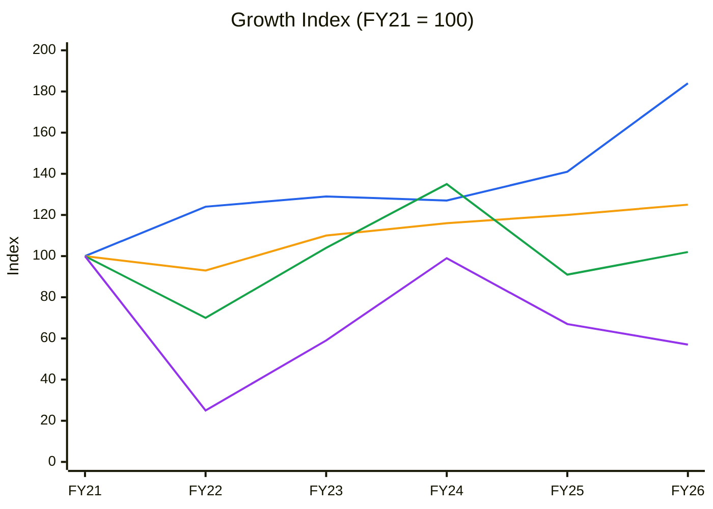
🟦 Revenue (CAGR 13.0%) · 🟧 Tangible PPE gross block (4.6%) · 🟩 EBITDA (0.4%) · 🟪 PAT (–10.6%). Base FY21 because FY20 PAT (₹2 Cr) is too small a base. Source: tables in Modules 5 and 10.

**Read:** Since FY21, revenue is up 84% (index 184) and the gross block is up 25%, but EBITDA is flat (index 102) and PAT has almost halved (index 57).

**Business inference:** Asset turnover rose because feedstock inflation pushed up the rupee price of each tonne, not because more tonnes were sold. None of that "growth" reached profit, which is how a pass-through converter with no pricing power behaves. Revenue growth is not a valid input to the valuation; the spread is (→ Module 10A uses rupee gross profit, not revenue, as the anchor).

*Order book tracking: not applicable. ASL's revenue is spot/contract product supply to FMCG customers with no disclosed order book, and the BSE harvest of 164 filings (Jan-2024 to Oct-2026) contains no Reg 30 "Award/Receipt of Order" filings.*

---

## Module 1 — Broad Market Cycle (Marks)
| Input | Reading | Source |
|---|---|---|
| Nifty 50 | 22,520 (9-Oct-2026), –12.4% YoY, 52-wk range 22,180–26,373 | Yahoo ^NSEI weekly |
| Nifty 30-wk MA | 23,718 and declining (–0.7% in 4 weeks); index below it | computed |
| Nifty stage | **Stage 4** | Module 9 |
| India VIX | Rising | user-supplied context, 9-Oct-2026 |

**Assessment: Cautious → Fearful.** The pendulum has swung toward fear. That would normally argue for larger positions in *quality* names; it does not rescue a sub-WACC business. **Sizing implication:** a Stage-4 market fails CANSLIM "M"; no new longs in weak-quality names.

## Module 1b — Sector Cycle: Tailwinds & Headwinds
**Secular vs cyclical decomposition.** FY26 revenue was +30%, but standalone gross profit (revenue – materials – inventory change) went from ₹124.8 Cr to ₹136.0 Cr (+9%), and the gross margin % fell to an eight-year low (15.8%). That is consistent with roughly +20pp of the growth being feedstock price pass-through and only high-single-digit underlying value growth. ⚠️ ASL does not disclose tonnage, so the split is an inference from the spread, not a measured volume number. The secular base is India HPC surfactant demand at ~6% CAGR (India surfactants market USD 3,186.5 mn CY2025 → USD 3,374 mn FY2026, Grand View Research as cited in the FY26 AR p.46). **Use 5–7% as the durable growth anchor, not 30%.**

**Input-cost cycle:** C12–C14 fatty alcohol (FOB Malaysia) rose from $3,072/MT (28-Feb-2026) to $3,585/MT (11-Apr-2026), +16.7% (Alchempro trade report), on CPKO strength, Indonesian biodiesel policy and Hormuz-linked freight. By late August, US fatty alcohol was "broadly stable" (ChemAnalyst). The FY26 MD&A describes fatty alcohol staying elevated all year with a brief Q3 correction. **Rising input cost → compress margin assumptions; any Q1FY27 inventory gain reverses when prices plateau.**

**Windfall test (KPI #2, adapted to fatty-alcohol feedstock):**
| Quarter | OPM | ΔOPM QoQ | Feedstock | Peers same quarter |
|---|---|---|---|---|
| Q4FY26 (Mar-26) | 5.15% | –0.96pp | Fatty alcohol rising (Feb–Apr +16.7%) | Galaxy OPM 9% |
| Q1FY27 (Jun-26) | 7.44% | **+2.29pp** | Elevated | **Galaxy 9% → 14%; Standard Surfactants 6.4% → 13.9%** |

The +2.3pp move is below the block's 4pp red-flag line, but it co-moves with feedstock and with two peers. Read it as **partly an inventory gain; do not annualise.** Q1FY27 material margin was 17.9% (computed from the Q1FY27 results: materials ₹229.2 Cr less inventory build ₹5.1 Cr on ₹272.9 Cr revenue), against 14.3% in Q4FY26 and 16.1% in Q1FY26.

**Competitive capacity pipeline:** the MD&A flags "capacity additions in key manufacturing regions, particularly across Asia and the Middle East … may result in pricing pressure" and "gradual absorption of new fatty alcohol capacities" (FY26 AR pp.46, 50). That points to oversupply risk at both the feedstock and the surfactant level. ⚠️ There is no quantified industry capacity/demand series, so **CY5 is not charted** (data gap).

**Geopolitical / FX:** most raw materials are palm derivatives imported from Indonesia/SE Asia (CARE Jun-2024, ESG section), while exports are only 18% of sales. ASL is therefore **net short USD**: INR depreciation raises costs faster than export revenue. Red Sea / Hormuz disruption is a transient cost (freight and insurance), classified **Transient**.

**Sector cycle verdict: Headwind (margin), Neutral (volume).** Primary driver: feedstock inflation plus buyer power. Duration: transient on inventory gains (1–2 quarters), structural on buyer power. → Module 8: no tailwind embedded; MoS widened +5pp.

**Chart CY6 — Revenue vs material spread (gross profit), ₹ Cr**
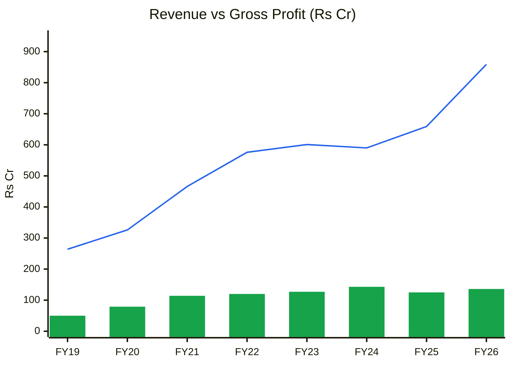
🟦 Revenue · 🟩 Gross profit (revenue – materials – Δinventory, standalone ARs FY20–FY26)

**Read:** Gross profit has sat in a ₹114–143 Cr band since FY21 while revenue rose from ₹466 Cr to ₹859 Cr. FY26 gross margin of 15.8% is the lowest of the 8 years (0th percentile; peak 24.6% in FY21). Rupee gross profit of ₹136 Cr is the second-highest of the 8 years (75th percentile; peak ₹143 Cr in FY24).

**Business inference:** The profit pool per year is roughly fixed and gets diluted as a percentage whenever palm-oil feedstock inflates. ASL earns a conversion fee, not a share of the end-product price. Today's margin is neither "earned" nor "borrowed"; it is mid-cycle in rupees, so there is no trough discount to buy.

## Module 1c — Stock Cycle: Company-Specific Positioning

**Quarterly results (consolidated, ₹ Cr; Screener):**
| Qtr | Q1FY25 | Q2FY25 | Q3FY25 | Q4FY25 | Q1FY26 | Q2FY26 | Q3FY26 | Q4FY26 | Q1FY27 |
|---|---|---|---|---|---|---|---|---|---|
| Revenue | 143.4 | 150.8 | 162.8 | 202.1 | 215.9 | 179.2 | 207.8 | 256.3 | 272.9 |
| EBITDA | 9.6 | 3.7 | 8.9 | 19.7 | 11.6 | 9.3 | 12.7 | 13.2 | 20.3 |
| OPM % | 6.7 | 2.5 | 5.5 | 9.8 | 5.4 | 5.2 | 6.1 | 5.2 | 7.4 |
| PAT | 2.2 | 1.8 | 0.8 | 9.7 | 2.9 | 1.6 | 3.7 | 4.2 | 9.0 |
| Revenue YoY % | –3.6 | 4.9 | 17.3 | 27.4 | 50.5 | 18.8 | 27.7 | 26.8 | 26.4 |
| EBITDA YoY % | –35.0 | –77.1 | –46.9 | 37.3 | 20.9 | 151.1 | 42.7 | –32.9 | 74.5 |

**Chart C2 — Quarterly YoY growth (%)**
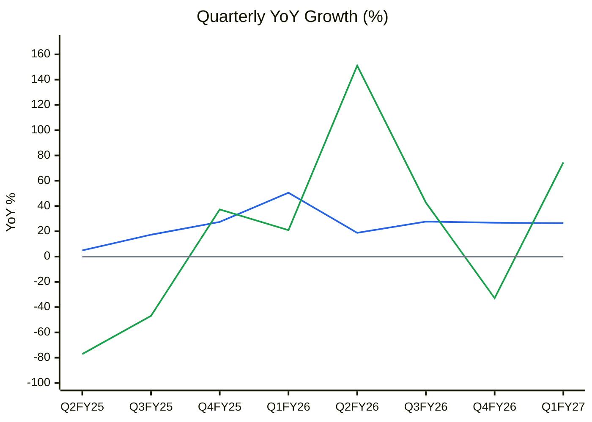
🟦 Revenue YoY % · 🟩 EBITDA YoY % · ⬜ zero line

**Read:** Revenue growth has been steady at +19% to +28% for six quarters (except the +50% spike in Q1FY26). EBITDA growth swings between –77% and +151% with no trend.

**Business inference:** Stable price-led top-line growth on a whipsawing profit line is the signature of feedstock timing, not operating leverage. Quarter-to-quarter EBITDA is inventory accounting, so the "C" in CANSLIM (Q1FY27 EPS +205%) is low-quality evidence.

**Volume / price / mix:** price dominates (Module 1b). Mix shows a weak signal at best: the specialty share is undisclosed ⚠️ and exports fell from 25% (FY24) to 20% (FY25) to 18% (FY26). Of the three drivers, the least durable one (price pass-through) explains most of the CAGR.

**Physical capacity model:** installed 1,32,600 MTPA (Pithampur 82,600 + Silvassa 50,000). Utilisation was 51% in FY22 (after the Silvassa sulphonation fire on 19-Mar-2022) and ">85%" in Q1FY23 (CARE Nov-2022). Current utilisation and tonnage are **not disclosed ⚠️**. Revenue per rupee of gross block hit a record 2.58× in FY26 (5-yr average 2.19×), which is consistent with high utilisation plus inflated prices. CWIP of ₹39.6 Cr (₹28.3 Cr less than one year old) plus ₹25–30 Cr/yr of planned capex (CARE Jun-2024) gives roughly 5% a year of physical headroom. **Capacity ceiling: likely near now; volume growth beyond ~5%/yr needs an unannounced expansion.**

**Operating leverage (FY26):** contribution (gross profit) ₹136 Cr / EBIT ₹29.9 Cr → **DOL 4.5×**. DFL = 29.9 / (29.9 – 12.3) = **1.70×** → **DTL 7.7×**. A 5% drop in the spread cuts EPS by about 38%. **ICR FY26 = 2.4× (< 2.5× flag)**; TTM 2.9×. → +5pp MoS for lender-behaviour risk.

**Management guidance accuracy:** there are no concalls and no quantified guidance in results or presentations; see the WTT ledger in Module 3 (0.44).

**FCF inflection:** none in sight. Base-case FCF is ₹2–5 Cr a year over FY27–29 (Module 10A), because ₹30 Cr+ capex absorbs about 80% of cash earnings.

**Stock cycle classification: Mid-cycle low-return steady state, with a transient inventory-gain upswing in Q1FY27.** TTM OPM of 6.1% vs a 7.6% 7-yr average is –0.8 SD; TTM ROCE ~10.9% is near the 9.9% average. **It is not a trough**, so there is no recovery discount. MoS adjustment: standard + 5pp (sector headwind). Size: 0 (hard stops).

---

## Module 2 — Industry Structure & Capital Cycle
| Force | Assessment | Signal |
|---|---|---|
| New entrants | Moderate. Sulphonation/ethoxylation is not capital-prohibitive; MNC vendor approval takes 1–3 years. Galaxy, BASF, Clariant, Godrej, Stepan, Croda and Dow compete (CARE). | Medium barrier |
| Supplier power | **High.** Palm-kernel-derived fatty alcohol from a few SE Asian oleochemical majors; Indonesia policy-driven | Adverse |
| Buyer power | **Very high.** Top-3 customers 68% (FY24, up from 41% in FY22 and 35% in FY21); HUL/P&G set the price | Adverse |
| Substitutes | Low for function; mild/sulphate-free/bio-surfactants are reshaping the mix | Neutral (opportunity only with R&D) |
| Rivalry | High. Galaxy is ~6× ASL's revenue; new Asian / Middle-East capacity (FY26 MD&A) | Adverse |

**Industry verdict: Unattractive for a sub-scale converter.** Required MoS: high end of the range.

**Capital cycle:** ASL capex/depreciation went from 0.9× (FY24) to 1.1× (FY25) to **2.6× (FY26)**. Galaxy's FY26 investing outflow was ₹366 Cr (incl. treasury investments) vs ₹123 Cr depreciation (~3×), and Standard Surfactants added a new reactor and spray dryer (STDSFAC report, Oct-2026). Industry capex is above depreciation across the listed peer set, so supply is building, not shrinking. ROCE of peers is near or below their own 10-yr averages (Galaxy 14% vs 23–28% in FY16–FY21). **Capital-cycle position: mid-to-late (supply additions under way).** CY8 is not charted (fewer than 3 peers with 10-yr capex data ⚠️).

---

## Module 3 (Skill Module 2) — Business Quality & Moat
| Greenwald barrier | Test | Result |
|---|---|---|
| Supply/cost advantage | Gross margin vs peers over 5–10 yrs | **Fail.** OPM 5–11% vs Galaxy 9–16%; sub-scale |
| Customer captivity | Do customers stay when cheaper options exist? | **Weak.** Approved-vendor stickiness exists, but power sits with the buyer (68% top-3) |
| Local scale | >50% share of a niche | **Fail.** ~3% of the India surfactant market (Module 7) |

**Moat verdict: NONE.** Buffett pricing-power test: **Fail.** Rupee gross profit did not rise in FY26 despite 30% price inflation, and percentage margins compress in every feedstock up-cycle. Market share stability: ⚠️ not measurable (no share data). **Fisher scuttlebutt sources used (2+ beyond IR):** CARE rating rationales (Nov-2022, Jun-2024), Crisil letter (Sep-2026), customs and pollution-board orders (BSE Reg 30), peer reports (Galaxy, Standard Surfactants).

**Fisher 15-point (1–3 each):**
| # | Point | Score | Note |
|---|---|---|---|
| 1 | Market potential | 2 | HPC demand ~6% CAGR |
| 2 | New products | 2 | R&D centre live Feb-2025; specialty push stated |
| 3 | R&D effectiveness | 1 | No disclosed revenue from new products; margins down |
| 4 | Sales organisation | 2 | Wins MNC wallet share, but concentrated |
| 5 | Profit margin | 1 | 1.4% PAT margin |
| 6 | Margin improvement | 1 | OPM 10.5% → 5.5% (FY24 → FY26) |
| 7 | Labour relations | 2 | No disputes disclosed; 393 permanent staff |
| 8 | Executive relations | 2 | Stable MD, new President (Aug-2026) |
| 9 | Management depth | 1 | Thin bench; IDs turning over |
| 10 | Cost / accounting controls | 2 | Clean audit; inventory is the only KAM |
| 11 | Industry advantages | 1 | None |
| 12 | Long-term orientation | 2 | R&D, capex |
| 13 | Dilution | 2 | Rights issue 2023 (+11.8% shares); small ESOPs |
| 14 | Candour in adversity | 1 | FY25 AR claimed return ratios "strengthened" when they fell (Module 3D) |
| 15 | **Integrity** | **2** | **Not a veto, but flagged:** customs order of 24-Sep-2026 confiscating misclassified imports, ₹1.54 Cr penalty on the company, and ₹20 lakh of personal penalties on the MD (incl. s.114AA, false/incorrect declaration). Under appeal to CESTAT |
| | **Total** | **24 / 45** | |

---

## Module 4 (Skill Module 3) — Management & Capital Allocation
**Promoter holding:** 49.84% (Jun-2026) | **Pledge:** 0% of promoter holding → **Normal**
**Pledge trend:** none ever disclosed | **Share count:** 75.8 lakh (FY22) → 84.7 lakh (FY26) after the ₹49.5 Cr rights issue (2023) → diluting once, now stable
**FCF/share vs EPS (FY21→FY26):** cumulative FCF FY21–FY26 = ₹49 Cr (≈ ₹10/share/yr) vs EPS falling from ₹25.45 to ₹14.58 (–10.5% CAGR). Neither compounds.
**Capital allocation rating: Poor-to-Average.** Rights equity (2023) was used to deleverage, which was sensible. Growth capex since then earns an incremental ROIC of 6–9% vs a 12.8% WACC (Module 10A). There were no buybacks or acquisitions. The new US marketing subsidiary (Precision Ingredients USA Inc., incorporated 27-Aug-2026, $10k capital) is immaterial.
**RPTs (FY26 AR Note 37):** small. Sales to Aarti USA Inc. ₹0.53 Cr, purchases from Aarti Drugs/Valiant/Aarti Pharmalabs ₹0.09 Cr, rent to promoters ₹0.23 Cr, reimbursement to Aarti Industries ₹0.12 Cr. **No ICDs to the group.** ✅
**Remuneration:** KMP remuneration ₹2.68 Cr = **21% of FY26 PAT**. MD Nikhil Desai at 38.81× the ₹3.69 lakh median ≈ ₹1.43 Cr = **11.3% of PAT** (> 10% flag), up 7% in a year PAT fell 15%.
**Buffett's Three C's:** Candour — Low (no concalls, boilerplate MD&A, the FY25 "strengthened return ratios" claim, a "Rating Upgrade" slide that actually shows a change of agency). Competence — Low (ROCE < WACC 7/7 years). Caring — Moderate (token dividend, modest pay, small RPTs).

**Board/governance events (2025–26, BSE):** Independent director Nisha Shah was appointed 1-Oct-2025 and resigned 11-Sep-2026 ("time commitments"; letter confirms no other reason). Prof. Vandana Patravale was appointed ID on 22-Aug-2026. The MD and the ED were re-appointed in Aug-2026 for five years starting Aug-2027, a year early. The MOA object clause was broadened (Oct-2026). Separately, a ₹17.4 lakh pollution-board environmental compensation order was issued for the Silvassa plant (15-Jun-2026).

**Credit rating path:** CARE A– (Jun-2024 upgrade) → **CARE BBB+ (Dec-2025 downgrade, "subdued margins in H1FY26")**. The company asked CARE to reconsider and CARE refused (18-Dec-2025). → **Crisil A–/Stable (3-Sep-2026, new agency).** Moving to a new agency one notch higher, nine months after a contested downgrade, is a **rating-shopping watch item**.

### Walk the Talk Scorecard
*There are no earnings concalls (none in 164 BSE filings Jan-2024 to Oct-2026). The guidance points below are management statements reported in CARE rationales ("as per the management") and in annual reports.*
| Guided (source) | Statement | Guided | Actual | Verdict |
|---|---|---|---|---|
| Aug/Nov-2022 (CARE, per mgmt) | Silvassa sulphonation restored "approximately in a year" | ~FY24 | Not disclosed in any later AR/filing | ⚠️ Unverifiable (not scored) |
| Aug/Nov-2022 (CARE, per mgmt) | "No concrete plan with regards to capex in upcoming years" | ~nil capex | Capex ₹11/16/20/45 Cr FY23–FY26; ₹25–30 Cr/yr plan by Jun-2024 | 🔴 Reversal |
| Jun-2024 (CARE, mgmt plan) | Capex ₹25–30 Cr p.a. for 3 yrs | ₹25–30 Cr | FY25 ₹20 Cr, FY26 ₹45 Cr (avg ₹32.5 Cr, +8% vs top of range) | ⚠️ Near miss |
| Jun-2024 (CARE, mgmt plan) | Capex "funded entirely from internal accruals" | No new debt | New ₹18 Cr term loan drawn FY26 (AR note 14.1) | ❌ Miss |
| Jun-2024 (CARE expectation on mgmt projections) | Revenue growth 10–15% p.a. for 2 yrs | +10–15% | FY25 +11.7%, FY26 +30.4% | ✅ Hit (price-led) |
| Jun-2024 (CARE, same) | PBILDT margin "sustaining above 10%" | >10% | FY25 7.6%, FY26 5.5% | ❌ Miss |
| Jun-2024 (CARE) / FY24 AR | "Focus on increasing export market share" | Export share ↑ | 25% (FY24) → 20% → 18% (FY26) | ❌ Miss |
| FY24 AR / Feb-2025 filing | R&D centre operational | FY25 | Operational 8-Feb-2025 | ✅ Hit |
| FY26 AR outlook (Sep-2026) | FY27 "cautiously optimistic, gradual recovery" | Recovery | Q1FY27 revenue +26%, OPM 7.4% | ✅ Hit (1 quarter) |
| *Candour check* (FY25 AR) | "disciplined capital allocation further strengthened our return ratios and operational cash flows" | — | ROCE 17.4% → 11.5% and ROE 11.5% → 6.6% (company's own figures); OCF ₹52 → ₹11 Cr | 🔴 Misstatement (not scored; O'Glove reframing flag) |

**WTT Score: 0.44 / 1.00 — LOW.** (3 hits + 1 near miss × 0.5) / 8 scored points.
**Guidance points assessed:** 8 scored (+1 unverifiable) | Hits: 3 | Near Misses: 1 | Misses: 3 | Reversals: 1
**Key pattern:** **optimism bias on margins and funding**, plus **selective disclosure** (no tonnage, utilisation or specialty mix; no concalls). Margin targets missed by 2.5–4.5pp.
**Insider action:** no open-market promoter buys or sells in 2024–26. The only SAST filing was an inter-se transfer of 2.5 lakh shares to Nikhil Holdings Pvt Ltd (Sep-2024). Promoter stake moved within 49.81–49.92%. → **NEUTRAL.**
**DCF impact:** guidance not used. Bottom-up model only; margin assumptions held at or below the 7-yr average.
**Overall management credibility: LOW.**

---

## Module 5 (Skill Module 4) — Financial Forensics
**Indian-specific flags:**
| Check | Reading | Verdict |
|---|---|---|
| Promoter pledge | 0% | ✅ |
| ICDs / guarantees to group | None (AR Note 37) | ✅ |
| RPT sales/purchases | ~₹0.6 Cr (<0.1% of revenue) | ✅ |
| Auditor | Gokhale & Sathe, re-appointed for a 2nd term to 2029; unmodified opinion; KAM = inventory valuation (₹118.6 Cr, 23% of assets) | ✅ |
| Regulatory orders | Customs misclassification (₹37 Cr of goods held liable to confiscation; ~₹3.5 Cr duty + fine + penalties; MD personally penalised); pollution compensation ₹0.17 Cr | ⚠️ Governance flag |
| Contingent liabilities | ₹11.7 Cr (customs ₹8.96 Cr incl. ₹2.25 Cr paid; sales tax; stamp duty) = 4.7% of net worth | ✅ Moderate |
| Board churn | ID tenure 11 months; early MD re-appointment | ⚠️ Watch |
| Rating agency switch | CARE BBB+ (downgrade, contested) → Crisil A– | ⚠️ Watch |

**Quantitative models (FY26 vs FY25, standalone AR):**
| Model | Components | Result | Verdict |
|---|---|---|---|
| Beneish M | DSRI 1.05, GMI 1.20, AQI 1.20 (CWIP in PPE; 2.02 if CWIP is treated as "soft"), SGI 1.30, DEPI 0.97, SGAI 0.83, LVGI 1.04, TATA –0.124 | **–2.55** (–2.22 with ex-CWIP AQI) | Unlikely manipulator. The boundary reading comes only from CWIP build and sales inflation |
| Altman Z'' | X1 0.123, X2 0.366, X3 0.058, X4 0.909 | **3.34** | Safe |
| Piotroski F | ROA>0 ✓, CFO>0 ✓, ΔROA ✗, CFO>NI ✓, debt/TA ↓ ✓, current ratio ↓ ✗, new shares (ESOP) ✗, GM ↓ ✗, AT ↑ ✓ | **5 / 9** | Average |
| Sloan accrual | (12.3 – 77 + 46) / avg TA 497 | **–3.8%** | Acceptable (cash-backed) |

**Schilit screen:** DSO 42 → 44 days (flat). Other income/EBIT 24% in FY25 is a one-off ₹4.2 Cr exceptional gain (fire-insurance-type), not recurring. Capex/depreciation 2.6× in FY26 is backed by CWIP. DPO rose 44 → 55 → 63 → 62 days (FY23 → FY26) as supplier credit stretched alongside RM inflation; trade payables went from ₹92 Cr to ₹122 Cr. This flatters FY26 CFO (₹77 Cr, 172% of OP). **About ₹30 Cr of FY26 CFO came from payables and ₹16 Cr from an inventory release; neither is repeatable.**

**Forensic red-flag count: 2 / 15** (DPO stretch; capex/depreciation > 2.5×) → below the 3-flag deep-dive threshold.
**Overall forensic verdict: Clean accounting with governance watch items.** As in July, the problem is economics, not accounting.

---

## Module 6 (Skill Module 5) — Earnings Quality & Financial Statements

**10-year financial table (consolidated, ₹ Cr; Screener · FY19 standalone · gross margin from standalone ARs):**
| Year | Revenue | Gross margin % | EBITDA | OPM % | EBIT | Interest | PAT | EPS ₹ | Equity | Debt | Tangible PPE gross block | CFO | CFI | ROCE % (avg CE) | ROE % (avg eq.) |
|---|---|---|---|---|---|---|---|---|---|---|---|---|---|---|---|
| FY19 | 264 | 19.1 | 5 | 2.0 | –4 | 2 | –6 | n/a | 136 | 97 | 196.7 | –13 | –28 | n/a | n/a |
| FY20 | 326 | 24.1 | 24 | 7.4 | 13 | 10 | 2.1 | 2.46 | 111 | 109 | 218.9 | 18 | –2 | 5.7 | 1.7 |
| FY21 | 466 | 24.6 | 46 | 9.9 | 33 | 10 | 21.6 | 25.45 | 133 | 152 | 265.7 | 36 | –60 | 13.1 | 17.7 |
| FY22 | 576 | 20.8 | 32 | 5.6 | 20 | 11 | 5.5 | 6.46 | 136 | 162 | 245.8 | 23 | –23 | 6.9 | 4.1 |
| FY23 | 601 | 21.1 | 48 | 8.0 | 33 | 15 | 12.7 | 14.94 | 168 | 149 | 292.6 | 25 | –11 | 10.7 | 8.3 |
| FY24 | 590 | 24.3 | 62 | 10.5 | 46 | 14 | 21.4 | 25.22 | 218 | 99 | 308.1 | 52 | –16 | 14.5 | 11.1 |
| FY25 | 659 | 18.9 | 42 | 6.4 | 33 | 12 | 14.5 | 17.19 | 232 | 110 | 319.9 | 11 | –16 | 10.0 | 6.5 |
| FY26 | 859 | 15.8 | 47 | 5.5 | 29 | 12 | 12.3 | 14.58 | 244 | 104 | 333.4 | 77 | –46 | 8.4 | 5.2 |
| TTM (Jun-26) | 916 | — | 56 | 6.1 | 38 | 13 | 18.4 | 21.73 | — | — | — | — | — | ~10.9 | ~7.4 |

*Only seven full years exist (listed 2020; FY19 is the first demerged year). FY22 gross block fell after the Silvassa fire write-off of ₹27.3 Cr. EBIT = PBT + interest. 7-yr averages (FY20–26): OPM 7.6% (SD 1.85), EBIT margin 5.2%, ROCE 9.9% (SD 2.9).*

**ROIC (post-tax, ≈ ROCE × 0.73):** FY26 6.1% | 7-yr average 7.2% | **WACC 12.8%** (Ke = 7% + 1.1 × 6% + 0.5% small-cap = 14.1%; Kd post-tax 6.75%; D/V 18% at market) → **spread –6.7pp; value-destroying in all 7 years.** ROIC trend over 3 years: declining (10.6% → 7.3% → 6.1%). Driver: margin (EBIT margin 7.8% → 3.4%), partly offset by price-driven asset turns. **Economic profit: negative every year** (FY26 ≈ –₹23 Cr on ~₹345 Cr invested).

**Chart C4 — Margin trend (%)**
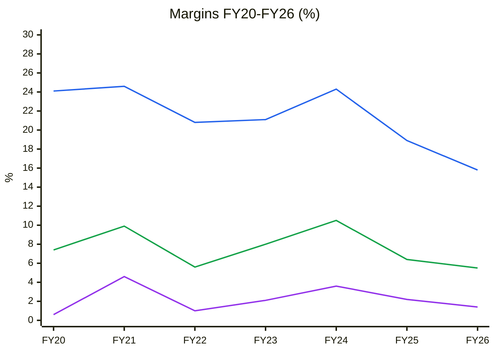
🟦 Gross margin (standalone) · 🟩 EBITDA margin · 🟪 PAT margin

**Read:** Gross margin fell from a 24–25% peak (FY21/FY24) to 15.8% in FY26. EBITDA margin swings between 5.5% and 10.5% with no upward trend, and PAT margin has never exceeded 4.6%.

**Business inference:** Margins fall whenever palm-oil feedstock rises (FY22, FY25–26) and recover only when it falls (FY24). ASL is a lagged pass-through with no pricing power, so the moat test fails (Module 3) and any valuation must use a through-cycle margin of ~7.5% EBITDA, not the latest quarter.

**Chart C5 — ROCE vs WACC (%)**
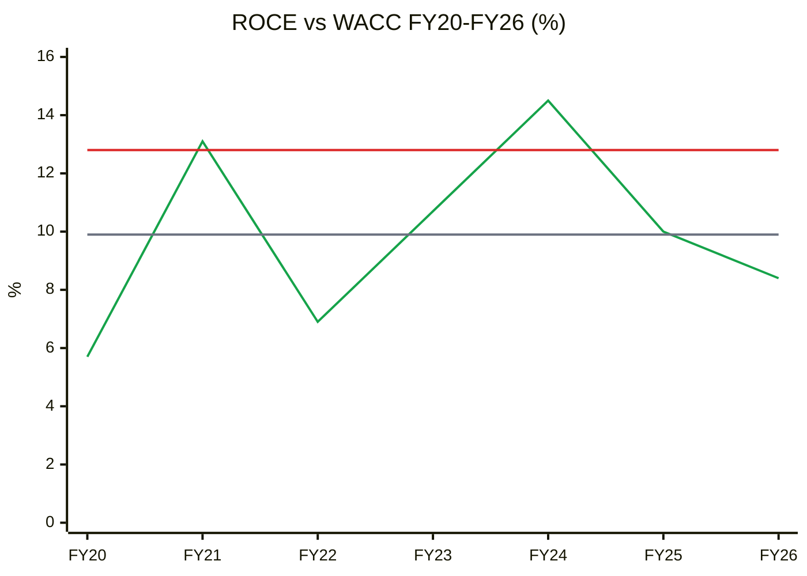
🟩 ROCE (pre-tax, avg capital employed) · 🟥 WACC 12.8% · ⬜ 7-yr average ROCE 9.9%

**Read:** Pre-tax ROCE beat the 12.8% WACC only in FY21 (13.1%) and FY24 (14.5%). Post-tax ROIC has been below WACC in all 7 years; FY26 is 8.4% pre-tax, 6.1% post-tax.

**Business inference:** Every rupee retained since listing has earned less than shareholders could get elsewhere at similar risk. This is the "ROIC < WACC for 5+ years with no turnaround thesis" hard stop, and nothing in Q1FY27 (one quarter of feedstock gain) qualifies as a turnaround.

**Chart CY7 — EBITDA margin through the cycle (%)**
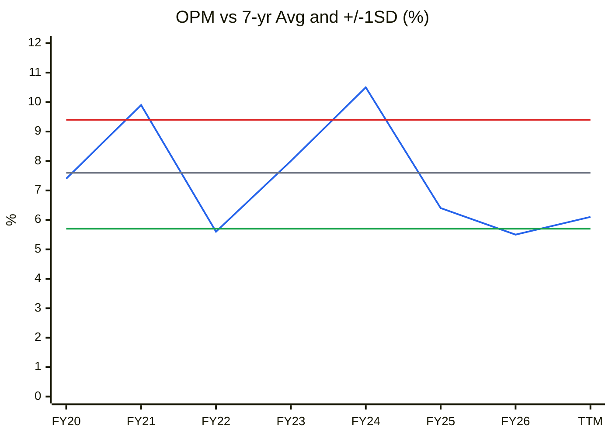
🟦 EBITDA margin · ⬜ 7-yr average 7.6% · 🟥 +1SD 9.4% · 🟩 –1SD 5.7%

**Read:** FY26 OPM of 5.5% sat just below –1SD (–1.1 SD; the lowest of the 7 years). TTM 6.1% is –0.8 SD, and Q1FY27 7.4% is at the average. The two peaks (FY21, FY24) both cleared +1SD.

**Business inference:** On margins the business is at lower-mid cycle, not a deep trough. The upswing the market is pricing is a return to roughly the average, which is mostly done already, so there is little "cycle recovery" left to buy. Separately, ROCE of 8.4% (FY26) vs its 9.9% average is –0.5 SD.

**Earnings quality — cumulative PAT vs CFO (₹ Cr):**
| | FY20 | FY21 | FY22 | FY23 | FY24 | FY25 | FY26 |
|---|---|---|---|---|---|---|---|
| Cumulative PAT | 2.1 | 23.7 | 29.2 | 41.9 | 63.2 | 77.8 | 90.1 |
| Cumulative CFO | 18 | 54 | 77 | 102 | 154 | 165 | 242 |

**Chart C7 — Cumulative PAT vs CFO (₹ Cr)**
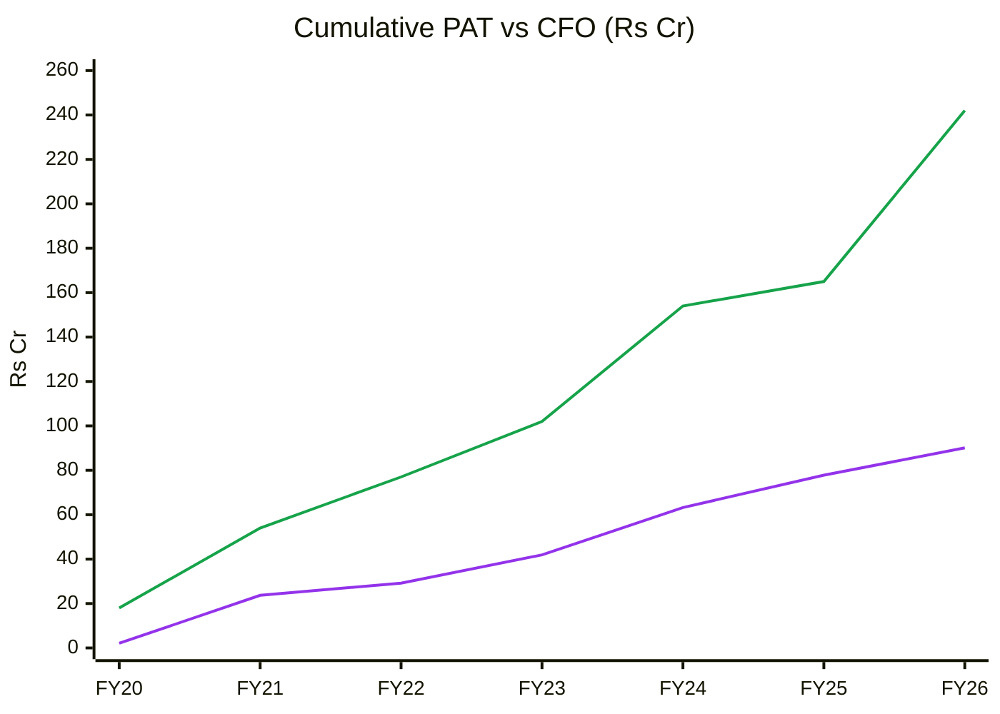
🟪 Cumulative PAT · 🟩 Cumulative CFO

**Read:** Cumulative CFO of ₹242 Cr is 2.7× cumulative PAT of ₹90 Cr (≥ 0.9 is healthy). The FY26 jump of ₹77 Cr was helped by about ₹30 Cr of payables stretch.

**Business inference:** Reported profits are real cash. The gap is mostly depreciation (₹11–18 Cr a year) on a capital-heavy base. Cash conversion is not the problem; the problem is that ₹174 Cr of cumulative investing outflow (FY20–26) produced flat EBITDA, so the cash went into assets that earn below WACC.

**OCF / Net income (5-yr, FY22–26):** 2.8× → quality **High** (cash-backed). **O'Glove red flags: 2 / 15.** **Key accounting concern:** FY26 CFO flattered by payables; inventory valuation is the only KAM.
**Ind AS 116:** ROU assets ₹1.1 Cr and lease liabilities ₹1.3 Cr are immaterial; no EBITDA adjustment needed.

### DuPont Decomposition (5-Factor, average balances, consolidated)
| Year | EBIT Margin | Asset Turnover | Equity Multiplier | Interest Burden | Tax Burden | **ROE** |
|---|---|---|---|---|---|---|
| FY22 | 3.5% | 1.46× | 2.93× | 0.45 | 0.61 | **4.1%** |
| FY23 | 5.5% | 1.49× | 2.65× | 0.55 | 0.70 | **8.3%** |
| FY24 | 7.8% | 1.43× | 2.14× | 0.70 | 0.67 | **11.1%** |
| FY25 | 5.0% | 1.47× | 2.00× | 0.64 | 0.69 | **6.5%** |
| FY26 | 3.4% | 1.73× | 2.09× | 0.59 | 0.73 | **5.2%** |
| **Change FY24→FY26** | –4.4pp | +0.30× | –0.05× | –0.11 | +0.06 | **–5.9pp** |

**Operating contribution (EBIT margin × AT):** 11.2% (FY24) → 5.9% (FY26), **declining**. **Financing contribution (IB × EM):** 1.50 → 1.23, falling as debt fell after the rights issue.
**DuPont verdict:** the ROE decline is **purely operational**. The margin collapse is only partly offset by price-inflated asset turns, and leverage is *not* masking it (EM is flat at ~2.0–2.1×).
**AT trend → Module 10A:** revenue/gross block 2.58× (FY26) vs 5-yr average 2.19× is **rising, but price-driven, not structural**. Base case uses the current AT on the incremental block only, with no step-up; bear case reverts to the average.
**Peer DuPont (FY26):** Galaxy ROE ~10.5% from EBIT margin ~6.9%, AT ~1.4× and EM ~1.4× (net cash). Its ROE quality is higher (margin-led, not leverage-led), which supports its ~2× P/B premium over ASL.

---

## Module 7 (Skill Module 6) — Industry KPIs & Peer Analysis
**Sector:** Commodity Surfactants (KPI block line 2467).
| KPI | ASL | Healthy range (block) | Assessment |
|---|---|---|---|
| Manufacturing EBIT margin (single segment) | 3.4% FY26; 5.2% 7-yr avg | 5–9% through cycle | **Below / low end** |
| Windfall test (ΔOPM vs feedstock) | +2.3pp QoQ in Q1FY27, co-moving with fatty alcohol and peers | < 2–3pp | **Borderline**; treat as partial inventory gain |
| Specialty mix % | Not disclosed | > 25% | ⚠️ Red-flag by omission |
| Capacity utilisation | Not disclosed since Q1FY23 (>85%) | > 75% | ⚠️ |
| Cash conversion cycle | 43 days (FY26), 71 (FY25) | < 45 days | In line (payables-assisted) |
| RPT intensity | < 0.1% of revenue | < 10% | ✅ |
| Net debt / EBITDA | 91 / 47 = 1.9× (FY26); 1.6× TTM | < 2.5× | ✅ |
| OCF / PAT (7-yr cumulative) | 2.7× | > 0.8 | ✅ |

**Peer comparison (Screener, Oct-2026; STDSFAC from the 6-Oct-2026 report):**
| Metric | Aarti Surfactants | Galaxy Surfactants | Standard Surfactants |
|---|---|---|---|
| Revenue 3-yr CAGR (FY23→FY26) | 12.6% | 5.5% | n/a (≈19%/yr over 10 yrs) |
| OPM FY26 / Q1FY27 | 5.5% / 7.4% | 8.9% / 14% | 3.8% / 13.9% |
| ROCE (latest) | 8.5% | 13.5% | 10.3% |
| Net D/E | 0.37× | Net cash | ~2× |
| P/E (TTM) | 22.3× | 24.4× | n/m |
| P/B | 1.68× | 3.2× (₹2,502 / ₹774) | 5.35× |
| Institutional holding | 0.08% | ~17% | ~0% |

**Peer positioning:** ASL trades at a **P/B discount** to both peers. That is **justified against Galaxy** (Galaxy's ROCE is ~5pp higher, it is net cash, it has specialty depth and its ROE is margin-led). It is **not a bargain against its own economics**: justified P/B = (ROE – g) / (Ke – g) = (7% – 5%) / (14.1% – 5%) ≈ **0.2–0.3×** on through-cycle ROE. The market is already paying for a margin recovery. Standard Surfactants at 5.35× P/B is the outlier (windfall pricing). **Sector-appropriate multiple:** 1.0–1.5× P/B or 6–9× EV/normalised EBITDA (KPI block).
**Promoter capital-structure adjustment:** none needed (no ICDs or guarantees to the group).

**Order Book Tracker:** *not applicable. There is no disclosed order book and no Reg 30 order filings; revenue is product supply to FMCG customers.*

---

## Module 8 (Skill Module 7) — Market Size & Market Share
**TAM:** India surfactants market USD 3,374 mn in FY2026 (Grand View Research, cited in FY26 AR p.46), ≈ ₹29,000 Cr at an assumed ₹87/USD ⚠️. **TAM growth:** ~6.2% CAGR (same source). The AR's own projection of USD 5,157 mn "by 2027" is internally inconsistent with a 6.2% CAGR (it would be +53% in a year), so it is ignored ⚠️.
**Company penetration:** ₹859 Cr / ~₹29,000 Cr ≈ **3%**.
**Market share trend:** ⚠️ no independent share data. ASL's revenue grew 12.6% a year (FY23–26) vs ~6% for the market, but its rupee gross profit grew only ~2% a year (₹127 Cr → ₹136 Cr). That points to price inflation, not share gain.
**Share-gain driver:** wallet share at existing MNC customers, which is temporary and buyer-controlled. Top-3 concentration rose from 41% to 68% (FY22 → FY24).
**Verdict:** **Growing with the market in value terms; share in tonnes unknown.** Rising dependence on three buyers is a risk, not a moat.

---

## Module 9 (Skill Module 8) — Valuation: PIE First, Then DCF

### 9A. Price-Implied Expectations (reverse DCF)
Inputs: EV ₹501 Cr (market cap ₹410 Cr + FY26 net debt ₹91 Cr), TTM revenue ₹916 Cr, WACC 12.8%, terminal growth 5% with RONIC = WACC, sales-to-capital 2.5× (actual TTM ≈ 2.7×). Quick check: g = (EV × WACC – NOPAT₀) / (EV + NOPAT₀) = (501 × 0.128 – 27.7) / 528.7 ≈ **6.8%** perpetual NOPAT growth from a ₹27.7 Cr TTM NOPAT.

**The key finding:** at any NOPAT margin ≤ 4.5% (EBIT ≤ 6.2%), **no growth rate justifies the price**. Incremental ROIC (margin × 2.5) stays below WACC, so faster growth *lowers* value. The two-stage solver hits its 60% CAGR ceiling without reaching ₹501 Cr. The price only clears through a margin step-up:

| PIE value driver | Market-implied | My base case | Expectations gap |
|---|---|---|---|
| Revenue CAGR (5-yr, then fade to 5%) | 5–7% (any value; margin is the binding driver) | ~4.6% (TTM → FY29 ₹1,050 Cr) | ≈ 0 |
| **EBIT margin (steady-state)** | **~8.3%** (NOPAT 6.0%) at 7% growth; ~8.5% at 5%; ~9.2% at 0% | **5.2%** (7-yr avg); 6.0% EBITDA–D&A path ≈ 4.0% | **–3pp to –4pp (optimistic)** |
| Investment rate (Δcapital / ΔRevenue) | 40% (s2c 2.5×) | 40% | 0 |
| Implied incremental ROIC | ~15% | 6–9% | **–6 to –9pp** |

**Gap classification: OPTIMISTIC.** The market needs an EBIT margin **above the company's best-ever year** (FY24: 7.8%) held for a decade, versus a 5.2% 7-yr average and 3.4% in FY26.
**Physical plausibility:** volume is not the constraint the market is betting on. Capacity (1,32,600 MTPA) plus CWIP of ₹40 Cr supports about 5% a year of physical growth (Module 10A capex-model CAGR 4.4% at constant prices). The bet is on **spread**, which buyer power (68% top-3) has capped for seven years. **This is not "unannounced expansion pricing"; it is "unannounced pricing-power pricing."**
**Expectations treadmill:** to beat the PIE, ASL must hold EBITDA margin ≥ ~10.5% (EBIT ≥ 8.3%) after feedstock prices plateau. It has reached that in 1 of 7 years (FY24, 10.5%) and held it for zero consecutive years.
**Positive triggers:** (1) Q2/Q3FY27 OPM ≥ 9% while fatty-alcohol prices are flat or falling (would show spread, not inventory); (2) disclosure of specialty revenue ≥ 25% with a margin split; (3) export share recovering above 25%.
**Negative triggers:** (1) OPM back to 5–6% as the Q1FY27 inventory gain reverses; (2) loss of wallet share at HUL/P&G (68% concentration); (3) adverse CESTAT outcome or further regulatory orders.
**SVAR (bear case ₹274):** (484 – 274) / 484 = **43% → > 40%: asymmetry unfavourable.**

### 9B. Intrinsic Value — Own Models
**DCF (3-stage, FCFF):** base = revenue CAGR 7% for 5 yrs fading to 5%, NOPAT margin 3.3% (EBIT 4.5%), s2c 2.5×, WACC 12.8% → EV ₹198 Cr → **₹126/share**. Bear (3%, 2.5%) → **₹68**. Bull (10%, 4.5%) → **₹285**.
**EPV (Klarman/Greenwald, no growth):** normalised EBIT ₹29 / ₹36 / ₹46 Cr (FY26 / ~7-yr average / FY24 peak) × 0.73 / 12.8% – net debt ₹91 Cr → **₹88 / ₹136 / ₹203.**
**Residual income cross-check:** ROE (5–7%) < Ke (14.1%) → value below book (₹289). The 1.68× P/B is a quality premium the returns do not support.
**Relative (sector multiples):** EV/EBITDA 6× / 7.5× / 9× on EBITDA ₹47 / ₹56 / ₹65 Cr → **₹225 / ₹388 / ₹583**; P/B 0.9× / 1.2× / 1.6× → **₹259 / ₹346 / ₹461**.

| Method | Bear | Base | Bull |
|---|---|---|---|
| DCF (FCFF, 3-stage) | ₹68 | ₹126 | ₹285 |
| Relative (EV/EBITDA & P/B average) | ₹242 | ₹367 | ₹522 |
| EPV (Klarman) | ₹88 | ₹136 | ₹203 |
| **Consensus range** (relative weighted 50%, DCF 25%, EPV 25%) | **₹160** | **₹249** | **₹383** |
| Scenario EV (Module 11, 3-yr, market multiples) | ₹274 | ₹433 | ₹837 |

**Current market price:** ₹483.75. **Margin of safety (base consensus ₹249):** **–94%** (price is 1.9× base value) → **Inadequate**. Even against the more generous market-multiple base target of ₹433, MoS is –12%.
**Upside/downside ratio:** probability-weighted **0.80 : 1** (raw bull/bear 1.69 : 1) → **Unacceptable (hard stop < 1.5 : 1)**.
**Reverse-DCF implied:** EBIT margin ~8.3% at 5–7% growth → **Aggressive.**
**Graham number:** √(22.5 × 5-yr normalised EPS ₹15.7 (FY22–26 avg) × BVPS ₹289) = **₹319.** Graham defensive screen: 1 of 7 criteria (P/B ≤ 3 ✓). Fails on revenue < ₹2,000 Cr, current ratio 1.32, a loss in FY19, a dividend gap, EPS growth, and P/E ≤ 20.
**Misprice reason:** none in the investor's favour. If anything the stock is *over*-priced after a windfall quarter and a 20%+ rally on low liquidity.
**Catalyst:** none identified that would close the gap upward within 2–3 years.

**P/E and P/B history (fiscal year-end price ÷ consolidated EPS/BVPS; prices from Yahoo monthly, last trading day of March):**
| | FY21 | FY22 | FY23 | FY24 | FY25 | FY26 | Now (Oct-26) |
|---|---|---|---|---|---|---|---|
| Price ₹ | 916.9 | 739.3 | 453.7 | 552.7 | 400.7 | 321.1 | 483.75 |
| EPS ₹ | 25.45 | 6.46 | 14.94 | 25.22 | 17.19 | 14.58 | 21.73 (TTM) |
| P/E × | 36.0 | 114.4 | 30.4 | 21.9 | 23.3 | 22.0 | 22.3 |
| BVPS ₹ | 175 | 179 | 198 | 258 | 274 | 288 | 289 |
| P/B × | 5.2 | 4.1 | 2.3 | 2.1 | 1.5 | 1.1 | 1.68 |
| ROE % | 17.7 | 4.1 | 8.3 | 11.1 | 6.5 | 5.2 | ~7.4 (TTM) |
*Only six fiscal year-ends exist (listed 2020; Yahoo history starts Aug-2020) ⚠️. FY23 BVPS includes partly-paid rights shares.*

**Chart CY1 — P/E band (×)**
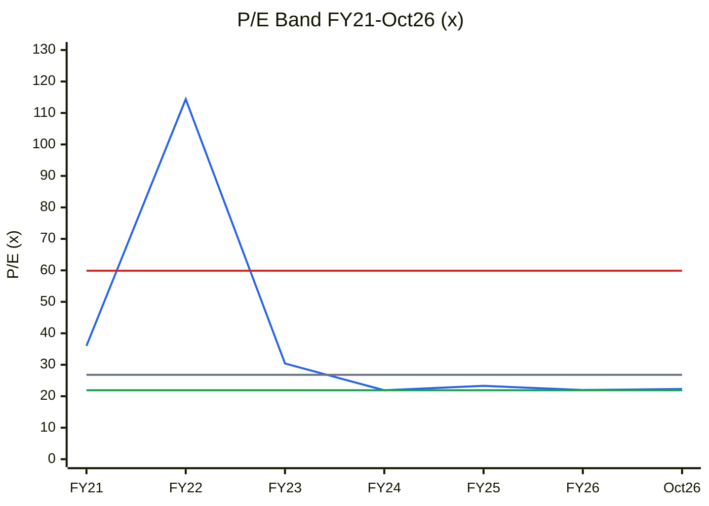
🟦 P/E · ⬜ Median 26.8× · 🟥 +1SD 59.9× · 🟩 period low 21.9× (–1SD is negative because of the FY22 outlier, so the period low is used as the floor line)

**Read:** P/E of 22.3× is at the 33rd percentile of six year-ends, below the 26.8× median and just above the 21.9× low. FY22's 114× reflects trough EPS of ₹6.46.

**Business inference:** For a cyclical converter, a "below-median" P/E on a TTM EPS that already includes a feedstock-gain quarter is not cheap. On normalised EPS (~₹15–17) the multiple is 28–32×, above the median. Read this with C4: this is the double-peak risk the cyclical P/E rule warns about.

**Chart CY2 — P/B band (×)**
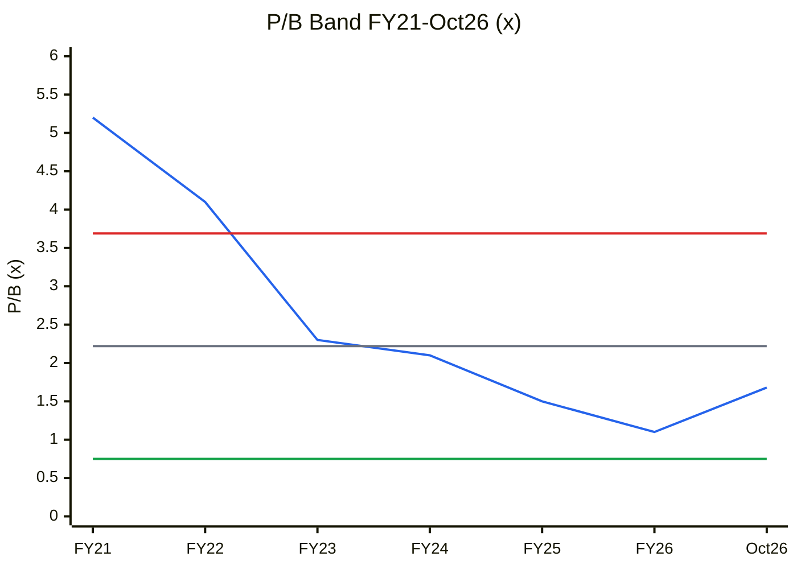
🟦 P/B · ⬜ Median 2.22× · 🟥 +1SD 3.69× · 🟩 –1SD 0.75×

**Read:** P/B of 1.68× is at the 33rd percentile, below the 2.22× median but 50% above the FY26 low of 1.1×. Current TTM ROE (~7.4%) is below its FY21–FY26 average of 8.8%.

**Business inference:** The de-rating from 5.2× to 1.1× over FY21–26 was the market learning that this book earns 5–8%. The rebound to 1.68× prices a return to FY24-type ROE (11%) that has happened once. On a justified-P/B basis (ROE < Ke), the stock should trade below book, not above it.

**ROE vs cost of equity (%)**
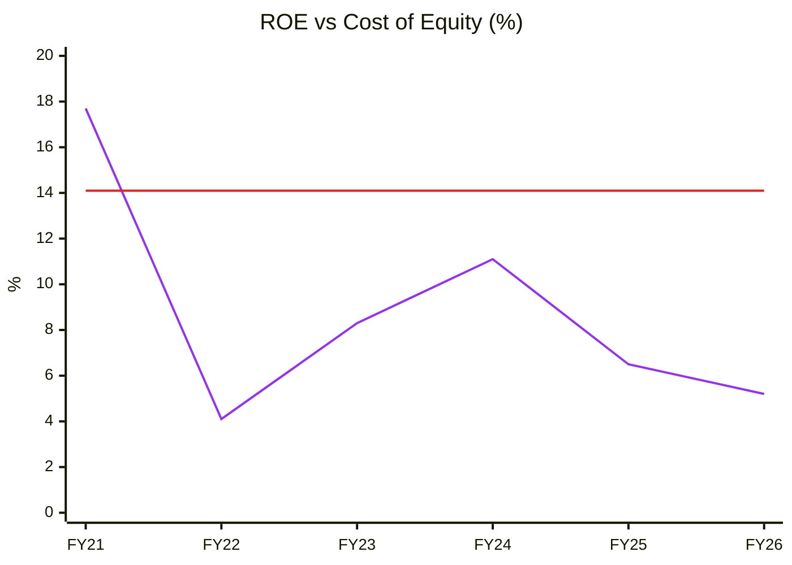
🟪 ROE (average equity) · 🟥 Cost of equity 14.1%

**Read:** ROE beat the 14.1% cost of equity only in FY21 (17.7%); the FY22–FY26 average is 7.0%.

**Business inference:** Equity holders have been under-compensated in five straight years. A P/B above 1× needs a reason to expect ROE above 14%, and none is visible.

**Chart CY4 — Price vs EPS index (FY21 = 100)**
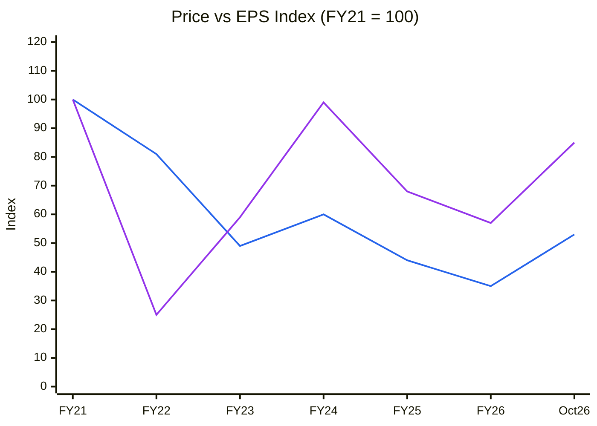
🟦 Share price index (Mar-end; Oct26 = ₹483.75) · 🟪 EPS index (Oct26 = TTM ₹21.73)

**Read:** Price is down 47% since FY21 and TTM EPS is down 15%. Price fell more than earnings through FY26 (index 35 vs 57) and has since bounced to 53 on a TTM EPS index of 85.

**Business inference:** The FY21 starting point was a re-rating bubble (36× P/E) that has fully unwound. The October bounce is earnings-led, but the earnings are one feedstock-assisted quarter. If Q2–Q3FY27 normalise, EPS falls back toward the 57 index, and the price has already moved ahead of it.

### Cycle Position Dashboard
| Dimension | Current | Median / avg (FY20/21–26) | Percentile | Signal |
|---|---|---|---|---|
| P/E | 22.3× (TTM) | 26.8× | 33% | Fair on TTM; **expensive on normalised EPS (28–32×)** |
| P/B | 1.68× | 2.22× | 33% | Fair vs history; **expensive vs ROE** |
| EBITDA margin | 6.1% TTM (7.4% Q1FY27) | 7.6% avg | ~30% (–0.8 SD) | Lower-mid |
| ROCE | 8.4% FY26 / ~10.9% TTM | 9.9% avg | 29% FY26 (–0.5 SD) / ~70% TTM | Mid |
| Gross margin % | 15.8% (FY26) | 21.1% avg | 0% (8-yr low) | Diluted by feedstock inflation |
| Rupee spread (gross profit) | ₹136 Cr | ₹122 Cr median (FY19–26) | 75% (2nd-highest of 8) | Mid-to-upper |
| Industry utilisation | ⚠️ n/a | — | — | — |
| Industry capex/dep | ASL 2.6×, Galaxy ~3× | ~1× | high | **Building** |
| **Overall cycle position** | | | | **Mid-cycle** (consistent with Module 1c "mid-cycle low-return" and Module 1b "headwind/neutral") |

**Chart C13 — Scenario target price vs CMP (₹)** *(table in Module 11)*
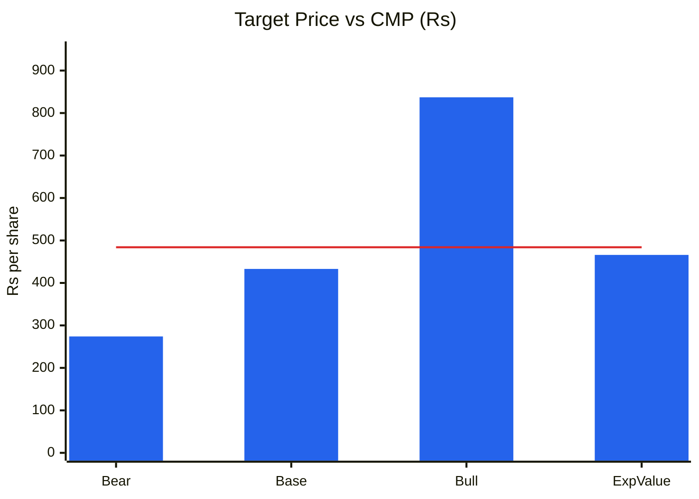
🟦 Scenario target price (FY29 earnings × target multiple) · 🟥 CMP ₹484

**Read:** Bear ₹274 (–43%), base ₹433 (–10%), bull ₹837 (+73%). The probability-weighted value is ₹466 (–4%), so U/D is 0.8:1.

**Business inference:** Only the bull case clears today's price, and it needs a record EBITDA margin (7.5%) on record revenue at the same time. The market is already paying for close to the best outcome, so a cautious investor gets bear-case risk for base-case return.

---

## Module 10 (Skill Module 9) — Technical Stage (Weinstein + CANSLIM)
| Measure | AARTISURF | Nifty 50 |
|---|---|---|
| Close (9-Oct-2026) | ₹483.75 | 22,520 |
| 30-wk SMA / 4-wk slope | ₹442.1 / **+3.8% (rising)** | 23,718 / –0.7% (declining) |
| Price vs MA | Above (+9%) | Below (–5%) |
| 52-wk high / low | ₹677.7 (Aug-2026) / ₹316.0 | 26,373 / 22,180 |
| Return 4 / 13 / 26 / 52 wk | –9.7% / +23.3% / +21.8% / +6.6% | –3.5% / –7.5% / –7.5% / –12.4% |
| RS vs Nifty (52-wk) | **+19pp** | — |
| Relative volume (4-wk avg / 30-wk avg) | **0.25×** (volume drying up) | — |
*Source: Yahoo Finance weekly bars, 3-yr range; the last bar is a partial week to 9-Oct.*

**Nifty market stage: 4** (below a declining 30-wk MA). **Sector index:** no surfactant index; Nifty Chemicals not checked ⚠️.
**Stock stage: 2 (late, pulling back).** The stock broke out of a Mar–Jul 2026 base (₹370–410) in the week of 2-Aug-2026 on Q1FY27 results, spiked to ₹677.7 (week of 9-Aug), and has since lost 29% on falling volume. It still holds above a rising 30-wk MA. **Breakout checklist:** volume on the breakout ✓ (spike weeks); base 16+ weeks ✓; but entry is now 20%+ above the base pivot (~₹410) and volume is fading (0.25×). This is a late, low-quality setup. A weekly close below ₹442 (30-wk MA) would turn it toward Stage 3.
**Stop-loss (for any holder):** weekly close below ₹440. **Stage + fundamental alignment: Misaligned** (strong RS, weak fundamentals; the market is Stage 4).

**CANSLIM:** C (Q1 EPS +205% YoY) **1** · A (3-yr EPS falling; ROE 5%) **0** · N (no new product; 52-wk high already reversed) **0** · S (small ~42 lakh-share free float, but volume drying) **0** · L (not sector leader; Galaxy is) **0** · I (FII 0.08%, DII 0%) **0** · M (Nifty Stage 4) **0** → **1 / 7.**
**Combined verdict:** a Stage-2 late entry with CANSLIM 1/7 in a Stage-4 market → **do not buy.**

---

## Module 11 (Skill Module 10) — Forward View: 2–3 Year Thesis

### Capex Classification (₹ Cr; FY26 AR PPE note; CARE Jun-2024 plan)
| Capex type | FY27E | FY28E | FY29E | In AT model? |
|---|---|---|---|---|
| Tangible growth capex (net of maintenance) | 15 | 15 | 15 | ✅ |
| Maintenance capex (≈ depreciation) | 18 | 19 | 20 | ❌ sustains only |
| Intangibles (SAP, R&D; ₹4.2 Cr under development) | 1 | 1 | 1 | ❌ |
| CWIP commissioning (from ₹39.6 Cr balance) | 39.6 | — | — | ✅ when capitalised |
| ROU (Ind AS 116) | 0 | 0 | 0 | ⚠️ immaterial |
| **Total cash capex** | ~34 + CWIP spend done | ~35 | ~36 | |

**CWIP:** ₹39.6 Cr (₹28.3 Cr < 1 yr, ₹7.2 Cr 1–2 yrs, ₹3.1 Cr 2–3 yrs, ₹1.0 Cr > 3 yrs; FY26 AR). No project-wise split is disclosed ⚠️. Treated as brownfield debottlenecking at both plants, commissioning in FY27.

| Year | Tangible PPE gross block (₹ Cr) | Revenue (₹ Cr) | AT (×) |
|---|---|---|---|
| FY20 | 218.9 | 326 | 1.49 |
| FY21 | 265.7 | 466 | 1.75 |
| FY22 | 245.8 | 576 | 2.34 |
| FY23 | 292.6 | 601 | 2.06 |
| FY24 | 308.1 | 590 | 1.91 |
| FY25 | 319.9 | 659 | 2.06 |
| FY26 | 333.4 | 859 | 2.58 |
| **5-yr avg (FY22–26)** | | | **2.19** |
| **Trend** | | | Rising, **price-driven** (not utilisation-led) |

**Chart C6 — Asset turnover (Revenue / tangible gross block, ×)**
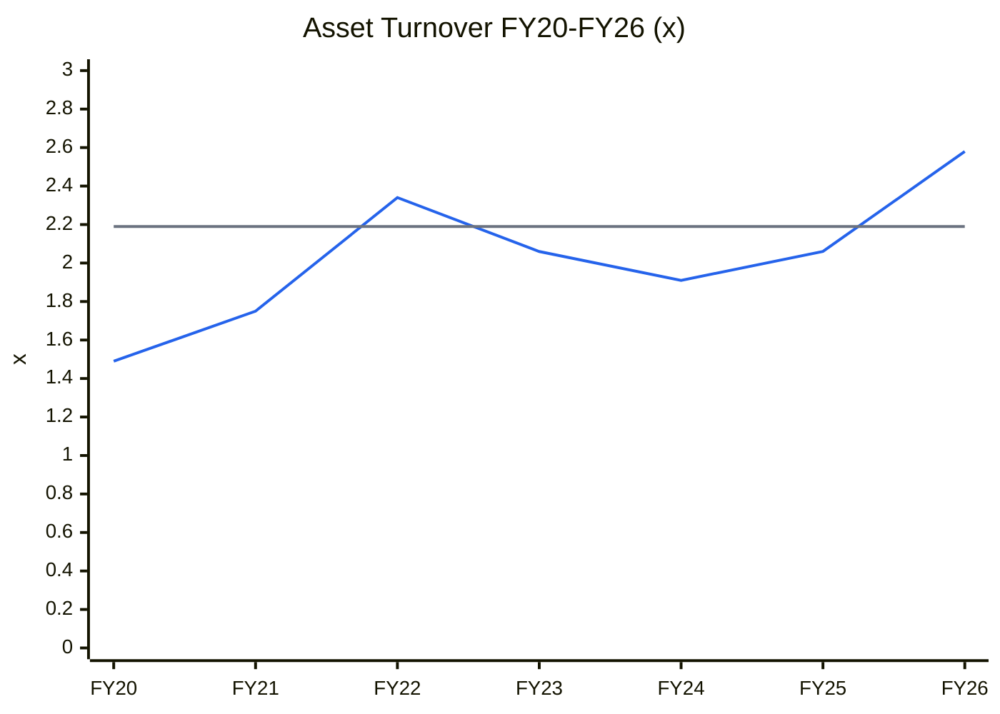
🟦 Revenue / tangible PPE gross block · ⬜ 5-yr average 2.19×

**Read:** AT hit a record 2.58× in FY26, 18% above the 2.19× 5-yr average. The previous high (2.34× in FY22) also came in a feedstock-inflation year, and that was when the fire cut the gross block.

**Business inference:** AT rises when feedstock prices rise, not when the plants sweat harder, so the "efficiency gain" reverses with prices. The bull case can borrow the current AT; the bear case must revert to ~2.2×, which takes revenue on the FY29 block (₹418 Cr) down to ~₹900 Cr.

**Incremental ROIC:** (ΔRevenue from ₹85 Cr of growth capex ≈ ₹202 Cr at 2.58× × 92% ramp) × EBIT margin × 0.73 / ₹85 Cr = **5.9% at 3.4% EBIT, 8.7% at 5.0%, 13.5% only at the FY24-peak 7.8%** vs WACC 12.8% → **value-destroying to neutral** (flagged in Module 4).
**Capex-model implied revenue CAGR (TTM → FY29):** **4.4%** at the current AT (₹1,042 Cr); **–1.1%** if AT reverts to 2.19× (₹885 Cr). PIE needs ~5–7% plus an ~8.3% EBIT margin, so the capex model and the PIE roughly agree on volume, and **the entire disagreement is margin.**

### Capex-to-Earnings Model (base case, ₹ Cr)
| Metric | FY27E | FY28E | FY29E |
|---|---|---|---|
| Opening tangible PPE gross block | 333 | 388 | 403 |
| Growth capex commissioned (incl. CWIP) | 55 | 15 | 15 |
| Closing tangible PPE gross block | 388 | 403 | 418 |
| AT applied (existing block / new at brownfield ramp 55–80–92%) | 2.58 / ramp | 2.58 / ramp | 2.58 / ramp |
| Revenue — existing assets | 860 | 860 | 860 |
| Revenue — new assets at ramp AT | 78 | 134 | 182 |
| **Total revenue (capex model)** | **938** | **994** | **1,042** |
| Revenue used (base) | 960 | 1,005 | 1,050 |
| EBITDA margin | 6.5% | 6.0% | 6.0% |
| EBITDA | 62.4 | 60.3 | 63.0 |
| D&A | 19 | 20 | 20 |
| EBIT | 43.4 | 40.3 | 43.0 |
| Interest | 13 | 12 | 12 |
| **ICR** | 3.3× | 3.4× | 3.6× |
| Debt / EBITDA (debt ~₹104 Cr) | 1.7× | 1.7× | 1.7× |
| PAT (26% tax) | 22.5 | 20.9 | 22.9 |
| EPS (₹, 84.7 lakh shares) | 26.6 | 24.7 | 27.1 |
| ΔWorking capital (12% of Δrevenue) | 5 | 5 | 5 |
| Total capex | 33 | 33 | 33 |
| **FCF** | **3.2** | **2.5** | **4.5** |

**FCF inflection year:** not reached in the forecast window. Capex at ~1.7× depreciation absorbs cash earnings.
**Debt ceiling verdict:** peak leverage ~1.7× EBITDA → **within the safe zone.** Leverage is not the risk; in the bear case ICR falls to 1.6× (FY29).

### Key Catalysts (3–5)
1. Q2FY27 results (Nov-2026): OPM ≥ 9% with fatty alcohol flat would be the first evidence of a spread, not an inventory gain. Probability low.
2. Disclosure of specialty mix, volumes or utilisation (AR FY27 / any investor call). Timing unclear.
3. Export recovery via the new US subsidiary (Precision Ingredients USA). FY28+.
4. Fatty-alcohol price decline lifting percentage margins (FY24 analogue). 2027, cyclical and reversible.

### Key Risks (3–5)
1. **Inventory-gain reversal:** OPM falls back to 5–6% in H2FY27 as feedstock plateaus. **High.**
2. **Customer concentration:** 68% top-3. A price reset or vendor-share cut by one FMCG major would erase a year's PAT. **Medium.**
3. **Regulatory / governance:** CESTAT outcome on the customs order (₹37 Cr of goods held liable; MD penalised), environmental orders at Silvassa, board churn. **Medium.**
4. **Value-destroying capex:** ₹30 Cr+ a year at 6–9% incremental ROIC. **High.**
5. **Liquidity / microcap:** 4-wk volume 0.25× of normal and no institutional holders, so exits gap down. **High.**

### Scenario Analysis (AT-driven, FY29, 3-yr)
| Scenario | AT assumption | Revenue FY29 | EBITDA margin | EPS FY29 | Target multiple | Target price | Probability |
|---|---|---|---|---|---|---|---|
| Bull | 2.75× (current AT + price inflation persists + capex on schedule) | ₹1,150 Cr | 7.5% | ₹46.5 | 18× P/E | **₹837** | 20% |
| Base | 2.5× (current AT on existing block, ramp on new) | ₹1,050 Cr | 6.0% | ₹27.1 | 16× P/E | **₹433** | 50% |
| Bear | 2.15× (reverts to 5-yr avg) | ₹900 Cr | 4.5% | ₹6.6 | 0.9× P/B (BVPS ~₹305) | **₹274** | 30% |
| **Expected value** | | | | | | **₹466** | |

**Return from current price (expected value): –3.6%.** Probability-weighted U/D = (0.2 × 353) / (0.5 × 51 + 0.3 × 210) = **0.80 : 1** → hard stop.

**Monitoring metrics:** quarterly OPM vs fatty-alcohol (C12–C14 FOB Malaysia) price; rupee gross profit per quarter (≥ ₹40 Cr sustained would be new); export share; any tonnage or utilisation disclosure; CESTAT order; next rating action; ID and KMP churn.

**Thesis (2 sentences):** Aarti Surfactants is a sub-scale, buyer-dominated surfactant converter whose rupee spread has been flat for five years, and whose ROIC has been below WACC in every year since listing. At ₹484 the market prices a permanent margin step-up that one feedstock-assisted quarter does not prove, so the risk-reward is negative (EV –4%, U/D 0.8:1).

---

## Checklist Summary
**Section 0 (Existing Report Protocol):** 3 / 3 — base report read in full, every item re-validated (25-row table, 2 ❌), file renamed with `git mv`, one file remains.
**Section A (Business Quality):** 16 / 18. Market-share stability and competitor interviews are not possible (no share data, no scuttlebutt access).
**Section B (Forensics):** 9 / 9.
**Section C (Financial Statements):** 12 / 12.
**Section D (KPIs & Peers):** 6 / 7. Primary surfactant KPI (EBITDA/MT) not computable without tonnage.
**Section E (Market Size & Share):** 4 / 7. TAM and penetration done; share trend not sourced.
**Section F (Valuation):** 10 / 10.
**Section G (Technical Stage):** 7 / 8. Sector index stage not checked.
**Section H (Forward View):** 26 / 30. Project-wise CWIP and segment attribution are not disclosed (single segment); unit economics not applicable.
**Section I (Charts):** 4 / 5. Mandatory set included (C1, C2, C4, C5, C6, C7, C13, CY1, CY2, CY4, CY6, CY7 + dashboard). **CY5 not charted** (no industry capacity/demand data) and C10 not charted (no utilisation series).
**Order Book Tracker:** not applicable (non-order-driven; no Reg 30 order filings).
**Hard stops triggered:** **(1) ROIC persistently < WACC for 5+ years with no turnaround thesis** (7/7 years). **(2) Upside/downside < 1.5:1** (0.80:1 probability-weighted). Not triggered: integrity veto (Point 15 = 2, flagged), earnings quality (clean), forensic flags (2/15), Beneish (–2.55), pledge (0%), ICD (nil), auditor (no resignation), stock Stage 4 (no; the stock is Stage 2-late, though Nifty is Stage 4).

**Conviction score (0–10):** Cycle 0.5/1 · Industry 0.3/1 · Moat 0.4/2 · Management 0.3/1 · Financial and earnings quality 1.2/2 · Valuation and PIE 0.1/2 · Technical 0.4/1 → **3.2 ≈ 3 / 10.**

---

## Investment Decision
**Recommendation:** **AVOID**
**Conviction score:** 3 / 10 (unchanged)
**Suggested position size:** 0%
**Entry price range:** none. Re-examine only below ~₹300 (≈ 1.0× book, ~EV/normalised EBITDA 6.5×) **and** after two quarters of OPM ≥ 9% with feedstock prices flat or down.
**Stop-loss (existing holders):** weekly close below ₹440 (30-wk MA)
**Target price (base, FY29 multiple, ~2.5 yrs):** ₹433
**Review trigger:** upgrade to watchlist if (a) rupee gross profit ≥ ₹160 Cr a year for 4 quarters, (b) specialty mix ≥ 25% is disclosed, and (c) ROCE ≥ 13% for two consecutive years. Exit or stay away on (d) an adverse CESTAT order, (e) a rating downgrade, or (f) further independent-director or KMP resignations.

---
*Sources: Screener.in AARTISURF consolidated and standalone, GALAXYSURF consolidated (fetched 10-Oct-2026). BSE corporate filings for scrip 543210, Jan-2024 to Oct-2026 (164 filings) and Jul-2019 to Dec-2023: Q1FY27 results (1-Aug-2026); FY20–FY26 annual reports; AGM presentations of Aug-2024, Sep-2025 and 29-Sep-2026; CARE rating rationales of Nov-2022, Jun-2024 and Dec-2025; Crisil letter of 3-Sep-2026; customs order disclosure (25-Sep-2026); pollution-board order (15-Jun-2026); ID resignation (12-Sep-2026); board outcome (22-Aug-2026); NCRPS redemption (3-Jul-2026); US subsidiary incorporation (31-Aug-2026); promoter reclassification (12-Feb-2026); SAST 29(2) (Sep-2024). Yahoo Finance AARTISURF.NS and ^NSEI weekly/monthly bars. Fatty alcohol prices: Alchempro (Apr-2026) and ChemAnalyst (Aug-2026) trade reports. Q1FY27 press coverage: Indian Chemical News, MarketsMojo, Univest. Peer data for Standard Surfactants from STDSFAC_StandardSurfactants_2026-10-06.md; Galaxy promoter data from GALAXYSURF_GalaxySurfactants_2026-07-28.md. ⚠️ marks items that could not be sourced.*
*Report generated by Stock Fundamental Analysis Skill v3.3 | Indian Markets Context*
*Save path: C:\Users\anubh\Documents\Anubhav\Stock Analysis\Stock Analysis\*
