# Stock Analysis Report — Action Construction Equipment Ltd (ACE)
*(NSE: ACE · BSE: 532762 · Palwal, Haryana)*
**Date:** 2026-10-16
**Analyst:** Claude (Stock Fundamental Analysis Skill v3.3)
**Investment Horizon:** 2–3 Years
**Recommendation:** WATCHLIST (Quality at Wrong Price). Buy below ₹900.
**Conviction Score:** 6 / 10

## Revision Log
| Version | Date | Recommendation | Conviction | Price | Key change |
|---|---|---|---|---|---|
| **Current** | 2026-10-16 | WATCHLIST, buy below ₹900 | 6/10 | ₹1,156 | **Initial report.** The library was searched by ticker ("ACE") and name fragments ("Action", "Construction Equipment"). No ACE report exists. ACE appears only as an MOU counterparty inside `SANGHVIMOV_SanghviMovers_2026-06-11.md`. |

*Initial report: no previous version to validate.*

---

## Executive Summary
ACE is India's dominant mobile-crane maker. It is the world's largest pick-and-carry ("Hydra") crane manufacturer, with 63%+ share of Indian mobile cranes and 60%+ of tower cranes (company, via Screener), and it also sells forklifts, backhoe loaders, road machinery and tractors. Over a decade it turned a 3–5% margin, debt-laden business (FY15) into a 15% EBITDA, net-cash (₹1,350 Cr treasury), ~70% pre-tax core-ROIC compounder: revenue rose 4.4× and PAT 30× from FY17 to FY26. **The thesis:** a capital-light, negative-working-capital franchise with a durable share moat, re-accelerating after a flat FY26 (CEV-V emission-norm price shock). Q1FY27 revenue grew +21% and defence (₹575 Cr order book) plus exports plus the KATO JV add new legs. **The catch:** at ₹1,156 (31.5× TTM EPS, 6.8× book) the price already embeds ~17–20% NOPAT CAGR for a decade, margins sit at a 10-year peak (> +1SD), management's revenue guidance has a 0.50 walk-the-talk record, and the market is in Stage 4. Expected value is ~₹1,182 (+2%). Great business, no margin of safety.

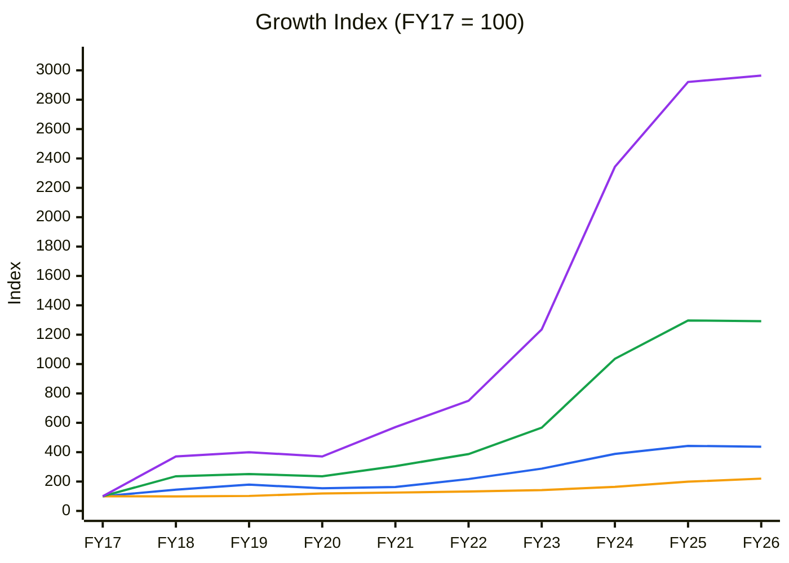
🟦 Revenue (CAGR 17.8%) · 🟧 Tangible PPE gross block (9.2%) · 🟩 EBITDA (32.9%) · 🟪 PAT (45.7%)

**Read:** Revenue grew 4.4× and gross block only 2.2×. EBITDA grew 12.9× and PAT 29.6× (FY17–26), so every line sits above the asset line. FY26 is the first year revenue and EBITDA flattened.

**Business inference:** This is textbook operating leverage on a capital-light assembly model. ACE grows revenue twice as fast as the capital it consumes, and margin expansion (5% → 15%) did the rest. The FY26 stall was demand (the emission-norm price jump), not capacity. But PAT compounding at 46% cannot repeat from a 15% margin base: future EPS growth ≈ revenue growth plus modest operating leverage.

**Order-driven line (defence segment only):** Defence order book ₹575 Cr (May-26) = 0.17× TTM revenue · 100% firm (MoD/BRO contracts) · single ₹420 Cr RTFLT order = 73% of it · core cranes/CE business is dealer/retail-sold (no backlog).

---

## BUSINESS PRIMER

ACE designs and assembles mobile cranes, the yellow "Hydra" pick-and-carry cranes ubiquitous on Indian factory floors and construction sites, plus newer-generation slewing cranes. It also makes tower cranes for high-rise construction, truck/crawler cranes, forklifts and warehousing equipment, backhoe loaders, motor graders, compactors, and an agri line of tractors and harvesters, all from an integrated complex at Dudhola (Palwal, Haryana). Cranes, material handling and construction equipment were ₹2,946 Cr (90%) of FY26 standalone revenue, agri ₹251 Cr and other ₹77 Cr (AR FY26 MD&A). Customers are crane-rental fleet owners, contractors, EPC firms, manufacturers and logistics operators. They buy through ACE's 125+ location dealer/service network, typically on retail finance, with 40–45% of revenue in H1 and 55–60% in H2 (Q1FY27 call). Newer channels are the Ministry of Defence (special forklifts, rough-terrain cranes, backhoes) and exports to 37 countries (6.2% of FY26 turnover). Revenue is units × realisation. Realisation is set by tonnage mix and pass-through of steel/engine cost inflation (three price hikes totalling ~10% in Jan–Jun 2026). The business depends on **(1) Indian infrastructure, manufacturing and real-estate capex** (the end demand for lifting) and **(2) its scale-based cost and distribution lead in pick-and-carry cranes**, which lets it hold ~60%+ share against Chinese and domestic rivals.

This is a **cyclical capital-goods OEM with a capital-light, negative-working-capital model**. It is an assembler buying engines, axles and steel, with dealer advances and 150-day payables funding inventory. Its ROIC is far above what the "capital goods" label suggests. The key value driver is **volume × margin**: price power is real but mostly cost pass-through. The key risks are the **domestic capex/construction cycle** (FY20 showed a −14% revenue year) and **input-cost inflation with a lag**. Three structural features colour the analysis. First, a **₹1,283 Cr treasury portfolio** (39% of total assets) earns ~₹110 Cr of other income, 19% of PBT, which flatters ROE and must be separated from core returns. Second, a **promoter family (Agarwals, 65.4%)** runs the business with an aggressive top-line narrative. Third, the **CEV-V emission transition (Jan-2025)** distorted FY26.

**Segment check (New Segment Protocol):** the closest covered block is **"Infrastructure / EPC / Capital Goods" (`references/05-industry-kpis-india.md` line 294)**, a near-match for a capital-goods OEM, so it counts as covered. Order book/revenue is not applicable to ACE's product business. Module 6 uses the block's capital-goods margin (12–18%), ROCE (> 15%) and WC-days KPIs, plus product-OEM metrics (market share, unit volumes, exports %).

---

## Module 1 — Broad Market Cycle (Marks)
- **Nifty 50:** 22,997, −10.8% YoY, below a falling 30-wk MA (23,740). **Stage 4.** India VIX ~14: no capitulation yet.
- **Pendulum: Cautious.** Index breadth is weak. Capital goods de-rated from 2024 peaks: ACE itself fell 45% (₹1,427 Mar-24 → ₹781 Mar-26) before rebounding.
- **Sizing:** defensive. New positions only with a clear margin of safety.

---

## Module 1b — Sector Cycle: Tailwinds & Headwinds

**Secular vs cyclical decomposition (revenue +21% in Q1FY27):**
| Component | Estimate | Evidence |
|---|---|---|
| Price / inflation pass-through (cyclical) | ~6–8pp | ~10% cumulative price hikes Jan–Jun 2026, against 11–12% input inflation (Q1FY27 call) |
| Base effect / emission-norm recovery (cyclical) | ~5–8pp | Q1FY26 was −11% YoY. Hydra demand "subdued due to price increase and technological changes last year" is now returning |
| Volume, underlying (secular + cyclical) | ~17% CHCE volume growth | "Volumes grew by 17.25% year-on-year" in the CHCE segment (Q1FY27 call) |
| Defence / exports (structural new legs) | ~2–4pp | Defence ~5% and exports ~3% of Q1 revenue. Full-year guide 5–6% defence plus 6–7% exports |

**Durable baseline:** ~11–13% a year. That is India construction/industrial capex (~9–10% nominal) plus mix/tonnage upgrade (~2%) plus defence/export diversification. The FY23–25 surge (+33%, +35%, +14%) contained a post-COVID capex up-leg and pre-buying ahead of CEV-V. Embedding 17%+ would capitalise a cyclical phase.

- **Input cost cycle: RISING.** Steel is up ~20% and rubber, tyres and freight are up (CFO, Q1FY27). Management aims to *hold* the ~15% margin, not expand it. The gross margin fell ~140 bps YoY in Q1.
- **Inventory/channel:** no stuffing evidence. Debtor days are 32 and advances from customers rose to ₹220 Cr (FY26), which is demand-pull, not push.
- **Competitive supply:** Chinese crane imports are flooding the market. DGTR recommended anti-dumping duty, but the Finance Ministry has not notified it (Q1FY27 call). That is a **headwind on heavy/slew cranes**, less on Hydras where ACE's share is entrenched.
- **Geopolitics:** West Asia war → steel, energy and freight inflation; Saudi export shipments were stuck in Q1. Classification: **transient (2–3 quarters) on margin**, structural for export timing.
- **Net FX:** exports ~6% of revenue vs imported engines/components. A small net short-USD position, immaterial to EBIT.

**CY5/CY6 (industry CE demand vs supply, steel spread):** ICEMA unit series and steel/realisation data were not accessed from a primary source, so these charts are not drawn. The AGM speech (18-Sep-26) states that **FY26 industry CE sales "declined modestly"** while CE exports rose ~32%.

**Sector cycle verdict: NEUTRAL turning TAILWIND on volume (post-emission-norm normalisation); HEADWIND on input costs.** No tailwind is embedded in the DCF, and MoS is widened 5pp for input inflation.

---

## Module 1c — Stock Cycle: Company-Specific Positioning

**Quarterly (Screener consolidated, ₹ Cr):**
| Qtr | Q2FY25 | Q3FY25 | Q4FY25 | Q1FY26 | Q2FY26 | Q3FY26 | Q4FY26 | Q1FY27 |
|---|---|---|---|---|---|---|---|---|
| Revenue | 757 | 875 | 961 | 652 | 744 | 855 | 1,029 | 786 |
| Revenue YoY % | 12.5 | 16.2 | 15.0 | −11.2 | −1.7 | −2.3 | 7.1 | 20.6 |
| EBITDA (ex-OI) | 109 | 135 | 164 | 93 | 109 | 130 | 172 | 118 |
| EBITDA YoY % | 22.5 | 31.1 | 26.2 | −6.1 | 0.0 | −3.7 | 4.9 | 26.9 |
| OPM % | 14 | 15 | 17 | 14 | 15 | 15 | 17 | 15 |
| PAT | 95 | 112 | 119 | 98 | 90 | 116 | 111 | 119 |

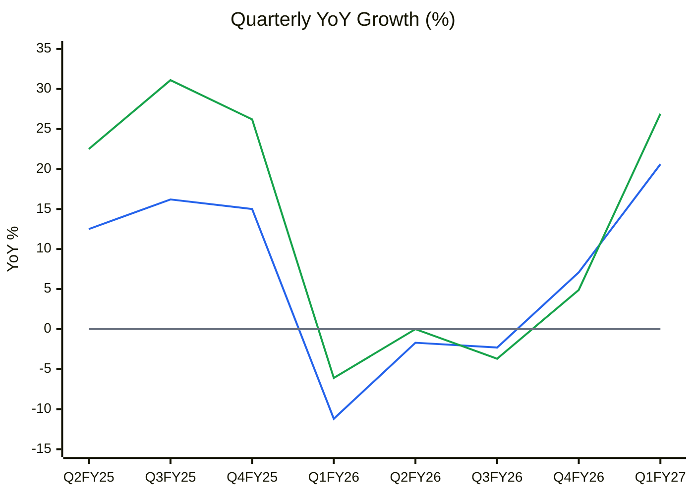
🟦 Revenue YoY % · 🟩 EBITDA YoY % · ⬜ zero line

**Read:** Growth troughed at −11% in Q1FY26 (the CEV-V shock) and has accelerated for three straight quarters, to +21% revenue and +27% EBITDA in Q1FY27. EBITDA growth outran revenue in every positive quarter.

**Business inference:** This is a V-shaped recovery from a regulatory price shock, not a demand collapse. Operating leverage reappears as soon as volume returns. Part of Q1FY27 is an easy base (Q1FY26 −11%), so the Q2–Q3 prints against a normal base are the true test of whether 12–15% growth is sustainable.

- **Volume / price / mix (FY17–26):** Volume and mix dominated. Unit growth followed the infra capex cycle, mix moved towards new-generation cranes (30–35% → >40% of volume in FY26) and higher tonnages, and price was largely pass-through. **Forward: mix stays positive** (management expects Hydra:NG to converge to 50:50, at a 30–35% price gap), price is pass-through, and volume follows capex.
- **Physical capacity:** management puts existing revenue capacity at **~₹4,400–5,000 Cr** (Q1FY26 and Q2FY26 calls). FY26 revenue of ₹3,280 Cr is **~66–75% utilisation**. Additions: **Plant 9** (defence/special machines, ₹40–50 Cr capex, revenue capacity ~₹500 Cr, functional by end-Q3/early-Q4 FY27). A new **tower-crane facility** 4–5 km away was planned for Apr-26 and deferred to a decision in Sep-26 (outcome not yet disclosed). **Land purchase ₹130–140 Cr** in FY27. **Capacity ceiling:** ~₹5,000–5,500 Cr by FY28, i.e. ~FY29 at a 13–15% CAGR, consistent with management's FY29–30 target of ₹6,000–6,200 Cr *only if* the tower-crane plant goes ahead.
- **Operating leverage (FY26):** Contribution margin ≈ gross margin 32% → DOL ≈ 32% / 14.3% core EBIT margin ≈ 2.2×. DFL ≈ 1.04× (net cash). **DTL ≈ 2.3×**: a 10% revenue miss cuts EPS by ~23%, cushioned by ~₹110 Cr of treasury income. ICR 26× (FY26). No balance-sheet risk.
- **FCF inflection:** already passed (FY23). FCF was ₹238–330 Cr a year FY23–26, because negative working capital (CCC −20 days) *releases* cash as revenue grows.
- **Guidance accuracy:** WTT 0.50 (Module 3). **Revenue guidance gets a 20% haircut; margin guidance is used as-is** (delivered).

**Stock-cycle classification: MID-CYCLE RECOVERY in volume, LATE-CYCLE in margin.** OPM of 15.4% is the 100th percentile of FY17–26 and > +1SD (12.8%). ROCE of 32% is the 78th percentile. MoS +5pp. Size ×0.5 until margins prove they hold through the input-cost spike.

---

## Module 2 — Industry Structure (Porter) & Capital Cycle

| Force | Assessment | Signal |
|---|---|---|
| New entrants | Distribution and service network (125+ locations), brand trust among rental owners and scale procurement are real barriers in Hydras. Lower in heavy cranes (Chinese imports, global OEMs) | Positive (Hydra) / Negative (heavy) |
| Supplier power | Engines (Cummins/Kirloskar class), castings and steel. Concentrated engine supply: Q1FY27 engine-casting disruption | Neutral-negative |
| Buyer power | Fragmented rental owners and contractors with no single large buyer. Defence/MoD is L1-tender priced | Positive |
| Substitutes | Crawler/truck cranes for heavy lifts; NG cranes replacing Hydras (ACE leads both) | Neutral |
| Rivalry | ACE 63% vs Escorts-Kubota (exited CE), TIL (loss-making), Chinese brands (Sany, Zoomlion, XCMG) in slew cranes; JCB dominates backhoes | Positive in cranes, negative in backhoes |

**Industry verdict: ATTRACTIVE in pick-and-carry/tower cranes (ACE is a quasi-monopoly), NEUTRAL-to-UNATTRACTIVE in backhoes/forklifts/heavy cranes.** The blended position supports a moderate MoS.

**Capital cycle:** ACE's capex/D&A was 7.6–7.9× in FY24–25 (land, plants), the heaviest in its history. The industry is adding capacity (JCB, Chinese localisation, the KATO JV), and Chinese import pressure is unresolved (anti-dumping not notified). These are early signs of supply building into a demand recovery, but they matter for heavy cranes more than Hydras. **CY8 not built** (peer capex series not assembled).

---

## Module 3 — Business Quality & Moat

**Greenwald barriers:**
1. **Cost advantage — YES (scale).** It is the largest pick-and-carry volume producer globally, and EBITDA margin rose from 5% to 15% while gross margin stayed ~28–32%. The gain is fixed-cost absorption, not price. Rivals cannot match unit costs at a fraction of the volume.
2. **Customer captivity — MODERATE.** Rental owners value resale value, service reach and spare-parts availability (installed base built over 30 years), which are switching costs. Not a lock-in, but sticky.
3. **Local economies of scale — YES.** The Indian Hydra market is a distinctly Indian product niche where 63%+ share and the national service network reinforce each other.

**Buffett price test: PARTIAL PASS.** ACE pushed ~10% of price increases in H1 CY26 without losing share. It concedes "sometimes … you're really not able to recover" fully, and margins are guided flat, not up.

**Market-share stability:** "nearly 20 years" as crane market leader (Q2FY25 call); 63%+ mobile, 60%+ tower (Screener/company). Stable to gaining. Targeting 70% in cranes. *An independent ICEMA share series was not sourced.*

**Moat verdict: NARROW-to-MODERATE** (scale cost plus distribution in a local niche). It is wide in Hydras, but Hydras are a shrinking share (60% → ~50% of crane volume).

**Fisher 15-point:** Market potential 3 · New products 3 (NG cranes, telehandlers, AWPs, electric cranes, KATO tech) · R&D effectiveness 2 · Sales organisation 3 · Profit margin 2 · Margin improvement 3 (5% → 15% in a decade) · Labour relations 2 · Executive relations 2 · Management depth 2 (family-heavy: CMD, wife, son and daughter on the board; CFO, President) · Cost/accounting controls 2 (EY internal audit; clean opinion) · Industry advantages 3 · Long-range orientation 2 (aggressive targets, then reset) · Dilution 2 (₹136 Cr QIP FY22, small ESOPs) · Candor in adversity 2 (withheld guidance rather than mislead, but the FY26 "doubling" target was reiterated until Q3FY25) · Integrity 3 → **36 / 45. Point 15: PASS.**

---

## Module 4 — Management & Capital Allocation
- **Promoter (Vijay Agarwal family):** 65.42% (Jun-26). It fell from 66.76% to 65.41% in the Jun-2024 quarter (−1.35pp, near the all-time-high share price of ~₹1,400–1,500) and has been flat since. *The Form C/SAST detail of that reduction was not retrieved.* **Pledge: not verified** (⚠️; no pledge-creation filings among BSE announcements Apr-23 to Oct-26). FII 7.82% (down from a 11.90% peak in Dec-24), DII 2.59%.
- **Remuneration:** CMD Vijay Agarwal ₹5.67 Cr, Mona Agarwal ₹3.06 Cr, Sorab Agarwal ₹1.31 Cr, Surbhi Garg ₹1.04 Cr (FY26 AR). Family total ₹11.1 Cr = **2.6% of PAT**, up ~1% YoY against PAT +1.5%. Normal.
- **RPTs:** The KATO JV slump sale (heavy-cranes business, FY25 revenue ₹85.8 Cr, 2.6% of revenue) is an RPT with the 50:50 JV "at arm's length" (BSE, 30-Apr-26). No promoter-group RPT concerns surfaced. *The AR Ind AS 24 schedule was not read in full.*
- **Capital allocation (10 yrs):** Capex ₹804 Cr vs D&A ₹182 Cr (FY17–26). It was disciplined until FY23, then heavier: ~₹400 Cr in FY24–25 including land. **Incremental core ROIC FY21→FY26:** core EBIT ₹105 Cr → ₹469 Cr (Δ₹364 Cr pre-tax; ~₹273 Cr post-tax) on ~₹490 Cr of net growth capex, with working capital *releasing* cash → **~55% ≫ WACC 12%. Value-creating.**
- **Cash hoarding:** treasury rose from ₹31 Cr (FY21) to ₹1,283 Cr (FY26) and dividend is ₹2/sh (~6% payout; ₹24 Cr/yr). Screener's "137% payout" for FY25–26 is a data error: the AGM speech confirms ₹2.00/sh. No buybacks. Management flags "inorganic growth … we have a lot available on the books" (Q1FY27). **This is the key capital-allocation risk: a large acquisition at a peak multiple.**
- **FCF/share vs EPS (5-yr, FY21–26):** FCF/share ₹5.9 → ₹27.7 (+36% CAGR) vs EPS ₹7.0 → ₹34.9 (+38%). Consistent, with no dilution red flag.
- **Buffett's three C's:** Candor **Moderate** (stopped giving numbers in uncertainty, but stuck to the doubling narrative too long). Competence **High** (10-yr margin and ROCE transformation). Caring **Moderate** (low payout while cash piles up).

### Walk the Talk Scorecard
| Source | Statement | Guided | Actual | Verdict |
|---|---|---|---|---|
| FY24 calls (2023–24) | "Between FY23 and FY26 we will double/triple revenue… achieve INR4,400 crores by FY26" | ₹4,400 Cr FY26 | ₹3,280 Cr (−25%) | ❌ |
| Q2FY25 call (Nov-24) | FY25 growth 15%+ overall, stable EBITDA margin | ~₹3,351 Cr | ₹3,327 Cr (−0.7%) | ✅ |
| Q2FY25 call | "On track to receive largest ever single order >INR400 crores from MoD" | Q3FY25 | ₹420 Cr RTFLT contract signed 20-Feb-25 | ✅ |
| Q4FY25 call (May-25) | FY26 top-line growth 14–15% | ~₹3,800 Cr | ₹3,280 Cr (−1.4% YoY) | ❌ |
| Q4FY25 call | EBITDA margin 17–18% (standalone, incl. OI basis) | 17–18% | 19.0% (₹622 Cr / ₹3,274 Cr standalone) | ✅ |
| Q1FY26 call (Aug-25) | Defence order execution from Q3FY26, ₹50–70 Cr in FY26 | ₹50–70 Cr FY26 | Execution started Q1FY27; first supplies Aug-26 | ❌ (~3-quarter slip) |
| Q3FY26 call (Feb-26) | FY26 "flat to positive" | ~0% | −1.4% | ✅ |
| Q3FY26 call | ~150 heavy recovery vehicles (with Ashok Leyland, ~₹1 Cr each) "expected any time… announcing shortly" | Q4FY26 | Not announced by 16-Oct-26 | ❌ |
| Q1FY27 call (Jul-26) | Full-year FY27 revenue guidance "by September end" | Sep-26 | No guidance filing on BSE by 16-Oct-26 | ⚠️ not scored (may have been given in media) |
| Q2FY26 call (Nov-25) | FY27 ₹4,000–4,400 Cr; FY29–30 ₹6,000–6,200 Cr | Pending | TTM ₹3,414 Cr; FY27 needs +22% | ⚠️ pending |

**WTT Score:** 4 / 8 = **0.50 — LOW**
**Guidance points assessed:** 8 | Hits: 4 | Near misses: 0 | Misses: 4 | Reversals: 0
**Key pattern:** **One-way misses on revenue and timelines** (the multi-year top-line target, defence execution start, new defence orders), while **margin guidance is reliably met or beaten**. Treat top-line targets as aspirational and margins as credible.
**Insider action:** a promoter stake reduction of −1.35pp in the Jun-24 quarter at the cycle-peak price, with no buying since → **mildly BEARISH**.
**DCF impact:** management's FY27 target of ₹4,000–4,400 Cr is haircut to ₹3,750 Cr in the base case. The FY29–30 ₹6,000 Cr+ target counts in the bull case only.
**Overall management credibility: MODERATE** (excellent operators, optimistic forecasters).

---

## Module 4b — Financial Forensics

**Beneish M-Score (FY26 vs FY25):** DSRI 1.09 · GMI 1.00 · AQI ~1.0 · SGI 0.99 · DEPI 0.88 · SGAI ~1.0 · LVGI 0.94 · TATA −0.001 → **M ≈ −2.41, Unlikely manipulator.**
**Altman Z'' (FY26, treasury treated as current):** X1 0.37 · X2 0.61 · X3 0.18 · X4 1.62 → **7.3, Safe.**
**Piotroski F (FY26):** ROA>0 ✓ · CFO>0 ✓ · ΔROA ✗ (12.8% vs 15.1%) · CFO>NI ✓ (marginal) · LT debt nil ✓ · current ratio ↑ ✓ (1.96 vs 1.80) · no dilution ✓ · gross margin ↑ ✗ (flat) · asset turnover ↑ ✗ → **6/9, Average-to-strong.**
**Sloan accrual (FY26):** headline (415 − 417 + 350)/2,980 = 11.8%, *but* CFI is dominated by ₹322 Cr of net treasury purchases. Ex-treasury (CFI = net capex −₹87 Cr) it is **2.9%, Acceptable.**

**Indian-specific flags:**
- **Payables:** DPO rose from 98 days (FY15) to 151 days (FY26). Trade payables are ₹916 Cr against inventory of ₹605 Cr. Suppliers fund the entire inventory plus receivables. This is a feature of scale-buyer power, but it is **O'Glove flag #5 (rising DPO)**. If vendors tighten (the Q1FY27 casting-supplier stress), up to ~₹300 Cr of working capital could reverse. ⚠️
- **Other income/EBIT:** ₹110 Cr / ₹579 Cr = **19% (> 15% threshold)**. Explained: it is yield on a ₹1,283 Cr treasury book, recurring as long as cash is kept. Core returns are shown separately.
- **Auditor:** clean opinion. KAM = revenue recognition (standard presumed fraud risk). EY are internal auditors. ICRA AA (Stable)/A1+ reaffirmed 17-Jan-26.
- **Warranty provisions** fell from ₹4.30 Cr to ₹3.91 Cr and warranty expense from ₹2.34 Cr to ₹1.48 Cr (standalone, AR FY26). These are falling while new-technology CEV-V machines are in their first years. Monitor (cookie-jar check). ⚠️ minor
- No pledge seen, no ICDs to the group, no auditor change.

**Schilit screen:** DSO 32 days (stable) ✓ · capex/D&A 2.7× in FY26 (land-heavy, explained) ✓ · no big-bath or one-off pattern (exceptional items ≤ ₹2 Cr except a ₹20 Cr gain in FY23) ✓ · DPO stretch ⚠️.

**Forensic red-flag count:** 2 / 15 (DPO trend, OI/EBIT). Both are explained.
**Overall forensic verdict: CLEAN (minor watch items).**

---

## Module 5 — Earnings Quality & Financial Statements

**12-year core table (Screener consolidated, ₹ Cr):**
| FY | Revenue | EBITDA | OPM % | Gross margin %* | PAT | CFO | Capex | ROCE % | ROE % | Net cash (treasury + cash − debt) |
|---|---|---|---|---|---|---|---|---|---|---|
| FY15 | 599 | 19 | 3.2 | 28 | 5 | 40 | 36 | 3 | 1.7 | −113 |
| FY16 | 637 | 31 | 4.9 | 30 | 9 | 57 | 39 | 6 | 3.2 | −126 |
| FY17 | 751 | 39 | 5.2 | 30 | 14 | 76 | 18 | 8 | 4.2 | −83 |
| FY18 | 1,087 | 92 | 8.5 | 29 | 52 | 89 | 19 | 19 | 13.6 | −32 |
| FY19 | 1,343 | 98 | 7.3 | 27 | 56 | 72 | 25 | 20 | 12.8 | 3 |
| FY20 | 1,156 | 92 | 8.0 | 31 | 52 | 48 | 87 | 16 | 11.7 | −45 |
| FY21 | 1,227 | 119 | 9.7 | 30 | 80 | 86 | 44 | 21 | 15.3 | 13 |
| FY22 | 1,630 | 151 | 9.3 | 28 | 105 | 104 | 48 | 21 | 13.9 | 162 |
| FY23 | 2,160 | 221 | 10.2 | 29 | 173 | 274 | 74 | 26 | 18.8 | 391 |
| FY24 | 2,914 | 404 | 13.9 | 31 | 328 | 433 | 175 | 42 | 26.7 | 700 |
| FY25 | 3,327 | 506 | 15.2 | 32 | 409 | 412 | 221 | 40 | 25.3 | 957 |
| FY26 | 3,280 | 504 | 15.4 | 32 | 415 | 417 | 93 | 32 | 20.6 | 1,352 |
| TTM (Jun-26) | 3,414 | 529 | 15.5 | — | 437 | — | — | — | — | — |
*Gross margin = 100 − material cost % (Screener expense schedule). ROE = PAT ÷ year-end equity.

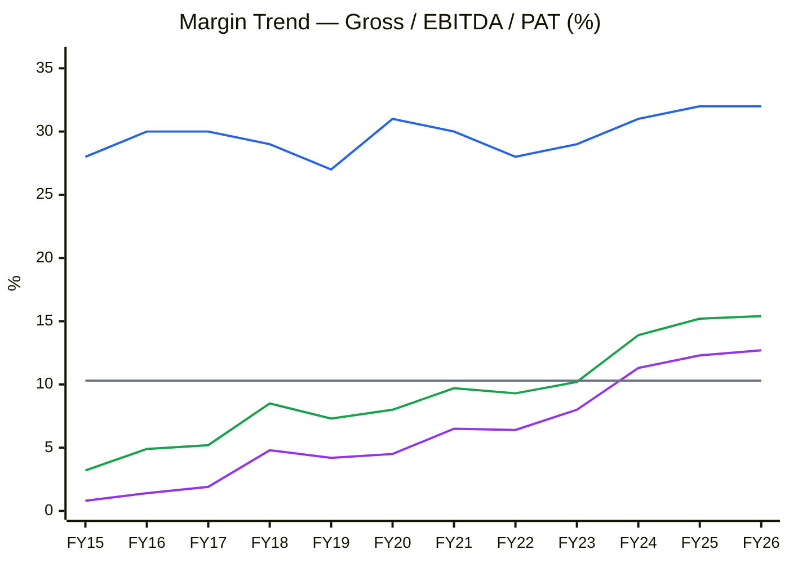
🟦 Gross margin · 🟩 EBITDA margin · 🟪 PAT margin · ⬜ 10-yr (FY17–26) average EBITDA margin 10.3%

**Read:** Gross margin has been flat at 27–32% for 12 years, while EBITDA margin climbed from 3% to 15.4%. That is the 100th percentile of the decade and +1.6 SD above the 10.3% average (+1SD = 12.8%).

**Business inference:** **All of the margin gain is operating leverage** (employee and other costs fell from 25% to 17% of sales), not pricing power. That is durable while volume grows, but it reverses quickly in a volume down-year: FY20 margin dipped despite flat gross margin. The bear case is therefore a volume recession (13–14% margin), not a gross-margin squeeze.

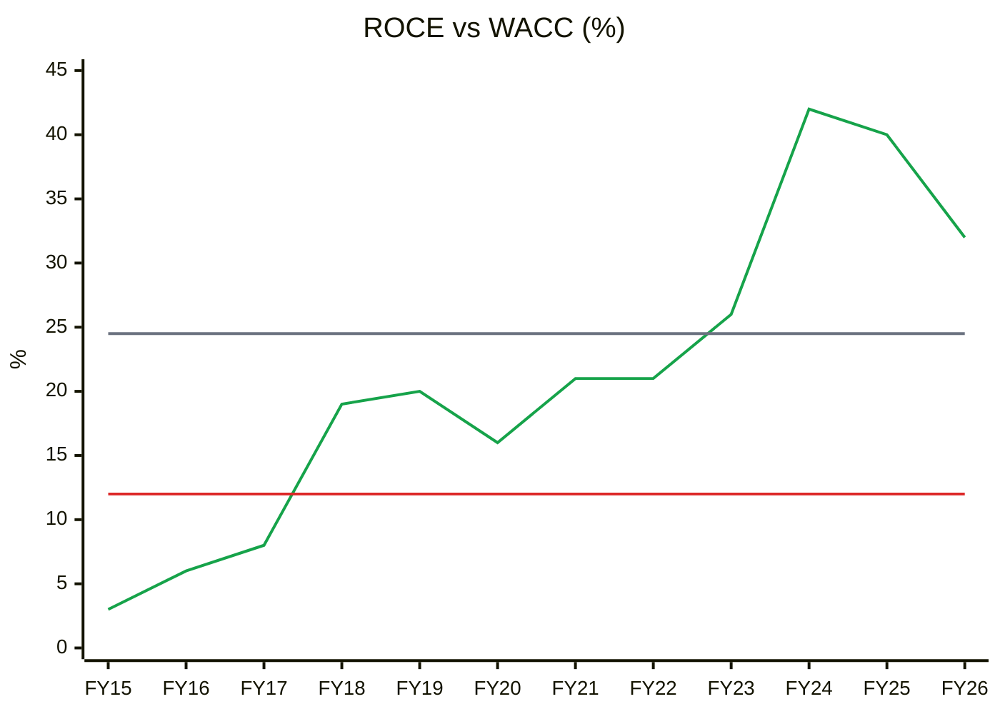
🟩 ROCE (Screener) · 🟥 WACC 12% · ⬜ 10-yr (FY17–26) average 24.5%

**Read:** ROCE was below WACC in FY15–17 and above it every year since FY18, even in the FY20 downturn (16%). It peaked at 42% in FY24 and is 32% in FY26: the 78th percentile, near +1SD (31.8%). It is falling because idle treasury cash and new land dilute it.

**Business inference:** Core ROIC ex-cash is far higher, at ~71% pre-tax on ~₹660 Cr of invested capital (FY24–26), because suppliers and customers fund working capital. Reported ROCE is now being diluted by the cash pile. **Redeploying the ₹1,350 Cr well (or returning it) is the single biggest lever on future ROE.**

**DuPont (5-factor; average balances):**
| FY | EBIT margin | Asset turnover | Equity multiplier | Interest burden | Tax burden | ROE |
|---|---|---|---|---|---|---|
| FY22 | 9.0% | 1.39× | 1.83× | 0.93 | 0.77 | 16.4% |
| FY23 | 11.3% | 1.50× | 1.72× | 0.96 | 0.74 | 20.7% |
| FY24 | 15.7% | 1.55× | 1.75× | 0.95 | 0.76 | 30.5% |
| FY25 | 17.4% | 1.36× | 1.71× | 0.95 | 0.74 | 28.8% |
| FY26 | 17.7% | 1.10× | 1.64× | 0.96 | 0.75 | 22.9% |
| **Change** | +8.7pp | −0.29× | −0.19× | +0.03 | −0.02 | +6.5pp |
*EBIT here includes other income (PBT + interest).*

**Operating contribution:** 12.5% (FY22) → 27.6% (FY24) → 19.5% (FY26). It rose with margin and is now falling with asset turnover, as cash plus land inflate total assets while revenue was flat.
**Financing contribution:** falling, as leverage declines (no debt; the equity multiplier comes from payables).
**DuPont verdict:** ROE fell from 30.5% to 22.9% **purely because of asset turnover** (the cash build-up and flat FY26 revenue). Margins rose and leverage did not mask anything. This is a good-quality ROE that is diluting itself through hoarding.
**AT trend → Module 10 base AT:** 3.4× on tangible gross block (5-yr average, FY22–26). Current 3.33× is near average. The FY24 peak of 3.96× is the bull anchor.

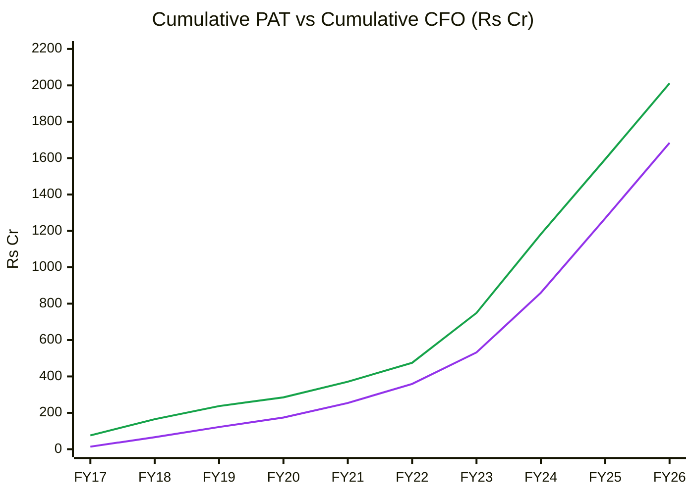
🟪 Cumulative PAT · 🟩 Cumulative CFO

**Read:** Ten-year cumulative CFO of ₹2,011 Cr vs PAT of ₹1,684 Cr gives a ratio of **1.19**. CFO has stayed above PAT throughout, and the 5-yr ratio is 1.15.

**Business inference:** Earnings are fully cash-backed. The negative-working-capital model (dealer advances plus long supplier credit) turns growth into cash *inflow*. That cash has gone into treasury rather than buybacks or dividends.

**OCF/NI (5-yr):** 1.15 → quality **HIGH.** **O'Glove flags:** 2/15. **Ind AS 116:** lease liabilities ₹7.8 Cr (FY26), immaterial.

---

## Module 5b — Fixed Assets: Full-Decade Long-Life Analysis

**PPE schedule (₹ Cr; Screener consolidated schedule FY15–26; AR FY26 Note 2a standalone for the FY26 split):**
| FY | Gross block (total) | Tangible gross | of which land | Buildings | Plant & machinery | Acc. depreciation | Net block | CWIP | Capex | D&A | Capex/D&A | Acc dep ÷ gross | AT (tangible gross) | AT (gross ex-land) | AT (net) |
|---|---|---|---|---|---|---|---|---|---|---|---|---|---|---|---|
| FY15 | 355 | 351 | 119 | 113 | 86 | 71 | 283 | 7 | 36 | 10 | 3.6× | 20% | 1.71× | 2.58× | 2.12× |
| FY16 | 410 | 406 | 124 | 117 | 129 | 95 | 315 | 2 | 39 | 11 | 3.5× | 23% | 1.57× | 2.26× | 2.02× |
| FY17 | 452 | 447 | 167 | 107 | 121 | 106 | 346 | 7 | 18 | 12 | 1.5× | 23% | 1.68× | 2.68× | 2.17× |
| FY18 | 446 | 441 | 164 | 107 | 112 | 109 | 337 | 5 | 19 | 12 | 1.6× | 24% | 2.46× | 3.92× | 3.23× |
| FY19 | 457 | 455 | 167 | 115 | 112 | 117 | 341 | 8 | 25 | 12 | 2.1× | 26% | 2.95× | 4.66× | 3.94× |
| FY20 | 537 | 534 | 171 | 177 | 119 | 125 | 412 | 19 | 87 | 13 | 6.7× | 23% | 2.16× | 3.18× | 2.81× |
| FY21 | 563 | 560 | 171 | 191 | 129 | 134 | 429 | 13 | 44 | 14 | 3.1× | 24% | 2.19× | 3.15× | 2.86× |
| FY22 | 593 | 589 | 173 | 193 | 145 | 141 | 452 | 24 | 48 | 15 | 3.2× | 24% | 2.77× | 3.92× | 3.61× |
| FY23 | 640 | 635 | 180 | 208 | 153 | 152 | 487 | 24 | 74 | 18 | 4.1× | 24% | 3.40× | 4.75× | 4.44× |
| FY24 | 740 | 735 | 195 | 240 | 182 | 161 | 580 | 44 | 175 | 23 | 7.6× | 22% | 3.96× | 5.40× | 5.02× |
| FY25 | 894 | 888 | 250 | 291 | 216 | 178 | 716 | 29 | 221 | 28 | 7.9× | 20% | 3.75× | 5.21× | 4.65× |
| FY26 | 991 | 984 | 283 | 302 | 253 | 210 | 781 | 49 | 93 | 35 | 2.7× | 21% | 3.33× | 4.68× | 4.20× |
*AR FY26 standalone Note 2a: gross ₹900.3 Cr (freehold land ₹248.5 Cr, factory buildings ₹144.1 Cr, office buildings ₹151.1 Cr, P&M ₹245.3 Cr, vehicles ₹45.3 Cr, electrical ₹17.9 Cr); acc dep ₹187.5 Cr; net ₹712.8 Cr. FY26 additions ₹71.0 Cr (P&M ₹43.1 Cr). CWIP ₹48.5 Cr (plant extensions and corporate office; none overdue). Screener "Land" includes leasehold/other categories, hence higher than AR freehold.*

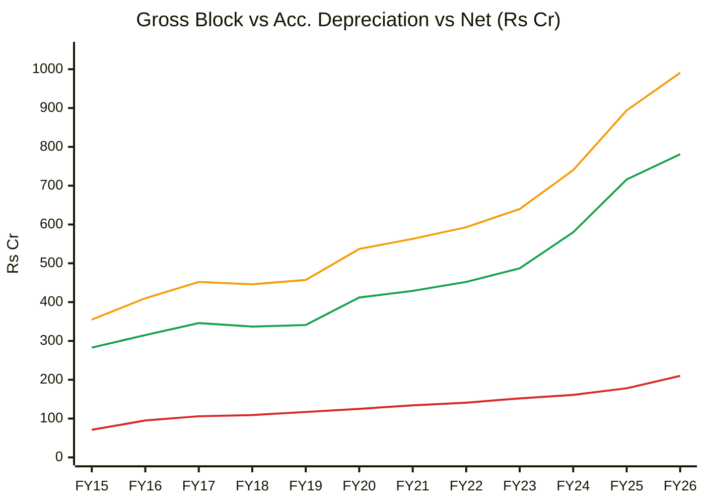
🟧 Gross block · 🟥 Accumulated depreciation · 🟩 Net block

**Read:** Gross block was flat at ~₹450 Cr through FY17–19, stepped up in FY20, then grew 1.7× in FY23–26 (₹593 Cr → ₹991 Cr). Accumulated depreciation grew only 3× in 11 years, because a large share of the block is non-depreciating land.

**Business inference:** ACE ran the same factory for a decade while revenue tripled, the classic sign of an assembler sweating cheap capacity. The FY24–26 spend (land plus buildings plus automation) is the first real capacity cycle. It expands revenue capacity to ~₹5,000 Cr and buys a land bank, so the next ~₹1,500 Cr of revenue needs little more than Plant 9 and the tower-crane plant.

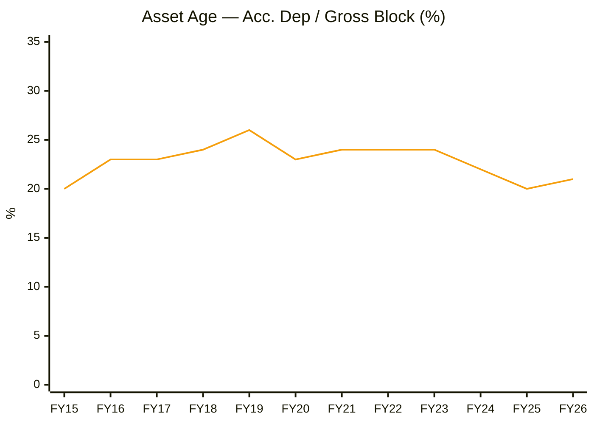
🟧 Accumulated depreciation as % of gross block

**Read:** The age ratio has been stable at 20–26% for 12 years and is 21% in FY26. Excluding land (~₹283 Cr), the depreciable block is ~30% consumed.

**Business inference:** The asset base is young and continuously refreshed (capex has exceeded D&A every year), so there is no hidden replacement-capex wall. The low ratio is partly a land artefact. ~29% of gross block is land at historical cost, a long-life asset with probable market value well above book. **Bear-case floor:** land of ₹283 Cr at book is ~₹24/share, immaterial against the ₹1,156 price but a sign of real asset backing.

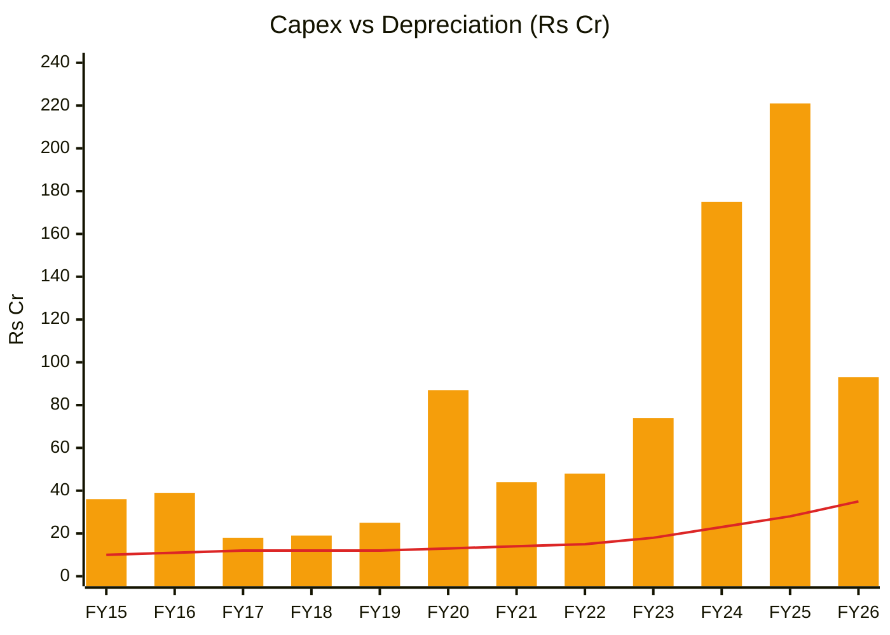
🟧 Capex (bars) · 🟥 Depreciation

**Read:** Capex/D&A averaged ~2× in FY17–19, then 7–8× in FY24–25 (₹396 Cr over two years) and 2.7× in FY26. FY27 is guided at ₹200–250 Cr (~6×; incl. ₹130–140 Cr of land).

**Business inference:** Most of the FY24–27 "capex" is land (non-depreciating, revenue-neutral until built on), so headline capex intensity overstates the growth capex. True plant-and-machinery growth capex is ~₹40–60 Cr a year. **This is a land-bank strategy, not a plant-heavy one: asset-light economics are intact, but the land is a call option on volume.**

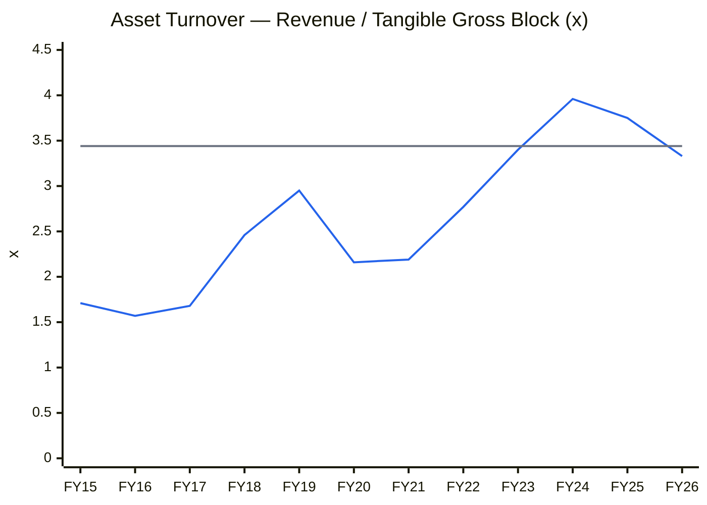
🟦 AT on tangible gross block · ⬜ 5-yr (FY22–26) average 3.44×

**Read:** AT rose from 1.6–1.7× (FY15–17) to a 3.96× peak (FY24) and has eased to 3.33× (FY26), just below the 5-yr average. Ex-land it is 4.7× (peak 5.4×).

**Business inference:** Doubling AT over a decade is the moat in numbers: scale absorbs fixed assets. The FY25–26 dip is the new land and plant ahead of volume, a normal capex-then-ramp pattern, not erosion. AT should recover towards ~3.6–3.9× by FY28 if revenue reaches ₹4,200 Cr on a ~₹1,270 Cr block.

**Capacity register & ceiling:**
| Site / capacity | Status | Revenue capacity (management) | Source |
|---|---|---|---|
| Dudhola (Palwal) integrated complex: Plants 1–8 + rented premises nearby | Operating; crane capacity raised to "about 1,000 cranes" via rearrangements in FY26 | ~₹4,400–5,000 Cr | Q1FY26 & Q2FY26 calls; Q1FY27 call |
| Plant 9: defence / special machines (on the last ~100 acres inside the complex) | Under construction; functional end-Q3/early-Q4 FY27; ₹40–50 Cr | +~₹500 Cr | Q1FY27 call |
| New tower-crane facility (4–5 km away) | Plans ready; start deferred from Apr-26 pending a Sep-26 decision | n.d. | Q1FY27 call |
| Contracted land (~1.5–2 yrs ago) | ₹130–140 Cr payment in FY27 | Future | Q1FY27 call |
| Heavy-crane business → ACE-KATO JV (50:50) | Slump sale approved 30-Apr-26; JV live end-Jul-26 | FY25 revenue ₹85.8 Cr leaves consolidation | BSE 30-Apr-26 |

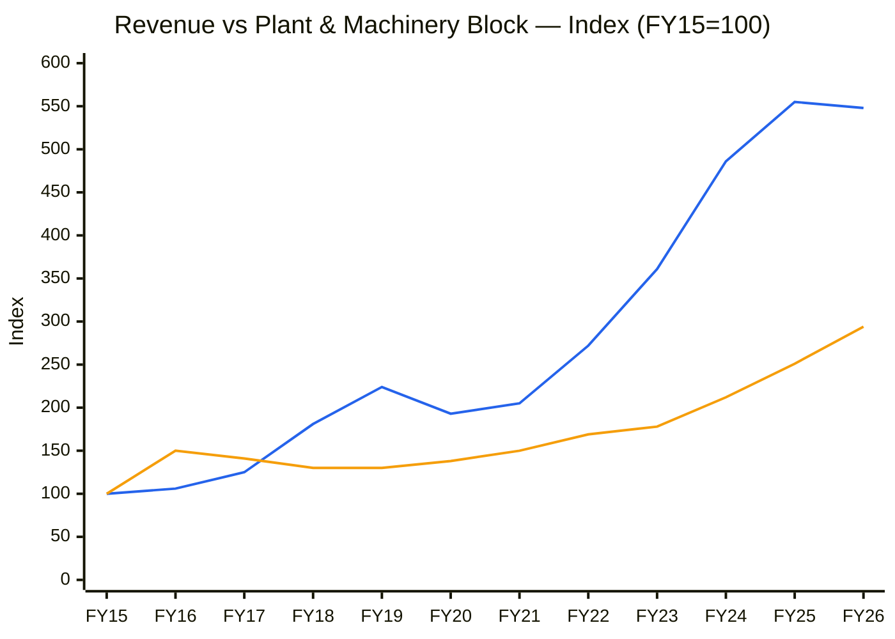
🟦 Revenue · 🟧 Plant & machinery gross block (capacity proxy)

**Read:** Revenue grew 5.5× on a P&M block that grew 2.9× (FY15–26). The gap peaked in FY25 and narrowed in FY26 as the P&M block grew 17% while revenue fell 1%.

**Business inference:** Utilisation was highest in FY25 (~75–80% of the stated ₹4,400 Cr capacity) and slipped to ~66–75% in FY26. **Headroom exists for ~₹1,200–1,700 Cr of extra revenue without major plant capex.** The forward ceiling is ~FY29 at ~13% growth, which matches management's own FY29–30 target. Faster growth needs the tower-crane plant.

---

## Module 6 — Industry KPIs & Peer Analysis
**Sector:** Capital Goods / Construction Equipment OEM (KPI block: Infrastructure / EPC / Capital Goods, near-match)

| KPI | ACE | Healthy range | Assessment |
|---|---|---|---|
| EBITDA margin (capital goods) | 15.4% | 12–18% | In line / upper half |
| ROCE | 31.6% | > 15% | **Well above** |
| Working capital days | −26 (CCC −20) | < 90 | **Exceptional** |
| Net D/E | −0.67 (net cash ₹1,352 Cr) | < 1.0 | Excellent |
| Order book / revenue | 0.17× (defence only) | > 3× for EPC | Not applicable: product OEM |
| Advances from customers | ₹220 Cr (6.7% of revenue) | > 10% of OB for EPC | Rising; healthy |
| Market share (mobile cranes) | 63%+ | — | Dominant |
| Export % | 6.2% (FY26) | — | Low; guided 6–7% FY27 |

**Peer comparison (Screener consolidated, Oct-2026):**
| Metric | ACE | Ajax Engineering | Escorts Kubota | BEML | TIL |
|---|---|---|---|---|---|
| Revenue 3-yr CAGR | 15% | — | 11% | 4% | 95% (low base) |
| EBITDA margin (latest FY) | 15.4% | — | 12% | 8% | 5% |
| ROCE | 31.6% | 23.9% | 13.9% | 7.7% | 2.9% |
| Net D/E | net cash | net cash | net cash | 0.10 | 3.4 |
| P/E (TTM) | 31.5× | 28.1× | 21.4× | 90.3× | loss |
| MCap (₹ Cr) | 13,762 | 6,460 | 30,505 | 16,118 | 1,889 |

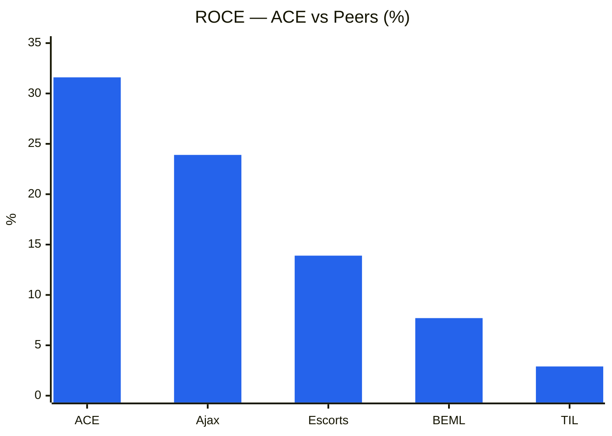
🟦 ROCE (latest, Screener)

**Read:** ACE's 31.6% ROCE is 8pp above Ajax's, 2.3× Escorts' and 4× BEML's.

**Business inference:** ACE's P/E premium over Escorts (31.5× vs 21×) is justified by returns and growth. Against Ajax (similar asset-light niche OEM) the premium is small. BEML's 90× is a defence/PSU narrative multiple, not a comparable. ACE is fairly priced *relative* to listed peers. The problem is absolute (PIE), not relative.

**Peer DuPont note:** Escorts' ROE (18.7%) is boosted by one-off gains (the FY25 PAT spike). ACE's ROE comes from margin and turnover, with negative-WC "leverage" from suppliers rather than debt. That is higher-quality ROE.

### Order Book Tracker *(defence segment; references/13-order-book-tracking.md)*
*ACE's core business (~90% of revenue) is sold through dealers against retail orders and carries no reportable backlog. The tracker covers the **defence** book, the only disclosed order book. OB-1/OB-2/OB-4 need ≥ 4 disclosed order-book points; only 2 exist (Q3FY26 ~₹500 Cr, Q4FY26 ₹575 Cr), so those charts are not drawn. Of 4 MoD/BRO Reg-30 order filings, only one (₹420 Cr) states a value. The rest are listed separately below and are not in the ledger arithmetic.*

## Order Book Tracker — ACE
*Generated 2026-10-16 by scripts/order_book_tracker.py from 1 order announcement (0 follow-ups excluded) and 6 period snapshots. Ledger coverage starts 2024-04-01. (est.) = tracked estimate: previous disclosed order book + announced orders − order-linked revenue.*

### 1. Disclosed vs tracked order book (reconciliation)

| Period | Revenue (₹ Cr) | Order book (₹ Cr) | Announced inflow | of which Framework | Implied inflow | Announced coverage | OB cover (× TTM rev) | Source |
|---|---|---|---|---|---|---|---|---|
| Q4FY25 | 961 | — | — | — | — | — | — | Screener quarterly |
| Q1FY26 | 652 | — | 0 | — | — | — | — | Screener quarterly |
| Q2FY26 | 744 | — | 0 | — | — | — | — | Screener quarterly |
| Q3FY26 | 855 | 500 | 0 | — | — | — | 0.2 | Q3FY26 concall (defence orders ~Rs500 Cr available for execution) |
| Q4FY26 | 1,029 | 575 | 0 | — | 96 | 0% | 0.2 | Q4FY26 concall (defence order book ~Rs575 Cr pending) |
| Q1FY27 | 786 | 536 (est.) | 0 | — | — | — | 0.2 | Screener quarterly; defence ~5% of Q1 revenue (CFO) |

*Implied inflow = OB(t) − OB(t−1) + order-linked revenue(t). Announced coverage = announced ÷ implied. The Q4FY26 coverage of 0% means the ~₹96 Cr implied inflow came from small, unannounced MoD orders ("INR2 crores, INR5 crores, INR1 crores keep on happening", Q1FY27 call).*

### 2. Announced orders aggregated by quarter

| Quarter | # orders | Total (₹ Cr) | Firm | Framework | Largest single | Export | Govt/PSU/Defence | Private domestic |
|---|---|---|---|---|---|---|---|---|
| Q4FY25 | 1 | 420 | 420 | 0 | 420 | 0 | 420 | 0 |

### 3. Macro picture

| Metric | Value |
|---|---|
| Latest disclosed order book | ₹575 Cr (Q4FY26) |
| Orders announced since that disclosure | ₹0 Cr with stated value (one BRO order for 74 backhoes, 30-Sep-26, value undisclosed) |
| Tracked order book today (before execution since Q4FY26) | ₹575 Cr (≈ ₹536 Cr after est. Q1FY27 execution) |
| Order book cover (latest) | 0.2 × TTM consolidated revenue (≈ 2.5–3 years of *defence* revenue at the guided ₹200–230 Cr/yr) |
| Framework / 'potential value' agreements | ₹0 Cr (0%) |
| Top-3 orders as % of disclosed OB | ~73% (the single ₹420 Cr RTFLT contract) → **concentrated** |

**OB-3 — Aggregated announced orders vs revenue, by quarter (₹ Cr)**

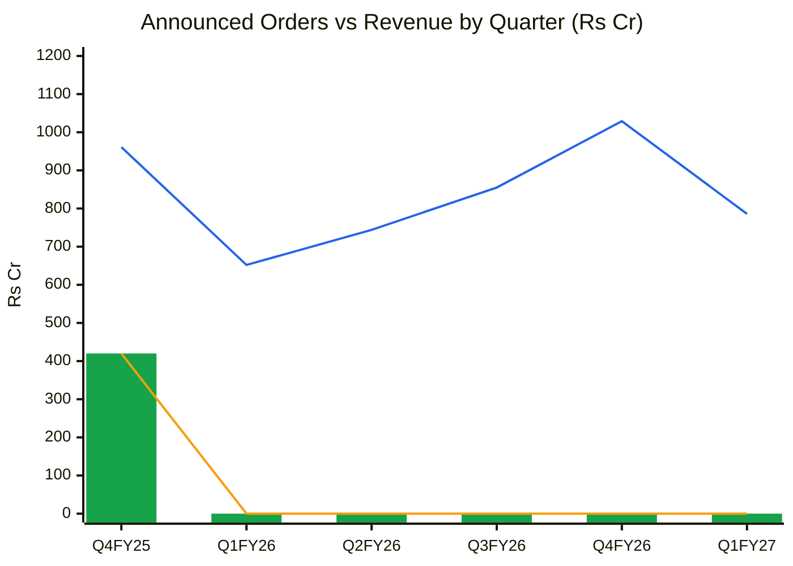
🟩 All announced orders with stated value (bars) · 🟧 Firm orders only · 🟦 Consolidated revenue

**Read:** Since Apr-2024 one valued defence order (₹420 Cr, Feb-25) equals ~44% of a single quarter's revenue. No other valued order has been announced in six quarters, and the book has grown only through small unannounced MoD orders (₹500 Cr → ₹575 Cr).

**Business inference:** Defence is lumpy, single-contract-driven, and slow to execute. The ₹420 Cr contract signed Feb-25 shipped its first units only in Aug-26. It is a real diversification leg (~5–6% of FY27 revenue) but not yet a growth engine. The next re-rating trigger is the promised repeat order of more than ₹100 Cr and the ~₹150 Cr HRV order, both of which have so far slipped.

**Defence orders without a disclosed value (not in the ledger arithmetic):**
| Date | Customer | Scope | Value | Source |
|---|---|---|---|---|
| 2024-08-16 | MoD | 285 special forklifts + 6 rough-terrain cranes (30 t) | n.d. | [BSE](https://www.bseindia.com/xml-data/corpfiling/AttachHis/0a074c21-c02a-4a6a-8834-ce533a950072.pdf) |
| 2024-09-09 | MoD | 99 forklifts | n.d. | [BSE](https://www.bseindia.com/xml-data/corpfiling/AttachHis/01f7e872-c374-44dc-aba8-15a27e482c3c.pdf) |
| 2026-09-30 | Border Roads Organisation (MoD) | 74 × 4×4 backhoe loaders | n.d. | [BSE](https://www.bseindia.com/xml-data/corpfiling/AttachHis/c7769e0c-f8e6-479b-a77e-b5d2bf4e6848.pdf) |
| Pipeline | MoD (with Ashok Leyland) | ~150 heavy recovery vehicles @ ~₹1 Cr | ~₹150 Cr (expected, not won) | Q3FY26 call |
| Pipeline | MoD | Repeat RTFLT-type order | > ₹100 Cr (expected in "next 1 or 2 quarters") | Q1FY27 call |

#### 5. Order Ledger — every announced order (source of truth; the next run appends here)

| order_id | date | customer | customer_type | segment | geography | value_cr | currency | value_fc | firmness | tenor_months | linked_to | source | notes |
|---|---|---|---|---|---|---|---|---|---|---|---|---|---|
| ACE-2502-01 | 2025-02-20 | Ministry of Defence (Army/IAF/Navy) | Defence | Defence - Rough Terrain Forklifts | Domestic | 420 | INR |  | Firm | 36 |  | [BSE](https://www.bseindia.com/xml-data/corpfiling/AttachHis/2aaf1906-2e6a-4fef-88cd-3da1b3499c7b.pdf) | 1,121 RTFLTs + attachments = 60% of MoD's 1,868-unit procurement; execution began Q1FY27 (supplies from Aug-26); guided ~Rs200-230 Cr FY27, balance FY28 |

#### 6. Order Book Snapshots — revenue and disclosed order book per period

| period | revenue_cr | revenue_ttm_cr | order_book_cr | order_linked_share | as_of_date | source |
|---|---|---|---|---|---|---|
| Q4FY25 | 961 | 3327 |  | 0.02 |  | Screener quarterly |
| Q1FY26 | 652 | 3245 |  | 0.02 |  | Screener quarterly |
| Q2FY26 | 744 | 3232 |  | 0.02 |  | Screener quarterly |
| Q3FY26 | 855 | 3212 | 500 | 0.02 | 2026-02-09 | Q3FY26 concall (defence orders ~Rs500 Cr available for execution) |
| Q4FY26 | 1029 | 3280 | 575 | 0.02 | 2026-05-21 | Q4FY26 concall (defence order book ~Rs575 Cr pending) |
| Q1FY27 | 786 | 3414 |  | 0.05 |  | Screener quarterly; defence ~5% of Q1 revenue (CFO) |

*Every number above traces to the ledger / snapshot rows (source column).*

**Order-book verdict:** Firm defence visibility ~2.5 years (₹575 Cr vs guided ₹200–230 Cr/yr burn) · book-to-bill (defence, TTM) ~1 on small orders · framework share 0% · concentration ~73% in one contract · execution rate rising from a zero base (first supplies Aug-26).
**Forward link (Module 10):** Defence revenue FY27E ≈ ₹200–230 Cr (management) and FY28E ≈ ₹200–250 Cr (balance of the RTFLT order plus new orders). It is *added* to the dealer-business capacity model, not used as the company revenue anchor.

---

## Module 7 — Market Size & Market Share
- **TAM:** Indian construction equipment (all categories) is roughly a ₹70,000–90,000 Cr (~US$8–10 bn) market *(indicative; ICEMA/industry-report figures not accessed from a primary source)*. Mobile and tower cranes are a sub-segment of perhaps ₹5,000–6,000 Cr, of which ACE's ~₹2,000+ Cr of crane revenue implies ~60%+ share, consistent with the company's own claim.
- **Market share:** **63%+ mobile cranes, 60%+ tower cranes, top-3 forklifts** (company, via Screener). ACE has been the leader in new-generation cranes for the last two years (Q1FY27 call). It targets 70% in cranes (Q2FY25 call).
- **5-yr trend:** stable to gaining (management statements). **No independent volume-share series was sourced, so this is a data gap.**
- **Reconciliation:** FY26 industry CE sales "declined modestly" against ACE −1.4% (in line). Q1FY27 CHCE volume grew +17% against an industry recovering from the emission-norm shock, implying stable-to-gaining share.
- **Verdict: dominant and stable in cranes; small and gaining in backhoes, forklifts and exports.**

---

## Module 8 — Valuation: PIE First, Then DCF

**Inputs:** CMP ₹1,155.7 · shares 11.905 Cr · MCap ₹13,762 Cr · net cash ₹1,352 Cr (FY26) · EV ~₹12,410 Cr · TTM EBITDA ₹529 Cr (EV/EBITDA 23.5×) · TTM core EBIT ₹493 Cr → NOPAT ≈ ₹370 Cr (25% tax) · WACC 12% (Rf 7%, β ~1.0, ERP 5.5%; ICRA AA, no debt) · terminal g 6%.

### 8A. Price-Implied Expectations
| PIE value driver | Market-implied | My base case | Expectations gap |
|---|---|---|---|
| NOPAT CAGR, 10 yrs (incremental ROIC 40%) | **~18%** (17% at ROIC 60%; 20% at ROIC 30%) | ~12–13% | **−5 to −6pp: mildly optimistic** |
| Revenue CAGR (5-yr) | ~15–16% (at a stable ~15% margin) | ~12% | −3 to −4pp |
| Steady-state EBITDA margin | ≥ 15.5% held | 15% (13–14% in a down-year) | ~flat |
| Reinvestment rate | ~40–45% of NOPAT | ~30% (land + Plant 9 + tower cranes) | Market assumes cash is redeployed productively |

**Physical plausibility:** a ~16% revenue CAGR means ~₹6,900 Cr by FY31. Existing plus Plant 9 capacity is ~₹5,000–5,500 Cr, so **the market is pricing the tower-crane plant and a further expansion on the new land** (both unannounced or deferred), or inorganic growth with the cash pile. That is plausible, but it is not in hand.

**Expectations treadmill:** To outperform, ACE must deliver **FY27 revenue ≥ ₹4,000 Cr (its own target) at ≥ 15% EBITDA *and* commit the ₹1,350 Cr cash pile to > 20% ROIC uses.** Delivering our base case of ₹3,750 Cr only earns the cost of capital from here.

**Triggers.** Positive: (1) FY27 guidance ≥ ₹4,000 Cr announced and Q2/Q3 delivering it; (2) anti-dumping duty on Chinese cranes notified; (3) the repeat RTFLT order (> ₹100 Cr) and the HRV order; (4) a buyback or special dividend. Negative: (1) margin slip below 14% as steel inflation outruns price hikes; (2) a large, expensive acquisition; (3) an infra/real-estate slowdown in H2 FY27 (monsoon, liquidity).

**SVAR:** bear price ₹656 → SVAR = (1,156 − 656)/1,156 = **43% (> 40%: unfavourable).**

### 8B. Intrinsic value
| Method | Bear | Base | Bull |
|---|---|---|---|
| DCF (FCFF; WACC 12%; 5-yr explicit; net cash added) | ₹471 (NOPAT ₹330 Cr, g 6%, ROIC 30%) | ₹709 (₹370 Cr, g 13%, ROIC 40%) | ₹954 (₹400 Cr, g 18%, ROIC 45%) |
| Relative P/E on FY28E EPS (₹32.8 / ₹42.7 / ₹52.3) | ₹656 (20×) | ₹1,200 (28× = 10-yr median) | ₹1,670 (32×) |
| **Scenario value used** | **₹656** | **₹1,200** | **₹1,670** |

The DCF says even the base case is worth ~₹700, so the market is paying a growth-option premium a strict DCF cannot justify at a 12% WACC. Indian capital-goods leaders trade on P/E norms (sector P/E 22–35× per the KPI reference). We use relative valuation for scenario prices, which is generous, and still find no margin of safety.

**Graham screen:** revenue > ₹2,000 Cr ✓ · current ratio ≥ 2 ✗ (1.96) · positive EPS for 7 yrs ✓ · no dividend cut for 5 yrs ✓ · EPS growth ≥ 30% over 7 yrs ✓ (₹4.44 → ₹34.86) · P/E ≤ 20 ✗ · P/B ≤ 3 ✗ → **4/7.** Graham number = √(22.5 × 5-yr avg EPS ₹24.0 × BVPS ₹169) = **₹302.**

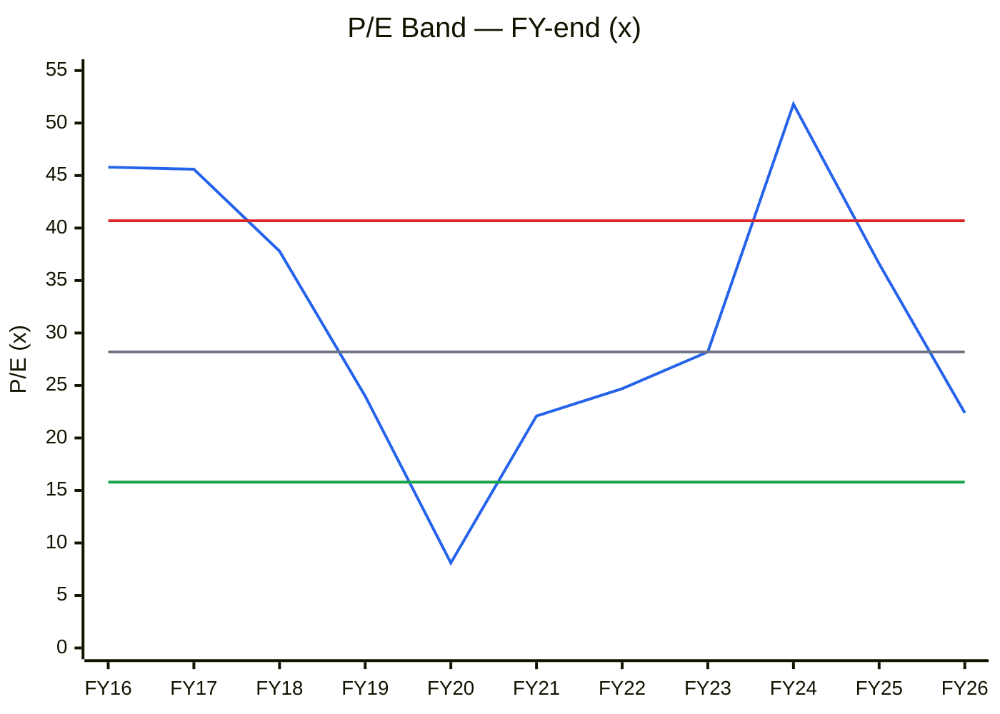
🟦 P/E (March price ÷ FY EPS) · ⬜ Median 28.2× · 🟥 +1SD 40.7× · 🟩 −1SD 15.8×

**Read:** At March 2026 the P/E was 22.4× (20th percentile). Today it is **31.5× TTM (~55th percentile)**, above the 28.2× median, after a 48% rally from the March low.

**Business inference:** The cyclical P/E rule applies, because margins are at a decade peak. Paying an above-median P/E on peak-margin earnings is double-peak risk. The March 2026 dip to 22× on trough-growth EPS was the opportunity. The market has since re-priced the recovery, so the next leg needs delivered growth, not re-rating.

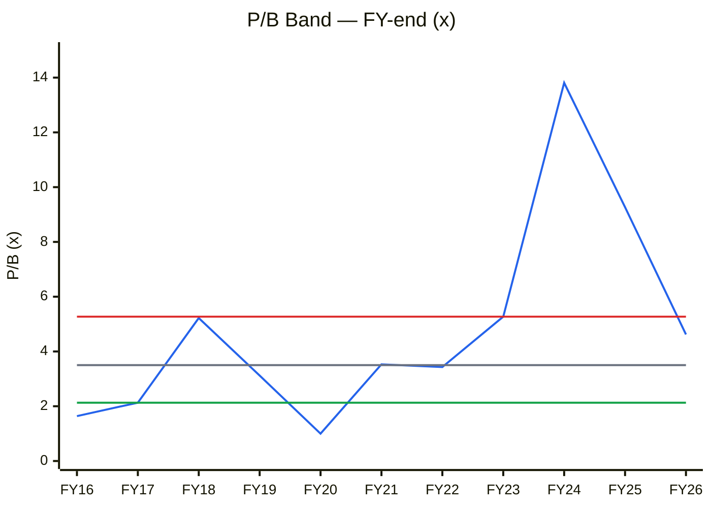
🟦 P/B (March price ÷ year-end BVPS; FY16–21 BVPS on current share count, slightly understated) · ⬜ Median 3.5× · 🟥 75th percentile 5.27× · 🟩 25th percentile 2.13×. *Quartiles are used because the FY24 13.8× outlier makes SD meaningless.*

**Read:** P/B is **6.8× today** (₹1,156 / ₹169), above the 75th percentile (~80th percentile). ROE is 22.8% against a 10-yr median of 13.9%.

**Business inference:** The high P/B is earned. Justified P/B = (ROE 23% − g 11%)/(Ke 12.5% − g 11%) ≈ 8×, but that is extremely sensitive to g and Ke, and ROE is falling as cash piles up. If ROE drifts to 18–20% with hoarding, the justified P/B is ~4–5×, i.e. ~₹700–850 on FY26 book.

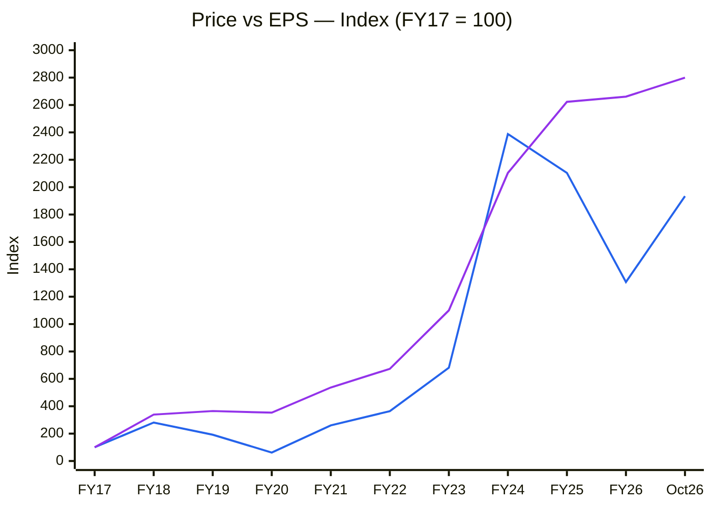
🟦 Share price (March-end; Oct-26 = ₹1,156) · 🟪 EPS (FY; Oct-26 = TTM ₹36.68)

**Read:** Over FY17–26, EPS rose 26.6× and the price 13.1× (Oct-26: 19.3× vs 28.0×). The price overshot EPS in FY24 (re-rating to 52×), de-rated below EPS in FY26, and is now converging.

**Business inference:** Long-run shareholder returns came from *earnings*, not multiple expansion, which is a healthy compounder signature. FY24 borrowed from the future and FY26 repaid it. At today's price, returns from here ≈ EPS growth (12–14%) ± multiple drift. The stock is no longer cheap against its own earnings path.

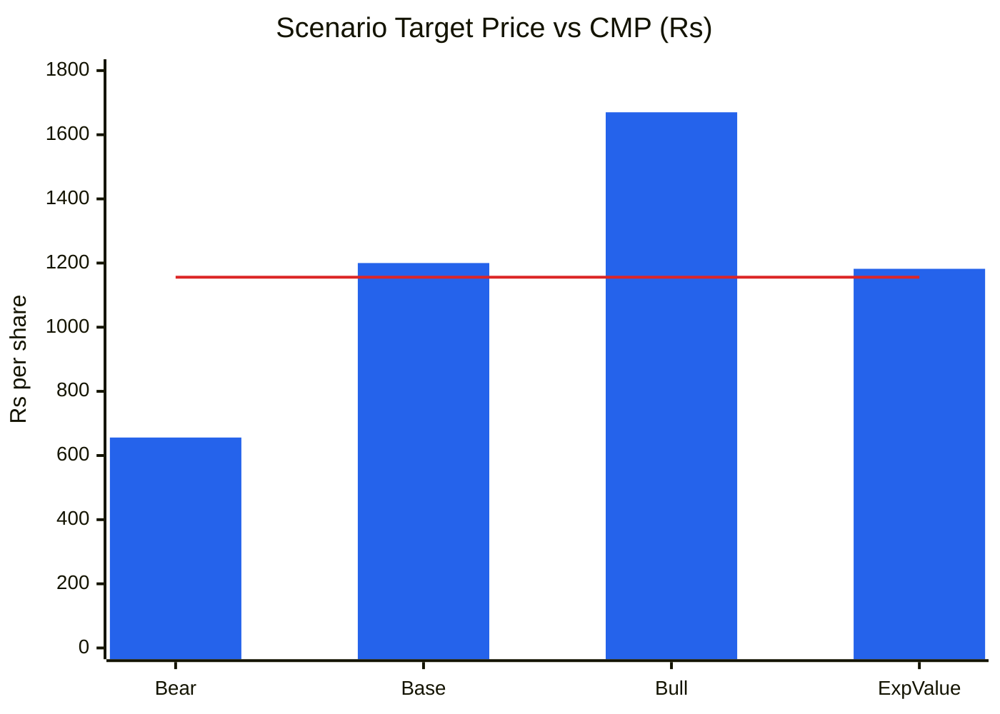
🟦 Scenario price · 🟥 CMP ₹1,156

**Read:** Bear −43%, base +4%, bull +44%. The expected value of ₹1,182 is +2% above CMP, an upside/downside ratio of ~1.0:1.

**Business inference:** At today's price the market has paid for the base case. The stock gives a symmetric coin-flip on whether management's (historically optimistic) growth targets arrive. **Asymmetry reappears below ~₹900**, where the base case gives +33% against a −27% bear case.

### Cycle Position Dashboard
| Dimension | Current | 10-yr median | Percentile | Signal |
|---|---|---|---|---|
| P/E (TTM) | 31.5× | 28.2× | ~55% | Fair-to-expensive |
| P/B | 6.8× | 3.5× | ~80% | Expensive (earned by ROE) |
| EBITDA margin | 15.4% (FY26) / 15.5% TTM | 9.5% (FY17–26) | 100% | **Peak (> +1SD)** |
| ROCE | 31.6% | 21.6% | 78% | Late-mid (≈ +1SD) |
| Revenue growth (TTM) | +5% (Q1 +21%) | ~16% | ~25% | Recovering from trough |
| Industry utilisation | ~66–75% of ACE capacity | — | — | Balanced (headroom) |
| Input cost (steel) | +~20% YoY | — | — | Headwind |
| **Overall cycle position** | | | | **MID (volume recovery) / LATE (margin)**. Consistent with Module 1b (neutral → tailwind on volume) and 1c (mid-cycle recovery, late-cycle margin) |

---

## Module 9 — Technical Stage (Weinstein + CANSLIM)
- **Nifty 50:** **Stage 4** (below a falling 30-wk MA; −10.8% YoY).
- **Sector:** Capital goods have been in a de-rating since 2024. No sector-index series was retrieved (data gap). Peers are mixed: BEML and Escorts are below their highs, Escorts −32% from its 52-wk high.
- **Stock:** **Stage 2 (advancing).** From a Stage-4 decline (₹1,427 Mar-24 → ₹781 Mar-26), ACE based in Mar–Jul 2026 (~₹880–990). It broke out in the week of 20-Jul-26 (Q1 results) on **9.5 mn shares, ~5× the ~1.8 mn weekly average**, and ran to a ₹1,268 high (Sep-26). It is now pulling back to ₹1,156 (−9%). The 30-wk MA is rising (₹1,015–1,028 vs ₹897 in June) and the price is ~13% above it. Stock +4.1% YoY vs Nifty −10.8% → **RS +15pp**.
- **Breakout checklist:** weekly close above resistance ✓ (₹1,039 vs the ~₹990–1,040 ceiling) · volume ✓ (5×) · 30-wk MA rising ✓ · RS positive ✓ · base width ✓ (~17 weeks) · entry within 10–15% of pivot ✗ (₹1,156 is +11% over the ₹1,040 pivot, at the edge).
- **CANSLIM:** C ✓ (Q1 EPS +22% standalone PAT; just below the 25% threshold, but accelerating: ½) · A ✓ (3-yr EPS CAGR 34%; ROE 23%) · N ✓ (KATO JV, defence, new 52-wk high from a base) · S ✗ (large float, no buyback) · L ✓ (sector leader, RS strong) · I ✗ (FII 11.9% → 7.8%, falling 4 quarters) · M ✗ (Nifty Stage 4) → **3.5/7.**
- **Stop-loss:** weekly close below ₹1,015 (30-wk MA). Hard stop ₹990 (failed-breakout level).
- **Stage + fundamental alignment: PARTIALLY ALIGNED.** The stock trend is positive, but valuation has no MoS and the market is Stage 4, which overrides an aggressive entry.

---

## Module 10 — Forward View: 2–3 Year Thesis

### Capex Classification
| Capex type | FY27E (₹ Cr) | FY28E | FY29E | In AT model? |
|---|---|---|---|---|
| Tangible growth capex: Plant 9 (defence/special) | 45 | 5 | — | ✅ |
| Tangible growth capex: tower-crane plant (if approved) | 0–30 | 60 | 40 | ✅ (bull / late base) |
| Land (contracted) | 135 | — | — | ⚠️ non-depreciating; revenue-neutral until built on |
| Automation / upgrade + maintenance (≈ D&A) | 55 | 50 | 55 | ❌ sustains |
| Intangibles / software | ~5 | ~5 | ~5 | ❌ |
| JV investment (ACE's ₹100 Cr share is in kind: models, tech, infrastructure) | 0 cash | — | — | ❌ (equity-accounted) |
| **Total capex** | **~240** | **~120** | **~100** | |

**Current CWIP:** ₹48.5 Cr (standalone, AR FY26 Note 2b; plant extensions and corporate office; none overdue). It transfers in FY27.

### Tangible gross block and AT
| Year | Tangible gross block (₹ Cr) | Revenue (₹ Cr) | AT (×) |
|---|---|---|---|
| FY22 | 589 | 1,630 | 2.77 |
| FY23 | 635 | 2,160 | 3.40 |
| FY24 | 735 | 2,914 | 3.96 |
| FY25 | 888 | 3,327 | 3.75 |
| FY26 | 984 | 3,280 | 3.33 |
| **5-yr avg AT** | | | **3.44** |
| **AT trend** | | | Rising FY15–24; dip FY25–26 (land/plant ahead of volume) |

**Incremental ROIC (FY21→FY26):** core EBIT Δ₹364 Cr × 0.75 / ~₹490 Cr net growth capex ≈ **~55% vs WACC 12% → strongly value-creating.** The land bank lowers the forward incremental ROIC to ~30–35%, still ≫ WACC.
**Capex-model implied revenue CAGR (FY26 → FY29):** gross block ~₹1,340 Cr × AT 3.4–3.5× ≈ ₹4,550–4,700 Cr → **~11–13% a year** (vs PIE ~15–16%, and vs management's ~17% to reach ₹6,000 Cr by FY29–30). **The market is pricing the unannounced tower-crane/land expansion or M&A.**

### Capex-to-Earnings Model (base case)
| Metric | FY27E | FY28E | FY29E |
|---|---|---|---|
| Opening tangible gross block (₹ Cr) | 984 | 1,200 | 1,270 |
| Growth capex commissioned (₹ Cr, incl. land) | 215 | 70 | 70 |
| Closing tangible gross block (₹ Cr) | 1,200 | 1,270 | 1,340 |
| AT applied (×, on closing block) | 3.13 | 3.31 | 3.47 |
| Revenue: dealer/CE business (₹ Cr) | 3,530 | 3,960 | 4,400 |
| Revenue: defence (order book) (₹ Cr) | 220 | 240 | 250 |
| **Total revenue (₹ Cr)** | **3,750** | **4,200** | **4,650** |
| EBITDA margin (%) | 15.0 | 15.0 | 15.0 |
| EBITDA (₹ Cr) | 563 | 630 | 698 |
| Other income (treasury) (₹ Cr) | 105 | 115 | 130 |
| D&A (₹ Cr) | 40 | 45 | 50 |
| Interest (₹ Cr) | 20 | 20 | 20 |
| ICR (×) | 30 | 35 | 39 |
| Net debt / EBITDA (×) | net cash | net cash | net cash |
| PAT (₹ Cr, 25% tax) | 456 | 510 | 570 |
| EPS (₹) | 38.2 | 42.7 | 47.7 |
| ΔWorking capital (₹ Cr; negative WC releases cash) | +20 | +20 | +20 |
| **FCF (₹ Cr)** | **~275** | **~455** | **~540** |

**FCF inflection:** passed (FY23). The FY27 dip comes from the land payment.
**Debt ceiling:** not applicable (net cash ₹1,350 Cr+).

### Key Catalysts
1. Q2FY27 results (early Nov-26) and the delayed FY27 revenue guidance (promised "by September end"). Timing: Nov-26.
2. The repeat MoD order (> ₹100 Cr) and the ~150-unit HRV order with Ashok Leyland. Timing: H2 FY27.
3. Plant 9 commissioning (Q4FY27) and the tower-crane plant go-ahead.
4. KATO JV upgraded products (from Q4FY27) and KATO-design export models (FY28+).
5. Capital return or a value-accretive acquisition using the ₹1,350 Cr cash. Timing: FY27–28.

### Key Risks
1. Input inflation (steel +20%) outruns the ~10% price hikes and margin slips below 14%. **Probability: Medium.**
2. Construction/infra slowdown in H2 FY27 (monsoon, state-government payment delays, a geopolitical shock to GDP). **Medium.**
3. Chinese heavy-crane imports with no anti-dumping duty; competition in the NG crane segment. **Medium.**
4. Capital misallocation: an expensive acquisition at the top of the cycle. **Low-Medium.**
5. Supplier stress (castings/engines) disrupts production and DPO normalises, unwinding working capital. **Low-Medium.**

### Scenario Analysis (AT-driven, FY28E)
| Scenario | AT assumption | Revenue FY28E | EBITDA margin | EPS FY28E | Multiple | Target price | Probability |
|---|---|---|---|---|---|---|---|
| Bull | AT → 3.96× (FY24 peak) on ~₹1,190 Cr block; defence + exports + KATO | ₹4,700 Cr | 16.5% | ₹52.3 | 32× | ₹1,670 | 25% |
| Base | 5-yr avg ~3.3–3.4× | ₹4,200 Cr | 15.0% | ₹42.7 | 28× | ₹1,200 | 50% |
| Bear | AT 2.7× (FY22-like; flat demand, new block idle) | ₹3,400 Cr | 14.0% | ₹32.8 | 20× | ₹656 | 25% |
| **Expected value** | | | | | | **₹1,182** | |

**Return from current price (expected value): +2%.** The MoS required for a mid-cap cyclical OEM is 25–30%, so this **fails** the test.

---

## Checklist Summary
**Section 0 (Existing Report Protocol):** 3/3. Folder searched by ticker and name fragments; no prior report; initial report created as the single ACE file
**Section A (Business Quality):** 15/18. Scuttlebutt limited to concall Q&A. Pledge and Form C detail not retrieved. Independent market-share series missing
**Section B (Forensics):** 9/9
**Section C (Financial Statements):** 12/12
**Section D (KPIs & Peers):** 7/7
**Section E (Market Size & Share):** 4/7. TAM is indicative and the 5-yr share series is unavailable
**Section F (Valuation):** 10/10
**Section G (Technical Stage):** 7/8. Sector-index stage not retrieved
**Section H (Forward View):** 31/36. Asset-light unit-economics N/A; tower-crane plant timing unknown; CWIP not project-wise
**Section I (Charts):** 4/5. CY5/CY6 not drawn (no primary industry series). OB-1/OB-2 not drawn (< 4 disclosed OB points); OB-3 included
**Order Book Tracker:** Run (defence segment; ledger + snapshots inside this report)
**Hard stops triggered:** None on quality. **Upside/downside of ~1.0:1 is below the 1.5:1 threshold → no new buying at CMP.**

**Pre-buy final check:** Business or story? A business, with a real moat in cranes. Am I anchored to the breakout? Yes, the risk is chasing a stock +48% off its low into a Stage-4 market. Would I buy after a 25% fall? Yes, at ≤ ₹900 with margins ≥ 14.5%. → **Watchlist.**

---

## Investment Decision
**Recommendation: WATCHLIST (QUALITY AT WRONG PRICE). Buy below ₹900.**
ACE is the best-run franchise in Indian mobile cranes: 63% share, a decade of margin expansion from 5% to 15%, ~70% pre-tax core ROIC, negative working capital, ₹1,350 Cr of net cash, clean forensics, and a fixed-asset base that has turned 3–4× for years while being refreshed. Revenue is re-accelerating (+21% in Q1FY27) after the CEV-V shock, and defence (₹575 Cr book), exports and the KATO JV add optionality. But at ₹1,156 the market already prices ~18% NOPAT growth for a decade on decade-peak margins. Management's top-line guidance has a 0.50 walk-the-talk record, the cash pile dilutes ROE until it is deployed, and the index is in Stage 4. Expected value of ₹1,182 is ≈ CMP.

- **Conviction score: 6 / 10.** Cycle 0.5 · Industry 0.5 · Moat 1.5 · Management 0.5 · Financial/earnings quality 2 · Valuation/PIE 0.5 · Technical 0.5
- **Suggested position size:** 0% now. At ≤ ₹900: standard 2–3% (×0.5 while margins are at peak and the market is Stage 4 → ~1.5% initial)
- **Entry price range:** ₹820–900 (≈ 20–22× FY28E EPS; base-case upside ≥ 33%)
- **Stop-loss (existing holders):** weekly close < ₹1,015 (30-wk MA); hard stop ₹990
- **Target price (base, 2-yr):** ₹1,200; bull ₹1,670
- **Review trigger:** *Upgrade* if (a) FY27 guidance ≥ ₹4,000 Cr is given **and** H1FY27 revenue ≥ ₹1,650 Cr at ≥ 15% EBITDA, or (b) a buyback/special dividend signals capital discipline. *Downgrade* if EBITDA margin falls below 14% for 2 quarters, a large acquisition is made at > 25× earnings, or the 30-wk MA rolls over.

---
*Report generated by Stock Fundamental Analysis Skill v3.3 | Indian Markets Context*
*Sources: Screener.in consolidated (FY15–26 P&L, BS, CF, schedules incl. fixed-asset breakdown, quarterly, shareholding, peers, price/PE chart API; fetched 16-Oct-2026); BSE filings 532762: Q1FY27 results & presentation (20-Jul-26), Q1FY27 concall transcript (21-Jul-26, revised 24-Jul-26), Q4FY26 / Q3FY26 / Q2FY26 / Q1FY26 / Q4FY25 / Q3FY25 / Q2FY25 transcripts, Annual Report FY26 (24-Aug-26: MD&A segment table, Note 2a PPE, Note 2b CWIP, remuneration annexure, KAM, BRSR export %), AGM chairman's speech (18-Sep-26), ₹420 Cr MoD press release (20-Feb-25), MoD/BRO order filings (16-Aug-24, 9-Sep-24, 30-Sep-26), KATO JV filings (13-Feb-26, 12-Mar-26, BTA 30-Apr-26), Sanghvi Movers MOU (11-Dec-25), ICRA AA/A1+ reaffirmation (17-Jan-26); Yahoo Finance weekly (^NSEI, ACE.NS). Order Book Tracker: scripts/order_book_tracker.py (inputs in session scratchpad only). Save path: C:\Users\anubh\Documents\Anubhav\Stock Analysis\Stock Analysis\*
