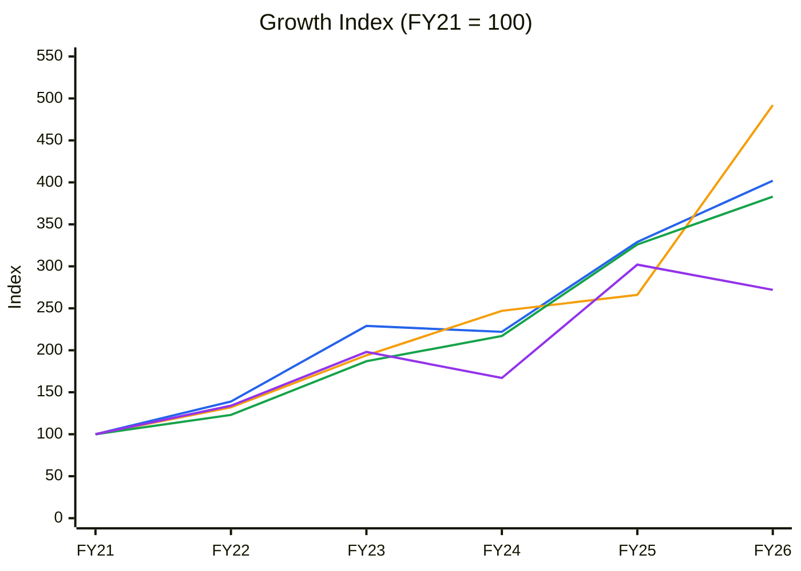
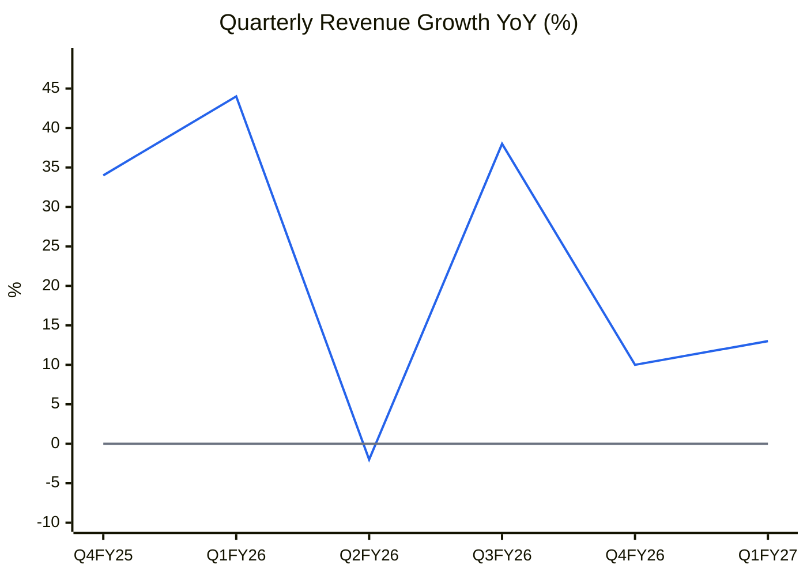
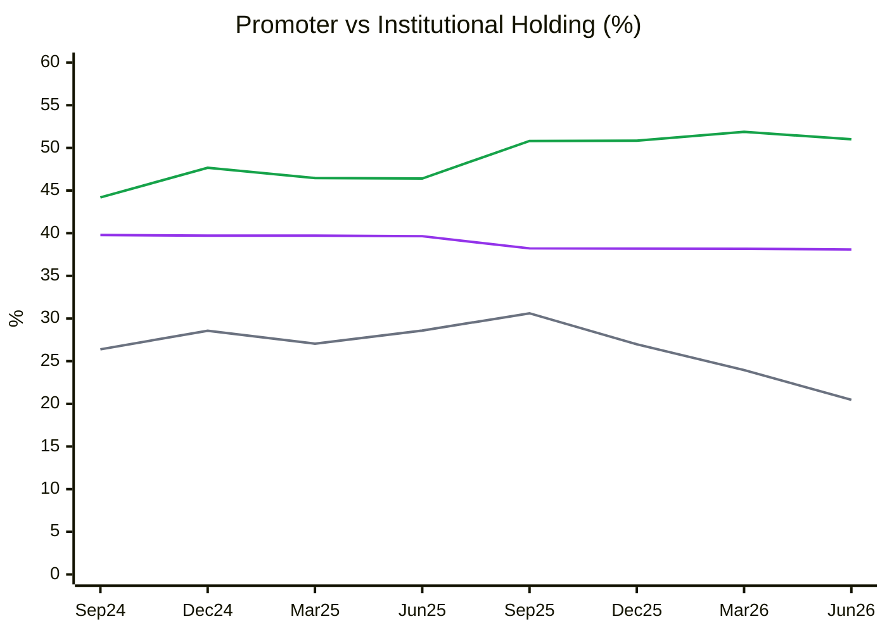
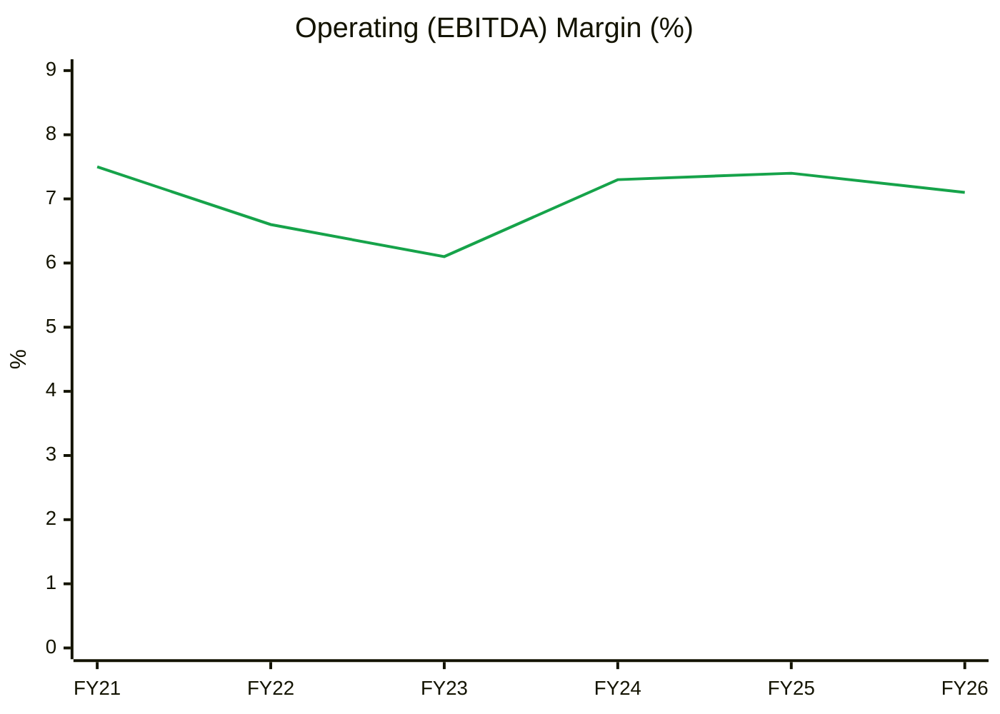
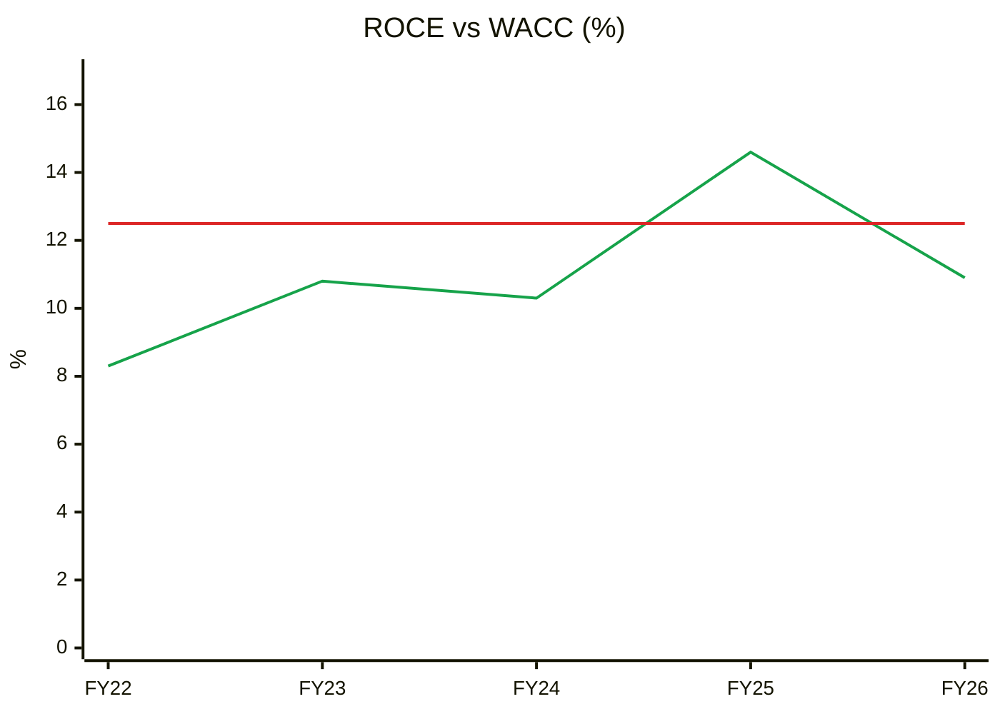
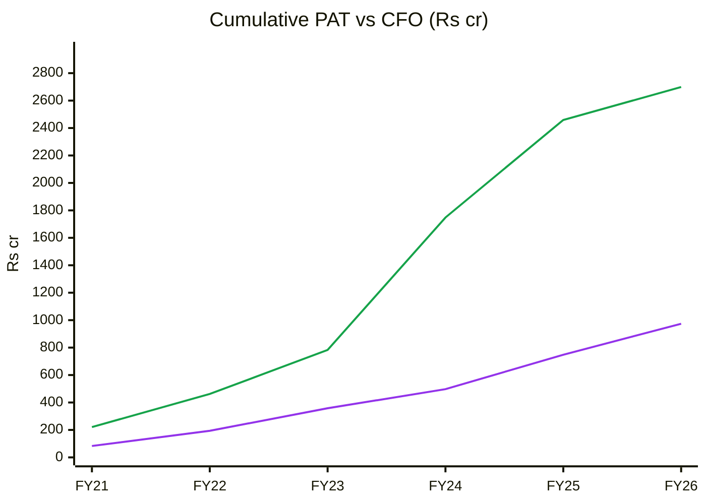
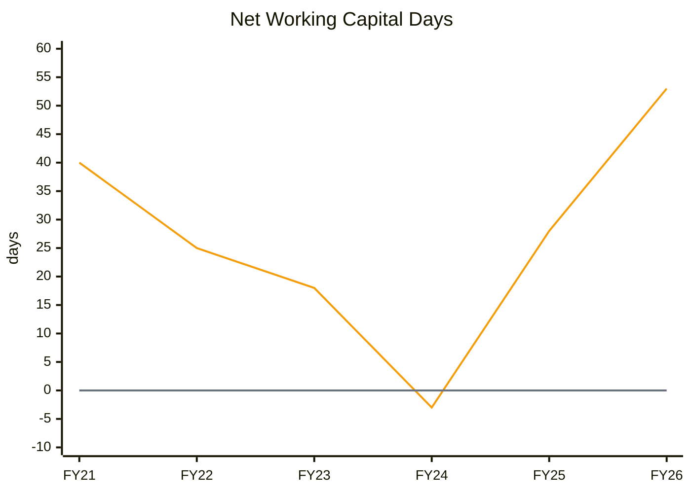
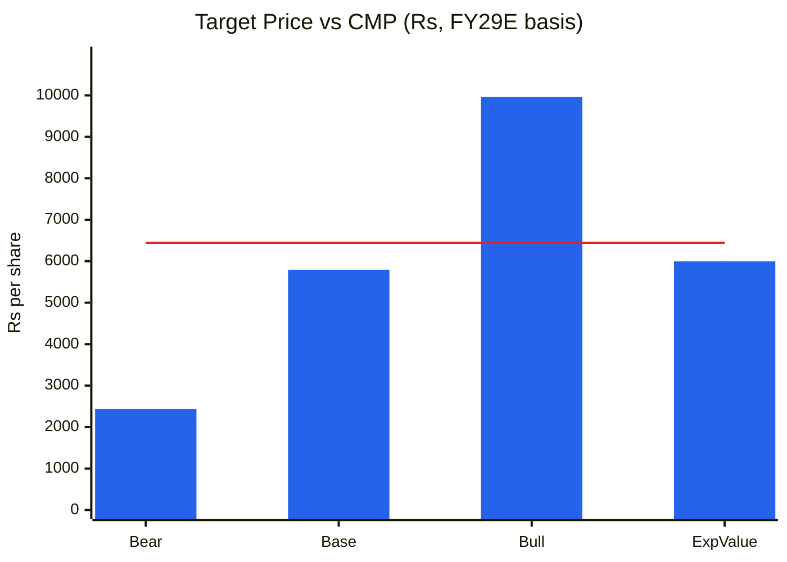

# Stock Analysis Report — Amber Enterprises India Ltd (AMBER)
**Date:** 2026-10-12
**Analyst:** Claude (Stock Fundamental Analysis Skill v3.3)
**Investment Horizon:** 2–3 Years
**Recommendation:** AVOID at CMP (WATCHLIST below ₹4,000 or on a Stage 2 base)
**Conviction Score (as a buy at CMP):** 3.5 / 10
**CMP:** ₹6,445 (NSE close 09-Oct-2026) · **Market cap:** ₹22,730 cr · **Buy-below:** ₹3,800–4,200

## Revision Log
| Version | Date | Recommendation | Conviction | Price | Key change |
|---|---|---|---|---|---|
| Current | 2026-10-12 | AVOID at CMP | 3.5/10 | ₹6,445 | Initial report. Run as part of a four-way EMS comparison (Amber, Dixon, Syrma, PGEL) |

**Validation of previous report:** Initial report. No earlier Amber file in the library.

---

## Executive Summary
Amber is being converted from India's largest room-AC contract manufacturer into a diversified electronics group (PCBA, bare PCBs through Ascent, Israeli PLC maker Unitronics, Power-One inverters, railway HVAC, and Oppo smartphones from FY28). The strategy is sensible and the electronics division is working: revenue +49% in FY26 and EBITDA margin 10.8% in Q4. The returns are not there yet. **ROCE has been below a 12.5% WACC in five of the last six years**, FY26 free cash flow was **−₹2,664 cr** (acquisitions plus capex), net debt more than doubled to ₹1,225 cr in one quarter, and Q1 FY27 reported PAT was just ₹3 cr after a ₹123 cr exceptional charge. At 110× trailing (≈92× on adjusted earnings), in a Weinstein **Stage 4** downtrend, with railway margin guidance already cut and PCB timelines slipped, the asymmetry is poor (≈0.9:1).

🟦 Revenue (CAGR 32%) · 🟧 Net Fixed Assets (38%; net block used — gross block not on Screener) · 🟩 EBITDA (31%) · 🟪 PAT (22%)

**Read:** FY21→FY26: revenue 4.0×, net fixed assets **4.9×**, EBITDA 3.8×, PAT only 2.7×.

**Business inference:** Amber is buying growth with capital. Assets (including acquisitions) have outrun revenue, and interest plus depreciation have eaten the operating gains, so PAT lags EBITDA. This is the "gross block above revenue, gap widening" pattern. Until the new electronics assets sweat, ROCE stays below cost of capital (→ Module 11 bear anchor).

---

## Business Primer
Amber makes room air conditioners (RACs) and their components (heat exchangers, motors, sheet metal, plastics) for most of India's leading AC brands, which sell them under their own names. It is the largest RAC ODM/OEM in India. Around that core it has built two higher-margin businesses. **Electronics** (through IL JIN Electronics) covers PCB assembly, bare PCBs (Ascent Circuits, now 98.5% owned after a ₹336.75 cr top-up in Jun-2026; Shogini Technoarts), industrial automation PLCs (Unitronics, Israel, ~50% stake) and power electronics (Power-One). **Railway sub-systems & defence** (Sidwal and others) makes HVAC, doors and other rail and metro systems. Revenue is volume × BOM pass-through in consumer durables (thin, seasonal margins), with design and programme margins in electronics (~10%) and railways (~15–16%). The business depends on (1) the summer AC season, which concentrates profits in Q4–Q1, and (2) successfully scaling the acquired electronics platforms so blended returns rise.

This is an **asset-heavy, acquisitive, seasonal manufacturer in the middle of a mix transformation.** The key value driver is margin mix (electronics and railway share rising). The key risks are weather (one weak summer can wipe out a year's profit), acquisition integration and put-option liabilities (the Q1 FY27 ₹123 cr exceptional charge was linked to the Ascent stake), and leverage (net debt ₹1,225 cr in Jun-2026, ~1.3× TTM EBITDA). Structural features: an effective tax rate of 32–33% (losses in subsidiaries that cannot be offset) and growing non-controlling interests (Unitronics) depress the earnings that reach Amber shareholders. In FY28 a new smartphone line (Oppo, 8 m units in year 1) could add a large but very low-margin revenue stream whose accounting (gross at Amber vs at IL JIN) is still undecided.

**Segment check:** EMS / Consumer Durables Contract Manufacturing. KPI reference available ✓ (line 2023).

---

## Module 1 — Broad Market Cycle
Nifty 22,520, ~14.5% off its 52-week high, below a falling 30-week MA. P/E ~19.3×. VIX 14.35. **Cautious.** Weak tape for high-beta mid-caps.

## Module 1b — Sector Cycle
- **Secular:** RAC penetration in India is still under 10% of households, so category growth runs in the low-to-mid teens. Electronics localisation (PCBs under ECMS), railway capex (Vande Bharat, metros) and defence add to that.
- **Cyclical / seasonal:** RAC demand is weather-driven. The 2025 summer was cut short by an early monsoon, so Q2–Q3 FY26 swung to losses (−₹32 cr, −₹9 cr). Management says Q1 FY27 was flattered by **pre-stocking ahead of a quality-control order and a premium-mix tilt that may not repeat**.
- **Input costs: adverse.** Copper-clad laminate and gold (PCB inputs), copper and aluminium, and higher minimum wages in Haryana and Noida. Management guided **50–100 bps** consolidated margin compression for FY27 in May.
- **Capacity:** PGEL, Epack, Dixon (through its JV) and brand captives (Voltas-Beko, Daikin) are all adding RAC capacity. In PCBs, many ECMS projects are arriving at the same time (Syrma, Kaynes and others).
- **Split (estimate):** ~15–18% secular baseline. The FY26–27 electronics surge is partly acquisition-led (inorganic).
- **Verdict: Tailwind (secular), Headwind (costs and RAC cyclicality).**

## Module 1c — Stock Cycle

🟦 Revenue YoY % · ⬜ zero line

**Read:** Growth has been erratic. +44% (Q1 FY26), −2% (Q2 FY26), +38% (Q3), +10% (Q4), +13% (Q1 FY27).

**Business inference:** Weather and acquisitions, not a steady compounding engine, set the quarterly path. Growth is decelerating toward the low teens organically, while EBITDA is helped by mix. Never annualise a Q4 or Q1 print (KPI note: seasonality).

- **Operating leverage:** High in the off-season. Q2 FY26 had OPM 5.1% on ₹1,647 cr of revenue and a net loss. **DFL ≈ 1.85×** (FY26 EBIT ₹620 cr / (₹620 cr − ₹284 cr interest)). Combined with high off-season DOL, EPS is very sensitive to a revenue miss.
- **Capacity:** The Ascent PCB expansion (trial production now Sep–Oct 2026, vs Q2 FY27 earlier), Oppo phone line (trial Q4 FY27, commercial Q1 FY28), and the ILJIN factory rebuild after a fire (insured).
- **FCF inflection:** Not in sight. FCF negative six years running (FY26 −₹2,664 cr).
- **Classification: Early-cycle ramp-up (electronics) on top of a mature, cyclical core. Small sizing; widest MoS.**

---

## Module 2 — Industry Structure & Capital Cycle
**Porter:** New entrants: medium in RAC (capital and brand approvals), lower in PCBA. Supplier power: high (compressors, laminates). **Buyer power: high** (a handful of AC brands; Voltas-Beko and Daikin in-sourcing). Substitutes: brand captives. Rivalry: intense (PGEL is the direct RAC-ODM rival). **Verdict: Neutral-to-unattractive in RAC; Neutral in electronics and railways.**
**Capital cycle:** Inflow phase. Multiple RAC-ODM expansions, PCB projects and QIPs (Amber itself raised ₹1,000 cr at ₹7,950 in Sep-2025). Returns face pressure.

## Module 3 — Business Quality & Moat
- **Greenwald:** (1) Scale in RAC components: yes (backward integration into heat exchangers and motors). (2) Customer captivity: moderate in RAC ODM (design lock-in); stronger in railways (approvals, long programmes). (3) Local scale: #1 RAC ODM.
- **Buffett test: fails** in RAC, partial in railways.
- **Share:** Large share of outsourced RAC manufacturing, but losing some ground as PGEL scales and brands in-source (qualitative; precise share not disclosed).
- **Moat verdict: NARROW.** The railway sub-segment is the most defensible piece but is small (~7–8% of revenue).

**Fisher (abridged):** market 3 · new products 3 · R&D 2 · sales 2 · margin 1 · margin improvement 2 · labour 2 · exec 2 · depth 2 · controls 2 · industry advantages 2 · long-range 3 · dilution 2 · candour 2 · **integrity 2 (pass)**. **Total 32/45.**

---

## Module 4 — Management & Capital Allocation
**Promoter holding:** 38.09% (Jun-2026), down from 39.79%. Pledge: none disclosed. The Sep-2025 step (39.65% → 38.22%) is **QIP dilution**: 12.58 lakh new shares on ~3.38 cr is ~3.7%, and 39.65% ÷ 1.037 ≈ 38.2%. Since then there has been only a minor drift.

🟪 Promoter · 🟩 FII + DII · ⬜ FII alone

**Read:** FIIs exited hard over three quarters (30.6% → 20.5%) while DIIs rose from 17.8% to 30.5%.

**Business inference:** Foreign money has voted against the margin and leverage trajectory since the Q2–Q3 FY26 losses. Domestic funds now carry the register. The stock's support depends on them continuing to buy.

- **Capital allocation:** Aggressive and acquisitive. Unitronics (₹404 cr for 40.24%, now ~50%), Ascent (60% in 2024, plus 38.5% for ₹336.75 cr in Jun-2026), Shogini and Power-One. FY26 CFI was −₹2,904 cr. Of the QIP's ₹1,000 cr, ₹900 cr went to repay debt ([CARE monitoring via Business Today](https://www.businesstoday.in/amp/markets/stocks/story/amber-enterprises-shares-in-focus-after-rs-1000-crore-qip-heres-the-list-of-allottees-495194-2025-09-23)), yet net debt rose back to ₹1,225 cr by Jun-2026. **Incremental ROIC on acquisitions is not yet demonstrated.** Q1 FY27 already carried a ₹123 cr exceptional charge linked to the Ascent stake.
- **Buffett's 3 C's:** Candour: decent (flagged the temporary nature of the Q1 tailwinds). Competence: mixed (ROCE ~10% for six years). Caring: no dividend; dilution.

### Walk the Talk Scorecard
| Quarter Guided | Statement | Guided | Actual | Verdict |
|---|---|---|---|---|
| Q4 FY26 (May-26) and earlier | Ascent PCB expansion trial production | Q2 FY27 | Now Sep–Oct 2026 | ❌ Miss (slip) |
| Q4 FY26 (May-26) | FY27 railway margin | 16–17% | Cut to 15–16% in Aug-26; Q1 railway EBITDA −26% | ❌ Miss (cut within one quarter) |
| Q4 FY26 | FY27 consolidated margin | −50 to −100 bps | Q1 FY27 operating EBITDA margin 8.7% vs 7.5% (company op. EBITDA ₹337 cr vs ₹257 cr) | ✅ Better (provisional; pre-stocking helped) |
| Q4 FY26 | FY27 consumer durables growth | 12–13% | Q1 +8% | ⚠️ Behind run-rate (provisional) |
| Q4 FY26 | FY27 electronics growth | ~40% | Q1 +29% (reiterated 40%+) | ⚠️ Behind run-rate (provisional) |
| Q1 FY27 | Oppo phones: trial Q4 FY27, commercial Q1 FY28, 8 m units Y1 | — | — | ⏳ Pending |
| Q1 FY27 | PCB margins back to 15–16% from Q3 FY27 | — | — | ⏳ Pending |

**WTT Score:** (1 + 0.5 + 0.5) / 5 = **0.40 — LOW.**
**Key pattern:** One-way misses on **project timelines and segment margins**. Growth guidance is reiterated while run-rates lag. "Recovery in H2" framing ([Business Upturn](https://businessupturn.com/business/amber-blames-a-costly-quarter-on-a-lag-it-says-will-reverse-and-stakes-its-recovery-on-cost-pass-throughs-landing-in-h2/)).
**Insider action:** No promoter open-market buys found. **NEUTRAL.**
**DCF impact:** Haircut guidance 20–30%. Electronics modelled at ~30% CAGR, not 40%. Projects delayed one to two quarters.
**Overall credibility:** LOW-to-MODERATE.

---

## Module 5 — Financial Forensics
| Test | Value | Read |
|---|---|---|
| Beneish M-Score | Partial. Debtor days 85 → 64 → 67 (stable); inventory days 56 → 74 → 90 (rising) | No revenue-inflation signal. Inventory build is worth watching (pre-stocking) |
| Altman Z'' (approx.) | **2.13** (FY24 2.32 → FY25 2.40 → FY26 2.13) | **Grey zone, declining** |
| Piotroski F (8 testable) | **4/8** | Average. ROA down, margin down, AT down, dilution |
| Sloan accrual (CF) | **+26%** | 🚩 Optically high, driven by acquisition outflows in CFI (₹2,904 cr). TATA ≈ 0 (CFO ≈ NI), so the core accruals are fine |
| CFO / PAT (5-yr) | **2.78** | High, but driven by **payables and customer advances** (payable days 104–144). FY26 CFO fell to ₹240 cr from ₹965 cr in FY24 as working capital swung from −3 to +53 days |
| Other income / EBIT | 79 / 620 ≈ 13% | Borderline |
| Exceptional items | ₹123 cr (Q1 FY27) | 🚩 Linked to Ascent put liability / impairment / labour codes (sources disagree). Read the filing |
| Tax rate | 32–33% vs ~25% statutory | Loss-making subsidiaries; not aggressive |

**Forensic red-flag count:** 2 (exceptional charges on an acquired stake; working-capital swing). Z'' trending toward distress-grey. **Verdict: Minor-to-moderate concerns** (balance-sheet and acquisition-accounting risk, not revenue manipulation).

## Module 6 — Earnings Quality & Financial Statements

🟩 OPM % (Screener operating profit ÷ sales; excludes other income)

**Read:** OPM has been stuck at 6.1–7.5% since FY22 (FY26 7.1%), well below the 8–10% of FY15–19.

**Business inference:** Diversification has not yet lifted the blend, because the RAC core's margin dilution and integration costs offset electronics gains. Electronics (~10%) and railways (~15%) must reach ~45% of revenue before consolidated OPM sustainably clears 8%.

🟩 ROCE (EBIT ÷ avg capital employed, computed) · 🟥 WACC 12.5%

**Read:** Computed ROCE: 8.3% (FY22), 10.8%, 10.3%, 14.6% (FY25), 10.9% (FY26). Only FY25 cleared the 12.5% WACC. Screener's 10-year ROCE series shows ≥ 14% in FY15–20 and 8–14% since.

**Business inference:** For six years Amber has created little or no economic profit. **This is within one year of the "ROIC < WACC for 5+ years" hard stop.** The electronics and railway mix shift is the turnaround thesis that keeps it from being disqualified, and it must show up in FY27–28.

🟪 Cumulative PAT · 🟩 Cumulative CFO

**Read:** Over FY21–26, cumulative CFO of ₹2,699 cr exceeds cumulative PAT of ₹974 cr (2.8×).

**Business inference:** Cash backing is good at the operating level, helped by supplier credit, but all of it and more went into capex and acquisitions (cumulative CFI −₹6,540 cr). Earnings are real; returns on the money reinvested are the problem.

### DuPont Decomposition (5-Factor, computed)
| Year | EBIT Margin | Asset Turnover | Equity Multiplier | Interest Burden | Tax Burden | ROE |
|---|---|---|---|---|---|---|
| FY22 | 4.8% | 0.99 | 2.54 | 0.77 | 0.72 | 6.6% |
| FY23 | 4.8% | 1.24 | 3.06 | 0.66 | 0.75 | 9.0% |
| FY24 | 5.3% | 1.05 | 3.23 | 0.53 | 0.73 | 7.0% |
| FY25 | 5.8% | 1.33 | 3.45 | 0.64 | 0.68 | 11.5% |
| FY26 | 5.1% | 1.10 | 3.33 | 0.54 | 0.67 | 6.8% |

**Operating contribution:** Flat (EBIT margin ~5%, AT ~1.1×). **Financing contribution:** Equity multiplier up 2.54 → 3.33, while the **interest burden fell 0.77 → 0.54** (interest now takes almost half of EBIT). **DuPont verdict:** Leverage is rising and is not converting into ROE, because interest absorbs it. This is the pattern the skill flags: financial risk is substituting for operating improvement. AT trend for Module 11: **stable at ~1.1×; base 1.1×.**
**O'Glove flags:** #6 (capex ≫ depreciation, in a growth phase), #8 (exceptional items), #12 (Z'' declining) → **3/15** (investigated: acquisition-driven, not manipulation).

🟧 Debtor + Inventory − Payable days · ⬜ zero line

**Read:** Net working-capital days swung from −3 (FY24) to 53 (FY26) as inventory days rose to 90 and payable days fell to 104.

**Business inference:** The supplier-funded model that produced strong CFO is unwinding. Acquired electronics businesses carry normal working capital, and RAC pre-stocking is lifting inventory. This alone absorbed ~₹1,500 cr of cash in two years.

---

## Module 7 — Industry KPIs & Peers
| KPI | Amber | Dixon | Syrma | PGEL | Assessment |
|---|---|---|---|---|---|
| EBITDA margin (FY26) | 7.1% | 3.8% | 11.3% | 7.3% | Middling |
| ROCE (Screener) | **10.3%** | 29.2% | 16.8% | 10.3% | Joint-worst (below WACC) |
| Net WC days | 53 | −6 | 48 | 69 | Deteriorating |
| Net debt / EBITDA | ~1.3× (Jun-26) | net cash | net cash | ~0.1× | **Most levered** |
| Revenue 3-yr CAGR | 21% | 59% | 33% | 35% | Slowest |
| Seasonality (peak ÷ trough quarter, FY26) | 2.5× (₹4,148 cr / ₹1,647 cr) | 1.4× | 1.6× | 2.6× | RAC-exposed, like PGEL |
| P/E (TTM / adj.) | 110× / ~92× | ~90× core | 89× | 71× | Extreme |

**Positioning:** Amber trades in line with peers on adjusted P/E but has the weakest balance-sheet trend and joint-lowest ROCE. **The premium is not justified on current returns.**

## Module 8 — Market Size & Share
- **TAM:** Indian RAC market ~13–15 m units/yr (~₹35,000–40,000 cr), growing 12–15%. Indian PCB and PCBA market several billion US$ (mostly imported). Railway HVAC and sub-systems ~₹5,000+ cr and growing with metro and Vande Bharat programmes (estimates).
- **Share:** #1 RAC ODM, though share is likely drifting as PGEL scales and brands in-source. Small in PCBs and PCBA (scaling).
- **Revenue vs market:** CD division +14% in FY26 vs RAC industry ~12–15%, which is **growing with the market**. Electronics +49% (partly inorganic).
- **Verdict:** Growing with the market in the core; taking share in electronics through acquisitions.

---

## Module 9 — Valuation: PIE First, Then Own Model
### PIE (EV ≈ ₹23,955 cr incl. net debt ₹1,225 cr; WACC 12.5%; terminal growth 6%; tax 28%; sales-to-capital 1.8×)
| PIE driver | Market-implied | My base | Gap |
|---|---|---|---|
| Revenue CAGR at today's ~5.5% EBIT margin | **Not reachable.** At ROIC ~7% < WACC, more growth *destroys* value, so no growth rate justifies the price | — | — |
| EBIT margin needed at 20%/yr for 10 yrs | **~12.8%** (ROIC ~17%) | 5.5–6.5% | **Optimistic, ~2.3× margin** |
| EBIT margin needed at 25%/yr | ~11.6% | — | — |

**Treadmill:** The price assumes Amber becomes an electronics and railway company with double-digit EBIT margins, effectively that the mix shift fully succeeds. On today's mix, growth is value-destructive because ROIC is below WACC.
**Positive triggers:** PCB margins back to 15–16% in Q3 FY27; railway order wins; a strong 2027 summer; Oppo line on time with accounting that is margin-neutral. **Negative triggers:** another weak summer; more exceptional charges on acquisitions; net debt rising above ₹1,500 cr.
**SVAR:** Bear ₹2,434 implies **SVAR ≈ 62%**.

### Own model (FY29E)
| Scenario | Revenue FY29 | EBITDA margin | Attrib. PAT | EPS | Multiple | Target | Prob |
|---|---|---|---|---|---|---|---|
| Bull | ₹23,500 cr (incl. some Oppo) | 8.3% | ₹732 cr | ₹208 | 48× | ₹9,958 | 25% |
| Base | ₹21,400 cr (CD 13%, electronics ~30%, railway 25% CAGR; Oppo excluded) | 7.8% | ₹538 cr | ₹153 | 38× | ₹5,796 | 50% |
| Bear | ₹18,500 cr (weak summer, electronics delays) | 7.0% | ₹269 cr | ₹76 | 32× | ₹2,434 | 25% |
| **Expected value** | | | | | | **₹5,996** | |

Assumptions: D&A ₹560–580 cr, interest ₹280–330 cr, other income ₹50–70 cr, **tax 30%**, NCI ₹50–80 cr (Unitronics and others), 3.53 cr shares. Base EPS of ₹153 is about 3× FY26's ₹50.5, which is already generous.

🟦 Scenario price · 🟥 CMP Rs 6,445

**Read:** Expected value is ₹5,996 (−7% vs CMP). Bull +55%, bear −62%. **U/D ≈ 0.88:1.**

**Business inference:** Thin PAT after high depreciation, interest and tax makes EPS hypersensitive to margin. A 1 pp EBITDA miss on ₹21,400 cr of revenue removes ~₹150 cr (≈28%) of base PAT. The payoff is skewed to the downside until returns are proven.

- **Graham number:** √(22.5 × 48.2 × 1,242) ≈ ₹1,161 (5-yr average EPS FY22–26 ₹48.2). Fails.
- **MoS:** Negative. ROCE below WACC calls for 35–40% MoS on base, so **buy-below ≈ ₹3,800–4,200**.
- **Misprice reason:** Diversification narrative premium (electronics re-rating) ahead of the returns.

### Cycle Position Dashboard
| Dimension | Current | Reference | Signal |
|---|---|---|---|
| P/E (adj.) | ~92× | 10-yr EPS range ₹9–72 | Expensive |
| P/B | 5.2× | — | Expensive for 6% ROE |
| EBITDA margin | 7.1% | 12-yr range 6.1–10.5%, median 7.6% | Mid-to-low |
| ROCE | 10.3% | 12-yr range 8–17%, median 14% | **Below median** |
| **Overall** | | | **Early-cycle (electronics ramp) inside a weak core; valuation late-cycle** |

⚠️ CY1/CY2 P/E and P/B band charts not built: year-end price history was not retrievable in this run. Data gap.

---

## Module 10 — Technical Stage (Weinstein, Yahoo weekly closes)
- **Nifty:** Stage 4 / late 3. **Headwind.**
- **Stock: Stage 4 (declining).** ₹6,445 vs a 30-week MA of ₹7,419 that is **falling** (−1.4% over 5 weeks). Lower highs since ₹7,675 in Aug. Price is 13% below the MA, near the ₹5,566 52-week low zone.
- **RS:** Negative (52-wk −22% vs −12%; 13-wk −17% vs −7%).
- **CANSLIM:** C 0 (reported EPS −97%) · A 0 · N 1 (Oppo, PCB) · S 0 · L 0 · I 0 (FIIs exiting) · M 0 → **1/7.**
- **Verdict:** **Hard stop: "Stock in Weinstein Stage 4 with declining 30-week MA."** No long entry until a Stage 1 base forms (6+ months of a flattening MA) and a breakout above it.

---

## Module 11 — Forward View
### Capex & AT model (segment view)
| Segment | FY26 revenue (est.) | Engine | FY29E base |
|---|---|---|---|
| Consumer durables (RAC + components) | ~₹7,400 cr | Capacity ~in place; AT stable | ~₹10,700 cr (13% CAGR) |
| Electronics (PCBA, PCB, Unitronics, Power-One) | ~₹4,000 cr | Ascent PCB greenfield (ramp Y1 ~30%) + acquisitions | ~₹9,100 cr (~30% CAGR) |
| Railway & defence | ~₹800 cr | Order-driven (no Reg 30 order flow tracked) | ~₹1,600 cr (25% CAGR) |
| Mobiles (Oppo) | — | 8 m units FY28 → 15–16 m FY29; accounting TBD | Excluded from base (bull only) |
*Segment split is my estimate from disclosed growth rates (CD +14%, electronics +49%, railway +19% in FY26; Q4 electronics revenue ₹1,020 cr). It is not a company table.*

- **Net fixed assets:** ₹5,633 cr + CWIP ₹746 cr (FY26) vs ₹3,040 cr + ₹198 cr (FY25). The asset base nearly doubled in one year (acquisitions plus Ascent).
- **Net FA turnover:** 2.16× FY26 (5-yr range 2.2–3.3×), the lowest in the series. The base case assumes recovery to ~2.8× by FY29 as Ascent ramps.
- **Incremental ROIC:** ΔRevenue ~₹9,200 cr × ~5.5% EBIT × 0.70 ≈ ₹355 cr on ~₹4,500 cr incremental capital (FY25–29 assets, acquisitions and working capital) → **~8%. Below WACC (value-neutral to destructive)** unless electronics margins beat.
- **Capex-model CAGR (~21%) vs PIE:** Capacity is adequate. The PIE requires margins of ~12–13% EBIT, which the asset base has never produced. **The market is pricing a quality step-change.**
- **Debt / ICR:** FY26 ICR 2.2× (EBIT ₹620 cr / interest ₹284 cr). 🚩 **Below the 2.5× threshold**, so the MoS is widened by 5–10 pp (applied). Net debt / TTM EBITDA ~1.3× (below the 3× ceiling).
- **FCF inflection:** FY29 at the earliest.

### Catalysts
1. Q2 FY27 results (Nov-2026): off-season quarter. A narrower loss than Q2 FY26 would be positive.
2. PCB margins back to 15–16% (Q3 FY27) and Ascent expansion trial production.
3. Oppo line trial (Q4 FY27) and the revenue-recognition decision.
4. Summer 2027 strength (Q4 FY27 – Q1 FY28).

### Risks
1. **Weak summer / RAC cyclicality.** Probability: High (recurring).
2. **Acquisition integration and put-liability charges.** Medium-High.
3. **Leverage and ICR < 2.5×.** Medium.
4. **Continued FII exit and de-rating.** Medium-High.
5. **Low-margin Oppo revenue diluting reported margins** (optics). Medium.

---

## Checklist Summary
**Section 0:** New report ✓ · **A:** 15/18 · **B:** 7/9 · **C:** 10/12 · **D:** 6/7 · **E:** 6/7 · **F:** 9/10 · **G:** 8/8 · **H:** segment model built from estimated splits · **I:** 9 charts. CY1/CY2/CY4 missing (data gap).
**Order Book Tracker:** Railway segment is order-driven but immaterial (~7% of revenue) and has no Reg 30 order flow, so it was not run. Flagged for the next update.
**Hard stops:** **(1) Stage 4 with declining 30-week MA. (2) Upside/downside < 1.5:1 (0.88:1).** (3) ROCE < WACC in 5 of 6 years, within one year of the hard stop, with a turnaround thesis.

## Investment Decision
**Recommendation:** **AVOID at CMP.** WATCHLIST for a Stage 1 base, or a price below ₹4,000.
**Conviction (buy at CMP):** 3.5/10 (cycle 0.25 · industry 0.5 · moat 1 · management 0.5 · financial quality 0.75 · valuation 0.25 · technical 0.25).
**Position size now:** 0%.
**Buy-below:** **₹3,800–4,200**, or re-underwrite if ROCE exceeds 13% on FY27 numbers with net debt falling.
**Target (base, FY29E basis):** ₹5,796 · Bull ₹9,958 · Bear ₹2,434.
**Review trigger:** Upgrade on electronics EBITDA margin ≥ 10% for a full year plus FY27 ROCE > 13%. Downgrade on another exceptional charge, ICR < 2×, or a weak summer 2027.

---
*Report generated by Stock Fundamental Analysis Skill v3.3 | Indian Markets Context*
*Sources: Screener.in (AMBER consolidated, fetched 12-Oct-2026); Yahoo Finance weekly prices; [Investywise Q1 FY27 results](https://www.investywise.com/amber-enterprises-india-limited-q1-fy27-unaudited-financial-results); [ScanX — Q1 FY27 PAT −97%](https://scanx.trade/stock-market-news/companies/amber-enterprises-q1-results-consolidated-pat-drops-97-yoy-3-1-crore/48203517); [Business Upturn — Q1 FY27 concall](https://businessupturn.com/business/amber-enterprises-q1-fy27-concall-oppo-mobile-production-to-start-q1-fy28-8-million-units-in-year-one-electronics-growth-guidance-stays-above-40/); [NSE — Q4 FY26 press release](https://nsearchives.nseindia.com/corporate/AMBER_16052026031328_SE_Intimation_PressReleaseQ4FY26.pdf); [Bajaj Broking — FY27 margin guidance](https://www.bajajbroking.in/share-market-news/amber-enterprises-share-price-stumbles-16-percent-after-management-flags-margin-pressure-ahead); [Business Today — Sep-2025 QIP](https://www.businesstoday.in/amp/markets/stocks/story/amber-enterprises-shares-in-focus-after-rs-1000-crore-qip-heres-the-list-of-allottees-495194-2025-09-23); [Sahi — Ascent stake to 98.5%](https://www.sahi.com/news/amber-subsidiary-spends-336-75-crore-to-boost-ascent-circuits-stake-to-98-50-total-4242-PE1_COR); [IIFL — Unitronics](https://indiainfoline.com/news/companies/amber-enterprises-acquires-stake-in-unitronics-for-404-crore). Concall figures are from secondary summaries. Segment revenue split, TAM and scenario inputs are labelled analyst estimates. The cause of the ₹123 cr exceptional item differs across sources; verify in the BSE filing.*
*Save path: C:\Users\anubh\Documents\Anubhav\Stock Analysis\Stock Analysis\*
