# Stock Analysis Report — Atlanta Electricals Ltd (NSE: ATLANTAELE · BSE)
**Date:** 2026-10-26
**Analyst:** Claude (Stock Fundamental Analysis Skill v3.3)
**Investment Horizon:** 2–3 Years
**Recommendation:** WATCHLIST: Quality at Wrong Price (buy-below ~₹1,000)
**Conviction Score:** 4.8 / 10
**CMP:** ₹1,620 (NSE close 23-Oct-2026, Screener.in; ~₹1,608 intraday 26-Oct) · Market cap ₹12,453 Cr (7.69 Cr shares, FV ₹2) · 52-wk range ₹708–2,153 · Listed 29-Sep-2025 (IPO ₹754; listed ₹858)

> Q2 FY27 results are **not yet out**. The board date is not announced; last year's Q2 board meeting was 11-Nov-2025. All TTM figures are to Q1 FY27 (Jun-2026). Q2 FY27 is the next test of the Q1 order-book jump (₹3,117 Cr).

## Revision Log
| Version | Date | Recommendation | Conviction | Price | Key change |
|---|---|---|---|---|---|
| Current | 2026-10-26 | Watchlist: Quality at Wrong Price (buy-below ~₹1,000) | 4.8/10 | ₹1,620 | **Initial report.** High ROCE (~45%), clean cash conversion (CFO/PAT 0.88 over 6 yrs), no term debt and a record order book of ₹3,117 Cr. But 57× TTM P/E prices ~27–30% revenue CAGR for 10 years (4–5× installed capacity), margins are at a cycle high, a ~12% promoter sell-down is required for MPS, and the stock is in Stage 3 |

**Validation of previous report:** Initial report. No earlier report exists in the library (searched `ATLANTA*`, "Atlanta Electricals" on 26-Oct-2026). The 14-Oct-2026 TARIL report does not cover Atlanta as a peer. This report adds Atlanta to the transformer peer set.

---

## Executive Summary

Atlanta Electricals (Anand, Gujarat; incorporated 1983; CMD Niral Patel) makes **power, auto and inverter-duty transformers** up to 220 kV today, with **400 kV approval from PGCIL (Apr-2026)** and a 765 kV plan. It sells mainly to state transmission utilities (GETCO was 29% of FY25 revenue) and renewable developers (Adani Green 10%). Revenue grew from ₹391 Cr (FY21) to **₹1,852 Cr (FY26, +49%)**. EBITDA margin rose from 8% to **18.6%**, ROCE runs at **45–50%**, and FY26 PAT was **₹202 Cr (+70%)**. Q1 FY27 revenue was ₹466 Cr (+48%) and PAT ₹47 Cr (+50%). The order book is a record **₹3,117 Cr (Jun-2026, 1.6× TTM revenue)** after the highest-ever quarterly inflow of ₹972 Cr. The Sep-2025 IPO (₹400 Cr fresh) cleared all term debt. The Aug-2025 acquisition of **Atlanta Trafo** (ex-BTW Atlanta; 15,000 MVA, 765 kV-capable; EV ~₹260 Cr) gives it a cheap EHV platform. Installed capacity is 63,060 MVA.

**Why it is not a buy at ₹1,620:**
1. **The price is ahead of physical reality.** 57× TTM consolidated EPS (₹28.3), 33× EV/EBITDA. The reverse DCF needs **~27–30% revenue CAGR for 10 years** (FY36 revenue ₹21,600–27,000 Cr). At Q1 FY27 realisation (₹10.6 lakh/MVA), today's 63,060 MVA supports **~₹5,400 Cr at 80% utilisation**. The market is pricing multiple **unannounced expansions** plus a successful 765 kV entry.
2. **Margins are at a cycle high.** EBITDA margin was 8% in FY20–22 and 18.6% in FY26 (Q4 20%). The industry is adding capacity fast (Siemens Energy, TARIL, Hitachi, GE T&D, CG, Voltamp, SME entrants). L1 tender pricing should normalise in FY28–29.
3. **A supply overhang is built in.** Promoters hold **87.28%**. The 25% minimum public shareholding rule implies ~**12.3% (~0.94 Cr shares, ≈₹1,530 Cr)** must be sold or diluted by ~Sep-2028 (3 years from listing; verify the applicable MPS timeline).
4. **Technically it is topping.** The price has been below the 30-week MA (₹1,710) for three weeks, with lower highs since June (₹2,153 intraday, then ₹1,882 and ₹1,770 weekly closes). RS is slipping vs Nifty over 26 weeks. Nifty itself is in Stage 4.

**Valuation:** the probability-weighted FY29 value is **₹1,906 (+18%)**, which discounts to **₹1,406 (−13%)**. Upside/downside is **1.8:1**; SVAR is 58%. MoS fails. **Buy-below ~₹1,000** (≈35× TTM, ~21× FY28E EPS). Upgrade triggers: Q2/Q3 FY27 execution at or above the guided ~₹2,400 Cr executable book, the 765 kV tie-up signed and first prototype tested, EBITDA holding ≥17.5% through Q4 FY27, and a weekly reclaim of the 30-week MA.

**Order-book line:** Order book ₹3,117 Cr (1.56× TTM revenue of ₹2,003 Cr) · 100% firm, no framework value · book-to-bill TTM (implied) 3,536 ÷ 2,003 = **1.77×** · ~₹2,400 Cr guided executable in FY27 · 400 kV/reactors ~₹275 Cr of OB · tracked today ₹3,117 Cr (Q2 FY27 not yet disclosed).

### C1 — Growth Index: Revenue vs Fixed Assets (net block + CWIP) vs EBITDA vs PAT (FY22 = 100, consolidated)

| ₹ Cr (consolidated) | FY21 | FY22 | FY23 | FY24 | FY25 | FY26 | TTM Jun-26 |
|---|---|---|---|---|---|---|---|
| Revenue | 391 | 595 | 874 | 868 | 1,244 | 1,852 | 2,003 |
| Fixed assets incl. CWIP | 48 | 47 | 50 | 77 | 189 | 537 | — |
| EBITDA (ex-OI) | 32 | 47 | 140 | 119 | 194 | 345 | 373 |
| PAT | 7 | 17 | 87 | 64 | 119 | 202 | 217 |

*Source: Screener.in consolidated (FY21–FY26, TTM). FY20 standalone revenue was ₹525 Cr (Screener standalone); FY17–FY19 are not available (pre-IPO, data gap), so this is a 7-year history, not 10. Base FY22 because FY21 PAT (₹7 Cr) gives a distorted index.*

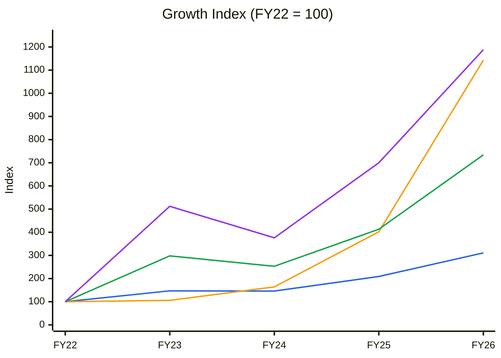
🟦 Revenue (4-yr CAGR 33%) · 🟧 Fixed assets incl. CWIP (×11) · 🟩 EBITDA (65%) · 🟪 PAT (86%)

**Read:** FY22–FY24 earnings rose ×4–5 on the *same* fixed-asset base (index ~100–164), which is classic operating leverage. From FY25 the asset base exploded (×11: the Vadod greenfield plus the Atlanta Trafo acquisition), while revenue was only ×3.

**Business inference:** Atlanta has already earned its cycle on old assets. The next leg (FY27–29) depends on sweating ~₹500 Cr of new block (Vadod at 39% and Atlanta Trafo at 15% utilisation in FY26). That is achievable on the order book, but it means FY27+ ROCE will be lower than the 45–50% history.

---

## Business Primer

Atlanta Electricals designs and manufactures oil-filled **power transformers** (79% of Q1 FY27 revenue), **inverter-duty transformers** for solar/BESS (14%) and **auto-transformers** (6%), up to 220 kV/160 MVA in volume production. It now holds approvals to 400 kV (Vadod, PGCIL Apr-2026) and has a 765 kV-capable plant (Atlanta Trafo, Jambusar/Ankhi). Customers are state transmission utilities (GETCO, KPTCL and others across 19 states), PGCIL (vendor development for 400 kV), renewable developers (Adani Green) and EPC contractors. Private players are ~30% of orders. Q1 FY27 sector mix was T&D 66%, solar 19%, wind 14% ([Multibagg Q1 note](https://www.multibagg.ai/market-pulse/articles/q1fy27-update-96340)). Revenue is order-driven: utility tenders are won L1, built in ~6–12 months and billed on dispatch. Five plants (four in Gujarat, one in Bengaluru) total 63,060 MVA. Returns depend on two things: winning tenders at prices above CRGO/copper cost (most orders carry price-variation clauses), and moving up the voltage ladder (220 → 400 → 765 kV), where fewer vendors qualify and margins and order sizes are larger.

This is an **order-driven, moderately working-capital-intensive capital-goods manufacturer in a cyclical-plus-secular upcycle**. It is better capitalised and more cash-generative than most of its peers: NWC ~72 days, debtor days 84–88, CFO/PAT ~0.9. The value drivers are volume (utilisation of a capacity base that has tripled) and mix (400/765 kV entry, exports). The key risks are the transformer capital cycle, customer concentration (top-10 customers 74% of FY25 revenue; GETCO 29%) and Gujarat concentration (98.9% of FY25 revenue from Gujarat plants). Two structural features colour the analysis. First, a **newly listed company with 87% promoter holding**, a small free float and a mandatory sell-down ahead. Second, a business whose reported history (FY20–FY26) covers essentially **one upcycle**: the FY20–FY22 trough margins (8%) are the only downcycle evidence available.

**New Segment Protocol:** Segment covered → "Electrical Equipment & Turnkey Electrical Solutions (Order-driven Capital Goods)" (references/05-industry-kpis-india.md, line 2256; transformer peers Voltamp, Shilchar and TARIL are listed) ✓. Demand context from "Power & Renewables" (line 479) ✓. Top KPIs: order book/revenue, NWC/debtor days, EBITDA margin and product mix. Order-book tracking is mandatory.

---

## Module 1 — Broad Market Cycle (Marks)

Nifty 50 is at **22,524** (26-Oct-2026 weekly bar), 14.6% below its 52-week high (26,373) and **below a falling 30-week MA (23,726)**. The 1-year return is −12.4%; the 26-week return is −6.1% (Yahoo Finance weekly). India VIX was ~14.4 and index P/E ~19.3× in early October (via the 14-Oct-2026 TARIL report: [JM Financial](https://www.jmfinancialservices.in/market-news-and-insights/1735991); [Stockpil](https://stockpil.com/india-markets-today-2026-10-05/)). Atlanta's own IPO was subscribed **70.6×** in Sep-2025 ([Business Standard](https://www.business-standard.com/amp/markets/capital-market-news/atlanta-electricals-ipo-ends-with-subscription-of-70-63-times-125092500249_1.html)), a sign of risk appetite for the T&D theme at the time. **Assessment: CAUTIOUS (leaning fearful).** Sizing: normal-to-small. High-multiple capital-goods names are being de-rated.

---

## Module 1b — Sector Cycle: Tailwinds & Headwinds

**Secular (durable):** India's grid transformation capacity was ~1,478 GVA (Jun-2026) against 2,345 GVA planned for 2032. The 2026–36 transmission plan needs 827,600 MVA of substation capacity (₹7.93 lakh Cr). Then come 500 GW of renewables by 2030, BESS, data centres (~13.6 GW by FY32) and railway electrification ([Powerline](https://powerline.net.in/2026/05/05/demand-surge-key-trends-growth-drivers-and-outlook-for-the-transformer-industry/); CEA via the TARIL report). ~₹9 lakh Cr of transmission investment is planned through 2032 (Atlanta FY26 release). The export window is wide open: US/EU lead times are ~120 weeks ([Wood Mackenzie](https://woodmac.com/news/opinion/supply-shortages-and-an-inflexible-market-give-rise-to-high-power-transformer-lead-times)). Atlanta targets ~15% export revenue in three years (nil in Q1 FY27).

**Cyclical (fades):** CEA transformation additions went 70,728 MVA (FY24) → 86,433 (FY25) → 113,013 (FY26) → 158,339 (FY27 target), a +124% target jump in three years. Utility tendering comes in waves. Global lead times are expected to ease within ~12 months ([Rystad](https://powerpeakdigest.com/global-transformer-supply-constraints-ease-rystad/)).

**Decomposition:** Atlanta's FY24→FY26 revenue CAGR is 46%. Our split is ~12–15% secular (grid volume at 7–8%, plus 400 kV mix, renewables and exports) and **~30pp cyclical or company-specific** (tight-market pricing and utilisation, plus the new Vadod capacity filling). **Durable DCF baseline after FY29: 12–15%**, fading to 8–9%.

### CY5 — Demand proxy: India grid transformation additions (220 kV+, MVA)

| | FY23 | FY24 | FY25 | FY26 | FY27 (target) |
|---|---|---|---|---|---|
| AC transformation capacity added (MVA) | 75,902 | 70,728 | 86,433 | 113,013 | 158,339 |
| Atlanta MVA sold (annualised from Q1 FY27: 4,381 MVA/qtr) | — | — | — | — | ~17,500 |

*Source: CEA via [Outlook Business](https://www.outlookbusiness.com/spotlight/news-wire/india-adds-113013-mva-grid-transformation-capacity-in-fy26-meets-90-of-cea-target) and the TARIL report. Atlanta MVA from the Q1 FY27 call ([Multibagg](https://www.multibagg.ai/market-pulse/articles/q1fy27-update-96340)). Historical Atlanta MVA is not available (data gap). Atlanta's MVA includes sub-220 kV units.*

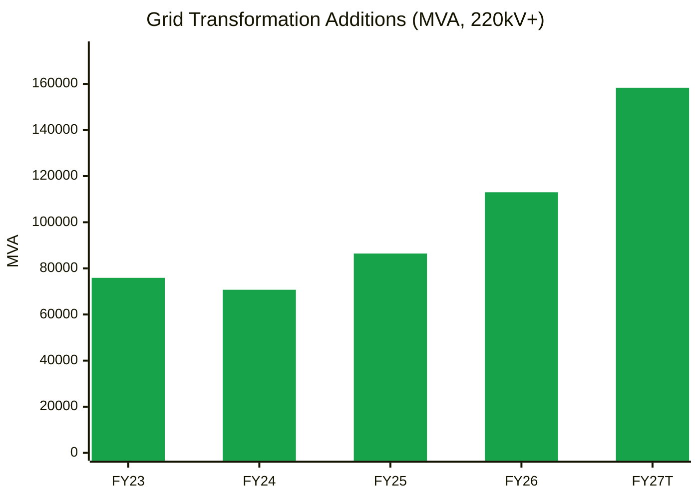
🟩 CEA transformation capacity added (FY27 = target)

**Read:** National additions were flat in FY23–24, then accelerated sharply. The FY27 target is +40% on FY26, and delivery is running behind (23% of the target in four months).

**Business inference:** The demand wave supports Atlanta's FY27–28 order book. But the same wave is pulling in a large supply response, including Atlanta's own 63,060 MVA and its planned +5,000 MVA inverter-duty and +15,000 MVA 765 kV lines. That is late-cycle behaviour. **Industry capacity series: data gap.**

**Input cost cycle:** CRGO and copper rose in 2026 (Hormuz disruption; DGTR CRGO anti-dumping probe). Atlanta's Q1 margin fell to 16.5% from 20% in Q4, which management called seasonality and mix. **Rising → compress margin assumptions.**
**FX / geopolitics:** exports are nil today; imported CRGO and bushings form the cost-side exposure. The earlier JV partner was Chinese (Baoding Tianwei Baobian). After the buyout, Chinese technology dependence at Atlanta Trafo should be watched: the 765 kV tie-up shortlist "has China as the last option" ([T&D India](https://www.tndindia.com/we-have-a-clear-roadmap-of-entering-the-765kv-space-atlanta-electricals/amp/)).

**Sector cycle verdict: TAILWIND (12–24 months), late-cycle on supply.** Module 8: no permanent embedding of FY25–27 growth. MoS +5pp.

---

## Module 1c — Stock Cycle: Company Positioning

### C2 — Quarterly YoY revenue growth (consolidated)

| | Q1 FY26 | Q2 FY26 | Q3 FY26 | Q4 FY26 | Q1 FY27 |
|---|---|---|---|---|---|
| Revenue (₹ Cr) | 315 | 317 | 472 | 748 | 466 |
| Same quarter last year | 300 | 270 | 263 | 411 | 315 |
| YoY growth | 5% | 17% | 79% | 82% | 48% |

*Source: Screener.in consolidated quarterly results. Only 9 quarters are available (listing Sep-2025), so 5 YoY points.*

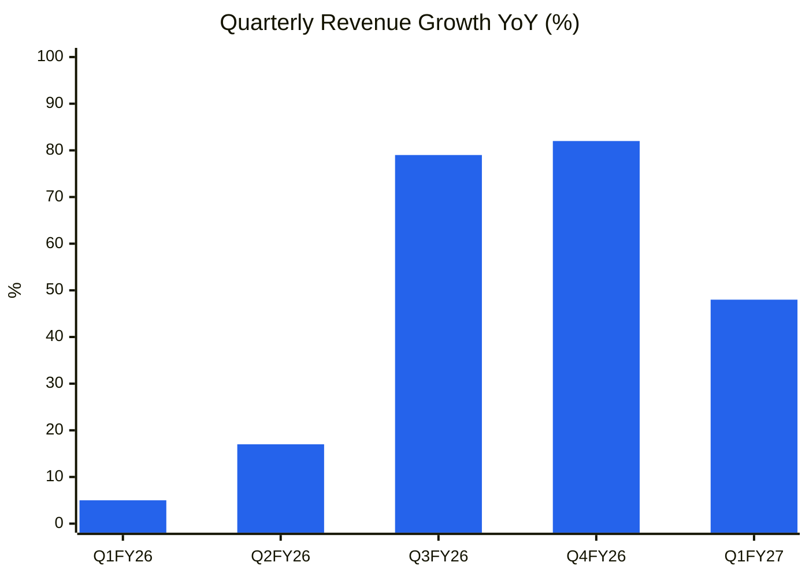
🟦 YoY revenue growth (consolidated)

**Read:** Growth accelerated from 5% to ~80% as Vadod came on stream (one-third of Q3 FY26 revenue), then **decelerated to 48%** in Q1 FY27.

**Business inference:** The step-up in capacity drove an 80% peak. Growth is now normalising toward the ~40% three-year target. Q4 is seasonally heavy (Q4 FY26 = 40% of FY26 revenue), so quarterly comparisons are noisy. A Q2 FY27 print below ~+35% would signal that the deceleration is not just seasonal.

### Revenue decomposition: volume / price / mix
- **Volume (dominant):** management calls Q1 growth "volume-driven, no material change in pricing or mix". Q1 FY27 MVA sold was 4,381 (Vadod 1,520 MVA; Atlanta Trafo 320 MVA).
- **Mix (next leg):** 220 kV is 56% of revenue and 66 kV 25%. 400 kV/reactors are ~₹275 Cr of the OB and give "meaningful revenue from FY28". 765 kV starts in FY28+ at the earliest. Power transformers rose from 75% to 86% of revenue (FY25→FY26).
- **Price:** protected by price-variation clauses, not pricing power. The FY23–FY26 margin step from 13% to 19% was industry-wide.

### Physical capacity model
| Unit | Location | Capability | Status / utilisation | Source |
|---|---|---|---|---|
| Unit 1 | Anand | up to 220 kV / 160 MVA; brownfield 2023 | "High" | T&D India |
| Unit 2 | Anand | 66–132 kV (+33 kV, 5,000 MVA small capex) | "High" | T&D India |
| Unit 3 | Bengaluru | acquired from an exiting transformer maker | — | T&D India |
| Unit 4 | Vadod (Vadodara) | 220 kV; **400 kV PGCIL-approved Apr-2026** | ~39% annualised FY26 | FY26 release |
| Unit 5 | Atlanta Trafo (Jambusar/Ankhi) | 765 kV-capable (upgradable to 1,200 kV); 15,000 MVA | ~15% FY26; ~8.5% Q1 FY27 (320 MVA) | FY26 release; Q1 call |
| Planned | Inverter-duty facility | +~5,000 MVA | Commissioning by Dec-2026 | Q1 call |
| Planned | 765 kV expansion | +15,000 MVA in three stages | After 765 kV entry | T&D India |
| **Total installed** | | | **63,060 MVA**; Q1 sales-based utilisation ~28% annualised (17,500 ÷ 63,060) | FY26 release |

- **Revenue per MVA (Q1 FY27):** ₹466 Cr ÷ 4,381 MVA = **₹10.6 lakh/MVA**.
- **Capacity revenue ceiling:** 63,060 MVA × ₹10.6 lakh = **₹6,700 Cr at 100%**; **₹5,400 Cr at 80%**. The 400/765 kV mix would raise realisation per MVA.
- **Capacity ceiling year:** at the guided 40% CAGR (FY29 ≈ ₹5,080 Cr) utilisation reaches **~75% by FY29**, so the next capacity step is needed by ~FY29–30.
- **Physical plausibility of guidance:** ✅ The 40% CAGR fits installed capacity. **The PIE (Module 8) does not.**

### Order-book revenue model (see Order Book Tracker, Module 6)
- **FY27E:** management says ~₹2,400 Cr of the Jun-2026 book is executable in FY27. Read as Q2–Q4, that gives FY27 ≈ ₹466 + ₹2,400 + in-year burn ≈ ₹2,900 Cr (+57%). Read as the whole year, it gives ~₹2,400 Cr (+30%). The wording is ambiguous (data gap). **Base FY27E: ₹2,600 Cr (+40%)**, in line with the three-year CAGR guidance.
- **FY28E:** opening OB (~₹2,900–3,200 Cr if inflow continues at ~₹800–1,000 Cr per quarter) × ~0.75 execution + in-year burn → **₹3,250 Cr base**.

### Operating leverage
FY26: raw materials are ~75% of revenue (estimate; gross margin not disclosed in the sources used), EBITDA 18.6%, EBIT 17.2%. **DOL ≈ 25 ÷ 17.2 ≈ 1.45×** (low). **DFL** = 319 ÷ (319 − 57) = 1.22× (FY26; interest falls in FY27 after term-debt repayment). **DTL ≈ 1.8×.** ICR: FY26 5.8×, Q1 FY27 ~11.8×. Not a constraint.

### Guidance accuracy (WTT, Module 3): 0.70 → **MODERATE** → ~10% haircut to guidance.

### FCF inflection year
FY26 FCF was ₹68 Cr after ₹403 Cr of investing outflows (acquisition plus Vadod). FY27–28 capex of ~₹150–200 Cr a year (inverter-duty, tank & radiator, 765 kV stages and royalty) is affordable from CFO. **FCF inflection: already positive. The step-up comes in FY28–29**, when CFO grows faster than capex.

### CY7 — Margin & ROCE vs history

| | FY20 | FY21 | FY22 | FY23 | FY24 | FY25 | FY26 | Q1 FY27 |
|---|---|---|---|---|---|---|---|---|
| EBITDA margin (standalone OPM) | 8% | 8% | 8% | 13% | 14% | 16% | 19% | 16.5% |
| ROCE (consolidated, avg CE) | — | — | 28% | 66% | 45% | 50% | 45% | — |

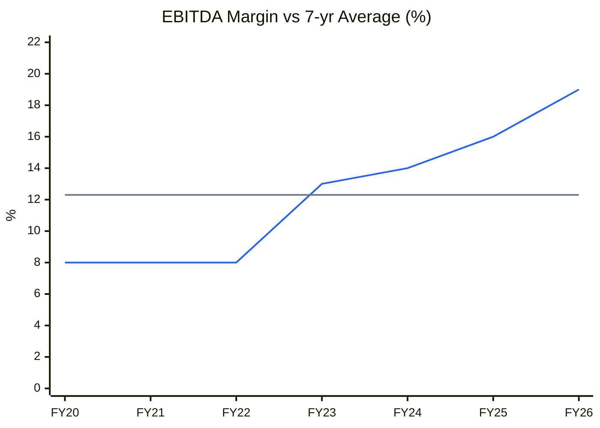
🟦 EBITDA margin (Screener standalone OPM) · ⬜ 7-yr average 12.3%

**Read:** FY26 margin (19%) is ~2× the FY20–22 level and **~1.9 SD above the 7-year average (12.3%)**.

**Business inference:** By the skill's rule (>1 SD above average = late cycle or peak), Atlanta is **late-cycle on margins**. Part of this is structural (higher-kV mix, the Vadod scale), but the base case should not capitalise 19%. We use 17.5–18.5% for FY27–29 and 14% in the bear case.

**Stock cycle classification: Late cycle / maturing on margins; mid-cycle on capacity utilisation.** MoS +5pp.

---

## Module 2 — Industry Structure & Capital Cycle

| Force | Atlanta's segment (66–220 kV now; 400/765 kV next) | Signal |
|---|---|---|
| New entrants | **Medium at ≤220 kV** (many Gujarat/Baroda-cluster makers, SME IPOs). **Low at 400/765 kV**: PGCIL approvals, short-circuit test records and technology partners take 2–4 years. Atlanta needed a tie-up (US$3–5 m fee plus 2–4% royalty) | Moat only at the top end |
| Supplier power | High: CRGO (imported, anti-dumping probe), copper, RIP bushings (vendors went from 1 to 4 in India), OLTCs | Price-variation clauses mitigate |
| Buyer power | High: state utilities and PGCIL buy L1; GETCO alone was 29% of FY25 revenue | Weak pricing power |
| Substitutes | Low | Neutral |
| Rivalry | **Rising**: Hitachi, Siemens Energy, GE T&D, BHEL and CG at EHV; TARIL, Voltamp, Shilchar, Indo Tech, Kanohar, SPEL and others below. Everyone is expanding | Price discipline lasts only while supply is short |

**Industry verdict: NEUTRAL** (attractive cyclically, structurally only above 400 kV).

**Capital cycle (Chancellor): "capital floods in."** (1) Atlanta tripled capacity in ~18 months ("18 months of intensive capacity build-out", CMD) and plans +20,000 MVA more. (2) Sector IPOs: Atlanta (Sep-2025), TMC Transformers, SME entrants such as Supreme Power. (3) Equity raises: TARIL QIP, Atlanta IPO. (4) Sector ROCE is at 10-year highs (Atlanta 45–50%, Shilchar 51%, GE T&D 77%). (5) Atlanta capex/D&A in FY26: ~₹400 Cr investing ÷ ₹26 Cr D&A = **~15×**. **Capital-cycle position: late upcycle.** CY8 (peer capex/depreciation series) is a data gap.

---

## Module 3 — Business Quality & Moat

### Greenwald's three barriers
1. **Supply/cost advantage:** **Partial.** The Atlanta Trafo plant was acquired for EV ~₹260 Cr for 15,000 MVA of 765 kV-capable capacity. That is well below greenfield cost (TARIL's 22,000 MVA EHV expansion and Siemens Energy's 30,000 MVA plant cost multiples of this). It gives Atlanta a cheap EHV option. Margins matched the peer median only at the cycle peak (FY20–22 8% vs Voltamp 12–15%), so there is no historical cost edge.
2. **Customer captivity:** Weak. GETCO has been a long relationship (the largest customer), but utilities buy L1. There are 255 customers across 19 states and 3 UTs ([T&D India](https://www.tndindia.com/we-have-a-clear-roadmap-of-entering-the-765kv-space-atlanta-electricals/amp/)).
3. **Local economies of scale:** Moderate in Gujarat (GETCO, Gujarat renewables), with 98.9% of revenue from Gujarat plants in FY25.

**Buffett 10% price test:** Fail (L1 tenders).
**Moat verdict: NARROW and emerging.** It is qualification-based at 400 kV and would become stronger if 765 kV entry succeeds (a club of ~8 vendors).

### Moat durability tests
| Test | Result |
|---|---|
| ROIC vs WACC | ROIC 20% (FY22), 51%, 32%, 36%, 32% (FY26) vs WACC 13.5%. Positive spread, all within one upcycle |
| Market share | ~4.6% of a >₹40,000 Cr industry (FY26), rising from ~2.5% (FY23 est.). Gaining |
| Pricing power in inflation | Q1 FY27 EBITDA margin was +1pp YoY (15.5% → 16.5%) but −3.5pp QoQ (20% in Q4) during a CRGO/copper rise. Inconclusive |
| Activity system | Five plants, a ladder of approvals, in-house testing to 765 kV (except short-circuit), backward integration (tank & radiator ~4–5% of cost) under way. Reasonable |
| Scuttlebutt | Motilal Oswal Buy (TP ₹1,950, 22-Jul-2026). The broker sees 400/765 kV entry from H2 FY27 subject to short-circuit tests and the tie-up |

### Fisher 15-point checklist
| # | Point | Score | Note |
|---|---|---|---|
| 1 | Market potential | 3 | Grid, renewables, exports |
| 2 | New products | 3 | 400 kV approved; 765 kV roadmap; inverter-duty/BESS |
| 3 | R&D effectiveness | 2 | 100 MVA natural-ester unit at GETCO; tech partner needed for 765 kV |
| 4 | Sales organisation | 2 | 19 states; utility-heavy; exports nil |
| 5 | Profit margin | 2 | High now; cyclically 8% |
| 6 | Margin actions | 2 | Backward integration (tank & radiator) |
| 7 | Labour relations | 2 | No issues found |
| 8 | Executive relations | 2 | Family-led (Patel) |
| 9 | Management depth | 2 | Second line not visible in sources (data gap) |
| 10 | Cost/accounting controls | 2 | CRISIL A/Stable; bank lines ₹910 Cr → ₹1,460 Cr |
| 11 | Industry-specific advantage | 2 | Cheap EHV plant |
| 12 | Long-range orientation | 3 | Capacity and approvals built ahead |
| 13 | Dilution | 1 | MPS sell-down/dilution of ~12% ahead |
| 14 | Candour | 2 | Gave utilisation numbers, including the low Atlanta Trafo figure (15%) |
| 15 | **Integrity** | **2** | **Pass.** No SEBI/ED actions found. The Atlanta Trafo acquisition involved a promoter LLP (10% JV partner) and was disclosed |
| | **Total** | **32 / 45** | |

---

## Module 4 — Management & Capital Allocation

**Promoter holding 87.28%** (unchanged Sep-2025 → Sep-2026). **Pledge: none shown** (Screener shareholding, Sep-2026). FIIs fell 2.19% → 1.45%; DIIs rose 3.86% → 4.97%; public 6.30%. Shareholders fell from 83,679 (Sep-2025, IPO allottees) to 34,845, then rose to 49,435 (Sep-2026).

| Check | Finding | Flag |
|---|---|---|
| Promoter trend | Flat (post-IPO lock-in) | ✅ |
| Pledge | None reported | ✅ |
| **MPS overhang** | 87.28% vs 75% maximum → **~12.3% (0.94 Cr shares ≈ ₹1,530 Cr at CMP)** to be sold or diluted, ~3 years from listing (~Sep-2028, verify the timeline under SCRR 19A as amended) | ⚠️ Supply overhang |
| **RPT: Atlanta Trafo acquisition (Aug-2025)** | Target was BTW Atlanta Transformers, a 90:10 JV of Baoding Tianwei Baobian (China) and **Atlanta UHV Transformers LLP (promoter entity)**. EV ~₹260 Cr incl. ~₹80 Cr debt ([T&D India](https://www.tndindia.com/we-have-a-clear-roadmap-of-entering-the-765kv-space-atlanta-electricals/amp/); SolarQuarter Oct-2025). Funded by a ₹218 Cr term loan, later repaid | ⚠️ Promoter received ~10% of equity value (~₹18 Cr); valuation looks reasonable vs greenfield cost |
| Subsidiary drag | Consolidated PBT below standalone by ~₹17 Cr (FY26) and ~₹6 Cr (Q1 FY27): Atlanta Trafo depreciation and low utilisation | ⚠️ Watch utilisation |
| ICDs to group | None found | ✅ |
| Dividend vs FCF | Nil dividend (growth reinvestment) | Neutral |
| IPO proceeds | ₹400 Cr fresh: debt repayment, working capital (₹210 Cr per one source; another lists capex), GCP. Term debt nil by Mar-2026 | ⚠️ Verify the Reg 32 deviation statement covers repayment of the acquisition loan |

**Capital allocation (Thorndike):** FY21–26 cumulative CFO ₹437 Cr against PAT ₹496 Cr (0.88×). Investing outflows were ₹617 Cr, funded by CFO, IPO and debt that has since been repaid. The share count was flat until the IPO (+7.4%). The acquisition was well-timed and cheap; Vadod is greenfield. **Incremental ROIC** on FY25–26 capital (~₹450 Cr into fixed assets): FY26 ΔEBIT ₹140 Cr × 0.73 ÷ ~₹450 Cr ≈ 23% before WC, already above WACC at 15–39% utilisation. **Capital allocation rating: Good.**

**Buffett Three C's:** Candour: Good (disclosed the low Atlanta Trafo and Vadod utilisation). Competence: Good (ROCE >30% through the build-out; debt cleared). Caring: Moderate (no dividend; the promoter sold in the OFS at ₹754; MPS overhang).

### Walk the Talk Scorecard
| Period guided | Statement | Guided | Actual | Verdict |
|---|---|---|---|---|
| IPO / FY26 | Revenue growth ~40% CAGR over 3 yrs | ~40% | FY26 +49%; Q1 FY27 +48% | ✅ Hit (yr 1) |
| IPO (Sep-2025) | Use IPO to retire debt | Term debt nil | Term debt nil (Mar-2026); ₹358 Cr Vadod + acquisition loans repaid | ✅ Hit |
| FY26 | Vadod 400 kV approval | Within 2 yrs of groundbreaking | PGCIL approval Apr-2026 | ✅ Hit |
| Jan-2026 interview | 765 kV tech tie-up | "Possibly before end-Mar-2026" | Q1 FY27 call: close in Q2 FY27; status at Q2 not yet reported | ❌ Miss (≥2-qtr slip) |
| FY26 priorities | Start inverter-duty facility | FY27 | Target end-Dec-2026 | Pending |
| Q1 FY27 call | "Stable margins" | ~FY26 level (18.6%) | Q1 16.5% (seasonal per mgmt) | ⚠️ Near miss |
| Q1 FY27 call | ~₹2,400 Cr executable in FY27 | ₹2,400 Cr | Pending (Q2 results) | Pending |
| Q1 FY27 call | Exports ~15% of revenue in 3 yrs | 15% | Q1 nil | Pending |

**WTT Score: (3 + 0.5) ÷ 5 = 0.70 / 1.00 — MODERATE.**
**Guidance points assessed:** 5 scored (+3 pending) | Hits: 3 | Near misses: 1 | Misses: 1 | Reversals: 0
**Key pattern:** financial targets delivered; **technology/EHV timelines slip** (765 kV tie-up). That is a one-way miss on the metric that matters most for the re-rating thesis.
**Insider action:** promoter sold in the IPO OFS (part of ₹287 Cr, at ₹754). No open-market trades found (BSE Form C check: data gap) → **NEUTRAL.**
**DCF impact:** a 10% haircut to the 40% CAGR (base ~36% FY27, then fading). 765 kV revenue pushed out by 2–3 quarters (to FY29 in the base case).
**Overall management credibility: MODERATE-HIGH on financials, MODERATE on technology timelines.**

---

## Module 5 — Financial Forensics

### 5A. Indian-specific red flags
| Check | Finding | Flag |
|---|---|---|
| Pledge | None | ✅ |
| RPT | Atlanta Trafo acquisition from a JV with a 10% promoter LLP stake (disclosed) | ⚠️ Minor |
| Revenue quality | Debtor days 181 (FY21) → 145 → 109 → 76 → 103 → 84 (FY26) → 88 (Q1 FY27): improving trend | ✅ |
| Seasonality / Q4 loading | Q4 FY26 = 40% of FY26 revenue (₹748 Cr), and Q1 FY27 −38% QoQ. Debtors at Mar-2026 (84 days) did not spike, so this is consistent with dispatch timing | ⚠️ Watch |
| Customer concentration | Top-10 74% (FY25); GETCO 29%; Adani Green 10% | ⚠️ |
| Audit | Auditor name and KAMs not retrieved (data gap). No qualification found in the sources searched | ⚠️ Data gap |
| Credit rating | CRISIL A/Stable reaffirmed (FY26) | ✅ |

### 5B. Quantitative models (consolidated FY26 vs FY25)
| Model | Value | Reading |
|---|---|---|
| **Beneish M-Score** (GMI proxied by EBITDA margin; SGAI = 1) | **−2.39** | Unlikely (< −2.22). DSRI 0.82 · GMI 0.84 · AQI 0.22 · SGI 1.49 · DEPI 1.50 (long-life acquired plant) · LVGI 0.65 · TATA +0.01. SGI and DEPI push it up; neither indicates manipulation |
| **Altman Z''** | **5.95** | Safe. X1 0.25 · X2 0.35 (RE ex-IPO premium, estimate) · X3 0.22 · X4 1.60 |
| **Piotroski F** | **6 / 9** | Average-strong. ROA+, CFO+, ΔROA+, LT debt down, current ratio up, margin up ✓. CFO < NI (184 < 202), new shares (IPO), AT down ✗ |
| **Sloan CF accrual** (NI − CFO − CFI)/avg TA | **+35%** | Above 10%, entirely from investing (acquisition + Vadod, IPO-funded). Balance-sheet accrual (NI − CFO)/avg TA = **+1.5%** (clean) |

### 5C. Schilit screen
| Shenanigan | Check | Result |
|---|---|---|
| Revenue too soon | DSO improving; CFO/EBITDA 77% (FY26), 65% (FY25), 94% (FY24) | ✅ |
| Bogus revenue | No related-party sales identified | ✅ |
| One-time boosts | Other income ₹14 Cr ≈ 4% of EBIT (IPO cash interest) | ✅ |
| Capitalising expenses | Capex was plant + acquisition; testing capex at Atlanta Trafo. Pre-operative costs not disclosed | ⚠️ Data gap |
| Hiding losses | Goodwill/intangibles from the acquisition not separately visible (FA ₹507 Cr). Atlanta Trafo is loss-making at the PBT level | ⚠️ Check the purchase-price allocation in the FY26 AR |
| Factoring / SCF | Not disclosed; bank lines raised to ₹1,460 Cr | ⚠️ Data gap |
| DPO stretching | DPO **fell** 232 → 112 days (FY21 → FY26): less supplier funding | ✅ (conservative) |

**Forensic red-flag count: 1 unresolved / 15** (acquisition PPA/goodwill and subsidiary-loss visibility), plus 3 watch items (Q4 loading, customer concentration, audit data gap).
**Overall forensic verdict: Clean to minor concerns.**

---

## Module 5 (cont.) — Earnings Quality & Financial Statements

### ROIC / WACC (consolidated)
| | FY22 | FY23 | FY24 | FY25 | FY26 |
|---|---|---|---|---|---|
| EBIT ex-OI (₹ Cr) | 43 | 135 | 113 | 187 | 319 |
| NOPAT | 31 | 107 | 83 | 140 | 234 |
| Invested capital (NW + debt, year-end) | 180 | 239 | 277 | 496 | 980 |
| ROIC (avg IC) | 19.5% | 51% | 32% | 36% | 31.6% |
| WACC | 13.5% | 13.5% | 13.5% | 13.5% | 13.5% |
| Spread | +6pp | +37pp | +19pp | +22pp | +18pp |

*WACC: Ke 13.5% (Rf 7% + β 1.1 × ERP 6%), net debt ~nil → WACC ≈ 13.5%. FY26 IC includes the acquired Atlanta Trafo block and IPO cash still in working capital.*

### C5 — ROIC vs WACC (%)

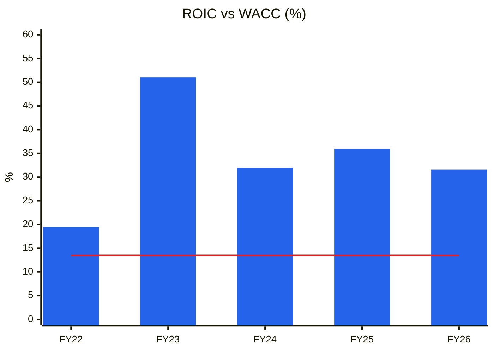
🟦 ROIC (avg invested capital) · 🟥 WACC 13.5%

**Read:** ROIC has stayed well above WACC for five years (peak 51% in FY23 on a tiny capital base). It has held ~32% even as capital tripled in FY26.

**Business inference:** This is the strongest part of the thesis: Atlanta earns high returns on new capital, not only on depreciated old plant. The caveat is that every year shown is within the upcycle, so there is no evidence of trough-cycle ROIC (FY20–21 margins of 8% would imply ~15–20%).

### C7 — Cumulative PAT vs CFO (consolidated, ₹ Cr)

| | FY21 | FY22 | FY23 | FY24 | FY25 | FY26 |
|---|---|---|---|---|---|---|
| PAT | 7 | 17 | 87 | 64 | 119 | 202 |
| CFO | 29 | 0 | 52 | 88 | 84 | 184 |
| Cumulative PAT | 7 | 24 | 111 | 175 | 294 | 496 |
| Cumulative CFO | 29 | 29 | 81 | 169 | 253 | 437 |

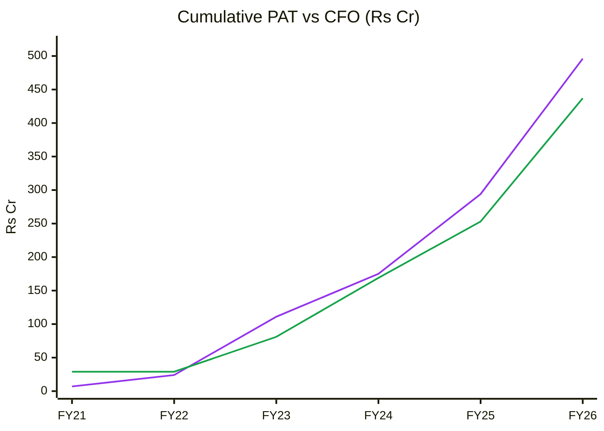
🟪 Cumulative PAT · 🟩 Cumulative CFO

**Read:** Cumulative CFO tracks PAT closely (0.88× over 6 years; 0.86× over FY23–26).

**Business inference:** Profits are real cash. That is unusual among the library's transformer names (TARIL 0.19×). Atlanta's lower NWC days (~55–72 vs TARIL 170) is a genuine operating advantage and partly justifies a premium. It does not justify 57×.

**OCF / Net income (6-yr):** 0.88 → **Quality: High.**
**O'Glove red flags:** 2 / 15 (#9 Sloan CF accrual >10%, capex-driven; #4 inventory days 86 → 102 → 105). **Key accounting concern:** acquisition accounting (PPA) and Atlanta Trafo losses.

### DuPont Decomposition (5-factor, consolidated, year-end balances)
| Year | EBIT margin | Asset turnover | Equity multiplier | Interest burden | Tax burden | ROE |
|---|---|---|---|---|---|---|
| FY22 | 7.6% | 1.36 | 4.19 | 0.53 | 0.71 | 16.3% |
| FY23 | 15.8% | 1.56 | 3.40 | 0.80 | 0.79 | 52.7% |
| FY24 | 13.5% | 1.55 | 2.45 | 0.74 | 0.74 | 28.1% |
| FY25 | 15.5% | 1.44 | 2.47 | 0.82 | 0.75 | 34.0% |
| FY26 | 18.0% | 1.23 | 1.62 | 0.83 | 0.73 | 21.7% |
| **Change FY22→FY26** | +10.4pp | −0.13× | −2.57× | +0.30 | +0.02 | **+5.4pp** |

**Operating contribution (EBIT margin × AT):** **Improving** (10.4% → 22.1%).
**Financing contribution (equity multiplier):** **Falling sharply** (4.19 → 1.62, from the IPO and debt repayment).
**DuPont verdict:** the ROE gains are **purely operational**, and leverage has been *reduced*. This is the high-quality ROE pattern. FY26 ROE (21.7% on year-end equity) is diluted by IPO cash. On average equity it is ~31%.
**AT trend → Module 10 base AT:** declining 1.56 → 1.23 (new block not yet utilised). Assume recovery to ~1.4–1.5 by FY29 as Vadod and Atlanta Trafo fill.

---

## Module 6 — Industry KPIs & Peer Analysis

| KPI | Atlanta | Peer avg / healthy range | Assessment |
|---|---|---|---|
| Order book / revenue | 1.56× TTM | >1.5×; TARIL 2.6× | **In line ✅** |
| NWC days | 72 (Q1 FY27); Screener WC days 55 (FY26) | <100; Voltamp 87, Indo Tech 75, Shilchar 91, TARIL 170 | **Above (better) ✅** |
| EBITDA margin | 18.6% (FY26), 16.5% (Q1 FY27) | 11–18%; peers 15–29% | In line (peak) |
| Execution velocity | FY26 revenue ₹1,852 ÷ opening OB ₹1,643 = 1.13 | >0.6 | **Strong ✅** |
| Net debt / EBITDA; ICR | ~0×; ICR 5.8× (FY26) → ~12× | <2×; >3× | ✅ |
| ROCE | 45% (FY26) | >18% | ✅ |
| CFO/PAT (cumulative) | 0.88 | >0.7 | ✅ |

### Peer comparison (Screener.in; Atlanta and SPEL 23-Oct-2026; others 13-Oct-2026 via TARIL report)
| Metric | Atlanta | TARIL | Voltamp | Indo Tech | Shilchar | GE T&D India | SPEL |
|---|---|---|---|---|---|---|---|
| Revenue FY26 (₹ Cr) | 1,852 | 2,507 | 2,154 | 782 | 652 | 6,206 | 182 |
| Revenue 3-yr CAGR | 29% | 22% | 16% | 28% | 33% | 31% | 22% |
| EBITDA margin (FY26) | 19% | 15% | 16% | 17% | 29% | 28% | 18% |
| ROCE (latest) | 45% | 23% | 24% | 40% | 51% | 77% | 19% |
| WC days | 55 | 80 | 87 | 75 | 91 | 6 | 39* |
| Net debt (₹ Cr) | ~0 | 574 | ~0 | ~0 | ~0 | ~0 | ~47 |
| P/E (TTM) | **57** | 30 | 33 | 34 | 33 | 79 | 28 |
| Market cap (₹ Cr) | 12,453 | 9,125 | 10,451 | 3,407 | 4,515 | 1,06,829 | 683 |

*SPEL WC days are flattered by payables.*

### C12 — P/E vs ROCE

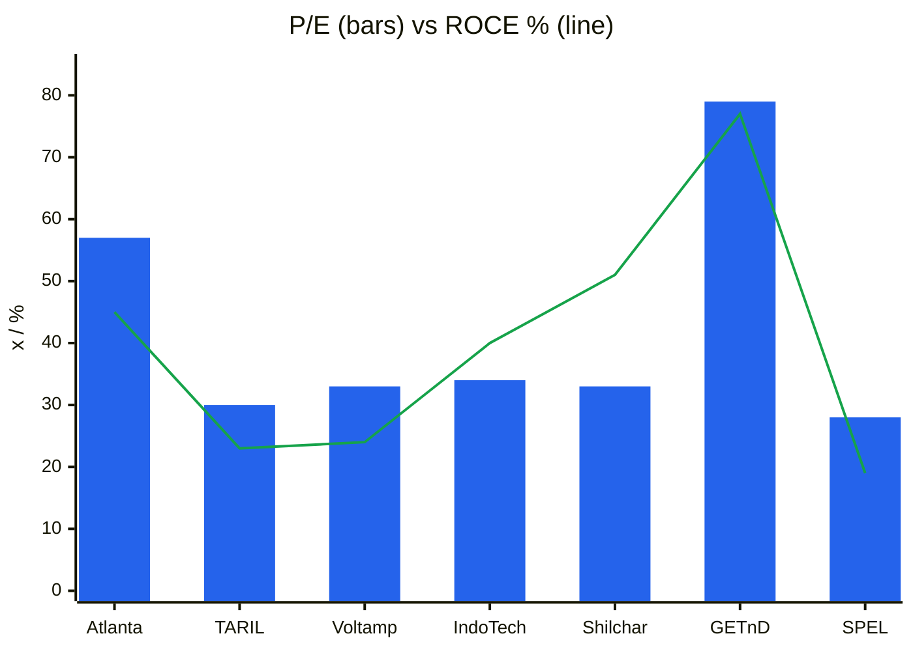
🟦 P/E TTM · 🟩 ROCE latest (%)

**Read:** Atlanta's ROCE (45%) is near the top of the domestic pack, level with Indo Tech and Shilchar. Its P/E (57×) is **~70% above** theirs (33–34×) and closer to the GE T&D MNC multiple (79×).

**Business inference:** The market prices Atlanta as a future EHV franchise (400/765 kV, exports) rather than a 220 kV utility supplier. Shilchar earns higher ROCE and margins at 33×. A justified premium for Atlanta's growth, cash conversion and EHV option is **~20–30% over the domestic pack (40–43×)**, not 70%. The base case uses 32× FY29 EPS (late-cycle exit multiple).

**Peer positioning:** large premium. **Justified? Partly** (growth, EHV option, cash conversion), but not at 57×.

### Order Book Tracker *(order-driven; references/13-order-book-tracking.md)*

*Generated 2026-10-26 by scripts/order_book_tracker.py from 4 order announcements and 6 period snapshots. Ledger coverage starts 2025-11-01. Atlanta discloses the order book and quarterly inflow in results releases (Q3 FY26 ₹796 Cr, Q4 FY26 ₹733 Cr, Q1 FY27 ₹972 Cr). Individual Reg 30 order filings are sparse, so announced coverage is low by construction: it does **not** signal restatement.*

#### 1. Disclosed vs tracked order book (reconciliation)

| Period | Revenue (₹ Cr) | Order book (₹ Cr) | Announced inflow (ledger) | Company-reported inflow | Implied inflow | Ledger coverage | OB cover (× TTM rev) | Source |
|---|---|---|---|---|---|---|---|---|
| FY25 | 1,244 | 1,643 | — | — | — | — | 1.3 | IPO documents (OB 1.32× FY25 revenue) |
| Q1FY26 | 315 | 1,584 | — | — | 256 | — | — | Q3 FY26 release (OB history); Screener |
| Q2FY26 | 317 | 2,069 | — | — | 802 | — | — | Q3 FY26 release; Screener |
| Q3FY26 | 472 | 2,451 | 432 | 796 | 854 | 51% | 1.7 | Q3 FY26 release 19-Jan-2026 |
| Q4FY26 | 748 | 2,493 | 288 | 733 | 790 | 36% | 1.3 | FY26 release 11-May-2026 |
| Q1FY27 | 466 | 3,117 | 190 | 972 | 1,090 | 17% | 1.6 | Q1 FY27 release 22-Jul-2026 |

*Implied inflow = OB(t) − OB(t−1) + order-linked revenue(t). Company-reported inflow sits 7–11% below implied in Q3 FY26 to Q1 FY27, a small gap consistent with price-variation escalation or rounding. **The reconciliation passes.***

#### 2. Announced orders aggregated by quarter (ledger)

| Quarter | # orders | Total (₹ Cr) | Firm | Framework | Largest single | Export | Govt/PSU | Private / undisclosed |
|---|---|---|---|---|---|---|---|---|
| Q3FY26 | 2 | 432 | 432 | 0 | 298 | 0 | 298 | 134 |
| Q4FY26 | 1 | 288 | 288 | 0 | 288 | 0 | 288 | 0 |
| Q1FY27 | 1 | 190 | 190 | 0 | 190 | 0 | 0 | 190 |

#### 3. Macro picture

| Metric | Value |
|---|---|
| Latest disclosed order book | ₹3,117 Cr (30-Jun-2026) |
| Orders announced since | none found (Q2 FY27 pending) |
| Tracked order book today | ₹3,117 Cr |
| Order book cover | 1.56× TTM revenue |
| Framework / potential-value agreements | ₹0 Cr (0%) |
| Implied inflow, last 4 quarters | ₹3,536 Cr → **book-to-bill 1.77×** |
| Company-reported inflow, last 3 quarters | ₹2,501 Cr |
| Execution rate FY26 (revenue ÷ opening OB) | 1,852 ÷ 1,643 = **1.13** |
| Top-3 announced orders as % of OB | 25% (GETCO ₹298 Cr, KPTCL ₹288 Cr, May-2026 ₹190 Cr) |
| OB mix (Mar-2026) | 220 kV ~52%; 400 kV ~11%; power transformers 82.5% (Dec-2025) |

#### OB-1 — Order book vs revenue (TTM), index FY25 = 100

| | FY25 | Q3 FY26 | Q4 FY26 | Q1 FY27 |
|---|---|---|---|---|
| TTM revenue (₹ Cr) | 1,244 | 1,462 | 1,852 | 2,003 |
| Order book (₹ Cr) | 1,643 | 2,451 | 2,493 | 3,117 |

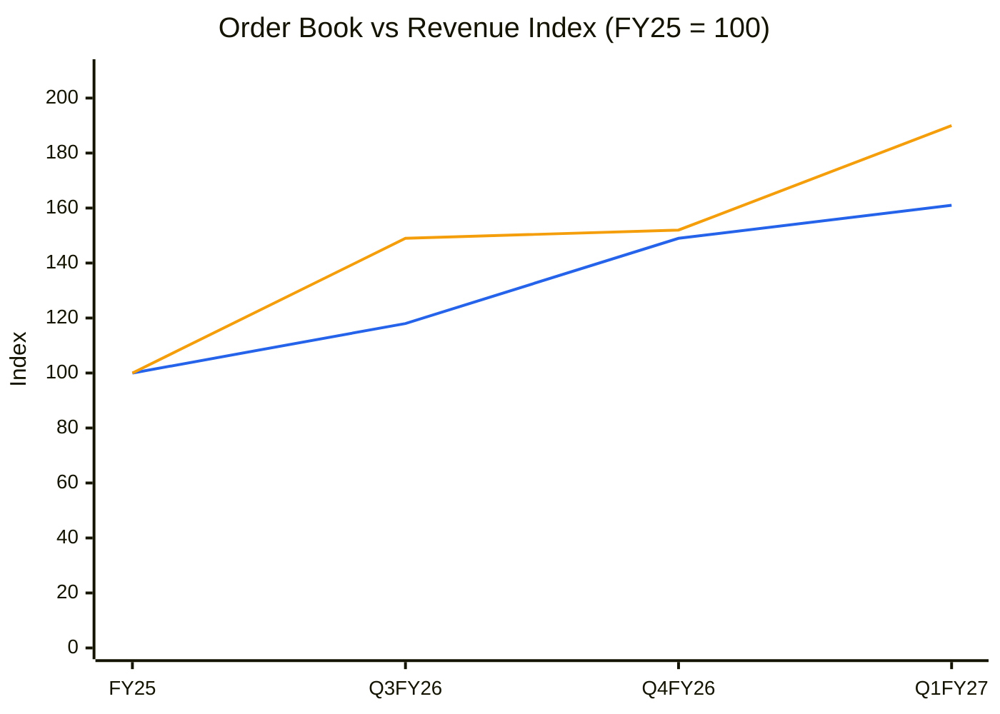
🟦 Revenue (TTM) · 🟧 Order book

**Read:** The order book (+90%) has grown faster than TTM revenue (+61%) since FY25, even though revenue itself grew at 50–80%.

**Business inference:** Demand, not execution, is setting the pace: inflow is outrunning a fast-growing revenue line. This supports FY27–28 revenue of ₹2,600–3,250 Cr with little order risk. The constraint becomes **margin on new orders** (late-cycle L1 pricing) and **plant ramp** (Vadod, Atlanta Trafo).

#### OB-4 — Implied order inflow vs revenue (₹ Cr)

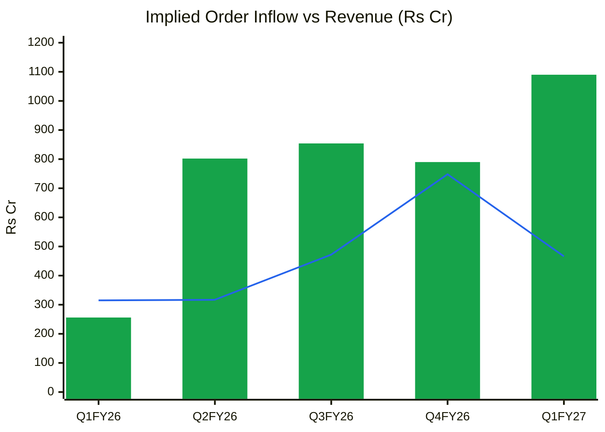
🟩 Implied inflow = ΔOB + revenue · 🟦 Revenue

**Read:** Implied inflow rose from ₹256 Cr to ₹800–1,090 Cr a quarter from Q2 FY26, running 1.1–2.5× revenue every quarter.

**Business inference:** Order momentum is **accelerating**, which is the opposite of SPEL. The Q2 FY27 inflow print is the near-term test. Another ~₹800 Cr+ quarter would sustain a 1.5× cover even with ~₹600 Cr of quarterly revenue.

**Order-book verdict:** Firm visibility ~1.2–1.5 years at FY27E revenue · book-to-bill 1.77× · framework share 0% · top-3 concentration 25% · execution rate high and stable (1.1×). **Strong.**

#### Order Ledger — every announced order (source of truth; the next run appends here)

| order_id | date | customer | customer_type | segment | geography | value_cr | currency | value_fc | firmness | tenor_months | linked_to | source | notes |
|---|---|---|---|---|---|---|---|---|---|---|---|---|---|
| A01 | 2025-11-15 | GETCO | Govt | 25 high-capacity power transformers | Domestic | 298 | INR |  | Firm |  |  | [Src](https://solarquarter.com/2026/01/20/atlanta-electricals-reports-80-yoy-revenue-growth-in-q3-fy26-order-book-hits-record-₹2451-crore) | Largest Q3FY26 win; date approx |
| A02 | 2025-12-10 | Adani Green Energy | Private | Inverter duty transformers | Domestic | 134 | INR |  | Firm |  |  | [Src](https://solarquarter.com/2026/01/20/atlanta-electricals-reports-80-yoy-revenue-growth-in-q3-fy26-order-book-hits-record-₹2451-crore) | Q3FY26; date approx |
| A03 | 2026-02-15 | KPTCL | Govt | 13 transformers + 11 fire-protection systems | Domestic | 288 | INR |  | Firm |  |  | [Src](https://www.tndindia.com/atlanta-electricals-order-book-nudges-rs-2500-crore/amp/) | Q4FY26 marquee order; date approx |
| A04 | 2026-05-15 | Undisclosed | Unspecified | Transformers | Domestic | 190 | INR |  | Firm |  |  | [Src](https://www.constructionworld.in/amp/policy-updates-and-economic-news/atlanta-electricals-posts-strong-fy26-growth-and-debt-free-finish/91344) | May-2026 contract |

#### Order Book Snapshots — revenue and disclosed order book per period

| period | revenue_cr | revenue_ttm_cr | order_book_cr | order_linked_share | as_of_date | source |
|---|---|---|---|---|---|---|
| FY25 | 1244 | 1244 | 1643 | 1.0 |  | RHP / IPO notes (OB 1.32x FY25 revenue) |
| Q1FY26 | 315 |  | 1584 | 1.0 |  | Q3FY26 release (OB history); Screener consolidated |
| Q2FY26 | 317 |  | 2069 | 1.0 |  | Q3FY26 release; Screener |
| Q3FY26 | 472 | 1462 | 2451 | 1.0 |  | Q3FY26 release 19-Jan-2026 |
| Q4FY26 | 748 | 1852 | 2493 | 1.0 |  | FY26 release 11-May-2026 |
| Q1FY27 | 466 | 2003 | 3117 | 1.0 |  | Q1FY27 release 22-Jul-2026 |

*Data gaps: BSE Reg 30 order filings were not harvested individually (only orders named in releases). Q1 FY26 implied inflow (₹256 Cr) looks low, possibly because the FY25 OB (₹1,643 Cr) and Q1 FY26 OB (₹1,584 Cr) come from different documents (IPO vs release).*

---

## Module 7 — Market Size & Market Share

**TAM:** Indian transformer-industry sales of >₹40,000 Cr by FY27 at 10–11% growth (CRISIL, Aug-2025). Power transformers (≥66 kV) are roughly half (estimate). Exports to the US, EU, Middle East and Africa are an additional TAM.
**Penetration:** ₹2,003 Cr ÷ ~₹40,000 Cr = **~5.0% of the national market** (TTM); ~9–10% of the power-transformer sub-segment (estimate).
**Market share trend:** gaining. FY23 ~₹874 Cr of a ~₹30,000 Cr market (~2.9%) → FY26 ~4.6%.
**Share gain driver:** **structural** (capacity tripled, 400 kV approval) plus **temporary** (supply shortage lets newer vendors in).
**Revenue growth vs market:** FY26 +49% vs market ~10–11% → **taking share.**
**Verdict:** taking share in a growing market (the ideal case), but share gains in a shortage tend to reverse once incumbents' capacity arrives (FY28–29).

---

## Module 8 — Valuation: PIE First, Then DCF

### 8A. Price-Implied Expectations (Mauboussin)
**EV** = ₹12,453 Cr + ₹51 Cr borrowings − cash (not disclosed; assume ~₹50 Cr) ≈ **₹12,450 Cr**. EV/EBITDA TTM **33.4×**; EV/Sales 6.2×.
Reverse DCF (S/C 3.0, terminal g 6%, terminal ROIC 25%):

| PIE value driver | Market-implied | My base case | Expectations gap |
|---|---|---|---|
| Revenue CAGR (10-yr) | **27% (WACC 13%) – 30% (WACC 14%)**; FY36 revenue ₹21,600–27,000 Cr | ~16% blended (FY27 +38–40%, fading to 8%) → FY36 ~₹8,100 Cr | **−11 to −14pp (optimistic gap)** |
| Revenue CAGR (7-yr variant) | 35–39% | ~22% | −13pp |
| NOPAT margin | 13.5% | 13% | −0.5pp |
| Investment rate (S/C) | 33% | 33% | 0 |

**Physical plausibility check:** installed capacity of 63,060 MVA supports ~₹5,400–6,700 Cr. Adding the planned +20,000 MVA (inverter-duty + 765 kV) at higher realisation gives perhaps ~₹9,000 Cr. **The PIE needs ₹21,600–27,000 Cr by FY36, i.e. 3–4× today's announced capacity.** The market is pricing (a) several unannounced expansions, (b) a large export franchise, and (c) sustained 19–20% margins. This is the main disagreement with the price.

**Expectations treadmill:** to beat the PIE, Atlanta must deliver the 40% CAGR to FY29 (~₹5,000 Cr) **and** announce the next 30,000–50,000 MVA **and** hold ≥18% EBITDA through the industry capacity wave. Delivering guidance only (₹5,000 Cr FY29 with fading margins) earns roughly the cost of equity.

**Triggers:**
- Positive: 765 kV tie-up signed and prototype passed; first export orders; Q2 FY27 inflow ≥₹900 Cr with margin ≥18%; index inclusion as the free float rises.
- Negative: MPS OFS/QIP at a discount; EBITDA <17% for two quarters; GETCO tender slowdown; failure of short-circuit tests at 400 kV.

**SVAR:** bear scenario (FY29 revenue ₹3,100 Cr, 14% EBITDA, 22×) = **₹676** → SVAR = (1,620 − 676)/1,620 = **58%** → unfavourable.

### 8B. Own DCF (3-stage)
WACC 13.5%, terminal g 6%, terminal ROIC 25%, S/C 3.0.

| Scenario | Revenue path (FY27→) | FY29 revenue | NOPAT margin | Value/share |
|---|---|---|---|---|
| Bull | +42%, +38%, +32%, fading to 9% | ₹4,790 Cr | 14.5% | ₹1,082 |
| Base | +38%, +29%, +21%, fading to 8% | ₹3,990 Cr | 13.0% | ₹735 |
| Bear | +30%, +15%, +3%, then 5–8% | ₹2,850 Cr | 10.5% | ₹357 |

A fundamental DCF at a 13.5% cost of capital supports **₹700–1,100**. The market price needs roughly a 10–11% WACC *and* bull-case growth. Indian capital-goods leaders have traded at such implied discount rates during this cycle, which is why the multiple-based scenarios (8D) sit above the DCF. **We use the DCF as the MoS anchor and the multiple-based EV as the upside reference.**

### 8C. Relative & Graham
- Peer P/E: domestic pack 30–34×; MNCs 73–113×. Justified for Atlanta: 40–43× TTM (₹1,130–1,215) on a 20–30% premium.
- PEG: 57× ÷ ~40% FY27E EPS growth = **1.4**. On FY28E EPS (₹47.9) the P/E is 34×.
- **Graham Number** = √(22.5 × ₹28.28 × ₹123) = **₹280.**
- Graham defensive screen: revenue >₹2,000 Cr ✓ (TTM) · current ratio ≥2 ✗ (~1.65) · positive EPS 7 yrs ✓ · dividend ✗ · EPS growth ≥30% over 7 yrs ✓ · P/E ≤20 ✗ · P/B ≤3 ✗ (13.2×) → **3/7, fails.**

### CY1 — P/E history since listing (TTM consolidated EPS)

| | Sep-25 | Dec-25 | Mar-26 | Jun-26 | Sep-26 | 23-Oct-26 |
|---|---|---|---|---|---|---|
| Price (₹, Yahoo weekly close) | 911 | 907 | 1,205 | 1,688 | 1,717 | 1,620 |
| TTM EPS (₹, on 7.69 Cr shares) | 16.0 | 18.7 | 26.1 | 28.2 | 28.2 | 28.2 |
| P/E (×) | 56.9 | 48.4 | 46.1 | 59.8 | 60.8 | 57.4 |

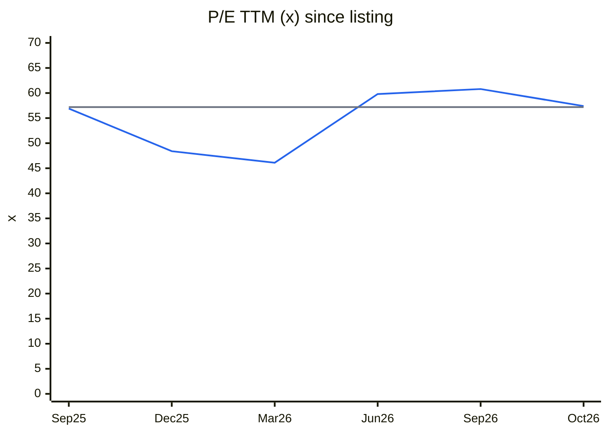
🟦 P/E TTM · ⬜ median since listing (57.2×)

**Read:** The P/E troughed at 46× (Mar-2026) when earnings jumped faster than the price, then re-rated to ~60×. It is now at its 13-month median.

**Business inference:** The market has paid 46–61× throughout, so it has never priced Atlanta as a cyclical. A 10-year band is impossible (listed Sep-2025). Against the domestic peer pack's 30–35× history, the whole band is "expensive".

### CY4 — Price vs EPS index (Sep-25 = 100)

| | Sep-25 | Dec-25 | Mar-26 | Jun-26 | Sep-26 | Oct-26 |
|---|---|---|---|---|---|---|
| Price | 100 | 100 | 132 | 185 | 188 | 178 |
| TTM EPS | 100 | 117 | 163 | 176 | 176 | 176 |

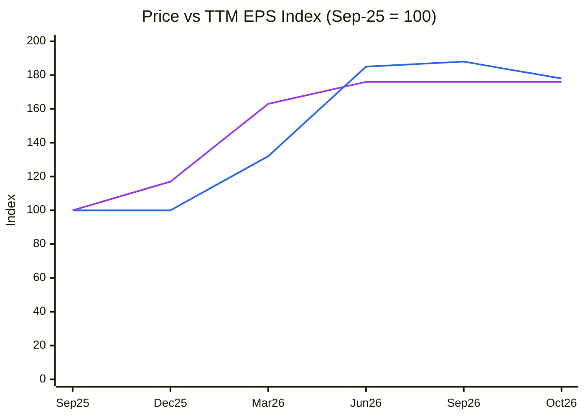
🟦 Price · 🟪 TTM EPS

**Read:** Price and EPS have both risen ~1.8× since listing. The return has been **earnings-driven, not a re-rating**.

**Business inference:** That is a healthy sign, but the starting multiple was already 57×. Future returns therefore need EPS growth of ≥30% a year just to hold the price, as the multiple is more likely to compress toward 35–40× as growth normalises.

### 8D. Scenario analysis (FY29E, multiple-based; 7.687 Cr shares)
| Scenario | Revenue FY29 | EBITDA margin | EPS FY29 | Target P/E | Target price | Probability |
|---|---|---|---|---|---|---|
| Bull | ₹5,000 Cr (40% CAGR delivered; 765 kV live) | 19.5% | ₹82.8 | 40× | **₹3,312** | 25% |
| Base | ₹4,000 Cr (~29% CAGR; 400 kV ramp, 765 kV late) | 17.5% | ₹56.8 | 32× | **₹1,818** | 50% |
| Bear | ₹3,100 Cr (orders peak FY27; L1 pricing war) | 14% | ₹30.7 | 22× | **₹676** | 25% |
| **Expected value (FY29)** | | | | | **₹1,906 (+18%)** | |

*D&A ₹85–100 Cr, interest ₹40–45 Cr (WC lines), OI ₹15–25 Cr, tax 26%.*
- **PV of expected value** (2.4 yrs @ 13.5%) = **₹1,406** → 13% below CMP. Base-case PV ₹1,341.
- **Upside/downside:** (3,312 − 1,620) ÷ (1,620 − 676) = **1.79:1** (below 2:1; above the 1.5:1 hard stop).
- **Required MoS** (mid-cap, late-cycle, MPS overhang): 30% + 5pp → **buy-below ≈ ₹1,406 × 0.70 ≈ ₹985 → ~₹1,000.**

### C13 — Scenario values vs CMP (₹)

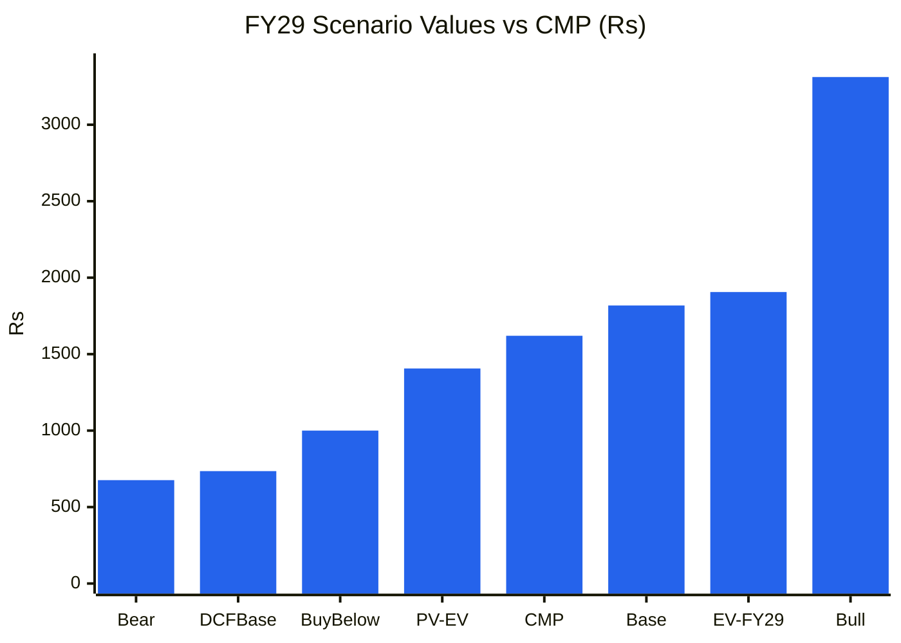
🟦 ₹ per share

**Read:** CMP (₹1,620) sits between the discounted expected value (₹1,406) and the undiscounted base case (₹1,818). Only the bull case (₹3,312) delivers a return well above the cost of equity.

**Business inference:** At ₹1,620 the investor is long the bull case: 765 kV success, exports and sustained 19%+ margins. The base case returns ~5% a year to FY29. That is a quality company priced for perfection.

### Cycle Position Dashboard
| Dimension | Current | History median | Percentile | Signal |
|---|---|---|---|---|
| P/E | 57.4× | 57.2× (13 m) / domestic peers ~33× | 50th own / >90th vs peers | **Expensive** |
| P/B | 13.2× | — | — | Expensive |
| EBITDA margin | 18.6% (FY26) | 12.3% (7-yr avg) | 100th (+1.9 SD) | **Peak / late** |
| ROCE | 45% | 45% (FY22–26) | ~50th | Mid (upcycle only) |
| Industry utilisation | Tight, easing 2027–28 | — | — | Balanced → oversupply risk |
| Order momentum | Book-to-bill 1.77× | — | High | **Strong** |
| **Overall cycle position** | | | | **Late cycle** |

---

## Module 9 — Technical Stage (Weinstein + CANSLIM)

**Nifty 50: Stage 4** (22,524 vs falling 30-week MA 23,726).
**Sector (capital goods / T&D): Stage 3** (secondary evidence; sector index chart is a data gap).
**Stock: Stage 3 (topping), early.**

| Check | Evidence |
|---|---|
| Price vs 30-week MA | ₹1,608–1,620 vs MA **₹1,710**. Below for 3 weeks (19-Oct and 26-Oct weekly bars) |
| MA slope | Still rising (₹1,465 → ₹1,614 → ₹1,710 over 10 weeks) but flattening, since price is now below it |
| Highs / lows | High ₹2,153 (intraday, week of 1-Jun-2026). Lower weekly-close highs: ₹1,882 (31-Aug), ₹1,770 (5-Oct). Support ₹1,493 (week of 27-Jul low) |
| Volume | Distribution weeks: 5-Oct 1.51 M and 12-Oct 1.10 M (vs 20-wk avg 0.65 M) on a reversal from ₹1,770 to ₹1,695 |
| RS vs Nifty | 26-wk: −8.2% vs Nifty −6.1% → **−2pp (deteriorating)**. Since listing: +76% vs Nifty −9.5% |

**Stop-loss / invalidation:** a weekly close below **₹1,490** (Jul-2026 low) would confirm Stage 4. A weekly reclaim of ₹1,775 (Oct swing high) on volume would put it back in Stage 2.

**CANSLIM (0–7)**
| Criterion | Evidence | Score |
|---|---|---|
| C | Q1 FY27 EPS ₹6.09 vs ₹4.35 (+40%) | 1 |
| A | Consolidated EPS FY24 −27% (₹12.22 → ₹8.87), then +87%, +58%. Not 3 consecutive years ≥25%; ROE 22–34% | 0 |
| N | 400 kV approval, 765 kV pending; price not at highs | 0 |
| S | Free float ~12.7% (small); recent heavy volume on down weeks | 0 |
| L | RS top-quartile since listing, slipping on 26 weeks | 0 |
| I | DIIs rising 3.9% → 5.0%; FIIs falling 2.2% → 1.5%; Motilal Buy | 1 |
| M | Nifty Stage 4 | 0 |
| **Total** | | **2 / 7** |

**Combined verdict:** Stage 3 → **do not buy; existing holders tighten stops** (₹1,490).
**Stage + fundamental alignment: Aligned (both say "wait").**

---

## Module 10 — Forward View: 2–3 Year Thesis

### Capex classification
| Capex type | FY27E (₹ Cr) | FY28E | FY29E | In AT model? |
|---|---|---|---|---|
| Tangible growth (inverter-duty +5,000 MVA; tank & radiator ~₹15–20 Cr spent; 765 kV stage 1 + testing) | ~110 | ~160 | ~110 | ✅ |
| Maintenance (~D&A) | ~45 | ~70 | ~90 | ❌ |
| Intangibles (765 kV tech fee US$3–5 m ≈ ₹25–40 Cr + royalty 2–4% on 765 kV sales) | ~35 | — | royalty in opex | ❌ |
| CWIP (Mar-2026) | ₹30 Cr | | | ❌ until capitalised |
| ROU (Ind AS 116) | Not disclosed | | | ⚠️ |
| **Total (approx.)** | **~150–190** | **~200–230** | **~150–200** | |

### Fixed assets & asset turnover (consolidated)
| Year | Fixed assets incl. CWIP (₹ Cr) | Revenue (₹ Cr) | Turnover (×) |
|---|---|---|---|
| FY22 | 47 | 595 | 12.7 |
| FY23 | 50 | 874 | 17.5 |
| FY24 | 77 | 868 | 11.3 |
| FY25 | 189 | 1,244 | 6.6 |
| FY26 | 537 | 1,852 | 3.4 |

*Net block + CWIP (gross block from the PPE note not retrieved; data gap). The structural fall reflects new and acquired block. The DuPont total-asset turnover (1.23×) is the better guide.*

**Incremental ROIC:** FY29 base ΔRevenue ₹2,150 Cr (vs FY26) × EBIT ~15.3% × 0.74 ≈ ₹243 Cr ÷ (₹520 Cr growth capex FY27–29 + ~₹380 Cr ΔNWC) ≈ **27% vs WACC 13.5% → value-creating.**
**Capex-model implied revenue CAGR (FY26–29):** base 29%; guided 40% fits capacity (~75% utilisation by FY29). **PIE: 27–30% for 10 years** → pricing **unannounced expansion** beyond FY29.

### C14 — Forward block → revenue bridge (₹ Cr)

| | FY26 | FY27E | FY28E | FY29E |
|---|---|---|---|---|
| Fixed assets incl. CWIP (closing) | 537 | 650 | 790 | 860 |
| Revenue (base) | 1,852 | 2,600 | 3,250 | 4,000 |
| Turnover (×) | 3.4 | 4.0 | 4.1 | 4.7 |

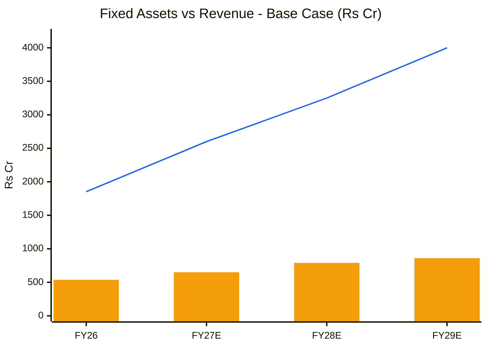
🟧 Fixed assets incl. CWIP · 🟦 Revenue (base)

**Read:** The base case needs only a ~60% rise in fixed assets for revenue to rise 2.2×, with turnover recovering from 3.4× to 4.7×.

**Business inference:** Growth to FY29 is mostly utilisation of capacity already built, so it is high-ROIC and cash-generative. The valuation gap is about what happens *after* FY29, not whether FY27–29 growth happens.

### Capex-to-earnings model (base)
| Metric | FY27E | FY28E | FY29E |
|---|---|---|---|
| Revenue (₹ Cr) | 2,600 | 3,250 | 4,000 |
| EBITDA margin | 18.5% | 18.0% | 17.5% |
| EBITDA | 481 | 585 | 700 |
| D&A | 45 | 70 | 90 |
| Interest | 30 | 35 | 40 |
| Other income | 15 | 18 | 20 |
| PBT | 421 | 498 | 590 |
| ICR (×) | 14.5 | 14.7 | 15.3 |
| PAT (26% tax) | 312 | 369 | 437 |
| EPS (₹) | 40.5 | 47.9 | 56.8 |
| P/E at CMP | 40× | 34× | 28.5× |
| ΔNWC (60 days) | −148 | −107 | −124 |
| Capex | −170 | −215 | −175 |
| **FCF** | **~39** | **~117** | **~228** |
| Net debt | net cash builds | | |

**FCF inflection:** FY28E (FCF ≥ ₹100 Cr). **Debt ceiling:** n/a (net cash); the risk is a dilutive MPS QIP rather than leverage.

### Key catalysts
1. **Q2 FY27 results** (~mid-Nov-2026): inflow, margin recovery from 16.5%, and progress on the 765 kV tie-up.
2. **765 kV technology agreement + PGCIL revalidation under the new name**: guided Q2–Q4 FY27, first orders by year-end or Q4 FY27.
3. **400 kV first unit and short-circuit test**: FY27; meaningful 400 kV revenue in FY28.
4. **Inverter-duty facility (+5,000 MVA)**: Dec-2026; BESS/solar demand.
5. **First export orders** (Europe/Africa/US): FY27–28.

### Key risks
1. **Capital-cycle margin compression** (L1 pricing as industry capacity arrives FY27–29). Probability: **Medium-High.**
2. **MPS-driven supply** (~₹1,500 Cr OFS/QIP by ~2028) capping the multiple. **High** (it is mandatory).
3. **765 kV / 400 kV execution delay or test failure** (already one slip). **Medium.**
4. **Customer concentration** (GETCO 29%; top-10 74%): a Gujarat tender pause would hurt. **Medium.**
5. **Atlanta Trafo remains under-utilised and loss-making** (8–15% utilisation). **Medium.**

### Scenario summary
Bull ₹3,312 (25%) · Base ₹1,818 (50%) · Bear ₹676 (25%) → **EV ₹1,906 (FY29), PV ₹1,406**. Return from CMP: +18% nominal over 2.4 years (≈7% a year); −13% on a PV basis.

---

## Checklist Summary
**Section 0 (Existing Report Protocol):** 3/3. Initial report.
**Section A (Business Quality):** 16/18. BSE Form C and independent scuttlebutt beyond broker notes are data gaps.
**Section B (Forensics):** 8/9. Auditor tier/KAM data gap.
**Section C (Financial Statements):** 11/12. Ind AS 116 lease detail not retrieved.
**Section D (KPIs & Peers):** 7/7.
**Section E (Market Size & Share):** 7/7.
**Section F (Valuation):** 10/10.
**Section G (Technical Stage):** 8/8. Sector index chart is a data gap.
**Section H (Forward View):** 30/34. PPE gross block, project-wise CWIP and NWC by segment are data gaps; unit-economics track n/a.
**Section I (Charts):** 5/5. C1, C2, C5, C7, CY1, CY4, CY5, CY7, C12, C13, C14, OB-1, OB-4.
**Order Book Tracker:** Run (4 ledger orders + company-reported quarterly inflow; 6 snapshots; reconciliation passes).
**Hard Stops Triggered:** None. Forensic 1; M-score −2.39; no pledge; Stage 3 (not Stage 4); upside/downside 1.79:1 (>1.5).

### Pre-buy final check (behavioural)
- **Falsifiable downgrade triggers:** (1) Q2 + Q3 FY27 EBITDA margin <17% combined; (2) quarterly implied inflow <₹600 Cr for two quarters; (3) 765 kV tie-up not signed by Mar-2027; (4) a weekly close <₹1,490.
- **Inversion:** margin cycle, MPS supply, EHV execution, GETCO concentration, subsidiary losses, multiple compression from 57× toward 35×. The price discounts **none** of these.
- **Asymmetry:** 1.79:1, SVAR 58% → fails.
- **5-year test:** a strong balance sheet survives a 2-year downturn; capital allocation is good. The moat is narrow but improving. → **Investment-grade business, trading-grade price.**
- **Recency bias:** base-case margins of 17.5–18.5% sit between the 7-yr average (12.3%) and the peak (19–20%). The DCF fades growth to 8%.
- **Crowd test:** Motilal Oswal Buy with TP ₹1,950 (+20%), set 22-Jul-2026. **Our view differs:** a FY29 base of ₹1,818 implies the broker's TP needs the bull path or a multiple held at ~40× FY28E.

---

## Investment Decision
**Recommendation:** **WATCHLIST — Quality at Wrong Price**
**Conviction Score:** 4.8 / 10

| Component | Max | Score | Note |
|---|---|---|---|
| Market + sector + stock cycle | 1 | 0.3 | Stage 4 market; late-cycle margins |
| Industry structure | 1 | 0.5 | Neutral; better above 400 kV |
| Business quality & moat | 2 | 1.1 | Narrow, emerging EHV moat; ROIC ≫ WACC |
| Management | 1 | 0.6 | WTT 0.70; MPS/OFS |
| Financial + earnings quality | 2 | 1.7 | CFO/PAT 0.88; net cash; operational ROE |
| Valuation & PIE asymmetry | 2 | 0.4 | 57× P/E; PV < CMP; 1.79:1; SVAR 58% |
| Technical + CANSLIM | 1 | 0.2 | Stage 3; CANSLIM 2/7 |
| **Total** | **10** | **4.8** | |

**Suggested position size:** 0% now. At buy-below: 2–3% (standard; × 0.5 late-cycle modifier until margins prove resilient).
**Entry price range:** **₹950–1,050** (≈21–22× FY28E EPS; ~35× TTM). **Or** above ₹1,775 on a weekly close with volume, **only if** Q2 FY27 shows inflow ≥₹800 Cr, EBITDA ≥18% and a signed 765 kV agreement (momentum entry, half size).
**Stop-loss (existing holders):** weekly close <₹1,490.
**Target price (base, FY29 multiple):** ₹1,818; PV ₹1,406; DCF base ₹735.
**Review triggers:** Q2 FY27 results (Nov-2026); the 765 kV agreement; any MPS OFS/QIP announcement (often a good entry when priced at a discount); FY27 EBITDA margin.

---

### Sources
- Screener.in: [ATLANTAELE standalone](https://www.screener.in/company/ATLANTAELE/) and [consolidated](https://www.screener.in/company/ATLANTAELE/consolidated/) (financials, ratios, shareholding; 23-Oct-2026 close).
- Results / calls: [Q1 FY27 Multibagg call note](https://www.multibagg.ai/market-pulse/articles/q1fy27-update-96340) · [SolarQuarter Q1 FY27](https://solarquarter.com/2026/07/22/atlanta-electricals-reports-48-revenue-growth-in-q1-fy27-order-book-crosses-inr-3100-crore/) · [T&D India Q1 FY27](https://www.tndindia.com/atlanta-electricals-closes-q1fy27-with-order-book-of-over-rs-3000-crore/) · [T&D India FY26 (OB ₹2,493 Cr; utilisation)](https://www.tndindia.com/atlanta-electricals-order-book-nudges-rs-2500-crore/amp/) · [Construction World FY26 (term debt nil, CRISIL A)](https://www.constructionworld.in/amp/policy-updates-and-economic-news/atlanta-electricals-posts-strong-fy26-growth-and-debt-free-finish/91344) · [SolarQuarter Q3 FY26 (OB history)](https://solarquarter.com/2026/01/20/atlanta-electricals-reports-80-yoy-revenue-growth-in-q3-fy26-order-book-hits-record-₹2451-crore) · [Q3 FY26 BSE filing](https://bsmedia.business-standard.com/_media/bs/data/announcements/bse/19012026/0e40a4e5-408c-4331-916f-879c8354e14a.pdf).
- Strategy / acquisition: [T&D India 765 kV roadmap interview](https://www.tndindia.com/we-have-a-clear-roadmap-of-entering-the-765kv-space-atlanta-electricals/amp/) · SolarQuarter 17-Oct-2025 (BTW Atlanta acquisition; page returned 403 on re-fetch; details via search summary).
- IPO: [Business Standard price band](https://www.business-standard.com/markets/news/atlanta-electricals-sets-ipo-price-band-at-718-754-check-key-details-here-125091700684_1.html) · [subscription 70.63×](https://www.business-standard.com/amp/markets/capital-market-news/atlanta-electricals-ipo-ends-with-subscription-of-70-63-times-125092500249_1.html) · [Chittorgarh IPO page](https://www.chittorgarh.com/ipo/atlanta-electricals-ipo/2011/) · [INDmoney IPO review (customer concentration)](https://www.indmoney.com/blog/ipo/atlanta-electricals-ipo-review).
- Broker: [Trade Brains on Motilal Oswal Buy, TP ₹1,950](https://tradebrains.in/motilal-oswal-pick-power-equipment-stock-that-could-deliver-20-upside/).
- Price series: Yahoo Finance weekly chart API (ATLANTAELE.NS, ^NSEI), pulled 26-Oct-2026.
- Peers: 14-Oct-2026 TARIL report (Screener.in 13-Oct-2026); SPEL report (26-Oct-2026).

---
*Report generated by Stock Fundamental Analysis Skill v3.3 | Indian Markets Context*
*Save path: C:\Users\anubh\Documents\Anubhav\Stock Analysis\Stock Analysis\*
