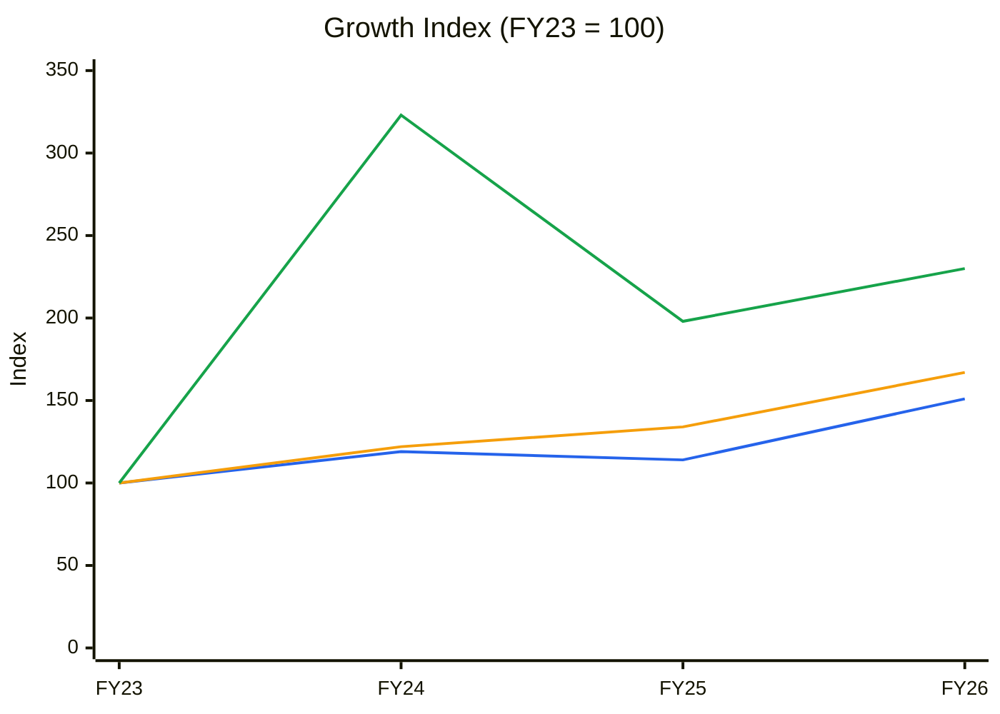
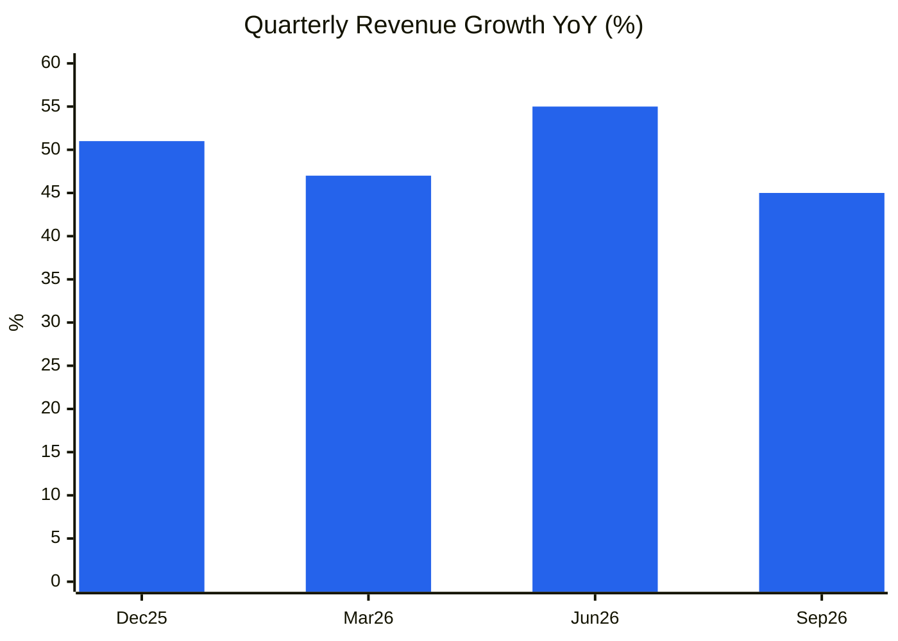
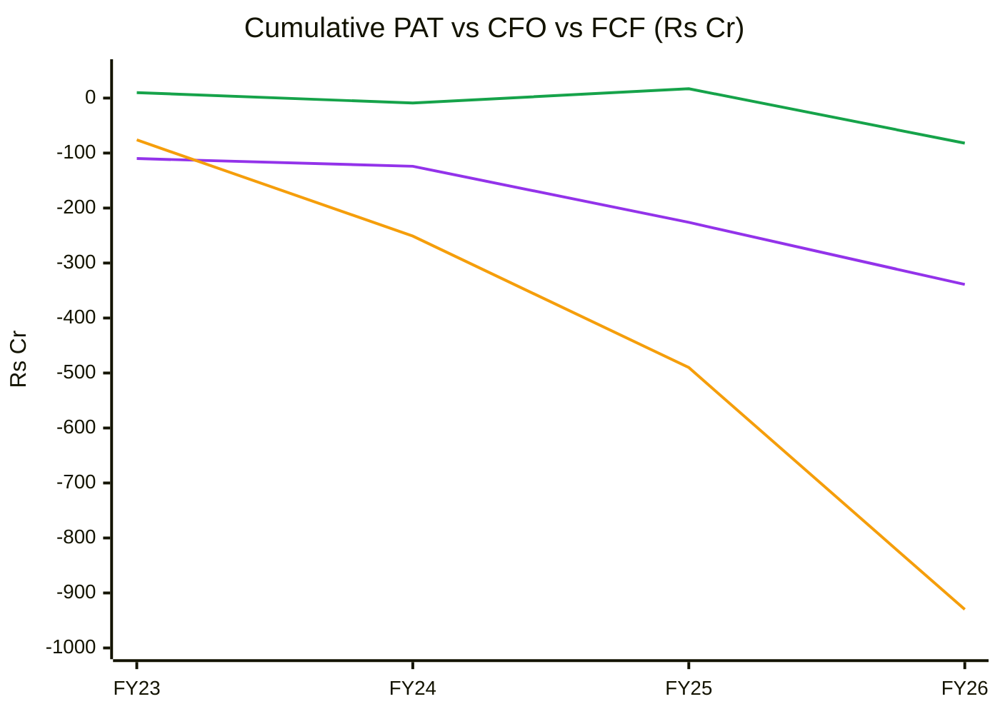
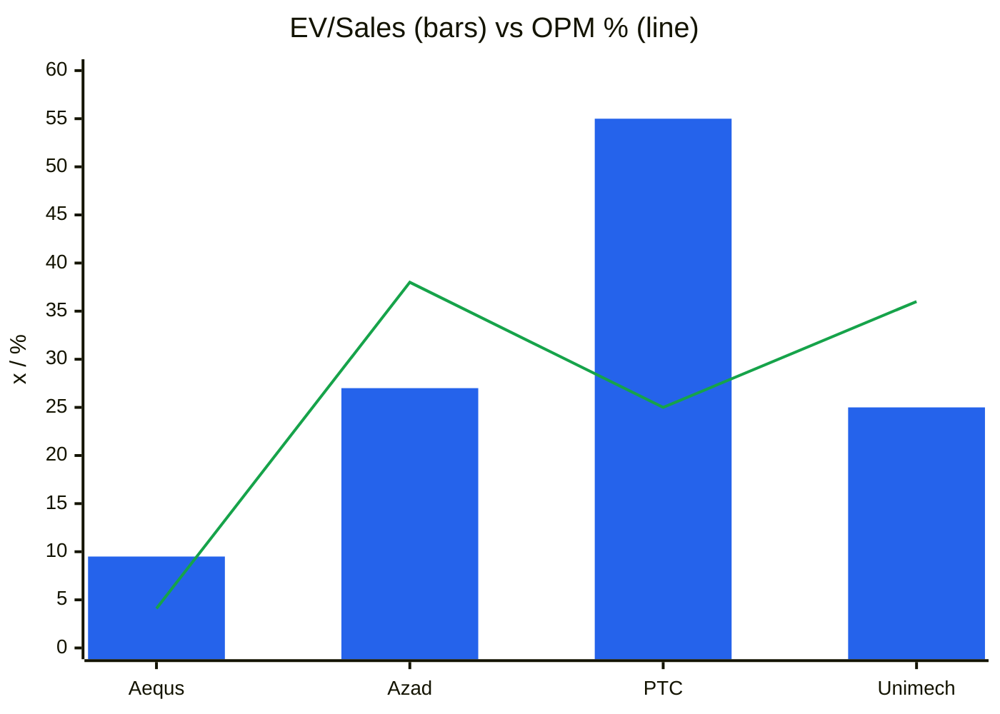
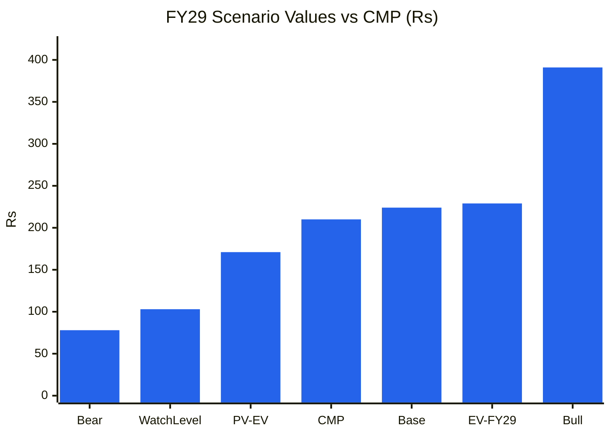

# Stock Analysis Report — Aequs Ltd (NSE: AEQUS)
**Date:** 2026-10-28
**Analyst:** Claude (Stock Fundamental Analysis Skill v3.3)
**Investment Horizon:** 2–3 Years
**Recommendation:** AVOID (hard stop: upside/downside < 1.5:1) → WATCHLIST, revisit on the fundamental triggers below
**Conviction Score:** 3.2 / 10
**CMP:** ₹210 (NSE, 28-Oct-2026 intraday, Screener.in) · Market cap ₹14,042 Cr (~66.9 Cr shares, FV ₹10; ~70 Cr diluted after ₹650 Cr promoter-group warrants) · Range since listing ₹113–295 · IPO Dec-2025 at ₹124
**Filed under:** Aerospace and Defence / Defence Electronics Drones and Components · Themes: Export-led manufacturing (civil aerospace exports)

## Revision Log
| Version | Date | Recommendation | Conviction | Price | Key change |
|---|---|---|---|---|---|
| Current | 2026-10-28 | AVOID → Watchlist | 3.2/10 | ₹210 | **Initial report.** The aerospace franchise is real and growing (+44% YoY, order book US$1.1 bn, 15-year Safran A320 wheels contract). But the consumer-electronics/toys/cookware unit loses ~₹40 Cr EBITDA a quarter, consolidated EBITDA margin fell to 6%, the group is loss-making (TTM PAT −₹202 Cr), inventory is 450 days, ~25% of promoter shares are pledged, and management now targets PAT break-even only by FY30. At ~9.5× EV/sales the price discounts a decade of 40%+ growth |

**Validation of previous report:** Initial report. No earlier report in the library (`--find AEQUS`; name search "Aequs" on 28-Oct-2026). Filed in the existing sub-sector `Aerospace-and-Defence/Defence-Electronics-Drones-and-Components` (with Unimech Aerospace; precision aero components fit "Components").

---

## Executive Summary

Aequs (Belagavi, Karnataka; founded 2000 by Aravind Melligeri, co-founder of QuEST Global) is India's largest integrated precision-component maker for **commercial aerospace**: machined parts, structures, landing-gear and engine components and assemblies for Airbus, Boeing and Tier-1s (Safran, Collins), made in a single vertically integrated SEZ (forging, machining, surface treatment, assembly). It also has a **consumer contract-manufacturing** arm (electronics enclosures, toys, cookware) built to diversify. It listed on NSE/BSE in Dec-2025 (₹922 Cr IPO at ₹124: ₹670 Cr fresh, ₹252 Cr OFS).

**Q2 FY27 (Sep-2026):** revenue **₹409 Cr (+45%)**: aerospace ₹351 Cr (+44%, ~86% of revenue), consumer ₹58 Cr (+52%). Consolidated EBITDA **₹24.5 Cr (6%, vs 16%)** because consumer EBITDA was **−₹40 Cr**. Net loss **₹52 Cr** (vs −₹21 Cr). Aerospace order book **US$1.1 bn (+9% QoQ)**. The stock fell **−17%** on results (27-Oct).

**Why AVOID:**
1. **The consumer bet is burning the aerospace profits.** Aerospace EBITDA is ~₹65 Cr/quarter (~18% margin, derived); consumer burns ~₹40 Cr. Management has cut planned consumer investment to ₹200–300 Cr and needs ~50% utilisation to break even. Its own guidance is **positive PAT only by FY30**.
2. **Capital-hungry and cash-negative.** FCF has been −₹76, −175, −239 and −440 Cr (FY23–FY26). Inventory days are **450**, the cash conversion cycle **290 days**. ROCE 1–4%. Equity keeps being raised (IPO ₹670 Cr; promoter-group warrants ₹650 Cr in Oct-2026).
3. **Promoter pledge ~25% of holding** (Screener, Sep-2026): elevated band (20–40%).
4. **Price already prices success.** EV ~₹14,300 Cr = 9.5× TTM sales and >200× TTM EBITDA. Management's 2031 target (revenue 4–6× FY26) implies a 32–43% CAGR. The probability-weighted FY29 value (EV/EBITDA basis) is **₹229**, PV **₹171** (−19%). **Upside/downside 1.4:1, below the 1.5:1 hard-stop floor.**

**Why it stays on the watchlist:** one of very few Indian Tier-1 aerostructure/component platforms with Airbus/Boeing/Safran qualifications, a decade-long order book, and a structural tailwind (aircraft backlog ~17,000; supply-chain diversification away from Europe/US). If consumer losses close, aerospace alone could justify a premium.

### C1 — Growth Index: Revenue vs Fixed Assets vs EBITDA (FY23 = 100, consolidated)
| ₹ Cr | FY23 | FY24 | FY25 | FY26 | TTM Sep-26 |
|---|---|---|---|---|---|
| Revenue | 812 | 965 | 925 | 1,230 | 1,498 |
| Fixed assets + CWIP | 686 | 835 | 920 | 1,149 | — |
| EBITDA | 40 | 129 | 79 | 92 | 62 |
| PAT | −110 | −14 | −102 | −113 | −202 |

*Source: Screener.in consolidated. PAT is not indexed (negative throughout). Pre-FY23 history not on Screener; RHP figures not retrieved (data gap).*

🟦 Revenue · 🟧 Fixed assets + CWIP · 🟩 EBITDA

**Read:** Revenue +51% and fixed assets +67% over FY23–FY26, while EBITDA swung from ₹129 Cr (FY24) to ₹62 Cr TTM. The group has lost money every year.

**Business inference:** Capital is growing faster than revenue, and earnings have not followed. That is the opposite of operating leverage. The consumer diversification is the main cause (aerospace alone is profitable), but the consolidated entity has not yet shown it can earn a return on the capital it raises.

---

## Business Primer
Aequs machines and assembles precision metal parts (aluminium, titanium, steel) for aircraft (wing and fuselage structures, landing-gear and engine components, wheels and brakes) under long-term agreements with OEMs and Tier-1 suppliers (Airbus, Boeing, Safran, Collins and others), mostly for export. Revenue = parts shipped × contracted price over programme lifetimes (often 10–15 years, e.g. the new Safran A320 wheels deal), so it scales with aircraft build rates (A320, B737) and share-of-wallet gains. Its consumer segment uses the same precision manufacturing base for consumer-electronics enclosures, toys (Hasbro-type programmes) and cookware, and is in ramp-up with heavy losses. Operations are concentrated in the Belagavi aerospace SEZ (Karnataka), with Hubballi (consumer) and a planned Hosur expansion. The business depends on two things: **OEM build-rate recovery** (Boeing production constraints, Airbus ramp), and **qualification/approval** for new parts, which takes years and creates the barrier.

This is an **asset-heavy, long-cycle, export-oriented precision manufacturer** in a structural growth industry, with an unproven consumer bet attached. The value driver is aerospace volume and mix (assemblies over parts). The key risks are consumer losses, the working-capital intensity of aerospace inventory, OEM concentration, and repeated equity funding. One structural feature colours everything: **consolidated results blend a ~18–21% EBITDA aerospace business with a deeply loss-making consumer business**, so the segment split, not the consolidated P&L, is the unit of analysis.

**New Segment Protocol:** segment covered → "Aerospace & Defence (A&D) Manufacturing" (references/05-industry-kpis-india.md, line 46) ✓; adjacent "Forgings & Precision Metal Components" (line 1046) ✓.

---

## Module 1 — Broad Market Cycle
Nifty 50 ~22,750, below a falling 30-week MA (Stage 4); 1-yr −11%. **CAUTIOUS.** Aequs is +43% since its listing-week close (₹147) vs Nifty −13% over the same period (Yahoo Finance weekly).

## Module 1b — Sector Cycle
**Secular:** global commercial aircraft backlog ~17,000 aircraft (8–10 years of production); OEMs diversifying supply chains to India; India's own aircraft orders (Air India, IndiGo ~1,500 aircraft). Long-term agreements (LTAs) give multi-year visibility.
**Cyclical:** the post-COVID build-rate ramp (A320neo toward rate 75; B737 constrained by FAA caps) is a recovery tailwind that will normalise. Consumer contract manufacturing is cyclical and competitive (China+1 toys/electronics).
**Decomposition:** aerospace +44% YoY ≈ ~15% secular (programme share + backlog) + ~29pp ramp-up/new-part transfers. **Durable baseline: 18–22%.**
**FX:** export revenue largely USD/EUR, so INR weakness helps. Titanium/aluminium input costs are typically passed through under LTAs.
**Verdict: TAILWIND for aerospace; HEADWIND (execution) for consumer.**

## Module 1c — Stock Cycle

### C2 — Quarterly YoY revenue growth
| | Dec-25 | Mar-26 | Jun-26 | Sep-26 |
|---|---|---|---|---|
| Revenue (₹ Cr) | 326 | 367 | 396 | 409 |
| Same quarter last year | 216 | 249 | 256 | 282 |
| YoY | 51% | 47% | 55% | 45% |

*Only four YoY points exist (Screener quarterly history starts Dec-2024).*

🟦 YoY revenue growth (consolidated)

**Read:** Revenue growth has been a steady 45–55% for four quarters.

**Business inference:** Top-line momentum is strong and broad-based (both segments). The problem is entirely below the gross line, in the consumer cost base and group interest and depreciation.

### Segment economics (Q2 FY27)
| Segment | Revenue (₹ Cr) | YoY | EBITDA (₹ Cr) | Margin |
|---|---|---|---|---|
| Aerospace | 351.4 | +44% | ~64.6 (derived: consolidated 24.5 − consumer −40.1) | ~18.4% (Q2 FY26 ~21.4%; aero EBITDA +24% YoY) |
| Consumer | 57.7 | +52% | **−40.1** | −70% |
| **Consolidated** | 409.1 | +45% | 24.5 | 6.0% |

*Sources: Investing.com/Kotak Neo/Inc42 Q2 FY27 coverage. The aerospace EBITDA split is derived; the company reports aerospace EBITDA growth of +24% YoY.*

**Note:** aerospace margin *fell* ~300 bp YoY (EBITDA +24% on revenue +44%): new-programme ramp, Hosur pre-operative costs or mix. That needs watching.

### Physical capacity / working capital
- Inventory days **450** (FY26), up from 313 (FY23): long-lead aerospace raw material (titanium, forgings) plus WIP for new programmes.
- **Cash conversion cycle 290 days.** Growth consumes large working capital.
- Capex FY27 guided at ₹500–550 Cr (mostly aerospace, Hosur expansion) vs depreciation of ~₹170 Cr TTM → **capex/D&A ~3×**.

### FCF inflection
Not before FY29–FY30 on management's own timeline (PAT break-even FY30). Funding: IPO ₹670 Cr (Dec-2025) + promoter-group warrants ₹650 Cr (to be deployed by Dec-2027). "No further fundraising planned in FY28."

**Stock cycle classification: Early cycle / ramp-up** (capex heavy, margins suppressed, revenue accelerating). MoS standard, but sizing small given losses.

---

## Module 2 — Industry Structure
| Force | Aerospace precision components | Signal |
|---|---|---|
| New entrants | **Low.** AS9100/NADCAP, OEM first-article and part approvals take 2–5 years per part | ✅ Barrier |
| Supplier power | Medium: titanium/aluminium mills, forgings; LTAs pass through metals | ⚠️ |
| Buyer power | **High.** Airbus/Boeing/Safran dictate pricing, with annual price-down clauses | ⚠️ |
| Substitutes | Low | ✅ |
| Rivalry | Rising in India (Azad, PTC Industries, Unimech, Tata Advanced Systems, Dynamatic, MTAR); global low-cost (Mexico, Morocco, Vietnam) | ⚠️ |
**Verdict (aerospace): ATTRACTIVE structurally.** Consumer contract manufacturing: **UNATTRACTIVE** (low barriers, strong buyers, China competition).
**Capital cycle:** capital is flooding into Indian aerospace components (multiple IPOs: Azad 2023, Unimech 2024, Aequs 2025; PTC and Azad capex). Returns at listed peers are already compressing (ROCE 9–12%). **Late in the listing cycle, early in the industry cycle.**

## Module 3 — Business Quality & Moat
- **Greenwald:** **customer captivity** via part qualifications and 10–15-year LTAs (switching a qualified part is costly for an OEM) ✅, plus **local scale** in the integrated Belagavi SEZ (forging-to-assembly under one roof, rare in India). No cost advantage evident yet (margins below peers: aero ~18–21% vs Azad 38%, Unimech 36%, PTC 25%).
- **Buffett 10% test:** fail (OEMs impose price-downs).
- **Moat: NARROW** (aerospace qualifications); **NONE** in consumer.

### Fisher 15-point checklist
| # | Point | Score | | # | Point | Score |
|---|---|---|---|---|---|---|
| 1 | Market potential | 3 | | 9 | Management depth | 2 |
| 2 | New products/programmes | 3 | | 10 | Controls | 2 |
| 3 | R&D/engineering | 2 | | 11 | Industry advantage | 2 |
| 4 | Sales (OEM relationships) | 3 | | 12 | Long-range orientation | 3 |
| 5 | Profit margin | 1 | | 13 | Dilution | 1 (IPO + warrants) |
| 6 | Margin actions | 1 | | 14 | Candour | 2 (pushed PAT break-even to FY30) |
| 7 | Labour relations | 2 | | 15 | **Integrity** | **2** (pledge flag; no SEBI issues found) |
| 8 | Executive relations | 2 | | | **Total** | **31 / 45** |

## Module 4 — Management & Capital Allocation
**Promoters:** Aravind Melligeri and entities (Aequs Manufacturing Investments, Melligeri Private Family Foundation) **59.09%**. **Pledge ~25.4% of promoter holding** (Screener, Sep-2026) → **ELEVATED** (verify the trend on BSE; data gap). FIIs 5.9% (rising), DIIs 9.3% (falling from 11.6%). Shareholders doubled to 1.0 lakh (Sep-2026).

| Check | Finding | Flag |
|---|---|---|
| Pledge | ~25% of promoter shares | ⚠️ Elevated |
| Promoter funding | Promoter-group warrants ₹650 Cr (Oct-2026): commitment, but also dilution (issue price not retrieved; ~3 Cr shares if near CMP) | ⚠️/✅ |
| OFS at IPO | Promoter entities and investors (Amicus, Dempo trusts) sold ₹252 Cr | Neutral |
| Capital allocation | Consumer diversification (₹200–300 Cr now, cut from earlier plans) has destroyed value so far | ❌ |
| Capex discipline | Capex shifted toward aerospace (Hosur) | ✅ Right direction |

**Capital allocation rating: Poor → Improving** (re-prioritising aerospace).

### Walk the Talk (limited history: listed Dec-2025)
| Period | Statement | Guided | Actual | Verdict |
|---|---|---|---|---|
| IPO (Dec-2025) | Aerospace growth momentum | Strong | +44% YoY (Q2 FY27) | ✅ |
| IPO / FY26 calls | Consumer ramp toward break-even | Ramp in FY27 | Losses deepened QoQ and YoY; "extended qualification timelines" | ❌ |
| FY26–27 | Consumer investment plan | Larger programme | Cut to ₹200–300 Cr (Q2 FY27) | 🔴 Reversal |
| Q2 FY27 | PAT positive | FY30 | Pending | — |
| Q2 FY27 | No new fundraising in FY28 | — | Pending | — |
| Q2 FY27 | 2031 revenue 4–6× FY26 | — | Pending | — |

**WTT: (1 + 0) ÷ 3 = 0.33 → UNRELIABLE** (small sample). Pattern: aerospace delivers; consumer timelines slip. Insider: promoter warrants (bullish) vs pledge (bearish) → **MIXED**. **DCF impact:** consumer break-even pushed out; aerospace guidance haircut 20%.

## Module 5 — Financial Forensics
| Check | Finding | Flag |
|---|---|---|
| Pledge | ~25% | ⚠️ |
| Other income | ₹60 Cr TTM vs EBITDA ₹62 Cr (~100% of EBITDA); FY26 ₹69 Cr incl. a ₹44 Cr Q4 spike (treasury on IPO cash / FX?) | 🔴 Reported PBT supported by OI |
| Inventory days | 313 → 336 → 420 → 450 | 🔴 Rising |
| Receivable days | 48 → 52 → 62 → 78 | ⚠️ Rising |
| CFO | −₹19 Cr (FY24), −₹99 Cr (FY26); CFO/EBITDA −80% FY26 | 🔴 |
| Tax | Tax expense despite losses (58% FY26): subsidiary profits / deferred tax | ⚠️ |
| Audit | Auditor/KAMs not retrieved (data gap) | ⚠️ |

**Quant models (FY26):** Altman Z'' ~2.0 (Grey: WC 0.25, retained earnings deeply negative, EBIT ~0); Piotroski **3/9** (CFO <0, ROA <0, dilution, leverage down ✓, current ratio up ✓ (IPO cash), AT up ✓); Sloan CF accrual (−113 + 99 + 365)/avg TA 2,318 = **15%** 🔴 (investing-driven). Beneish not run (loss-making, IPO-year balance sheet).
**Unresolved forensic red flags: 3** (rising inventory days with negative CFO; other income ≈ EBITDA; Sloan >10%). **Verdict: Significant concerns** (operating, not manipulation: no evidence of misstatement).

## Module 5 (cont.) — Earnings Quality
- **ROIC:** EBIT TTM ≈ 62 − 172 = **−₹110 Cr** → negative ROIC. On aerospace alone (~₹245 Cr EBITDA TTM est., D&A ~₹140 Cr) ROIC is roughly **5–7%**, still below WACC (~13%).
- **Cumulative FY23–FY26:** PAT −₹339 Cr · CFO −₹82 Cr · FCF −₹930 Cr. Funded by equity and debt.

### C7 — Cumulative PAT vs CFO vs FCF (₹ Cr)
| | FY23 | FY24 | FY25 | FY26 |
|---|---|---|---|---|
| Cum. PAT | −110 | −124 | −226 | −339 |
| Cum. CFO | 10 | −9 | 17 | −82 |
| Cum. FCF | −76 | −251 | −490 | −930 |

🟪 Cumulative PAT · 🟩 Cumulative CFO · 🟧 Cumulative FCF

**Read:** Four years of losses and ₹930 Cr of cumulative negative free cash flow.

**Business inference:** Aequs is a capital consumer. The IPO and warrants are filling the hole, and per-share value depends on future returns on that capital.

### DuPont (FY26)
ROE −10% (FY26) = negative EBIT margin (~−2%) × AT 0.45 × equity multiplier 1.84. **Operations, not leverage, drive the losses.** Leverage has fallen (borrowings ₹1,106 Cr → ₹701 Cr).

## Module 6 — Industry KPIs & Peers
| KPI (A&D block) | Aequs | Healthy | Assessment |
|---|---|---|---|
| Order book / revenue | US$1.1 bn ≈ ₹9,200 Cr ÷ aero TTM ~₹1,300 Cr ≈ **7×** (long-term LTA values, not all firm) | >2.5× | ✅ (verify firm vs LTA "potential") |
| Book-to-bill | +9% QoQ OB growth | >1× | ✅ |
| EBITDA margin | 6% consolidated; ~18% aerospace | 15–25% | 🔴 consolidated / ✅ aero (below peers) |
| Receivable days | 78 | <120 | ✅ |
| WC intensity | CCC 290 days | NWC <30% of revenue | 🔴 |
| Programme concentration | Not disclosed (A320/B737 dominant, assumed) | <30% | ⚠️ |
| Export revenue % | Majority (aero exports) | Rising | ✅ |

**Order book note:** a US$1.1 bn backlog against ~US$155 m of annual aero revenue (~7×) almost certainly reflects **lifetime LTA value at forecast build rates**, not firm purchase orders (the A&D block's "firm vs pipeline" caution applies). The Order Book Tracker was not run: no quarterly order announcements or firm/LTA split are available (data gap).

### Peer comparison (Screener.in, 28-Oct-2026)
| Metric | Aequs | Azad Engineering | PTC Industries | Unimech Aerospace |
|---|---|---|---|---|
| Market cap (₹ Cr) | 14,042 | 16,743 | 38,145 | 8,434 |
| TTM revenue (₹ Cr) | 1,498 | 638 | 697 | 346 |
| TTM OPM | 4.1% | 38% | 25% | 36% |
| TTM PAT (₹ Cr) | −202 | 139 | 126 | 88 |
| 3-yr sales CAGR | 15% | 34% | 40% | 37% |
| ROCE | 1.7% | 11.9% | 8.6% | 11.2% |
| P/E | n.m. | 120 | 304 | 96 |
| EV/Sales (approx.) | ~9.5× | ~27× | ~55× | ~25× |

🟦 EV/Sales (approx.) · 🟩 TTM operating margin %

**Read:** Aequs is the cheapest of the group on EV/sales (9.5× vs 25–55×), but it is also the only one losing money, at a 4% margin vs 25–38%.

**Business inference:** The whole Indian aero-components basket trades at extreme multiples (P/E 96–304×). Aequs looks "cheap" only relative to that basket. On its own economics (losses, cash burn) the discount is earned. If the sector multiple compresses toward global aerostructure peers (~15–25× EBITDA), Aequs has the least earnings support.

## Module 7 — Market Size & Share
Global aerostructures/precision-components market ~US$80–100 bn (estimate; data gap); India's share is small but rising (OEM India sourcing commitments: Airbus ~US$1.5–2 bn a year, Boeing ~US$1.25 bn+). Aequs aero revenue ~US$155 m TTM, perhaps **10–15% of Airbus/Boeing India sourcing** (estimate). **Gaining share** in India-sourced content; structural driver (qualified parts transfer).

## Module 8 — Valuation
### 8A. PIE
EV ≈ ₹14,042 Cr + ~₹700 Cr debt − ~₹450 Cr cash/investments (est.) ≈ **₹14,300 Cr**. EV/Sales 9.5×; EV/EBITDA TTM >200× (not meaningful).
Reverse DCF (base revenue ₹1,498 Cr; steady-state NOPAT margin 10.5–13%; WACC 12–13%; S/C 1.0; terminal g 6%): implied revenue CAGR **43–70% for 10 years** (FY36 revenue ₹55,000 Cr+). Even with a generous 13% margin and 12% WACC, the price requires **~43% a year for a decade**.
**Cross-check vs management:** the 2031 target of 4–6× FY26 revenue (₹4,900–7,400 Cr, a 32–43% CAGR to 2031) *plus* a full margin repair would roughly justify today's price **only at the top end**. **The market is pricing management's best case.**
**SVAR:** bear ₹78 → **63%** → unfavourable.

### 8B. Scenarios (FY29E; ~70 Cr diluted shares; EV/EBITDA basis, which suits a ramp-up manufacturer)
| Scenario | Aero rev FY29 | Aero EBITDA % | Consumer | Group EBITDA | EV/EBITDA | Net debt | Value/share | Prob. |
|---|---|---|---|---|---|---|---|---|
| Bull | ₹2,800 Cr (~38% CAGR) | 23% | ₹600 Cr at +8% | ₹692 Cr | 40× | ₹300 Cr | **₹391** | 25% |
| Base | ₹2,300 Cr (~30%) | 20% | Break-even | ₹460 Cr | 35× | ₹400 Cr | **₹224** | 50% |
| Bear | ₹1,900 Cr (~22%) | 17% | −₹80 Cr | ₹243 Cr | 25× | ₹600 Cr | **₹78** | 25% |
| **Expected value** | | | | | | | **₹229 (+9%)** | |

*Aero FY26 base ≈ ₹1,060 Cr (86% of ₹1,230 Cr). P/E cross-check (base FY29 PAT ~₹150 Cr, EPS ~₹2.1 × 50×) gives ~₹105, so the EV/EBITDA basis is the generous one.*
- **PV** (2.4 yrs @ 13%) = **₹171** (−19%).
- **Upside/downside:** (391 − 210) ÷ (210 − 78) = **1.37:1** → **below the 1.5:1 hard-stop floor.**
- **Graham Number:** n.a. (losses).
- **Watch level:** PV × (1 − 40%) ≈ **₹100–105**, or a re-look on fundamental triggers (below) regardless of price.

### C13 — Scenario values vs CMP (₹)

🟦 ₹ per share

**Read:** CMP (₹210) sits above the discounted expected value (₹171) and only just below the undiscounted base (₹224).

**Business inference:** The base case, in which aero grows 30% a year *and* consumer reaches break-even, returns ~3% a year to FY29 at a generous 35× EBITDA multiple. The risk/reward is not attractive until either the price falls or consumer losses visibly close.

### CY1/CY4 — valuation history
Not meaningful: listed Dec-2025 (<1 year) and loss-making (no P/E). P/B rose from ~5.6× at the IPO price (₹124 vs BV ~₹22) to ~9.5× (₹210).

### Cycle Position Dashboard
| Dimension | Current | Signal |
|---|---|---|
| EV/Sales | 9.5× (peers 25–55×) | Cheap vs sector, expensive vs fundamentals |
| EBITDA margin | 6% consolidated / ~18% aero | Trough (consumer drag) |
| ROCE | ~2% | Trough |
| Industry (aero) build rates | Ramping | Early-mid upcycle |
| Sector valuations (listed aero) | P/E 96–304× | **Euphoric** |
| **Overall** | | **Early company cycle inside a richly valued sector** |

## Module 9 — Technical Stage
**Nifty: Stage 4.** **Stock: Stage 2 → early Stage 3 (pullback after results).**
| Check | Evidence |
|---|---|
| Price vs 30-week MA | ₹210.6 vs MA ₹225.8 (rising: ₹189.6 ten weeks ago → ₹206.8 five weeks ago → ₹225.8) |
| Highs | All-time high ₹294.7 (Sep–Oct 2026); now −29% from the high |
| Volume | Results week (26-Oct) 41.8 M vs 20-wk avg ~27.9 M (**distribution**, −17% day) |
| RS vs Nifty | Since listing +43% vs −13% (strong); 5-week RS sharply negative |
**Read:** the uptrend broke on heavy volume. Below a still-rising 30-week MA = **Stage 2 failure risk / early Stage 3**. A weekly close below ~₹190 (Aug-2026 swing low area ~₹200–230) would signal Stage 4.
**CANSLIM:** C 0 (loss widened) · A 0 (losses) · N 1 (new LTAs, recent highs) · S 0 (dilution) · L 1 (RS leader since listing) · I 0 (DIIs down) · M 0 → **2/7**.
**Verdict: do not buy; holders tighten stops (weekly close <₹190).**

## Module 10 — Forward View
**Model track:** asset-heavy (capex-AT) for aerospace; unit-economics/ramp for consumer.
| ₹ Cr | FY27E | FY28E | FY29E |
|---|---|---|---|
| Aerospace revenue | 1,400 | 1,800 | 2,300 |
| Consumer revenue | 250 | 350 | 450 |
| Group EBITDA | 110 | 280 | 460 |
| D&A | 185 | 205 | 220 |
| Interest | 85 | 80 | 70 |
| Other income | 40 | 30 | 30 |
| PBT | −120 | 25 | 200 |
| PAT | −135 | 10 | 150 |
| Capex | 525 | 350 | 300 |
| FCF (incl. WC build ~₹100–150 Cr/yr) | ~−550 | ~−300 | ~−100 |
*Funding through FY28: IPO cash + ₹650 Cr warrants (management: no fresh raise in FY28).*

**Incremental ROIC (aerospace):** ΔRevenue ~₹1,240 Cr (FY26–29) × EBIT ~12% × 0.75 ≈ ₹112 Cr ÷ (~₹900 Cr capex + ~₹400 Cr WC) ≈ **9% < WACC 13%** at a 20% EBITDA margin. Value-creating only if aero margins reach peer levels (≥25%).

**Catalysts:** consumer EBITDA break-even (50% utilisation); aero EBITDA margin back to ≥21%; new LTAs (Airbus/Boeing/Safran); Boeing rate increases; pledge release.
**Risks:** consumer losses persist (**High**); Boeing/Airbus production disruption (**Medium**); further dilution beyond warrants (**Medium**); sector de-rating from 100×+ P/E (**High**); pledge invocation on a sharp price fall (**Low-Medium**).

## Checklist Summary
Section 0 5/5 · A 15/18 · B 7/9 · C 9/12 · D 6/7 (Order Book Tracker not run: no firm/LTA split) · E 4/7 · F 9/10 (CY1/CY4 n.m.) · G 8/8 · H 26/34 · I 4/5.
**Hard Stops Triggered:** **upside/downside 1.37:1 (<1.5:1).** Near-misses: ROIC < WACC for 4 years (turnaround thesis exists for aero only); 3 forensic flags (operational: WC, OI, accruals; at the threshold); pledge 25% (elevated, below the 60% stop).

## Investment Decision
**Recommendation:** **AVOID → WATCHLIST**
**Conviction:** 3.2 / 10 (Cycle 0.5 · Industry 0.6 · Moat 0.9 · Management 0.4 · Financial quality 0.3 · Valuation 0.2 · Technical 0.3)
**Position size:** 0%.
**Re-look triggers (any two):** consumer segment EBITDA ≥ 0 for a quarter; aerospace EBITDA margin ≥ 21%; consolidated CFO positive for two quarters; pledge reduced below 10%; or price ≤ ~₹105.
**Holders:** weekly-close stop at ₹190.

### Sources
- Screener.in [AEQUS consolidated](https://www.screener.in/company/AEQUS/consolidated/) (28-Oct-2026; incl. pledge ~25.4%); peers [Azad](https://www.screener.in/company/AZAD/consolidated/), [PTC Industries](https://www.screener.in/company/PTCIL/consolidated/), [Unimech](https://www.screener.in/company/UNIMECH/consolidated/).
- Q2 FY27: [Inc42](https://inc42.com/buzz/aequs-q2-loss-widens-2-5x-to-%E2%82%B952-4-cr-revenue-jumps-45-yoy/) · [Free Press Journal](https://www.freepressjournal.in/business/aequs-ltd-reports-strong-q2-h1-revenue-growth-aerospace-order-book-touches-usd-11-billion) · [GuruFocus call highlights](https://www.gurufocus.com/news/9145120/aequs-ltd-nseaequs-q2-2027-earnings-call-highlights-aerospace-surges-44-as-consumer-losses-weigh-on-margins) (page returned 403 on fetch; summary via search) · [Investing.com slides](https://ng.investing.com/news/stock-market-news/aequs-q2-fy27-slides-aerospace-drives-45-revenue-surge-amid-margin-pressure-93CH-2757708) · [Kotak Neo](https://www.kotakneo.com/news/stocks/aequs-q2fy27-results-show-aerospace-growth-and-consumer-break-even-challenges/) · [ScanX](https://scanx.trade/stock-market-news/companies/aequs-q2fy27-results-revenue-up-45-yoy-ebitda-falls-45/54558919).
- IPO: [Inc42 price band](https://inc42.com/buzz/aequs-ipo-price-band-set-at-inr-118-124) · [Outlook Business](https://www.outlookbusiness.com/markets/aequs-922-cr-ipo-to-open-on-dec-3-sets-price-band-at-118-124-share) · [Business Today](https://www.businesstoday.in/amp/markets/ipo-corner/story/aequs-ipo-opens-today-check-price-band-issue-size-latest-gmp-brokerage-reviews-and-more-504719-2025-12-03).
- Prices: Yahoo Finance weekly API (AEQUS.NS, ^NSEI), 28-Oct-2026.

---
*Report generated by Stock Fundamental Analysis Skill v3.3 | Indian Markets Context*
*Save path: C:\Users\anubh\Documents\Anubhav\Stock Analysis\Stock Analysis\Aerospace-and-Defence\Defence-Electronics-Drones-and-Components\*
