# Stock Analysis Report — ideaForge Technology Ltd (IDEAFORGE)
**Date:** 2026-10-11
**Analyst:** Claude (Stock Fundamental Analysis Skill v3.3)
**Investment Horizon:** 2–3 Years
**CMP:** ₹668.6 (NSE close, 09-Oct-2026) · **Shares:** ~4.97 Cr post-QIP · **Market cap:** ~₹3,322 Cr
**Recommendation:** AVOID (fresh money) → WATCHLIST, buy-below ₹430–450 or on a confirmed FTP win plus a new Stage 2 base
**Conviction Score:** 4 / 10

## Revision Log
| Version | Date | Recommendation | Conviction | Price | Key change |
|---|---|---|---|---|---|
| Current | 2026-10-11 | AVOID / WATCHLIST (buy-below ₹430–450) | 4/10 | ₹668.6 | Initial report |

**Validation of previous report:** Initial report. No earlier ideaForge file exists in the report folder or its git history (searched by ticker and by name on 2026-10-11).

**Claims checked from the Value Chain notes** (`Aerospace and Defense Technology - Value Chain Analysis.md`, which lists ideaForge as an idea):
| Item | Value-chain note | Now | Status |
|---|---|---|---|
| Q4FY26 revenue | ₹141 Cr (+605% YoY) | ₹141.04 Cr vs ₹20.31 Cr = +594% (Screener, consolidated) | ❌ Corrected (growth figure slightly off) |
| PAT turned positive | Yes | Q4FY26 PAT ₹60 Cr, but FY26 PAT −₹17 Cr and Q1FY27 PAT −₹2.6 Cr | 🔄 Updated: only one quarter was profitable |
| "Natural winner" of the $2 Bn drone order | Asserted | No FTP award disclosed yet; management expects "a couple" of outcomes in FY27, some may slip to FY28 (Q1FY27 call) | ⚠️ Unverified: the thesis rests on it |
| US law-enforcement export contract | Yes | First US PO (Texas school district police), March 2026; US JV and Blue UAS certification "work in progress" | ✅ Validated (but small) |
| Coverage tag "Under-researched" | — | QIP in July 2026 brought in HDFC MF, Bandhan MF, Franklin; FII+DII up from 2.2% to 19.3% | 🔄 Updated: no longer under-owned |

**Data discrepancy to note:** one secondary source quoted FY26 revenue at ₹286.1 Cr. The NSE iXBRL filing (standalone ₹226.85 Cr) and Screener's consolidated quarterly sum (₹226.1 Cr) both say **₹226 Cr**, which is the figure used here.

---

## Business Primer

ideaForge designs and makes small and mid-sized unmanned aerial vehicles (UAVs): quadcopters, hybrid VTOL fixed-wing drones and tactical drones (SWITCH, ZOLT, Q6, NETRA). They are used for surveillance, mapping and survey work. Most revenue comes from the Indian armed forces and paramilitary forces, which buy through Ministry of Defence channels (emergency procurement, capital EP and now fast-track procurement). The rest comes from civil buyers such as state police, mapping and survey agencies and infrastructure firms. Revenue is project-based: orders are won in lumpy tenders and recognised on delivery after user and QA inspection, so a single quarter can carry more than half the year's sales (Q4FY26 was 62% of FY26). Operations are a single segment, run from Navi Mumbai with an in-house design, assembly and test set-up. A small US joint venture and a Japan MoU are early-stage export bets. The business depends on two things: winning MoD procurement rounds on technical trials (including the "no components from land-border countries" test) and getting scarce sub-components such as thermal cameras and electronics.

ideaForge is a **technology-led, order-driven defence hardware business**, not yet a compounder. The key value driver is volume (order wins), then gross margin from defence versus civil mix (defence EW-resilient platforms carry 60%+ gross margins, civil sits nearer 40%). The key risks are lumpy government ordering (FY25 revenue halved when orders dried up), competition from well-funded groups (Adani, Tata, L&T and many drone start-ups) and component supply. Three structural features shape the whole analysis. First, the company **capitalises a large share of its product development** (₹204 Cr of intangibles on the FY26 balance sheet), so reported EBITDA overstates cash economics. Second, a **₹500 Cr QIP in July 2026** turned a cash-thin balance sheet into roughly ₹450–500 Cr of net cash (estimated). Third, the founders hold only **25.3%**, and the CEO has begun pledging shares.

*Segment: Aerospace & Defence (A&D) Manufacturing. KPI reference available ✓ (`references/05-industry-kpis-india.md` line 46).*

---

## Executive Summary
ideaForge is India's largest listed drone maker. It came out of a two-year order drought with a record ₹530 Cr of FY26 bookings and a ₹60 Cr profit in Q4FY26, and raised ₹500 Cr at ₹795 in July 2026. The thesis rests on winning a meaningful share of the MoD's ~₹20,000 Cr drone fast-track procurement plus the Army's 2,715-unit logistics drone RFI (YETI). But the **order book is running down**: cover fell from 3.3× to 0.9× TTM revenue, and implied Q1FY27 inflow was only ~₹11 Cr. Earnings quality is weakened by capitalised development costs and a 2-year negative CFO. The stock has broken below its 30-week MA after a ~29% fall from its ₹945 weekly closing high. At ₹669 the price already implies a ~35–40% revenue CAGR for a decade (PIE). The base case does not beat that, and the bear case (FTP slips) means ~46% downside. **Upside/downside fails the 1.5:1 hard stop, so the verdict is AVOID for fresh money. Put it on the watchlist with a buy-below of ₹430–450, or revisit once an FTP order of ≥₹300 Cr is in hand.**

**Order book:** ₹256.8 Cr at 30-Jun-26 (0.91× TTM revenue) · all firm, no framework value · book-to-bill TTM ~1.4 but Q1FY27 ~0.16 · tracked today ~₹280 Cr (before Q2 execution)

**C1 — Growth Index: Revenue vs Fixed Assets (incl. capitalised intangibles + CWIP) vs Shareholders' Equity, FY22 = 100**

| FY | Revenue (₹ Cr) | Fixed assets + CWIP (₹ Cr) | Equity (₹ Cr) | Rev idx | FA idx | Equity idx |
|---|---|---|---|---|---|---|
| FY22 | 159 | 45 | 163 | 100 | 100 | 100 |
| FY23 | 186 | 74 | 324 | 117 | 164 | 199 |
| FY24 | 314 | 121 | 661 | 197 | 269 | 406 |
| FY25 | 161 | 197 | 609 | 101 | 438 | 374 |
| FY26 | 226 | 248 | 599 | 142 | 551 | 367 |

*Source: Screener.in consolidated P&L and balance sheet (fixed assets = net block, CWIP includes intangibles under development).*

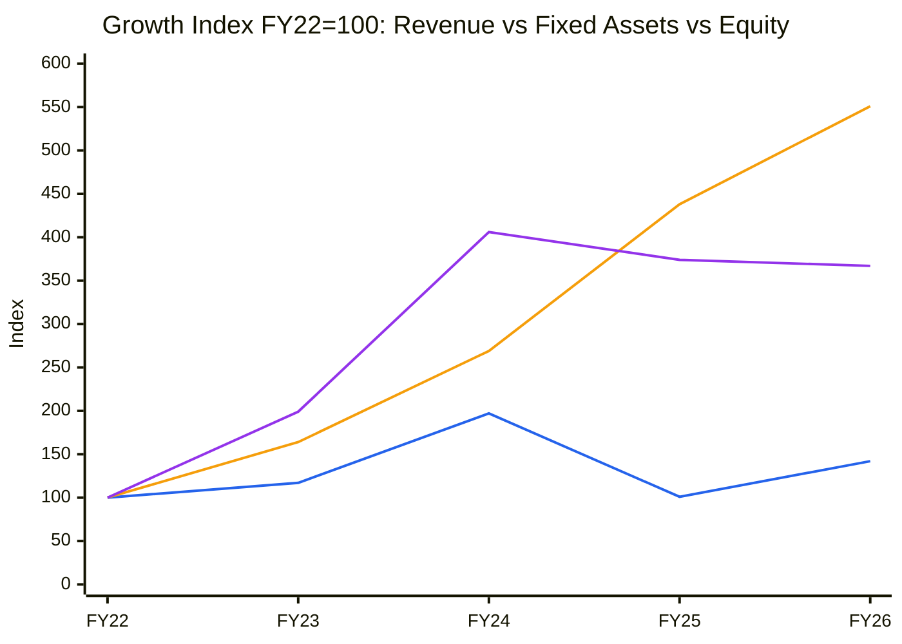
🟦 Revenue · 🟧 Fixed assets + CWIP (mostly capitalised product development) · 🟪 Shareholders' equity
**Read:** Since FY22, revenue is up 1.4× while the asset base is up 5.5× and equity 3.7× (and equity is now higher still after the QIP).
**Business inference:** The company has consumed far more capital than its revenue has grown. Much of it sits as capitalised R&D whose payback depends on future order wins. Until revenue catches up, ROIC stays below WACC and the moat is still being built.

---

## Module 1 — Market, Sector & Stock Cycle

### 1. Broad market (Marks)
- Nifty 50 closed at **22,520** on 09-Oct-2026 (+1.3% on the day), well below its 2024–25 highs above 26,000. India VIX was **14.35** ([JM Financial market wrap](https://www.jmfinancialservices.in/market-news-and-insights/1735991)).
- **Assessment: Cautious.** The market is correcting but not panicking (VIX mid-teens). IPOs and QIPs still clear: ideaForge itself raised money in July. Sizing stays normal-to-small, without fear-driven aggression.

### 1b. Sector cycle: tailwinds vs headwinds
**Secular vs cyclical decomposition (drones):**
- **Secular (durable):** Drone use in Indian forces is structural after the 2025 India–Pakistan conflict. Lessons from Ukraine, a domestic-sourcing mandate (positive indigenisation lists, ban on components from land-border countries), and DAP-2026 make a lasting tailwind. The Army RFI for **2,715 logistics drones** (budget up to ₹2,000 Cr as an FTP case) and DFPDS-2026 (2× higher financial powers for field commanders) widen the buyer base (Q1FY27 call).
- **Cyclical (mean-reverting):** Emergency procurement rounds (EP-5/EP-6) and the ~**₹20,000 Cr fast-track procurement** are post-conflict surge spending. They bring orders forward and will not recur at this pace every year. ideaForge's FY24 peak and FY25 collapse (−49%) show how revenue swings once an EP round ends.
- **Split:** Roughly half of the FY26–FY28 demand surge is cyclical (EP/FTP catch-up). The durable baseline for ideaForge is about 15–20% revenue growth, not the 35–40% the price implies.

**Inputs:**
- **Input cost / supply:** Thermal cameras and electronic components are tight because of geopolitical conflict. Management flagged timeline delays (Q1FY27). This is transient but recurring, and it matters most in Q3/Q4 when deliveries bunch.
- **Competitive capacity pipeline:** Heavy. Adani Defence, Tata Advanced Systems and L&T are all bidding for the same drone pool, along with dozens of iDEX start-ups (Asteria, Raphe mPhibr, NewSpace, Garuda and others). Competition is now about price as well as specification.
- **Geopolitical map:** Export markets (US) are small. Raw-material risk is real: no Chinese parts are allowed and Western thermal cores are scarce. Overall this is a transient risk, but MoS should still be widened by 5pp.
- **Net FX:** Imports of components exceed exports, so a weaker INR mildly compresses gross margin. Not material at current export scale.

**Sector cycle verdict: Tailwind (demand), but Headwind on competition and timing. Net: Neutral-to-Tailwind.** Do not embed FTP-surge growth as permanent in the DCF.

### 1c. Stock cycle: company-specific
**C2 — Quarterly YoY revenue growth (consolidated, Screener)**

| Qtr | Q2FY25 | Q3FY25 | Q4FY25 | Q1FY26 | Q2FY26 | Q3FY26 | Q4FY26 | Q1FY27 |
|---|---|---|---|---|---|---|---|---|
| Revenue (₹ Cr) | 37.1 | 17.6 | 20.3 | 12.8 | 40.8 | 31.6 | 141.0 | 68.6 |
| YoY % | +56% | −81% | −80% | −85% | +10% | +79% | +594% | +437% |

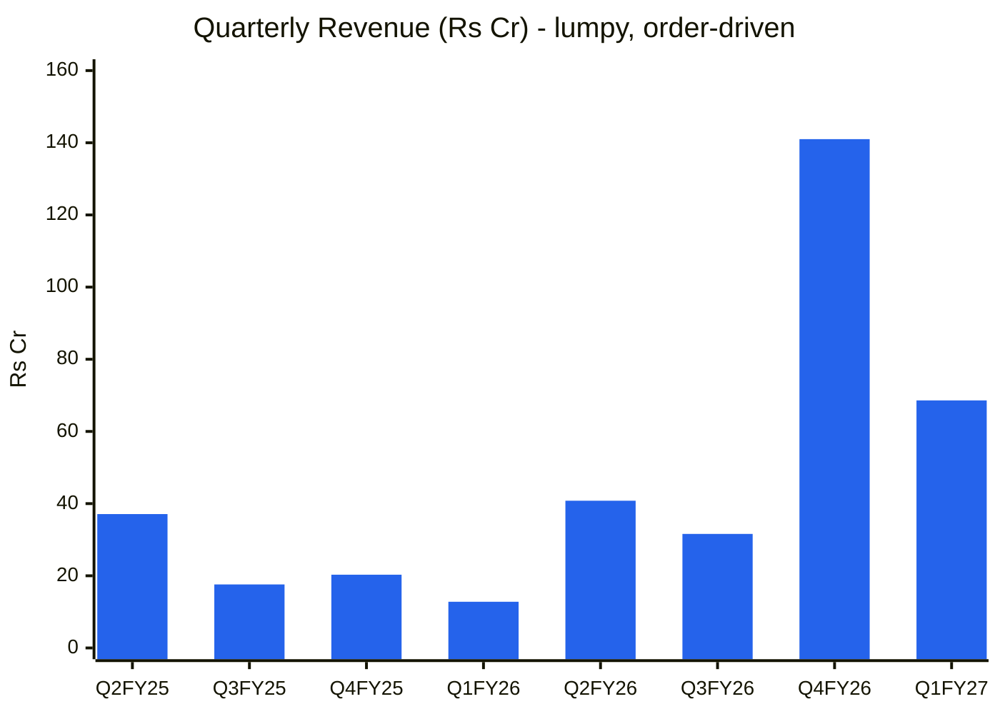
🟦 Quarterly revenue
**Read:** Growth rates of +594% and +437% come off a collapsed base. In absolute terms Q1FY27 revenue fell by half quarter-on-quarter, and the business is one big quarter (Q4FY26) away from FY25 levels.
**Business inference:** YoY growth is a base effect, not acceleration. The real signal is the order book (Module 6), which is shrinking. Revenue in Q2–Q3FY27 is capped at the remaining ₹257 Cr unless FTP orders land.

- **Volume / price / mix:** Growth is almost entirely **volume** (order wins). Mix explains the margin swing: defence 70→60% of Q1 revenue cut gross margin from 61.7% to 49.0%.
- **Capacity:** Not a constraint. There is no new factory capex, and output can go from one to three shifts in existing space (Q1FY27 call). Revenue is order-constrained, not capacity-constrained.
- **Operating leverage:** The fixed cost base is about ₹117 Cr a year (FY26 employees ₹54 Cr + other expenses ₹63 Cr, standalone iXBRL) plus ~₹43 Cr of D&A. At a ~55% gross margin, breakeven EBIT revenue is about **(117+43)/0.55 ≈ ₹290 Cr**. TTM revenue is ₹282 Cr, so the company sits right at breakeven. DOL is very high (>5×) near breakeven: a 10% revenue miss swings EBIT by more than 50%.
- **Guidance accuracy:** 0.69 (see Module 3), which is moderate.
- **FCF inflection:** Not yet. FCF was negative in FY25 (−₹164 Cr) and FY26 (−₹152 Cr). Earliest plausible inflection is FY28, if FTP orders arrive with advances.

**Stock cycle classification: Trough / early recovery.** Revenue and margins are recovering from an identifiable, reversible cause (the EP gap), but the recovery depends on new orders. MoS: widest. Sizing: small initial, add only after an order turn.

---

## Module 2 — Industry Structure & Capital Cycle
**Porter Five Forces (Indian military/civil small UAVs):**
| Force | Assessment | Signal |
|---|---|---|
| New entrants | Barriers are **falling**. iDEX grants, Drone PLI and DGCA type certification lower entry costs; Adani, Tata and L&T bring deep balance sheets. ideaForge's 6 DGCA type-certified platforms and battle-tested fleet (1M+ missions) are real but copyable credentials. | Unattractive |
| Supplier power | **High.** Thermal cameras, EO/IR gimbals and chips come from a few non-Chinese suppliers, which are scarce in 2026. | Unattractive |
| Buyer power | **Very high.** MoD/Army is a monopsony buyer: L1 tendering, QA inspection before revenue recognition, long receivable cycles (FY26 debtor days 204). | Unattractive |
| Substitutes | Loitering munitions, counter-drone systems and larger MALE UAVs compete for the same budget; the tech cycle is short (EW resilience made old fleets obsolete in 2025). | Neutral |
| Rivalry | Fragmented and intensifying. Every round brings 5–10 qualified bidders. | Unattractive |

**Industry Verdict: Unattractive-to-Neutral structurally,** though the demand tailwind is strong. Growth is easier to find than profit.

**Capital cycle (Chancellor):** Capital is **flooding in**. ideaForge raised ₹500 Cr; large private groups are building drone units; Zen Tech, Paras and others are extending into drones and counter-drone; iDEX funds dozens of start-ups. Industry capex is well above depreciation. **Position: early-to-mid upswing in capital supply, which usually precedes return compression.** No CY8 chart: there is no reliable industry capex series for unlisted drone makers.

---

## Module 3 (skill Module 2) — Business Quality & Moat
**Moat Verdict: Narrow (eroding-to-stable)**
- **Greenwald barriers:**
  - *Supply/cost advantage:* Partial. Vertical integration (in-house autopilot, flight controller and design) and a non-Chinese supply chain were validated by two independent Army technical committees in 2025 ([DroneLife, Jun-2025](https://dronelife.com/2025/06/23/indian-army-awards-emergency-uav-contract-to-ideaforge/)). However, gross margin swung 74%→32%→57% over FY22–FY26, which is not a stable cost advantage.
  - *Customer captivity:* Weak-to-moderate. The installed base (1M+ customer missions, trained operators, spares) creates some switching cost, but MoD tenders are L1 and platform-agnostic.
  - *Local scale:* Largest Indian small-UAV maker by revenue, but share is not proven to hold (see Module 7).
- **Buffett test (+10% price):** **Fails.** L1 tendering means no pricing power.
- **Market share stability:** The ~50%+ share of the Indian small-UAV market claimed at IPO (2023 RHP) has fallen as rivals won EP rounds in FY25. It is **losing / unstable**.
- **Pricing power test:** Fail. Q1FY27 gross margin fell 12.7pp on mix alone.
- **Activity system:** Design + certification + field testing + EW hardening is a coherent system and a genuine edge in **qualification speed**, not in price.

**Fisher 15-Point (1–3 each)**
| # | Point | Score | Note |
|---|---|---|---|
| 1 | Market potential | 3 | Drone budgets are rising structurally |
| 2 | New products | 3 | YETI heavy-lift logistics, combat drones, loitering munitions, EW-resilient variants |
| 3 | R&D effectiveness | 2 | Strong pipeline, but capitalised R&D has not yet converted to stable revenue |
| 4 | Sales organisation | 2 | Defence wins, but the civil and US build-out is slow |
| 5 | Profit margin | 1 | Loss-making on an annual basis for 2 years |
| 6 | Margin improvement | 2 | EBITDA turned positive, but it is mix-dependent |
| 7 | Labour relations | 2 | No issues found; employee cost 53% of revenue in FY26 |
| 8 | Executive culture | 2 | Founder-led (Ankit Mehta, Rahul Singh, Vipul Joshi) |
| 9 | Management depth | 2 | CFO plus program heads; no deep bench disclosed |
| 10 | Cost controls | 2 | Opex is held flat, but R&D capitalisation obscures cost |
| 11 | Industry advantages | 2 | Certifications, non-Chinese BoM, combat-tested fleet |
| 12 | Long-range orientation | 3 | Heavy R&D and patient platform building |
| 13 | Dilution | 1 | QIP of 62.9 lakh shares (+14.5%), plus continuous ESOP allotments (10+ in 2026) |
| 14 | Candor in adversity | 2 | FY25 collapse was acknowledged, but a non-GAAP "EBITDA ₹27 Cr" is promoted |
| 15 | **Integrity** | **2 (Pass)** | No SEBI or forensic action found; the CGST dispute is an interpretation issue |
| | **Total** | **31 / 45** | Integrity: Pass |

**Scuttlebutt:** Two Army technical committees verified component origin (DroneLife). There is no DRHP-era management controversy. The April 2026 BSE clarification about a Japan MoU article was routine.

---

## Module 4 (skill Module 3) — Management & Capital Allocation
**Promoter Holding:** 25.26% (Jul-26, post-QIP; 28.96% before) · **Pledge:** CEO Ankit Mehta has pledged **6,50,370 shares** (3,70,370 on 19-Mar-26 to Neo Wealth; 2,80,000 on 28-Sep-26 to Infina Finance, "for personal financial requirements"). That is **17.6% of his own 36.87 lakh holding**, about **5.2% of total promoter holding** and **1.30% of share capital** (BSE Reg 31 disclosures, 07-Apr-26 and 05-Oct-26). **Risk: Normal (<20%), but the trend is rising.**
**Pledge trend:** Increasing (nil → 0.85% → 1.30% of capital in 6 months).
**FCF/share vs EPS:** Both negative; not meaningful.
**Share count trend:** **Diluting.** 4.33 Cr → 4.97 Cr (+14.8%) in FY27 from the QIP plus ESOPs; IPO (2023) and pre-IPO rounds before that.
**Capital allocation rating:** **Average.** Raising ₹500 Cr at ₹795 (about 4× pre-QIP book) was well-timed and value-accretive for existing holders. But since FY22 the capital deployed (₹200 Cr+ of capitalised development, rising working capital) has earned below WACC.
**RPT concerns:** None material found.
**Three C's:** Candor: Medium (the non-GAAP EBITDA is flattering) · Competence: Medium-high (technology), low on predictability · Caring: Medium (the QIP was priced well, but ESOP dilution is continuous and the CEO is pledging).

### Walk the Talk Scorecard
| Quarter Guided | Statement | Guided | Actual | Verdict |
|---|---|---|---|---|
| Q1FY26 call (Jul-25) | Execute a large part of the ₹137 Cr EP order within FY26 | Most of it in FY26 | FY26 revenue ₹226 Cr incl. Q4 ₹141 Cr; ~40% of open OB executed in Q4 | ✅ Hit |
| Q2FY26 call (Nov-25) | Return to profitability contingent on Q3/Q4 order closures | Profit in H2 | Q4FY26 PAT ₹60 Cr | ✅ Hit |
| Q2FY26 call (Nov-25) | L1 pipeline ~₹400 Cr to close this and next FY | ~₹400 Cr | Q3 bookings ~₹217 Cr; FY26 bookings ~₹530 Cr total | ⚠️ Near (partly converted) |
| Q3FY26 call (Jan-26) | Execute 40–45% of the open order book in Q4 | 40–45% | ~40% | ✅ Hit |
| Q3FY26 call (Jan-26) | FY26 gross margin above 50% | >50% | ~58% (standalone iXBRL: (226.8−94.5)/226.8) | ✅ Hit |
| Q3FY26 call (Jan-26) | "Close the year … and turn profitable" | Profitable | Q4 profitable; FY26 full-year PAT −₹17 Cr | ⚠️ Near (quarter yes, year no) |
| Q4FY26 call (May-26) | FY27 blended gross margin 50–55% | 50–55% | Q1FY27 49.0% (reiterated 50–55%) | ⚠️ Near (first quarter) |
| Q4FY26 / Mar-26 | US expansion: JV and Blue UAS | Progressing | "Slower than expected; work in progress" (Q1FY27) | ❌ Miss (timeline slip) |
| Q4FY26 call (May-26) | Execute ₹310 Cr opening OB in FY27, mainly over Q1–Q3 | ~100% by Q3 | Q1 ~22%; ₹257 Cr left for Q2–Q3 | ⏳ Pending (needs ~₹128 Cr/qtr) |
| Q4FY26 call (May-26) | FY27 annual profitability | PAT > 0 | Q1FY27 PAT −₹2.6 Cr | ⏳ Pending |

**WTT Score: 0.69 / 1.00 — MODERATE**
**Guidance points assessed:** 8 (2 pending excluded) | Hits: 4 | Near Misses: 3 | Misses: 1 | Reversals: 0
**Key pattern:** Execution guidance (what share of the order book ships next quarter) is reliable. **Profitability and expansion guidance (annual PAT, US) slips.** No topline or inflow guidance is ever given: selective disclosure on the hardest metric. Management promotes a non-GAAP FY26 "EBITDA ₹27 Cr (12%)" while statutory consolidated operating profit is about ₹6 Cr, a definition gap (likely ESOP and other add-backs).
**Insider action:** No open-market buys. CEO **pledging** shares while guiding growth (Mar and Sep 2026), plus ongoing ESOP allotments → **BEARISH-leaning** (the quantum is small).
**DCF impact:** 12% haircut to management-implied growth; annual-profit guidance not used.
**Overall management credibility: MODERATE**

---

## Module 5 (skill Module 4) — Financial Forensics
**Forensic Red Flag Count:** 6 / 15 (O'Glove list below). Several are explained by Q4 back-loading of revenue, so they are partly resolved.
**Beneish M-Score (FY26, approximate):** **−2.01 → Grey zone.** Components: DSRI 1.60 (receivables/sales 0.56 vs 0.35), GMI 0.56, AQI ~1.1, SGI 1.40, DEPI ~0.9, SGAI ~0.8, LVGI 2.67, TATA +0.058. DSRI and LVGI drive the score. The receivables spike is explained by ₹141 Cr of revenue in Q4 (₹126 Cr receivables at year-end), and higher leverage reflects short-term borrowings that the QIP has since repaid.
**Altman Z''-Score (FY26):** ~**5.4 → Safe.** X1 0.35, X2 ≈ 0 (accumulated reserves are mostly securities premium), X3 −0.02, X4 3.1. Safer still after the QIP.
**Piotroski F-Score (FY26):** **4 / 9 → Average.** Points for ΔROA, no material dilution in FY26, higher gross margin and higher asset turnover. Fails on ROA, CFO, accruals, leverage and liquidity.
**Sloan Accrual Ratio (FY26):** (NI −17 − CFO −63 − CFI +16)/avg TA 735 = **+4.1% → Acceptable.**

**Indian-specific flags:**
1. **Capitalised development (Schilit EMS #4):** intangible assets ₹94.3 Cr + intangible assets under development **₹109.5 Cr = ₹203.8 Cr**, which is **33% of FY26 equity** (₹620.5 Cr standalone) ([NSE iXBRL FY26](https://nsearchives.nseindia.com/corporate/ixbrl/INTEGRATED_FILING_INDAS_155063_30042026203414_iXBRL_WEB.html)). FY26 capex of ₹88.3 Cr equalled **39% of revenue**, most of it capitalised development. Ind AS 38 allows this, but it shifts R&D cost out of EBITDA into amortisation (D&A rose from ₹12 Cr in FY23 to ₹43 Cr in FY26, and ₹14.2 Cr in Q1FY27 alone). **Impairment risk if platforms fail to win orders.**
2. **CGST demand ₹109.17 Cr** (tax ₹54.59 Cr + equal penalty, s.74, Jan-2022 to Mar-2024; drones taxed at 5% vs the department's 18%) from the Addl. Commissioner, Belapur. The company will appeal, citing a 2025 clarification that set a uniform 5% rate ([Sahi](https://www.sahi.com/news/ideaforge-technology-faces-545-86-million-cgst-notice-plans-to-appeal); BSE filing 02-Oct-26). Contingent liability equals **~3.3% of market cap**; a pre-deposit of ~₹5.5 Cr is likely.
3. **Pledge:** small (1.30% of capital), rising, by the CEO personally.
4. **RPT / ICD:** none material found. **Auditor:** no qualification or resignation found.
5. **Working capital:** debtor days 204, inventory days 536, payable days 153 (stretched from 29). Cash conversion cycle 587 days (Screener FY26).

**Schilit quick-screen:** EMS #1 (revenue too soon): DSO up sharply, but revenue is recognised after user/QA acceptance, so it is explained by Q4 bunching (⚠️ watch H1FY27 collections). EMS #3 (one-time boosts): other income ₹22 Cr against EBIT −₹15 Cr, i.e. **>15% of EBIT**. EMS #4: capitalisation flagged above. CFS #3 (DPO stretch): payables rose from ₹8.7 Cr to ₹40.8 Cr while CFO was still −₹63 Cr.
**Overall Forensic Verdict: Minor-to-significant concerns. No manipulation signal, but accounting choices flatter EBITDA.**

---

## Module 6 (skill Module 5) — Earnings Quality & Financial Statements
**ROIC (FY26):** −2.8% | **ROIC (FY22–FY26 avg):** ~11% (FY22 46%, FY23 12.5%, FY24 15.6%, FY25 −14.7%, FY26 −2.8%) | **WACC:** 13.5% (Rf 7% + β ~1.2 × ERP 5.5%)
**ROIC vs WACC spread:** −16pp → **Value-destroying (current)**
**ROIC trend (3yr):** Declining (FY24 → FY26), but recovering on a TTM basis
**ROIC driver:** Margin-led (capital turnover is low, at 0.4–0.5× invested capital)
**Economic profit:** Negative (~−₹88 Cr in FY26: ₹539 Cr invested capital × −16.3pp)

**C4 — Margin trend (Screener consolidated)**
| FY | FY20 | FY21 | FY22 | FY23 | FY24 | FY25 | FY26 | TTM |
|---|---|---|---|---|---|---|---|---|
| Gross margin % (1 − material cost %) | 47 | 45 | 74 | 68 | 48 | 32 | 57 | — |
| OPM % | −88 | −31 | 47 | 26 | 18 | −32 | 2.6 | 9 |

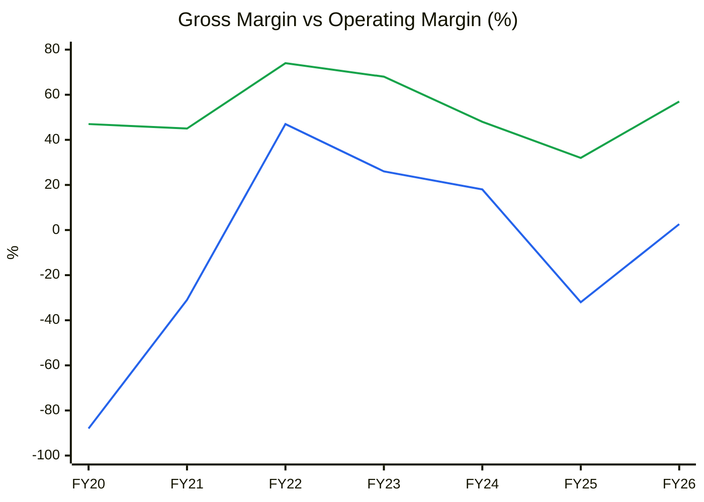
🟩 Gross margin · 🟦 Operating (EBITDA) margin
**Read:** Gross margin swings by 40pp and operating margin by 80pp across the cycle. Only FY22–FY24 were profitable.
**Business inference:** Margins are a function of order volume and defence mix, not of a stable cost edge. Normalised margins should be anchored on the FY23–FY24 range (operating margin 18–26%), not the FY22 peak.

**C7 — Cumulative PAT vs cumulative CFO (₹ Cr)**
| FY | FY20 | FY21 | FY22 | FY23 | FY24 | FY25 | FY26 |
|---|---|---|---|---|---|---|---|
| Cumulative PAT | −13 | −28 | 16 | 48 | 93 | 31 | 14 |
| Cumulative CFO | −16 | −47 | 20 | −33 | 43 | −34 | −97 |

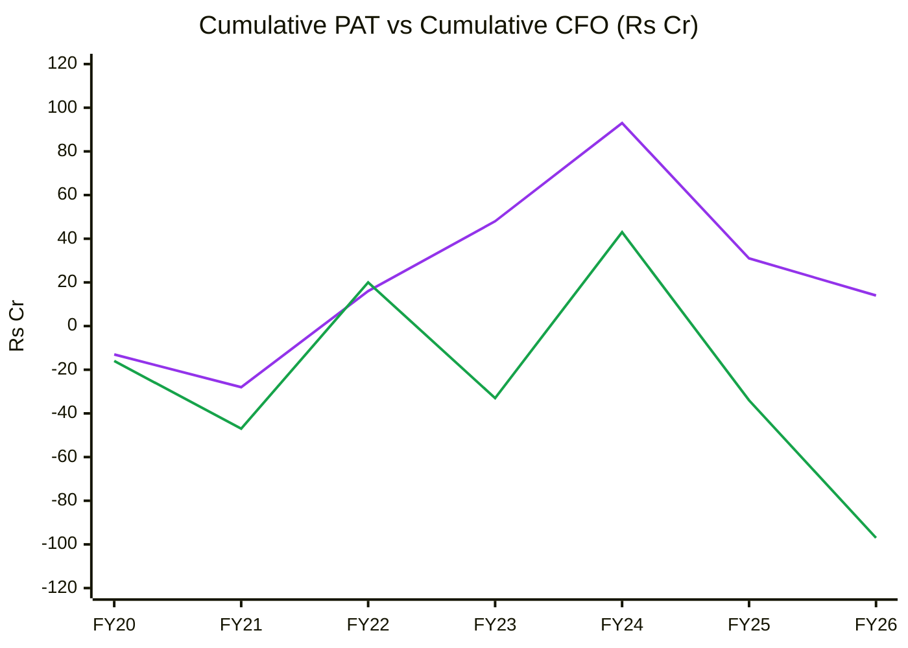
🟪 Cumulative PAT · 🟩 Cumulative CFO
**Read:** Over 7 years the company booked a cumulative ₹14 Cr of profit but burned ₹97 Cr of operating cash, and FCF is far worse once capitalised development is included.
**Business inference:** Reported earnings are not converting to cash. Working capital (inventory 536 days) and capitalised R&D absorb everything. The QIP, not operations, funds the next growth phase.

**OCF / Net Income (5yr):** Negative cumulative → **Quality: Low**
**O'Glove Red Flags: 6 / 15** (#1 NI vs OCF, #2 DSO, #3 AR/revenue rising 2 yrs, #4 inventory days, #5 DPO rising, #7 other income/EBIT >15%)
**Key accounting concern:** R&D capitalisation (₹204 Cr intangibles) plus a non-GAAP "EBITDA" narrative.

### DuPont Decomposition (5-Factor, consolidated)
| Year | EBIT Margin | Asset Turnover | Equity Multiplier | Interest Burden | Tax Burden | ROE |
|---|---|---|---|---|---|---|
| FY22 | 43.4% | 0.72 | 1.36 | 0.72 | 0.88 | 27.0% |
| FY23 | 25.3% | 0.38 | 1.51 | 0.87 | 0.78 | 9.9% |
| FY24 | 21.0% | 0.42 | 1.12 | 0.92 | 0.74 | 6.8% |
| FY25 | −37.3% | 0.24 | 1.10 | 1.03 | 1.00 | −10.2% |
| FY26 | −6.6% | 0.28 | 1.33 | 1.33 | 0.85 | −2.8% |
| **Change FY22→FY26** | −50pp | −0.44× | −0.03× | n.m. | n.m. | **−29.8pp** |

**Operating contribution (EBIT margin × AT):** **Declining** (0.31 → −0.02).
**Financing contribution:** Stable. Leverage is not masking anything; the QIP lowers the equity multiplier further in FY27.
**DuPont verdict:** The ROE decline is **purely operational**: both margin and asset turnover collapsed as each fund-raise expanded the asset base faster than revenue. Asset turnover has fallen structurally for 4 years (0.72 → 0.28) and will dip further on the post-QIP balance sheet.
**AT trend → Module 10A base AT:** 0.30–0.35× total assets (declining structurally).

---

## Module 7 (skill Module 6) — Industry KPIs & Peer Analysis
**Sector:** Aerospace & Defence Manufacturing (KPI block line 46)

| KPI | ideaForge | Peer average (Zen, Paras, Apollo Micro, Data Patterns) | Assessment |
|---|---|---|---|
| Order book / revenue | **0.91×** (₹257 Cr / ₹282 Cr TTM) | 1.5–3× (sector healthy >2.5×) | **Below. Red flag (<1.0×)** |
| Book-to-bill | TTM ~1.4×; **Q1FY27 ~0.16×** | >1.0× | Below in the latest quarter |
| EBITDA margin (TTM) | 9.3% (₹26 Cr / ₹282 Cr) | 23–36% | **Below** |
| Receivable days | 204 | <120 healthy | Red flag (>180) |
| Working-capital intensity | NWC ~₹290 Cr vs revenue ₹226 Cr (>100%) | <30% healthy | Red flag |
| Indigenisation | ~60–65% indigenous content; 20–22% of revenue is import substitution | Rising | In line |
| Export % | Near zero (one US PO) | Rising | Below |

**Peer comparison (Screener, consolidated, 09/10-Oct-2026)**
| Metric | ideaForge | Zen Technologies | Paras Defence | Apollo Micro | Data Patterns |
|---|---|---|---|---|---|
| Market cap (₹ Cr) | 3,322 | 13,804 | 10,218 | 14,431 | 22,868 |
| TTM revenue (₹ Cr) | 282 | 671 | 511 | 1,022 | 941 |
| Revenue CAGR FY23→FY26 | 7% | 46% | 29% | 45% | 27% |
| FY26 OPM | 2.6% | 33% | 26% | 23% | ~35%+ |
| ROCE | −2.8% | 16.2% | 17.2% | 14.5% | 21.9% |
| TTM PAT (₹ Cr) | 4 | 197 | 96 | 115 | 268 |
| P/S (TTM) | **11.8×** | 20.6× | 20.0× | 14.1× | 24.3× |
| P/E | n.m. (846×) | 76× | 110× | 119× | 85× |

**Peer positioning:** a discount on P/S, but **not cheap on quality-adjusted terms**. Every peer is profitable with ROCE of 14–22%, while ideaForge is at breakeven. The P/S discount reflects its lower margins and less visible order book.

**C12 — P/S vs ROCE**
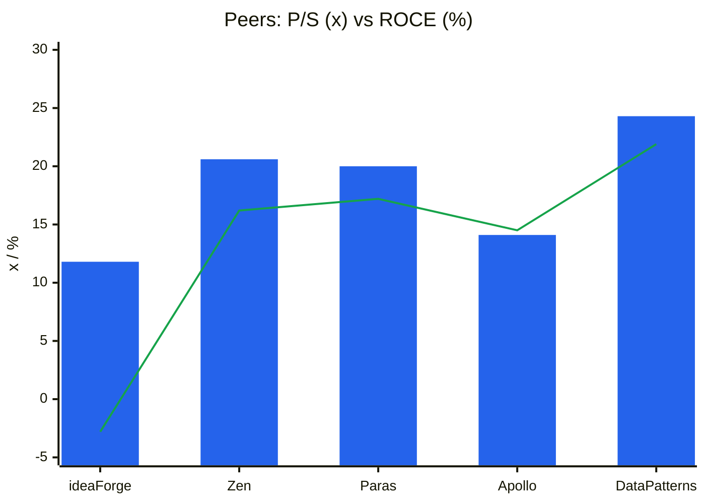
🟦 P/S (TTM) · 🟩 ROCE %
**Read:** ideaForge has the lowest P/S but also the only negative ROCE in the group.
**Business inference:** To earn the peer P/S it has to prove peer-level margins. The current discount is roughly fair compensation for its risk, not a mispricing.

### Order Book Tracker
*Generated 2026-10-11 by scripts/order_book_tracker.py from 4 order announcements and 5 period snapshots. Ledger coverage starts 2025-04-01. (est.) = tracked estimate: previous disclosed order book + announced orders − order-linked revenue.*

#### 1. Disclosed vs tracked order book (reconciliation)
| Period | Revenue (₹ Cr) | Order book (₹ Cr) | Announced inflow | of which Framework | Implied inflow | Announced coverage | OB cover (× TTM rev) | Source |
|---|---|---|---|---|---|---|---|---|
| Q1FY26 | 13 | — | 137 | — | — | — | — | Screener consolidated; OB not reliably disclosed |
| Q2FY26 | 41 | 164 | 0 | — | — | — | 1.8 | Q2FY26 results (₹164 Cr at 30-Sep-25) |
| Q3FY26 | 32 | 350 | 107 | — | 218 | 49% | 3.3 | Q3FY26 concall (~₹350 Cr open OB at 31-Dec-25) |
| Q4FY26 | 141 | 314 | 0 | — | 105 | 0% | 1.4 | Q4FY26 / Q1FY27 deck (₹3,142 Mn at 31-Mar-26) |
| Q1FY27 | 69 | 257 | 0 | — | 11 | 0% | 0.9 | Q1FY27 deck (₹2,568 Mn at 30-Jun-26) |

*Implied inflow = OB(t) − OB(t−1) + order-linked revenue(t). Announced coverage = announced ÷ implied. Coverage below 50% is normal here: ideaForge's many civil and command-level orders fall below the Reg 30 materiality threshold. FY26 announced ₹244 Cr vs ~₹530 Cr booked (46%). Q2FY26 and Q3FY26 cover uses the TTM revenue sum from Screener quarters (₹91.5 Cr and ₹105.4 Cr).*

#### 2. Announced orders aggregated by quarter
| Quarter | # orders | Total (₹ Cr) | Firm | Framework | Largest single | Export | Govt/PSU/Defence | Private domestic |
|---|---|---|---|---|---|---|---|---|
| Q1FY26 | 1 | 137 | 137 | 0 | 137 | 0 | 137 | 0 |
| Q3FY26 | 2 | 107 | 107 | 0 | 75 | 0 | 107 | 0 |
| Q2FY27 | 1 | 24 | 24 | 0 | 24 | 0 | 0 | 24 |

#### 3. Macro picture
| Metric | Value |
|---|---|
| Latest disclosed order book | ₹257 Cr (Q1FY27) |
| Orders announced since that disclosure | ₹24 Cr (1 order, civil, 30-Sep-26) |
| Tracked order book today (before execution since Q1FY27) | ₹280 Cr |
| Order book cover (latest) | 0.9× TTM revenue |
| Framework / 'potential value' agreements in ledger | ₹0 Cr (0%) |
| Orders announced, last 12 months | ₹131 Cr (3 orders; avg ₹44 Cr) |
| Top-3 orders (last 12m) as % of disclosed OB | 51% |
| Execution rate Q1FY27 (revenue ÷ opening OB) | 22% |

**Geography mix (12m):** Domestic 100% · **Customer type:** Defence 82% · Private 18% · **Firmness:** Firm 100%

**OB-1 — Order book vs TTM revenue (₹ Cr)**
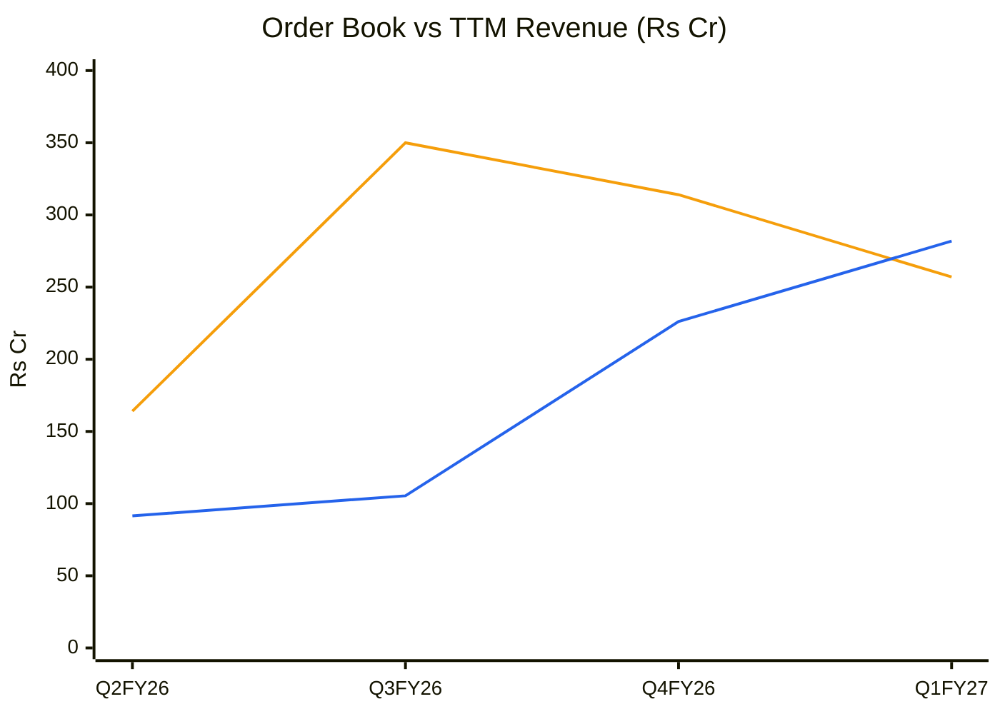
🟧 Disclosed order book · 🟦 TTM revenue
**Read:** The two lines crossed in Q1FY27. TTM revenue (₹282 Cr) now exceeds the order book (₹257 Cr).
**Business inference:** The FY26 order wave is being consumed faster than it is replaced. Without FTP awards by Q3FY27, H2FY27 and FY28 revenue face a repeat of the FY25 air-pocket.

**OB-2 — Order book cover (× TTM revenue)**
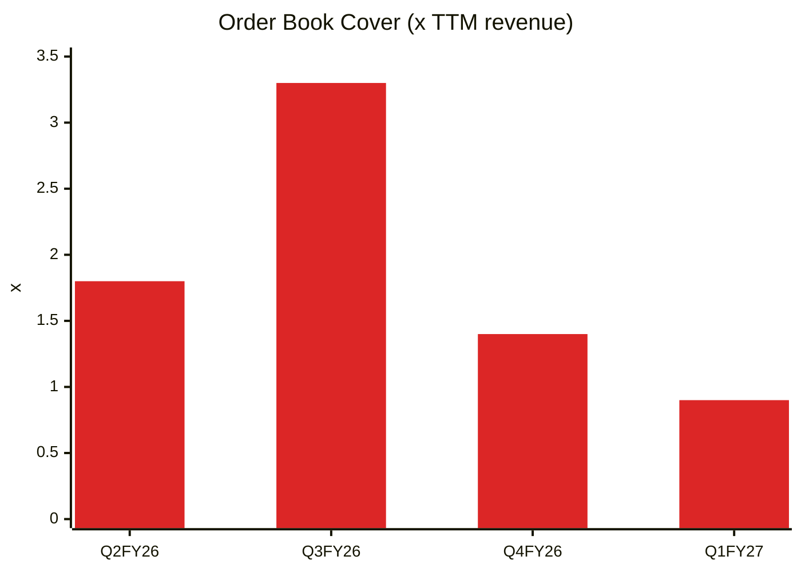
🟥 Cover
**Read:** Cover fell from 3.3× to 0.9× in two quarters.
**Business inference:** Visibility is under 1 year, far below the >2.5× healthy A&D level. This is the single biggest gap between the stock's valuation and the business's visibility.

**OB-3 — Aggregated announced orders vs revenue, by quarter (₹ Cr)**
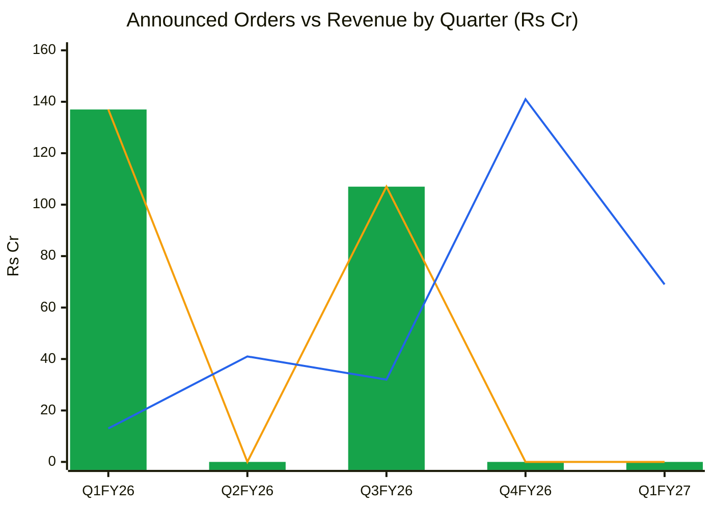
🟩 All announced orders (bars) · 🟧 Firm orders only · 🟦 Revenue
**Read:** There has been no material defence order announcement since November 2025. The only filing since then is a ₹23.6 Cr civil bundle in September 2026.
**Business inference:** The FY26 book-to-bill was real (all firm, no framework padding), but the pipeline is now waiting on FTP decisions concentrated in Q3–Q4FY27. Guidance credibility on execution is fine; on inflows it is untested.

**OB-4 — Implied inflow vs revenue (₹ Cr)**
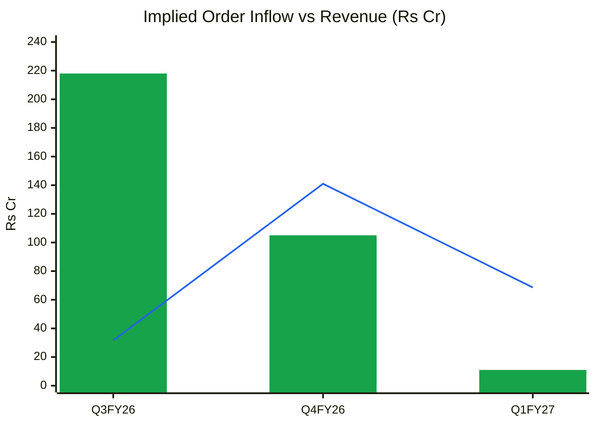
🟩 Implied inflow · 🟦 Revenue
**Read:** Implied inflow fell from ₹218 Cr to ₹105 Cr to ₹11 Cr over three quarters.
**Business inference:** Q1FY27 book-to-bill was ~0.16. The coming FTP outcome is binary for FY28 earnings.

#### 5. Order Ledger — every announced order (source of truth; the next run appends here)
| order_id | date | customer | customer_type | segment | geography | value_cr | currency | value_fc | firmness | tenor_months | linked_to | source | notes |
|---|---|---|---|---|---|---|---|---|---|---|---|---|---|
| IF-2506-01 | 2025-06-23 | Indian Army (Emergency Procurement) | Defence | Defence UAV | Domestic | 137 | INR |  | Firm | 12 |  | [BSE](https://www.bseindia.com/corporates/ann.html) | Hybrid mini UAVs; EP route; all-inclusive |
| IF-2511-01 | 2025-11-14 | Ministry of Defence | Defence | Defence UAV | Domestic | 75 | INR |  | Firm |  |  | [BSE](https://www.bseindia.com/corporates/ann.html) | AFDS/Tactical class UAVs (ZOLT) with accessories; capital EP |
| IF-2511-02 | 2025-11-14 | Ministry of Defence | Defence | Defence UAV | Domestic | 32 | INR |  | Firm |  |  | [BSE](https://www.bseindia.com/corporates/ann.html) | Hybrid UAVs (SWITCH) with accessories |
| IF-2609-01 | 2026-09-30 | Multiple civil customers (unnamed) | Private | Civil UAV | Domestic | 23.62 | INR |  | Firm | 6 |  | [BSE](https://www.bseindia.com/corporates/ann.html) | Aggregate of several POs; mapping/survey/surveillance multicopters |

#### 6. Order Book Snapshots — revenue and disclosed order book per period
| period | revenue_cr | revenue_ttm_cr | order_book_cr | order_linked_share | as_of_date | source |
|---|---|---|---|---|---|---|
| Q1FY26 | 12.78 |  |  | 1.0 |  | Screener consolidated; OB not reliably disclosed |
| Q2FY26 | 40.76 |  | 164 | 1.0 |  | Q2FY26 results (₹164 Cr at 30-Sep-25) |
| Q3FY26 | 31.55 |  | 350 | 1.0 |  | Q3FY26 concall (~₹350 Cr open OB at 31-Dec-25) |
| Q4FY26 | 141.04 | 226.13 | 314.2 | 1.0 |  | Q4FY26 / Q1FY27 deck (₹3,142 Mn at 31-Mar-26) |
| Q1FY27 | 68.59 | 281.94 | 256.8 | 1.0 |  | Q1FY27 deck (₹2,568 Mn at 30-Jun-26) |

**Order-book verdict:** Firm visibility **~0.9 yrs** · Book-to-bill TTM ~1.4 but Q1FY27 ~0.16 · Framework share 0% · Top-3 concentration 51% · Execution rate: Rising (22% in Q1, needs ~50%/qtr for Q2–Q3 guidance)

---

## Module 8 (skill Module 7) — Market Size & Market Share
**TAM:** The MoD's committed drone pool for the next ~18 months is about **₹20,000 Cr of FTP**, plus the YETI logistics RFI (up to ₹2,000 Cr) and EP/command-level buys. Civil/enterprise drones in India are an estimated ₹3,000–5,000 Cr a year (⚠️ estimate; industry sources vary widely). Call the realistic SAM for ideaForge's classes (mini, tactical, hybrid VTOL, logistics) **₹6,000–8,000 Cr over FY27–FY29**, i.e. ~₹2,500 Cr a year.
**TAM growth:** 25–35% a year near term (surge), 12–15% secular.
**Company penetration:** ₹282 Cr / ~₹2,500 Cr ≈ **11%** of the annual SAM.
**Market share:** The ~50% share of Indian small UAVs cited in the 2023 RHP has fallen to an estimated **15–25%** as rivals won EP rounds in FY25 (⚠️ no independent share data). **5-year trend: losing.**
**Share driver:** Structural. More qualified competitors, L1 tendering and big-group entry.
**Revenue vs market check:** FY23→FY26 revenue CAGR is 7% while the domestic drone market grew far faster, so **ideaForge has been losing share**.
**Verdict:** Losing share in a fast-growing market. FY26 regained some ground via EP-6 wins, but the trend is unproven.

---

## Module 9 (skill Module 8) — Valuation & Margin of Safety

**Capital structure (estimated, post-QIP):**
- Mar-26: cash ₹26.4 Cr + bank ₹3.5 Cr + current investments ₹68.5 Cr = ₹98.4 Cr, against borrowings ₹72.1 Cr + leases ~₹12 Cr (standalone iXBRL). Net cash ≈ ₹14 Cr.
- QIP: ₹500 Cr gross (~₹490 Cr net) on 10-Jul-26. ₹120 Cr is earmarked for debt repayment, which is net-cash neutral.
- **Estimated net cash: ~₹450–500 Cr** after Q1 burn (⚠️ verify in the H1FY27 balance sheet due Nov-2026). **EV ≈ ₹2,850 Cr.**
- Post-QIP equity ≈ ₹1,108 Cr → **BVPS ≈ ₹223 → P/B ≈ 3.0×** (Screener's 4.8× uses the stale pre-QIP book of ₹138). **❌ Note:** Screener's book value is outdated. Tangible BVPS ≈ ₹182 → P/TBV 3.7×.

### 8A. Price-Implied Expectations (Mauboussin reverse DCF)
Assumptions: EV ₹2,850 Cr, WACC 13.5%, terminal g 6%, sales-to-capital 1.5×, tax 25%, EBIT margin ramping linearly to steady state by year 5, base revenue ₹282 Cr (TTM).

| Steady-state EBIT margin | Implied 10-yr revenue CAGR | Implied FY36 revenue |
|---|---|---|
| 15% | 48.9% | ₹15,100 Cr |
| **20%** | **40.0%** | **₹8,160 Cr** |
| 25% | 34.6% | ₹5,490 Cr |

Cross-check (5-year): EV × 1.135⁵ = ₹5,370 Cr at a 25× NOPAT exit needs FY31 NOPAT of ~₹215 Cr, i.e. revenue of ~₹1,430 Cr at a 15% NOPAT margin, a **~38% CAGR**.

| PIE value driver | Market-implied | My base case | Expectations gap |
|---|---|---|---|
| Revenue CAGR (5-yr) | ~38% | ~27% (₹282 → ~₹930 Cr by FY31) | **−11pp (optimistic gap)** |
| NOPAT margin (steady state) | ~15% | ~13% (EBIT 17–18%, peers' low end, after capitalised R&D amortisation) | −2pp |
| Investment rate | ~67% of ΔRevenue (sales-to-capital 1.5) | Higher (inventory 536 days) | Worse |

**Gap classification: Optimistic.** The price already embeds near-bull execution, so matching it earns only the cost of capital.
**Expectations treadmill:** To outperform, ideaForge must win **≥₹800–1,000 Cr of FTP/YETI orders over FY27–FY28** *and* sustain EBIT margins of ~20%+ from FY29. Either alone is not enough.
**Positive triggers:** (1) A large FTP award (≥₹300 Cr) in Q3–Q4FY27. (2) YETI logistics drone selected under the Army RFI. (3) Blue UAS certification and the first sizeable US order (~$30 Mn opportunity).
**Negative triggers:** (1) FTP awards slip to FY28 or go mainly to Adani/Tata/L&T. (2) Impairment of capitalised development. (3) The CGST demand upheld at appellate level, or further CEO pledging.
**Physical plausibility:** Capacity is not the constraint (3-shift headroom), so PIE is **order-constrained**. The market is pricing order wins that have not been announced.
**SVAR:** Bear-case value ₹360 → (669 − 360)/669 = **46% → unfavourable asymmetry (>40%)**.

### 8B. Intrinsic value
| Method | Bear | Base | Bull |
|---|---|---|---|
| Scenario EPS × multiple (FY29, discounted 2.5 yrs at 13.5%) | ₹263 | ₹640 | ₹1,595 |
| Relative (P/S on FY28E revenue; bear 3×, base 6×, bull 10×, + cash) | ₹320 | ₹760 | ₹1,500 |
| Asset floor (P/B 1.6–2.0× post-QIP BVPS ₹223) | ₹360 | ₹445 | — |
| **Consensus range** | **₹330–360** | **₹640–760** | **₹1,500–1,600** |

**Current market price:** ₹668.6
**Margin of safety (vs base ~₹700):** **~4% → Inadequate** (small-cap with complexity needs 40–50%)
**Upside/downside ratio:** base vs bear: (700 − 669)/(669 − 360) = **0.1:1**; probability-weighted EV ₹983 (FY29) ≈ ₹717 today vs ₹360 bear = **0.15:1 → Unacceptable (<1.5:1 hard stop)**
**Reverse DCF implied growth:** ~38–40%. **Aggressive.**
**Graham Number:** not meaningful (5-yr average EPS ≈ ₹0.2): √(22.5 × 0.2 × 223) ≈ ₹32.
**Misprice reason:** none. If anything the stock is priced on the drone narrative plus post-QIP institutional support, not underpriced.
**Catalyst:** FTP awards (Q3–Q4FY27, per management).

**Valuation band charts:** CY1 (P/E band) and CY4 (Price vs EPS index) are **not meaningful** because EPS has been negative or near zero in 4 of the last 8 quarters. P/B is used instead.

**CY2 — P/B band (Screener weekly, quarterly sample; pre-QIP book until Jul-26)**
| Date | Jan24 | Jul24 | Oct24 | Jan25 | Apr25 | Jul25 | Oct25 | Jan26 | Apr26 | Jul26 | Oct26 |
|---|---|---|---|---|---|---|---|---|---|---|---|
| P/B (×) | 5.2 | 5.4 | 4.5 | 3.8 | 2.2 | 4.0 | 3.6 | 3.6 | 3.1 | 6.4 | 3.0* |

*Oct-26 shown on post-QIP book (~₹223). Screener's 4.8× uses the old book. 3-yr median 4.0×, SD 1.1 (on pre-QIP book).*

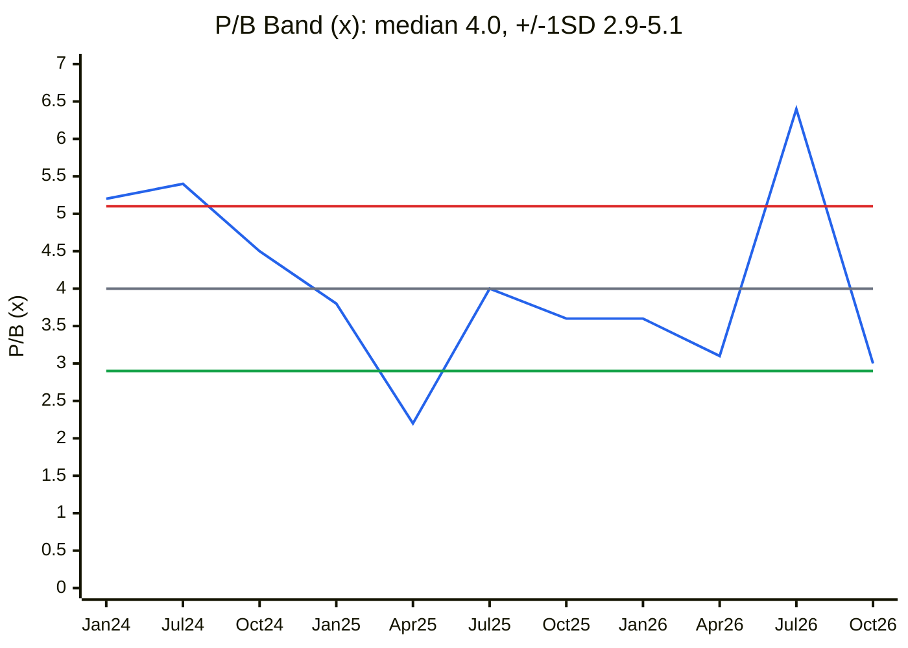
🟦 P/B · ⬜ median · 🟥 +1SD · 🟩 −1SD
**Read:** On the post-QIP book, P/B (~3.0×) sits near the −1SD band. The trough was 2.2× in April 2025, during the order drought.
**Business inference:** P/B looks optically cheap, but the book is now ~45% QIP cash plus ~18% capitalised intangibles. ROE is negative, so P/B is a weak anchor. The April-2025 trough of 2.2× (≈ ₹490 on today's book) is the realistic support zone if FTP slips.

**C13 — Scenario targets vs CMP (₹, FY29 value)**
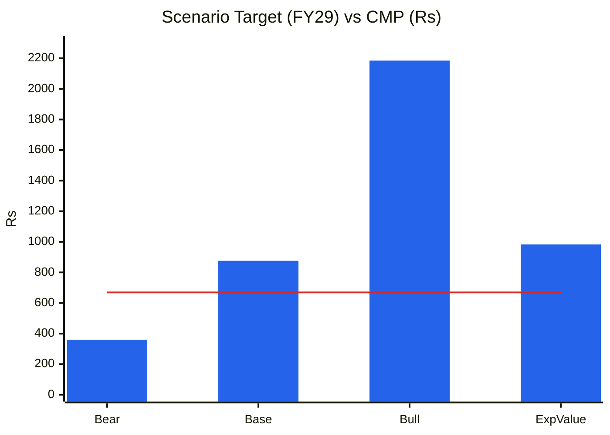
🟦 Target price (FY29) · 🟥 CMP ₹669
**Read:** Only the bull case clears CMP by a wide margin. The base case is +31% over ~2.5 years (~11%/yr, below the 13.5% cost of equity).
**Business inference:** The payoff is a call option on FTP wins, priced as if already partly won. Not enough asymmetry for fresh capital.

### Cycle Position Dashboard
| Dimension | Current | Median (3–7 yr) | Percentile | Signal |
|---|---|---|---|---|
| P/B | 3.0× (post-QIP) | 4.0× | ~20th | Fair-to-cheap (on a diluted book) |
| P/S | 11.8× | ~12× (3-yr) | ~50th | Fair |
| EBITDA margin | 9% TTM | 18% (FY20–26) | ~40th | Trough → recovering |
| ROCE | −2.8% | 11% | ~25th | Trough |
| Order-book cover | 0.9× | 1.6× (4 qtrs) | lowest | Thin |
| **Overall** | | | | **Trough/recovery business priced at mid-cycle** |

---

## Module 10 (skill Module 9) — Technical Stage (Weinstein)
*Screener weekly price series (Price, DMA50, DMA200, volume), computed 30-week MA.*

| Week | Close (₹) | 30-wk MA (₹) |
|---|---|---|
| 02-Apr-26 | 396 | 453 |
| 08-May-26 (post-Q4, 20% upper circuit) | 814 | 463 |
| 05-Jun-26 (high-week close) | 945 | 512 |
| 10-Jul-26 (QIP at ₹795) | 901 | 581 |
| 14-Aug-26 (post-Q1, heavy volume 4.7 Mn) | 821 | 649 |
| 11-Sep-26 | 734 | 697 |
| 01-Oct-26 | 735 | 728 |
| **09-Oct-26** | **669** | **737** |

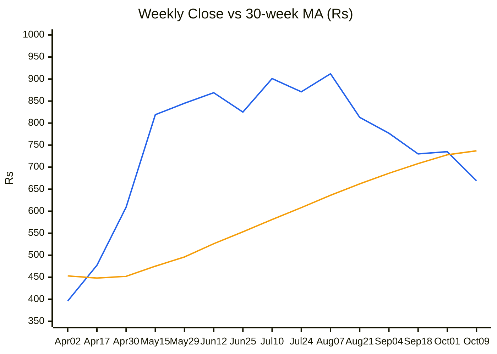
🟦 Weekly close · 🟧 30-week MA
**Read:** Price peaked in June to August (₹945 / ₹912 weekly closes), made lower highs after the Q1 results, and closed **below the 30-week MA** for the first time since April. The MA is flattening (+₹9/week vs +₹28 in July).
**Business inference:** The post-results and post-QIP rally has been distributed. The heaviest volume week (14-Aug, 4.7 Mn shares) was a down week after the gross-margin miss. Institutions bought the QIP at ₹795 and are now ~16% underwater, a supply overhang on rallies.

**Nifty 50 market stage:** ~22,520, well below 2024–25 highs → **Stage 4 → 1 (basing)** (⚠️ approximate; no weekly MA computed)
**Sector index stage (Nifty India Defence):** Not verified for Oct-2026 (⚠️ data gap)
**Stock stage:** **Stage 3 (top), breaking into Stage 4.** Price is below the 30-week MA (₹737), the 50-DMA (₹759) and the 200-DMA (₹694).
**30-week MA:** Flattening (still marginally rising) | Price: **Below**
**RS vs Nifty:** 1-yr positive (stock +42% from ₹472 vs a falling Nifty), but **3-month deteriorating** (−27% from August).
**Volume:** Distribution. The largest weekly volume came on down weeks in August.
**Stop-loss (for existing holders):** weekly close below ₹600 (the May 2026 breakout zone and ~10% below CMP).
**CANSLIM:** C 0 (Q1 EPS negative) · A 0 · N 1 (new platforms, YETI) · S 0 (supply from the QIP and ESOPs) · L 0 · I 1 (MF/FII up 2.2% → 19.3%) · M 0 → **2/7**
**Stage + fundamental alignment:** **Misaligned / both negative.** Technicals are rolling over just as the order book thins.

---

## Module 11 (skill Module 10) — Forward View: 2–3 Year Thesis

### Capex classification (FY26 actual; FY27–FY29 estimated)
| Capex type | FY26 (₹ Cr) | FY27E | FY28E | FY29E | In model? |
|---|---|---|---|---|---|
| Tangible growth capex (plant, lines, test range) | ~15 | 20 | 20 | 25 | ✅ (small) |
| Maintenance (≈ PPE depreciation) | ~10 | 12 | 14 | 15 | ❌ Sustains only |
| Capitalised product development (intangibles + IAUD) | ~63 | 90 (QIP ₹90 Cr earmarked) | 70 | 70 | ❌ Excluded from AT; treated as R&D cost in normalised EBIT |
| ROU (leases) | small | — | — | — | ⚠️ |
| **Total capex** | **88.3** | **~122** | **~104** | **~110** | |

*Source: FY26 standalone cash flow "Purchase of PPE" ₹88.3 Cr (NSE iXBRL); split is ⚠️ estimated (PPE net block ₹31.7 Cr vs intangibles ₹203.8 Cr implies most spend is development).*

**AT model note:** ideaForge is an **order-driven, asset-light assembler**. Tangible PPE gross block (~₹32 Cr net) does not constrain revenue, and shifts can triple output. Per the skill, the revenue anchor is the **order-book model (Module 1c)**, not gross-block asset turnover.

**Order-book revenue anchor (FY27):**
- Opening OB ₹314 Cr; Q1 delivered ₹69 Cr; remaining ₹257 Cr guided by Q3. Civil run-rate orders add ~₹15–20 Cr a quarter (₹23.6 Cr filed in September).
- FTP wins (if any) in Q3–Q4 burn only ~20–30% in-year.
- **FY27E revenue: Bear ₹330 Cr / Base ₹380 Cr / Bull ₹450 Cr.**

**Incremental ROIC:** FY22→FY26, invested capital rose by ~₹406 Cr (₹133 → ₹539 Cr) while EBIT fell ₹84 Cr (₹69 → −₹15 Cr). **Incremental ROIC is negative, i.e. value-destroying so far.** Prospective (base): ΔRevenue FY26→FY29 ₹474 Cr × 17% EBIT × 0.75 = ₹60 Cr NOPAT on ~₹450 Cr of new capital (QIP deployment + capitalised R&D + working capital) gives **~13%, roughly equal to WACC: value-neutral.**
**Model-implied revenue CAGR (FY26→FY29, base):** 46% (₹226 → ₹700 Cr; from TTM ₹282 it is 35%) vs **PIE ~38–40% sustained for 10 years → the market is pricing the surge as permanent.**

### Earnings model (Base case, ₹ Cr)
| Metric | FY27E | FY28E | FY29E |
|---|---|---|---|
| Revenue | 380 | 550 | 700 |
| Gross margin | 52% | 52% | 52% |
| Fixed opex (employees + other) | 130 | 145 | 160 |
| EBITDA | 68 | 141 | 204 |
| EBITDA margin | 18% | 26% | 29% |
| D&A (amortisation of capitalised development rising) | 58 | 66 | 74 |
| EBIT | 10 | 75 | 130 |
| Other income (₹450 Cr cash at ~6%, declining as cash is used) | 25 | 22 | 20 |
| Interest | 4 | 3 | 3 |
| PBT | 31 | 94 | 147 |
| Tax (25%) | 8 | 24 | 37 |
| **PAT** | **23** | **70** | **110** |
| EPS (₹, 4.97 Cr shares + 1%/yr ESOP) | 4.6 | 13.9 | 21.7 |
| ΔWorking capital (NWC ~70% of incremental revenue, down from >100%) | 60 | 120 | 105 |
| Total capex | 122 | 104 | 110 |
| **FCF** | **−101** | **−88** | **−31** |
| ICR | 2.5× | 25× | 43× |

**FCF inflection year:** FY30 at the earliest (base). It moves to FY29 only if FTP contracts carry 20–30% advances, which management has hinted at.
**Debt ceiling verdict:** Net cash throughout (TDB YETI loan ₹151 Cr in tranches is low-cost, milestone-linked). **Safe.** Cash burn of ~₹220 Cr over FY27–FY29 consumes about half the QIP cash.

### Key catalysts
1. **FTP drone awards** (MoD ~₹20,000 Cr pool). Timing: Q3–Q4FY27, possibly slipping to FY28.
2. **YETI heavy-lift logistics drone** in the Army RFI for 2,715 units; TDB loan of ₹151 Cr signed 09-Oct-26. Timing: trials in FY27, orders FY28.
3. **US Blue UAS certification** plus a ~$30 Mn US opportunity. Timing: FY28.
4. **Combat drones / loitering munitions** entry via partnerships. Timing: FY28+.
5. **CGST appeal** relief (2025 rate clarification). Timing: 12–24 months.

### Key risks
1. **FTP slippage or loss to large groups** (Adani, Tata, L&T): **High.** A repeat of FY25 would cut revenue by ~40–50%.
2. **Capitalised development impairment** (₹204 Cr intangibles) if platforms are superseded (EW-resilience cycles are short): **Medium.**
3. **Component supply** (thermal cameras, chips) delaying Q3–Q4 deliveries and revenue recognition: **Medium-High.**
4. **Governance drift:** CEO pledge rising plus continuous ESOP dilution: **Low-Medium.**
5. **CGST ₹109 Cr demand** upheld: **Low-Medium** (~₹22/share worst case).

### Scenario analysis (order-book driven)
| Scenario | Assumption | Revenue FY29 (₹ Cr) | EBITDA margin | EPS FY29 (₹) | Multiple | Target (₹) | Probability |
|---|---|---|---|---|---|---|---|
| Bull | Wins ≥₹1,000 Cr FTP + YETI; US scales | 1,100 | 30% | 43.7 | 50× | **2,185** | 20% |
| Base | Wins ~₹500–600 Cr FTP over FY27–FY28; civil grows 15% | 700 | 29% | 21.7 | 40× | **876** | 50% |
| Bear | FTP slips / lost; FY25-style air-pocket in FY28 | 450 | 12% | 2.9 | P/B 1.6× + cash | **360** | 30% |
| **Expected value** | | | | | | **₹983** | |

**Return from CMP (expected value, FY29):** +47% over ~2.5 years ≈ **16% a year**, with **46% bear-case downside (SVAR)**. Base case alone: +31% (~11% a year, below the cost of equity).

---

## Checklist Summary
**Section 0 (Existing Report Protocol):** 3 / 3. Searched by ticker, name and git history; initial report; one file.
**Section A (Business Quality):** 16 / 18. No competitor interviews; market-share series unavailable.
**Section B (Forensics):** 9 / 9 (Beneish approximate)
**Section C (Financial Statements):** 11 / 12 (Ind AS 116 adjustment immaterial; leases ~₹12 Cr)
**Section D (KPIs & Peers):** 7 / 7
**Section E (Market Size & Share):** 5 / 7. No independent TAM or share data (⚠️).
**Section F (Valuation):** 10 / 10
**Section G (Technical):** 6 / 8. Nifty and defence index stage not computed (⚠️).
**Section H (Forward View):** Order-book track used (asset-light assembler); capex classified; incremental ROIC and FCF built; scenarios done.
**Section I (Charts):** C1, C2, C4, C7, C12, CY2, C13, OB-1 to OB-4, and the weekly stage chart included. CY1/CY4 skipped because EPS is negative (stated).
**Order Book Tracker:** Run (ledger starts 2025-04-01; 4 filings; 5 snapshots)
**Hard stops triggered:** **Upside/downside < 1.5:1** (0.15:1). Watch: forensic flags ≥3 (6 O'Glove flags, partly explained by Q4 revenue bunching). Not triggered: Stage 4 with a *declining* MA (MA still flat-rising), pledge >60%, Beneish >−1.78.

**Pre-buy final check (behavioural):** The drone theme is narrative-heavy, with a recency bias from a +594% quarter and a QIP anchor at ₹795. The disconfirming evidence (shrinking order book, Q1 inflow ~₹11 Cr, technical breakdown) is given full weight here.

---

## Investment Decision
**Recommendation:** **AVOID for fresh money now → WATCHLIST**
**Conviction Score:** **4 / 10**
| Component | Max | Score |
|---|---|---|
| Market + sector + stock cycle | 1 | 0.5 |
| Industry structure | 1 | 0.25 |
| Business quality & moat | 2 | 0.75 |
| Management | 1 | 0.5 |
| Financial + earnings quality | 2 | 0.75 |
| Valuation & PIE asymmetry | 2 | 0.5 |
| Technical + CANSLIM | 1 | 0.25 |
| **Total** | **10** | **3.5 → 4** |

**Suggested position size:** 0% now. Watchlist starter of 1% only if a re-entry trigger fires (sizing ×0.5 for trough-cycle classification).
**Entry price range:** ₹430–450 (≈40% MoS on probability-weighted value ~₹717; ≈2.0× post-QIP book; near the April-2025 trough multiple), **or** after an FTP award of ≥₹300 Cr *plus* a new Stage 1 base that breaks out above the 30-week MA on volume.
**Stop-loss (existing holders):** weekly close below ₹600.
**Target price (base, FY29):** ₹876.
**Review triggers:**
- **Add / upgrade:** FTP or YETI orders ≥₹300 Cr; order-book cover back above 1.5×; H1FY27 CFO positive; Q2–Q3 deliveries on track (~₹128 Cr/qtr).
- **Exit / downgrade further:** Q2FY27 revenue below ₹80 Cr with no new defence orders; any impairment of intangibles; further CEO pledging; FTP outcomes deferred to FY28.
- **Data to check at the H1FY27 results (Nov-2026):** net cash post-QIP, receivables collection from the Q4FY26 deliveries, intangibles under development movement, order book at 30-Sep-26.

**Sources:** Screener.in consolidated financials and price API (accessed 11-Oct-2026); [NSE iXBRL FY26 results](https://nsearchives.nseindia.com/corporate/ixbrl/INTEGRATED_FILING_INDAS_155063_30042026203414_iXBRL_WEB.html); BSE corporate announcements, scrip 543932 (order filings 23-Jun-25, 14-Nov-25 ×2, 30-Sep-26; SAST Reg 31 pledge filings 07-Apr-26 and 05-Oct-26; CGST order 02-Oct-26; TDB loan 09-Oct-26; QIP allotment 10-Jul-26); Q1FY27 call coverage ([Yahoo Finance](https://finance.yahoo.com/markets/stocks/articles/ideaforge-technology-ltd-nse-ideaforge-150052280.html), [Multibagg](https://www.multibagg.ai/market-pulse/articles/ideaforge-q1-97733), [Raksha Anirveda](https://raksha-anirveda.com/ideaforge-reports-%E2%82%B968-6-cr-q1-fy27-revenue-with-positive-ebitda-targets-execution-of-fy27-opening-order-book-by-q3/)); Q4FY26 ([sUAS News](https://www.suasnews.com/2026/05/ideaforge-reports-its-strongest-quarterly-performance-in-q4-with-inr-141-cr-revenue-and-inr-60-cr-pat-with-the-highest-ever-annual-order-bookings-of-inr-530-cr-in-fy26-signalling-a-strong-fy27-outl/), [ScanX](https://scanx.trade/stock-market-news/companies/ideaforge-technology-delivers-record-q4-fy26-performance-revenue-soars-to-141-crores-ebitda-margin-at-52-6/40039003)); Q3FY26 ([Aviation & Defence Universe](https://www.aviation-defence-universe.com/ideaforge-technology-reports-fy26-q3-performance-with-a-strong-order-book-with-its-highest-order-booking-yet-of-inr-440-crores-ytd-in-fy26)); QIP ([Inc42](https://inc42.com/?p=564307), [FilingReader](https://filingreader.com/news-wire/mumbai/2026-07-10/ideaforge-technology-raises-5000m-through-share-allotment)); CGST ([Sahi](https://www.sahi.com/news/ideaforge-technology-faces-545-86-million-cgst-notice-plans-to-appeal)); Nifty/VIX ([JM Financial](https://www.jmfinancialservices.in/market-news-and-insights/1735991)).

**Data gaps:** FY26 annual-report note on capitalised development (additions vs amortisation by project); post-QIP net cash (until H1FY27); Q3FY26 and Q4FY26 transcripts read only via secondary summaries; independent drone market-share data; Nifty India Defence index stage.

---
*Report generated by Stock Fundamental Analysis Skill v3.3 | Indian Markets Context*
*Save path: C:\Users\anubh\Documents\Anubhav\Stock Analysis\Stock Analysis\*
