# Stock Analysis Report — Cochin Shipyard Ltd (NSE: COCHINSHIP | BSE: 540678)
**Date:** 2026-10-12
**Analyst:** Claude (Stock Fundamental Analysis Skill v3.3)
**Investment Horizon:** 2–3 Years
**CMP:** ₹1,245 (12-Oct-2026, Screener) · **M-cap:** ₹32,731 Cr · **EV:** ~₹32,000 Cr (borrowings ₹1,672 Cr less cash and bank balances ₹2,406 Cr at 31-Mar-26)
**Recommendation:** AVOID (hard stops: Weinstein Stage 4 with a declining 30-week MA; upside/downside 0.44:1). Watchlist only, buy-below ₹600–650, and only after a Stage-1 base forms.
**Conviction Score:** 3.5 / 10

## Revision Log
| Version | Date | Recommendation | Conviction | Price | Key change |
|---|---|---|---|---|---|
| **Current** | 2026-10-12 | **AVOID** (watchlist, buy-below ₹600–650) | 3.5/10 | ₹1,245 | The ISRF thesis was built on wrong facts. The stock has broken down into Stage 4. FY27 margin guidance is cut to ~14%. The ISRF is moving into a DP World joint venture. |
| Previous | 2026-06-20 | WAIT FOR CONFIRMATION | 5/10 | ₹1,458 | Skill v2.0 report (full text in git history) |

**What changed in the thesis.** The June report rested on the International Ship Repair Facility (ISRF). It called the ISRF a newly commissioned, VLCC/Suezmax-capable, ₹2,000 Cr+ facility able to earn ₹2,000–3,000 Cr a year. **That premise was factually wrong.** The ISRF cost ₹970 Cr. It is a 6,000-tonne shiplift for vessels up to 130 m (82 ships/yr). It has been operating since 12-Aug-2024 and earned ₹207 Cr in FY26 ([BSE board outcome 9-Sep-26](https://www.bseindia.com/xml-data/corpfiling/AttachHis/0a171a52-44c4-41b2-8d99-ebe1fbefcf2f.pdf)). The large-ship capability belongs to the separate ₹1,800 Cr, 310 m New Dry Dock. On 9-Sep-26 CSL agreed to move the ISRF into a 50:50 JV that **Drydocks World (DP World) will control**. The price is ₹1,800 Cr: ₹900 Cr in cash plus ₹900 Cr in JV equity, against a book value of ₹1,053 Cr. The repair upside therefore becomes a monetisation plus an equity-accounted stake, not a consolidated growth engine. Three other developments matter:
- **Margins are normalising.** Management now guides ~14% blended EBITDA, excluding other income. Ship repair margins fell from 39% to 26% once the aircraft-carrier refits ended.
- **Cash flow has been negative for three straight years.** CFO was −₹1,234 Cr in FY26, and CSL took a new ₹1,030 Cr short-term working-capital loan.
- **The government sold again.** GoI cut its stake from 67.91% to 63.33% through an OFS in July 2026, at a ₹1,400 floor.

The stock has fallen to a new weekly closing low of ₹1,230 (9-Oct-26), below a 30-week MA that is now declining. That is a Weinstein Stage-4 hard stop.

**Validation of previous report (2026-06-20):**
| # | Item | Previous | Now (source) | Status |
|---|---|---|---|---|
| 1 | CMP / M-cap / P/E | ₹1,458 / ₹38,357 Cr / 53.5× | ₹1,245 / ₹32,731 Cr / 48.1× TTM (Screener 12-Oct-26) | 🔄 Updated |
| 2 | FY26 revenue / PAT / EPS | ₹5,022 Cr / ₹717 Cr / ₹27.2 | ₹5,022 / ₹717 / ₹27.24 (Screener consolidated; FY26 AR) | ✅ Validated |
| 3 | ISRF: "newly commissioned (Q4 FY26)", "₹2,000+ Cr", "VLCC/Suezmax", "₹2,000–3,000 Cr revenue", "200+ ships/yr" | as stated | ₹970 Cr cost; vessels ≤130 m / 6,000 t; 82 ships/yr; inaugurated 17-Jan-24, commercial ops 12-Aug-24; FY26 revenue ₹207 Cr; management target ₹600 Cr in ~2 yrs and ₹1,000–1,200 Cr in 5 yrs ([BSE 9-Sep-26](https://www.bseindia.com/xml-data/corpfiling/AttachHis/0a171a52-44c4-41b2-8d99-ebe1fbefcf2f.pdf); Q1 FY27 call). Large-ship work is done at the 310 m New Dry Dock (₹1,800 Cr). | ❌ Corrected |
| 4 | Revenue mix "defence ~50% / commercial ~30% / repair ~20%" | as stated | FY26 segments: shipbuilding ₹3,366 Cr (67%), ship repair ₹1,656 Cr (33%) (FY26 AR Note 58). Defence is 54% of the order book, not of revenue. | ❌ Corrected |
| 5 | "Pledge trend: declining (−4.95% over 3 years from divestment)" | as stated | Pledge is nil. The 4.95 pp was the GoI stake cut in the Oct-2024 OFS (72.86% → 67.91%). It was mislabelled as pledge. GoI now holds 63.33% after the Jul-2026 OFS (Q1 FY27 PPT). | ❌ Corrected |
| 6 | Promoter holding | 67.92% | 63.33% (Sep-26 PPT; OFS 7–8 Jul 2026, floor ₹1,400) | 🔄 Updated |
| 7 | MoUs with Maersk, Drydocks World, HD KSOE | listed | All three were real but non-binding ([Maersk Feb-25](https://www.bairdmaritime.com/shipping/boxships/cochin-shipyard-teams-up-with-maersk-to-explore-ship-repair-and-shipbuilding-options-in-india)). DDW has now become a binding JV (ISRF transfer). The HD KSOE block-fabrication JV was **dropped** in Sep-26, and CSL will build a smaller 60,000 t/yr facility on its own. | 🔄 Updated |
| 8 | Inventory days 379 | 379 (vs "122 five years ago") | 379 FY26 ✅ (Screener). The 122 figure was FY23, three years earlier, not five. | ✅ Validated (minor wording) |
| 9 | CFO −₹1,234 Cr; FCF −₹1,385 Cr | as stated | Confirmed against the FY26 AR consolidated cash-flow statement: CFO (₹1,23,408 lakh); capex + CWIP ₹151 Cr. The Screener cash-flow columns are **not** year-shifted (FY24 −₹172 Cr and FY25 −₹284 Cr also tie to the ARs). | ✅ Validated |
| 10 | Borrowings ₹1,672 Cr | as stated | ✅. Of this, ~₹1,030 Cr is net new short-term WCDL drawn in FY26 (AR cash flow: drawn ₹4,070 Cr, repaid ₹3,040 Cr). | ✅ Validated |
| 11 | Cash "est. ₹2,000 Cr" | estimate | ₹2,406 Cr (cash ₹105 Cr + other bank balances ₹2,301 Cr, 31-Mar-26 consolidated BS) | 🔄 Updated |
| 12 | EBIT ₹750 Cr / NOPAT ₹578 Cr (PIE input) | as stated | EBIT excl. other income ₹701 Cr (NOPAT ~₹522 Cr); EBIT incl. other income ₹1,110 Cr | ❌ Corrected |
| 13 | Gross block "~₹14,000 Cr (ISRF inclusive)" | as stated | Consolidated PPE gross ₹3,804 Cr (tangible owned ₹3,221 Cr, ROU ₹583 Cr). ₹14,531 Cr is *total assets*. | ❌ Corrected |
| 14 | FY26 D&A ₹150 Cr / interest ₹130 Cr | as stated | D&A ₹130 Cr / interest ₹111 Cr (Screener; AR) | ❌ Corrected |
| 15 | Order book ₹21,100 Cr; book-to-bill 4.2× | as stated | ₹21,900 Cr (Sep-26 PPT; ₹22,125 Cr at 31-Mar-26), 4.3× TTM revenue. The NGSV L1 (~₹5,000 Cr) is **not** yet in the book. | 🔄 Updated |
| 16 | ROCE 16% | 16% | 16.2% FY26 (Screener) | ✅ Validated |
| 17 | ROIC 14%, 5-yr avg 12% | as stated | ROIC excl. cash ~10.2% FY26 (FY25 ~19.5%). The 5-yr average Screener ROCE is ~16%. | ❌ Corrected |
| 18 | DuPont table (EBIT margin 12→16%, AT 0.65→0.35, EM 1.8→2.4, ROE ~10→12.5%) | as stated | Actual FY22→FY26: EBIT margin (incl. OI) 25.7%→22.1%, AT 0.38→0.35, EM 1.92→2.47, ROE 12.8%→12.2%. The EM rise comes from customer advances, not debt, so the "leverage masking operations" verdict was wrong. | ❌ Corrected |
| 19 | Altman Z'' "grey zone" | grey | 3.70 FY26 (3.84 FY25), safe | ❌ Corrected |
| 20 | Piotroski 5/9 | 5/9 | 2/9 FY26 | ❌ Corrected |
| 21 | Sloan accrual ~+8–10% | warning | +11.6% FY26, red flag | ❌ Corrected |
| 22 | Beneish "grey zone" | grey | −1.03 (above the −1.78 flag). Driven by DSRI (receivables ₹225 → ₹423 Cr on a small base) and TATA (negative CFO). Explained by tail-heavy export milestones (see Module 5). | ❌ Corrected |
| 23 | WTT: "FY26 growth guided 14–15%, actual ~13.2%" | near miss | Actual FY26 consolidated growth was **+4.2%** (₹4,820 → ₹5,022 Cr): a miss | ❌ Corrected |
| 24 | WTT: "ISRF operational by Q4 FY26 ✅" | hit | The ISRF was guided in May-24 to be fully operational by Aug-24 and achieved 12-Aug-24 (hit, but a different guidance item and date) | ❌ Corrected |
| 25 | WTT score 0.55 (LOW) | 0.55 | 0.78 (MODERATE) on 9 sourced guidance points | 🔄 Updated |
| 26 | Peers: MAZDOCK P/E 39×, GRSE 43× | as stated | 29.0× / 30.2× (Screener 12-Oct-26) | 🔄 Updated |
| 27 | Peers: GRSE inventory ~100 days; GRSE OCF positive, CFO/PAT +0.7× | as stated | GRSE inventory days 307 (FY26); GRSE FY26 CFO −₹290 Cr (Screener) | ❌ Corrected |
| 28 | Peers: MAZDOCK OCF −₹2,891 Cr | as stated | −₹2,654 Cr FY26 (Screener consolidated) | ❌ Corrected |
| 29 | Peers: GRSE book-to-bill 3.4× | as stated | Order book ₹13,596 Cr (Jun-26) ÷ TTM revenue ₹7,507 Cr = 1.8× ([PSU Connect](https://www.psuconnect.in/financial/grse-q1-result-revenue-up-38-5-to-1814-cr-pat-jumps-44)). The June figure could not be re-sourced. | ⚠️ Unverifiable → replaced |
| 30 | 5-yr PAT CAGR 4% | 4% | 4% (Screener) | ✅ Validated |
| 31 | Free float 32% | 32% | 36.67% after the Jul-26 OFS | 🔄 Updated |
| 32 | Market: Nifty Stage 2; Defence index at new highs | as stated | Nifty 22,520 (9-Oct-26), −14.5% from its Jan-26 high of ~26,340, below its 200-DMA and 200-WMA. The defence index peaked ~10,000 on 9-Sep-26, then fell ~9% in five sessions. | 🔄 Updated |
| 33 | Stock stage "2–3 transition", 30-wk MA flat | as stated | **Stage 4**: price ₹1,245 vs 30-wk MA ₹1,459 (declining from ₹1,848 in Dec-25); new weekly closing low ₹1,230 | 🔄 Updated |
| 34 | Scenario targets FY28 (bear ₹690 / base ₹1,480 / bull ₹2,565) | as stated | Replaced by FY29: ₹320 / ₹830 / ₹1,650 (Module 11) | 🔄 Updated |
| 35 | Old data gap: "management owes an explanation for the inventory build" | open | **Closed.** The CMD (Sep-26 call) says European export contracts pay ~10/10/10/70% (signing / keel / launch / delivery). Vessels contracted in 2023–24 are 80–90% built with ~30% received. He guides positive CFO in FY27 on ~10 deliveries. | ✅ Closed |
| 36 | Old data gap: "ISRF revenue from Q2–Q3 FY27" | open | **Closed.** The ISRF already earned ₹207 Cr in FY26. | ✅ Closed |
| 37 | Catalyst "P17B allocation to CSL" | catalyst | The P17B RFP has been issued and CSL is bidding. The CMD says LPD/MCMV fit CSL better, and P17A builders (MDL/GRSE) hold the edge. | 🔄 Updated |

*Order Ledger: the June report had no ledger (it was written on skill v2.0). This re-run builds the ledger from 1-Apr-2024 by harvesting BSE Reg-30 filings, then runs the tracker with `--report` pointed at the old file, which yielded no rows to carry.*

---

## Business Primer

Cochin Shipyard (CSL) is a Government of India "Schedule A Miniratna" shipyard in Kochi. It builds and repairs ships. Revenue comes from two segments, both recognised over time on physical progress. **Shipbuilding** (₹3,366 Cr, 67% of FY26) covers naval vessels (anti-submarine shallow-water craft and next-generation missile vessels for the Indian Navy; it also built INS Vikrant), domestic commercial ships (dredgers, tugs, ferries) and a fast-growing **export** book for European owners (offshore-wind service vessels, LNG feeder containerships for CMA CGM, electric tugs for Svitzer, dry-cargo ships for Wilson). **Ship repair** (₹1,656 Cr, 33%) covers refits of Navy and Coast Guard vessels, including aircraft carriers, plus commercial repairs at Kochi and units in Mumbai, Kolkata and Port Blair. CSL claims about 45% of India's ship-repair market. Subsidiaries Udupi-CSL (tugs, small export cargo ships) and Hooghly-CSL (river vessels) add about ₹740 Cr. Returns depend on two things: winning large, nominated or high-margin naval programmes (the aircraft-carrier era drove FY24–25 margins), and executing milestone-heavy export contracts without tying up working capital.

This is a **project-based, order-driven heavy-engineering business with a government buyer, a government owner and lumpy, mix-driven margins**. It is not a compounder. The key value driver is the **mix and margin of what is in the book**, more than volume. The key risks are execution and working capital (three straight years of negative CFO) and margin normalisation now that the carrier work has rolled off. Three structural features shape the analysis. First, 30–40% of historical PBT came from **other income** on a ₹2,000–3,000 Cr cash pile that the FY24–26 capex and working-capital build has largely used up. Second, the company is starting a **new ₹6,500 Cr capex cycle** (block fabrication, Vadinar and Tuticorin) funded ~80% by debt, with a 25% government subsidy. Third, the **ISRF is about to leave the consolidated perimeter** through the DP World joint venture.

*Segment: Defence Shipbuilding & Marine Services. KPI reference available ✓ (`references/05-industry-kpis-india.md`, line 1150).*

---

## Executive Summary

CSL has a credible, diversified franchise. It has the largest dry dock in India, the only aircraft-carrier build and repair capability, a growing European export book and an order book of ~4.3× revenue. **But the stock prices a growth path the business cannot physically deliver.** A two-stage reverse DCF needs ~40% revenue CAGR for five years at current margins. The confirmed book, executing at ~24% a year, supports ~10%. Meanwhile:
- Management has cut blended EBITDA guidance to ~14% excluding other income.
- FY26 consolidated revenue grew only 4% against 14–15% guided.
- CFO has been negative three years running.
- The ISRF is being handed to a DP World-controlled JV.

Base-case FY29 value is ~₹830 (32× FY29E EPS of ₹24.9 plus ISRF cash), **33% below CMP**. Upside/downside is **0.44:1**. The stock is in **Weinstein Stage 4**. **AVOID.** Revisit below ₹600–650 after a Stage-1 base forms, or sooner if (a) the NGSV and LPD/MCMV contracts are signed, (b) FY27 CFO turns positive as guided, and (c) EBITDA holds above 16%.

**Order book ₹21,900 Cr (Sep-26; 4.3× TTM revenue) · NGSV L1 ~₹5,000 Cr pending, so ~₹26,900 Cr (5.3×) once signed · FY26 implied book-to-bill 1.19 (TTM to Q1 FY27 ~1.16) · tracked today ₹22,075 Cr · defence 54% / export 33% / domestic commercial 7% / repair 6%**

### C1 — Growth Index (FY18 = 100)
| FY | Revenue | Net fixed assets + CWIP | EBITDA (excl. OI) | PAT | Rev idx | FA idx | EBITDA idx | PAT idx |
|---|---|---|---|---|---|---|---|---|
| FY18 | 2,355 | 470 | 465 | 396 | 100 | 100 | 100 | 100 |
| FY19 | 2,966 | 718 | 571 | 478 | 126 | 153 | 123 | 121 |
| FY20 | 3,422 | 1,563 | 711 | 632 | 145 | 333 | 153 | 160 |
| FY21 | 2,819 | 2,043 | 723 | 609 | 120 | 435 | 155 | 154 |
| FY22 | 3,191 | 2,234 | 627 | 564 | 135 | 475 | 135 | 142 |
| FY23 | 2,365 | 2,572 | 262 | 305 | 100 | 547 | 56 | 77 |
| FY24 | 3,830 | 3,164 | 882 | 783 | 163 | 673 | 190 | 198 |
| FY25 | 4,820 | 3,563 | 895 | 827 | 205 | 758 | 192 | 209 |
| FY26 | 5,022 | 3,751 | 831 | 717 | 213 | 798 | 179 | 181 |

*Source: [Screener consolidated](https://www.screener.in/company/COCHINSHIP/consolidated/). Gross block history before FY25 is not on Screener, so net fixed assets + CWIP is used as the capital-deployed proxy. FY26 consolidated PPE gross block is ₹3,804 Cr (FY26 AR Note 4). Order book is shown separately in OB-1, because annual order-book data before FY24 is not consistently disclosed.*

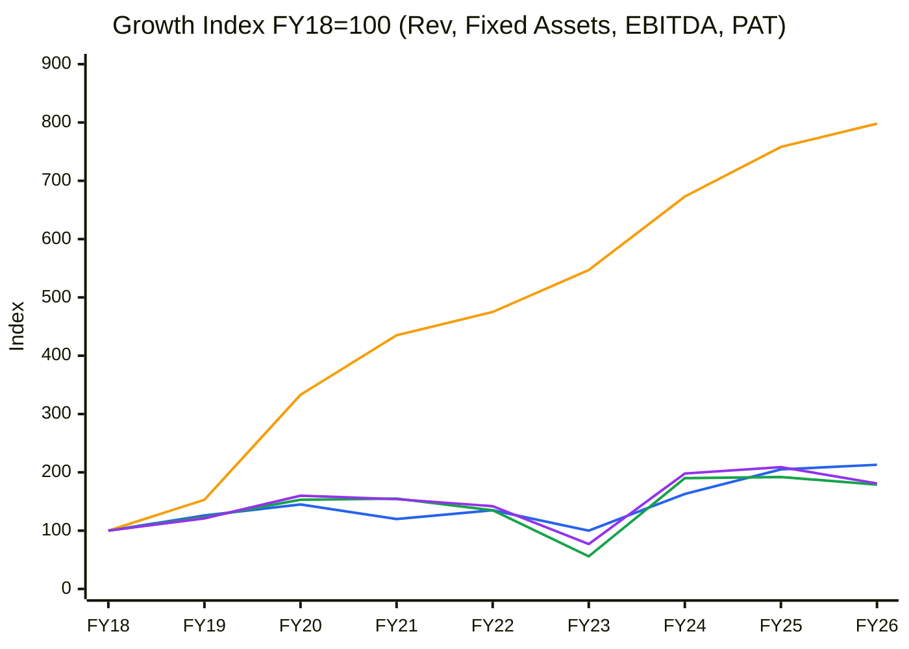
🟦 Revenue (CAGR FY18–26 9.9%) · 🟧 Net fixed assets + CWIP (29.6%) · 🟩 EBITDA excl. other income (7.5%) · 🟪 PAT (7.7%)

**Read:** Capital deployed in fixed assets grew ~8× (index 798) while revenue grew 2.1× and EBITDA and PAT 1.8×. Both profit lines have fallen for two years from their FY24–25 peak.

**Business inference:** The ₹2,770 Cr New Dry Dock + ISRF programme (FY19–25) was funded from the IPO and cash reserves. It has not yet produced revenue at the rate of the older asset base. The FY24–25 profit spike came from one-off aircraft-carrier build and refit work, not from the new assets. Growth has been capital-hungry and profits are now mean-reverting. This is a reinvestment-heavy franchise whose returns depend on filling the new dock with high-margin work. → Module 6 ROIC, Module 11 bear asset-turnover anchor.

---

## Module 1 — Broad Market Cycle (Marks)
Nifty 50 closed at **22,520** on 9-Oct-26, with India VIX at 14.35 ([JM Financial / Capital Market](https://www.jmfinancialservices.in/market-news-and-insights/1735991)). That is ~14.5% below the early-January 2026 record of ~26,340 ([Business Standard](https://www.business-standard.com/markets/capital-market-news/nifty-hits-record-high-broader-mrkt-outperforms-126010200625_1.html)). The index spent 100+ sessions below its 200-DMA through July ([5paisa](https://www.5paisa.com/news/nifty-50-marks-100-trading-days-below-200-dma-second-longest-streak-in-10-years)) and slipped below its 200-week MA in the week to 1-Oct-26 (secondary report, unverified). Drivers cited are crude oil and bond yields. **Verdict: CAUTIOUS (leaning fearful).** Sizing: normal-to-small. A falling tide is a headwind to high-multiple PSU names.

## Module 1b — Sector Cycle: Defence & Commercial Shipbuilding / Ship Repair
- **Secular (durable).** Government policy is the main driver: Maritime India Vision 2030 / Amrit Kaal 2047, the **₹69,725 Cr shipbuilding package** (Shipbuilding Financial Assistance, Maritime Development Fund, Shipbuilding Development Scheme with a 25% capex subsidy) and 3% interest subvention (FY26 AR MD&A). Domestic demand aggregation covers **~432 vessels over 10 years** (SCI and the BCSL JV; Q1 FY27 call). On the naval side the pipeline includes LPD (4 ships, ~₹32,000 Cr), MCMV (12, ~₹36,000 Cr) and P17B (7, ~₹49,000 Cr), all at RFP/RFI stage with competitive bidding. The global shipbuilding market is projected at >US$262 bn by 2029 and global ship repair at ~US$40 bn by 2030 (FY26 AR MD&A). **Durable baseline: ~10–12% revenue growth.** Management itself "conservatively guides ~12%".
- **Cyclical / one-off.** FY24–25 were inflated by the IAC-1 (INS Vikrant) post-delivery work and two aircraft-carrier refits (Vikrant, Vikramaditya). These are nominated, high-margin jobs that will not recur on a schedule. IAC-2 has not even reached AoN stage (Q1 FY27 call). Defence orders are now tendered (L1), not nominated. **Roughly 5–7 pp of FY24–25 EBITDA margin was one-off.** Do not capitalise it.
- **Input cost.** Steel and imported equipment are largely passed through on defence work (cost-plus elements) but not on fixed-price export contracts. That is a margin risk on the European book.
- **Competitive capacity.** Capacity is being added across the industry. CSL is adding a 60,000 t/yr block fab, Vadinar and Tuticorin. GRSE, MDL, private yards (L&T, Swan) and greenfield clusters under the shipbuilding mission are also expanding. This invites L1 price competition on commercial tenders (SCI MR/Aframax tankers).
- **Geopolitical and FX.** The export book is EUR/USD-denominated: ₹1,106 Cr of standalone FY26 revenue (26%), up from ₹534 Cr. Net exposure is partly hedged (derivative gain ₹93 Cr in FY26, per AR cash flow). A 5% INR appreciation on ~₹1,100 Cr of unhedged export revenue at ~11% margin would cut EBIT by ~₹55 Cr (~8% of FY26 EBIT excl. OI). Red Sea and Hormuz disruption raises freight and lead times for imported equipment. That is transient.

**Sector verdict: NEUTRAL.** A structural tailwind is offset by the post-carrier margin air-pocket and tender-based (lower-margin) defence awards. Module 9 must not embed FY24–25 margins.

## Module 1c — Stock Cycle

### C2 — Quarterly YoY growth
| Qtr | Q2FY25 | Q3FY25 | Q4FY25 | Q1FY26 | Q2FY26 | Q3FY26 | Q4FY26 | Q1FY27 |
|---|---|---|---|---|---|---|---|---|
| Revenue ₹Cr | 1,143 | 1,148 | 1,758 | 1,069 | 1,119 | 1,350 | 1,484 | 1,094 |
| Revenue YoY % | +13 | +9 | +37 | +39 | −2 | +18 | −16 | +2 |
| EBITDA (excl. OI) ₹Cr | 197 | 237 | 266 | 241 | 74 | 187 | 310 | 193 |
| EBITDA YoY % | +3 | −24 | −8 | +36 | −62 | −21 | +17 | −20 |

*Source: [Screener consolidated quarters](https://www.screener.in/company/COCHINSHIP/consolidated/). Q1 FY27 = Jun-2026 quarter, reported 14-Aug-26. Q2 FY27 is not out yet.*

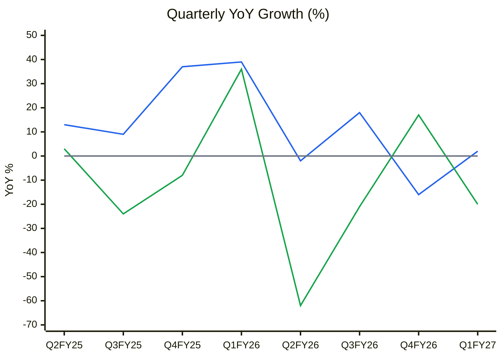
🟦 Revenue YoY % · 🟩 EBITDA YoY % · ⬜ zero line

**Read:** Revenue growth has decelerated from +37–39% (Q4 FY25–Q1 FY26) to an average of ~0% over the last four quarters. EBITDA fell YoY in five of the last seven quarters, including −20% in Q1 FY27 (margin 17.6% vs 22.6%).

**Business inference:** The carrier-driven peak has passed. New export and tender-won defence work is lower-margin and slower to bill. Until the ~10 FY27 deliveries happen, revenue is flat and margins are compressing. **Decelerating.** This is an earnings-downgrade phase, not an upgrade phase.

**Revenue decomposition (volume / price / mix):** There is no volume unit. Revenue is percentage-of-completion on ~78 vessels. **Mix dominates.**
- **Ship repair** fell 11% (₹1,865 → ₹1,656 Cr) and its segment margin fell from 39.1% to 25.9% once the carrier refits ended.
- **Shipbuilding** grew 14% (₹2,955 → ₹3,366 Cr) with segment margin up from 15.6% to 20.0% (FY26 AR Note 58).
- **Exports** doubled (₹534 → ₹1,106 Cr standalone).

Management guides shipbuilding at 10–12% and repair at 20–24% EBITDA, so ~14–15% blended (Q1 FY27 call). Mix is now **moving against margin**.

**Capacity model:**
- **Steel throughput:** 12,000 t/yr block fabrication at the main yard. A new 60,000 t/yr facility (going alone after the HD KSOE talks failed) takes this to ~72,000 t, but only by ~2029–30 (part of ₹4,100 Cr shipbuilding infrastructure, 2026–30).
- **New Dry Dock:** 310 m dock, "utilised to the full" per management. Dock-day utilisation is not disclosed (⚠️).
- **ISRF:** 82 ships/yr. Phase II (+10 workstations, ~₹1,500 Cr) would sit inside the DDW JV.
- **Order book by stage:** 31 vessels in design, 30 in hull fabrication, 17 at an advanced stage (Sep-26 PPT).

**Capacity ceiling:** Until the new block fab is commissioned (~FY29–30), throughput limits revenue to roughly **₹6,000–7,000 Cr**, whatever the order intake.

**Operating leverage:** DOL is not meaningful because the margin moves are mix-driven. Revenue +4% came with EBIT (excl. OI) −11% in FY26. DFL = EBIT/(EBIT − interest) = 1,110/999 = **1.11×**. Interest has doubled (₹55 → ₹111 Cr) on the new WCDL. **ICR (EBIT incl. OI ÷ interest) is 10.0×.** Projected ICR stays ≥ 4.9× through FY29 (Module 11).

**Guidance accuracy (feeds WTT):** 0.78 (Module 4).

**FCF inflection:** Management says CFO turns positive in FY27 as ~10 vessels deliver and the 60–70% delivery tranches arrive. But ₹6,500 Cr of capex over five years (net ~₹4,900 Cr after subsidy) means **FCF will not be sustainably positive before ~FY30**.

**Stock cycle classification: LATE CYCLE (margin normalisation) heading into a new capex cycle.** FY26 EBITDA margin (16.5%) is already below its 9-yr average (19.6%) and guided to ~14%. Valuation sits at the top of its range (Module 9). Apply MoS +5–10 pp and a smaller size.

---

## Module 2 — Industry Structure & Capital Cycle

| Force | Assessment | Signal |
|---|---|---|
| New entrants | Defence: high barriers (MoD Category-A yard status, security clearance, dock infrastructure). Commercial: barriers are falling. The government is funding greenfield clusters and private yards, and Korean/Japanese yards are partnering Indian players. | Mixed |
| Supplier power | Moderate-high. Imported propulsion, LNG systems and batteries, plus specialised steel. A single-source OEM is a common chokepoint. | Unfavourable |
| Buyer power | **High.** MoD/Navy is a monopsony and now tenders (L1). Export owners (CMA CGM, Svitzer, Wilson) are global, price-sensitive buyers with tail-heavy payment terms (30% before delivery). | Unfavourable |
| Substitutes | Low for warships. For commercial ships, Korean, Chinese and Japanese yards are the substitute and set world prices. | Neutral |
| Rivalry | Rising. MDL, GRSE, GSL, HSL and L&T are bidding for the same naval programmes, and private yards plus foreign JVs are chasing commercial work. | Unfavourable |

**Industry verdict: NEUTRAL** (attractive for defence, unattractive for commercial shipbuilding). Scale MoS up.

**Capital cycle (Chancellor): returns are near peak, and capital is flooding in.** Policy money is subsidising the whole industry: the ₹69,725 Cr package, the 25% capex subsidy, 3% interest subvention and new clusters. Shipyards are raising capex. CSL alone plans ₹6,500 Cr (~1.7× its gross block) at 80:20 debt:equity. Its own capex/depreciation will run at ~5–10× in FY28–29, against ~1.2× in FY26 (capex ₹151 Cr vs D&A ₹130 Cr). Signals: government-subsidised entry, multiple new yard announcements, and ROCE in FY24–25 well above the long-run norm. **Supply is building faster than returns justify. That is a late-cycle capital signal for commercial shipbuilding.**

---

## Module 3 — Business Quality & Moat

**Moat Verdict: NARROW** (defence franchise and dock infrastructure; none in commercial shipbuilding)
- **Supply/cost advantage:** Partial. CSL has India's largest dry dock (310 m, 600 t gantry crane) and the only aircraft-carrier build and repair track record. A rival would need ~₹2,000 Cr and 5+ years to replicate the dock. There is no cost advantage against Korean or Chinese yards in commercial work.
- **Customer captivity:** The Navy and Coast Guard repeat-order, but awards are now L1 tenders. Ship repair has relationship stickiness (~45% India share; top-2 repair customers are 61% of repair revenue).
- **Local economies of scale:** Real in Indian ship repair (5 repair units, ~45% share) and in carrier-class work.
- **Buffett 10% price test:** **Fail** for commercial (global price-taker) and defence (L1). Pass only for nominated carrier refits.

**Durability tests:**
- ROCE has exceeded WACC (12.2%) in 7 of 8 years (FY23 trough 8%).
- Repair market share (~45%) has been stable.
- Pricing power is not evident: segment margins swing with carrier work.
- Activity system: design (in-house naval architects plus Conoship 23% stake), build, repair and lifecycle support reinforce one another.
- Scuttlebutt: Kotak (Sell, ₹860) highlights "margin normalisation after one-off Vikrant/Vikramaditya repair". Antique (Hold, ₹1,693) says valuations "already account for a relatively optimistic execution trajectory" ([Business Today](https://businesstoday.in/markets/stocks/story/cochin-shipyard-shares-slip-on-weak-q1-earnings-fresh-price-targets-and-more-549499-2026-08-17)).

### Fisher 15-Point (1–3 each)
| # | Point | Score | Evidence |
|---|---|---|---|
| 1 | Market potential | 3 | Naval pipeline worth ₹1.17 lakh Cr (LPD/MCMV/P17B), 432-vessel domestic aggregation, exports |
| 2 | New products | 3 | LNG feeders, hydrogen fuel-cell vessel, electric/green tugs, CSOV/SOV |
| 3 | R&D effectiveness | 2 | Technology firsts (fuel-cell vessel) still small in revenue |
| 4 | Sales organisation | 2 | First Indian yard to win a global liner order (CMA CGM), repeat Wilson/Svitzer wins |
| 5 | Profit margin | 2 | 16.5% FY26 EBITDA excl. OI, guided ~14% |
| 6 | Margin improvement | 1 | Margins falling; no cost programme articulated |
| 7 | Labour relations | 2 | No disruptions reported; PSU wage structure |
| 8 | Executive relations | 1 | The CMD post is held as an **additional charge** by the Director (Finance), who holds both roles (Sep-26 PPT) |
| 9 | Management depth | 2 | Experienced functional directors |
| 10 | Cost / accounting controls | 2 | KAMs on physical-completion estimates; EoM on suspended A&N vessels; SBFA reclassified into revenue |
| 11 | Industry-specific advantage | 3 | Largest Indian dry dock, carrier capability |
| 12 | Long-range orientation | 3 | Repair clusters, Tuticorin, green tech |
| 13 | Dilution | 3 | No equity issuance (GoI OFS is a supply overhang, not dilution) |
| 14 | Communication in adversity | 2 | Only about one analyst call a year (Aug-25, then Sep-26), hosted by an IR firm; candid on margins |
| 15 | **Integrity (veto)** | 3 | No governance red flags. One BSE fine for a one-day record-date delay (May-24). |
| | **Total** | **34 / 45** | Point 15: **PASS** |

---

## Module 4 — Management & Capital Allocation
- **Promoter (GoI) holding:** 63.33% (Sep-26 PPT), down from 72.86% (Sep-23) after OFS rounds in Oct-24 and Jul-26 (floor ₹1,400). **Pledge: nil.** Risk: Normal. The trend is a **steady government sell-down, a recurring supply overhang near ₹1,400–1,550.**
- **FCF/share vs EPS (FY21–26):** EPS rose from ₹23.13 to ₹27.24 (3.3% CAGR). Cumulative FCF FY22–26 was −₹43 Cr, so FCF per share is ~nil. The divergence is caused by working capital and the dock/ISRF capex, not by accounting.
- **Share count:** 26.31 Cr, stable since the Jan-24 split (₹200 Cr buyback in Dec-18).
- **Capital allocation rating: AVERAGE.**
  - The ₹2,770 Cr New Dry Dock + ISRF was built without debt.
  - The ISRF is monetised at ₹1,800 Cr (1.7× book).
  - Dividend payout ~33% is maintained even in negative-CFO years: ₹257 Cr paid in FY26 while borrowing short-term.
  - The new ₹6,500 Cr programme targets only a **14–15% ROCE**, near WACC.
- **RPT:** Subsidiaries and JVs only (HBL marine-battery JV 40%; DDW JV 50%). No ICDs to a promoter group. Not a concern.
- **Buffett's three C's:**
  - Candor: MODERATE-GOOD. The CMD openly attributes the margin decline to carrier work rolling off and loss of interest income.
  - Competence: GOOD on capex delivery; MIXED on commercial delivery timelines (DCI dredger).
  - Caring: MODERATE. GoI is a seller; minority shareholders get a dividend.

### Walk the Talk Scorecard
| Quarter Guided | Statement | Guided | Actual | Verdict |
|---|---|---|---|---|
| May-24 call | FY25 revenue growth | +20–25% | +25.8% (₹3,830 → ₹4,820 Cr) | ✅ |
| May-24 call | FY25 blended EBITDA | 17–19% | 18.6% (excl. OI) | ✅ |
| May-24 call | ISRF fully operational | Aug-2024 | Commercial ops 12-Aug-24 | ✅ |
| Aug-25 call | FY26 revenue growth | +14–15% | **+4.2%** (₹5,022 Cr) | ❌ |
| Aug-25 call | FY26 PAT margin | ~15% | 14.3% (within ±5%) | ✅ |
| Aug-25 call | FY26 EBITDA (company definition, incl. OI) | ~20% | 24.3% incl. OI (16.5% excl.) | ✅ |
| Aug-25 call | FY26 ship repair revenue | ~₹1,500 Cr | ₹1,656 Cr | ✅ |
| Aug-25 call | ISRF incremental revenue | ~₹250 Cr in 18–24 months | ₹207 Cr in FY26 (on track) | ✅ |
| Aug-25 call | DCI dredger | launch in ~1 month, deliver a few months later | Still not delivered; "next month" (Oct-26) per Sep-26 call (~1-yr slip) | ❌ |
| *Open* | FY27: revenue ~12% (12–15%), EBITDA ~14% excl. OI, CFO positive, 10 deliveries, NGSV signed ~Nov-26, DCI repeat (₹1,300 Cr) within 2 months | — | to track | — |

**WTT Score: 0.78 / 1.00 — MODERATE** (just below HIGH)
**Guidance points assessed:** 9 | Hits: 7 | Near misses: 0 | Misses: 2 | Reversals: 0
**Key pattern:** Reliable on margins, repair and its own capex. **Optimistic on revenue timing and commercial delivery schedules.** The FY26 revenue miss came from the export-vessel delay, and the dredger has slipped about a year. EBITDA guidance also includes interest income on cash that has since been spent, a definitional cushion. → Haircut revenue guidance ~15% (12% guided → ~10% base).
**Insider action:** No director open-market buying (Form C) seen. The promoter (GoI) sold ~4.6% via OFS in Jul-26 at a ₹1,400 floor, two months before the stock broke below it. **BEARISH supply signal.**
**DCF impact:** Base revenue CAGR 10% (vs 12% guided); margin 14.5% (guided ~14%).
**Overall management credibility: MODERATE.**

---

## Module 5 — Financial Forensics
**Indian-specific checks:**
- **Pledge:** nil.
- **RPT:** clean.
- **Auditor:** Babu A. Kallivayalil & Co. (CAG-appointed; small firm for a ₹33k Cr company, mitigated by CAG supplementary audit). Opinion unmodified.
- **Emphasis of Matter (2):**
  - (i) Two passenger vessels for a Union Territory (₹819 Cr contract, 2016) are **suspended at ~55% completion**. ₹665 Cr has been received and ₹1,124 Cr of bank guarantees are outstanding. The financial impact is undeterminable.
  - (ii) The **Shipbuilding Financial Assistance (a government subsidy) has been regrouped from "other operating revenue" into "sale of products"**. That flatters reported product revenue quality.
- **KAMs:** measurement of physical completion and Ind AS 115 revenue recognition. The auditor "placed reliance on Management's technical … assessments."
- **Revenue quality:** contract assets up from ₹925 Cr to ₹1,359 Cr, receivables from ₹225 Cr to ₹423 Cr, while contract liabilities (customer advances) fell from ₹5,051 Cr to ₹4,525 Cr (FY26 AR Note "Contract balances").
- **Contingent liabilities:** claims ₹240 Cr, LCs ₹182 Cr, BGs ₹2,332 Cr. That is ~8% of M-cap, mostly performance and advance BGs. ✅

**Quantitative models (FY26 vs FY25, consolidated):**
| Model | FY26 | Threshold | Read |
|---|---|---|---|
| Beneish M-score | **−1.03** | > −1.78 flag | DSRI 1.80 (receivables ₹225 → ₹423 Cr on revenue +4%); TATA 0.134 (NI ₹717 Cr vs CFO −₹1,234 Cr); GMI ~1.12 (EBITDA-margin proxy); AQI 1.04; SGI 1.04; DEPI 0.83; LVGI 1.02; SGAI assumed 1.0. **Flagged but explained** by tail-heavy export milestone terms (30% paid during build, 70% on delivery). Watch FY27 deliveries: if CFO is not positive, this escalates. |
| Altman Z'' | **3.70** (FY25 3.84) | < 1.10 distress | Safe. X1 0.18, X2 0.40, X3 0.08, X4 0.68. |
| Piotroski F | **2 / 9** | < 4 weak | ROA > 0 ✓; no dilution ✓; CFO < 0, ROA down, CFO < NI, LT debt up, current ratio flat, margin down, asset turn down ✗ |
| Sloan accrual | **+11.6%** | > +10% | (717 + 1,234 − 327) ÷ avg TA ₹13,962 Cr. **Red flag.** |

**Schilit screen:**
- (1) Revenue too soon: cash collections lag revenue, and the receivables plus contract-asset build is the flag. ⚠️
- (3) One-time boosts: other income ₹409 Cr is 37% of EBIT incl. OI, recurring but shrinking. ⚠️
- (4) Capex/D&A was 1.2× in FY26. ✅
- (5)–(7): none. ✅
- CFS: no factoring disclosed; payables days rose from 85 to 159 (stretching, ⚠️).

**Forensic red-flag count: 5 / 15:** negative CFO 3 years, Sloan > 10%, Piotroski < 4, Beneish > −1.78 (explained), DPO rising.
**Overall forensic verdict: MINOR-TO-SIGNIFICANT CONCERNS — Aggressive but Defensible.** The concerns are working-capital and timing problems, not fabrication. They become *Concerning* if FY27 deliveries do not convert into positive CFO as guided.

---

## Module 6 — Earnings Quality & Financial Statements
- **ROCE (Screener, incl. other income):** 16.2% FY26; 10-yr average ~18.6%.
- **ROIC (excl. cash):** ~10.2% FY26 (NOPAT ₹522 Cr ÷ invested capital ₹5,139 Cr = equity ₹5,873 Cr + debt ₹1,672 Cr − cash ₹2,406 Cr), down from ~19.5% in FY25 (NOPAT ₹590 Cr ÷ IC ₹3,027 Cr). Invested capital rose ₹2,100 Cr in one year as working capital ballooned.
- **WACC: 12.2%** (Rf 7.0% + β ~1.0 × ERP 5.5% → Ke 12.5%; debt ~5% of capital).
- **Spread:** ROCE +4 pp; **ex-cash ROIC −2 pp in FY26.** Value creation is marginal at present.
- **ROIC trend (3-yr): DECLINING.** Driver: asset turn and working capital, plus margin.
- **Economic profit:** FY26 ≈ −₹105 Cr on ex-cash IC (FY25 ≈ +₹220 Cr).

### C4 — Margin trend vs 9-yr average (CY7)
| FY | FY18 | FY19 | FY20 | FY21 | FY22 | FY23 | FY24 | FY25 | FY26 |
|---|---|---|---|---|---|---|---|---|---|
| EBITDA margin (excl. OI) % | 20 | 19 | 21 | 26 | 20 | 11 | 23 | 19 | 17 |
| PAT margin % | 16.8 | 16.1 | 18.5 | 21.6 | 17.7 | 12.9 | 20.4 | 17.2 | 14.3 |

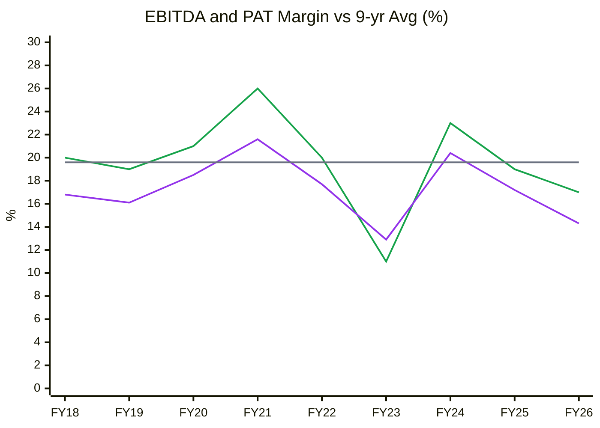
🟩 EBITDA margin (excl. other income) · 🟪 PAT margin · ⬜ 9-yr average EBITDA margin 19.6% (SD ~4 pp)

**Read:** FY26 EBITDA margin (17%) is below its 9-yr average (19.6%, ~40th percentile). Management guides FY27 to ~14%, which would be ~1.4 SD below average and the second-lowest year after FY23 (11%).

**Business inference:** The FY24 peak (23%) was carrier-driven. Tender-won naval and fixed-price export work structurally earns 10–12% in shipbuilding. PAT margin has been propped up by other income, which is now shrinking as cash is consumed. Normalised EBITDA of ~14–15% is the right base for valuation, not 19–23%. → Module 9 margin assumption.

### C5 — ROCE vs WACC (with 8-yr average)
| FY | FY19 | FY20 | FY21 | FY22 | FY23 | FY24 | FY25 | FY26 |
|---|---|---|---|---|---|---|---|---|
| ROCE % (Screener) | 22 | 25 | 20 | 17 | 8 | 21 | 20 | 16 |

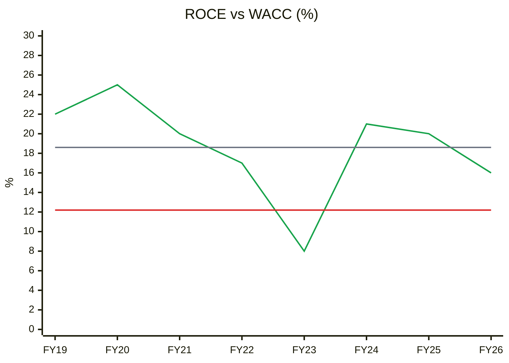
🟩 ROCE · 🟥 WACC 12.2% · ⬜ 8-yr average 18.6%

**Read:** ROCE has beaten WACC in 7 of 8 years (exception FY23: 8%). It is now 16%, below its 18.6% average. Ex-cash ROIC fell to ~10%.

**Business inference:** The franchise has historically created value, so **no ROCE < WACC hard stop applies**. But Screener ROCE is flattered by interest income on surplus cash. On an operating basis, FY26 returns fell below the cost of capital because working capital absorbed ₹2,100 Cr. The new 14–15% hurdle on ₹6,500 Cr of capex implies thin spreads ahead.

### C7 — Cumulative PAT vs cumulative CFO (₹ Cr)
| FY | FY18 | FY19 | FY20 | FY21 | FY22 | FY23 | FY24 | FY25 | FY26 |
|---|---|---|---|---|---|---|---|---|---|
| PAT | 396 | 478 | 632 | 609 | 564 | 305 | 783 | 827 | 717 |
| CFO | 631 | −451 | 253 | 710 | 1,398 | 1,889 | −172 | −284 | −1,234 |
| Cum PAT | 396 | 874 | 1,506 | 2,115 | 2,679 | 2,984 | 3,767 | 4,594 | 5,311 |
| Cum CFO | 631 | 180 | 433 | 1,143 | 2,541 | 4,430 | 4,258 | 3,974 | 2,740 |

*CFO cross-checked against the FY24/FY25/FY26 annual reports (consolidated cash-flow statements). No year-shift found in Screener.*

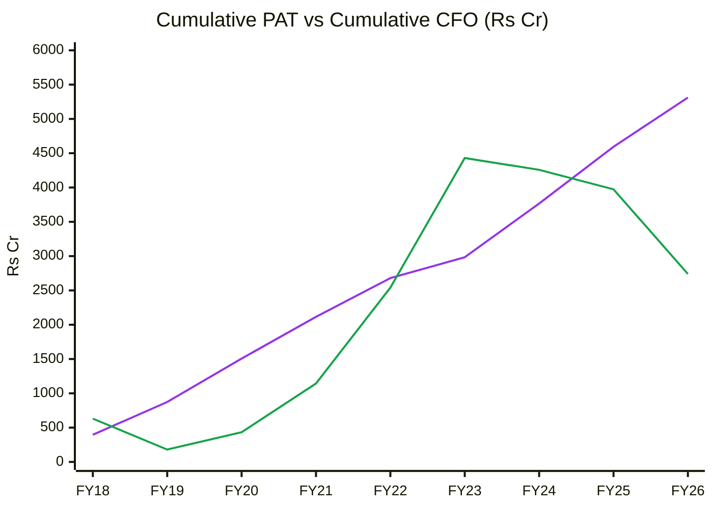
🟪 Cumulative PAT · 🟩 Cumulative CFO

**Read:** Cumulative CFO/PAT was 1.48× at FY23. It has since fallen to **0.52× over FY18–26** (and 0.50× for FY22–26), below the 0.7 red-flag line.

**Business inference:** The FY22–23 surplus came from IAC-1 advances. Since FY24, export contracts that pay 70% on delivery, plus a ₹500 Cr+ inventory build, have reversed it. Reported profits of FY24–26 are not yet cash. The thesis needs the FY27 deliveries to release ₹1,500–2,000 Cr. If they slip, this becomes an earnings-quality problem, not a timing one. → Hard monitoring item.

### C8 — Working-capital days
| FY | FY18 | FY19 | FY20 | FY21 | FY22 | FY23 | FY24 | FY25 | FY26 |
|---|---|---|---|---|---|---|---|---|---|
| Debtor days | 90 | 48 | 31 | 46 | 50 | 52 | 29 | 17 | 31 |
| Inventory days | 98 | 70 | 65 | 139 | 67 | 122 | 216 | 325 | 379 |
| Payable days | 83 | 84 | 85 | 130 | 38 | 71 | 98 | 85 | 159 |

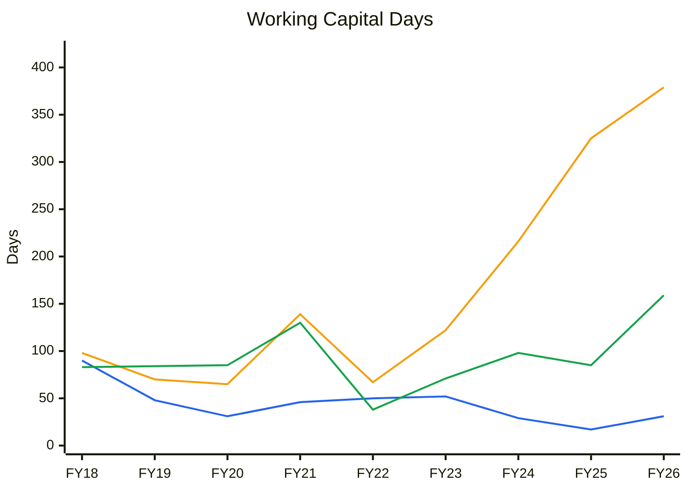
🟦 Debtor days · 🟧 Inventory days · 🟩 Payable days (Screener definitions)

**Read:** Inventory days have tripled since FY23 (122 → 379), well above the 250-day red-flag line in the sector KPI block. Payable days nearly doubled in FY26 (85 → 159).

**Business inference:** Work-in-progress on export hulls is sitting on the balance sheet while CSL stretches suppliers to fund it. That is unsustainable beyond FY27. When the hulls deliver, inventory should fall sharply. If deliveries slip again, CSL needs more short-term debt (it already drew ₹1,030 Cr net in FY26).

### DuPont Decomposition (5-factor, consolidated)
| Year | EBIT margin (incl. OI) | Asset turnover | Equity multiplier | Interest burden | Tax burden | ROE |
|---|---|---|---|---|---|---|
| FY22 | 25.7% | 0.38× | 1.92× | 0.94 | 0.74 | 12.8% |
| FY23 | 19.5% | 0.24× | 2.26× | 0.91 | 0.73 | 6.9% |
| FY24 | 29.2% | 0.32× | 2.41× | 0.96 | 0.73 | 15.6% |
| FY25 | 24.5% | 0.36× | 2.40× | 0.95 | 0.74 | 14.8% |
| FY26 | 22.1% | 0.35× | 2.47× | 0.90 | 0.72 | 12.2% |
| **Change FY22→26** | −3.6 pp | −0.03× | +0.55× | −0.04 | −0.02 | **−0.6 pp** |

*Source: Screener consolidated P&L and balance sheet (year-end total assets and equity).*

- **Operating contribution (EBIT margin × AT):** 9.8% FY22 → 7.7% FY26, **declining** since the FY24 peak of 9.3%.
- **Financing contribution:** The equity multiplier is rising, but from **customer advances (contract liabilities ~₹4,500–5,000 Cr)**, not debt. Debt was only ~₹500 Cr until FY26.
- **DuPont verdict:** The ROE decline is operational (margin plus interest burden). Leverage is "free float" from customers, which is now shrinking (advances fell ₹526 Cr in FY26). The June report's "leverage masking operations" verdict is withdrawn.
- **Asset-turn trend:** stable-to-low. Base asset turn on (NFA + CWIP) is 1.25× (5-yr average); see C6.

**Peer DuPont (FY26, Screener):** MAZDOCK ROE 29% and GRSE 32% vs CSL 12%. Both peers earn more from higher asset turnover (submarine and frigate throughput on a smaller asset base) and less other-income dependence. CSL's lower ROE is operational, not a leverage difference.

**OCF / net income (5-yr):** 0.50 → quality LOW. **O'Glove flags: 6/15** (#1 NI vs OCF, #2 DSO up, #4 inventory days, #5 DPO, #7 other income/EBIT > 15%, #11 Piotroski < 4; #9 Sloan and #10 Beneish counted in Module 5).

---

## Module 7 — Industry KPIs & Peer Analysis
**Sector:** Defence Shipbuilding & Marine Services (`references/05-industry-kpis-india.md`, line 1150)

| KPI | CSL | Healthy range | Assessment |
|---|---|---|---|
| Order book / TTM revenue | **4.3×** (5.3× with NGSV) | > 3× | ✅ Above |
| Execution rate (revenue ÷ opening OB) | 23.7% FY26 (21.9% FY25) | 20–35% | ✅ In range |
| EBITDA margin (excl. OI) | 16.5% FY26; 17.6% Q1 FY27; ~14% guided FY27 | 12–20% | ⚠️ In range, falling |
| Advances / order book | 20.5% (₹4,525 / ₹22,125 Cr), down from 23.9% | > 15% | ✅ but falling |
| Working-capital days (CCC) | 250 | 90–200 | ⚠️ Above |
| CFO / EBITDA (3-yr avg) | **−0.67** (−0.20, −0.32, −1.49) | > 0.5 | ❌ Red flag (negative 3 yrs) |
| Inventory days | **379** | 60–150 | ❌ Red flag (> 250) |
| Net debt / EBITDA | Net cash ~₹734 Cr | Net cash to 1× | ✅ |
| ROCE | 16% | > 18% | ⚠️ Below |
| Order concentration | Defence 54% of OB; top programme share not disclosed | Top-1 < 60% | ⚠️ Data gap |
| Contingent liability / M-cap | ~8% | < 30% | ✅ |
| Deliveries | FY27 target 10 (3 done by Sep-26, plus 3 at Udupi-CSL) | Accelerating | To verify |

**Peer comparison (Screener, 12-Oct-26; order books from Q1 FY27 disclosures):**
| Metric | COCHINSHIP | MAZDOCK | GRSE |
|---|---|---|---|
| M-cap (₹ Cr) | 32,731 | 82,757 | 24,158 |
| Revenue 3-yr CAGR (FY23–26) | 28.5% | 18.4% | 39.8% |
| EBITDA margin FY26 (excl. OI) | 16.5% | 17.4% | 11.4% |
| ROCE FY26 | 16% | 36% | 43% |
| ROE FY26 | 12% | 29% | 32% |
| CFO FY26 (₹ Cr) | −1,234 | −2,654 | −290 |
| Inventory days FY26 | 379 | 131 | 307 |
| Order book Jun-26 (₹ Cr) | 21,900 | 18,218 ([multibagg](https://www.multibagg.ai/market-pulse/articles/mazagon-q1-96893)) | 13,596 ([PSU Connect](https://www.psuconnect.in/financial/grse-q1-result-revenue-up-38-5-to-1814-cr-pat-jumps-44)) |
| OB cover (× TTM revenue) | 4.3× | 1.4× | 1.8× |
| P/E TTM | **48.1×** | 29.0× | 30.2× |
| P/B | 5.6× | 8.5× | 9.2× |

*Mazagon Dock is being analysed separately in parallel. The figures here are public Screener data only.*

### C12 — ROCE: CSL vs peers (FY26)
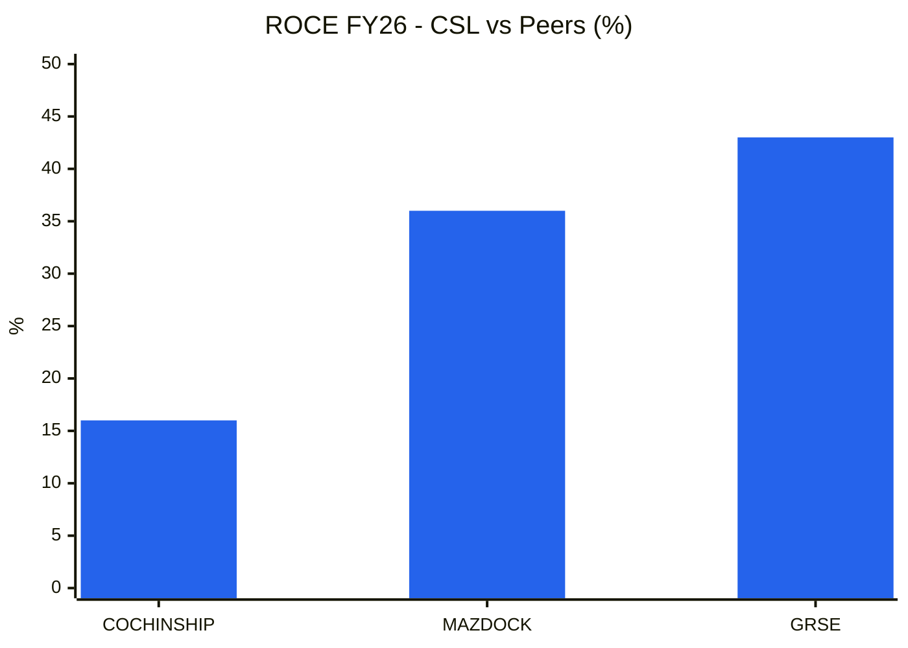
🟦 ROCE FY26 (Screener)

**Read:** CSL's ROCE (16%) is less than half its peers' (36–43%), yet its P/E (48×) is ~60% higher than theirs (29–30×).

**Business inference:** CSL's premium rests only on order cover (4.3× vs 1.4–1.8×) and commercial/export optionality. Peers have bigger naval re-fills coming (P75I, NGC ~₹33,000 Cr for GRSE) that would erase that cover gap. A lower-return business trading at a premium multiple is exposed when peers sign their large orders. **Peer positioning: premium, not justified.**

### Order Book Tracker
*Generated 2026-10-12 by scripts/order_book_tracker.py from 14 order announcements (1 follow-ups excluded) and 10 period snapshots. Ledger coverage starts 2024-04-01; earlier periods show '—' for announced inflow (unknown, not zero). (est.) = tracked estimate: previous disclosed order book + announced orders − order-linked revenue.*

#### 1. Disclosed vs tracked order book (reconciliation)

| Period | Revenue (₹ Cr) | Order book (₹ Cr) | Announced inflow | of which Framework | Implied inflow | Announced coverage | OB cover (× TTM rev) | Source |
|---|---|---|---|---|---|---|---|---|
| Q4FY24 | 1,286 | 22,000 | — | — | — | — | 5.7 | May-2024 investor PPT (~Rs22000 Cr incl. ship repair & subsidiaries); revenue Screener consolidated |
| Q1FY25 | 771 | 22,500 | 1,100 | — | 1,271 | 87% | 5.5 | Sep-2024 investor PPT (Rs22500 Cr approx.) |
| Q2FY25 | 1,143 | 21,357 (est.) | 0 | — | — | — | 5.0 | Screener consolidated |
| Q3FY25 | 1,148 | 21,584 (est.) | 1,375 | — | — | — | 5.0 | Screener consolidated |
| Q4FY25 | 1,758 | 21,150 | 0 | — | 1,324 | 0% | 4.4 | FY25 Annual Report (order book as on 31-Mar-2025 Rs21150 Cr incl. subsidiaries) |
| Q1FY26 | 1,069 | 21,100 | 350 | — | 1,019 | 34% | 4.1 | Aug-2025 investor PPT/call (Rs21100 Cr incl. ship repair Rs1500 Cr) |
| Q2FY26 | 1,119 | 20,181 (est.) | 200 | — | — | — | 4.0 | Screener consolidated |
| Q3FY26 | 1,350 | 21,806 (est.) | 2,975 | — | — | — | 4.1 | Screener consolidated |
| Q4FY26 | 1,484 | 22,125 | 5,175 | — | 1,803 | 287% | 4.4 | FY26 Annual Report (order book as on 31-Mar-2026 Rs22125 Cr incl. subsidiaries) |
| Q1FY27 | 1,094 | 21,900 | 175 | — | 869 | 20% | 4.3 | Sep-2026 investor PPT (Rs21900 Cr; excludes NGSV L1 ~Rs5000 Cr) |

*Implied inflow = OB(t) − OB(t−1) + order-linked revenue(t). Announced coverage = announced ÷ implied: < 50% means most orders are below the disclosure threshold (or the OB is restated); > 120% means cancellations, de-scoping or slow-burn framework value not yet in the reported book.*

#### 2. Announced orders aggregated by quarter

| Quarter | # orders | Total (₹ Cr) | Firm | Framework | Largest single | Export | Govt/PSU/Defence | Private domestic |
|---|---|---|---|---|---|---|---|---|
| Q1FY25 | 2 | 1,850 | 1,850 | 0 | 1,100 | 1,850 | 0 | 0 |
| Q3FY25 | 2 | 1,375 | 1,375 | 0 | 1,000 | 0 | 1,000 | 375 |
| Q1FY26 | 2 | 350 | 350 | 0 | 175 | 0 | 0 | 350 |
| Q2FY26 | 1 | 200 | 200 | 0 | 200 | 0 | 0 | 200 |
| Q3FY26 | 2 | 2,975 | 2,975 | 0 | 2,600 | 2,975 | 0 | 0 |
| Q4FY26 | 2 | 5,175 | 5,175 | 0 | 5,000 | 0 | 5,000 | 175 |
| Q1FY27 | 1 | 175 | 175 | 0 | 175 | 0 | 0 | 175 |
| Q3FY27 | 1 | 175 | 175 | 0 | 175 | 0 | 0 | 175 |

#### 3. Macro picture

| Metric | Value |
|---|---|
| Latest disclosed order book | ₹21,900 Cr (Q1FY27) |
| Orders announced since that disclosure | ₹175 Cr (1 orders) |
| Tracked order book today (before execution since Q1FY27) | ₹22,075 Cr |
| Order book cover (latest) | 4.3 × TTM revenue |
| Framework / 'potential value' agreements in ledger | ₹0 Cr (0% of latest disclosed OB) |
| Orders announced, last 12 months | ₹8,700 Cr (7 orders; avg ₹1,243 Cr) |
| Top-3 orders (last 12 m) as % of disclosed OB | 36% |

**Geography mix, last 12 months:** Domestic 66% · Export 34%
**Customer type mix, last 12 months:** Defence 57% · Export 34% · Private 6% · Unspecified 2%
**Segment mix, last 12 months:** Shipbuilding-Defence 57% · Shipbuilding-Commercial 36% · Shipbuilding-Commercial (subsidiary) 4% · Ship Repair 2%
**Firmness mix, last 12 months:** L1 57% · LoI 30% · Firm 13%

#### 4. Charts

**OB-1 — Order book vs revenue (TTM), index = 100 at Q4FY24**

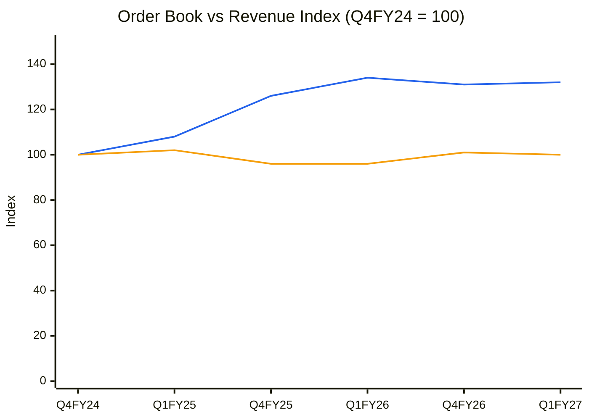
🟦 Revenue (TTM) · 🟧 Order book (disclosed points only; x-axis mixes FY and quarter-ends where history is annual)
**Read:** Since Q4 FY24 the disclosed order book has been flat (index 100 → 100, ₹22,000 → ₹21,900 Cr) while TTM revenue rose 32% (index 132). CSL is consuming its book faster than it is refilling it with *contracted* orders.

**Business inference:** Demand is not the binding constraint, but *contracting* is. The ₹5,000 Cr NGSV (L1 since Feb-26) and the big naval programmes are not yet signed, so revenue growth beyond ~10% needs those awards. Until then, execution of a static book caps FY27–28 revenue at roughly ₹5,500–6,100 Cr.

**OB-2 — Order book cover (years of TTM revenue)**

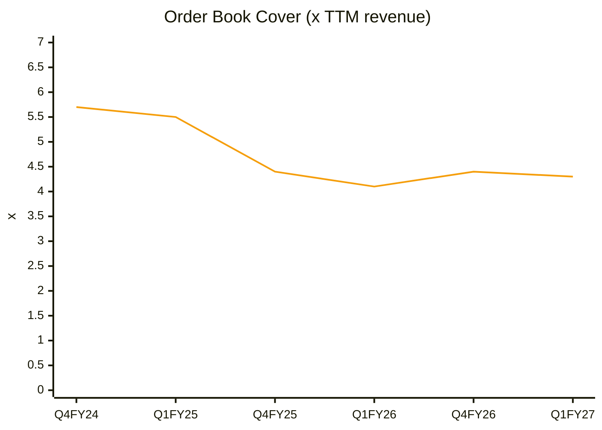
🟧 Order book / TTM revenue
**Read:** Cover fell from 5.7× (Q4 FY24) to 4.3× (Q1 FY27). It is still above the 3× sector benchmark and well above MDL (1.4×) and GRSE (1.8×).

**Business inference:** Forward revenue is secure for ~4 years, but the book is long-tenor: CMA CGM's last ship delivers ~64 months out, and the NGMV/ASW programmes are slow. Low-margin export hulls with tail-heavy payments make up a growing share, so high cover means working-capital drag as much as visibility. Cover alone does not justify a premium multiple.

**OB-3 — Aggregated announced orders vs revenue, by quarter (₹ Cr)**

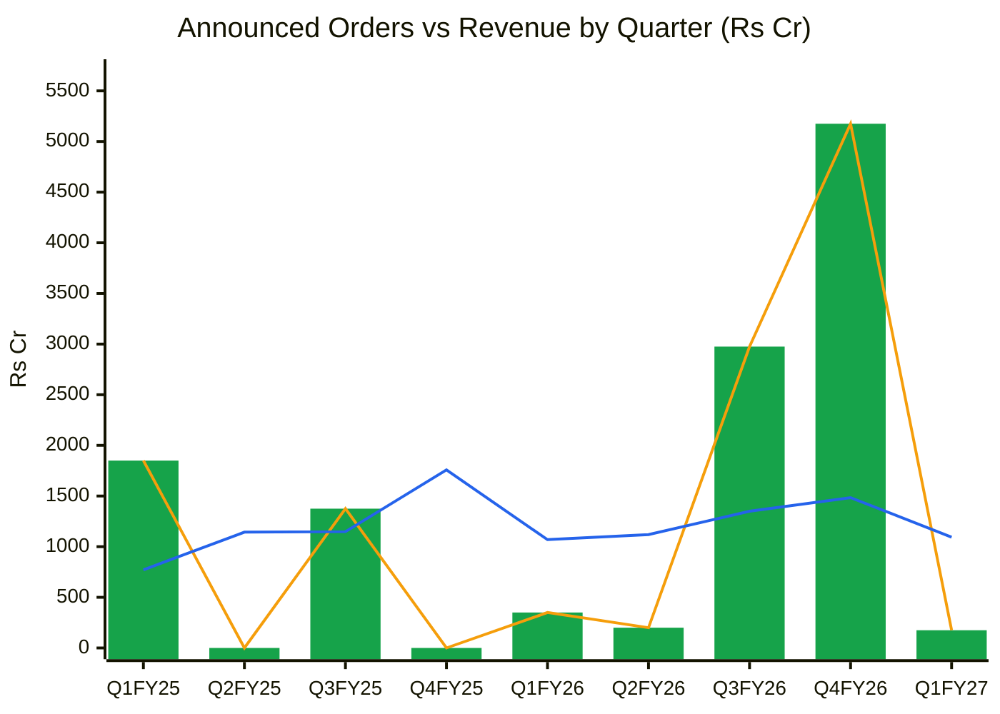
🟩 All announced orders (bars) · 🟧 Firm orders only (excl. framework / potential-value agreements) · 🟦 Revenue
**Read:** Announced orders are lumpy: ₹0–5,175 Cr a quarter against ₹1,050–1,750 Cr of revenue. Two filings make up 87% of the last 12 months (₹8,700 Cr). Note: the 🟧 'firm' line is non-framework only, so it *includes* the NGSV L1 (₹5,000 Cr, Q4 FY26) and the CMA CGM LoI (₹2,600 Cr, Q3 FY26; contracted Feb-26). On truly firm contracts, 12-month announced orders are only ~₹3,700 Cr. There is no framework value.

**Business inference:** CSL is genuinely winning *export commercial* work (CMA CGM, Svitzer, Wilson). The naval award is still L1. The Q4 FY26 coverage of 287% simply reflects the unbooked NGSV. Many small repair jobs sit below the Reg-30 threshold, which explains the low coverage in other quarters (Q1 FY26 34%, Q1 FY27 20%). Order *momentum* depends on 1–2 large signings, so a haircut to order-led revenue forecasts is appropriate.

*Analyst notes on the tracker output: (1) Order values in CSL filings are bands; midpoints are used and marked 'est.' in the notes. (2) The script computes Q4 FY26 'implied inflow' (1,803) against the Q3 FY26 *tracked estimate*. The like-for-like **FY26 implied inflow** is 22,125 − 21,150 + 5,022 = **₹5,997 Cr (book-to-bill 1.19)**; FY25 is 21,150 − 22,000 + 4,820 = ₹3,970 Cr (0.82). (3) The Q2/Q3 FY25 and Q2/Q3 FY26 '(est.)' order books are tracked estimates, not disclosures, and are not charted. (4) OB-4 is not generated: there are fewer than 4 contiguous quarterly OB disclosures, because CSL holds roughly one analyst call a year.*

#### 5. Order Ledger — every announced order (source of truth; the next run appends here)

| order_id | date | customer | customer_type | segment | geography | value_cr | currency | value_fc | firmness | tenor_months | linked_to | source | notes |
|---|---|---|---|---|---|---|---|---|---|---|---|---|---|
| CSL-2405-01 | 2024-05-13 | European client (Hybrid SOV) | Export | Shipbuilding-Commercial | Export | 750 | INR |  | Firm | 31 |  | [BSE](https://www.bseindia.com/xml-data/corpfiling/AttachHis/f1d00e44-9bc8-4cd6-96b3-cfd449eaa22e.pdf) | 'Large' band Rs500-1000 Cr (midpoint used, est.); 1 Hybrid SOV for offshore wind + option for 2 more; completion end-2026 |
| CSL-2406-01 | 2024-06-28 | Wilson ASA Norway (via Udupi-CSL) | Export | Shipbuilding-Commercial (subsidiary) | Export | 1100 | INR |  | Firm | 51 |  | [BSE](https://www.bseindia.com/xml-data/corpfiling/AttachHis/d737a466-3270-4537-a490-446d209149c6.pdf) | 8x 6300 TDW dry cargo vessels (4 contracted + 4 to be contracted by 19-Sep-2024); 'about Rs1100 Cr'; execution by Sep-2028 |
| CSL-2411-01 | 2024-11-30 | Indian Navy (large naval vessel refit) | Defence | Ship Repair | Domestic | 1000 | INR |  | Firm | 5 |  | [BSE](https://www.bseindia.com/xml-data/corpfiling/AttachHis/141f3760-a35e-40c3-bdf9-0a3fb17bafe6.pdf) | Short refit + dry docking; value stated 'above Rs1000 Cr' (lower bound used); ~5 months |
| CSL-2412-01 | 2024-12-27 | Ocean Sparkle (Adani Group) via Udupi-CSL | Private | Shipbuilding-Commercial (subsidiary) | Domestic | 375 | INR |  | Firm | 44 |  | [BSE](https://www.bseindia.com/xml-data/corpfiling/AttachHis/6d5cc893-e568-4d76-b156-98bc1458739d.pdf) | 8x 70T BP ASD tugs; 'Significant' band Rs250-500 Cr (midpoint, est.); deliveries Dec-2026 to Aug-2028 |
| CSL-2506-01 | 2025-06-23 | Heritage River Journeys (via Hooghly-CSL) | Private | Shipbuilding-Commercial (subsidiary) | Domestic | 175 | INR |  | Firm |  |  | [BSE](https://www.bseindia.com/xml-data/corpfiling/AttachHis/88c33ff2-5238-415e-a5f8-d2ae4f1e2cb8.pdf) | 2 luxury river cruise vessels (Brahmaputra); 'Notable' band Rs100-250 Cr (midpoint, est.) |
| CSL-2506-02 | 2025-06-28 | Polestar Maritime | Private | Shipbuilding-Commercial | Domestic | 175 | INR |  | Firm | 27 |  | [BSE](https://www.bseindia.com/xml-data/corpfiling/AttachHis/088aba49-568f-4c83-883e-0c03055cb390.pdf) | 2x 70T BP tugs; 'Notable' band (midpoint, est.); delivery May/Sep-2027 |
| CSL-2509-01 | 2025-09-17 | Jack-up rig owner (undisclosed) | Unspecified | Ship Repair | Domestic | 200 | INR |  | Firm | 12 |  | [BSE](https://www.bseindia.com/xml-data/corpfiling/AttachHis/7f56d51b-6057-42af-89f3-24b1c9cc57a4.pdf) | Dry dock / major lay-up repairs of a jack-up rig; 'around Rs200 Cr'; ~12 months |
| CSL-2510-01 | 2025-10-14 | CMA CGM France (LoI) | Export | Shipbuilding-Commercial | Export | 2600 | USD | 300 | LoI | 64 |  | [BSE](https://www.bseindia.com/xml-data/corpfiling/AttachHis/fa6d3be3-997f-4ab2-af8c-1e55a9ec0aa8.pdf) | 6x 1700 TEU LNG feeder vessels; filing says 'Mega' (>Rs2000 Cr) only; ~USD300 mn per WorldPorts -> Rs2600 Cr est.; first delivery 36 m, last 64 m |
| CSL-2512-01 | 2025-12-06 | Svitzer Denmark | Export | Shipbuilding-Commercial | Export | 375 | INR |  | Firm | 30 |  | [BSE](https://www.bseindia.com/xml-data/corpfiling/AttachHis/37953148-b1f5-4b2b-b457-d289c49bacc2.pdf) | 4x electric TRAnsverse 70T BP tugs + option for 4; follows LoI of 31-Oct-2025 (no value); 'Significant' band (midpoint, est.) |
| CSL-2601-01 | 2026-01-30 | Polestar Maritime (GTTP green tugs) | Private | Shipbuilding-Commercial | Domestic | 175 | INR |  | Firm | 20 |  | [BSE](https://www.bseindia.com/xml-data/corpfiling/AttachHis/4c2dbd84-5a12-4e90-ba03-8e6bfd90f273.pdf) | 2x 60T BP battery-electric green tugs; 'Notable' band (midpoint, est.); delivery Aug/Sep-2027 |
| CSL-2602-01 | 2026-02-16 | Ministry of Defence (Indian Navy NGSV) | Defence | Shipbuilding-Defence | Domestic | 5000 | INR |  | L1 |  |  | [BSE](https://www.bseindia.com/xml-data/corpfiling/AttachHis/85d7fb2d-27bd-4f6e-b6dc-56157b07ee01.pdf) | Declared L1 for 5 Next Generation Survey Vessels; ~Rs5000 Cr; contract expected ~Nov-2026 (Sep-2026 call); NOT in disclosed order book |
| CSL-2602-02 | 2026-02-18 | CMA CGM France (contract signed) | Export | Shipbuilding-Commercial | Export | 2600 | USD | 300 | Firm | 64 | CSL-2510-01 | [BSE](https://www.bseindia.com/xml-data/corpfiling/AttachHis/2ee0f469-4189-4dc2-8e20-c1b09682f2cc.pdf) | Formal contract for the 6 LNG feeders announced as LoI on 14-Oct-2025 (re-statement; not added to inflow) |
| CSL-2605-01 | 2026-05-07 | Ocean Sparkle (Adani Group) via Udupi-CSL | Private | Shipbuilding-Commercial (subsidiary) | Domestic | 175 | INR |  | Firm | 37 |  | [BSE](https://www.bseindia.com/xml-data/corpfiling/AttachHis/f39b508d-709c-40a4-b7b0-ddeebfc7865c.pdf) | 4x 70T BP ASD tugs (ASTDS); 'Notable' band (midpoint, est.); deliveries Nov-2028 to Jun-2029 |
| CSL-2610-01 | 2026-10-09 | Heritage River Journeys (via Hooghly-CSL) | Private | Shipbuilding-Commercial (subsidiary) | Domestic | 175 | INR |  | Firm | 45 |  | [BSE](https://www.bseindia.com/xml-data/corpfiling/AttachHis/821f536e-9d5c-442f-a5d0-a17c64859127.pdf) | Repeat order: 2 luxury river cruise vessels; 'Notable' band (midpoint, est.); delivery Jun-2029/Jun-2030 |

#### 6. Order Book Snapshots — revenue and disclosed order book per period

| period | revenue_cr | revenue_ttm_cr | order_book_cr | order_linked_share | as_of_date | source |
|---|---|---|---|---|---|---|
| Q4FY24 | 1286 | 3830 | 22000 | 1.0 | 2024-05-31 | May-2024 investor PPT (~Rs22000 Cr incl. ship repair & subsidiaries); revenue Screener consolidated |
| Q1FY25 | 771 | 4125 | 22500 | 1.0 | 2024-09-02 | Sep-2024 investor PPT (Rs22500 Cr approx.) |
| Q2FY25 | 1143 | 4256 |  | 1.0 |  | Screener consolidated |
| Q3FY25 | 1148 | 4348 |  | 1.0 |  | Screener consolidated |
| Q4FY25 | 1758 | 4820 | 21150 | 1.0 |  | FY25 Annual Report (order book as on 31-Mar-2025 Rs21150 Cr incl. subsidiaries) |
| Q1FY26 | 1069 | 5118 | 21100 | 1.0 | 2025-08-19 | Aug-2025 investor PPT/call (Rs21100 Cr incl. ship repair Rs1500 Cr) |
| Q2FY26 | 1119 | 5094 |  | 1.0 |  | Screener consolidated |
| Q3FY26 | 1350 | 5296 |  | 1.0 |  | Screener consolidated |
| Q4FY26 | 1484 | 5022 | 22125 | 1.0 |  | FY26 Annual Report (order book as on 31-Mar-2026 Rs22125 Cr incl. subsidiaries) |
| Q1FY27 | 1094 | 5047 | 21900 | 1.0 | 2026-09-10 | Sep-2026 investor PPT (Rs21900 Cr; excludes NGSV L1 ~Rs5000 Cr) |

*Every number above traces to the ledger / snapshot rows (source column).*

**Order-book verdict:** Firm visibility ~4.3 yrs (no framework orders; NGSV L1 excluded) · Book-to-bill (implied, FY26) **1.19**; TTM to Sep-26 ~1.16 · Framework share 0% · Concentration: top-3 announced orders (12 m) = 36% of OB · Execution rate **stable** (21.9% → 23.7%)
**Forward link (Module 11):** Revenue FY27 ≈ opening OB ₹22,125 Cr × 23.7% (₹5,244 Cr) + in-year inflow ~₹2,500 Cr (repair, tugs, DCI repeat) × ~12% burn (₹300 Cr) ≈ **₹5,550 Cr** (+10.5%). This sits below management's ~12% guide, consistent with the WTT haircut.

---

## Module 8 — Market Size & Market Share
- **TAM (defined):**
  - (a) **Indian naval shipbuilding pipeline** open to CSL: LPD + MCMV + P17B ≈ ₹1.17 lakh Cr over ~8–10 years, i.e. ~₹12,000–15,000 Cr/yr. CSL competes with MDL, GRSE and L&T.
  - (b) **Indian commercial demand aggregation:** ~432 vessels over 10 years.
  - (c) **Indian ship repair:** ~₹3,700 Cr/yr, derived from CSL's ₹1,656 Cr at its stated ~45% share.
  - (d) **Global:** shipbuilding >US$262 bn by 2029 and ship repair ~US$40 bn by 2030 (FY26 AR MD&A).
- **TAM growth:** Indian defence shipbuilding ~10–15% (policy-led). Global shipbuilding mid-single digit.
- **Penetration:** Indian ship repair ~45%. Global shipbuilding ~0.2% (₹3,366 Cr vs ~US$200 bn+).
- **Market share trend:** Repair share is stable (~45%). Naval share is falling relatively, as the MDL/GRSE books dwarf CSL's defence book in new awards. CSL's last big naval wins were ASW-SWC and NGMV in 2019–23. **Commercial export share is gaining** (first Indian yard to win a global liner order).
- **Reconciliation:** CSL FY23–26 revenue CAGR of 28.5% beat the market because of carrier one-offs and the export ramp. Forward, the ~10% base matches market growth with no share gain.
- **Verdict: growing with the market. Share gains are confined to commercial exports, which are low-margin and working-capital-heavy.**

---

## Module 9 — Valuation: PIE First, Then Own Model

### 9A. Price-Implied Expectations (Mauboussin)
- **EV** = M-cap ₹32,756 Cr (26.31 Cr shares × ₹1,245) − net cash ₹734 Cr ≈ **₹32,020 Cr** (lease liabilities are inside borrowings). EV/EBITDA (FY26, excl. OI) is **38.5×**.
- **NOPAT₀** = EBIT excl. OI ₹701 Cr × (1 − 25.5%) = ₹522 Cr.
- **Quick PIE:** g = (32,020 × 12.2% − 522) ÷ (32,020 + 522) = **10.4% perpetual NOPAT growth with zero reinvestment**. That is demanding in itself.
- **Two-stage reverse DCF** (WACC 12.2%, terminal 6%, incremental ROIC 20%, years 6–10 fading): at today's 10.4% NOPAT margin the price needs **~42% revenue CAGR for 5 years**. At a 13% NOPAT margin it still needs ~37% (scratchpad `dcf.py`).

| PIE value driver | Market-implied | My base | Expectations gap |
|---|---|---|---|
| Revenue CAGR (5-yr) | ~40% | ~10% | **−30 pp (optimistic gap)** |
| NOPAT margin (steady state) | 10–13% | ~10.5% | ~0 to −2 pp |
| Investment rate (incremental ROIC) | 20% assumed | 6–15% (management targets 14–15% ROCE on new capex) | Negative |

- **Physical plausibility:** 40% CAGR means revenue of ~₹27,000 Cr by FY31. Block fabrication only reaches 72,000 t/yr around FY29–30, and the confirmed book plus pipeline at ~24% execution supports ₹6,000–7,000 Cr by FY29. **The market is pricing unannounced, uncontracted scale:** multiple naval mega-programmes (LPD/MCMV/P17B/IAC-2) plus a policy-driven commercial boom. Two of these CSL itself rates as uncertain (P17B "other yards more competitive"; IAC-2 "no visibility").
- **Expectations treadmill:** To outperform, CSL must win at least one of LPD or MCMV (~₹32,000–36,000 Cr) **and** hold EBITDA ≥ 16% **and** turn CFO positive in FY27.
- **Positive triggers:** NGSV signed (~Nov-26); DCI repeat dredger (₹1,300 Cr); LPD or MCMV award; FY27 CFO turning strongly positive; ISRF JV closing (₹900 Cr cash plus a one-off gain).
- **Negative triggers:** Q2/Q3 FY27 EBITDA < 14%; another GoI OFS; delivery slips (DCI dredger, CSOVs, Samskip); P17B/LPD lost to MDL/GRSE/L&T.
- **SVAR** (bear ₹320) = (1,245 − 320) ÷ 1,245 = **74%** → asymmetry unfavourable (> 40%).

### 9B. Intrinsic value — own models
| Method | Bear | Base | Bull | Notes |
|---|---|---|---|---|
| DCF (two-stage, WACC 12.2%, g 6%) | ₹216 | ₹301 | ₹414 | 5-yr revenue CAGR 5/10/15%; NOPAT margin 8.5/10.5/12.5%; incremental ROIC 20%. Sensitivity (base): WACC 11.2–13.2% × g 5–7% gives ₹248–403. |
| Relative (P/E on FY29E EPS + ISRF cash ₹35/sh) | ₹320 | ₹830 | ₹1,650 | 22× / 32× / 42× on EPS ₹13.0 / ₹24.9 / ₹38.4 (Module 11) |
| EPV (Klarman: normalised EBIT margin 13 / 15.7 / 18% × FY26 revenue, no growth, + net cash) | ~₹180 | ~₹211 | ~₹245 | Asset and earnings-power value is far below price |
| Graham Number √(22.5 × 5-yr avg EPS ₹24.3 × BVPS ₹223) | | ₹349 | | |
| **Consensus range used** | **₹320** | **₹830** | **₹1,650** | Street: Kotak Sell ₹860; Antique Hold ₹1,693; Investing.com average ₹1,499 (2 Buy / 1 Sell) |

- **CMP ₹1,245 → base MoS −33% (INADEQUATE).** Upside/downside = (1,650 − 1,245) ÷ (1,245 − 320) = **0.44:1 (UNACCEPTABLE, < 1.5:1 hard stop).**
- **Graham defensive screen:** revenue > ₹2,000 Cr ✓; current ratio 1.33 ✗; positive EPS 7 yrs ✓; no dividend cut 5 yrs ✓; EPS growth ≥ 30% over 7 yrs ✓ (FY19 ₹18.2 → FY26 ₹27.2 = +50%); P/E ≤ 20 ✗; P/B ≤ 3 ✗ → **4/7**.
- **Why mispriced?** The policy narrative (shipbuilding mission, "India's Hyundai" framing) and naval mega-pipeline headlines. The Oct-8 "40 ships" media rumour, which CSL denied on 9-Oct ([BSE rumour verification](https://www.bseindia.com/stockinfo/AnnPdfOpen.aspx?Pname=f9fc72fb-1554-4dc4-8805-38adf22d708d.pdf)), shows how sentiment-driven pricing is. Retail holds 22% with ~9.7 lakh shareholders.
- **Catalyst to close the gap (downward):** FY27 prints at ~14% margin and successive OFS supply. Upward: large naval awards.

### CY1 — P/E band
| Point | FY19 | FY20 | FY21 | FY22 | FY23 | FY24 | FY25 | FY26 | Oct-26 |
|---|---|---|---|---|---|---|---|---|---|
| P/E (×) | 13.6 | 5.4 | 9.1 | 7.7 | 11.5 | 43.9 | 46.4 | 45.5 | 48.2 |

*Source: [Screener P/E chart API](https://www.screener.in/company/COCHINSHIP/consolidated/), last trading week of each March plus 12-Oct-26. The median (13.2×) is Screener's full-history median. +1SD = 13.2 + 17.5 (SD of FY-end readings) = 30.7×. −1SD would be negative, so the 10-yr low (5.4×) is used as the lower band.*

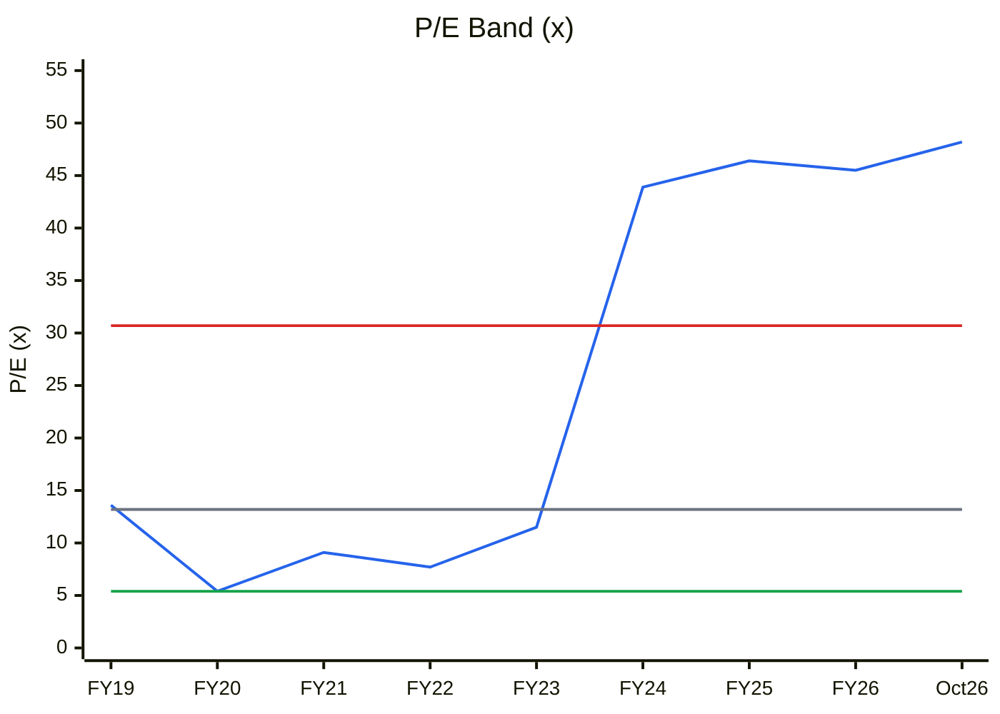
🟦 P/E · ⬜ median 13.2× · 🟥 +1SD 30.7× · 🟩 10-yr low 5.4×

**Read:** At 48.2× trailing, the P/E is above every fiscal-year-end reading, ~3.6× its long-run median and the 75th percentile of weekly history (which includes the 2024 mania highs).

**Business inference:** The 2024 re-rating (11.5× → 44×) priced CSL as a structural defence growth story, but earnings since FY24 have *fallen*. The multiple now rests on a falling EPS base (₹31.45 → ₹25.86 TTM). This is a double-compression risk: if margins normalise to ~14% while the multiple reverts towards peers' ~30×, the stock halves. **Expensive.**

### CY2 — P/B band, with ROE
| Point | FY19 | FY20 | FY21 | FY22 | FY23 | FY24 | FY25 | FY26 | Oct-26 |
|---|---|---|---|---|---|---|---|---|---|
| P/B (×) | 1.6 | 0.9 | 1.3 | 0.9 | 1.4 | 4.9 | 7.0 | 5.8 | 5.6 |
| ROE (%) | 14.4 | 17.0 | 15.1 | 12.8 | 6.9 | 15.6 | 14.8 | 12.2 | — |

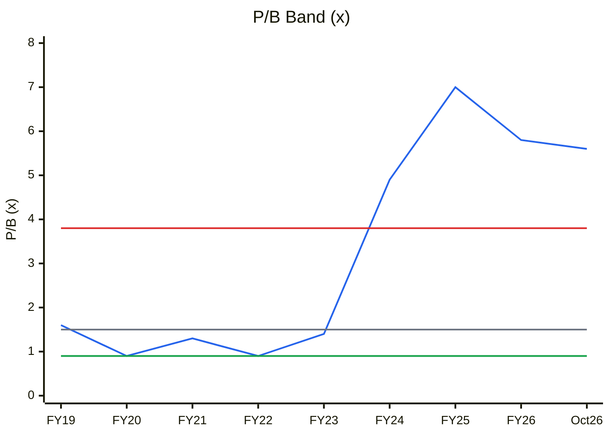
🟦 P/B · ⬜ median 1.5× · 🟥 +1SD 3.8× · 🟩 10-yr low 0.9×

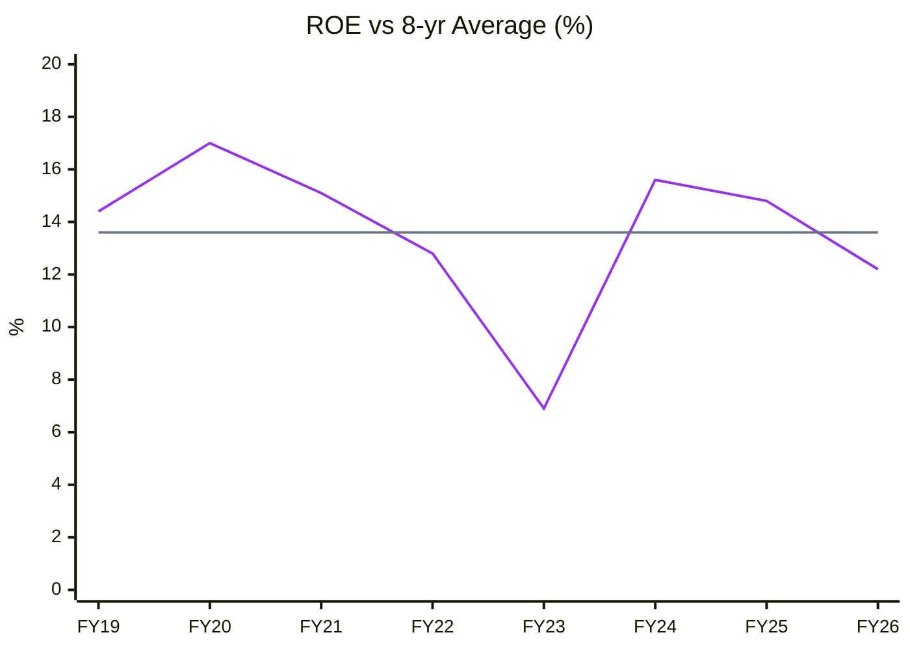
🟪 ROE · ⬜ 8-yr average 13.6%

**Read:** P/B is 5.6× (70th percentile, ~3.7× its median) on an ROE of 12.2%, which is *below* its own 8-yr average (13.6%).

**Business inference:** Justified P/B = (ROE − g) ÷ (Ke − g). At 12.2% ROE and 12.5% Ke, that is ~1× however growth is assumed. Even at a sustained 16% ROE with 10% growth it is only 2.4×. Paying 5.6× book for a below-cost-of-equity ROE requires a structural return step-up that the numbers do not yet show.

### CY4 — Price vs EPS index (FY18 = 100)
| Point | FY18 | FY19 | FY20 | FY21 | FY22 | FY23 | FY24 | FY25 | FY26 | Oct-26 |
|---|---|---|---|---|---|---|---|---|---|---|
| Price (₹, split-adj.) | 251 | 196 | 122 | 177 | 150 | 238 | 872 | 1,408 | 1,257 | 1,245 |
| EPS (₹; Oct-26 = TTM) | 14.58 | 18.17 | 24.02 | 23.13 | 21.44 | 11.58 | 29.77 | 31.45 | 27.24 | 25.86 |

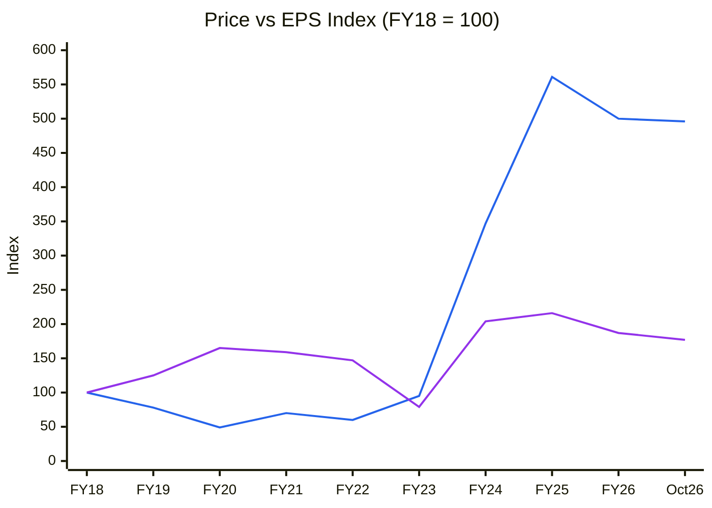
🟦 Price index · 🟪 EPS index

**Read:** Since FY18 the share price is up ~5× while EPS is up ~1.8×. Nearly all of the return since FY23 came from re-rating.

**Business inference:** The returns of FY24–25 were borrowed from the future. The price index has rolled over (561 → 496) while EPS is still falling (216 → 177). Mean reversion has started but is far from complete. A return to a 30× multiple on ~₹25 EPS gives ~₹750.

### C13 — Scenario targets (FY29E) vs CMP
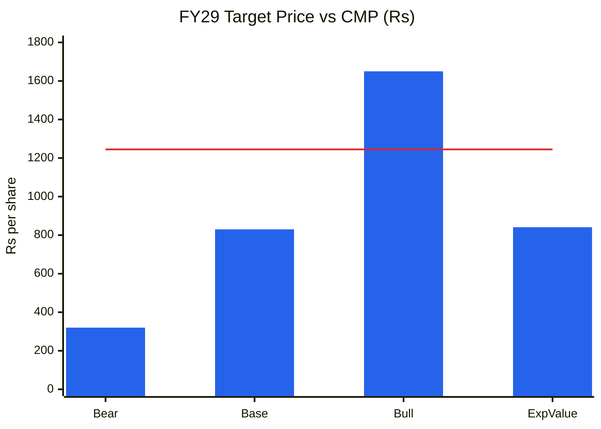
🟦 Scenario value · 🟥 CMP ₹1,245

**Read:** Bear is −74%, base −33% and bull +33%. The probability-weighted value is ₹841 (−32%), and upside/downside is 0.44:1.

**Business inference:** Even the bull case (an LPD/MCMV win, 17% margins and a 42× multiple) barely beats today's price. The market already pays for the good outcome and leaves the normalisation scenario unpriced. The payoff is asymmetric on the downside. Only a step-change in order intake **and** margins would change that.

### Cycle Position Dashboard
| Dimension | Current | 10-yr median | Percentile | Signal |
|---|---|---|---|---|
| P/E | 48.2× | 13.2× | ~75% (weekly history) | **Expensive** |
| P/B | 5.6× | 1.5× | ~70% | **Expensive** |
| EBITDA margin (excl. OI) | 16.5% (FY26), ~14% guided | 19.6% (avg) | ~40% → falling | **Mid → trough-ward (normalising)** |
| ROCE | 16% | ~19% | ~25% | Mid-low |
| Order cover | 4.3× | n/a (5.7× → 4.3× since FY24) | — | Balanced, consumed slowly |
| Industry capex | CSL capex/D&A ~1.2× FY26 → 5–10× FY28–29E | — | — | **Capital flooding (policy-funded)** |
| **Overall cycle position** | | | | **LATE (valuation) on a normalising earnings base** |

*Consistent with the Module 1b NEUTRAL sector verdict and the Module 1c LATE classification.*

---

## Module 10 — Technical Stage (Weinstein + CANSLIM)
- **Nifty 50: Stage 4 / late-4.** 22,520, below a falling 200-DMA, below the 200-WMA (1-Oct-26) and −14.5% from its Jan-26 high.
- **Sector (Nifty India Defence): Stage 3.** It peaked ~10,000 (9-Sep-26) and fell ~9% in five sessions. It is still up ~12% YoY, while CSL is −27% YoY ([HDFC Sky, 16-Sep-26](https://hdfcsky.com/news/nifty-india-defence-index-tanks-over-2-percent-as-17-out-of-18-stocks-decline)).
- **Stock: STAGE 4.**
  - Weekly close ₹1,230 (9-Oct-26) is a **new closing low**, below the Mar-26 low of ₹1,257.
  - 30-week MA is ₹1,459, **declining** from ₹1,848 (Dec-25) and ₹1,485 (Aug-26).
  - Lower highs: ₹1,901 (Sep-25) → ₹1,777 (May-26) → ₹1,535 (Aug-26).
  - The price is below both the 50-DMA (₹1,389) and the 200-DMA (₹1,488).
  - It is 56% below the Jul-24 peak of ₹2,838 (Screener weekly series).
- **RS:** Negative and deteriorating (−30% YoY vs a defence index up ~12%).
- **Volume:** The 9-Sep-26 JV week had 11.1 mn shares, the highest since Jul-26, and the week closed −8%. That is distribution.
- **Stop-loss / exit:** Weekly close below a declining 30-wk MA = exit (already triggered). The June stop of ₹1,100 has not been hit (52-wk low ₹1,187).
- **Stage + fundamental alignment:** **ALIGNED NEGATIVE.** Both say no.

**CANSLIM:**
| Criterion | Assessment | Score |
|---|---|---|
| C | Q1 FY27 EPS −19% YoY | 0 |
| A | FY24 +157%, FY25 +6%, FY26 −13%; ROE 12% | 0 |
| N | New items (DDW JV, CMA CGM, green tugs), but the price is near a 52-wk low, not breaking out | 0 |
| S | Float rising (GoI OFS 4.6%) | 0 |
| L | Laggard (RS negative) | 0 |
| I | FII 5.8% → 2.8%, DII 2.2% → 7.0% (8 qtrs) | 0.5 |
| M | Nifty in Stage 4 | 0 |
| **Total** | | **0.5 / 7** |

**Verdict: Stage 4 → do not buy. HARD STOP triggered.** Re-entry requires a Stage-1 base (≥ 12–16 weeks of flattening, with the 30-wk MA flattening) and then a breakout on volume ≥ 1.5× average.

---

## Module 11 — Forward View: 2–3 Year Thesis

### Capex classification (management plan, Q1 FY27 PPT/call; estimates)
| Capex type | FY27E | FY28E | FY29E | In AT model? |
|---|---|---|---|---|
| Block fabrication facility (60,000 t/yr) + shipbuilding infrastructure (₹4,100 Cr, 2026–30) | 300 | 700 | 900 | ✅ Growth (commissioning ~FY29–30) |
| Ship-repair clusters: Vadinar (CSL ₹920 Cr; 36 months from environmental clearance); ISRF Phase II (₹1,500 Cr, inside DDW JV, so off balance sheet) | 100 | 300 | 400 | ✅ Growth (Vadinar revenue ~FY30) |
| Tuticorin land + hybrid yard (₹306 Cr land paid/payable; DPR stage) | 50 | 100 | 100 | ✅ Growth (pre-revenue) |
| Maintenance (≈ D&A) | 135 | 160 | 200 | ❌ Sustains only |
| Less: Shipbuilding Development Scheme subsidy (25%) | (110) | (275) | (350) | — |
| CWIP at 31-Mar-26: ₹586 Cr | | | | ❌ Until capitalised |
| **Total gross capex (est.)** | **~600** | **~1,250** | **~1,600** | Funded ~80% debt (management) |

### Asset turnover (Revenue ÷ net fixed assets + CWIP)
| FY | FY18 | FY19 | FY20 | FY21 | FY22 | FY23 | FY24 | FY25 | FY26 |
|---|---|---|---|---|---|---|---|---|---|
| AT (×) | 5.01 | 4.13 | 2.19 | 1.38 | 1.43 | 0.92 | 1.21 | 1.35 | 1.34 |

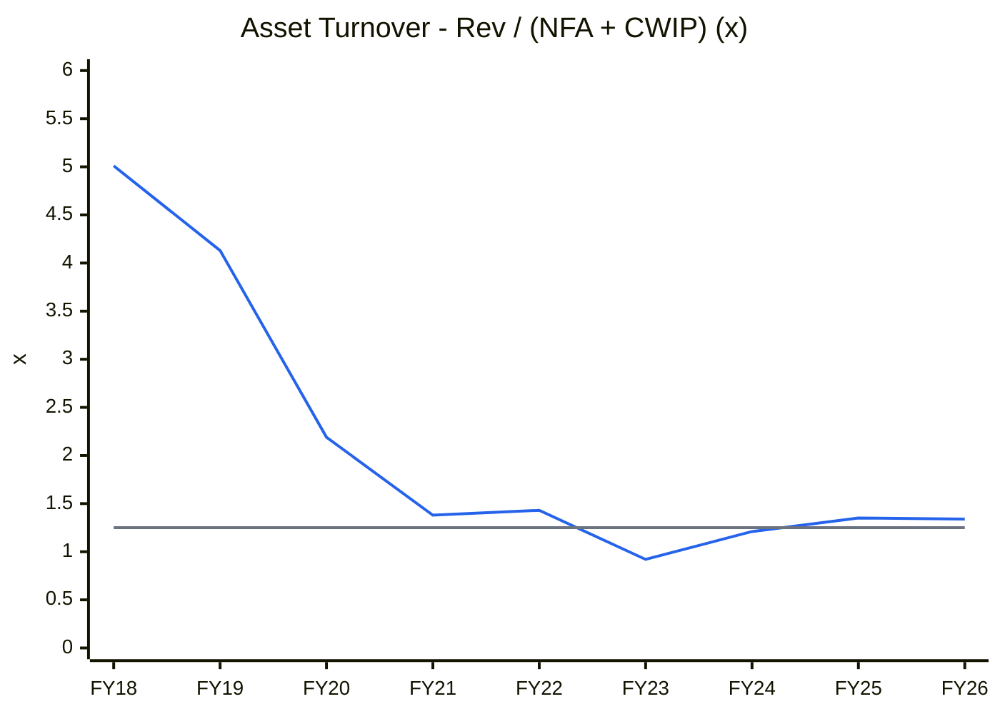
🟦 Asset turnover · ⬜ 5-yr average 1.25×

**Read:** Asset turn collapsed from ~5× to ~1.3× as the ₹2,770 Cr dock and ISRF were built. It has recovered only modestly since FY23 (0.92× → 1.34×).

**Business inference:** For order-driven shipbuilding, the order book, not gross block, drives revenue (Module 1c). But the new ₹6,500 Cr programme will push AT back down towards ~1.0× by FY29 before Vadinar and Tuticorin produce revenue. Each new rupee of capex earns less than the old asset base did. This is the bear anchor.

**Incremental ROIC:** New capex (net of subsidy) is ~₹4,900 Cr. Management's revenue targets add ~₹3,000–3,500 Cr by FY32–33 (Vadinar ₹500–600 Cr, Tuticorin ₹1,800–2,000 Cr, ISRF ₹1,000–1,200 Cr at 50%). At an ~11% EBIT margin that is NOPAT of ~₹250–290 Cr → **~5–6% incremental ROIC vs WACC 12.2% → VALUE-DESTROYING on my assumptions.** Management claims 14–15%. → Flagged in Module 4.
**Order-book model implied revenue CAGR (FY26–29):** **~10%** vs PIE ~40% → **"Unannounced expansion pricing"**: the market assumes mega-order wins that are neither contracted nor capacity-feasible before FY30.

### Earnings model (base, consolidated, ₹ Cr; estimates)
| Metric | FY26A | FY27E | FY28E | FY29E |
|---|---|---|---|---|
| Revenue | 5,022 | 5,550 | 6,050* | 6,700 |
| EBITDA margin (excl. OI) | 16.5% | 14.5% | 14.5% | 14.5% |
| EBITDA | 831 | 805 | 877 | 972 |
| Other income | 409 | 330 | 320 | 300 |
| D&A | 130 | 135 | 160 | 200 |
| EBIT (incl. OI) | 1,110 | 1,000 | 1,037 | 1,072 |
| Interest | 111 | 120 | 170 | 220 |
| ICR (×) — flag < 2.5× | 10.0 | 8.3 | 6.1 | 4.9 |
| PBT | 999 | 880 | 867 | 852 |
| PAT (tax 25.5%; + JV share from FY28) | 717 | 656** | 661 | 655 |
| EPS (₹; 26.31 Cr shares) | 27.24 | 24.9 | 25.1 | 24.9 |
| CFO (est.) | −1,234 | +600 (guided positive) | +700 | +800 |
| Gross capex net of subsidy | 151 | ~490 | ~975 | ~1,250 |
| **FCF** | **−1,385** | **~+110** | **~−275** | **~−450** |
| Net cash (est.; incl. ₹900 Cr ISRF cash in FY27) | 734 | ~1,450 | ~920 | ~200 |
| Gross debt / EBITDA (×) — flag > 3.0× | 2.0 | ~2.3 | ~2.9 | ~3.3 |

\*FY28 is after deconsolidation of ISRF revenue (~₹250–300 Cr) into the DDW JV (equity-accounted). \*\*FY27E excludes the one-off ISRF transfer gain: ₹1,800 Cr consideration vs ₹1,053 Cr carrying value = ~₹747 Cr pre-tax (est.; tax treatment not disclosed), ~₹20–23/share one-off.

**FCF inflection year:** FY27 (delivery-led, one-off), then negative again on capex. **Sustained FCF not before ~FY30.**
**Debt ceiling:** Net debt stays ≈ 0, but **gross debt/EBITDA reaches ~3.3× by FY29** (above the 3.0× flag) under the 80% debt funding plan. Interest subvention (3%) and subsidy help. Within the safe zone on a net basis; watch gross covenants.

### Key catalysts (3–5)
1. **NGSV contract signed (~₹5,000 Cr)**, expected ~Nov-2026 → order book ~₹27,000 Cr. Already well known; low surprise value.
2. **DCI repeat dredger (~₹1,300 Cr, nomination)**, "within two months" of Sep-26 (so ~Nov-26).
3. **FY27 deliveries (10 vessels) → CFO positive.** Visible in the H1 FY27 cash flow (Nov-26) and FY27 AR.
4. **ISRF JV closing** (shareholder postal ballot noticed 8-Oct-26; MoPSW/DIPAM approvals) → ₹900 Cr cash plus a ~₹747 Cr pre-tax one-off gain, by Mar-27.
5. **LPD (₹32,000 Cr) / MCMV (₹36,000 Cr) award to CSL.** Timeline not in CSL's control; FY28+.

### Key risks (3–5)
1. **Margin normalisation below 14%.** Fixed-price exports plus L1 defence tenders. Probability: **Medium-High.**
2. **Delivery slippage → negative CFO for a 4th year → more short-term debt.** The DCI dredger slipped ~1 yr; CSOV/SOV deliveries are due Oct-26 to Mar-27. Probability: **Medium.**
3. **Further GoI OFS** (two in 21 months at a discount; GoI can go to 51%). Probability: **High.**
4. **Losing the naval mega-programmes** (P17B to MDL/GRSE; LPD to L&T/MDL), plus IAC-2 not progressing. Probability: **Medium.**
5. **Capex at ~5–6% incremental ROIC** with 80% debt funding during a policy-driven capacity flood. Probability: **Medium.**

### Scenario analysis (FY29E; order-book-driven, the native engine for shipbuilding)
| Scenario | Driver | Revenue FY29 | EBITDA margin | EPS FY29 | Target P/E | Target price | Probability |
|---|---|---|---|---|---|---|---|
| **Bull** | NGSV + LPD or MCMV won; export repeat orders; block fab early | ₹7,800 Cr (15.8% CAGR) | 17% | ₹38.4 | 42× | **₹1,650** (incl. ₹35 ISRF cash) | 20% |
| **Base** | NGSV + DCI; execution at ~24%/yr; margins at guidance | ₹6,700 Cr (10.1%) | 14.5% | ₹24.9 | 32× | **₹830** | 50% |
| **Bear** | Delivery slips; no mega award; L1 margins; capex drag | ₹5,700 Cr (4.3%) | 11.5% | ₹13.0 | 22× | **₹320** | 30% |
| **Expected value** | | | | | | **₹841** | |

**Return from CMP to expected value: −32%.** Multiples bracket peers (29–30×) and remain well above CSL's own 13× median.

**Thesis (1–3 sentences):** CSL is a sound, diversified PSU yard whose FY24–25 earnings were inflated by one-off aircraft-carrier work. It is now in margin normalisation and a debt-funded capex cycle, while the share price still capitalises mega-order wins that are neither contracted nor physically executable before FY30. With a Stage-4 chart and continuing government supply, the risk-reward is unfavourable.

**Monitoring metrics (what revises the thesis):**
- Upgrade: (1) quarterly EBITDA (excl. OI) back above 16% for two quarters; (2) H1/FY27 CFO > +₹500 Cr and inventory days < 250; (3) LPD or MCMV signed with CSL.
- Downgrade further: (4) FY27 CFO negative again, or short-term debt > ₹1,500 Cr; (5) another OFS below ₹1,200.

---

## Checklist Summary
**Section 0 (Existing Report Protocol):** 3/3. Base report read in full, 37 items validated (16 ❌ corrected), renamed via `git mv`, one file only.
**Section A (Business Quality):** 17/18. Scuttlebutt is limited to two broker views plus filings; no customer or employee channel checks.
**Section B (Forensics):** 9/9. Red flags 5/15 → deep dive done (explained as WC timing; escalation trigger defined).
**Section C (Financial Statements):** 11/12. Ind AS 116 leases (~₹60 Cr) are already inside borrowings, so the adjustment is immaterial.
**Section D (KPIs & Peers):** 7/7.
**Section E (Market Size & Share):** 5/7. Historical 5-yr market share is available only for repair (~45%). The naval share trend is qualitative.
**Section F (Valuation):** 10/10.
**Section G (Technical):** 8/8. The Nifty weekly 30-wk MA is taken from secondary sources.
**Section H (Forward View):** 25/31. Segment-level PPE attribution and a project-wise CWIP schedule are not disclosed, and the unit-economics track is N/A.
**Section I (Charts):** 5/5. C1, C2, C4/CY7, C5, C6, C7, C8, C12, C13, CY1, CY2 (+ROE), CY4, OB-1, OB-2, OB-3. OB-4 is not generated (fewer than 4 contiguous quarterly OB disclosures).
**Order Book Tracker:** Run (ledger built from 1-Apr-2024; no prior ledger existed).
**Pre-buy final check (Checklist B):**
- Thesis is falsifiable ✓ (monitoring list above).
- Inversion ✓: five failure modes are listed, and the price discounts none of them.
- Circle of competence ✓.
- Asymmetry ✗ (0.44:1; SVAR 74%).
- Buffett 5-yr test: the moat survives, but capital allocation into an 80%-debt capex wave is uncertain → trading, not compounding.
- Narrative vs numbers ✗: "growth" narrative vs falling EPS and three years of negative CFO.
- Recency ✓: normalised margins used.
- Confirmation bias ✓: bull views reviewed (Antique, Investing.com consensus ₹1,499).
- Crowd ✓: the street is split, and my view sits near the bear end (Kotak ₹860).
- Governance ✓: no SEBI/ED issues, pledge nil, unmodified opinion with 2 EoMs.

**Hard stops triggered:** (1) **Weinstein Stage 4 with a declining 30-week MA**; (2) **upside/downside 0.44:1 < 1.5:1**. Not triggered: ROCE < WACC for 5+ years (ROCE > WACC in 7 of 8 years); pledge; auditor resignation. Beneish > −1.78 is flagged but explained (WC timing on export milestones).

---

## Investment Decision
**Recommendation: AVOID** (five-category verdict). Two hard stops are triggered: Stage 4 and U/D < 1.5:1.

**Conviction score: 3.5 / 10**

| Component | Max | Score |
|---|---|---|
| Market + sector + stock cycle (Modules 1/1b/1c) | 1 | 0.2 |
| Industry structure (Module 2) | 1 | 0.5 |
| Business quality & moat (Module 3) | 2 | 1.1 |
| Management (Module 4) | 1 | 0.6 |
| Financial + earnings quality (Modules 5–6) | 2 | 0.8 |
| Valuation & PIE asymmetry (Modules 8–9) | 2 | 0.3 |
| Technical + CANSLIM (Module 10) | 1 | 0.0 |

**Suggested position size:** 0% (watchlist only).
**Buy-below range (watchlist): ₹600–650.** That is base FY29 value ₹830 discounted 2.5 years at Ke 12.5% (≈ ₹620), or ~25× FY29E base EPS. It applies **only** after a Stage-1 base forms with a flattening 30-wk MA. Earlier re-rating triggers: a signed LPD/MCMV award plus positive FY27 CFO plus EBITDA ≥ 16%.
**Stop-loss (for existing holders):** The weekly close below the declining 30-wk MA (₹1,459) has already triggered. A hard floor is the 52-wk low of ₹1,187.
**Target price (FY29):** Bear ₹320 · Base ₹830 · Bull ₹1,650 · EV ₹841.
**ROCE vs WACC:** 16.2% vs 12.2% (Screener ROCE incl. other income); ex-cash ROIC ~10.2% < WACC in FY26.
**Review trigger:** H1 FY27 results (~Nov-26: CFO, inventory, EBITDA margin); NGSV/DCI signing; ISRF JV approvals; any new GoI OFS.

### Data gaps
1. **Q2 FY27 (Sep-26 quarter) results are not yet published.** The Q1 FY27 balance sheet is not disclosed (half-yearly only), so inventory, CFO and debt after Mar-26 are unknown.
2. **Order values are disclosed only in bands** (Notable / Significant / Large / Major / Mega). Ledger values use band midpoints, and CMA CGM uses a USD 300 mn press estimate. Ledger totals are therefore approximate.
3. **Order-book definitions shift between disclosures**: shipbuilding-only vs including repair and subsidiaries; "as on" dates vary. The FY23 and earlier year-end order book was not recovered, so OB history starts at FY24.
4. ISRF JV accounting (equity method assumed), tax on the slump-sale gain, and the timing of approvals have not been disclosed.
5. New Dry Dock utilisation, the top-programme share of the order book and project-wise CWIP are not disclosed.
6. Nifty weekly 30-wk MA and the defence index stage come from secondary reports, not a charting source.
7. The ICICI Securities 2026 view was not found. Consensus comes from Business Today / Investing.com snippets.

### Sources
- Screener.in: [COCHINSHIP consolidated](https://www.screener.in/company/COCHINSHIP/consolidated/), [standalone](https://www.screener.in/company/COCHINSHIP/), [MAZDOCK](https://www.screener.in/company/MAZDOCK/consolidated/), [GRSE](https://www.screener.in/company/GRSE/); price, P/E and P/B chart API (accessed 12-Oct-26).
- Annual Reports: [FY26](https://www.bseindia.com/xml-data/corpfiling/AttachHis/aba1459d-eea7-4d24-9b40-e52540f83926.pdf) (balance sheet, cash flow, Notes 4/33/58, contract balances, contingent liabilities, auditor's report, MD&A), [FY25](https://www.bseindia.com/xml-data/corpfiling/AttachHis/22ef1dd8-595b-4080-bb28-035d4c702ae1.pdf), [FY24](https://www.bseindia.com/xml-data/corpfiling/AttachHis/e5b8816d-997a-45e5-b6c8-1e873dc3d26a.pdf).
- Investor presentations / transcripts (BSE): [Sep-26 PPT](https://www.bseindia.com/stockinfo/AnnPdfOpen.aspx?Pname=9be93d07-be78-44fc-a440-d534f28b3325.pdf), [Sep-26 call transcript](https://www.bseindia.com/stockinfo/AnnPdfOpen.aspx?Pname=e06e8723-5411-4d65-bcb8-fb93356261ff.pdf), [Aug-25 PPT](https://www.bseindia.com/stockinfo/AnnPdfOpen.aspx?Pname=52481d9b-1671-4f67-8e4d-7c956f78716a.pdf), [Aug-25 transcript](https://www.bseindia.com/stockinfo/AnnPdfOpen.aspx?Pname=753064f1-3d0a-4a0f-afbd-6bf04a23fef7.pdf), [Sep-24 PPT](https://www.bseindia.com/stockinfo/AnnPdfOpen.aspx?Pname=7564567d-63cb-4f0e-99c1-47c919f02bef.pdf), [May-24 PPT](https://www.bseindia.com/stockinfo/AnnPdfOpen.aspx?Pname=52748ec0-3b90-45d8-991c-bf96525f22b2.pdf), [May/Jun-24 transcript](https://www.bseindia.com/stockinfo/AnnPdfOpen.aspx?Pname=4305aabf-5e10-4347-a395-2cf1e1005b80.pdf).
- BSE Reg-30 filings: order filings (see Order Ledger), [DDW JV board outcome 9-Sep-26](https://www.bseindia.com/xml-data/corpfiling/AttachHis/0a171a52-44c4-41b2-8d99-ebe1fbefcf2f.pdf), [JV agreement 11-Sep-26](https://www.bseindia.com/xml-data/corpfiling/AttachHis/8605bd8a-6fda-4be8-bf43-4078a8e3fe45.pdf), [HBL JV 25-Mar-26](https://www.bseindia.com/xml-data/corpfiling/AttachHis/5bdbdca5-696d-4c07-b6f4-1067cd511c17.pdf), [rumour verification 9-Oct-26](https://www.bseindia.com/stockinfo/AnnPdfOpen.aspx?Pname=f9fc72fb-1554-4dc4-8805-38adf22d708d.pdf), OFS notices 6–7 Jul-26 and 15–16 Oct-24 (BSE announcements).
- Market and peers: [JM Financial / Capital Market (Nifty, VIX)](https://www.jmfinancialservices.in/market-news-and-insights/1735991), [5paisa](https://www.5paisa.com/news/nifty-50-marks-100-trading-days-below-200-dma-second-longest-streak-in-10-years), [HDFC Sky defence index](https://hdfcsky.com/news/nifty-india-defence-index-tanks-over-2-percent-as-17-out-of-18-stocks-decline), [Business Today (Kotak/Antique targets)](https://businesstoday.in/markets/stocks/story/cochin-shipyard-shares-slip-on-weak-q1-earnings-fresh-price-targets-and-more-549499-2026-08-17), [HDFC Sky OFS](https://hdfcsky.com/news/govt-to-sell-5-pc-stake-in-cochin-shipyard-at-rs-1400-share-via-ofs), [Baird Maritime (Maersk MoU)](https://www.bairdmaritime.com/shipping/boxships/cochin-shipyard-teams-up-with-maersk-to-explore-ship-repair-and-shipbuilding-options-in-india), [WorldPorts / Shipping Telegraph (CMA CGM value)](https://shippingtelegraph.com/shipyard-news/cochin-shipyard-bags-mega-european-order-for-six-feeder-newbuilds/), [PSU Connect (GRSE Q1)](https://www.psuconnect.in/financial/grse-q1-result-revenue-up-38-5-to-1814-cr-pat-jumps-44), [multibagg (MDL Q1)](https://www.multibagg.ai/market-pulse/articles/mazagon-q1-96893).

---
*Report generated by Stock Fundamental Analysis Skill v3.3 | Indian Markets Context*
*Save path: C:\Users\anubh\Documents\Anubhav\Stock Analysis\Stock Analysis\COCHINSHIP_CochinShipyard_2026-10-12.md*
