# Stock Analysis Report — Garden Reach Shipbuilders & Engineers Ltd (NSE: GRSE | BSE: 542011)
**Date:** 2026-10-13
**Analyst:** Claude (Stock Fundamental Analysis Skill v3.3)
**Investment Horizon:** 2–3 Years
**CMP:** ₹2,140.5 (13-Oct-2026, Screener; last weekly close ₹2,046 on 09-Oct-2026) · **Shares:** 11.455 Cr · **M-cap:** ₹24,520 Cr · **Core EV:** ~₹24,270 Cr (M-cap + leases ₹37 Cr − own funds ~₹283 Cr; the other ~₹3,100 Cr of cash is customer project money, see Module 5)
**Recommendation:** AVOID (hard stops: upside/downside 0.87:1 < 1.5:1; Weinstein Stage 4 with a declining 30-week MA). WATCHLIST, buy-below ₹1,450–1,550, and only after a Stage-1 base forms, or re-run on a signed NGC contract.
**Verdict category:** AVOID. Without the hard stops the business/valuation mix reads **Quality at Wrong Price**.
**Conviction Score:** 4 / 10

## Revision Log
| Version | Date | Recommendation | Conviction | Price | Key change |
|---|---|---|---|---|---|
| **Current** | 2026-10-13 | **AVOID** (watchlist, buy-below ₹1,450–1,550) | 4/10 | ₹2,140.5 | The order book has fallen to ₹13,596 Cr (1.8× TTM revenue) and FY26 implied book-to-bill is ≈ 0. The NGC corvette award (L1 since May-25) is still unsigned. P17A, which drove ~¾ of FY26 revenue, ends in Nov-26. FY28 revenue is likely to dip. Margins were helped by estimate revisions (EoM two years running). The stock broke into Stage 4. |
| Previous | 2026-06-20 | QUALITY AT WRONG PRICE (watchlist; buy at ₹2,200–2,350) | 7/10 | ₹2,798 | Skill v2.0 report (full text in git history) |

**What changed in the thesis.** The June report rightly flagged a "programme transition gap", but it was built on several wrong facts and underestimated the gap.
1. **The NGC corvette programme was misdescribed.** June called it a future "10–12 vessel" tender expected in FY27–28. In fact GRSE was declared **L1 on 21-May-2025 for 5 of 8 Next Generation Corvettes** ([BSE 22-May-25](https://www.bseindia.com/xml-data/corpfiling/AttachHis/3fdde87b-444e-4220-b5e6-15d70221e058.pdf); >₹25,000 Cr per the filing, ~₹33,000 Cr per [CARE, Jun-26](https://www.careratings.com/upload/CompanyFiles/PR/202606140613_Garden_Reach_Shipbuilders_and_Engineers_Limited.pdf)). It is still unsigned 17 months later. CCS approval is pending ([Hans India, 3-Jun-26](https://www.thehansindia.com/news/national/grse-awaits-contract-for-next-generation-corvettes-project-to-get-final-ccs-nod-1082647)). Management guided signing "this FY" (Aug-25), "in 3–4 months" (Nov-25), "this June quarter" (May-26) and "this quarter" (Aug-26). No signing has been filed on BSE as of 13-Oct-26.
2. **The order book is depleting faster than June assumed.** June used "book-to-bill 3.4×". The real figures: order-book cover was 2.2× at Mar-26 and **1.8× at Jun-26 (₹13,596 Cr)**, the lowest in 10 years by the CMD's own account. FY26 *implied* inflow was about −₹354 Cr (book-to-bill ≈ 0).
3. **Cash is mostly customer money.** June estimated cash at "~₹1,500 Cr". Cash plus deposits were actually ₹3,388 Cr at Mar-26, but **own funds were only ₹283 Cr** of ₹3,157 Cr in Sep-25 (CFO on the Q2FY26 call). The rest is customer project funds. Contract liabilities are ₹5,751 Cr. Treasury interest (₹246 Cr, 24% of PBT) is a float that shrinks as advances run off.
4. **Earnings quality is softer than June's "Piotroski 9/9, cleanest of the five".** The auditor added an **Emphasis of Matter in both FY25 and FY26** on revisions to cost-to-complete estimates. These revisions added ₹100 Cr (FY25) and ₹62.6 Cr (FY26) to pre-tax profit, and ₹520 Cr to FY26 revenue (AR FY26 Note 48). FY26 CFO was −₹290 Cr and FCF −₹367 Cr. Piotroski is 6/9.
5. **Capex has stepped up.** The ₹2,670 Cr expansion (Raichak ₹2,500 Cr, plus Timber Pond and Damodar; [BSE 24-Aug-26](https://www.bseindia.com/xml-data/corpfiling/AttachHis/253b8f30-5a4d-4c7a-bea0-6d4f42b499ef.pdf)) is 2.9× the current gross block. A further ~₹2,000 Cr Gujarat PPP yard is planned (Q1FY27 call).
6. **Technicals.** The price is ₹2,140 against a 30-week MA of ₹2,563 that has fallen for 4 straight weeks. The 9-Oct-26 weekly close of ₹2,046 was a new 52-week closing low. June's ₹2,100 weekly-close stop has triggered.

**Validation of previous report (2026-06-20)** — every carried-forward item re-checked; all ❌ listed
| # | Item | Previous | Now (source) | Status |
|---|---|---|---|---|
| 1 | CMP / M-cap / P/E | ₹2,798 / ₹32,055 Cr / 43× | ₹2,140.5 / ₹24,520 Cr / 30.6× TTM (Screener 13-Oct-26) | 🔄 Updated |
| 2 | FY26 revenue / PAT / EPS | ₹7,002 Cr / ₹748 Cr / ₹65.3 | ₹7,002.16 / ₹747.94 / ₹65.29 (AR FY26 P&L) | ✅ Validated |
| 3 | FY26 EBITDA / margin | ₹795 Cr / 11% | ₹795 Cr / 11.4% (Screener); CARE PBILDT 11.45% | ✅ Validated |
| 4 | "8 warships delivered in FY26, 3 on one day" | as stated | Confirmed (Q4FY26 call, 12-May-26) | ✅ Validated |
| 5 | ROCE 43%, ROE 32% | as stated | Screener 42.8% / 31.6%; AR Note 49: ROCE 38.45%, ROE 31.79% | ✅ Validated |
| 6 | 5-yr PAT CAGR 36%, 5-yr revenue CAGR 44%, 10-yr 16% | as stated | 37.4% / 43.7% / 15.5% (Screener) | ✅ Validated |
| 7 | Piotroski F-Score 9/9 "maximum" | 9/9 | **6/9**: CFO negative, CFO < NI, and lease liabilities rose (Module 5) | ❌ Corrected |
| 8 | "Tangible PPE gross block ₹584 Cr"; asset turnover 12× | as stated | Gross block **₹924 Cr**; net block ₹576 Cr (AR FY26 Directors' Report). The 12× figure was revenue ÷ *net* block. On gross block AT is 7.6× | ❌ Corrected |
| 9 | Cash "est. ₹1,500 Cr"; EV ₹30,592 Cr | estimate | Cash ₹17 Cr + other bank balances ₹3,371 Cr = **₹3,388 Cr** (AR Note 10). **Own funds only ₹283 Cr** (Q2FY26 call); the rest is project money. Contract liabilities ₹5,751 Cr. Core EV ₹24,274 Cr | ❌ Corrected |
| 10 | FY26 FCF "+₹400 to +600 Cr"; "already FCF positive"; "OCF better than MDL" | as stated | CFO **−₹289.7 Cr**, FCF −₹367 Cr (AR FY26 cash flow; ties to Screener). FY25 CFO +₹15.6 Cr; FY24 −₹707 Cr. Cumulative CFO/PAT FY22–26 = 0.06 | ❌ Corrected |
| 11 | FY26 interest ₹5 Cr; D&A ₹50 Cr | as stated | Finance cost ₹16.1 Cr (mostly lease/BG); D&A ₹48.9 Cr (AR) | ❌ Corrected (interest) |
| 12 | "Book-to-bill 3.4×" | 3.4× | That was a mislabelled, unsourced cover figure. Order-book cover was **2.2×** at Mar-26 (₹15,324 Cr) and 1.8× at Jun-26 (₹13,596 Cr). True FY26 book-to-bill (implied inflow ÷ revenue) is ≈ 0 | ❌ Corrected |
| 13 | Execution rate ~29% | 29% | FY26 30.9% (₹7,002 ÷ opening OB ₹22,680 Cr); FY25 22.4%; Q1FY27 annualised ~47% (book depleting) | 🔄 Updated |
| 14 | NGC "10–12 vessels primarily for GRSE; tender expected FY27–28" | as stated | GRSE was L1 for **5 of 8** NGCs on 21-May-25 (BSE). Value >₹25,000 Cr (filing), ~₹33,000 Cr (CARE/mgmt). Price negotiated; CCS pending; unsigned | ❌ Corrected |
| 15 | P17B "7 frigates + 2 replenishment ships; GRSE ~₹15,000 Cr; order FY27" | as stated | 7 frigates only. AoN ~₹70,000 Cr, split 4 (L1) / 3 (L2). RFP issued **16-Sep-26** to MDL, GRSE, GSL and CSL. Bids due ~mid-Jan-27; award expected late-2027 ([Shephard](https://www.shephardmedia.com/news/naval-warfare/p17b-tender-shift-indian-navy-frigate-procurement/), [Raksha Anirveda](https://raksha-anirveda.com/indian-navy-invite-bids-for-project-17b-stealth-frigate-programme/)) | ❌ Corrected |
| 16 | "Shipbuilding 89% of revenue" | 89% | FY26 shipbuilding ₹5,773 Cr = 82% of revenue (auditor KAM); CARE: shipbuilding 93% / repair 4% / engineering 3%. The 89% was a stale Screener blurb | 🔄 Updated |
| 17 | DuPont (AT 6→12×, equity multiplier 2.5→1.9×, ROE 15→32%) | as stated | FY22→FY26: AT **0.23→0.66×** (on total assets); EM **6.1→4.05×**; EBIT margin incl. OI 14.8→14.6%; ROE 15.1→28.5% (year-end equity) | ❌ Corrected |
| 18 | ROIC FY26 38–43%; 5-yr avg ~20% | as stated | Screener ROCE 43% (5-yr avg 29%). **Core ROIC** (core NOPAT ÷ net fixed assets + CWIP) 92% FY26. Working capital is negative | 🔄 Updated |
| 19 | WACC 11.5% | 11.5% | **12.5%** (Rf 7%, β ~0.9, ERP 6%), consistent with the 12-Oct-26 MAZDOCK report | 🔄 Updated (judgement) |
| 20 | PIE implied growth 9.5% | 9.5% | 9.9% quick PIE on core NOPAT; two-stage reverse DCF needs ~23% core NOPAT CAGR for 10 years | 🔄 Updated |
| 21 | Graham Number ₹618 (forward EPS ₹74) | ₹618 | **₹430**: √(22.5 × 5-yr avg EPS ₹35.8 × BVPS ₹229). The method requires normalised EPS | ❌ Corrected |
| 22 | WTT: "Q4FY25 call guided FY26 revenue growth 30%+" | ✅ | The guidance was **25–30%** (repeated on the Q2FY26 call); delivered 38%, still a hit | ❌ Corrected (wording) |
| 23 | WTT: "ROCE maintained at 35%+" | ✅ | Not found in any FY26 transcript | ⚠️ Unverifiable (dropped) |
| 24 | WTT score 0.90 HIGH | 0.90 | **0.41 LOW** on 11 sourced points. Execution items are mostly hit; every order-timing item missed (Module 4) | 🔄 Updated |
| 25 | "Cost-plus negotiated contracts / fixed-price with escalation"; pricing power Pass | as stated | The CMD (May-26): "all the contracts are fixed price contracts and so are our orders with ... vendors". NGC and P17B are competitive L1 tenders. Pricing power: **Fail** | ❌ Corrected |
| 26 | Moat "Wide; all three Greenwald barriers" | Wide | **Narrow**: a regulatory and capability franchise, but awards are now competitive; no local-scale barrier | ❌ Corrected |
| 27 | Forensic flags 1/15, "CLEAN — best of five" | 1/15 | **5/15**: EoM in FY25 and FY26 on estimate revisions; Beneish +0.46 (DSRI from 31-Mar deliveries); CFO < 0; CFO/PAT; DSO jump. Verdict: Minor concerns, explained | ❌ Corrected |
| 28 | Altman Z'' "safe" | safe | 2.89 FY26 (2.22 FY25, grey) | ✅ Validated |
| 29 | Working-capital days 205 | 205 | Screener cash conversion cycle 206 days FY26 (Screener "working capital days" −80) | ✅ Validated (label) |
| 30 | Promoter 74.50%, pledge nil | as stated | 74.50% for 12 straight quarters, pledge nil (Screener Sep-26). No OFS, unlike CSL/MDL | ✅ Validated |
| 31 | Share count ~11.5 Cr; payout ~30% | as stated | 11.455 Cr; FY26 payout 27% (Screener) | ✅ Validated |
| 32 | Nifty Stage 2; defence index at 52-wk high | as stated | Nifty ~22,520 (9-Oct-26), ~15% below its Jan-26 high, Stage 4. Defence index peaked ~10,000 on 9-Sep-26 and then fell ~9% (COCHINSHIP report, 12-Oct-26) | 🔄 Updated |
| 33 | Stock Stage 2, 30-wk MA rising | Stage 2 | **Stage 4**: price ₹2,140 vs 30-wk MA ₹2,563, falling since 11-Sep; new 52-wk weekly closing low ₹2,046 | 🔄 Updated |
| 34 | 52-week range ₹1,963–₹3,538 | as stated | The ₹3,538 high is not re-sourced. Current 52-week range ₹1,964–₹3,339 (Screener) | ⚠️ Unverifiable |
| 35 | CANSLIM 7/7 | 7/7 | **2.5/7** now (Module 10) | 🔄 Updated |
| 36 | Scenarios FY28: bear ₹1,316 / base ₹2,660 / bull ₹4,860 | as stated | Replaced by FY29: ₹640 / ₹1,814 / ₹3,452 (Module 11) | 🔄 Updated |
| 37 | Stop-loss ₹2,100 (weekly close) | ₹2,100 | Triggered: weekly close ₹2,046 on 09-Oct-26 | 🔄 Updated |
| 38 | TAM ₹8,000–12,000 Cr/yr; "60–65% penetration" | as stated | No primary source. Replaced with the management-listed pipeline (Module 8) | ⚠️ Unverifiable |
| 39 | Export: "India marketing P17A to Vietnam/Philippines" | as stated | Not re-sourced. Management says it is *consciously not taking* new exports while domestic demand is strong (Q1FY27 call) | ⚠️ Unverifiable |
| 40 | Thesis: "FY27–28 revenue air pocket risk" | 35% probability | Validated and worse. The CMD would not rule out an FY28 dip (May-26 call); P17A ends Nov-26; NGC revenue only from H2 FY28, with "major chunk from FY29" | ✅ Validated (strengthened) |
| 41 | Peers: MAZDOCK P/E 39×, COCHINSHIP 53×; book-to-bill 1.6× / 4.2×; F-scores 6/9, 5/9 | as stated | 29.0× / 48.1×; order-book cover 1.4× / 4.3×; Piotroski 5/9 / 2/9 (sister reports dated 12-Oct-26) | 🔄 Updated |
| 42 | Fisher ~36/45 | 36 | 35/45 (Point 15 Pass) | 🔄 Updated |
| 43 | Peer-error check (inventory days, CFO) | — | The June GRSE report did **not** state inventory days. Its CFO/FCF claims (#10) were wrong, the same error the sister reports found. Actual FY26 inventory days 307 (Screener) | ❌ Corrected (via #10) |

**Old data gaps retried.** The June report listed no formal data gaps, but it used several estimates:
- "Cash est." is closed (#9).
- "Sloan estimated" is closed: 4.9%.
- "Beneish likely clean" is closed: +0.46, flagged and explained.
- "FCF/share below EPS" is quantified (Module 4).
- The Order Ledger was missing, because skill v2.0 had none. This run builds it from all BSE Reg-30 filings since 1-Apr-2024. `--report` was pointed at the June file, which yielded no rows to carry.

---

## Business Primer

Garden Reach Shipbuilders & Engineers (GRSE) is a Kolkata shipyard under the Ministry of Defence. It is 74.5% owned by the Government of India and was upgraded to Navratna status on 19-Jun-2026. It builds surface warships for the Indian Navy and Coast Guard: P17A stealth frigates (3 of 7), anti-submarine shallow-water craft, next-generation offshore patrol vessels and survey vessels. Increasingly it also builds non-defence vessels: research ships for ministries, electric ferries, a dredger for Bangladesh, and 12 multipurpose cargo ships for a German owner. Shipbuilding was ₹5,773 Cr of FY26 revenue of ₹7,002 Cr (auditor's KAM). Small portable steel bridge (₹200 Cr+), deck-machinery, naval gun and engine units make up most of the rest. Revenue is recognised over time on an input-cost basis under multi-year, **fixed-price** contracts. Customers pay 15 stage payments, so GRSE carries large customer advances (₹5,751 Cr) that fund inventory and are parked in bank deposits until spent. The business depends on two things: winning the next naval programme in what are now *competitive* tenders (NGC, P17B, MCMV, LPD), and executing it at a margin, because cost estimates on fixed-price ships are where profit is made or lost.

GRSE is a **government-franchise, project-based, customer-funded assembler and integrator**. About 65% of a warship's cost is buyer-nominated equipment. That makes it asset-light on paper (gross block ₹924 Cr) and gives it a negative working capital, but its revenue is lumpy and programme-driven. The key value driver is **order inflow (volume)**, then execution margin. The key risks are order timing (the NGC has been "imminent" for 17 months) and a programme cliff (P17A, ~¾ of FY26 revenue, ends with the last frigate in Nov-26). Three structural features colour the analysis:
1. **Treasury income** of ₹246 Cr (24% of PBT) is earned mostly on *customer* money and shrinks as advances run off.
2. **Margins have been lifted by estimate revisions** booked when programmes near completion, flagged by the auditor in FY25 and FY26.
3. A **₹2,670 Cr capex cycle** (plus a ~₹2,000 Cr Gujarat PPP) is about to quadruple the asset base. That will end the "capital-light" era just as the order book troughs.

*Segment: Defence Shipbuilding & Marine Services. KPI reference available ✓ (`references/05-industry-kpis-india.md`, line 1150).*

---

## Executive Summary

GRSE is the best *executor* among India's listed PSU yards. Revenue grew 6× from FY21 to FY26 (₹1,141 → ₹7,002 Cr), it delivered eight warships in FY26, and reported ROCE is 43%. But the order book is now ₹13,596 Cr (1.8× TTM revenue), down 46% from its Jun-24 peak. The P17A frigate programme, which drove most FY24–26 growth, finishes in Nov-26. The replacement, the ~₹33,000 Cr NGC corvette award, is still unsigned 17 months after L1, and management says it brings only design-phase revenue in FY28. The base case is therefore **flat-to-down revenue in FY28 (~₹6,250 Cr) and FY29 back near ₹7,500 Cr**. Margins normalise to ~9.5% without estimate releases, and treasury income shrinks.

At ₹2,140 the stock trades at 30.6× headline P/E and ~42× core EV/NOPAT. A reverse DCF needs ~23% core NOPAT growth for ten years. The FY29 base value is ₹1,814 (−15%), against bull ₹3,452 and bear ₹640, so **upside/downside is 0.87:1**. The stock is also in **Weinstein Stage 4**. **AVOID.** Watch for a buy-below of ₹1,450–1,550 after a Stage-1 base, or re-run once the NGC contract is signed and FY28 order inflow is visible.

**Order book ₹13,596 Cr (30-Jun-26; 1.8× TTM revenue) · tracked today ₹14,711 Cr (incl. ONGC PSV NoA ₹1,032 Cr, e-tug, ferries) · FY26 implied book-to-bill ≈ 0 (−0.05) · announced-order book-to-bill TTM 0.23 · NGC L1 (~₹33,000 Cr) NOT in book · P17B RFP live (bids ~Jan-27) · framework 0%**

### C1 — Growth Index: Revenue vs Gross Block vs EBITDA vs PAT (FY21 = 100)
| FY | Revenue (₹ Cr) | Gross block (₹ Cr) | EBITDA (₹ Cr) | PAT (₹ Cr) | Rev idx | GB idx | EBITDA idx | PAT idx |
|---|---|---|---|---|---|---|---|---|
| FY21 | 1,141 | 496 | 81 | 153 | 100 | 100 | 100 | 100 |
| FY22 | 1,754 | 687 | 141 | 190 | 154 | 138 | 174 | 124 |
| FY23 | 2,561 | 730 | 149 | 228 | 224 | 147 | 184 | 149 |
| FY24 | 3,593 | 754 | 235 | 357 | 315 | 152 | 290 | 233 |
| FY25 | 5,076 | 816 | 422 | 527 | 445 | 165 | 521 | 344 |
| FY26 | 7,002 | 924 | 795 | 748 | 614 | 186 | 981 | 489 |

*Sources: Screener standalone P&L (EBITDA = operating profit excl. other income); gross block from the AR FY26 "Decade of Financial Progress" table. Order book is charted separately in OB-1 (quarterly history starts Q4FY24). FY21 is the base because FY17–FY20 EBITDA was negative or tiny.*

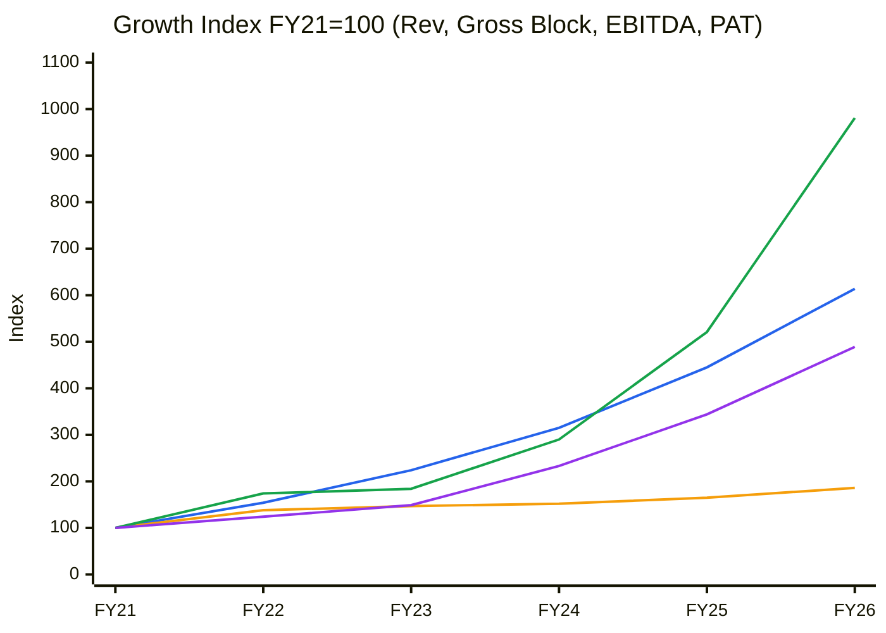
🟦 Revenue (CAGR 43.7%) · 🟧 Gross block (13.2%) · 🟩 EBITDA excl. other income (57.9%) · 🟪 PAT (37.4%)

**Read:** Revenue rose 6.1× and EBITDA 9.8× while gross block rose only 1.9×. PAT (4.9×) lagged EBITDA because other income stayed flat at ₹270–335 Cr.

**Business inference:** This was a harvest of the P17A/ASW programmes, funded by customer advances on a nearly fixed asset base. That is real operating leverage, but it is programme-specific. Part of the FY25–26 EBITDA jump came from cost-to-complete releases (₹100 Cr and ₹63 Cr). The 🟧 line is about to steepen (₹2,670 Cr capex), so the next five years will look much less capital-light. → Module 6 ROIC; Module 11 asset-turnover bear anchor.

---

## Module 1 — Broad Market Cycle (Marks)
- Nifty 50 closed at ~22,520 on 9-Oct-26 (India VIX 14.35; [JM Financial](https://www.jmfinancialservices.in/market-news-and-insights/1735991), as cited in the 12-Oct-26 sister reports). The 1-Oct close was ~22,421, about 15% below the 5-Jan-26 record of 26,373 ([GoodReturns](https://www.goodreturns.in/common/static_html/nifty-and-sensex-in-2026--down-about-15--1790886452.html)).
- The index has been below its 200-DMA for most of 2026. Drivers cited are crude oil and bond yields. PSU OFS supply continues (CSL Jul-26, MDL Apr-25).
- **Verdict: CAUTIOUS (leaning fearful).** Sizing normal-to-small. High-multiple PSU defence names face a falling tide.

## Module 1b — Sector Cycle: Defence Shipbuilding
- **Secular (durable).** Naval fleet expansion and Aatmanirbhar indigenisation (GRSE ~80–85% indigenous on ASW SWC/SVL, Q1FY27 call). Management lists a pipeline of AoN-stage defence RFPs:
  - Live now (~₹80,000 Cr): P17B ₹70,000 Cr, 120 fast interceptor craft ~₹3,500 Cr, 31 water-jet FACs ~₹3,500 Cr, 22 interceptor boats ~₹1,200–1,300 Cr, 6 Coast Guard NGOPVs ~₹2,500 Cr.
  - Expected in CY26 (~₹70,000 Cr): 12 MCMVs (AoN ~₹36,000 Cr, split 8/4) and 4 LPDs (~₹35,000 Cr, split 2/2) (Q1FY27 call, 6-Aug-26).
  - Commercial demand aggregation by MoPSW covers ~207 vessels. The ₹69,725 Cr shipbuilding package adds 15–30% subsidies (Q3FY26 meet).
- **Cyclical / one-off.** FY23–26 revenue CAGR of 40% was P17A + ASW peak execution. The P17A balance fell from ₹11,435 Cr (Mar-25) to ₹5,868 Cr (Mar-26), so P17A alone ran down ~₹5,500 Cr in FY26, ~¾ of revenue. **Durable baseline ~10–12% revenue growth.** The FY24–26 rate must not be embedded.
- **Procurement shift (headwind).** NGC, P17B, MCMV and LPD are all **competitive L1** tenders, not nominations. CARE notes that P17A (38% of the Mar-26 book) was the last large nominated order. Competitive bidding caps margins: the CMD cites a conventional PAT margin of ~7.5% and claims GRSE will be "well beyond" it on NGC (Q2FY26 call).
- **Input cost.** All current contracts and vendor orders are fixed-price, placed early, so the current book is hedged. New bids must price in steel and gas inflation (Q4FY26 call).
- **Competitive capacity.** Every yard is expanding at once: GRSE ₹2,670 Cr + ~₹2,000 Cr, CSL ₹6,500 Cr, MDL "~₹15,000 Cr floated", plus private yards (L&T, Swan) and greenfield clusters. That is a policy-funded capacity wave → L1 pricing pressure.
- **FX / geopolitics.** Export revenue ₹271 Cr in FY26 (AR Note 20), ~4%. The German MPV book is USD-denominated: ~₹1,355 Cr incl. the dredger at Jun-26. A 5% INR move is worth ~₹13 Cr a year of revenue, immaterial.

**Sector verdict: NEUTRAL.** The structural pipeline is real, but it is competitive, contracting is slow and capacity is flooding in. Module 9 must not embed FY24–26 growth or margins.

## Module 1c — Stock Cycle

### C2 — Quarterly YoY growth
| Qtr | Q2FY25 | Q3FY25 | Q4FY25 | Q1FY26 | Q2FY26 | Q3FY26 | Q4FY26 | Q1FY27 |
|---|---|---|---|---|---|---|---|---|
| Revenue ₹ Cr | 1,153 | 1,271 | 1,642 | 1,310 | 1,677 | 1,896 | 2,119 | 1,815 |
| Revenue YoY % | +28 | +38 | +62 | +30 | +45 | +49 | +29 | +39 |
| EBITDA (excl. OI) ₹ Cr | 69 | 75 | 221 | 112 | 156 | 172 | 355 | 149 |
| EBITDA YoY % | +41 | +53 | +143 | +100 | +126 | +129 | +61 | +33 |
| EBITDA margin % | 6.0 | 5.9 | 13.5 | 8.5 | 9.3 | 9.1 | 16.8 | 8.2 |

*Source: [Screener standalone quarters](https://www.screener.in/company/GRSE/). Q1FY27 = Jun-26 quarter, reported 29-Jul-26. Q2FY27 is not yet published.*

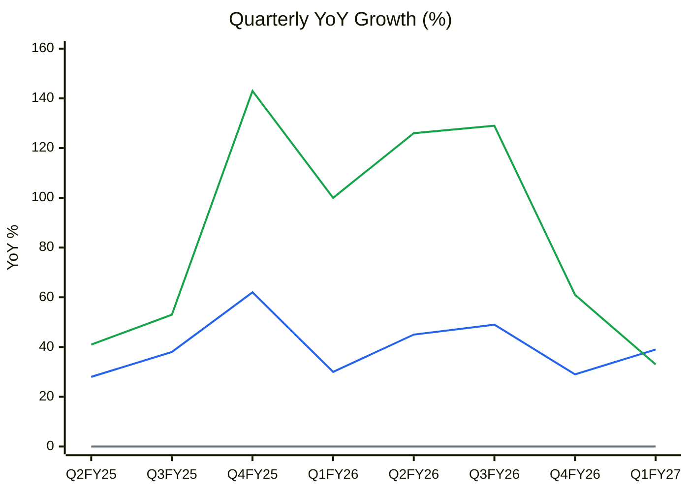
🟦 Revenue YoY % · 🟩 EBITDA YoY % · ⬜ zero line

**Read:** Revenue growth is still strong (+29–49% for six quarters, +39% in Q1FY27), but EBITDA growth has decelerated from +126–129% to +33%. Q1FY27 margin (8.2%) is below Q1FY26 (8.5%).

**Business inference:** The Q4 margin spikes (13.5% in Q4FY25, 16.8% in Q4FY26) coincide with deliveries and year-end cost-to-complete revisions. Underlying quarterly margins run at 8–9%. Revenue is still riding the last P17A frigate (₹4,519 Cr left at Jun-26) and ASW SWC ships 5–8. After Nov-26 / Mar-27 that support disappears. **Decelerating at the margin line → late in the programme cycle.**

**Revenue decomposition (volume / price / mix).** There is no unit volume. Revenue follows each programme's S-curve: design is 5–10% of value, hull 20–25%, and equipment lowering and integration is the steep phase, ~65% of cost (CMD, Q1FY27 and Q4FY26 calls). Growth came from **volume**, with three programmes in their steep phase simultaneously (P17A, ASW SWC, SVL). Price has no role (fixed-price, L1). Mix is moving toward lower-margin commercial and research vessels (non-defence 25% of the shipbuilding book, vs ~0–2% historically).

**Capacity model.** GRSE has capacity for 28 concurrent platforms up to ~10,000 t and 200 m, rising to 32 by end-CY26 (in-yard modernisation) and 43 after the Raichak/Gujarat greenfields, which take 3–5 years. It currently has 44 platforms in 11 projects (Q1FY27 call). **Capacity is not the binding constraint; contracted orders are.** The riverine Hooghly location limits large commercial hulls, which is the reason for the greenfields.

**Operating leverage.** FY26 revenue +38% with EBITDA +88% implies DOL ~2.3×. DFL = EBIT ÷ (EBIT − interest) = 1,021 ÷ 1,005 = 1.02×. **The same leverage works in reverse in FY28:** a 15% revenue dip with ~40% fixed costs (employees ₹413 Cr plus overheads, and an 8th Pay Commission rise of 15–20% expected from FY28 per the Q1FY27 call) could cut EBITDA ~30–35%. ICR (EBIT incl. OI ÷ interest) is 64×, irrelevant as a constraint.

**Guidance accuracy:** WTT 0.41 (Module 4). Execution guidance is reliable; order-timing guidance is not.

**FCF inflection:** Not applicable in the usual sense. CFO swings with advances: −₹707 Cr FY24, +₹16 Cr FY25, −₹290 Cr FY26 as contract liabilities ran off from ₹7,327 Cr (Mar-24) to ₹5,751 Cr (Mar-26). The next positive inflection depends on the **NGC signing advance**, plausibly ₹3,000 Cr+ if a ~10% first stage applies (estimate). FY28–30 capex of ₹2,670 Cr+ will absorb much of it.

**Stock cycle classification: LATE CYCLE (programme peak).** FY26 EBITDA margin (11.4%) is >1 SD above its 9-yr average (5.8%, SD 3.5 pp). ROCE (43%) is >1 SD above its 10-yr average (22.3%, SD 10.8). The order book is at a 10-year low. → MoS +5–10 pp; smaller size.

---

## Module 2 — Industry Structure & Capital Cycle

| Force | Assessment | Signal |
|---|---|---|
| New entrants | Defence: high barriers (MoD Category-A status, security clearance, warship design teams). Commercial: barriers falling under policy-funded greenfields and Korean JVs | Mixed |
| Supplier power | High. ~65% of ship cost is equipment, much of it buyer-nominated (BEL electronics, imported propulsion engines). GRSE is "a platform integrator" (CMD) | Unfavourable |
| Buyer power | **Monopsony.** MoD/Navy sets specifications, timing and LDs, and now tenders competitively (NGC, P17B). Fixed-price contracts | Unfavourable |
| Substitutes | Low for warships. The autonomous/unmanned shift is a long-run mix risk, which GRSE is addressing with prototype USV/AUV work | Neutral |
| Rivalry | Rising. MDL, GSL, CSL, HSL and L&T bid on the same programmes. GSL is likely to build the other 3 NGCs | Unfavourable |

**Industry verdict: NEUTRAL** (attractive defence franchise, unattractive economics of competitive fixed-price bidding). Scale MoS up.

**Capital cycle (Chancellor): returns at a peak; capital flooding in.** Indian shipyards' ROCE (GRSE 43%, MDL 36%) is far above long-run norms, and the government is subsidising capacity: the ₹69,725 Cr package, 25% capex subsidies, the Maritime Development Fund. All listed yards announced large capex in 2025–26. GRSE's own capex/D&A was ~1.6× in FY26 (capex ₹77 Cr vs D&A ₹49 Cr) and goes to ~10× on the ₹2,670 Cr plan. **Supply is building faster than contracted demand. That is a late-cycle capital signal.** (CY8 industry chart not drawn: peer capex history is incomplete.)

---

## Module 3 — Business Quality & Moat

**Moat verdict: NARROW**
- **Supply/cost advantage:** Partial. GRSE runs a low-asset, customer-funded model and has built 118 warships (CARE). It won NGC L1 competitively, which suggests a cost edge in corvette-class ships. It has no structural cost advantage over GSL/MDL in large surface combatants.
- **Customer captivity:** Partial. Category-A status plus a security-cleared workforce and design teams. But the Navy now *chooses by L1*, so switching costs between Indian yards are low.
- **Local scale:** None. Kolkata location is a constraint (riverine), not a moat.
- **Buffett 10% price test:** **Fail**. It cannot raise prices on fixed-price L1 contracts.

**Durability tests:**
- ROCE above WACC every year FY19–26 (18–43%). Core ROIC was below WACC in FY17–FY21 (−37% to +8%) and well above it since FY22.
- Share of naval surface programmes is gaining: NGC 5/8 (L1), ASW SWC 8/16, P17A 3/7, SVL 4/4.
- Pricing power: no.
- Activity system: design-build-integrate plus a small engineering vertical (bridges ₹200 Cr+).
- Scuttlebutt: ICICI Securities (Hold, ₹2,850, 7-Aug-26) "awaits meaningful order-book replenishment" and trimmed FY27–28E ([ICICI Direct Q1FY27](https://mailcontent.icicidirect.com/mailcontent/idirect_grse_q1fy27.pdf)). An Antique analyst on the Q4FY26 call argued that sustainable margins excluding write-backs are ~9.5–10%. Management did not dispute this directly ("we will try and maintain similar margins").

### Fisher 15-Point (1–3 each)
| # | Point | Score | Evidence |
|---|---|---|---|
| 1 | Market potential | 3 | ~₹1.5 lakh Cr live/expected naval RFPs + NGC + 207-vessel commercial aggregation |
| 2 | New products | 3 | Research vessels (only Indian yard building them), electric ferries/tugs, PSVs, USV/AUV prototypes |
| 3 | R&D effectiveness | 2 | R&D ₹33 Cr (0.5% of revenue, AR); design capability real but small |
| 4 | Sales organisation | 2 | Won NGC L1 and a German export repeat; deliberately pausing exports |
| 5 | Profit margin | 1 | 11.4% EBITDA, the lowest of the three listed yards (MDL 17.4%, CSL 16.5%); ~9.5–10% underlying |
| 6 | Margin improvement | 2 | 6% → 11% FY23–26, partly estimate releases |
| 7 | Labour relations | 2 | No disruptions; heavy subcontracting (₹1,183 Cr FY26); pay-commission cost ahead |
| 8 | Executive relations | 2 | The CMD held additional charge of Director (Finance) and Director (CP&P) through 2025 (BSE 2-May-25, 15-May-25, 4-Sep-25); D(Finance) now filled |
| 9 | Management depth | 2 | Navy-veteran-led; functional directors refilled in 2026 |
| 10 | Cost / accounting controls | 2 | EoM on estimate revisions two years running; KAMs on revenue and inventory |
| 11 | Industry-specific advantage | 3 | Category-A warship yard, 100+ warships delivered, first Indian warship exporter |
| 12 | Long-range orientation | 3 | Greenfield capacity, autonomy, green vessels |
| 13 | Dilution | 3 | None; share count 11.455 Cr unchanged since FY18 buyback |
| 14 | Communication in adversity | 2 | Very open on pipeline and order-book detail; repeatedly over-optimistic on NGC timing; deflected on normalised margin |
| 15 | **Integrity (veto)** | 3 | No SEBI/ED issues. Only a ₹10 lakh GST penalty (BSE 13-Feb-26) |
| | **Total** | **35 / 45** | Point 15: **PASS** |

---

## Module 4 — Management & Capital Allocation
- **Promoter (GoI) holding:** 74.50% for 12 straight quarters (Screener). **Pledge nil.** Risk: Normal. No OFS yet, unlike CSL and MDL. With public float at the 25% minimum, a future OFS toward 51% remains a supply risk.
- **Institutions:** FII 3.17% (5.33% in Jun-25), DII 2.01%, retail ~20%, 3.99 lakh shareholders (Sep-26).
- **FCF/share vs EPS (FY21–26):** EPS grew from ₹13.40 to ₹65.29 (37% CAGR). Cumulative FCF FY22–26 was **−₹~170 Cr** (Screener: 351, −411, 1,408, −755, −51, −367 for FY21–26). The divergence comes from advance run-off, not accounting manipulation, but **reported profits have not become owner cash**: own funds were only ₹283 Cr in Sep-25.
- **Capital allocation rating: AVERAGE → watch.** Dividends were paid steadily (27–31% payout; ₹225 Cr declared for FY26) out of customer-funded liquidity. The new ₹2,670 Cr greenfield capex plus the ~₹2,000 Cr Gujarat PPP targets large commercial hulls (Aframax, VLGC), a global price-taker segment. Incremental ROIC on that capex is estimated at ~9% < WACC (Module 11).
- **RPT:** No promoter-group RPTs; a jointly owned building with MDL/GSL. No ICDs. Clean.
- **Buffett's three C's:**
  - Candor: MODERATE. Very detailed disclosure of order book and execution status, but serial over-promising on NGC timing, and a non-answer on normalised margins.
  - Competence: HIGH on execution (8 deliveries; ships ahead of schedule).
  - Caring: MODERATE (consistent dividends; capex ambitions run ahead of own funds).

### Walk the Talk Scorecard
| Quarter guided | Statement | Guided | Actual | Verdict |
|---|---|---|---|---|
| Q4FY25 call (20-May-25) | NGC L1 declaration | "in a couple of days" | L1 declared 21-May-25 (BSE 22-May-25) | ✅ |
| Q4FY25 call | FY26 margins | "maintain more or less same" (FY25 8.3%) | FY26 11.4% | ✅ |
| Q4FY25 call | Peak year | "FY25-26 could be the peak year" | Q3FY26 meet: "FY27 is going to be a peak year" | 🔴 Reversal |
| Q1FY26 call (19-Aug-25) | NGC contract | concluded "during this financial year" (FY26) | Unsigned at 13-Oct-26 | ❌ |
| Q1FY26 call | P17A ship 2 delivery | Apr-2026 | Delivered ahead of schedule; commissioned 21-Jun-26 | ✅ |
| Q2FY26 call (Nov-25) | FY26 revenue growth | 25–30% | +38% | ✅ (beat) |
| Q2FY26 call | NGC contract | "next 3 to 4 months" | Unsigned | ❌ |
| Q2FY26 call | FY26-end order book | "~₹50,000 Cr" | ₹15,324 Cr | ❌ |
| Q3FY26 meet (11-Feb-26) | P17B RFP | "expected to come out in April" | Issued 16-Sep-26 | ❌ |
| Q3FY26 meet | First 2 hybrid ferries | Q1FY27 delivery | "September and October" (Q1FY27 call): ~1 quarter late | ⚠️ |
| Q4FY26 call (12-May-26) | ASW SWC ships 5–6 | delivery "by mid of the calendar year" | At 91% / 88% progress on 6-Aug-26; not delivered | ❌ |
| Q4FY26 call | NGC contract | "during the current quarter, that is June" | Unsigned | ❌ |
| *Open* | FY27: margins "similar" (~11%); P17A ship 3 by Nov-26; ASW ships 5–8 in FY27; NGOPV deliveries Q2FY28–Q2FY29; NGC "this quarter" (Sep-26, already missed) | — | to track | — |

**WTT Score: 0.41 / 1.00 — LOW**
**Guidance points assessed:** 12 (11 scored) | Hits: 4 | Near misses: 1 | Misses: 6 | Reversals: 1
**Key pattern:** **One-way misses on order timing.** All four NGC/order-book/P17B timing statements missed; several are MoD-dependent, but management chose to guide on them. Execution guidance (revenue, deliveries, margins) is mostly met or beaten. That is sandbagging on revenue, optimism on orders.
**Insider action:** No director open-market (Form C) buying found. GoI holding unchanged. **NEUTRAL.**
**DCF impact:** NGC signing assumed in Q4FY27 in the base case (two quarters after the latest guide). P17B share appears only in the bull case. Revenue guidance is used as given for FY27, with the FY28 dip modelled independently.
**Overall management credibility: MODERATE** (high on execution, low on order timing).

---

## Module 5 — Financial Forensics
**Indian-specific checks:**
- **Pledge:** nil. **RPT:** clean. **Contingent liabilities (AR Note 29):** claims ₹93 Cr; bank guarantees ₹6,321 Cr (mostly advance and performance BGs backing stage payments); indemnity bonds ₹1,430 Cr; LCs ₹80 Cr; tax disputes ₹35 Cr. Genuine dispute exposure is ~₹128 Cr (0.5% of M-cap). ✅
- **Auditor:** Guha Nandi & Co. (CAG-appointed) for FY26; S K Agrawal & Co. appointed for FY27 (BSE 25-Sep-26), a routine CAG rotation. Opinion unmodified.
- **Emphasis of Matter, FY26 (Note 48):** Revisions to cost-to-complete and sale consideration on P17A, ASW SWC and NGOPV raised **revenue by ₹519.55 Cr** and cost by ₹456.93 Cr, a **net +₹62.62 Cr to profit**. **FY25 EoM (Note 48):** cost-to-complete cut by ₹433.03 Cr, **profit +₹100 Cr**. CARE confirms FY26 margins "benefited from reversal of excess cost provisions created in earlier years".
- **KAMs:** revenue recognition on ship-building contracts (input method; LD assessment), and inventory of ₹3,402 Cr (mostly project-specific equipment).
- **Revenue quality:** Trade receivables rose **4.7×** (₹259 → ₹1,221 Cr). AR Note 49 attributes this to "successive deliveries of 8 ships". ₹738 Cr is not yet due and ₹396 Cr is < 6 months old. Contract liabilities fell from ₹6,900 Cr to ₹5,751 Cr; the guarantee-repair provision rose from ₹19 Cr to ₹165 Cr (warranty on delivered ships).
- **GST penalty** ₹10.2 lakh for FY2018-19 ITC (BSE 13-Feb-26), immaterial.

**Quantitative models (FY26 vs FY25, standalone):**
| Model | FY26 | Threshold | Read |
|---|---|---|---|
| Beneish M-score | **+0.46** | > −1.78 flag | DSRI 3.41 (receivables ×4.7 on revenue +38%); TATA 0.098 (NI ₹748 Cr vs CFO −₹290 Cr); GMI 0.73; AQI 1.12; SGI 1.38; DEPI 0.96; LVGI 0.94; SGAI assumed 1.0. **Flagged but explained:** three ships were delivered on 31-Mar-26 and billed at delivery (stage 14 of 15 payments); collections should show in the H1FY27 balance sheet (Nov-26). If receivables are still > ₹800 Cr at Sep-26, escalate. |
| Altman Z'' | **2.89** (FY25 2.22) | < 1.10 distress | Safe and improving. X1 0.17, X2 0.24, X3 0.10, X4 0.33. |
| Piotroski F | **6 / 9** | < 4 weak | ROA > 0 ✓, ROA up ✓, current ratio up ✓ (1.17 → 1.25), no dilution ✓, margin up ✓, asset turnover up ✓; CFO < 0 ✗, CFO < NI ✗, long-term leverage (leases) up ✗ |
| Sloan accrual | **+4.9%** | > +10% | (748 + 290 − 527) ÷ avg TA ₹10,504 Cr. Excluding fixed-deposit liquidation in CFI, ~8%. Acceptable. |

**Schilit screen:**
- (1) Revenue too soon ⚠️: receivables spike, and ₹520 Cr of FY26 revenue came from estimate and consideration revisions.
- (3) One-time boosts ⚠️: estimate releases of ₹100 Cr (24% of FY25 EBITDA) and ₹63 Cr (8% of FY26). Other income/EBIT is 27% (treasury on customer float).
- (4) Capex/D&A 1.6× ✅.
- (5)–(7) none ✅.
- CFS: no factoring. Payables days 119 → 164 ⚠️ (supplier payables +₹670 Cr into year-end deliveries).

**Forensic red-flag count: 5 / 15:** EoM two years running; Beneish > −1.78 (explained); CFO negative / CFO < NI; DSO jump; other income/EBIT > 15%.
**Overall forensic verdict: MINOR CONCERNS — Aggressive but Defensible.** The issues are input-method estimate timing and advance run-off, not fabrication. They escalate to *Concerning* if (a) H1FY27 receivables do not normalise, or (b) FY27 margins need further estimate releases to stay near 11%.

---

## Module 6 — Earnings Quality & Financial Statements

**Separating core from treasury (FY26, ₹ Cr):**
| Line | FY24 | FY25 | FY26 | Note |
|---|---|---|---|---|
| Core EBITDA (excl. OI) | 235 | 422 | 795 | Screener |
| of which estimate-revision gain (P&L) | n/d | 100 | 63 | AR FY25/FY26 Note 48 |
| **Underlying core EBITDA** | 235 | **322** | **732** | margin 6.5% / 6.3% / 11.3% (FY26 on revenue ex-₹520 Cr revision) |
| Core EBIT (EBITDA − D&A) | 194 | 380 | 746 | |
| Interest income (other income) | 271 | 250 | 246 | AR cash-flow statements |
| Treasury share of PBT | 56% | 36% | 24% | interest ÷ PBT |
| Own funds within cash | — | ₹577 Cr of ₹3,214 Cr (Dec-24) | ₹283 Cr of ₹3,157 Cr (Sep-25) | Q3FY25 meet; Q2FY26 call |

- **Reported ROCE (Screener, incl. treasury):** 43% FY26; 10-yr average 22%.
- **Core ROIC** (core NOPAT ÷ net fixed assets + CWIP; operating working capital is *negative* at −₹1,545 Cr): **92% FY26** (554 ÷ 600), 52% FY25, 28% FY24. On *underlying* EBIT (ex revisions) FY26 is ~85%.
- **WACC: 12.5%** (Rf 7.0% + β ~0.9 × ERP 6% ≈ Ke 12.4%; no debt). Consistent with the MAZDOCK report.
- **Spread:** strongly positive since FY22. **ROIC trend (3-yr): rising.** Driver: asset turnover (customer-funded, near-fixed asset base) and margin.
- **Economic profit FY26:** ≈ +₹480 Cr on core capital. Small in absolute terms, because the capital base is tiny.

### C4 / CY7 — Margin trend vs 9-yr average
| FY | FY18 | FY19 | FY20 | FY21 | FY22 | FY23 | FY24 | FY25 | FY26 |
|---|---|---|---|---|---|---|---|---|---|
| EBITDA margin (excl. OI) % | −1.1 | 3.0 | 2.9 | 7.1 | 8.0 | 5.8 | 6.5 | 8.3 | 11.4 |
| PAT margin % | 6.8 | 7.9 | 11.4 | 13.4 | 10.8 | 8.9 | 9.9 | 10.4 | 10.7 |

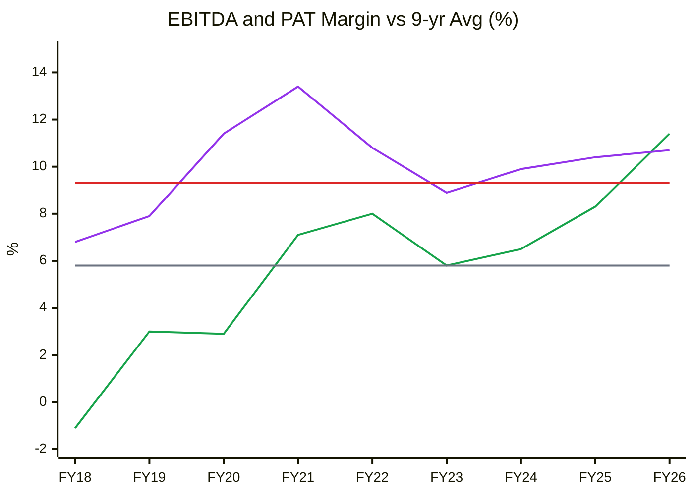
🟩 EBITDA margin (excl. other income) · 🟪 PAT margin · ⬜ 9-yr avg EBITDA margin 5.8% · 🟥 +1 SD 9.3%

**Read:** FY26 EBITDA margin (11.4%) is the highest in a decade, >1 SD above the 9-yr average (5.8%, 100th percentile). PAT margin has been flat at ~10–11% because treasury income carried the low-margin years.

**Business inference:** The margin peak coincides with the steep, delivery phase of P17A plus cost-to-complete releases. Fixed-price, competitively won work (NGC L1; CMD cites ~7.5% PAT as conventional) and the FY28 revenue dip point back toward ~9–10% (CARE: "~10–11% medium term"). **Late-cycle margin → value on normalised ~9.5%, not 11.4%.** → Module 9.

### C5 — Reported ROCE and core ROIC vs WACC
| FY | FY17 | FY18 | FY19 | FY20 | FY21 | FY22 | FY23 | FY24 | FY25 | FY26 |
|---|---|---|---|---|---|---|---|---|---|---|
| ROCE % (Screener) | 3 | 12 | 18 | 22 | 21 | 20 | 20 | 27 | 37 | 43 |
| Core ROIC % (core NOPAT ÷ NFA+CWIP) | −37 | −8 | 3 | 3 | 8 | 15 | 16 | 28 | 52 | 92 |

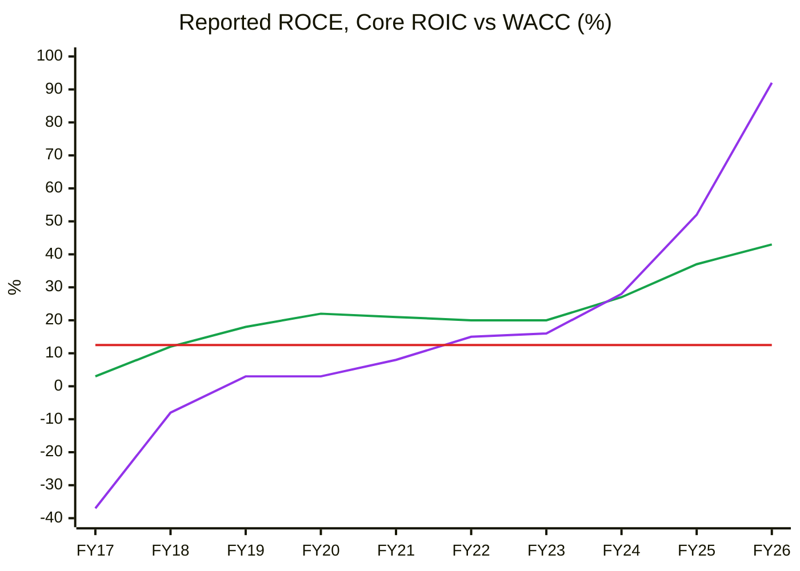
🟩 Reported ROCE (incl. treasury) · 🟪 Core ROIC (excl. other income) · 🟥 WACC 12.5%

**Read:** Reported ROCE has exceeded WACC every year since FY19. Core ROIC was below WACC for five years (FY17–FY21) and has been above it since FY22 (15% → 92%).

**Business inference:** Before FY22, GRSE's *core* business barely covered its cost of capital; treasury income on customer float made it look profitable. The FY22–26 surge is genuine, but it is the economics of three nominated programmes in their delivery phase on a ~₹600 Cr asset base. **No ROCE < WACC hard stop** (a clear turnaround since FY22). As gross block rises from ₹924 Cr to ~₹3,600 Cr+ and margins normalise, core ROIC should fall toward ~20–25% by FY29–30 (estimate).

### C7 — Cumulative PAT vs cumulative CFO (₹ Cr)
| FY | FY18 | FY19 | FY20 | FY21 | FY22 | FY23 | FY24 | FY25 | FY26 |
|---|---|---|---|---|---|---|---|---|---|
| PAT | 92 | 110 | 163 | 153 | 190 | 228 | 357 | 527 | 748 |
| CFO | −74 | −112 | 628 | 515 | −356 | 1,450 | −707 | 16 | −290 |
| Cum PAT | 92 | 202 | 365 | 518 | 708 | 936 | 1,293 | 1,820 | 2,568 |
| Cum CFO | −74 | −186 | 442 | 957 | 601 | 2,051 | 1,344 | 1,360 | 1,070 |

*CFO cross-checked against AR cash-flow statements: FY26 −₹289.72 Cr and FY25 +₹15.59 Cr (AR FY26); FY24 −₹706.89 Cr (AR FY25 comparative). **No year-shift in Screener.***

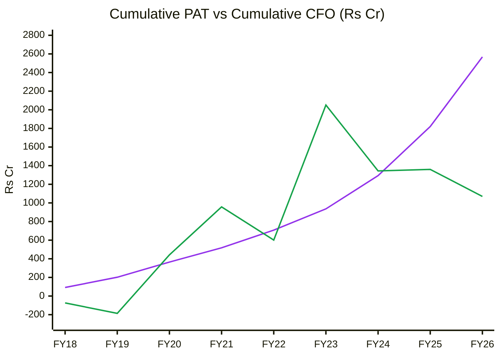
🟪 Cumulative PAT · 🟩 Cumulative CFO

**Read:** Cumulative CFO/PAT is **0.42 over FY18–26** and **0.06 over FY22–26**, far below the 0.7 red-flag line. Cumulative CFO peaked in FY23 (₹2,051 Cr) and has fallen since.

**Business inference:** The FY23 surplus was the P17A/NGOPV advance inflow. Since then GRSE has been *consuming* advances (contract liabilities −₹1,576 Cr FY24–26) while reporting record profits. Profits are not fake. They are earned on cash received years earlier. But it means **today's profits are not producing new cash**, and dividends plus capex are being funded from a shrinking float until NGC money arrives. → Monitoring item; Module 11 capex funding.

### C8 — Working-capital days
| FY | FY21 | FY22 | FY23 | FY24 | FY25 | FY26 |
|---|---|---|---|---|---|---|
| Debtor days | 57 | 31 | 7 | 20 | 19 | 64 |
| Inventory days | 606 | 458 | 662 | 648 | 368 | 307 |
| Payable days | 592 | 159 | 266 | 161 | 119 | 164 |

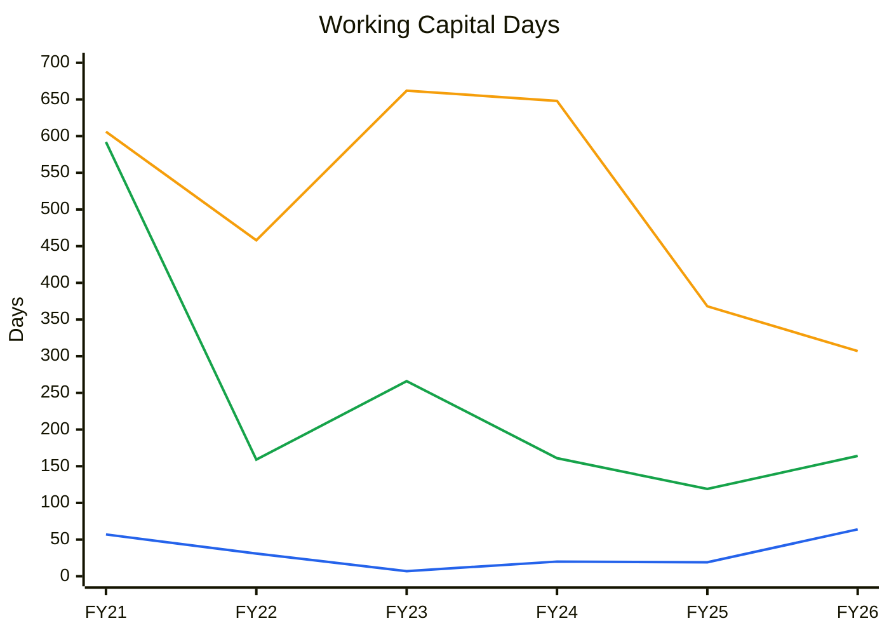
🟦 Debtor days · 🟧 Inventory days · 🟩 Payable days (Screener definitions)

**Read:** Inventory days halved (648 → 307) as P17A equipment was consumed into delivered ships. Debtor days tripled (19 → 64) on year-end deliveries.

**Business inference:** Inventory (₹3,402 Cr, mostly project equipment) is funded by customer advances, so the high days are not a stress signal for GRSE as they were for CSL's export hulls. The *new* signal is receivables: GRSE is now waiting on the Navy for delivery-stage payments. That should reverse in H1FY27. → Beneish DSRI explanation.

### DuPont Decomposition (5-factor, standalone; year-end assets and equity)
| Year | EBIT margin (incl. OI) | Asset turnover | Equity multiplier | Interest burden | Tax burden | ROE |
|---|---|---|---|---|---|---|
| FY22 | 14.8% | 0.23× | 6.08× | 0.99 | 0.74 | 15.1% |
| FY23 | 12.2% | 0.24× | 7.63× | 0.98 | 0.75 | 16.1% |
| FY24 | 13.7% | 0.35× | 6.13× | 0.97 | 0.74 | 21.3% |
| FY25 | 14.1% | 0.49× | 4.98× | 0.98 | 0.75 | 25.3% |
| FY26 | 14.6% | 0.66× | 4.05× | 0.98 | 0.74 | 28.5% |
| **Change FY22→26** | −0.2 pp | +0.43× | −2.03× | −0.01 | 0.00 | **+13.4 pp** |

- **Operating contribution (EBIT margin × AT):** 3.4% → 9.6%. It rose strongly, all from asset turnover.
- **Financing contribution:** The equity multiplier *fell* (6.1× → 4.05×) as customer advances (not debt) ran off. There is no debt.
- **DuPont verdict:** The ROE rise is **entirely operational**: assets were turned faster as advance-funded inventory converted to delivered ships. Leverage is shrinking, not masking anything. But the EBIT margin *incl. OI* is flat at ~14–15% because treasury income fell as a share; the core margin rose. The June report's DuPont table was wrong on every factor.
- **Asset-turnover trend → Module 11:** Revenue ÷ gross block is 7.6× (FY26), with a 5-yr average of 4.9×. Base case: falls to ~3× by FY29 as the ₹2,670 Cr capex lands ahead of revenue.

**Peer DuPont (FY26):** MDL ROE ~29% (higher margin, treasury ~35% of PBT); CSL ROE 12% (more capital, debt-funded working capital). GRSE's ROE premium comes from asset turnover, not leverage. → It is high-quality but *programme-dependent*.

**OCF / net income (5-yr): 0.06 → quality LOW** (structural, advance-driven). **O'Glove flags: 4/15** (#1 NI vs OCF; #2 DSO +45 days; #7 other income/EBIT > 15%; #8 "one-time" estimate gains in consecutive years). #10 Beneish is counted in Module 5.

---

## Module 7 — Industry KPIs & Peer Analysis
**Sector:** Defence Shipbuilding & Marine Services (`references/05-industry-kpis-india.md`, line 1150)

| KPI | GRSE | Healthy range | Assessment |
|---|---|---|---|
| Order book / TTM revenue | **1.8×** (Jun-26); 2.2× (Mar-26) | > 3× | ❌ Below the 2× red-flag line (pipeline depletion) |
| Order inflow (implied) | FY26 ≈ −₹354 Cr; Q1FY27 ₹87 Cr | growing YoY | ❌ Declining for 6+ quarters |
| Execution rate (revenue ÷ opening OB) | 30.9% FY26 (22.4% FY25); Q1FY27 annualised ~47% | 20–35% | ⚠️ Moving above 40% = book depleting |
| EBITDA margin (excl. OI) | 11.4% FY26; 8.2% Q1FY27; ~9.5–10% underlying | 12–20% | ⚠️ Below range |
| Advances / order book | 37.5% (₹5,751 / ₹15,324 Cr) | > 15% | ✅ but unwinding |
| Working-capital days (CCC) | 206 | 90–200 | ⚠️ Slightly above |
| CFO / EBITDA (3-yr avg) | (−707 + 16 − 290) ÷ (235 + 422 + 795) = **−0.68** | > 0.5 | ❌ Red flag (negative 2 of 3 years) |
| Inventory days | 307 | 60–150 | ❌ > 250 (customer-funded, so less alarming than at CSL) |
| Net debt / EBITDA | Net cash (₹3,388 Cr cash vs ₹37 Cr leases), but own funds only ₹283 Cr | Net cash to 1× | ✅ (with caveat) |
| ROCE | 43% reported; core ROIC 92% | > 18% | ✅ Well above |
| Order concentration (top programme) | P17A ₹4,519 Cr = 33% of OB (Jun-26) | < 60% | ✅ |
| Contingent liability / M-cap | Disputes 0.5%; incl. BGs and indemnities ~32% | < 30% | ✅ / ⚠️ |
| Deliveries | FY26: 8 warships (record); FY27 plan: P17A #3 + ASW #5–8 + ferries + dredger | accelerating | ✅ FY27, then a gap until NGOPV in Q2FY28 |
| Indigenous content | ~80–85% (ASW SWC, SVL) | rising, > 50% | ✅ |

**Peer comparison (Screener, 12/13-Oct-26; peer figures from the sister reports dated 12-Oct-26):**
| Metric | GRSE | MAZDOCK | COCHINSHIP |
|---|---|---|---|
| M-cap (₹ Cr) | 24,520 | 82,798 | 32,731 |
| Revenue FY26 (₹ Cr) | 7,002 | 13,006 | 5,022 |
| Revenue 3-yr CAGR (FY23–26) | **39.8%** | 18.4% | 28.5% |
| EBITDA margin FY26 (excl. OI) | **11.4%** (lowest) | 17.4% | 16.5% |
| ROCE FY26 | **43%** | 36% | 16% |
| ROE FY26 | 31.6% | 26–29% (sister reports differ) | 12% |
| Treasury share of PBT | 24% | ~35% | ~37% (OI/EBIT) |
| CFO FY26 (₹ Cr) | −290 | −2,654 | −1,234 |
| Inventory days FY26 | 307 | 131 | 379 |
| Order book (Jun-26, ₹ Cr) | 13,596 | 18,218 | 21,900 |
| OB cover (× TTM revenue) | 1.8× | 1.4× | 4.3× |
| Pending L1 / nominations not in book | NGC ~₹33,000 Cr (L1) | P75(I) + P75 follow-on (negotiated) | NGSV ~₹5,000 Cr (L1) |
| Headline P/E (TTM) | 30.6× | 29.0× | 48.1× |
| P/B | 9.3× | 8.5× | 5.6× |

### C12 — EBITDA margin: GRSE vs peers (FY26)
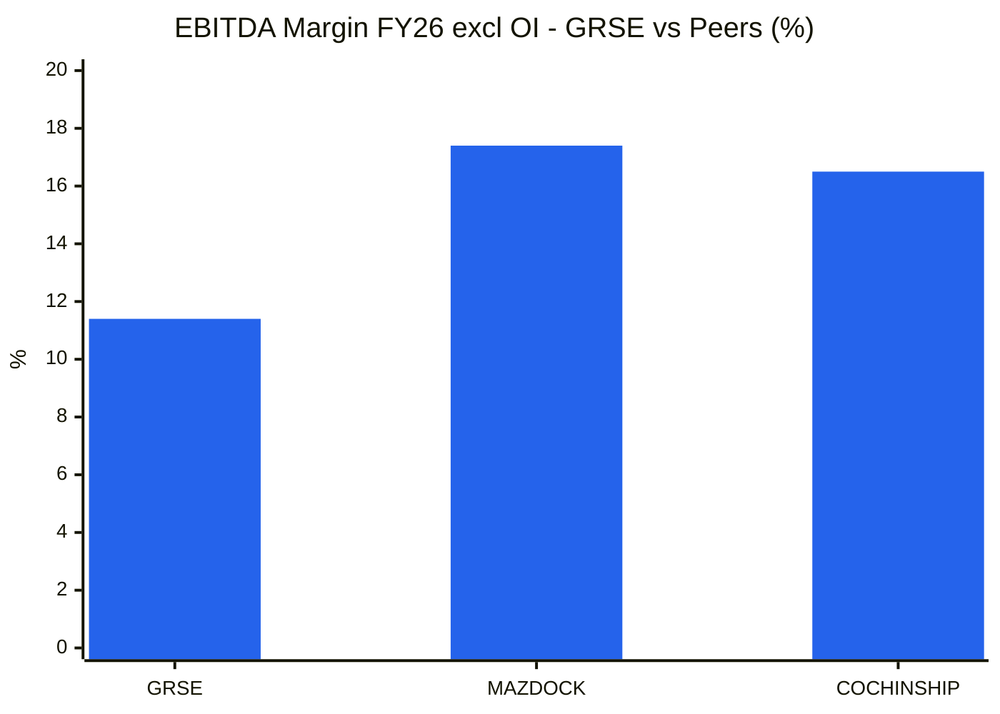
🟦 EBITDA margin excl. other income (Screener)

**Read:** GRSE's EBITDA margin (11.4%) is 5–6 pp below MDL and CSL, yet its P/B (9.3×) is the highest and its P/E (30.6×) is in line with MDL.

**Business inference:** GRSE's ROCE lead comes from asset turnover on customer money, not from pricing. That edge fades once the ₹2,670 Cr capex lands and advances unwind. With the thinnest margin, a 1.8× cover and its replacement programme unsigned, a valuation in line with MDL is **not justified by margin or visibility**. It is justified only by the unsigned NGC. **Peer positioning: in-line, not justified on the current book.**

### Order Book Tracker
*Generated 2026-10-13 by scripts/order_book_tracker.py from 25 order announcements (8 follow-ups / re-statements excluded) and 10 period snapshots. Ledger coverage starts 2024-04-01. The previous report (20-Jun-2026, skill v2.0) had no Order Ledger table, so it is built fresh from BSE Reg-30 filings and carried forward from here. Rule used: **L1 declarations are carried at ₹0** (pipeline, not backlog). The value enters the ledger at the first award document (LoI/NoA/contract), and the NGC enters only on contract signing. USD orders use the INR equivalent at the filing-date rate (est.), because the filings state USD only.*

#### 1. Disclosed vs tracked order book (reconciliation)

| Period | Revenue (₹ Cr) | Order book (₹ Cr) | Announced inflow | of which Framework | Implied inflow | Announced coverage | OB cover (× TTM rev) | Source |
|---|---|---|---|---|---|---|---|---|
| Q4FY24 | 1,016 | 22,653 | — | — | — | — | 6.3 | Q4FY24 call (OB as on 31-Mar-24 Rs22652.68 Cr); revenue Screener standalone |
| Q1FY25 | 1,010 | 25,231 | 589 | — | 3,588 | 16% | 6.6 | Q1FY25 call (OB as on 30-Jun-24 Rs25231.29 Cr) |
| Q2FY25 | 1,153 | 24,221 | 628 | — | 143 | 439% | 5.9 | Q2FY25 call (OB as on 30-Sep-24 Rs24221.37 Cr) |
| Q3FY25 | 1,271 | 23,877 | 717 | — | 927 | 77% | 5.4 | Q3FY25 analyst meet (OB as on 31-Dec-24 Rs23877 Cr) |
| Q4FY25 | 1,642 | 22,680 | 123 | — | 445 | 28% | 4.5 | Q4FY25 call (OB as on 31-Mar-25 Rs22680 Cr) |
| Q1FY26 | 1,310 | 21,700 | 314 | — | 330 | 95% | 4.0 | Q1FY26 call (OB as on 30-Jun-25 Rs21700 Cr) |
| Q2FY26 | 1,677 | 20,206 | 550 | — | 183 | 301% | 3.4 | Q2FY26 call (OB as on 30-Sep-25 Rs20205.56 Cr) |
| Q3FY26 | 1,896 | 18,482 | 0 | — | 172 | 0% | 2.8 | Q3FY26 analyst meet (OB as of 31-Dec-25 Rs18482 Cr) |
| Q4FY26 | 2,119 | 15,324 | 33 | — | -1,039 | — | 2.2 | FY26 Annual Report + CARE Jun-26 (OB as on 31-Mar-26 Rs15324.13 Cr) |
| Q1FY27 | 1,815 | 13,596 | 0 | — | 87 | 0% | 1.8 | FY26 Annual Report / Q1FY27 call (OB as on 30-Jun-26 Rs13596.26 Cr) |

*Implied inflow = OB(t) − OB(t−1) + order-linked revenue(t). Announced coverage = announced ÷ implied: < 50% means most orders are below the disclosure threshold (or the OB is restated); > 120% means cancellations, de-scoping or slow-burn framework value not yet in the reported book.*

**Coverage extremes explained:**
- **Q1FY25 (16%):** Implied inflow was ₹3,588 Cr, but only ₹589 Cr was announced. The ₹840 Cr NCPOR research-vessel contract (LoI Nov-23, pre-ledger) accounts for part of it. The remaining ~₹2,100 Cr is unexplained by filings: likely contract amendments or escalation on P17A/NGOPV (⚠️ data gap).
- **Q2FY25 and Q2FY26 (> 300%):** Announced USD export orders (German MPV options) were larger than the net OB change, implying de-scoping or restatement elsewhere.
- **Q4FY26 (−₹1,039 Cr):** The book fell by ₹1,039 Cr *more* than revenue. FY26 revenue included ₹520 Cr of estimate and consideration revisions (Note 48), which consumed no "new" order value. The remainder is unexplained (possible GST-basis or LD netting). The company has not reconciled it (⚠️ data gap).

#### 2. Announced orders aggregated by quarter

| Quarter | # orders | Total (₹ Cr) | Firm | Framework | Largest single | Export | Govt/PSU/Defence | Private domestic |
|---|---|---|---|---|---|---|---|---|
| Q1FY25 | 3 | 589 | 589 | 0 | 451 | 589 | 0 | 0 |
| Q2FY25 | 2 | 628 | 628 | 0 | 452 | 628 | 0 | 0 |
| Q3FY25 | 2 | 717 | 717 | 0 | 491 | 0 | 717 | 0 |
| Q4FY25 | 1 | 123 | 123 | 0 | 123 | 0 | 123 | 0 |
| Q1FY26 | 3 | 314 | 314 | 0 | 490 | -176 | 490 | 0 |
| Q2FY26 | 1 | 550 | 550 | 0 | 550 | 550 | 0 | 0 |
| Q4FY26 | 1 | 33 | 33 | 0 | 33 | 0 | 33 | 0 |
| Q1FY27 | 1 | 0 | 0 | 0 | 0 | 0 | 0 | 0 |
| Q2FY27 | 3 | 1,115 | 1,115 | 0 | 1,032 | 0 | 1,115 | 0 |

*Q1FY26 includes the NGC L1 (carried at ₹0) and the −₹176 Cr Bangladesh tug cancellation. Q1FY27 holds only the e-tug L1 (₹0). Q2FY27 is the ONGC PSV NoA (₹1,032 Cr incl. GST), the e-tug LoI (₹38 Cr) and WBTDC ferries (₹45 Cr). The tracker's "Firm" column means non-framework, so it includes LoI/NoA.*

#### 3. Macro picture

| Metric | Value |
|---|---|
| Latest disclosed order book | ₹13,596 Cr (Q1FY27) |
| Orders announced since that disclosure | ₹1,115 Cr (3 orders) |
| Tracked order book today (before execution since Q1FY27) | ₹14,711 Cr |
| Order book cover (latest) | 1.8 × TTM revenue |
| Framework / 'potential value' agreements in ledger | ₹0 Cr (0% of latest disclosed OB) |
| Orders announced, last 12 months | ₹1,698 Cr (6 orders; avg ₹283 Cr) |
| Top-3 orders (last 12 m) as % of disclosed OB | 12% |
| **Implied book-to-bill FY26 / TTM** | FY26: (15,324 − 22,680 + 7,002) ÷ 7,002 = **−0.05**; TTM to Jun-26: −0.08 (≈ +0.06 excluding the unexplained Q4FY26 restatement) |
| Announced-order book-to-bill (12 m to 13-Oct-26) | ₹1,698 Cr ÷ TTM revenue ₹7,507 Cr = 0.23 |
| Execution rate | FY25 22.4% → FY26 30.9% → Q1FY27 annualised ~47% (rising = depleting) |
| Pipeline NOT in book | NGC L1 ~₹33,000 Cr (CCS pending); P17B RFP (bids ~Jan-27); FIC/FAC/IB/CG-NGOPV bids (~₹10,800 Cr total, GRSE share uncertain) |

**Geography mix, last 12 months:** Domestic 68% · Export 32%
**Customer type mix, last 12 months:** PSU 63% · Export 32% · Govt 5%
**Segment mix, last 12 months:** Shipbuilding-Commercial 98% · Ship Repair 2%
**Firmness mix, last 12 months:** LoI 63% · Firm 37% · L1 0% (by value; the NGC and e-tug L1s are carried at ₹0)

#### 4. Charts

**OB-1 — Order book vs revenue (TTM), index = 100 at Q4FY24**

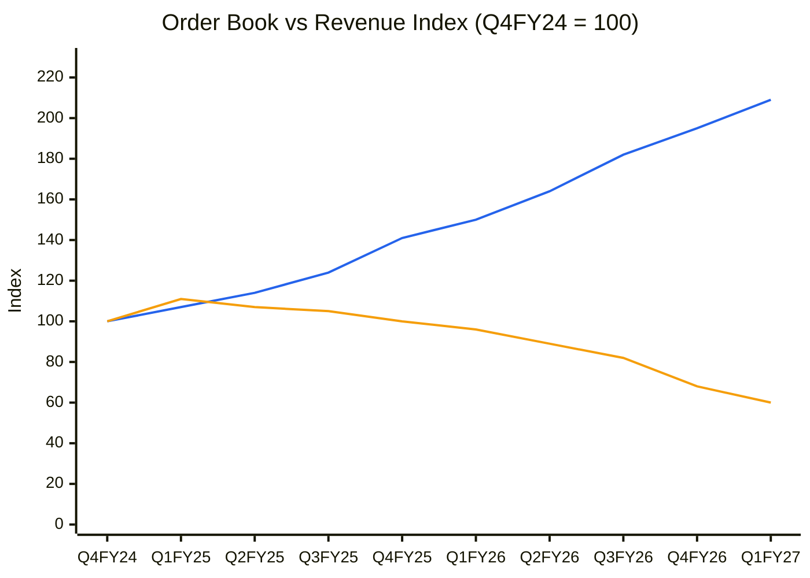
🟦 Revenue (TTM) · 🟧 Order book (disclosed quarter-end points)

**Read:** Since Q4FY24, TTM revenue has doubled (index 209) while the order book has shrunk 40% (index 60, ₹22,653 → ₹13,596 Cr). The lines crossed in Q1FY25 and the gap has widened for eight straight quarters.

**Business inference:** GRSE has been executing a book it is not refilling. Demand exists (~₹1.5 lakh Cr of RFPs), but **contracting is the binding constraint**. Without NGC, the book supports only ~1.8 years of revenue at today's run-rate, and the composition after P17A (NGOPV, research ships, MPVs) is smaller-ticket and lower-margin. → Module 11: FY28 dip.

**OB-2 — Order book cover (years of TTM revenue)**

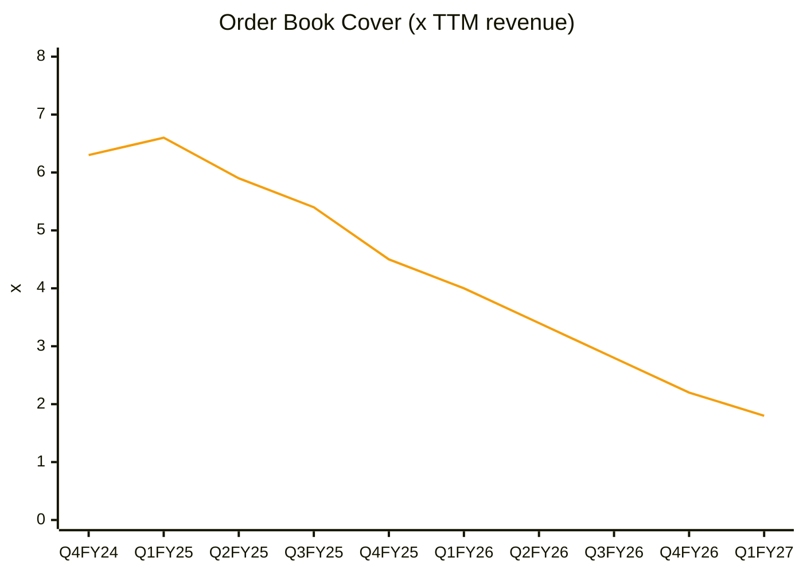
🟧 Order book / TTM revenue

**Read:** Cover fell from 6.6× (Q1FY25) to 1.8× (Q1FY27). It crossed below the 3× sector benchmark in Q3FY26 and below the 2× red-flag line in Q1FY27, close to MDL (1.4×) and far below CSL (4.3×).

**Business inference:** Visibility beyond FY28 now rests entirely on new awards. Signing the NGC alone (~₹33,000 Cr) would lift cover to ~6×. But its revenue is back-ended: 3–5% in FY28 and the "major chunk from FY29", with the first ship after 5 years. **Cover will recover before revenue does**, which is why the FY28 earnings dip and the order-book recovery can coexist.

**OB-3 — Aggregated announced orders vs revenue, by quarter (₹ Cr)**

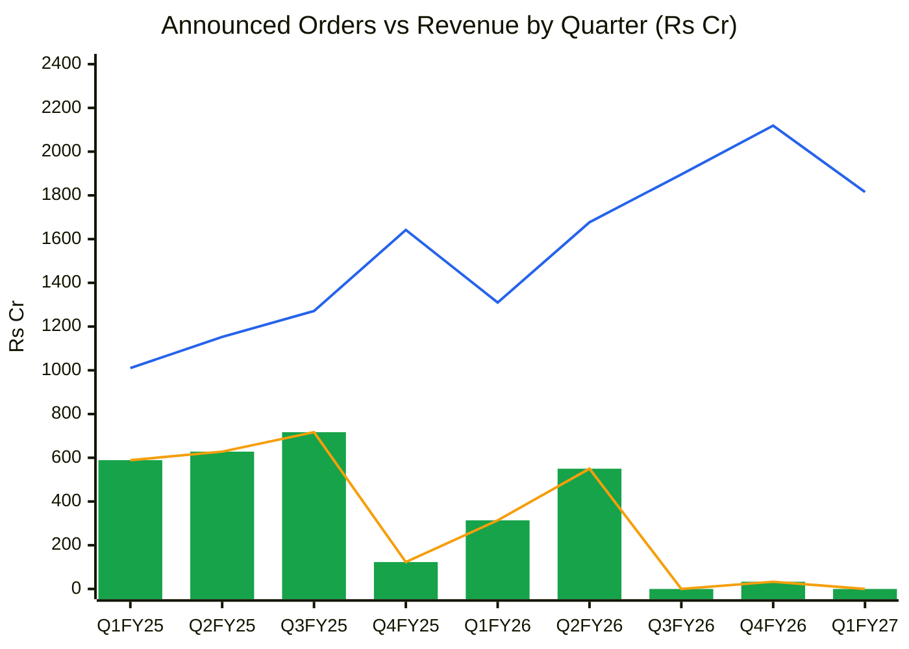
🟩 All announced orders (bars) · 🟧 Firm orders only (excl. framework / potential-value agreements; L1 carried at ₹0) · 🟦 Revenue

**Read:** Announced orders never exceeded ₹717 Cr in any quarter, against ₹1,000–2,100 Cr of revenue. Over nine quarters, announced orders total ₹2,954 Cr against revenue of ₹13,893 Cr, a **book-to-bill of 0.21**. There is no framework value.

**Business inference:** Since 2024 GRSE has filled gaps with small commercial, export and research jobs (German MPVs, ferries, CRVs, PSVs). These are useful for keeping the yard busy but cannot replace a ₹5,000 Cr/yr frigate programme. The CMD admits some were taken "at very low margins ... for sustenance and entry" (Q3FY26 meet). Order *momentum* depends on a single signature (NGC), so a haircut to order-led forecasts is appropriate.

**OB-4 — Implied order inflow (from disclosed order book) vs revenue (₹ Cr)**

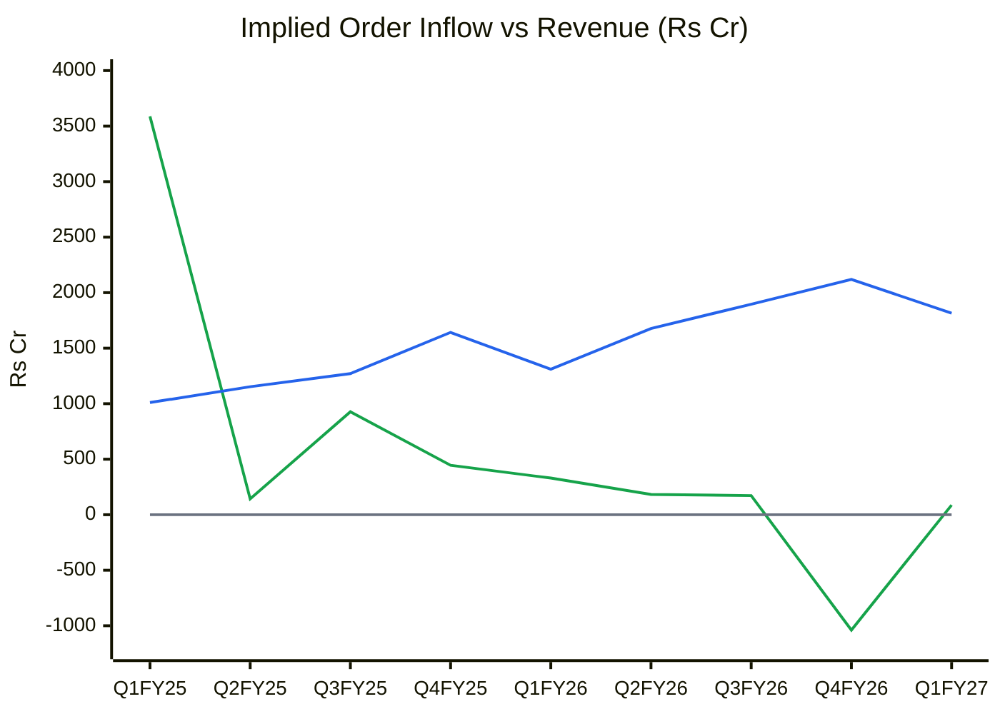
🟩 Implied inflow = ΔOB + order-linked revenue · 🟦 Revenue · ⬜ zero line *(implied inflow drawn as a line because it goes negative; the script's bar was converted per chart rule 10)*

**Read:** Implied inflow has been below revenue in every quarter since Q1FY25. Over Q1FY26–Q1FY27 it averaged −₹53 Cr a quarter (₹193 Cr excluding the −₹1,039 Cr Q4FY26 restatement) against ~₹1,760 Cr of revenue.

**Business inference:** True order intake (including undisclosed small orders and refits) has effectively stopped. Four to eight quarters out, revenue converges on whatever the NGC and the mid-size FIC/FAC/CG tenders add. That is the core of the FY28 revenue-cliff case.

*Analyst notes on the tracker output: (1) FY24-era LoIs (NGOPV, NCPOR ORV LoI) predate the ledger and are already in the Q4FY24 book. (2) The ONGC PSV NoA value includes GST (ex-GST ~₹980 Cr at 5%, est.). (3) Programme balances quoted on calls do not reconcile cleanly. NGOPV was ₹3,136 Cr (Dec-25) → "₹5,168 Cr" (May-26 transcript) → ₹3,075 Cr (Jun-26). The May-26 figure is probably a transcription error for ~₹3,168 Cr, and the Jun-26 programme split is used in this report.*

#### 5. Order Ledger — every announced order (source of truth; the next run appends here)

| order_id | date | customer | customer_type | segment | geography | value_cr | currency | value_fc | firmness | tenor_months | linked_to | source | notes |
|---|---|---|---|---|---|---|---|---|---|---|---|---|---|
| GRSE-2405-01 | 2024-05-16 | Govt of Bangladesh (BIWTA) | Export | Shipbuilding-Commercial | Export | 138 | USD | 16.58 | Firm |  |  | [BSE](https://www.bseindia.com/xml-data/corpfiling/AttachHis/c85ab194-3f04-48f8-869d-1344e26894ea.pdf) | 1x 1000 m3 trailing suction hopper dredger; notification of award accepted 16-May-24; USD 16.58 mn excl. taxes (INR est. at ~83.5; filing gives USD only) |
| GRSE-2406-01 | 2024-06-05 | Govt of Bangladesh (BIWTA) | Export | Shipbuilding-Commercial | Export | 138 | USD | 16.58 | Firm |  | GRSE-2405-01 | [BSE](https://www.bseindia.com/xml-data/corpfiling/AttachHis/bde419fa-c9df-4ea5-b07f-72a02f7ce69b.pdf) | Contract signed for the dredger awarded 16-May-24 (re-statement; not added) |
| GRSE-2406-02 | 2024-06-07 | DRDO (research vessel) | Defence | Shipbuilding-Defence | Domestic | 0 | INR |  | L1 |  |  | [BSE](https://www.bseindia.com/xml-data/corpfiling/AttachHis/2cae486e-8407-43c9-9526-fe72d57dc3d8.pdf) | Declared L1 for a DRDO research vessel ~Rs500 Cr; L1 rows carried at 0 (pipeline) - value counted at LoI GRSE-2410-03 |
| GRSE-2406-03 | 2024-06-22 | Carsten Rehder (Germany) | Export | Shipbuilding-Commercial | Export | 451 | USD | 54 | Firm |  |  | [BSE](https://www.bseindia.com/xml-data/corpfiling/AttachHis/33881e8c-8b9c-44e5-ba12-0fb3fa44ebf8.pdf) | 4x 7500 DWT multipurpose vessels + option for 4; USD 54 mn (INR est. at ~83.5) |
| GRSE-2407-01 | 2024-07-01 | Govt of Bangladesh (ocean-going tug) | Export | Shipbuilding-Commercial | Export | 176 | USD | 21 | Firm |  |  | [BSE](https://www.bseindia.com/xml-data/corpfiling/AttachHis/2361041b-bf1a-4431-8b5a-a5ef1184efcc.pdf) | Advanced ocean-going tug USD 21 mn (INR est. at ~83.6); CANCELLED 21-May-25 (see GRSE-2505-01) |
| GRSE-2407-02 | 2024-07-16 | NCPOR (Ministry of Earth Sciences) | Govt | Shipbuilding-Research | Domestic | 840 | INR |  | Firm |  | pre-ledger LoI 2023-11-09 | [BSE](https://www.bseindia.com/xml-data/corpfiling/AttachHis/8a1dd9e6-a0bd-47e0-9fe4-efec56d21ae5.pdf) | Ocean Research Vessel contract ~Rs840 Cr; LoI filed 9-Nov-2023 (before ledger start) and already in the Mar-24 order book - not added |
| GRSE-2409-01 | 2024-09-18 | Carsten Rehder (Germany) | Export | Shipbuilding-Commercial | Export | 452 | USD | 54 | Firm |  |  | [BSE](https://www.bseindia.com/xml-data/corpfiling/AttachHis/a91b5a0a-6716-4156-bce7-1e3f2f098eaa.pdf) | Option exercised: additional 4 MPVs on same terms; USD 54 mn (INR est. at ~83.7); total 8 ships USD 108 mn |
| GRSE-2410-01 | 2024-10-04 | Govt of West Bengal (Transport Dept) | Govt | Shipbuilding-Commercial | Domestic | 226 | INR |  | Firm |  |  | [BSE](https://www.bseindia.com/xml-data/corpfiling/AttachHis/515249ac-db28-498b-bbd1-467ab862e933.pdf) | 13 hybrid electric ferries (design-build-operate-maintain); Rs226.18 Cr excl. GST; two letters of acceptance |
| GRSE-2410-02 | 2024-10-04 | Carsten Rehder (Germany) | Export | Shipbuilding-Commercial | Export | 113 | USD | 13.5 | Firm |  | GRSE-2409-01 | [BSE](https://www.bseindia.com/xml-data/corpfiling/AttachHis/8444a934-bf9d-4ee0-91e8-a6d81d326e81.pdf) | Contract for 1 of the 4 additional MPVs (re-statement) |
| GRSE-2410-03 | 2024-10-18 | DRDO NPOL Kochi (Acoustic Research Ship) | Defence | Shipbuilding-Defence | Domestic | 491 | INR |  | LoI |  |  | [BSE](https://www.bseindia.com/xml-data/corpfiling/AttachHis/2d591090-93d5-48d5-9b5a-0c9d19396b13.pdf) | LoI for 1 Acoustic Research Ship ~Rs491 Cr (L1 was GRSE-2406-02) |
| GRSE-2410-04 | 2024-10-29 | DRDO NPOL Kochi (Acoustic Research Ship) | Defence | Shipbuilding-Defence | Domestic | 491 | INR |  | Firm |  | GRSE-2410-03 | [BSE](https://www.bseindia.com/xml-data/corpfiling/AttachHis/b972eea5-239b-4c90-9c4b-358291e2e2a0.pdf) | Contract signed for the ARS (re-statement) |
| GRSE-2411-01 | 2024-11-19 | Govt of West Bengal (Transport Dept) | Govt | Shipbuilding-Commercial | Domestic | 226 | INR |  | Firm |  | GRSE-2410-01 | [BSE](https://www.bseindia.com/xml-data/corpfiling/AttachHis/c96a70c8-1d3b-4a66-b240-ee0e467cafd8.pdf) | Contract signed for the 13 hybrid ferries (re-statement) |
| GRSE-2412-01 | 2024-12-05 | Carsten Rehder (Germany) | Export | Shipbuilding-Commercial | Export | 113 | USD | 13.5 | Firm |  | GRSE-2409-01 | [BSE](https://www.bseindia.com/xml-data/corpfiling/AttachHis/b67a8dca-fef3-4077-a118-f3c9479d4a25.pdf) | Contract for 2nd of the 4 additional MPVs (re-statement) |
| GRSE-2502-01 | 2025-02-20 | Ministry of External Affairs (Mauritius CGS Barracuda) | Govt | Ship Repair | Domestic | 123 | INR |  | Firm |  |  | [BSE](https://www.bseindia.com/xml-data/corpfiling/AttachHis/4f3ff2ba-cbd7-43fb-9149-52474fc080b9.pdf) | Normal refit of Mauritius CG ship funded by MEA; Rs123.07 Cr + 15% growth-of-work (excl. taxes) |
| GRSE-2503-01 | 2025-03-24 | Carsten Rehder (Germany) | Export | Shipbuilding-Commercial | Export | 226 | USD | 27 | Firm |  | GRSE-2409-01 | [BSE](https://www.bseindia.com/xml-data/corpfiling/AttachHis/8e4d8483-4464-4b20-b0e3-2382be843197.pdf) | Contracts for remaining 2 of the 4 additional MPVs (re-statement) |
| GRSE-2504-01 | 2025-04-09 | Geological Survey of India | Govt | Shipbuilding-Research | Domestic | 490 | INR |  | Firm |  |  | [BSE](https://www.bseindia.com/xml-data/corpfiling/AttachHis/1697d1a0-7de2-40b8-bd1c-6e513a83b0a9.pdf) | Letter of Award: 2 Coastal Research Vessels Rs489.98 Cr |
| GRSE-2505-01 | 2025-05-21 | Govt of Bangladesh (ocean-going tug) | Export | Shipbuilding-Commercial | Export | -176 | USD | -21 | Firm |  |  | [BSE](https://www.bseindia.com/xml-data/corpfiling/AttachHis/4a72584d-014e-4a8a-87c5-5e09816c7765.pdf) | Cancellation of the tug order GRSE-2407-01 by the Govt of Bangladesh |
| GRSE-2505-02 | 2025-05-22 | Ministry of Defence (Indian Navy NGC) | Defence | Shipbuilding-Defence | Domestic | 0 | INR |  | L1 |  |  | [BSE](https://www.bseindia.com/xml-data/corpfiling/AttachHis/3fdde87b-444e-4220-b5e6-15d70221e058.pdf) | L1 for 5 of 8 Next Generation Corvettes; filing says likely value > Rs25000 Cr; CARE (Jun-26) and mgmt (May-26) ~Rs33000 Cr; price negotiation done; CCS approval pending; NOT signed as of 13-Oct-26; carried at 0 until contract |
| GRSE-2506-01 | 2025-06-11 | Geological Survey of India | Govt | Shipbuilding-Research | Domestic | 490 | INR |  | Firm |  | GRSE-2504-01 | [BSE](https://www.bseindia.com/xml-data/corpfiling/AttachHis/51cd12ed-2d8c-4fc3-a533-d97fc2b62074.pdf) | Contract signed for 2 CRVs (re-statement) |
| GRSE-2509-01 | 2025-09-19 | Carsten Rehder (Germany) | Export | Shipbuilding-Commercial | Export | 550 | USD | 62.44 | Firm | 42 |  | [BSE](https://www.bseindia.com/xml-data/corpfiling/AttachHis/a93bd9c0-4410-442e-9e41-f67160a0983a.pdf) | 4 follow-on hybrid 7500 DWT MPVs USD 62.44 mn (INR est. at ~88.1); 33-42 months; MoI 5-Jun-25 (no value) |
| GRSE-2602-01 | 2026-02-07 | Ministry of External Affairs (Seychelles CG PS Zoroaster) | Govt | Ship Repair | Domestic | 33 | INR |  | Firm |  |  | [BSE](https://www.bseindia.com/xml-data/corpfiling/AttachHis/01bf5043-8380-4052-9d36-423c69545d87.pdf) | 2nd refit of Seychelles CG ship; ~Rs33 Cr excl. GST |
| GRSE-2606-01 | 2026-06-23 | Syama Prasad Mookerjee Port Kolkata | PSU | Shipbuilding-Commercial | Domestic | 0 | INR |  | L1 |  |  | [BSE](https://www.bseindia.com/xml-data/corpfiling/AttachHis/6a0ed6ed-629d-41dd-9bba-743c775b8026.pdf) | L1 for 15T bollard-pull electric tug ~Rs40 Cr; carried at 0 - value counted at LoI GRSE-2608-01 |
| GRSE-2607-01 | 2026-07-30 | ONGC | PSU | Shipbuilding-Commercial | Domestic | 1032 | INR |  | LoI | 48 |  | [BSE](https://www.bseindia.com/xml-data/corpfiling/AttachHis/ec0640a0-1c29-440e-8781-c37aeec4584d.pdf) | Notification of Award for 4 Platform Supply Vessels Rs1032.07 Cr incl. GST; 48 months from NOA; mgmt calls it a letter of intent |
| GRSE-2608-01 | 2026-08-04 | Syama Prasad Mookerjee Port Kolkata | PSU | Shipbuilding-Commercial | Domestic | 38 | INR |  | LoI |  |  | [BSE](https://www.bseindia.com/xml-data/corpfiling/AttachHis/a16b61b3-cc3e-4788-8be0-95e1e3e040a4.pdf) | LoI: 1x 15T BP electric battery tug incl. shore charging; Rs37.94 Cr incl. GST |
| GRSE-2608-02 | 2026-08-24 | West Bengal Tourism Development Corp | Govt | Shipbuilding-Commercial | Domestic | 45 | INR |  | Firm |  |  | [BSE](https://www.bseindia.com/xml-data/corpfiling/AttachHis/10e36860-d570-4aae-88e6-ae42f9dda189.pdf) | 2x 100-pax electric ferries; contract price Rs45.02 Cr |

#### 6. Order Book Snapshots — revenue and disclosed order book per period

| period | revenue_cr | revenue_ttm_cr | order_book_cr | order_linked_share | as_of_date | source |
|---|---|---|---|---|---|---|
| Q4FY24 | 1016 | 3593 | 22653 | 1.0 |  | Q4FY24 call (OB as on 31-Mar-24 Rs22652.68 Cr); revenue Screener standalone |
| Q1FY25 | 1010 | 3847 | 25231 | 1.0 |  | Q1FY25 call (OB as on 30-Jun-24 Rs25231.29 Cr) |
| Q2FY25 | 1153 | 4102 | 24221 | 1.0 |  | Q2FY25 call (OB as on 30-Sep-24 Rs24221.37 Cr) |
| Q3FY25 | 1271 | 4450 | 23877 | 1.0 |  | Q3FY25 analyst meet (OB as on 31-Dec-24 Rs23877 Cr) |
| Q4FY25 | 1642 | 5076 | 22680 | 1.0 |  | Q4FY25 call (OB as on 31-Mar-25 Rs22680 Cr) |
| Q1FY26 | 1310 | 5376 | 21700 | 1.0 |  | Q1FY26 call (OB as on 30-Jun-25 Rs21700 Cr) |
| Q2FY26 | 1677 | 5900 | 20206 | 1.0 |  | Q2FY26 call (OB as on 30-Sep-25 Rs20205.56 Cr) |
| Q3FY26 | 1896 | 6525 | 18482 | 1.0 |  | Q3FY26 analyst meet (OB as of 31-Dec-25 Rs18482 Cr) |
| Q4FY26 | 2119 | 7002 | 15324 | 1.0 |  | FY26 Annual Report + CARE Jun-26 (OB as on 31-Mar-26 Rs15324.13 Cr) |
| Q1FY27 | 1815 | 7507 | 13596 | 1.0 |  | FY26 Annual Report / Q1FY27 call (OB as on 30-Jun-26 Rs13596.26 Cr) |

*Every number above traces to the ledger / snapshot rows (source column).*

**Jun-26 order-book composition (Q1FY27 call):** shipbuilding ₹12,980 Cr (95%), made up of P17A ₹4,519 Cr, NGOPV ₹3,075 Cr, ASW SWC ₹1,815 Cr, MPV + dredger ₹1,355 Cr, ORV ₹740 Cr, ARS ₹450 Cr, CRV ₹258 Cr, SVL ₹225 Cr and ferries ₹203 Cr. The rest is guns ₹219 Cr, bridges ₹158 Cr, engines ₹82 Cr, repair ₹96 Cr and deck machinery ₹58 Cr. Naval is ~74% of shipbuilding and non-defence ~25%.

**Order-book verdict:** Firm visibility ~1.8 yrs (no framework; NGC L1 excluded) · book-to-bill (implied) FY26 −0.05, announced TTM 0.23 · framework share 0% · top programme 33% (P17A, ending Nov-26) · execution rate **rising** (22% → 31% → ~47% annualised) = **depleting**.
**Forward link (Module 11):** Revenue FY27 ≈ opening OB ₹15,324 Cr × ~45% (P17A and ASW in their final, steep phase) + in-year inflow ~₹1,300 Cr × ~10% ≈ **₹7,000–7,400 Cr**. FY28 ≈ opening OB (ex-NGC) ~₹9,300 Cr × ~50% + NGC design revenue (~3% of ₹33,000 Cr) + new small orders ≈ **₹6,250 Cr (−15%)**.

---

## Module 8 — Market Size & Market Share
- **TAM (defined):**
  - (a) **Indian naval and Coast Guard surface shipbuilding** open to GRSE. Management lists ~₹80,000 Cr of live RFPs plus ~₹70,000 Cr expected in CY26, i.e. ~₹1.5 lakh Cr over ~2–3 years excluding the NGC (Q1FY27 call). The MAZDOCK report estimates the overall naval build TAM at ~₹25,000–35,000 Cr/yr over FY27–32.
  - (b) **Domestic commercial demand aggregation:** ~207 vessels (MoPSW), including PSVs, MR tankers, VLGCs, Aframaxes and container ships. Most need hulls beyond GRSE's 200 m riverine limit until the greenfields arrive.
  - (c) **Research and special vessels:** GRSE is the only Indian yard building them (CMD).
- **TAM growth:** Indian naval surface shipbuilding ~10–15%/yr (policy-led, estimate).
- **Penetration / share:** FY26 revenue of ₹7,002 Cr on a ~₹30,000 Cr/yr naval TAM is ~20–25% (estimate). Programme share: P17A 3/7 (nominated), ASW SWC 8/16, NGC 5/8 (L1, competitive), NGOPV 4/11, SVL 4/4. **Share is gaining in competitive tenders.** GRSE beat MDL, GSL and CSL to the NGC.
- **Reconciliation:** The FY23–26 revenue CAGR of 39.8% far exceeded market growth because of the programme cycle (three programmes peaking together), not structural share gain. Forward base growth of ~3% CAGR FY26–29 is *below* market because the replacement programmes are back-ended.
- **Verdict: taking share in awards (NGC), but losing revenue share near term during the programme transition.** The historical 5-yr market-share series is not available (⚠️).

---

## Module 9 — Valuation: PIE First, Then Own Model

### 9A. Price-Implied Expectations (Mauboussin)
- **Core EV** = M-cap ₹24,519 Cr + leases ₹37 Cr − own funds ₹283 Cr (latest disclosed, Sep-25) = **₹24,274 Cr**. Customer project funds (~₹3,100 Cr) are *not* deducted, because they belong to customers and are matched by ₹5,751 Cr of contract liabilities.
- **Core NOPAT (TTM)** = (TTM EBITDA ₹833 Cr − D&A ₹51 Cr) × (1 − 25.7%) = **₹581 Cr**. **EV / core NOPAT = 41.8×.** Headline P/E is 30.6×; EV/EBITDA (deducting all cash) 25.4×.
- **Quick PIE:** g = (24,274 × 12.5% − 581) ÷ (24,274 + 581) = **9.9% perpetual core NOPAT growth with zero reinvestment**.
- **Two-stage reverse DCF** (WACC 12.5%, terminal 6%, RONIC 40%, 10-yr explicit; `calc.py`): the price needs **~23% core NOPAT CAGR for 10 years**. That means core NOPAT of ~₹4,800 Cr by FY36, ~₹60,000 Cr of revenue at an 8% NOPAT margin, ~8× today.

| PIE value driver | Market-implied | My base | Expectations gap |
|---|---|---|---|
| Core NOPAT CAGR (10-yr) | ~23% | ~8–10% (FY26–29 ≈ flat, then ~12%) | **−13 to −15 pp (optimistic gap)** |
| NOPAT margin (steady state) | ~8% (today's) | ~6.5–7% (core EBIT 8.5–9% × 0.745) | −1 to −1.5 pp |
| Investment rate (RONIC) | 40% assumed | ~9–15% on the ₹2,670 Cr greenfield (Module 11) | Negative |

- **Physical plausibility:** 23% for 10 years means winning NGC plus a P17B share plus MCMV/LPD *and* scaling commercial shipbuilding in yards that do not yet exist (Raichak: 3–5 years). Capacity of 43 platforms by ~FY30–31 *could* support ₹15,000–20,000 Cr, but the **order book cannot**. The market is pricing orders that are neither won nor signed.
- **Expectations treadmill:** To outperform, GRSE must sign the NGC by Q4FY27, win ≥ 3 P17B frigates (L2 or better) in late-2027, *and* hold EBITDA ≥ 11% through the FY28 trough.
- **Positive triggers:** NGC contract signing (plus a fresh advance); P17B L1/L2; FIC/FAC/CG-NGOPV wins; FY27 margin ≥ 11% without estimate releases.
- **Negative triggers:** NGC slipping beyond FY27; Q2/Q3FY27 margins < 9%; a GoI OFS; receivables not collected by Sep-26; P17B lost.
- **SVAR** (bear ₹640) = (2,140 − 640) ÷ 2,140 = **70%**. Asymmetry is unfavourable (> 40%).

### 9B. Intrinsic value — own models
| Method | Bear | Base | Bull | Notes |
|---|---|---|---|---|
| DCF (two-stage, WACC 12.5%, g 6%, core only + own funds ₹283 Cr) | ₹725 | ₹920 | ₹1,179 | 10-yr core NOPAT CAGR 6 / 10 / 14%. Float income excluded (~₹60–80/share of value if capitalised) |
| Relative (P/E on FY29E EPS) | ₹640 | ₹1,814 | ₹3,452 | 22× / 32× / 40× on EPS ₹29.1 / ₹56.7 / ₹86.3 (Module 11). Multiples bracket peers: MDL 30/35/40, CSL 22/32/42 |
| EPV (normalised core EBIT margin 7.1% × FY26 revenue, no growth, + own funds + capitalised float income) | | ~₹390 | | Asset and earnings-power value is far below price |
| Graham Number √(22.5 × 5-yr avg EPS ₹35.8 × BVPS ₹229) | | ₹430 | | |
| **Consensus range used** | **₹640** | **₹1,814** | **₹3,452** | Street: ICICI Securities Hold ₹2,850 (35× FY28E, 7-Aug-26); aggregator median ~₹2,990 (Sharpely, undated) |

- **CMP ₹2,140.5 → base MoS −15% (INADEQUATE).** Upside/downside = (3,452 − 2,140) ÷ (2,140 − 640) = **0.87:1 (UNACCEPTABLE, < 1.5:1 hard stop).**
- **Graham defensive screen:** revenue > ₹2,000 Cr ✓; current ratio 1.25 ✗; positive EPS 7 yrs ✓; no dividend cut 5 yrs ✓; EPS growth ≥ 30% over 7 yrs ✓ (₹9.60 → ₹65.29); P/E ≤ 20 ✗; P/B ≤ 3 ✗ → **4/7**.
- **Why priced this way?** Navratna and "best executor" narrative; NGC "any day now" headlines; a sector re-rating in 2024–25 (P/E 29× → 49×); low float (25.5%) with 4 lakh retail holders. **Our view differs from the street on FY28.** ICICI's ₹2,850 at 35× FY28E implies FY28 EPS of ~₹81. Our base is ~₹47 because P17A ends and NGC is back-ended.
- **Catalyst to close the gap:** downward, the H2FY27 prints after P17A delivery and FY28 guidance; upward, NGC signing plus a P17B award.

### CY1 — P/E band
| Point | FY19 | FY20 | FY21 | FY22 | FY23 | FY24 | FY25 | FY26 | Oct-26 |
|---|---|---|---|---|---|---|---|---|---|
| P/E (×) | 12.9 | 10.4 | 13.0 | 12.7 | 23.7 | 29.1 | 48.9 | 34.4 | 30.3 |

*Source: Screener P/E chart API (last trading week of each March, plus 13-Oct-26). Median 20.9× is Screener's full-history median since Oct-2018. +1 SD = 20.9 + 12.8 (SD of FY-end readings) = 33.7×; −1 SD = 8.1×.*

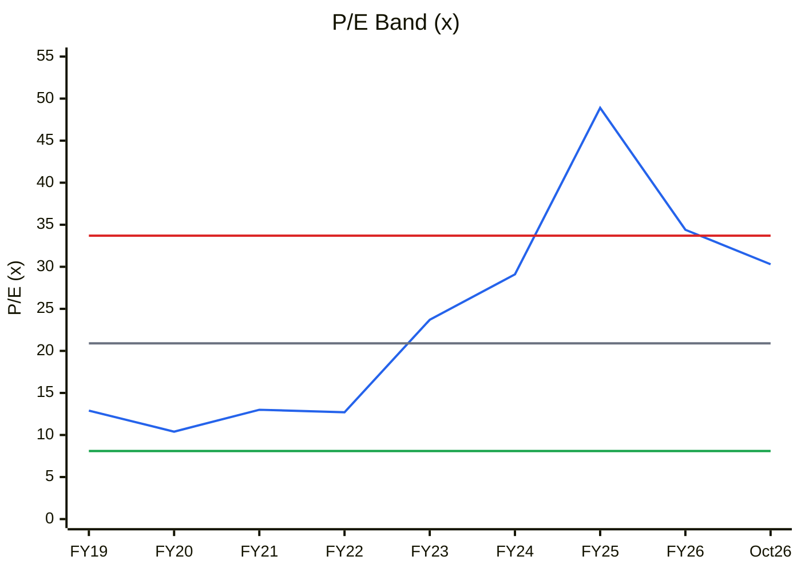
🟦 P/E · ⬜ median 20.9× · 🟥 +1 SD 33.7× · 🟩 −1 SD 8.1×

**Read:** Trailing P/E has compressed from 48.9× (FY25) to 30.3×. That is still ~45% above the 20.9× median and at the **62nd percentile** of weekly history since 2018.

**Business inference:** The de-rating so far has come with *rising* EPS (peak-margin, peak-programme earnings). This is the classic cyclical trap: a falling P/E on peak earnings is not cheapness. If FY28 EPS falls to ~₹47 and the multiple settles at the median (~21×), the stock is worth ~₹990. **Fair-to-expensive on peak earnings.**

### CY2 — P/B band, with ROE
| Point | FY19 | FY20 | FY21 | FY22 | FY23 | FY24 | FY25 | FY26 | Oct-26 |
|---|---|---|---|---|---|---|---|---|---|
| P/B (×) | 1.09 | 1.48 | 1.92 | 2.07 | 3.69 | 5.23 | 9.28 | 9.02 | 9.33 |
| ROE (%, year-end equity) | 10.6 | 15.7 | 13.4 | 15.1 | 16.1 | 21.3 | 25.3 | 28.5 | — |

*FY-end price ÷ book value per share (Screener reserves + capital ÷ 11.455 Cr shares). Median 2.9×, SD 3.1 → +1 SD 6.0×; 10-yr low 1.09×.*

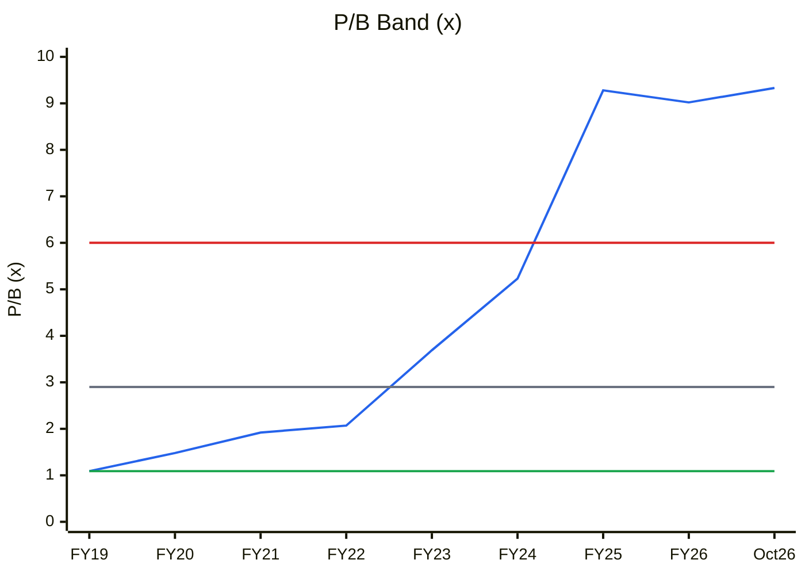
🟦 P/B · ⬜ median 2.9× · 🟥 +1 SD 6.0× · 🟩 10-yr low 1.09×

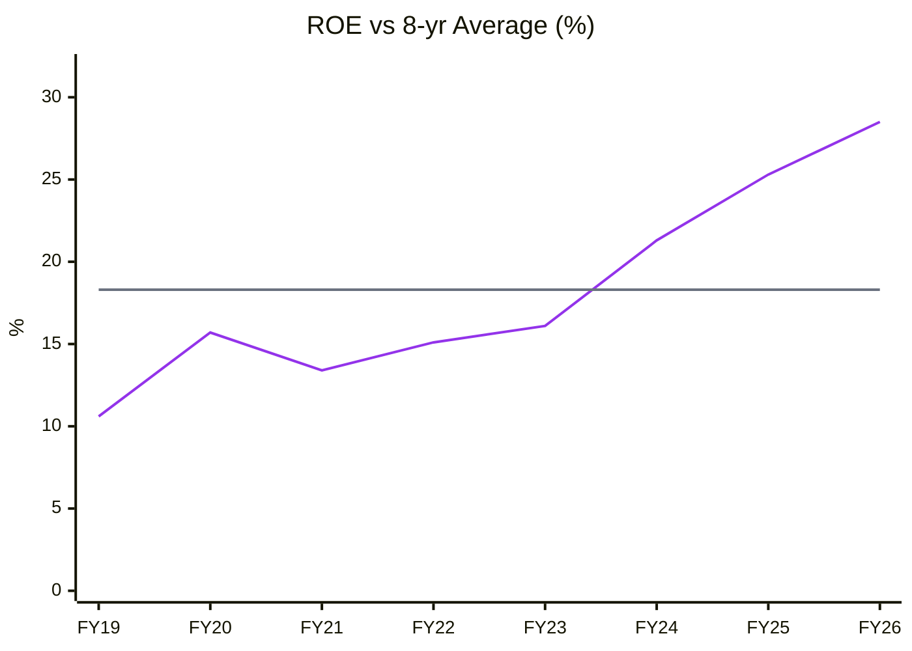
🟪 ROE · ⬜ 8-yr average 18.3%

**Read:** P/B of 9.3× is the **highest reading in the series (100th percentile)**, 3.2× its median, on an ROE (28.5%) that is also at its decade high and 10 pp above the 8-yr average.

**Business inference:** Justified P/B = (ROE − g) ÷ (Ke − g). At a sustained 25% ROE and 8% growth that is (25 − 8) ÷ (12.4 − 8) ≈ 3.9×; even at 28% ROE it is ~4.5×. The market is paying 9.3×, as if peak-programme ROE were permanent while the order book is at a 10-year low. **Expensive.**

### CY4 — Price vs EPS index (FY19 = 100)
| Point | FY19 | FY20 | FY21 | FY22 | FY23 | FY24 | FY25 | FY26 | Oct-26 |
|---|---|---|---|---|---|---|---|---|---|
| Price (₹, FY-end week) | 98.65 | 134.2 | 190.3 | 227.7 | 455.4 | 764.7 | 1,685.7 | 2,068.4 | 2,140.5 |
| EPS (₹; Oct-26 = TTM) | 9.60 | 14.27 | 13.40 | 16.55 | 19.91 | 31.19 | 46.04 | 65.29 | 69.90 |
| Price index | 100 | 136 | 193 | 231 | 462 | 775 | 1,709 | 2,097 | 2,170 |
| EPS index | 100 | 149 | 140 | 172 | 207 | 325 | 480 | 680 | 728 |

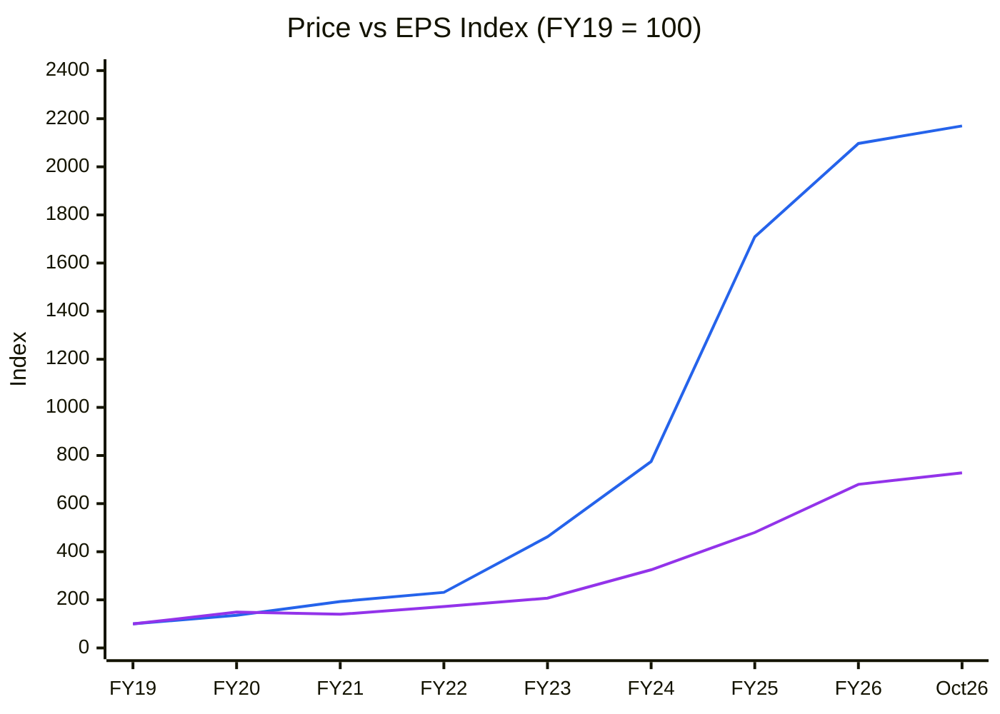
🟦 Price index · 🟪 EPS index

**Read:** Since FY19 the price is up ~22× and EPS ~7.3×. About two-thirds of the return came from re-rating (P/E 12.9× → 30×), and the gap opened in FY23–25.

**Business inference:** EPS has caught up a lot since FY25 (the price index rose 1.27× while EPS rose 1.5×), which is why the stock already de-rated. But EPS is now at a programme peak. If EPS falls in FY28 while the multiple stays above median, the gap reopens from the earnings side. Returns from here depend on earnings that are not yet contracted.

### C13 — Scenario targets (FY29E) vs CMP
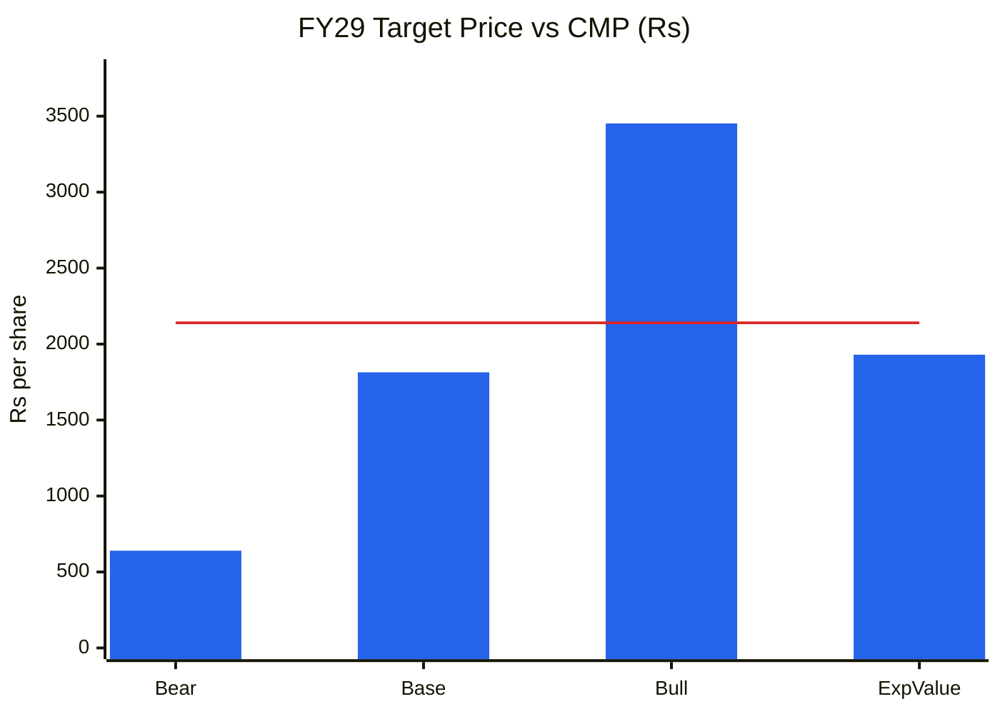
🟦 Scenario value · 🟥 CMP ₹2,140.5

**Read:** Bear is −70%, base −15% and bull +61%. The probability-weighted value is ₹1,930 (−10%), and upside/downside is 0.87:1.

**Business inference:** The bull case needs NGC signed promptly, a P17B award and 11.5% margins. Even then the payoff is less than the bear-case loss. The price already discounts a good outcome on orders. The payoff is asymmetric on the downside until either the price falls ~30% or the NGC/P17B contracts are in hand.

### Cycle Position Dashboard
| Dimension | Current | 10-yr median / avg | Percentile | Signal |
|---|---|---|---|---|
| P/E | 30.3× | 20.9× | 62% (weekly since 2018) | **Fair-to-expensive on peak EPS** |
| P/B | 9.3× | 2.9× | 100% (FY-end series) | **Expensive** |
| EBITDA margin (excl. OI) | 11.4% (FY26); 8.2% (Q1FY27) | 5.8% avg (SD 3.5) | 100% | **Peak** |
| ROCE | 43% | 22% avg (SD 10.8) | 100% | **Peak** |
| Order cover | 1.8× | 6.6× (Q1FY25 peak) | 10-yr low | **Depleted** |
| Industry capex | GRSE capex/D&A 1.6× → ~10× (FY28–29E); all yards expanding | — | — | **Capital flooding (policy-funded)** |
| **Overall cycle position** | | | | **LATE (peak margins and returns on a depleted book)** |

*Consistent with the Module 1b NEUTRAL sector verdict and the Module 1c LATE classification.*

---

## Module 10 — Technical Stage (Weinstein + CANSLIM)
- **Nifty 50: Stage 4 (late) / basing attempt.** ~22,520 (9-Oct-26), ~15% below the Jan-26 high and below its 200-DMA (sister reports). The weekly 30-week MA for the index was not computed (⚠️).
- **Sector (Nifty India Defence): Stage 3 → 4.** It peaked ~10,000 on 9-Sep-26 and fell ~9% in five sessions (COCHINSHIP report citing HDFC Sky). Peer proxies are all Stage 4: MDL (30-wk MA ₹2,414, falling) and CSL (new closing lows).
- **Stock: STAGE 4 (early).** Weekly closes and 30-week SMA (Screener weekly series):

| Week ending | 21-Aug | 28-Aug | 04-Sep | 11-Sep | 18-Sep | 25-Sep | 01-Oct | 09-Oct | 13-Oct* |
|---|---|---|---|---|---|---|---|---|---|
| Close (₹) | 2,601.5 | 2,612.9 | 2,533.2 | 2,427.5 | 2,411.8 | 2,319.0 | 2,111.1 | 2,046.0 | 2,140.5 |
| 30-wk SMA (₹) | 2,589 | 2,592 | 2,596 | 2,596 | 2,594 | 2,590 | 2,576 | 2,567 | 2,563 |

  *13-Oct is a partial week.*
  - The 30-week MA was flat at ₹2,495–2,596 from Feb to Sep-26 (Stage 3 range, closes ₹2,068–3,051). It has **declined for 4 consecutive weeks** since 11-Sep.
  - Price broke **below the Stage-3 range low**: the ₹2,046 close on 9-Oct is below the Mar-26 low of ₹2,068 and is a new 52-week closing low.
  - The price is 16.5% below the 30-wk MA, and below the 50-DMA (₹2,375) and 200-DMA (₹2,501).
  - Lower highs: ₹3,288 (Jun-25) → ₹3,051 (May-26) → ₹2,613 (Aug-26).
- **RS:** Negative. The stock is −17.6% over 1 year (₹2,596 → ₹2,140) and −30% from its 52-week high. Nifty is roughly −10% (estimate).
- **Volume:** The breakdown came on light volume: ~2.0–2.1 mn shares a week vs a 52-week average of ~6.1 mn. This is not a capitulation; Weinstein does not require volume on Stage-4 breakdowns. No accumulation signal.
- **Stop-loss / exit:** June's ₹2,100 weekly-close stop was hit on 9-Oct (₹2,046). Hard rule: a weekly close below a declining 30-wk MA means exit (triggered).
- **Stage + fundamental alignment:** **ALIGNED NEGATIVE.** The order-book depletion and the technical breakdown agree.

**CANSLIM:**
| Criterion | Assessment | Score |
|---|---|---|
| C | Q1FY27 EPS +44% YoY (helped by other income ₹100 Cr vs ₹73 Cr) | 1 |
| A | 3-yr EPS CAGR 48.6%; ROE 31.6% | 1 |
| N | Navratna status (Jun-26), but price at a 52-wk low; NGC unsigned | 0 |
| S | Float 25.5%, no OFS; but distribution-type price action | 0 |
| L | Laggard (RS negative) | 0 |
| I | FII 5.33% → 3.17% (Jun-25 → Sep-26); DII 1.69% → 2.01% | 0.5 |
| M | Nifty in Stage 4 | 0 |
| **Total** | | **2.5 / 7** |

**Verdict: Stage 4 → do not buy. HARD STOP triggered.** Re-entry requires ≥ 12–16 weeks of basing with a flattening 30-wk MA, then a weekly close above the base on ≥ 1.5× average volume. An NGC signing during the base would be the fundamental confirmation.

---

## Module 11 — Forward View: 2–3 Year Thesis

### Capex classification (management plan; estimates)
| Capex type | FY27E | FY28E | FY29E | In AT model? |
|---|---|---|---|---|
| Raichak greenfield shipyard (₹2,500 Cr; approvals CY26, build from 2027, 3–5 yrs) | 50 | 500 | 700 | ✅ Growth (revenue ~FY30+) |
| Timber Pond (₹100 Cr) + Damodar (₹70 Cr) brownfield (18 months) | 100 | 70 | — | ✅ Growth (capacity 28 → 32 platforms) |
| Gujarat "total ship solution" PPP (~₹2,000 Cr; GRSE share undisclosed) | — | 100 | 200 | ✅ Growth (est.; not yet board-approved per filings) |
| Maintenance (≈ D&A) | 55 | 65 | 75 | ❌ Sustains only |
| CWIP at 31-Mar-26: ₹19 Cr | | | | ❌ Until capitalised |
| **Total gross capex (est.)** | **~205** | **~735** | **~975** | CARE: ₹500–600 Cr over the next 2 years, internal accruals |

### Asset turnover (Revenue ÷ gross block)
| FY | FY17 | FY18 | FY19 | FY20 | FY21 | FY22 | FY23 | FY24 | FY25 | FY26 |
|---|---|---|---|---|---|---|---|---|---|---|
| Gross block (₹ Cr) | 605 | 472 | 400 | 431 | 496 | 687 | 730 | 754 | 816 | 924 |
| AT (×) | 1.52 | 2.85 | 3.47 | 3.33 | 2.30 | 2.55 | 3.51 | 4.76 | 6.22 | 7.58 |

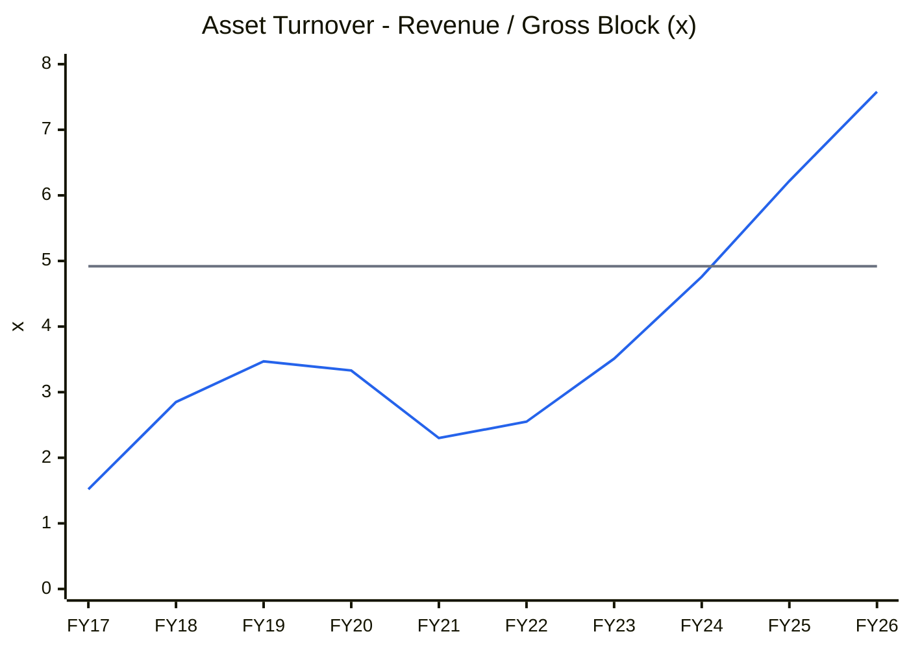
🟦 Asset turnover · ⬜ 5-yr average (FY22–26) 4.92×

**Read:** Asset turnover tripled from 2.55× (FY22) to 7.58× (FY26), 54% above its 5-yr average, on a gross block that grew only 35%.

**Business inference:** For an integrator, gross block does not drive revenue; the order book does (Module 1c), so the AT peak is a programme artefact. But the ₹2,670 Cr+ capex will take gross block to ~₹3,000–3,600 Cr by FY30. At base FY29 revenue (₹7,500 Cr) that is AT ~2.5–3×, the bear anchor for core ROIC.

**Incremental ROIC (greenfield):** ₹2,670 Cr lifts capacity from 32 to 43 platforms (+34%) and adds large-hull capability. At the current ~₹7,000 Cr on 28–32 platforms, the added capacity supports ~₹2,500–3,700 Cr of revenue (est.). At 8.5% core EBIT that is NOPAT of ₹160–235 Cr → **~6–9% incremental ROIC vs WACC 12.5% → value-neutral-to-destroying** unless the commercial hulls earn well above naval L1 margins. Global Aframax/VLGC building is a price-taker market. → Flagged in Module 4.
**Order-book-model implied revenue CAGR (FY26–29):** **~2.3%** (₹7,002 → ₹7,500 Cr) vs PIE ~23% NOPAT CAGR → **"Unannounced order pricing"**: the market assumes NGC + P17B + MCMV/LPD wins and fast burn that the contracted book and the S-curve timing cannot deliver before FY30.

### Earnings model (base, standalone, ₹ Cr; estimates)
| Metric | FY26A | FY27E | FY28E | FY29E |
|---|---|---|---|---|
| Revenue | 7,002 | 7,300 | 6,250 | 7,500 |
| EBITDA margin (excl. OI) | 11.4% | 10.5% | 9.0% | 9.5% |
| EBITDA | 795 | 767 | 563 | 713 |
| Other income (mostly interest on project funds) | 274 | 270 | 240 | 250 |
| D&A | 49 | 55 | 65 | 75 |
| Interest (leases, BG) | 16 | 16 | 16 | 15 |
| PBT | 1,005 | 966 | 722 | 873 |
| ICR (×) — flag < 2.5× | 64 | 61 | 46 | 59 |
| PAT (tax 25.5%) | 748 | 720 | 538 | 650 |
| EPS (₹; 11.455 Cr shares) | 65.29 | 62.8 | 47.0 | 56.7 |
| CFO (est.) | −290 | +500 (P17A/ASW delivery collections) | +2,000 to +3,000 *if* the NGC advance arrives; ~0 if not | +300 |
| Gross capex | 77 | ~205 | ~735 | ~975 |
| **FCF (est.)** | **−367** | **~+300** | **highly NGC-dependent** | **~−675** |
| Gross debt / EBITDA (×) — flag > 3.0× | 0.05 | ~0.05 | ~0.1 | ~0.1 (debt-free; capex from accruals and project-fund timing) |

*FY27 assumes the Q1 run-rate holds (CMD: "the current quarter's performance will be able to replicate"). FY28 assumes NGC is signed Q4FY27 with design-phase revenue (~3% of ₹33,000 Cr) and the 8th Pay Commission (+15–20% employee cost). FY29 assumes NGC in hull phase (~9%), a remaining legacy book of ~₹2,500 Cr, and ~₹2,000 Cr burn from new mid-size wins.*

**FCF inflection year:** Not meaningful, because FCF follows advances. A sustained, advance-independent FCF is unlikely before the greenfield capex ends (~FY31).
**Debt ceiling:** Not binding. The binding constraint is **own funds** (₹283 Cr), which makes dividends plus ₹2,670 Cr of capex reliant on fresh customer advances.

### Key catalysts (3–5)
1. **NGC contract signing** (~₹33,000 Cr; 5 corvettes; CCS pending). Expected FY27 per management; base assumes Q4FY27. Lifts cover to ~6× and brings a large advance.
2. **P17B bid outcome** (7 frigates, AoN ~₹70,000 Cr; split 4/3). Bids due ~Jan-27, award late-2027. L2 alone is worth ~₹30,000 Cr (CMD).
3. **Mid-size naval/Coast Guard awards:** 120 FIC (~₹3,500 Cr, split 80/40), 31 FAC (~₹3,500 Cr), 22 IB (~₹1,200–1,300 Cr), 6 CG NGOPV (~₹2,500 Cr). Timing H2FY27–FY28.
4. **MCMV / LPD RFPs** (₹36,000 Cr / ₹35,000 Cr). RFPs expected in CY26; awards FY28+.
5. **H1FY27 results (Nov-26):** receivables collection and margin without estimate releases. Credibility check.

### Key risks (3–5)
1. **FY28 revenue and earnings dip** as P17A/ASW end before NGC ramps. Probability: **High**.
2. **NGC delayed further, or re-scoped** (CCS; 17 months since L1). Probability: **Medium**.
3. **Margin normalisation** to 8–9.5% (fixed-price L1 contracts, no more estimate releases, pay commission). Probability: **Medium-High**.
4. **Capital misallocation**: a ₹4,000 Cr+ greenfield wave into commercial shipbuilding at ~6–9% incremental ROIC, during a policy-driven capacity flood. Probability: **Medium**.
5. **GoI OFS** (public float at the 25% minimum, but DIPAM has sold MDL and CSL stakes). Probability: **Medium**.

### Scenario analysis (FY29E; order-book-driven, the native engine for shipbuilding)
| Scenario | Driver | Revenue FY29 | EBITDA margin | EPS FY29 | Target P/E | Target price | Probability |
|---|---|---|---|---|---|---|---|
| **Bull** | NGC signed by Q3FY27; P17B 3–4 frigates (late-2027); strong mid-size wins; OI ₹330 Cr on fresh advances | ₹9,500 Cr (10.7% CAGR) | 11.5% | ₹86.3 | 40× | **₹3,452** | 25% |
| **Base** | NGC signed Q4FY27; FY28 dip to ~₹6,250 Cr; P17B not won (or post-FY29 revenue); margins ~9.5% | ₹7,500 Cr (2.3%) | 9.5% | ₹56.7 | 32× | **₹1,814** | 50% |
| **Bear** | NGC slips into FY28; P17B lost; margins revert toward FY23–25 underlying levels; float drains | ₹5,200 Cr (−9.4%) | 6.5% | ₹29.1 | 22× | **₹640** | 25% |
| **Expected value** | | | | | | **₹1,930** | |

**Return from CMP to expected value: −10%.** The multiples sit around GRSE's own 20.9× median (bear) and peer bands (MDL 30–40×, CSL 22–42×). Sensitivity: even with a 30× bear multiple (₹873), U/D is 1.04:1, so the hard stop holds.

**Thesis (1–3 sentences):** GRSE is India's most efficient PSU shipyard, but its FY24–26 earnings were the harvest of three programmes peaking together, lifted by estimate releases and funded by customer advances now running off. At ₹2,140 the market already capitalises a successor order book (NGC, P17B) that is neither signed nor revenue-bearing before FY29, while the stock is in Stage 4. The risk-reward is unfavourable until either the price or the order book resets.

**Monitoring metrics (what revises the thesis):**
- Upgrade:
  1. NGC contract signed with an advance (BSE Reg-30 filing).
  2. H1FY27 receivables back below ₹600 Cr and CFO positive.
  3. Quarterly EBITDA ≥ 10% in Q2/Q3FY27 without estimate releases.
  4. P17B L1/L2.
- Downgrade further:
  5. NGC not signed by Mar-27.
  6. Q3FY27 EBITDA < 8%.
  7. A GoI OFS announcement.

---

## Checklist Summary
**Section 0 (Existing Report Protocol):** 3/3. Base report read in full; 43 items validated (19 ❌ corrected); renamed via `git mv`; one file only.
**Section A (Business Quality):** 17/18. Scuttlebutt is limited to one broker note, a CARE rationale and analyst Q&A; no customer or employee channel checks.
**Section B (Forensics):** 9/9. Red flags 5/15 → deep dive done (explained as estimate timing and advance run-off; escalation triggers defined).
**Section C (Financial Statements):** 11/12. Ind AS 116 leases (₹37 Cr) are immaterial and included in EV.
**Section D (KPIs & Peers):** 7/7.
**Section E (Market Size & Share):** 5/7. No historical 5-yr market-share series; TAM is from management's pipeline list.
**Section F (Valuation):** 10/10.
**Section G (Technical):** 7/8. The Nifty weekly 30-wk MA and the defence index stage come from sister reports and secondary sources.
**Section H (Forward View):** 24/31. Segment-level PPE and a project-wise CWIP schedule are not disclosed (exempt from segment reporting); the Gujarat PPP share is undisclosed; unit economics N/A.
**Section I (Charts):** 5/5. C1, C2, C4/CY7, C5, C6, C7, C8, C12, C13, CY1, CY2 (+ROE), CY4, OB-1, OB-2, OB-3, OB-4. Pre-save check done: every series traces to a table; x-axis counts match; negative series are drawn as lines with zero lines (OB-4 converted from the script's bar).
**Order Book Tracker:** Run (ledger built from 1-Apr-2024; no prior ledger existed).

**Checklist A (master analysis) — key confirmations:** Primer ✓; segment KPI block used ✓; 10-year data ✓ (FY15–26 P&L, FY17–26 gross block); PIE before DCF ✓; forensics before valuation ✓; core vs treasury separated ✓; Screener cash flow cross-checked against ARs ✓.

**Pre-buy final check (Checklist B):**
- Thesis is falsifiable ✓ (monitoring list above).
- Inversion ✓: five failure modes listed; the price discounts few of them.
- Circle of competence ✓.
- Asymmetry ✗ (0.87:1; SVAR 70%) → stop.
- Buffett 5-yr test: the franchise survives, but the capital-allocation pivot to greenfield commercial yards is untested → trading, not compounding.
- Narrative vs numbers ✗: "best is yet to come" vs a 10-year-low book and five quarters of missed NGC timing.
- Recency ✓: normalised margins (9.5%) used.
- Confirmation bias ✓: bull view (ICICI ₹2,850) reviewed and the FY28 EPS disagreement stated.
- Crowd ✓: our view sits below the street.
- Governance ✓: pledge nil, no SEBI/ED issues. **EoM present** (estimate revisions), noted.

**Hard stops triggered:** (1) **Upside/downside 0.87:1 < 1.5:1**; (2) **Weinstein Stage 4 with a declining 30-week MA** (4 weeks declining, breakdown below the Stage-3 range). Not triggered: ROCE < WACC for 5+ years (reported ROCE > WACC since FY19; core ROIC > WACC since FY22, a turnaround); pledge; ICD; auditor resignation (the FY27 change is a CAG rotation); integrity. Beneish > −1.78 is flagged but explained (31-Mar deliveries).

---

## Investment Decision
**Recommendation: AVOID** (five-category verdict), with two hard stops: U/D < 1.5:1 and Stage 4. Without them: **Quality at Wrong Price.**

**Conviction score: 4 / 10**

| Component | Max | Score |
|---|---|---|
| Market + sector + stock cycle (Modules 1/1b/1c) | 1 | 0.2 |
| Industry structure (Module 2) | 1 | 0.5 |
| Business quality & moat (Module 3) | 2 | 1.2 |
| Management (Module 4) | 1 | 0.6 |
| Financial + earnings quality (Modules 5–6) | 2 | 1.2 |
| Valuation & PIE asymmetry (Modules 8–9) | 2 | 0.2 |
| Technical + CANSLIM (Module 10) | 1 | 0.1 |
| **Total** | **10** | **4.0** |

**Suggested position size:** 0% (watchlist only).
**Buy-below range (watchlist): ₹1,450–1,550.** At ₹1,500, U/D = (3,452 − 1,500) ÷ (1,500 − 640) = 2.3:1 and the discount to expected value is 22%. At ₹1,577, U/D is exactly 2:1. The base FY29 value discounted 2.5 years at Ke 12.5% is ₹1,351. Apply only after a Stage-1 base with a flattening 30-wk MA. **Earlier re-run trigger:** a signed NGC contract.
**Stop-loss (existing holders):** A weekly close below the declining 30-wk MA (₹2,563) has already triggered. Hard floor: ₹1,964 (52-wk low).
**Target price (FY29):** Bear ₹640 · Base ₹1,814 · Bull ₹3,452 · EV ₹1,930.
**ROCE vs WACC:** Reported ROCE 43% (incl. treasury) / core ROIC 92% (FY26) vs WACC 12.5%. Both are at decade peaks and set to normalise.
**Review trigger:** NGC signing; H1FY27 results (~Nov-26: receivables, CFO, margin); P17B bid opening (~Jan-27); any GoI OFS.

### Data gaps
1. **Q2FY27 (Sep-26 quarter) results are not yet published.** The H1 balance sheet will show whether the ₹1,221 Cr of receivables has been collected.
2. **Own funds at Mar-26 and Jun-26 are not disclosed.** The ₹283 Cr own-funds figure is from Sep-25 (Q2FY26 call). EV uses it.
3. **Order-book reconciliation:** the Q1FY25 implied inflow (₹3,588 Cr vs ₹589 Cr announced) and the Q4FY26 −₹1,039 Cr restatement are unexplained by the company. Programme balances on calls do not tie (e.g. NGOPV "₹5,168 Cr" in the May-26 transcript).
4. **NGC contract terms** are not public: final value (₹25,000 Cr+ filing vs ~₹33,000 Cr CARE vs ~₹40,000 Cr total programme per press), advance %, delivery schedule and CCS date.
5. **Gujarat PPP:** the GRSE capital share and structure are not disclosed (not in the 24-Aug-26 capex filing).
6. **Exempt from segment reporting**: there is no segment margin split (ship vs engineering vs repair), and no project-wise CWIP.
7. FY24 estimate-revision impact was not separately disclosed (only FY25 and FY26 Note 48).
8. Nifty and Nifty India Defence weekly 30-wk MAs were not computed; secondary sources are used.
9. The June report's 52-week high (₹3,538) could not be re-sourced.

### Sources
- Screener.in: [GRSE standalone](https://www.screener.in/company/GRSE/) (P&L FY15–26, quarters Jun-23–Jun-26, balance sheet, cash flow, ratios, shareholding Dec-23–Sep-26; price, DMA, volume and P/E chart API, accessed 13-Oct-26).
- Annual Reports: [FY26](https://www.bseindia.com/xml-data/corpfiling/AttachHis/c7976186-75fd-4281-9279-fcc63ecea1b0.pdf) (balance sheet, P&L, cash flow, Notes 10, 18, 19, 20, 21, 29, 48, 49; auditor's report with EoM and KAMs; Directors' Report order book and gross block; decade table), [FY25](https://www.bseindia.com/xml-data/corpfiling/AttachHis/d08fc952-56e0-4d5f-9ad4-e3ef3a2e7e30.pdf) (Note 48, FY24 cash-flow comparative, contract liabilities).
- Earnings calls (BSE): [Q1FY27, 6-Aug-26](https://www.bseindia.com/stockinfo/AnnPdfOpen.aspx?Pname=eb03f183-9215-46ce-8b9d-ebc6729f0440.pdf), [Q4FY26, 12-May-26](https://www.bseindia.com/stockinfo/AnnPdfOpen.aspx?Pname=ac1f1c3d-44eb-4515-b4b1-c374cd12b95b.pdf), [Q3FY26 meet, 11-Feb-26](https://www.bseindia.com/stockinfo/AnnPdfOpen.aspx?Pname=6535c7ed-dc40-41b2-aed4-920a4ee06ce5.pdf), [Q2FY26](https://www.bseindia.com/stockinfo/AnnPdfOpen.aspx?Pname=e561979d-e033-4dbd-9713-47de8301eced.pdf), [Q1FY26](https://www.bseindia.com/stockinfo/AnnPdfOpen.aspx?Pname=66b11c87-3fae-40d4-a69f-e8856df775ec.pdf), [Q4FY25](https://www.bseindia.com/stockinfo/AnnPdfOpen.aspx?Pname=06d7ad96-67db-4e6b-a533-75759b906b9a.pdf), [Q3FY25 meet](https://www.bseindia.com/stockinfo/AnnPdfOpen.aspx?Pname=4e81e183-15ee-4083-a50d-d2605e86bd33.pdf), [Q2FY25](https://www.bseindia.com/stockinfo/AnnPdfOpen.aspx?Pname=af7a7555-e03d-4bf2-9438-2f7952e524e3.pdf), [Q1FY25](https://www.bseindia.com/stockinfo/AnnPdfOpen.aspx?Pname=548722c0-fd46-4964-a049-d0acc9523f8b.pdf), [Q4FY24](https://www.bseindia.com/stockinfo/AnnPdfOpen.aspx?Pname=47b8fd72-987d-4bab-8bb1-c0a904b58ab3.pdf).
- BSE Reg-30 filings: order filings (see Order Ledger); [Q1FY27 results, 29-Jul-26](https://www.bseindia.com/xml-data/corpfiling/AttachHis/69ad00e1-6cd5-4dc8-9887-675391ccb4ae.pdf); [capex ₹2,670 Cr, 24-Aug-26](https://www.bseindia.com/xml-data/corpfiling/AttachHis/253b8f30-5a4d-4c7a-bea0-6d4f42b499ef.pdf); [Navratna, 20-Jun-26](https://www.bseindia.com/xml-data/corpfiling/AttachHis/710574cf-becf-4a91-bbc4-977b5118a245.pdf); [GST penalty, 13-Feb-26](https://www.bseindia.com/xml-data/corpfiling/AttachHis/5c21cc18-b4e3-43ed-ba9d-a6076bc649e5.pdf); [Kongsberg MoU rumour verification, 4-Jun-25](https://www.bseindia.com/xml-data/corpfiling/AttachHis/0422f66f-6551-4ba9-82ad-33e9984e2ab8.pdf); auditor appointment (25-Sep-26).
- Rating: [CARE Ratings, Jun-2026](https://www.careratings.com/upload/CompanyFiles/PR/202606140613_Garden_Reach_Shipbuilders_and_Engineers_Limited.pdf).
- News and brokers: [Hans India (NGC CCS pending, 3-Jun-26)](https://www.thehansindia.com/news/national/grse-awaits-contract-for-next-generation-corvettes-project-to-get-final-ccs-nod-1082647), [idrw (NGC signing expected Q2FY27)](https://idrw.org/grse-confirms-formal-signing-of-3-7-billion-next-generation-corvette-contract-expected-in-q2-fy27/), [Shephard (P17B RFP 16-Sep-26)](https://www.shephardmedia.com/news/naval-warfare/p17b-tender-shift-indian-navy-frigate-procurement/), [Raksha Anirveda (P17B)](https://raksha-anirveda.com/indian-navy-invite-bids-for-project-17b-stealth-frigate-programme/), [ICICI Direct Q1FY27 note](https://mailcontent.icicidirect.com/mailcontent/idirect_grse_q1fy27.pdf), [Sharpely consensus](https://sharpely.in/stocks/grse/forecast), [GoodReturns (Nifty 2026)](https://www.goodreturns.in/common/static_html/nifty-and-sensex-in-2026--down-about-15--1790886452.html), [JM Financial (Nifty/VIX)](https://www.jmfinancialservices.in/market-news-and-insights/1735991).
- Sister reports (same folder, 12-Oct-26): `MAZDOCK_MazagonDockShipbuilders_2026-10-12.md`, `COCHINSHIP_CochinShipyard_2026-10-12.md` (peer figures, WACC framework, sector stage).
- Calculations: scratchpad `calc.py` (ratios, DuPont, Beneish, Altman, Piotroski, reverse DCF, scenarios); order-book CSVs (scratchpad only).

---
*Report generated by Stock Fundamental Analysis Skill v3.3 | Indian Markets Context*
*Save path: C:\Users\anubh\Documents\Anubhav\Stock Analysis\Stock Analysis\GRSE_GardenReachShipbuilders_2026-10-13.md*
