# Stock Analysis Report — Mazagon Dock Shipbuilders Ltd (MAZDOCK)
**Date:** 2026-10-12
**Analyst:** Claude (Stock Fundamental Analysis Skill v3.3)
**Investment Horizon:** 2–3 Years
**CMP:** ₹2,053 (NSE, 12-Oct-2026 09:42, Screener; last weekly close ₹2,010 on 09-Oct-2026) · **Shares:** 40.33 Cr · **Market cap:** ₹82,798 Cr
**Recommendation:** AVOID for fresh money → WATCHLIST. Buy-below ₹1,650–1,750, *or* re-run on a signed P75(I) / P75 follow-on contract once a Stage 1 base forms
**Verdict category:** AVOID (hard stops: Weinstein Stage 4 with a declining 30-week MA; upside/downside 1.50:1, which fails the 1.5:1 test at 1.496)
**Conviction Score:** 5 / 10 (4.8)

## Revision Log
| Version | Date | Recommendation | Conviction | Price | Key change |
|---|---|---|---|---|---|
| Current | 2026-10-12 | AVOID / WATCHLIST (buy-below ₹1,650–1,750) | 5/10 | ₹2,053 | Order book fell again to ₹18,218 Cr (1.4× TTM revenue; TTM implied book-to-bill ~0.10). P75(I) and the 3-Scorpene follow-on are still unsigned. The stock broke into Stage 4. Strip out ~₹1,000 Cr of treasury interest and core P/E is ~44×, not the 29× headline. |
| Previous | 2026-06-20 | WATCHLIST (BUY at ₹2,100–2,200 or on P75I signing) | 6/10 | ₹2,519 | Initial report under skill v2.0. Full text is in git history. |

**What changed in the thesis**
1. **The order-book cliff is deeper and has lasted longer.** The order book was ₹20,535 Cr at Mar-26 and ₹18,218 Cr at Jun-26, with implied Q1FY27 inflow of only ₹454 Cr. The old report used "book-to-bill 1.6×", which is really order-book cover. True TTM book-to-bill (implied inflow ÷ revenue) is ~0.10.
2. **P75(I) has slipped a fourth time.** Contract negotiations finished in Mar-26 (MDL BSE clarification, 05-Mar-2026), and the Finance Ministry reportedly cleared the deal on 28-May-2026. CCS approval is still pending as of 12-Oct-2026. The 3-Scorpene follow-on was "confident before 31-Mar-2025" (Q3FY25 call) and is still unsigned 18 months later.
3. **Treasury income is now separated from core earnings.** FY26 other income was ₹1,139 Cr, of which ₹1,008 Cr was bank-deposit interest (AR FY26 Note 29). That is 35% of PBT. On core earnings only, the stock trades at ~44× TTM core NOPAT after deducting shareholders' own cash.
4. **New forensic items from AR FY26.** The onerous-contract provision doubled to ₹1,060 Cr (FPV / Denmark MPV fixed-price contracts). A ₹262 Cr P17A liquidated-damages reversal was booked into revenue. Five Emphasis-of-Matter paragraphs appear in the standalone audit report.
5. **Technicals turned negative.** The price is ₹2,048 versus a 30-week MA of ₹2,414 that has been falling since Jan-26, and the 52-week weekly-close low was set on 09-Oct-2026. The old stop (₹2,000 weekly close) is ~2% away.
6. **Capital allocation is a new risk.** Management floats ~₹15,000 Cr of greenfield shipyard capex for the Dighi (Maharashtra) cluster, plus anchor status at Dugarajapatnam (AP), for commercial shipbuilding (Director-Finance, Sep-2026). The earlier ₹5,000 Cr Thoothukudi plan has been dropped (BSE clarification, 02-Oct-2026).

**Validation of previous report** (every carried-forward item re-checked; all ❌ listed)
| Item | Previous (20-Jun-2026) | Now (validated source) | Status |
|---|---|---|---|
| FY26 revenue / PAT / EPS (consol.) | ₹13,006 Cr / ₹2,578 Cr / ₹64.0 | Same (Screener consol.; Apr-26 PPT; AR FY26 says PAT attributable ₹2,583 Cr) | ✅ Validated |
| FY26 CFO | ₹−2,891 Cr | **₹−2,654 Cr** consolidated (AR FY26 cash-flow statement p.244); standalone ₹−2,761 Cr | ❌ Corrected |
| Screener cash-flow year alignment | not checked | Cross-checked vs AR FY24/25/26: FY23 ₹1,516, FY24 ₹684, FY25 ₹2,102 (restated; ₹2,078 originally), FY26 ₹−2,654. **No year shift** | ✅ Validated (new check) |
| Contingent liabilities | "₹37,852 Cr (performance guarantees, warranty, tax disputes), >37% of mcap" | AR FY26 Note 36: indemnity bonds to MoD ₹24,732 Cr; bank guarantees ₹1,345 Cr; LCs ₹603 Cr; litigation claims ₹285 Cr; sales-tax ₹1,163 Cr (reimbursable by customer); service tax ₹47 Cr. Screener aggregate ₹28,181 Cr. Genuine dispute exposure is only **~₹1,500 Cr**; the rest are contractual indemnities that shrink as projects close | ❌ Corrected (figure and character) |
| Cash used in EV | "Cash est. ₹6,000 Cr" | Cash ₹2,731 Cr + other bank balances ₹10,365 Cr = **₹13,097 Cr** (AR FY26 consol. BS). Mgmt: ~₹6,000 Cr of the ~₹11–12k Cr pile was "our margin", the rest customer advances (Q4FY25 call). Own cash now est. ~₹7,000 Cr | ❌ Corrected (mislabelled total cash) |
| Effective tax rate | "12–15% vs 25% statutory"; NOPAT used 15% tax | **25.2%** (FY26 consol. tax ₹659 Cr / PBT ₹3,237 Cr; Screener 25%) | ❌ Corrected |
| DuPont table | AT 0.68→0.48×, equity multiplier 2.1→1.8×, EBIT margin 6→18% | AT **0.19→0.47×**, EM **7.7→2.8×**, EBIT margin 13→26% (FY22–FY26, Screener consol.) | ❌ Corrected |
| ROIC | "~28–30% FY26; 10-yr avg ~20%" | Reported ROCE 36% FY26, 10-yr avg 30% (Screener). Core ROIC on tangible operating capital ~97% FY26 (computed) | ❌ Corrected |
| "Book-to-bill 1.6×" | Labelled book-to-bill | 1.6× was order-book **cover** at Mar-26. Jun-26 cover is 1.4×; TTM book-to-bill (inflow/revenue) is ~0.10 | ❌ Corrected (terminology) and 🔄 Updated |
| Execution rate | ~29% | FY26 = ₹12,840 Cr / opening OB ₹32,260 Cr = **40%** (FY25 30%) | 🔄 Updated |
| Order book | ₹20,535 Cr (implied) | ₹18,218 Cr at 30-Jun-2026 (Q1FY27 PPT) | 🔄 Updated |
| Promoter holding / pledge | 81.22% / nil; "govt sold small stake 2021" | 81.22% / nil ✅. The sale was a **Apr-2025 OFS** (84.83%→81.22%, BSE 03-Apr-2025), not 2021 | ❌ Corrected (date) |
| WTT: "FY25 concall guided FY26 revenue ~₹13,000 Cr" | ✅ hit | Actual guidance: 8–10% growth (Q4FY25 call, 30-May-2025) and ~₹12,500 Cr (Q2FY26 call, 28-Oct-2025). Delivered ₹12,840 Cr standalone, so still a hit | ❌ Corrected (wording) |
| WTT: "OB ₹1 lakh Cr by FY26" | ❌ miss | Guidance was **>₹1.25 lakh Cr by FY26** if both submarine deals were signed (Q4FY25 call). Missed (₹20,535 Cr) | 🔄 Updated |
| WTT: "PAT growth 5–8% guided" | ✅ | FY26 PAT growth 6.8% is correct, but the guidance source could not be found in any transcript | ⚠️ Unverifiable (dropped from scorecard) |
| WTT score | 0.50 | **0.42** on 12 points (Module 4) | 🔄 Updated |
| Sloan accrual | ~+18% | **+14.4%** (FY26 consol.) | 🔄 Updated |
| Piotroski | 6/9 | **5/9** | 🔄 Updated |
| CWIP / gross block | CWIP ~₹400 Cr; gross block ₹2,069 Cr | CWIP ₹252 Cr consol. (₹245 Cr standalone); gross block ₹2,140 Cr (AR FY26 p.33) | ❌ Corrected |
| FY26 D&A / interest | ₹200 Cr / ₹45 Cr | ₹97 Cr / ₹74 Cr consol. (Screener) | ❌ Corrected |
| Graham Number | ₹595 (single-year EPS ₹65) | **₹484** on 5-yr avg EPS ₹42.95 × BVPS ₹242 | ❌ Corrected (method) |
| Peer: Cochin "net debt ₹1,672 Cr" | net debt | ₹1,672 Cr is **gross borrowings** (Screener). Cochin holds cash too | ❌ Corrected |
| Peer: GRSE book-to-bill 3.4× | — | OB ₹13,596 Cr at Jun-26 / TTM rev ₹7,507 Cr = **1.8×** cover | 🔄 Updated |
| WACC | 11.5% | **12.5%** (Rf 7%, β ~0.9, ERP 6%), reflecting the stock's high volatility | 🔄 Updated (judgement) |
| Revenue split "~70% warships / ~30% HE" | stated | Parent is exempt from segment reporting (AR Note 35). OB split Jun-26: Shipbuilding 64% / Submarine & HE 36% | ⚠️ Unverifiable (replaced with OB split) |
| P75I value / MDL share "₹35–40k Cr" | stated | Reports range ₹70,000–99,000 Cr total. MDL work-share is not disclosed | ⚠️ Unverifiable |
| Nifty Defence index "52-week high, June 2026" | stated | Not re-sourced. Peer proxies (MDL, GRSE, Cochin) are 27–37% below highs in Oct-26 | ⚠️ Unverifiable |
| TAM ₹15–20k Cr/yr; "65% penetration" | stated | No primary source found | ⚠️ Unverifiable (kept as an estimate, flagged) |
| Kalvari monopoly; P17A 4 of 7; share count 40.33 Cr | stated | Confirmed (Jun-26 corporate presentation; Screener) | ✅ Validated |

**Old data gaps retried:** (a) Volume at price action: now assessed from Screener weekly volume (Module 10). (b) The order ledger was missing (the old report had no Order Ledger table). It is now built from all BSE Reg 30 order filings since 01-Apr-2023 (14 rows). (c) Cash-flow verification: closed (see above). (d) Contingent liability composition: closed.

---

## Business Primer

Mazagon Dock Shipbuilders (MDL) is a Mumbai shipyard, 81.22% owned by the Government of India through the Ministry of Defence. It builds destroyers, frigates and conventional submarines for the Indian Navy, plus Coast Guard vessels, offshore oil platforms for ONGC and a few commercial ships. It now also owns 51% of Colombo Dockyard PLC (Sri Lanka, consolidated from Q4FY26) and 47.21% of the unlisted Goa Shipyard. Revenue is recognised on a percentage-of-completion basis under multi-year, mostly fixed-price contracts (the Navy and Coast Guard account for 80–90% of the order book, per the Q2FY26 call). Each contract carries a large customer advance, and MDL parks that cash in bank deposits until it is spent. The business depends on two things. The first is getting nominated or winning the next large naval programme: P75(I) submarines, the 3-Scorpene follow-on, P17B frigates and the LPD. The second is executing those programmes without cost overruns, which in the past has been where the margin was made or lost.

MDL is a **government-franchise, project-based, asset-light-on-paper defence contractor**. Its earnings are swollen by a treasury float. The key value driver is order inflow (volume), followed by stage-of-completion margin: projects book conservatively early and release warranty and contingency provisions near delivery, which is why FY24–FY26 margins peaked as P15B, P17A and P75 closed out. The key risk is order timing. Big contracts arrive years late, the order book has fallen 64% from ₹50,310 Cr (FY21) to ₹18,218 Cr (Jun-26), and the next large nomination is unsigned. Two structural features colour everything below. First, **35% of PBT is interest on deposits** (₹1,008 Cr in FY26), and part of that cash belongs to customers, so the headline P/E understates how expensive the core business is. Second, **operating cash flow swings with advances**: CFO was ₹−2,654 Cr in FY26 as ₹5,191 Cr of contract liabilities ran off. Cash flow will stay weak until a large contract brings a fresh advance.

*Segment: Defence Shipbuilding & Marine Services — KPI reference available ✓ (`references/05-industry-kpis-india.md` line 1150).*

---

## Executive Summary
MDL is India's only builder of destroyers and conventional submarines. It is a wide-moat national franchise, but the business is between programmes. P17A, P15B and P75 are delivered, and the order book has run down to ₹18,218 Cr (1.4× TTM revenue). TTM implied inflow is ~₹1,300 Cr against ~₹13,000 Cr of revenue. The bull case rests entirely on contract signings that have slipped repeatedly: P75(I) with TKMS, worth a reported ₹70,000–99,000 Cr (CCS approval pending), and the ~₹36,000 Cr 3-Scorpene follow-on. At ₹2,053 the market already prices those signings in. A reverse DCF on core NOPAT implies **~24% a year for 10 years**, and core P/E is ~44× once ~₹1,000 Cr of deposit interest is set aside. The stock is in **Weinstein Stage 4** (price 15% below a falling 30-week MA, at 52-week closing lows). The FY29 base target of ₹2,216 offers only ~8% upside against bull ₹3,558 / bear ₹1,047, which gives U/D 1.50:1. **Verdict: AVOID for fresh money; watchlist with buy-below ₹1,650–1,750, or a re-run once P75(I) is signed and a new base forms.**

**Order book:** ₹18,218 Cr at 30-Jun-26 (**1.4× TTM revenue**) · all firm, no framework value · TTM book-to-bill (implied inflow) **~0.10** · tracked today ₹18,336 Cr (before Q2 execution) · pipeline not in book: P75(I) and P75 follow-on (negotiated, unsigned), P17B (RFP, competitive), LPD (AoN)

**C1 — Growth Index: Revenue vs Order Book vs Core EBITDA vs PAT (standalone, FY21 = 100)**

| FY | Revenue (₹ Cr) | Order book (₹ Cr) | Core EBITDA (₹ Cr) | PAT (₹ Cr) | Rev idx | OB idx | EBITDA idx | PAT idx |
|---|---|---|---|---|---|---|---|---|
| FY21 | 4,048 | 50,310 | 226 | 480 | 100 | 100 | 100 | 100 |
| FY22 | 5,733 | 45,874 | 442 | 586 | 142 | 91 | 196 | 122 |
| FY23 | 7,827 | 38,755 | 801 | 1,073 | 193 | 77 | 354 | 224 |
| FY24 | 9,467 | 38,561 | 1,416 | 1,845 | 234 | 77 | 627 | 384 |
| FY25 | 11,432 | 32,260 | 2,093 | 2,325 | 282 | 64 | 926 | 484 |
| FY26 | 12,840 | 20,535 | 2,262 | 2,436 | 317 | 41 | 1,001 | 508 |

*Sources: Screener.in standalone P&L (core EBITDA = operating profit, excluding other income); order book from AR FY25 p.39 and AR FY26 p.33.*

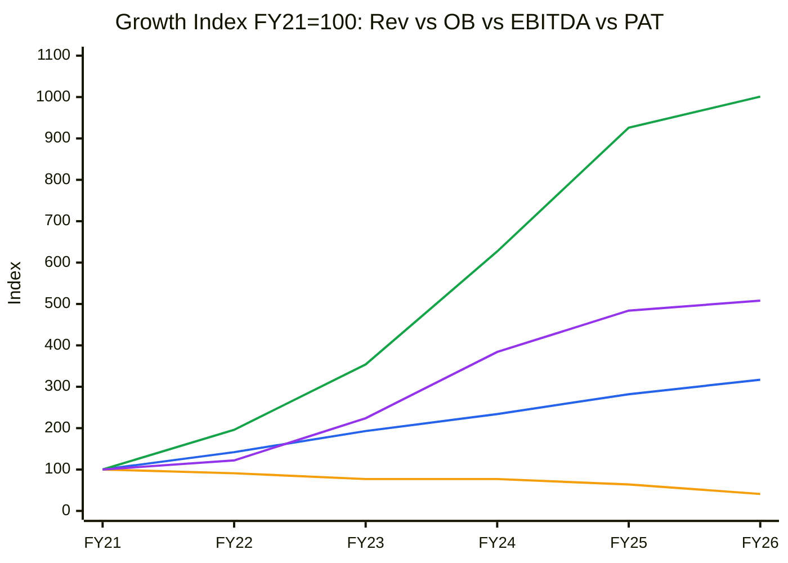
🟦 Revenue (CAGR 26.0%) · 🟧 Order book (−16.4%) · 🟩 Core EBITDA (+58.5%) · 🟪 PAT (+38.4%)

**Read:** Since FY21, revenue has risen 3.2× and core EBITDA 10× while the order book has shrunk to 0.41× of its FY21 level. Profit growth ran far ahead of revenue as legacy programmes reached completion.

**Business inference:** FY22–FY26 was a harvest. MDL executed a book won in the 2010s and released contingencies at delivery, so margins and ROE peaked while the order book was being consumed. Without a large new contract, revenue and margins revert from FY28 (→ Module 11 bear case).

---

## Module 1 — Market, Sector & Stock Cycle

### 1. Broad market (Marks)
- Nifty 50 closed at **22,520** on 09-Oct-2026, well below its 2024–25 highs above 26,000. India VIX was **14.35** ([JM Financial market wrap](https://www.jmfinancialservices.in/market-news-and-insights/1735991), as cited in the 11-Oct-2026 ideaForge report in this library).
- **Assessment: Cautious.** The market is correcting without panic, and primary issuance still clears. Sizing stays normal-to-small; there is no fear-driven bargain in the index.

### 1b. Sector cycle: tailwinds vs headwinds
**Secular vs cyclical decomposition (Indian naval shipbuilding):**
- **Secular (durable):** Fleet expansion toward ~200 ships by 2035 (`05-industry-kpis-india.md`), the Aatmanirbhar indigenisation mandate (MDL indigenous content rose from 42% on P15 to 75% on P17A, Jun-26 presentation), and a multi-programme naval pipeline: P75(I), P75 follow-on, P17B, LPD, MCMV and a next-generation destroyer. Management cites LPD at ₹35–40k Cr, MCMV ~₹40k Cr, P17B ₹50–60k Cr and a destroyer programme at ₹70–80k Cr (Q2FY26 call, 28-Oct-2025).
- **Cyclical (mean-reverting):** MDL's FY22–FY26 revenue and margin surge is a **programme-completion cycle**: three large programmes (P15B, P17A, P75) delivered within 30 months. That bunching does not recur until the next programmes are mid-build (FY30+).
- **Split:** Roughly 40% of FY22–FY26 revenue growth (26% CAGR) is cyclical bunching. The durable baseline for a well-ordered PSU yard is about 12–15% revenue growth, and that baseline only applies after the next submarine programmes are signed.

**Other inputs:**
- **Procurement model shift (headwind):** P17B is being tendered **competitively** to Category-A yards (MDL, GRSE, GSL, CSL) rather than by nomination ([Raksha Anirveda](https://raksha-anirveda.com/indian-navy-invite-bids-for-project-17b-stealth-frigate-programme/)). Competitive bids compress future margins versus the nomination-era P15B and P17A.
- **Capacity pipeline:** The industry is adding capacity. MDL's own South Yard Annex, Nhava yard and floating dock; Swan Defence (listed, 7,188% YoY revenue growth from a tiny base); and Cochin's ISRF and Udupi expansions. All are chasing the same naval and commercial demand, which is a capital-cycle warning (Module 2).
- **Geopolitical:** India–Pakistan tensions support budgets. The submarine imports and ToT for P75(I) come from Germany, an execution and transfer risk rather than a demand risk.
- **Net FX:** Export revenue is only 0.21% of standalone revenue (AR FY26). Imported submarine equipment is largely contract pass-through. Not material.

**Sector cycle verdict: Tailwind on demand, Headwind on timing and procurement terms. Net: Neutral.** Do not embed FY22–FY26 growth or margins in the DCF.

### 1c. Stock cycle: company-specific
**C2 — Quarterly YoY revenue growth (₹ Cr; Screener consolidated and standalone)**

| Qtr | Q2FY25 | Q3FY25 | Q4FY25 | Q1FY26 | Q2FY26 | Q3FY26 | Q4FY26 | Q1FY27 |
|---|---|---|---|---|---|---|---|---|
| Revenue consol. | 2,757 | 3,144 | 3,174 | 2,626 | 2,929 | 3,601 | 3,850 | 2,943 |
| YoY consol. | +50.8% | +33.1% | +2.3% | +11.4% | +6.2% | +14.5% | +21.3% | +12.1% |
| YoY standalone | +50.8% | +33.1% | +2.3% | +11.4% | +6.2% | +14.5% | +16.1% | +5.5% |
| Core operating profit | 511 | 817 | 119 | 302 | 695 | 887 | 543 | 447 |
| Core OPM | 19% | 26% | 3.8% | 11% | 24% | 25% | 14% | 15% |

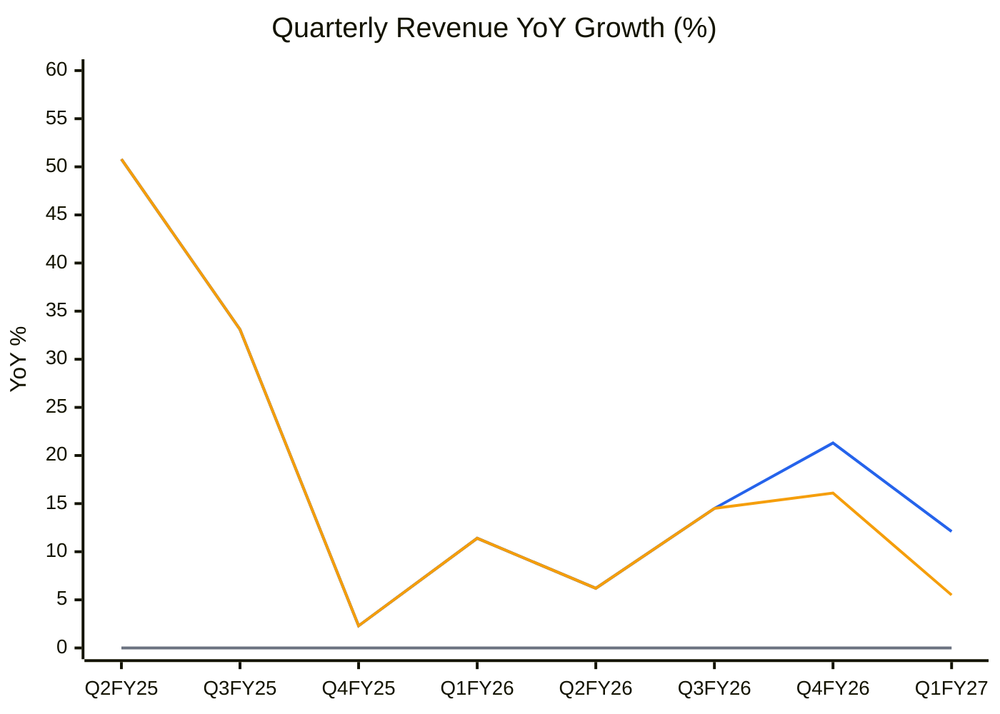
🟦 Consolidated YoY % (includes Colombo Dockyard from Q4FY26) · 🟧 Standalone YoY % · ⬜ zero line

**Read:** Growth has decelerated from +51% to single digits. The Q1FY27 consolidated +12% includes ~₹172 Cr of newly consolidated Colombo Dockyard revenue; **standalone growth was only +5.5%**.

**Business inference:** Organic growth is fading as the order book empties. The only "growth" left is acquired (CDPLC) or depends on unsigned contracts. Management's FY27 guidance of 15–17% growth (Director-Finance, Sep-2026) is not supported by a ₹18,218 Cr book (see the revenue anchor below).

- **Volume / price / mix:** Volume (programme stage) dominates. Margin is driven by **stage of completion**. Management says new projects book at 12–15% and late-stage projects at 25–30% ("at the end of the project … we book all the unclaimed liabilities", Q2FY26 call).
- **Order-book revenue anchor:** Opening OB of ₹20,535 Cr × FY26 execution rate of 40% gives ≈ ₹8,200 Cr from the book, plus ~₹700 Cr from CDPLC, plus small in-year inflow (Q1 implied ₹454 Cr). That points to **FY27 consolidated revenue of roughly ₹11,500–13,000 Cr without the submarine contracts**, versus a guided ~₹15,000 Cr. Q1's ₹2,771 Cr standalone run-rate (×4 = ₹11,100 Cr) agrees with the order-book math, not with the guidance.
- **Operating leverage:** Fixed cost is large (employee cost ₹937 Cr in FY26, AR Note 31). Every ₹1,000 Cr revenue shortfall at a ~20% contribution margin costs ~₹200 Cr of EBIT, so DOL is ~2× at current scale.
- **Guidance accuracy:** WTT 0.42 (Module 4). Revenue guidance has been reliable or conservative. Order-signing guidance has been unreliable (0 of 5).
- **FCF inflection:** Not yet. FCF was ₹−2,828 Cr in FY26 (consol.). The next inflection comes when a P75(I) or P75 follow-on advance (typically 10–15% of contract value) lands, which would swing CFO by ₹5,000 Cr or more in one year.

**Stock cycle classification: Late cycle, harvest phase ending.** Margins are above the 10-year average by more than 1 SD (CY7), and the order book is at a decade low. MoS +5–10pp. Size small.

---

## Module 2 — Industry Structure & Capital Cycle
**Porter Five Forces (Indian naval shipbuilding)**
| Force | Assessment | Signal |
|---|---|---|
| New entrants | Very high barriers for submarines and destroyers: security clearances, drydocks, ToT, design bureau integration. Lower for OPVs, FPVs and commercial vessels (Swan Defence, L&T, private yards) | Strong for MDL's core, weak for the periphery |
| Supplier power | Imported combat systems and submarine equipment (Naval Group, TKMS), mostly pass-through. Steel and machinery are domestic | Neutral |
| Buyer power | **Monopsony**: MoD and Navy set price, timing and LDs (P17A LDs ₹678 Cr outstanding, AR Note 57). Moving to competitive bidding (P17B) | **High: the key structural weakness** |
| Substitutes | None for warships. Pressure can come from aviation/drone priorities competing for the capital budget | Low |
| Rivalry | Four PSU yards plus emerging private yards. Nomination era is ending for frigates; submarines are still effectively nominated | Rising |

**Industry verdict: Neutral-to-attractive for submarines, neutral for surface ships.** A sovereign buyer caps returns over the cycle, even though the barriers are real.

**Capital cycle (Chancellor):** Supply-side signals are turning negative. (1) Capacity is being added across the sector: MDL's Nhava yard, South Yard Annex and floating dock; Cochin's ISRF; Swan's Pipavav restart; plus government shipbuilding-cluster programmes (Dighi, Dugarajapatnam) with ₹15,000 Cr+ per cluster. (2) New listings and re-rated stocks: Swan Defence is valued at ₹15,141 Cr on ₹31 Cr of quarterly revenue (Screener peer table). (3) MDL's own capex/depreciation was 4.9× in FY26 (₹472 Cr / ₹97 Cr). Returns are near peak while capital floods in, which reads as **late capital cycle**. CY8 is not charted (peer capex history not compiled; ⚠️ data gap).

---

## Module 3 — Business Quality & Moat
**Moat Verdict:** Wide in submarines and destroyers; Narrow in surface ships and commercial work
**Moat Source (Greenwald):** Supply advantage (capability, infrastructure, ToT) plus customer captivity (the Navy has no alternative builder of conventional submarines). Local scale applies on the west coast.
**Buffett Moat Type:** Government-mandated capability franchise
**Pricing Power Test:** **Fail / partial.** Contracts are fixed-price. MDL is booking onerous-contract losses (total estimated loss ₹1,180 Cr, AR Note 59) and pays LDs on delays. It cannot raise price 10%, but it can earn high margins on programmes it knows well.
**Market Share Stability (5yr):** Stable in submarines (100% of Indian-built conventional subs). Losing share of surface frigates to competitive tendering is a risk.
**Fisher 15-Point Score:** 31 / 45 *(Point 15 Integrity: Pass, PSU, no governance enforcement found)*

| # | Fisher point | Score (1–3) | Note |
|---|---|---|---|
| 1 | Market potential | 3 | Navy pipeline of ₹2.5 lakh Cr+ |
| 2 | New products | 2 | Midget submarine, AUVs, Li-ion batteries, AIP plug (Jun-26 presentation) |
| 3 | R&D effectiveness | 2 | ₹100.6 Cr spent on future-bid design in FY26 (AR Note 58) |
| 4 | Sales organisation | 1 | Nomination-dependent; exports 0.21% |
| 5 | Profit margin | 3 | Core EBITDA 17–18% (peak) |
| 6 | Margin improvement | 2 | Shipyard 4.0. Onerous losses on new programmes offset gains |
| 7 | Labour relations | 2 | Large unionised workforce; no disruption found |
| 8 | Executive relations | 2 | Director churn (independent directors' terms lapsing; MoD-appointed) |
| 9 | Management depth | 2 | Ex-Navy technocrats |
| 10 | Cost/accounting controls | 1 | 5 EoM paragraphs; vendor/Navy balances unreconciled (AR FY26) |
| 11 | Industry advantages | 3 | Only submarine yard |
| 12 | Long-range orientation | 2 | Capacity building; greenfield ambitions |
| 13 | Dilution | 3 | None; government OFS is secondary only |
| 14 | Communication in adversity | 1 | No earnings-call transcripts filed on BSE after Nov-2025; order timelines repeatedly over-promised |
| 15 | Integrity | 2 | Pass |

**Moat risk:** P75(I) dilutes the moat by involving TKMS design. The bigger risk is that future surface programmes go competitive (P17B), turning MDL from franchise holder into bidder.

---

## Module 4 — Management & Capital Allocation
**Promoter Holding:** 81.22% (President of India / MoD) | Pledge: Nil → Risk: Normal
**Promoter trend:** 84.83% → 81.22% after the Apr-2025 OFS (BSE 03/04-Apr-2025). Further OFS is possible down to the 75% MPS level (~2.5 Cr shares, ~₹5,100 Cr at CMP), which is a supply overhang.
**Institutional:** DII 1.69% → 5.02% (Mar-25 → Jun-26); FII 2.26% → 1.72%; 8.06 lakh retail holders (Screener shareholding)
**Share count:** Stable at 40.33 Cr (post 1:2 split, Dec-2024)
**Dividend:** ~28–30% payout; FY26 DPS ₹18.12 declared (Jun-26 presentation)
**Capital Allocation Rating:** Average → at risk. Internal capex has been sensible (FY26 ₹472 Cr: floating dock, cranes, Nhava). The Colombo Dockyard 51% stake cost ₹237 Cr (AR FY26). The next leg is a proposed **~₹15,000 Cr greenfield commercial shipyard** (Dighi cluster; "investing something around 15,000 crores", Director-Finance, Sep-2026). Commercial shipbuilding globally earns low-single-digit to high-single-digit margins, so incremental ROIC is likely below the 12.5% WACC unless heavily subsidised.
**Key RPT concerns:** None material (customers are government entities, transactions at arm's length per filings)
**Buffett Three C's:** Candor: Low–Moderate (no transcripts after Nov-25; repeated order-timing promises) | Competence: High in execution (P15B ships 2–5 months early) | Caring: Moderate (steady dividends; the state's priorities come first)

### Walk the Talk Scorecard
| Quarter guided | Statement | Guided | Actual | Verdict |
|---|---|---|---|---|
| Q3FY25 call (07-Feb-25) | 3 additional P75 Scorpenes signed "before 31st March this year" | By Mar-25 | Not signed as of Oct-26 | ❌ |
| Q3FY25 call | P75(I) order "next financial year" | FY26 | Not signed | ❌ |
| Q4FY25 call (30-May-25) | FY26 revenue growth 8–10% | 8–10% | +12.3% standalone (₹12,840 Cr) | ✅ (beat) |
| Q4FY25 call | Order book >₹1.25 lakh Cr by FY26-end if both subs signed | ₹1.25 lakh Cr | ₹20,535 Cr | ❌ |
| Q4FY25 call | PBT/EBITDA margin ~15% normalised | ~15% | FY26 core OPM 17.4%; PBT margin 25% | ✅ (beat) |
| Q4FY25 call | ₹532 Cr provision (FPV + MPV) a one-off "estimate for a loss" | One-off | FY26 onerous charge ₹538 Cr again; provision now ₹1,060 Cr | ❌ |
| Q4FY25 call | 4th P17A delivered by Apr-26 | Apr-26 | Mahendragiri delivered 30-Apr-26 | ✅ |
| Q2FY26 call (28-Oct-25) | FY26 revenue ~₹12,500 Cr | ₹12,500 Cr | ₹12,840 Cr standalone | ✅ |
| Q2FY26 call | P75(I) signed by FY26-end; 3 Scorpenes "in coming months" | Mar-26 | Neither signed (CNC done Mar-26; CCS pending) | ❌ |
| Q2FY26 call | FY26 capex ~₹500 Cr; floating dock complete by FY26-end | ₹500 Cr / Mar-26 | Capex ₹472 Cr ✅; dock still "target completion Jul'26" in Sep-26 presentation | ⚠️ capex hit, dock late (scored as 1 hit + 1 miss) |
| Q2FY26 call | Thoothukudi greenfield shipyard, ₹5,000 Cr phase 1 | Proceed | Not pursued (BSE clarification 02-Oct-26; state JV decision) | 🔴 Reversal |

**WTT Score:** 0.42 / 1.00 — **LOW** (12 points: 5 hits, 6 misses, 1 reversal; the capex/dock line counts as one hit and one miss)
**Key pattern:** **One-way misses on order timing.** Every contract-signing date has slipped, five times in 20 months. Revenue and margin guidance is conservative (sandbagged). "One-off" provisions recur.
**Insider action:** No open-market insider trades (PSU). The promoter (GoI) **sold** 3.61% via OFS in Apr-2025 near ₹2,500–2,700, a neutral-to-bearish signal on price.
**DCF impact:** Order-signing dates are pushed out 2–3 quarters beyond management's latest guidance. FY27 revenue guidance (15–17%) is haircut to ~0% organic growth (flat consol. ~₹13,000 Cr) because the order book cannot support it.
**Overall management credibility:** MODERATE on execution, LOW on order timelines and provisioning.

---

## Module 5 — Financial Forensics
**Forensic Red Flag Count:** 5 / 15 (CFO/PAT divergence, Sloan >10%, other income/EBIT >15%, Beneish mechanically >−1.78, debtor-days jump). All are explained by contract mechanics, but they still count as flags.
**Beneish M-Score (FY26 consol.):** **−0.17 mechanical** → "likely manipulator" zone. Drivers: DSRI 2.15 (receivables ₹1,067 → ₹2,606 Cr as two frigates were delivered and billed in H2), TATA 0.19 (advance run-off), DEPI 1.62 (CDPLC assets consolidated near year-end). Excluding the ₹5,069 Cr contract-liability run-off from accruals, M ≈ **−1.0**, still grey-to-high because of DSRI. **Explained (delivery-milestone billing to the Navy, not a revenue-quality issue), but watch Q2FY27 receivables.**
**Altman Z''-Score:** **4.08** (FY26) vs 3.12 (FY25) → Safe, improving
**Piotroski F-Score:** **5 / 9** → Average (fails CFO>0, CFO>NI, leverage up via CDPLC debt, margin down)
**Sloan Accrual Ratio:** **+14.4%** → Warning (structural, advance run-off)
**Indian-specific flags:**
- ✅ No pledge; no ICDs; RPTs with government entities only
- ⚠️ **Auditor EoMs (standalone FY26):** (1) vendor balances unconfirmed; (2) Indian Navy balances unreconciled; (3) ₹262 Cr P17A LD reversal credited to revenue; (4) ₹1,060 Cr onerous-contract provision; (5) ₹90 Cr inventory-provision reversal. The opinion is unmodified (Sarda & Pareek LLP, C&AG-appointed). The consolidated EoM covers the CDPLC acquisition.
- ⚠️ **One-off swings inside FY26 core EBIT:** +₹262 Cr LD reversal, +₹90 Cr inventory reversal, −₹538 Cr onerous charge (AR Note 34). Net −₹186 Cr, so FY26 core margin is not flattered on a net basis.
- ⚠️ **Quarterly vs annual mismatch (consolidated):** FY26 quarter PATs sum to ₹2,755 Cr versus audited annual ₹2,578 Cr (PBT ₹3,414 vs ₹3,237 Cr). Standalone quarters reconcile (₹2,435 vs ₹2,436 Cr). The likely cause is a Q4FY26 consolidation/CDPLC adjustment. Screener's TTM (₹2,854 Cr) is therefore overstated. This report uses audited FY26 plus the Q1 delta (TTM PAT ≈ ₹2,676 Cr). ⚠️ data gap
**Overall Forensic Verdict:** **Minor-to-moderate concerns (structural, not manipulative).** Earnings quality is "Aggressive but Defensible" on percentage-of-completion judgements.

---

## Module 6 — Earnings Quality & Financial Statements
**Reported ROCE (FY26):** 36% (Screener; AR: 37.4%) | **10-yr avg:** 30% | **WACC:** 12.5%
**Core (ex-treasury) ROIC on tangible operating capital (FY26):** ~97% post-tax (core EBIT ₹2,169 Cr standalone × 0.75 / net fixed assets + CWIP ₹1,677 Cr). Core ROIC was **below WACC only in FY17–FY18 (~10%)** and above it every year since FY19.
**ROIC vs WACC Spread:** +24pp reported; much higher on core. **Value-creating. No hard stop (ROCE < WACC for 5+ years is not triggered).**
**ROIC trend (3yr):** Declining from the FY24 peak (44% → 36%) as harvest-phase margins fade and the equity/cash base grows
**ROIC driver:** Margin-led (core EBIT margin 6.4% FY22 → 16.7% FY26); capital is negative because customers pre-fund work
**Economic profit:** Strongly positive (core)

**Core vs treasury earnings (consolidated)**
| FY | Revenue | Core EBITDA | Core EBIT margin | Other income | of which deposit interest | Treasury share of PBT | PAT |
|---|---|---|---|---|---|---|---|
| FY22 | 5,733 | 441 | 6.4% | 396 | n/a | 53% | 611 |
| FY23 | 7,827 | 801 | 9.3% | 687 | n/a | 49% | 1,119 |
| FY24 | 9,467 | 1,416 | 14.1% | 1,101 | n/a | 45% | 1,937 |
| FY25 | 11,432 | 2,093 | 17.3% | 1,112 | 1,008 | 36% | 2,414 |
| FY26 | 13,006 | 2,268 | 16.7% | 1,139 | 1,008 | 35% | 2,578 |
| Q1FY27 | 2,943 | 447 | 14.2% | 313 | n/a | 46% | 550 |

*Screener consol.; deposit interest from AR FY26 Note 29 (₹1,00,799 lakh FY26; ₹1,00,814 lakh FY25). Treasury share = (PBT − core EBIT + interest) / PBT. MDL also passes ₹53 Cr a year of interest earned on customer advances back to the customer (finance cost, AR Note 32).*

**10-year view (standalone; Screener)**
| FY | Revenue | Core OPM | PAT margin | Net FA + CWIP | Core ROIC (post-tax) | Reported ROCE (consol.) |
|---|---|---|---|---|---|---|
| FY17 | 3,530 | 3.6% | 15.1% | 644 | 10% | 30% |
| FY18 | 4,475 | 3.3% | 9.8% | 731 | 10% | 23% |
| FY19 | 4,614 | 5.7% | 11.2% | 899 | 16% | 27% |
| FY20 | 4,905 | 5.4% | 8.3% | 916 | 16% | 24% |
| FY21 | 4,048 | 5.6% | 11.9% | 887 | 14% | 23% |
| FY22 | 5,733 | 7.7% | 10.2% | 1,052 | 26% | 21% |
| FY23 | 7,827 | 10.2% | 13.7% | 1,086 | 50% | 33% |
| FY24 | 9,467 | 15.0% | 19.5% | 910 | 110% | 44% |
| FY25 | 11,432 | 18.3% | 20.3% | 1,599 | 93% | 43% |
| FY26 | 12,840 | 17.6% | 19.0% | 1,677 | 97% | 36% |

*Growth index FY16 = 100 → FY26 (standalone): Revenue 311 (CAGR 12.0%), net FA+CWIP 312 (12.0%), core EBITDA 1,042 (26.4%), PAT 429 (15.7%). Fixed assets grew in line with revenue over the decade. Almost all profit growth came from margin.*

**C4 — Margin trend (standalone, %)**
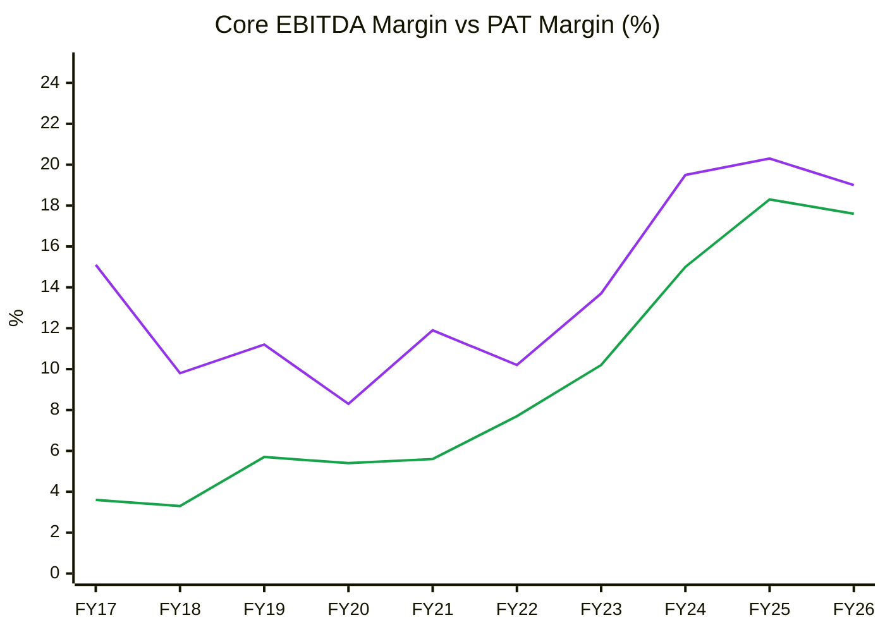
🟩 Core EBITDA margin (ex-other income) · 🟪 PAT margin

**Read:** Until FY23 the PAT margin exceeded the core EBITDA margin every year, which means treasury income was MDL's profit. Core margin rose from 3–6% to 15–18% only in FY24–FY26.

**Business inference:** The "high-quality 18% margin business" is a late-stage-programme phenomenon. A decade-average core margin is ~9%. New programmes (P75(I), Coast Guard, commercial) will book at 12–15% early (management) or less if competitively bid, so FY29 margin assumptions should sit below FY26 (→ Module 11 base 13%).

**C5 — ROCE / core ROIC vs WACC (%)**
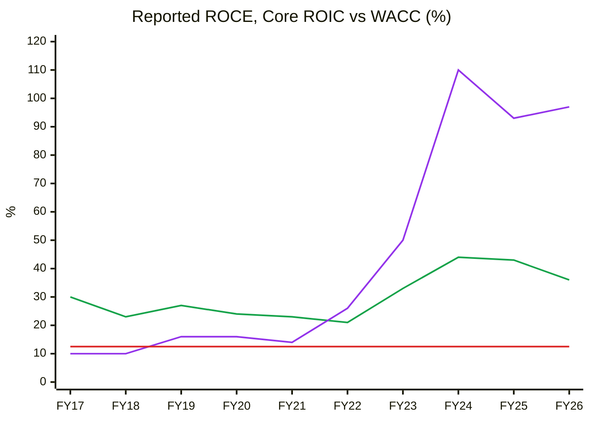
🟩 Reported ROCE (Screener consol., includes treasury) · 🟪 Core ROIC (post-tax core EBIT / net FA + CWIP, standalone) · 🟥 WACC 12.5%

**Read:** Reported ROCE has stayed above WACC for 10 years (21–44%). Core ROIC was below WACC in FY17–FY18 and has been far above it since FY22.

**Business inference:** The franchise creates value, because customers fund the working capital. But the core spread only became huge in the harvest years. In weaker years (FY17–FY21) value creation leaned on the float income, so the spread will narrow toward ~20–30% when new programmes start at lower margins.

**C7 — Cumulative PAT vs cumulative CFO (consolidated, ₹ Cr)**

| FY | FY17 | FY18 | FY19 | FY20 | FY21 | FY22 | FY23 | FY24 | FY25 | FY26 |
|---|---|---|---|---|---|---|---|---|---|---|
| PAT | 585 | 496 | 532 | 471 | 514 | 611 | 1,119 | 1,937 | 2,414 | 2,578 |
| CFO | −1,003 | 491 | 65 | −96 | 68 | −163 | 1,516 | 684 | 2,102 | −2,654 |

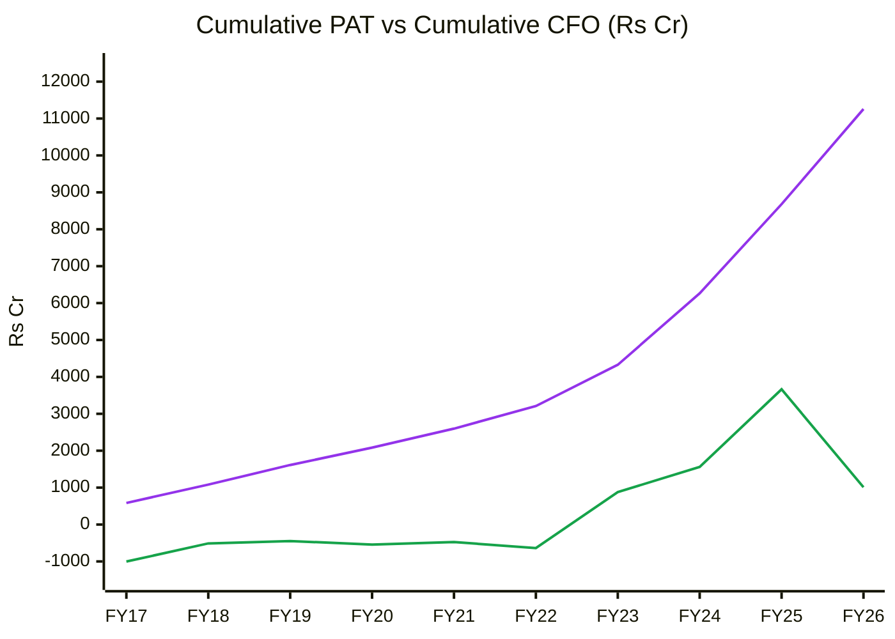
🟪 Cumulative PAT · 🟩 Cumulative CFO

**Read:** Ten-year cumulative CFO/PAT is **0.09** (₹1,010 Cr vs ₹11,257 Cr); five-year is 0.17. On its face that is a severe O'Glove flag.

**Business inference:** Profits are real but were pre-funded. The cash came in as advances before FY17 (other liabilities were ₹28,397 Cr in FY15) and is being "earned" as work is done, so CFO is low while PAT accrues. The flip side is that **today's cash pile partly belongs to the customer**: contract liabilities were still ₹10,303 Cr at Mar-26 against ₹13,097 Cr of cash. Without new advances, CFO stays negative and treasury income shrinks.

**CY7 — Core margin through the cycle**
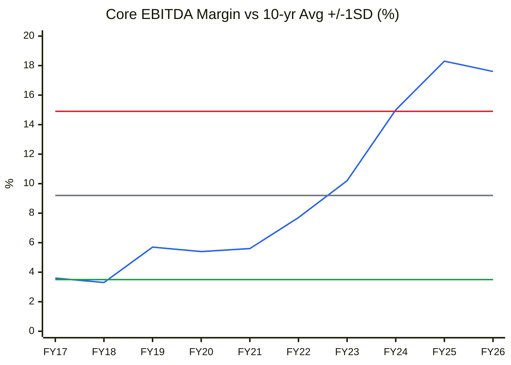
🟦 Core EBITDA margin · ⬜ 10-yr avg 9.2% · 🟥 +1SD 14.9% · 🟩 −1SD 3.5%

**Read:** The FY26 margin of 17.6% sits at the **90th percentile** (second-highest of 10 years) and more than 1 SD above the 10-year average for three straight years.

**Business inference:** This is a peak-margin signal (late cycle). Valuing MDL on FY26 earnings capitalises completion-stage profits that will not recur on new contracts. Use normalised 12–14% margins.

**C8 — Working-capital days (Screener consol.)**
| FY | FY20 | FY21 | FY22 | FY23 | FY24 | FY25 | FY26 |
|---|---|---|---|---|---|---|---|
| Debtor days | 107 | 87 | 64 | 47 | 71 | 34 | 73 |
| Inventory days | 688 | 1,142 | 1,044 | 605 | 411 | 298 | 131 |
| Payable days | 704 | 1,234 | 836 | 366 | 321 | 240 | 224 |

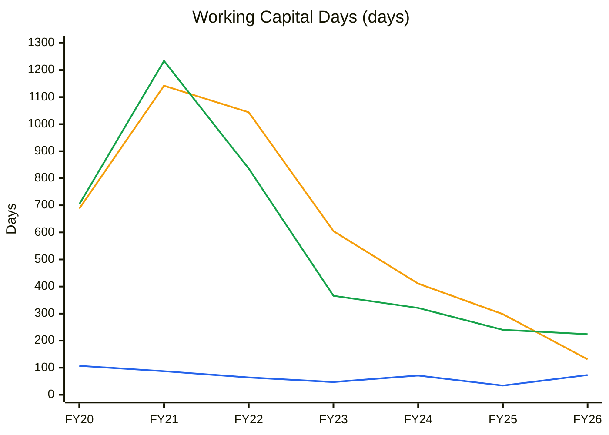
🟦 Debtor days · 🟧 Inventory days · 🟩 Payable days

**Read:** Inventory days collapsed from 1,142 to 131 as hulls were delivered. Debtor days doubled to 73 in FY26.

**Business inference:** The yard is nearly empty of work-in-progress, which is the physical picture of the thin order book. Rising debtors reflect Navy milestone billing on the last frigates and need to normalise by Q2–Q3FY27, otherwise collection risk replaces execution risk.

### DuPont Decomposition (5-Factor, consolidated, year-end balances)
| Year | EBIT Margin | Asset Turnover | Equity Multiplier | Interest Burden | Tax Burden | ROE |
|---|---|---|---|---|---|---|
| FY22 | 13.3% | 0.19× | 7.72× | 0.98 | 0.82 | 15.8% |
| FY23 | 18.0% | 0.27× | 6.19× | 0.99 | 0.80 | 23.5% |
| FY24 | 25.7% | 0.32× | 4.72× | 1.00 | 0.80 | 31.0% |
| FY25 | 27.0% | 0.40× | 3.63× | 0.99 | 0.79 | 30.4% |
| FY26 | 25.5% | 0.47× | 2.82× | 0.98 | 0.80 | 26.4% |
| **Change** | +12.2pp | +0.28× | −4.9× | ≈0 | ≈0 | +10.6pp |

**Operating contribution (EBIT margin × AT):** Rising strongly (2.6% → 12.1%)
**Financing contribution (equity multiplier):** Falling sharply. The "leverage" here is customer advances, not debt, and it is unwinding.
**DuPont verdict:** ROE rose on operations, but it peaked in FY24 and is now falling because margins plateaued and the advance-funded balance sheet is shrinking. **There is no debt-driven financial engineering.** The coming risk is the reverse: falling margin *and* a smaller float.
**Peer DuPont (FY26, approx.):** GRSE ROE 31.6% on an 11% OPM (higher AT, high advances); Cochin ROE 12.5% (lower margin, more capital, gross borrowings ₹1,672 Cr). MDL's ROE premium is operational.
**AT trend → Module 11:** Not used. MDL is order-book driven (EPC track).

**OCF / Net Income (5yr):** 0.17 → Low (structural)
**O'Glove Red Flags:** 4 / 15 (#1 NI vs OCF, #7 other income/EBIT 34%, #9 Sloan, #10 Beneish mechanical). The tax rate is normal at 25% (the old report's flag is withdrawn).
**Key accounting concern:** Stage-of-completion judgements: provisions and LDs released at delivery, plus onerous losses on fixed-price commercial and Coast Guard work.

---

## Module 7 — Industry KPIs & Peer Analysis
**Sector:** Defence Shipbuilding & Marine Services (`05-industry-kpis-india.md` L1150)
**Top 3 KPIs:**
| KPI | MAZDOCK | Healthy range | Assessment |
|---|---|---|---|
| Order book / TTM revenue | **1.4×** (Jun-26) | >3× (red flag <2×) | 🔴 **Red flag**, below |
| Execution rate (rev / opening OB) | **40%** FY26 | 20–35% (>40% = depleting book) | 🔴 At the depletion threshold |
| EBITDA margin (core) | 17.4% FY26; 15.2% Q1FY27 | 12–20% | ✅ Upper end (peak-stage) |

**Other KPIs**
| KPI | Value | Read |
|---|---|---|
| Order inflow (implied, TTM) | ~₹1,285 Cr | 🔴 Declining for 6 quarters (red flag: declining 2+ quarters) |
| Advances / order book | Contract liabilities ₹10,303 Cr / OB ₹20,535 Cr = 50% (Mar-26) | ✅ but unwinding |
| CFO / EBITDA (3-yr avg) | (684 + 2,102 − 2,654) / (1,416 + 2,093 + 2,268) = **0.02×** | 🔴 Below 0.5× |
| Working-capital days | −187 (Screener) | Customer-funded |
| Order book concentration (top programme) | P17A balance ₹7,587 Cr = 42% of OB | ✅ <60% |
| Contingent liability / market cap | Disputes ~₹1,500 Cr = 2%; incl. indemnity bonds ₹28,181 Cr = 34% | ✅ / ⚠️ |
| Ship deliveries | FY26: 3 P17A frigates (Udaygiri Jul-25, Taragiri Nov-25, Mahendragiri Apr-26) | Peak deliveries now behind |
| Indigenous content | 75% on P17A | ✅ Rising |

**Peer Comparison (Screener, 12-Oct-2026; order books from company or press disclosures)**
| Metric | MAZDOCK | GRSE | COCHINSHIP | Swan Defence |
|---|---|---|---|---|
| Market cap (₹ Cr) | 82,798 | 24,141 | 32,675 | 15,141 |
| Revenue FY26 (₹ Cr) | 13,006 | 7,002 | 5,022 | n/m |
| Revenue 3-yr CAGR (FY23–26) | 18.4% | 39.8% | 28.5% | n/m |
| Core EBITDA margin FY26 | 17.4% | 11.4% | 16.5% | negative |
| EPS/PAT 3-yr CAGR | 32.1% | 48.6% | 32.9% | loss |
| ROCE (FY26) | 36% | 43% | 16% | −7.6% |
| Borrowings | ₹447 Cr (CDPLC) | ~nil | ₹1,672 Cr | — |
| Headline P/E (TTM) | 29.0× | 30.1× | 48.1× | n/m |
| Order book / TTM revenue | **1.4×** (₹18,218 Cr) | 1.8× (₹13,596 Cr; [press](https://www.psuconnect.in/financial/grse-q1-result-revenue-up-38-5-to-1814-cr-pat-jumps-44)) | ~4.2× (~₹21,100 Cr; [press](https://www.sahi.com/blogs/cochin-shipyard-order-book)) | n/m |

**Peer positioning:** MDL trades in line with GRSE on headline P/E and below Cochin. Adjusted for treasury income (~35% of PBT vs ~20% for GRSE), its core multiple is the highest of the three. The *thinnest* order cover in the group does not justify a premium; the discount is not big enough to compensate. Premium **not** justified on current book. It would be justified only after P75(I) and the P75 follow-on (cover would jump to ~8–10×).

### Order Book Tracker
*Generated 2026-10-12 by `scripts/order_book_tracker.py` from 14 order announcements (0 follow-ups excluded) and 13 period snapshots. The previous report (20-Jun-2026) had no Order Ledger table, so this ledger is built fresh from all BSE Reg 30 filings since 01-Apr-2023 and will be carried forward from here. Ledger coverage starts 2023-04-01; earlier periods show '—' for announced inflow (unknown, not zero). Order book = MDL standalone (company presentations); revenue = standalone.*

#### 1. Disclosed vs tracked order book (reconciliation)

| Period | Revenue (₹ Cr) | Order book (₹ Cr) | Announced inflow | of which Framework | Implied inflow | Announced coverage | OB cover (× TTM rev) | Source |
|---|---|---|---|---|---|---|---|---|
| FY21 | 4,048 | 50,310 | — | — | — | — | 12.4 | AR FY25 p39 (OB) + Screener standalone (rev) |
| FY22 | 5,733 | 45,874 | — | — | 1,297 | — | 8.0 | AR FY26 p35 (OB) + Screener standalone |
| FY23 | 7,827 | 38,755 | — | — | 708 | — | 5.0 | AR FY26 p35 + Screener standalone |
| FY24 | 9,467 | 38,561 | 7,200 | — | 9,273 | 78% | 4.1 | AR FY26 p35 / May-24 PPT + Screener standalone |
| Q1FY25 | 2,357 | 36,839 | 351 | — | 635 | 55% | 3.8 | Q1FY25 PPT (Aug-24) + Screener standalone |
| Q2FY25 | 2,757 | 39,872 | 6,163 | — | 5,790 | 106% | 3.8 | Q2FY25 PPT (Nov-24) |
| Q3FY25 | 3,144 | 34,787 | 2,112 | — | -1,941 | — | 3.1 | Q3FY25 PPT (Feb-25) |
| Q4FY25 | 3,174 | 32,260 | 0 | — | 647 | 0% | 2.8 | Q4FY25 PPT (May-25) / AR FY25 |
| Q1FY26 | 2,626 | 29,918 | 0 | — | 284 | 0% | 2.6 | Q1FY26 PPT (Jul-25) |
| Q2FY26 | 2,929 | 27,415 | 0 | — | 426 | 0% | 2.3 | Q2FY26 PPT (Oct-25) |
| Q3FY26 | 3,601 | 23,758 | 0 | — | -56 | — | 1.9 | Q3FY26 PPT (Feb-26) |
| Q4FY26 | 3,684 | 20,535 | 365 | — | 461 | 79% | 1.6 | Q4FY26 PPT (Apr-26) / AR FY26 |
| Q1FY27 | 2,771 | 18,218 | 0 | — | 454 | 0% | 1.4 | Q1FY27 PPT (30-Jul-26) |

*Implied inflow = OB(t) − OB(t−1) + order-linked revenue(t). Announced coverage = announced ÷ implied: < 50% means most orders are below the disclosure threshold (or the OB is restated); > 120% means cancellations, de-scoping or slow-burn framework value not yet in the reported book.*

**Coverage extremes explained:** **Q3FY25 implied inflow −₹1,941 Cr**, even though a ₹1,990 Cr AIP contract was announced in the quarter. That implies ~₹3,900 Cr of book was removed or restated. The most likely causes are (a) ONGC DSF-II booked at its EPC-reimbursable ceiling including GST and then restated ex-tax and at expected cost, and (b) P17A LD accrual (₹940 Cr at Mar-25, AR Note 57) netted from the balance. MDL did not explain it (⚠️ data gap). Q1FY26–Q1FY27 "0% coverage" quarters are small unannounced work (refits, spares, variations) of ₹280–460 Cr a quarter, below the Reg 30 threshold.

#### 2. Announced orders aggregated by quarter

| Quarter | # orders | Total (₹ Cr) | Firm | Framework | Largest single | Export | Govt/PSU/Defence | Private domestic |
|---|---|---|---|---|---|---|---|---|
| Q1FY24 | 1 | 2,725 | 2,725 | 0 | 2,725 | 0 | 2,725 | 0 |
| Q3FY24 | 5 | 3,405 | 3,405 | 0 | 1,600 | 350 | 3,055 | 0 |
| Q4FY24 | 1 | 1,070 | 1,070 | 0 | 1,070 | 0 | 1,070 | 0 |
| Q1FY25 | 1 | 351 | 351 | 0 | 351 | 351 | 0 | 0 |
| Q2FY25 | 2 | 6,163 | 6,163 | 0 | 4,676 | 0 | 6,163 | 0 |
| Q3FY25 | 2 | 2,112 | 2,112 | 0 | 1,990 | 0 | 2,112 | 0 |
| Q4FY26 | 1 | 365 | 365 | 0 | 365 | 0 | 365 | 0 |
| Q2FY27 | 1 | 118 | 118 | 0 | 118 | 0 | 118 | 0 |

#### 3. Macro picture

| Metric | Value |
|---|---|
| Latest disclosed order book | ₹18,218 Cr (Q1FY27) |
| Orders announced since that disclosure | ₹118 Cr (1 order: MSETCL) |
| Tracked order book today (before execution since Q1FY27) | ₹18,336 Cr |
| Order book cover (latest) | 1.4 × TTM revenue |
| Framework / 'potential value' agreements in ledger | ₹0 Cr (0% of latest disclosed OB) |
| Orders announced, last 12 months | ₹483 Cr (2 orders; avg ₹242 Cr) |
| Top-3 orders (last 12 m) as % of disclosed OB | 3% |
| **TTM book-to-bill (implied inflow Q2FY26–Q1FY27 ÷ TTM revenue)** | ₹1,285 Cr ÷ ₹12,985 Cr = **0.10** |
| Execution rate FY26 (revenue ÷ opening OB) | 40% (FY25 30%, FY24 24%), rising, so the book is depleting |

**Geography mix, last 12 months:** Domestic 100%
**Customer type mix, last 12 months:** PSU 100%
**Segment mix, last 12 months:** Shipbuilding (commercial) 76% · Others (security systems) 24%
**Firmness mix, last 12 months:** Firm 100%

**Order-book composition (balance, ₹ Cr; company presentations)**
| Programme | Client | Sep-25 | Mar-26 | Jun-26 | Pending deliveries (Jun-26) |
|---|---|---|---|---|---|
| P15B destroyers | MoD | 2,174 | 863 | 283 | 0 |
| P17A stealth frigates | MoD | 11,492 | 8,257 | 7,587 | 0 (all 4 delivered; guarantee and spares remain) |
| ICGS (CTS, NGOPV, FPV) | MoD | 2,815 | 2,690 | 2,649 | 21 |
| MPV (Navi Merchants, Denmark) | Export | 655 | 717 | 695 | 6 |
| SCI methanol PSV | SCI | — | 365 | 367 | 1 |
| P75 Kalvari submarines | MoD | 2,248 | 1,722 | 1,678 | 0 |
| MRLC submarine refit | MoD | 1,302 | 754 | 492 | 1 |
| ONGC (PRPP, DSF-II, PRP-8) | ONGC | 4,800 | 3,320 | 2,774 | 2 |
| AIP plug | MoD | 1,739 | 1,687 | 1,542 | 1 |
| Others | — | 191 | 160 | 151 | — |
| **Total** | | **27,415** | **20,535** | **18,218** | |

*P17A's ₹7,587 Cr balance has no hulls left to deliver. It is guarantee work (~10% of ship cost, Q2FY26 call), base and depot spares, and LD-linked amounts (₹678 Cr LD outstanding, AR Note 57). It will burn slowly and at variable margin, not as hull revenue.*

**Pipeline — NOT in the ledger or order book (firmness classification)**
| Programme | Reported value | Status (as of 12-Oct-2026) | Firmness | Source |
|---|---|---|---|---|
| P75(I): 6 AIP submarines with TKMS | ₹70,000–99,000 Cr (total; MDL share undisclosed) | CNC completed (MDL BSE, 05-Mar-26); Finance Ministry cleared 28-May-26 (press); **CCS approval pending** | Negotiated, unsigned (not L1-to-contract yet) | [BSE clarification](https://www.bseindia.com/xml-data/corpfiling/AttachHis/d2fd7fc7-5bb1-4549-a364-fecc1eb54c0a.pdf); [ArmyRecognition](https://www.armyrecognition.com/news/navy-news/2026/india-project-75i-submarine-deal-70000-crore-ccs-approval) |
| P75 follow-on: 3 Scorpenes | ~₹36,000 Cr (press) | Commercial negotiations done mid-2025; "at sanction stage" (Q2FY26 call) | Negotiated, unsigned | Q2FY26 transcript |
| P17B: 7 frigates | ~₹70,000 Cr (programme) | RFP to MDL, GRSE, GSL, CSL (2026); **competitive** | RFP | [Raksha Anirveda](https://raksha-anirveda.com/indian-navy-invite-bids-for-project-17b-stealth-frigate-programme/) |
| LPD (with Swan Defence teaming) | ₹35,000–40,000 Cr | DAC AoN Oct-2025; RFP awaited | AoN | MDL press release 28-Oct-25; Q2FY26 call |
| Brazil / Malaysia Scorpene support | n/d | MoUs only | Framework/MoU | BSE 10-Dec-25; Sep-26 presentation |

#### 4. Charts

**OB-1 — Order book vs revenue (TTM), index = 100 at FY21**

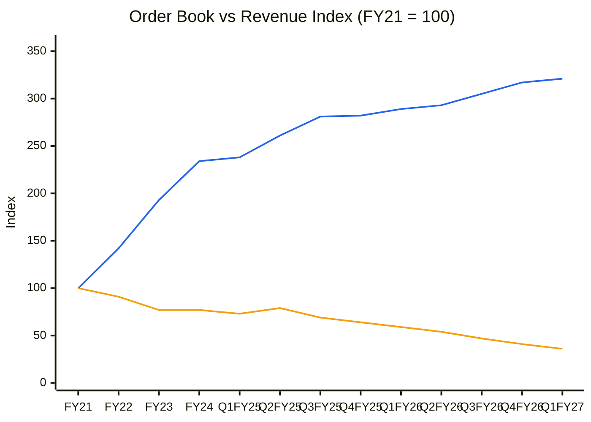
🟦 Revenue (TTM) · 🟧 Order book (disclosed points only; x-axis mixes FY and quarter-ends where history is annual)

**Read:** TTM revenue index rose to 321 while the order-book index fell to 36. The book has been consumed for five straight years and has never been replenished.

**Business inference:** Demand (order placement), not execution, is the binding constraint. MDL has spare capacity (11 submarines and 10 warships concurrently), so FY28 revenue falls unless the submarine contracts are signed in FY27.

**OB-2 — Order book cover (years of TTM revenue)**

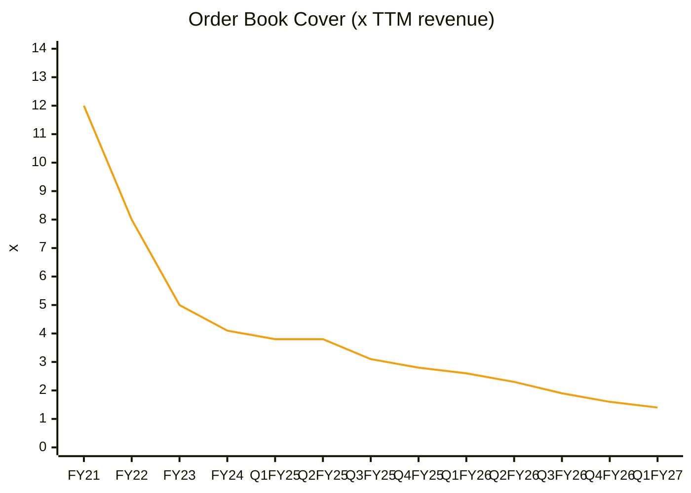
🟧 Order book / TTM revenue

**Read:** Cover fell from 12.4× (FY21) to 1.4× (Jun-26), crossing the sector red-flag line (<2×) in Q3FY26.

**Business inference:** Forward revenue is secure for only about four quarters, and much of the remaining book is low-burn guarantee and spares work. Visibility now rests on government signing decisions, not on the yard.

**OB-3 — Aggregated announced orders vs revenue, by quarter (₹ Cr)**

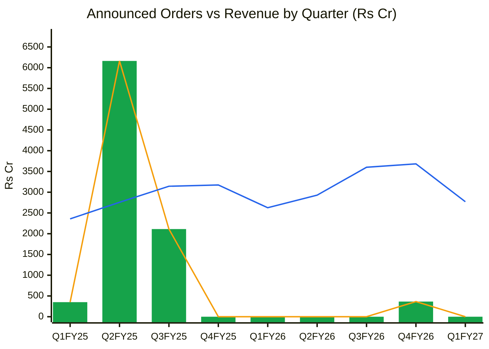
🟩 All announced orders (bars) · 🟧 Firm orders only (excl. framework / potential-value agreements) · 🟦 Revenue

**Read:** The last material order (₹1,990 Cr AIP) came in Dec-2024. Since then only ₹483 Cr has been announced against ~₹16,000 Cr of revenue. All announced value is firm; there is no framework inflation.

**Business inference:** There is no share-loss problem. MDL is simply waiting for the state to place submarine orders. Management's repeated signing promises (Module 4) have not converted, so guidance on order timing deserves heavy discounting.

**OB-4 — Implied order inflow (from disclosed order book) vs revenue (₹ Cr)** *(drawn as lines because two quarters are negative; see chart rule 10)*

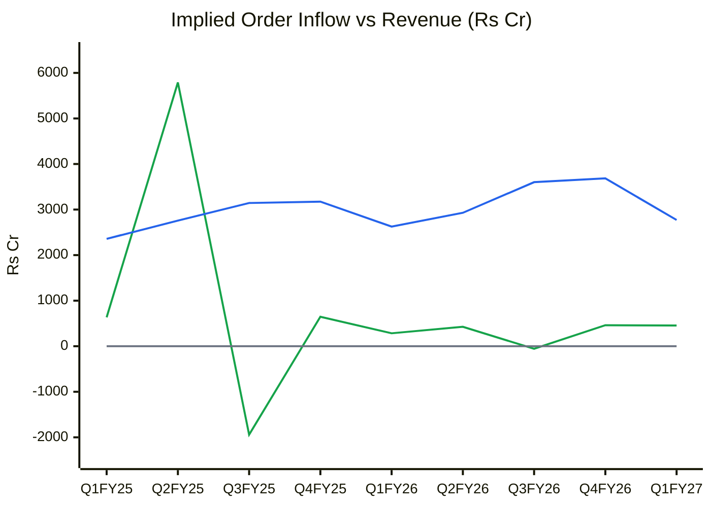
🟩 Implied inflow = ΔOB + order-linked revenue · 🟦 Revenue · ⬜ zero line

**Read:** Quarterly book-to-bill has been 0.0–0.2× for six quarters. Implied inflow tracks the (empty) announced ledger closely after Q4FY25.

**Business inference:** Order momentum is nil. Unless ~₹30,000 Cr+ arrives by mid-FY28, revenue four to eight quarters out (FY28) is structurally lower, and the yard's fixed costs will compress margins.

#### 5. Order Ledger — every announced order (source of truth; the next run appends here)

| order_id | date | customer | customer_type | segment | geography | value_cr | currency | value_fc | firmness | tenor_months | linked_to | source | notes |
|---|---|---|---|---|---|---|---|---|---|---|---|---|---|
| MDL-2306-01 | 2023-06-30 | Indian Navy (MoD) | Defence | Submarine & HE (refit) | Domestic | 2724.63 | INR |  | Firm |  |  | [BSE](https://www.bseindia.com/xml-data/corpfiling/AttachHis/77b550e7-2ffe-430f-ba5f-c5fb6d6f590a.pdf) | MRLC of INS Shankush (2nd Shishumar-class submarine) |
| MDL-2310-01 | 2023-10-09 | Navi Merchants (Denmark) | Export | Shipbuilding (commercial) | Export | 0 | USD |  | LoI |  |  | [BSE](https://www.bseindia.com/xml-data/corpfiling/AttachHis/504e9923-634d-4bd9-8e0e-1d6488e410eb.pdf) | LoI for 6 firm + 4 optional 7500 DWT hybrid MPVs; price to be firmed at contract (value not disclosed) |
| MDL-2310-02 | 2023-10-17 | MoD (Indian Coast Guard) | Defence | Shipbuilding | Domestic | 310 | INR |  | Firm | 35 |  | [BSE](https://www.bseindia.com/xml-data/corpfiling/AttachHis/afd365af-2a3f-430f-96f3-da7246ff525f.pdf) | 1 Cadet Training Ship; delivery by Sep-2026; incl. taxes |
| MDL-2312-01 | 2023-12-08 | ONGC | PSU | Offshore (Heavy Engineering) | Domestic | 1145.1 | INR |  | Firm |  |  | [BSE](https://www.bseindia.com/xml-data/corpfiling/AttachHis/a4c3642b-ac8b-4b5f-b1b9-2fc1e9465c64.pdf) | PRPP turnkey lump sum incl. taxes (fixed price) |
| MDL-2312-02 | 2023-12-15 | Navi Merchants (Denmark) | Export | Shipbuilding (commercial) | Export | 350 | USD | 42 | Firm |  |  | [BSE](https://www.bseindia.com/xml-data/corpfiling/AttachHis/cac176d7-f6d3-4117-9f96-7e6bb7323e6c.pdf) | 3 x 7500 DWT MPV contracts ~USD 42 mn; INR not stated in filing - converted at ~83.3 (estimate) |
| MDL-2312-03 | 2023-12-20 | MoD (Indian Coast Guard) | Defence | Shipbuilding | Domestic | 1600 | INR |  | Firm |  |  | [BSE](https://www.bseindia.com/xml-data/corpfiling/AttachHis/65c7f8a3-f7f1-446c-bd7c-66ef45fe32d0.pdf) | 6 Next Generation OPVs; approx INR 1600 Cr |
| MDL-2401-01 | 2024-01-24 | MoD (Indian Coast Guard) | Defence | Shipbuilding | Domestic | 1070 | INR |  | Firm |  |  | [BSE](https://www.bseindia.com/xml-data/corpfiling/AttachHis/5c2770db-3e8b-44a4-9bfb-d031c622ba61.pdf) | 14 Fast Patrol Vessels; approx INR 1070 Cr (later onerous-loss provision) |
| MDL-2405-01 | 2024-05-02 | Navi Merchants (Denmark) | Export | Shipbuilding (commercial) | Export | 351 | USD | 42 | Firm |  |  | [BSE](https://www.bseindia.com/xml-data/corpfiling/AttachHis/b86f61a3-965e-4922-ab9a-b3ac4a228d5f.pdf) | 3 more 7500 DWT MPVs ~USD 42 mn; INR converted at ~83.5 (estimate); loss-making (onerous provision) |
| MDL-2408-01 | 2024-08-09 | ONGC | PSU | Offshore (Heavy Engineering) | Domestic | 4676.33 | INR |  | Firm | 22 |  | [BSE](https://www.bseindia.com/xml-data/corpfiling/AttachHis/8de4d263-d59d-44a4-b8bf-8fb392a18e94.pdf) | DSF-II wellhead platforms; EPC reimbursable ceiling price incl. GST 12% |
| MDL-2409-01 | 2024-09-06 | ONGC | PSU | Offshore (Heavy Engineering) | Domestic | 1486.4 | INR |  | Firm |  |  | [BSE](https://www.bseindia.com/xml-data/corpfiling/AttachHis/3364cf1f-9bf1-4e05-a384-dd9d7ac1650e.pdf) | PRP-8 Group A pipeline replacement; ceiling price |
| MDL-2410-01 | 2024-10-10 | MAHAGENCO | PSU | Others (security systems) | Domestic | 121.68 | INR |  | Firm | 12 |  | [BSE](https://www.bseindia.com/xml-data/corpfiling/AttachHis/5d42b7cf-1d20-4b33-a76a-b44b1808c945.pdf) | AI-based infrasecure project; incl. GST |
| MDL-2412-01 | 2024-12-31 | MoD (DRDO-AIP) | Defence | Submarine & HE | Domestic | 1990 | INR |  | Firm |  |  | [BSE](https://www.bseindia.com/xml-data/corpfiling/AttachHis/feceb1e3-a1cd-4089-98f5-e500bc74464f.pdf) | AIP plug construction & integration into Scorpene submarines (BSE filing 31-Dec-2024; OB table shows project value 1758 Cr ex-tax) |
| MDL-2603-01 | 2026-03-18 | Shipping Corporation of India | PSU | Shipbuilding (commercial) | Domestic | 365 | USD | 39 | Firm |  |  | [BSE](https://www.bseindia.com/xml-data/corpfiling/AttachHis/7b699bec-b815-4aea-b4db-20ead952967e.pdf) | 1 x 3000 DWT methanol dual-fuel PSV ~USD 39 mn; INR per company OB table (365 Cr) |
| MDL-2609-01 | 2026-09-04 | MSETCL | PSU | Others (security systems) | Domestic | 118 | INR |  | Firm | 24 |  | [BSE](https://www.bseindia.com/xml-data/corpfiling/AttachHis/f9f009d4-dd09-4f99-8cf6-a2038854e276.pdf) | AI-based infrasecure project for 5 substations; incl. GST |

#### 6. Order Book Snapshots — revenue and disclosed order book per period

| period | revenue_cr | revenue_ttm_cr | order_book_cr | order_linked_share | as_of_date | source |
|---|---|---|---|---|---|---|
| FY21 | 4048 | 4048 | 50310 | 1.0 |  | AR FY25 p39 (OB) + Screener standalone (rev) |
| FY22 | 5733 | 5733 | 45874 | 1.0 |  | AR FY26 p35 (OB) + Screener standalone |
| FY23 | 7827 | 7827 | 38755 | 1.0 |  | AR FY26 p35 + Screener standalone |
| FY24 | 9467 | 9467 | 38561 | 1.0 |  | AR FY26 p35 / May-24 PPT + Screener standalone |
| Q1FY25 | 2357 | 9651 | 36839 | 1.0 |  | Q1FY25 PPT (Aug-24) + Screener standalone |
| Q2FY25 | 2757 | 10580 | 39872 | 1.0 |  | Q2FY25 PPT (Nov-24) |
| Q3FY25 | 3144 | 11362 | 34787 | 1.0 |  | Q3FY25 PPT (Feb-25) |
| Q4FY25 | 3174 | 11432 | 32260 | 1.0 |  | Q4FY25 PPT (May-25) / AR FY25 |
| Q1FY26 | 2626 | 11701 | 29918 | 1.0 |  | Q1FY26 PPT (Jul-25) |
| Q2FY26 | 2929 | 11873 | 27415 | 1.0 |  | Q2FY26 PPT (Oct-25) |
| Q3FY26 | 3601 | 12330 | 23758 | 1.0 |  | Q3FY26 PPT (Feb-26) |
| Q4FY26 | 3684 | 12840 | 20535 | 1.0 |  | Q4FY26 PPT (Apr-26) / AR FY26 |
| Q1FY27 | 2771 | 12985 | 18218 | 1.0 |  | Q1FY27 PPT (30-Jul-26) |

*Every number above traces to the ledger / snapshot rows (source column). Ledger start for future re-runs: `--ledger-start 2023-04-01`.*

**Order-book verdict:** Firm visibility **~1.4 years** (no framework value, but ~₹7,600 Cr is P17A guarantee/spares, a slow burn) · TTM book-to-bill **0.10** · framework share 0% · top-programme concentration 42% (P17A) · execution rate **rising (24% → 30% → 40%), which means the book is depleting**
**Forward link (Module 11):** Revenue FY27 ≈ opening OB ₹20,535 Cr × 40% + CDPLC ~₹700 Cr + in-year inflow ~₹2,000 Cr × ~30% burn ≈ **₹9,500–10,000 Cr from the book**. Reaching even a flat ~₹13,000 Cr needs faster burn of P17A/ONGC balances or LD reversals. Guidance of ~₹15,000 Cr needs the submarine contracts signed in H2FY27.

---

## Module 8 — Market Size & Market Share
**TAM:** Indian naval and coast-guard shipbuilding capex of roughly ₹25,000–35,000 Cr a year over FY27–FY32. This is an **estimate** from the named pipeline (P75(I), P75 follow-on, P17B, LPD, MCMV, NGC, destroyer ≈ ₹3.5–4 lakh Cr over ~10–12 years; Q2FY26 call figures). The old report's ₹15–20k Cr/yr TAM and "65% penetration" could not be sourced (⚠️).
**TAM growth:** Structural ~10–15% a year, lumpy
**Company penetration:** FY26 revenue ₹13,006 Cr ÷ ~₹30,000 Cr ≈ 40–45% (estimate) of annual naval build spend, including legacy-programme bunching
**Market share:** Conventional submarines 100% (all Indian-built Scorpenes; P75(I) nominated). Destroyers effectively 100% (P15/15A/15B). Frigates 4 of 7 P17A (GRSE 3). OPV/FPV/commercial work is contested.
**5-year trend:** Stable in submarines. **At risk in frigates** (P17B competitive) and in auxiliary ships (NGC to GRSE/others; LPD contested with private yards)
**Share-gain driver:** Structural capability in submarines; nothing structural in surface/commercial
**Revenue growth vs market check:** FY23–26 revenue CAGR 18.4% versus an estimated ~10–15% market. The excess is delivery bunching, not share gain.
**Verdict:** Holding share in its core, but the core market is binary (one or two programmes a decade). Growth is now set by programme timing.

---

## Module 9 — Valuation & Margin of Safety

### 8A. Price-Implied Expectations (Mauboussin reverse DCF)
- **Market cap** ₹82,798 Cr. **Shareholders' own cash** ~₹7,000 Cr (*estimate*: ₹6,000 Cr "our margin" per Q4FY25 call, plus FY26 retained cash after dividends, capex and CDPLC). The other ~₹6,100 Cr of the ₹13,097 Cr pile is customer advances. CDPLC debt ₹447 Cr; NCI ₹229 Cr.
- **Core EV** = 82,798 − 7,000 + 447 + 229 = **₹76,474 Cr**
- **Core NOPAT (TTM)** = (FY26 core EBIT ₹2,171 Cr + Q1 YoY uplift ₹139 Cr) × (1 − 25%) ≈ **₹1,728 Cr**. Core EV / core NOPAT = **44×**.
- **Quick PIE:** g = (76,474 × 12.5% − 1,728) / (76,474 + 1,728) = **9.6% perpetual growth**
- **Two-stage reverse DCF** (WACC 12.5%, terminal g 6%, RONIC 40%): the price implies **~24% core NOPAT CAGR for 10 years**. That means core NOPAT of ~₹15,000 Cr by FY36, roughly **₹1.25 lakh Cr of revenue at a 12% NOPAT margin, ~10× today**.

| PIE value driver | Market-implied | My base case | Expectations gap |
|---|---|---|---|
| Core NOPAT CAGR (10-yr) | ~24% | ~10% (FY26→FY36: ₹1,624 → ₹4,605 Cr) | **−14pp (optimistic gap)** |
| Revenue CAGR (5-yr, FY26–31) | ~20%+ | ~12% (with P75(I) and P75 follow-on signed by FY28) | −8pp |
| Steady-state core NOPAT margin | 12%+ sustained | 9.75% (13% EBIT) | −2pp |
| Investment rate | Low (customer-funded) | Low, but **+₹15,000 Cr greenfield capex** risk | Market ignores the greenfield capex |

**Gap classification: Optimistic.** The market is paying for P75(I), the P75 follow-on, *and* share in P17B, LPD and the destroyer programme on top, at today's peak margins.
**Expectations treadmill:** To outperform, MDL must sign ~₹1 lakh Cr of submarine contracts in FY27 *and* win a large surface programme by FY29, while keeping core margins at or above 14% on new contracts.
**Positive triggers:** CCS approval and signing of P75(I); P75 follow-on signing (immediate revenue); P17B L1.
**Negative triggers:** Another CCS deferral past Q4FY27; FY27 revenue print below ₹13,000 Cr; P17B lost or bid at thin margins; further government OFS; greenfield capex committed without subsidy.
**SVAR:** Bear target ₹1,047 → (2,053 − 1,047) / 2,053 = **49%** → unfavourable (>40%)
**Physical plausibility:** MDL's capacity (11 subs + 10 warships concurrently) *could* support ₹30,000–35,000 Cr of revenue. So the 24% CAGR is capacity-feasible but **order-infeasible**. The market is effectively pricing orders that are not yet placed.

### 8B. Intrinsic value

**DCF (WACC 12.5%, terminal g 6%, core only, plus own cash ₹7,000 Cr; float income excluded, worth ~₹25/share)**
| Scenario | Core NOPAT path FY27 → FY29 → FY36 (₹ Cr) | DCF value / share |
|---|---|---|
| Bear | 1,219 → 908 → 2,178 | ₹520 |
| Base | 1,365 → 1,804 → 4,605 | ₹880 |
| Bull | 1,631 → 2,588 → 6,000 | ₹1,110 |

*The DCF says MDL is worth roughly half its price even with the submarine contracts signed. The market is capitalising long-dated naval programmes at a multiple that a 12.5% cost of capital cannot justify.*

**Relative / scenario valuation (FY29E EPS × P/E; FY29 targets)**
| Scenario | Revenue FY29E (₹ Cr) | Core EBIT margin | Core NOPAT | Treasury PAT | EPS FY29E | P/E | Target | Prob. |
|---|---|---|---|---|---|---|---|---|
| Bull: P75(I) + P75 follow-on signed by Q4FY27, P17B share by FY28 | 23,000 | 15% | 2,588 | 1,000 (fresh advances) | ₹89.0 | 40× | **₹3,558** | 25% |
| Base: both submarine contracts signed H2FY27–H1FY28; FY28 dip | 18,500 | 13% | 1,804 | 750 | ₹63.3 | 35× | **₹2,216** | 50% |
| Bear: signings slip to FY29; FY28 revenue air-pocket ~₹9,000 Cr | 11,000 | 11% | 908 | 500 (float drains) | ₹34.9 | 30× | **₹1,047** | 25% |
| **Probability-weighted** | | | | | | | **₹2,259** | |

*Treasury PAT = post-tax deposit interest; it rises only if new contract advances arrive. P/E 30–40× brackets MDL's own post-listing median of ~26× (CY1) and Indian PSU defence peer multiples (29–48×).*

| Method | Bear | Base | Bull |
|---|---|---|---|
| DCF (12.5%) | ₹520 | ₹880 | ₹1,110 |
| Relative (FY29E P/E) | ₹1,047 | ₹2,216 | ₹3,558 |
| Graham Number (5-yr avg EPS ₹42.95 × BVPS ₹242) | | ₹484 | |
| **Range used for the verdict** | **₹1,047** | **₹2,216** | **₹3,558** |

**Current Market Price:** ₹2,053
**Margin of Safety (base relative):** (2,216 − 2,053) / 2,216 = **7%** → **Inadequate** (required 30%: 20–25% large-cap plus 5–10pp late-cycle adjustment)
**Upside/Downside Ratio:** (3,558 − 2,053) / (2,053 − 1,047) = 1,505 / 1,006 = **1.50:1 (1.496)** → **fails** the 1.5:1 hard stop and the 2:1 minimum
**Expected return (prob-weighted, ~2.5 yrs):** +10%, i.e. ~4% a year, below the cost of equity
**Reverse DCF implied growth:** ~24% core NOPAT CAGR → **Aggressive**
**Misprice reason:** None in MDL's favour. The price is propped by sector enthusiasm and the headline P/E, which includes deposit interest. The usual Indian mispricing sources (forced selling, complexity) do not apply. Government OFS is a *supply* overhang.
**Catalyst:** P75(I) CCS approval and signing (timing unknown, slipped repeatedly)
**Buy-below:** **₹1,650–1,750.** At ₹1,750, U/D = (3,558 − 1,750)/(1,750 − 1,047) = 2.6:1 and MoS vs base = 21%. At ₹1,650, MoS is 26%.

**CY1 — P/E band (semi-annual, since listing; Screener P/E)**
| Point | Mar21 | Sep21 | Mar22 | Sep22 | Mar23 | Sep23 | Mar24 | Sep24 | Mar25 | Sep25 | Mar26 | Oct26 |
|---|---|---|---|---|---|---|---|---|---|---|---|---|
| P/E | 9.9 | 8.2 | 6.8 | 11.8 | 14.1 | 37.9 | 23.5 | 37.5 | 38.8 | 54.4 | 36.2 | 28.4 |

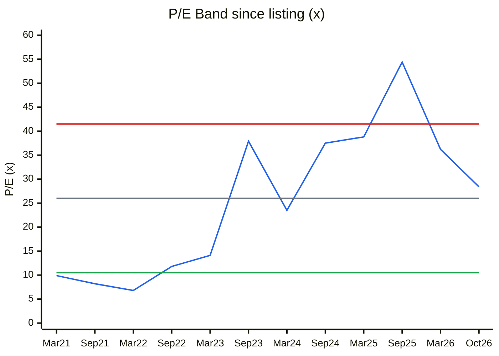
🟦 P/E (TTM, headline) · ⬜ Median 26.0× · 🟥 +1SD 41.5× · 🟩 −1SD 10.5×

**Read:** The headline P/E of 28.4× sits at about the **55th percentile** of its post-listing range, just above the 26× median, on peak-cycle earnings (CY7). Only ~6 years of history exist, which is not a full decade.

**Business inference:** A median multiple on peak margins *and* a 35% treasury contribution is a "double-peak" trap. Normalise margins to ~13% and strip treasury, and the effective multiple is ~45–50×. The 2021–22 sub-10× era (pre-defence re-rating) shows how far the multiple can fall if the order thesis fails.

**CY2 — P/B band (table only):** P/B 8.5× now versus a post-listing median of 9.1× (+1SD 15.8×, −1SD 2.4×), ~40th percentile (Screener). That is for ROE of 26–29%, which is itself at a peak. On a normalised ~18% ROE, the justified P/B at Ke 12.5% / g 8% is (18 − 8)/(12.5 − 8) = 2.2×, a quarter of the current multiple.

**CY4 — Price vs EPS index (FY21 = 100; split-adjusted price at fiscal year-end and TTM EPS as reported at that date, Screener)**
| Point | FY21 | FY22 | FY23 | FY24 | FY25 | FY26 | Oct26 |
|---|---|---|---|---|---|---|---|
| Price (₹) | 110 | 122 | 333 | 932 | 2,644 | 2,163 | 2,048 |
| TTM EPS (₹) | 11.15 | 17.88 | 23.60 | 39.67 | 68.20 | 59.66 | 70.85 |
| Price idx | 100 | 110 | 301 | 844 | 2,395 | 1,959 | 1,855 |
| EPS idx | 100 | 160 | 212 | 356 | 612 | 535 | 635 |

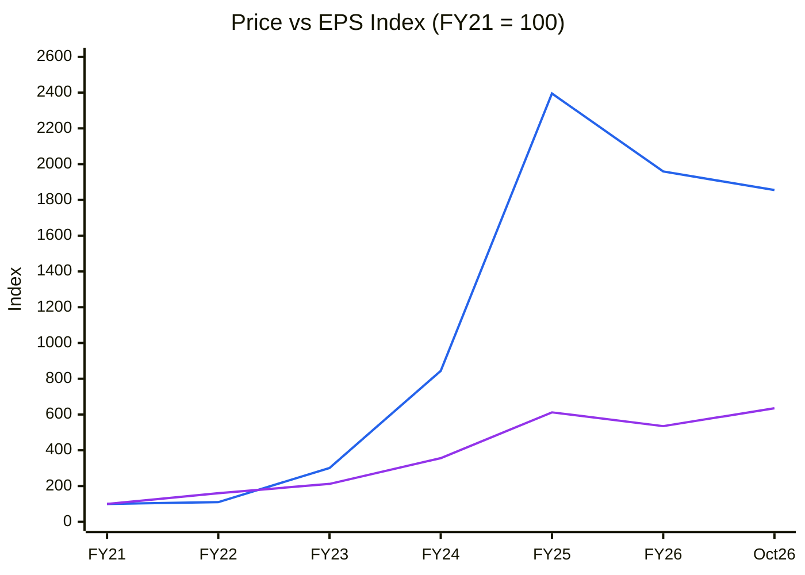
🟦 Price index · 🟪 EPS index (TTM, Screener; FY21 price derived as P/E × EPS)

**Read:** The price is up 18.6× since FY21 against EPS up 6.4×. About **2.9× of the return came from re-rating** (P/E ~10× → ~29×).

**Business inference:** Most of the shareholder return was borrowed from future expectations, not earned. The re-rating is unwinding (price index −23% from FY25 while EPS rose), and the PIE shows the remaining multiple still assumes the next orders arrive on time.

**C13 — Scenario targets vs CMP (₹)**
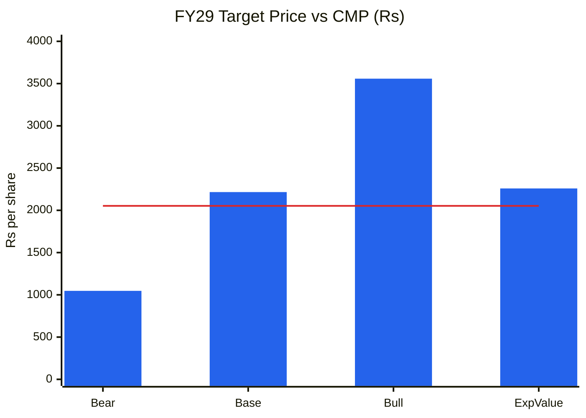
🟦 Scenario target · 🟥 CMP ₹2,053

**Read:** Downside −49% versus upside +73% gives U/D 1.50:1. The base case is only +8% and the probability-weighted value +10%.

**Business inference:** The payoff is close to symmetric, a coin-flip on a CCS signature that has already slipped four times. The market is pricing near the base case, so even a successful signing mostly validates the current price. The asymmetry only turns favourable below ~₹1,750.

### Cycle Position Dashboard
| Dimension | Current | Median / avg | Percentile | Signal |
|---|---|---|---|---|
| P/E (headline) | 28.4× | 26.0× (post-listing) | ~55% | Fair on peak earnings → **Expensive** on normalised |
| P/B | 8.5× | 9.1× | ~40% | Fair vs history, expensive vs normalised ROE |
| Core EBITDA margin | 17.6% (FY26) | 9.2% (10-yr avg) | 90% | **Peak** |
| ROCE | 36% | 30% (10-yr avg) | ~70% | High, falling from 44% |
| Order-book cover | 1.4× | ~4–5× (FY21–26) | Lowest on record | **Trough of visibility** |
| Industry capex/dep | MDL 4.9×; sector expanding | — | — | **Capacity flooding** |
| **Overall cycle position** | | | | **Late cycle (harvest ending, reload not yet signed)** |

*Consistent with Module 1b (Neutral) and Module 1c (Late cycle).*

---

## Module 10 — Technical Stage (Weinstein)
*Screener weekly closes; 30-week MA computed from the weekly series.*

| Week | Close (₹) | 30-wk MA (₹) |
|---|---|---|
| 16-Jan-26 | 2,447 | 2,760 |
| 06-Feb-26 | 2,402 | 2,674 |
| 27-Mar-26 | 2,163 | 2,573 |
| 30-Apr-26 (Q4 results; Mahendragiri delivered) | 2,733 | 2,522 |
| 12-Jun-26 | 2,410 | 2,463 |
| 14-Aug-26 | 2,580 | 2,435 |
| 25-Sep-26 | 2,200 | 2,447 |
| 09-Oct-26 | **2,010** | 2,423 |
| 12-Oct-26 (intraday) | 2,048 | 2,414 |

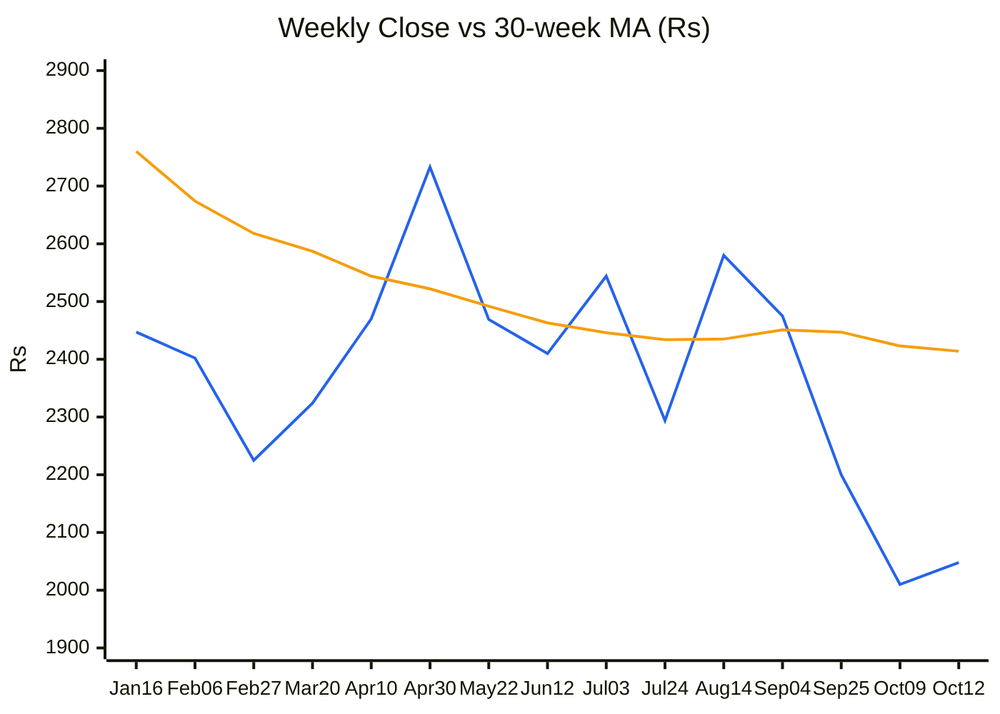
🟦 Weekly close · 🟧 30-week MA

**Read:** The 30-week MA has fallen from ₹2,760 to ₹2,414 since January and turned down again in the last four weeks (−₹34). Rallies failed at lower highs (₹2,733 in Apr, ₹2,580 in Aug). Price closed at a **52-week weekly low of ₹2,010** (intraday low ₹1,988), 15% below the MA.

**Business inference:** Holders are selling into every order-hope rally (March CNC news, April results), so the market no longer gives credit for "imminent" signings. The trend will not repair until a contract is actually signed.

**Nifty 50 market stage:** ~22,520, well below 2024–25 highs → **Stage 4 → 1 (basing)** (⚠️ approximate; no weekly MA computed for the index)
**Sector stage (Nifty India Defence):** Index series not retrieved (⚠️ data gap). Proxies: MDL −27% YoY, GRSE −37% from its 52-week high (₹2,107 vs ₹3,339), Cochin −33% (₹1,242 vs ₹1,864), which suggests **Stage 4** (estimate).
**Stock stage:** **Stage 4 (declining), with a declining 30-week MA → HARD STOP**
**30-Week MA:** Declining | Price: **Below** (−15%)
**RS vs Nifty:** Negative. Stock −27% over 1 year (₹2,818 → ₹2,048) versus Nifty roughly −10% (estimate)
**Volume:** No accumulation. Weekly volume averages ~5.8 Mn shares; the down-legs in Sep–Oct came on ~2.8–4.1 Mn (no capitulation spike yet). The last heavy-volume week was 06-Mar-26 (27 Mn, CNC news), which has since been fully retraced.
**Stop-loss (existing holders):** Weekly close below ₹1,950 (below the 52-week intraday low of ₹1,988)
**CANSLIM:** C 1 (Q1 EPS +21.5% YoY, but on a weak base and with CDPLC) · A 1 (3-yr EPS CAGR 32%, ROE 26%) · N 0 (no new high; catalyst unsigned) · S 0 (government OFS overhang) · L 0 (RS negative) · I 0 (FII falling; DII flat since Jun-25) · M 0 (Nifty below highs) → **2/7**
**Stage + fundamental alignment:** **Aligned on the negative side.** The order cliff and the falling trend agree.

---

## Module 11 — Forward View: 2–3 Year Thesis

### Capex classification (FY26 actual; FY27–FY29 estimates)
| Capex type | FY26A (₹ Cr) | FY27E | FY28E | FY29E | In model? |
|---|---|---|---|---|---|
| Tangible growth (floating dock, Nhava yard, South Yard Annex, P75(I) infra) | ~375 | 400 | 600 | 700 | ✅ (capacity, not revenue driver) |
| Maintenance (≈ depreciation) | ~97 | 100 | 110 | 120 | ❌ |
| CDPLC acquisition (equity) | 237 | — | — | — | ❌ (inorganic) |
| Greenfield commercial cluster (Dighi/Dugarajapatnam; mgmt "~₹15,000 Cr", 5–7 yrs) | — | ? | 1,000–2,000 (est.) | 2,000–3,000 (est.) | ⚠️ Not in base; bear-case risk |
| **CWIP (Mar-26)** | ₹252 Cr consol. / ₹245 Cr standalone | | | | |

*Source: AR FY26 (capex ₹471.81 Cr; CDPLC ₹236.95 Cr); Q2FY26 call (₹1,000 Cr Nhava + SYA; ₹1,000 Cr P75(I) infra); Director-Finance Sep-2026 (~₹15,000 Cr cluster). MDL is order-book driven, so revenue is modelled on order book × execution (EPC track), not on gross-block AT. Gross block ₹2,140 Cr (FY26) against ₹12,840 Cr revenue is 6.0× AT, which tells us little.*

**Incremental ROIC:** Defence capex (₹2,000 Cr over FY27–29) supports ~₹8,000–10,000 Cr of submarine revenue at a 13% EBIT margin, about **35–45% post-tax: value-creating**. The proposed ₹15,000 Cr commercial cluster at an assumed 6–8% EBIT margin on ~1× asset turn gives about **5–6%: value-destroying** unless the Shipbuilding Financial Assistance policy and the state make up the gap. Flag for Module 4.

### Earnings model (Base case, consolidated, ₹ Cr)
| Metric | FY26A | FY27E | FY28E | FY29E |
|---|---|---|---|---|
| Opening order book (standalone) | 32,260 | 20,535 | ~9,500 (+ new) | ~70,000+ (P75/P75I signed) |
| New firm orders | ~1,500 | ~38,000 (P75 follow-on in H2) | ~60,000 (P75(I)) | ~5,000 |
| Revenue | 13,006 | 13,000 | 12,500 | 18,500 |
| Core EBIT margin | 16.7% | 14% | 12% | 13% |
| Core EBIT | 2,171 | 1,820 | 1,500 | 2,405 |
| Treasury income (pre-tax) | ~1,000 | 850 | 900 | 1,000 |
| PBT | 3,237 | 2,600 | 2,330 | 3,330 |
| PAT (25% tax, net of NCI) | 2,578 | 1,950 | 1,750 | 2,500 |
| EPS (₹) | 64.0 | 48.4 | 43.4 | 62.0 |
| CFO | −2,654 | −1,500 to +4,000 (depends on P75 advance) | +5,000 (P75(I) advance) | +1,000 |

*Treasury income stays roughly flat in the base case only because new advances replace the ones being drawn down. In the bear case it falls toward ~₹600–700 Cr. The base EPS in the scenario table (₹63.3) uses the same revenue and margin; the small difference is rounding of treasury and NCI.*

**FCF inflection year:** FY28 in the base case (the advance on signing). In the bear case it does not arrive before FY29.
**Debt ceiling:** Not applicable. Net cash, with CDPLC debt of ₹447 Cr.

### Key catalysts
1. **CCS approval and signing of P75(I)** (6 AIP submarines with TKMS, ₹70,000–99,000 Cr reported). Timing: Q4FY27 base. Management has guided "this FY" three years running.
2. **P75 follow-on (3 Scorpenes, ~₹36,000 Cr)**: immediate revenue on signing (management). Timing: unknown, possibly bundled with P75(I).
3. **P17B bid outcome** (competitive, ~₹70,000 Cr programme). Timing: FY28.
4. **Colombo Dockyard turnaround** (management targets +50% revenue in two years, Q2FY26 call). Small, ~₹700–1,000 Cr revenue.
5. **Indian Navy refit and MRLC work** (Scorpene refits as the first boats reach mid-life).

### Key risks
1. **Further P75(I) slippage past FY27.** Probability: **High (40–50%)**. Four slips so far; CCS timing is political.
2. **FY28 revenue air-pocket and margin compression** as fixed costs meet a thin book. Probability: **Medium-High**.
3. **Capital misallocation into a ₹15,000 Cr commercial shipyard** earning below WACC. Probability: **Medium**.
4. **Government OFS** (81.22% → 75% would mean ~₹5,100 Cr of supply at CMP). Probability: **Medium**.
5. **Fixed-price loss creep** (onerous provision already ₹1,060 Cr on FPV/MPV-type contracts) and LD exposure (₹678 Cr on P17A). Probability: **Medium**.

### Scenario analysis (order-book driven)
| Scenario | Order assumption | Revenue FY29E | Core EBIT margin | EPS FY29E | P/E | Target | Probability |
|---|---|---|---|---|---|---|---|
| Bull | P75(I) + P75 follow-on by Q4FY27; P17B share FY28 | ₹23,000 Cr | 15% | ₹89.0 | 40× | ₹3,558 | 25% |
| Base | Both subs signed H2FY27–H1FY28 | ₹18,500 Cr | 13% | ₹63.3 | 35× | ₹2,216 | 50% |
| Bear | Signings slip to FY29; FY28 air-pocket | ₹11,000 Cr | 11% | ₹34.9 | 30× | ₹1,047 | 25% |
| **Expected Value** | | | | | | **₹2,259** | |

**Return from current price (Expected Value):** +10% over ~2.5 years (~4% a year)
**Thesis in two sentences:** MDL is a wide-moat submarine franchise between programmes. Its price already discounts timely signing of ~₹1 lakh Cr of submarine contracts and peak-like margins. Buy only once the price offers ≥2:1 asymmetry (≤ ₹1,750) or once the contracts are signed and the stock rebuilds a Stage 1 base.
**Monitoring metrics:** (1) BSE filing on P75(I) / P75 contract signing and advance receipt; (2) quarterly order book (red line: < ₹15,000 Cr at Sep-26 with no new order); (3) core OPM < 12% in any quarter; (4) receivables > ₹3,000 Cr; (5) any board approval of greenfield-shipyard capex; (6) DIPAM OFS notice.

---

## Checklist Summary
**Section 0 (Existing Report Protocol):** 3 / 3. Base report read and validated (Revision Log above), renamed via `git mv`, one file for this company.
**Section A (Business Quality):** 16 / 18. Scuttlebutt is limited to transcripts and press; no Form C insider data (PSU).
**Section B (Forensics):** 9 / 9. Red-flag count 5/15. Beneish mechanically high but explained.
**Section C (Financial Statements):** 11 / 12. Ind AS 116 immaterial (lease liability ₹7 Cr).
**Section D (KPIs & Peers):** 7 / 7
**Section E (Market Size & Share):** 5 / 7. TAM is an estimate; no third-party market-share series.
**Section F (Valuation):** 10 / 10. MoS gate **FAILED**; U/D **FAILED**.
**Section G (Technical Stage):** 7 / 8. Sector index stage estimated from proxies.
**Section H (Forward View):** EPC track used. Order Book Tracker run and ledger established. AT-model items marked not applicable.
**Section I (Charts):** 5 / 5. C1, C2, OB-1…OB-4, C4, C5, C7, C8, CY7, CY1, CY4, C13 and weekly MA chart, each with Read and Business inference. Pre-save check passed: every series traces to a table; x-axis counts match; OB-4 converted to lines because of negative values.
**Checklist B (Pre-buy):** Falsifiability ✅ (triggers above) · Inversion ✅ (5 risks) · Circle of competence ✅ · **Asymmetry ❌ (U/D 1.50, SVAR 49%)** · 5-year test ✅ moat / ❌ price · Narrative vs numbers ❌ (guidance on orders and FY27 growth not supported by the book) · Recency ✅ (normalised margins used) · Confirmation ✅ (bear evidence sought: OFS, onerous losses, P17B competition) · Crowd: consensus is broadly positive on "P75(I) imminent"; this view differs on timing and valuation · Governance ✅ (no SEBI/SFIO actions found; EoMs noted)
**Order Book Tracker:** Run (ledger established; see Module 7)
**Hard Stops Triggered:** **(1) Weinstein Stage 4 with declining 30-week MA; (2) Upside/downside 1.50:1 (1.496) < 1.5:1.** Not triggered: integrity, pledge, ICD, auditor resignation, ROCE < WACC (core ROIC ≫ WACC), earnings quality (Aggressive but Defensible, not Concerning).

**Data gaps (carry to next run):** (1) No earnings-call transcripts on BSE after the Q2FY26 call (28-Oct-2025); Q3FY26, Q4FY26 and Q1FY27 management commentary is taken from presentations and press. (2) P75(I) contract value and MDL work-share. (3) Project-wise split of the ₹1,060 Cr onerous provision. (4) Colombo Dockyard standalone P&L, and the ₹177 Cr consolidated quarterly-vs-annual PBT mismatch for FY26. (5) Unexplained ~₹3,900 Cr order-book reduction in Q3FY25. (6) Own vs customer cash split (estimated ₹7,000 / ₹6,100 Cr). (7) Nifty India Defence index weekly series. (8) Peer DuPont and capex history for CY8. (9) Cochin Shipyard Q1FY27 figures conflict across secondary sources (Screener used).

---

## Investment Decision
**Recommendation:** **AVOID** (fresh money) → **WATCHLIST**
**Verdict category:** AVOID. Hard stops: Stage 4 with a declining 30-week MA, and U/D 1.50:1 below the 1.5 threshold. Without the hard stops, the business-quality/valuation mix would read **Quality at Wrong Price**.
**Conviction Score:** 5 / 10. Cycle 0.3 · Industry 0.8 · Moat 1.6 · Management 0.5 · Financial/earnings quality 1.2 · Valuation/PIE 0.4 · Technical 0.0 = 4.8
**Suggested Position Size:** 0% now. On a trigger, start at 1–2% (sizing halved for late cycle).
**Entry Price Range:** **₹1,650–1,750** (U/D ≥ 2.6:1, MoS 21–26% vs base), *or* after a signed P75(I)/P75 follow-on **plus** a weekly close back above a flattening 30-week MA (re-run the valuation then; the bull path becomes the base)
**Stop-Loss (existing holders):** Weekly close below ₹1,950
**Target Price (FY29):** Base ₹2,216 · Bull ₹3,558 · Bear ₹1,047 · Prob-weighted ₹2,259
**Review Trigger:** (a) P75(I) or P75 follow-on contract signing on BSE (upgrade review); (b) order book < ₹15,000 Cr at Sep-26 with no new order (downgrade case strengthens); (c) Q2FY27 results (~early Nov-2026); (d) any DIPAM OFS or greenfield-capex board approval.

---
*Report generated by Stock Fundamental Analysis Skill v3.3 | Defence Shipbuilding & Marine Services | Indian Markets Context*
*Save path: C:\Users\anubh\Documents\Anubhav\Stock Analysis\Stock Analysis\MAZDOCK_MazagonDockShipbuilders_2026-10-12.md*
*Primary sources: BSE Reg 30 filings (scrip 543237) incl. clarifications of 05-Mar-2026 and 02-Oct-2026; MDL investor presentations Aug-24 → Sep-26; Annual Reports FY24, FY25, FY26; earnings-call transcripts Q3FY25 (07-Feb-25), Q4FY25 (30-May-25), Q2FY26 (28-Oct-25); Screener.in (consolidated and standalone, 12-Oct-2026); press as linked.*
