# Stock Analysis Report — Bodal Chemicals Ltd (NSE: BODALCHEM · BSE: 524370)
**Date:** 2026-10-10
**Analyst:** Claude (Stock Fundamental Analysis Skill v3.3)
**Investment Horizon:** 2–3 Years
**Recommendation:** AVOID (hard stops triggered: U/D 0.8:1, SVAR 61%, ROIC < WACC for 7 years). Re-test after Q2FY27 results.
**Conviction Score:** 3.5 / 10
**CMP:** ₹172.59 (NSE close 9-Oct-2026, Yahoo Finance) · **Market cap:** ₹2,174 Cr (12,59,44,065 shares, from the SAST filing of 30-Sep-2026)

## Revision Log
| Version | Date | Recommendation | Conviction | Price | Key change |
|---|---|---|---|---|---|
| **Current** | 2026-10-10 | **AVOID** | **3.5 /10** | ₹172.59 | The stock went up another 46% in 6 weeks (peak ₹207.7) with no company trigger. The company says the move is "purely market driven" (1-Sep-2026) and called a merger rumour fake (14-Sep-2026). FY26 profit turns out to be almost all one-offs: ₹27 Cr SGST catch-up, ₹28.8 Cr asset-sale gain and ₹6.3 Cr interest on a tax refund, against PBT of ₹54 Cr. Normalised TTM P/E is about 118×, and the price now implies an EBIT margin of 13–18%. The old report missed the hard stops. |
| Previous | 2026-08-31 | WATCHLIST / ACCUMULATE ON DIPS | 5 /10 | ₹118 | Initial report: "quality cyclical at a full price". Full text in git history. |

**What changed in the thesis:** The August report read FY26 (+158% PAT) and Q1FY27 (+218% PAT) as a Saykha-driven, cash-backed recovery. Primary filings tell a different story. **(1)** FY26 earnings were close to zero once one-offs are removed: normalised consolidated PBT was about ₹2 Cr against ₹54 Cr reported (FY26 AR, Notes 26 and 27). **(2)** Q1FY27 growth came from passing through a crude/sulphur price spike. The company says so itself: "Increase in crude oil prices led to increase in RM prices… could pass on the price effect" (Q1FY27 presentation). Volumes were mixed: dye intermediates +18%, dyestuff flat, basic chemicals −3%, caustic −9%. EBITDA margin *fell* from 11.3% to 10.5%. **(3)** Management's own FY26 targets were mostly missed: margin, term-debt reduction, chlor-alkali utilisation, Debt/EBITDA. No concall transcript has been filed since Aug-2025. **(4)** At ₹173 the stock trades at the 89th percentile of its 10-yr P/E range and the 80th of its P/B range, on trough-percentile margins and ROCE.

**Validation of previous report (every material item re-checked):**
| Item | Previous (31-Aug-2026) | Now (10-Oct-2026) | Status |
|---|---|---|---|
| CMP / market cap | ₹118 / ₹1,497 Cr | ₹172.59 / ₹2,174 Cr | 🔄 Updated |
| 52-wk range | ₹41–₹119 | ₹42.81–₹207.70 (weekly, Yahoo); Screener shows ₹41.25 intraday low | 🔄 Updated |
| P/E, P/B, BV | 21.8×, 1.28×, ₹92 | 31.6× TTM, 1.88×, ₹91.9 (Screener) | 🔄 Updated (old values were correct at ₹118) |
| FY19–FY26 sales series | FY25 ₹1,745 Cr | FY25 **₹1,748 Cr** (Screener consolidated) | ❌ Corrected (minor transcription) |
| Operating profit FY25 / FY26 | ₹167 / ₹161 Cr | **₹171 / ₹168 Cr** (Screener) | ❌ Corrected |
| ROCE / ROE (current) | 7% / 4% | **ROCE 6% (FY26), 5.6% TTM; ROE 2.0%** (Screener) | ❌ Corrected |
| ROCE 10-yr series | 39→…→7 | FY26 = 6% (rest ✅) | ❌ Corrected (last point) |
| FY26 PAT ₹48 Cr "+158%" as recovery evidence | Recovery | +167% reported, but **~₹62 Cr of one-offs in ₹54 Cr PBT** (SGST catch-up ~₹17 Cr est., PPE sale ₹28.8 Cr, IT-refund interest ₹6.3 Cr; FY26 AR Notes 26/27). Normalised PBT ≈ ₹2 Cr | ❌ Corrected (material) |
| Q1FY27 ₹709 Cr / ₹69 Cr OP / ₹30 Cr PAT (+218%) | As stated | Confirmed (Q1FY27 results, consolidated PAT ₹30.4 Cr, +218.7%) | ✅ Validated |
| "Saykha operating leverage kicking in" (Q1FY27) | Saykha drove step-up | Revenue: "Others" (incl. benzene derivatives) rose from ~₹45 Cr to ~₹160 Cr, ✅ in part. But the company attributes growth mainly to RM pass-through, and EBITDA margin fell 11.3%→10.5%: **no operating leverage** | ❌ Corrected (attribution) |
| Chlor-alkali located at Saykha | "Saykha benzene-downstream + chlor-alkali" | Chlor-alkali is **Unit XII, Rajpura (Punjab)**. Saykha = Unit V, 63,000 MTPA benzene derivatives (BSE 29-Mar-2024) | ❌ Corrected |
| "Saykha SPV" subsidiary | SPV | Saykha is a unit of the listed company. Subsidiaries are trading entities (BCTPL, China, Turkey/Sener Boya, Indonesia, Bangladesh), per Q1FY27 results note 3 | ❌ Corrected |
| Fixed assets ₹817→₹1,314 Cr (FY22–24) | As stated | Net block ✅ (Screener) | ✅ Validated |
| OCF FY23–26 ₹290/204/114/176 Cr | As stated | ✅ (Screener) | ✅ Validated |
| Borrowings ₹911→₹813 Cr | As stated | ✅. Net debt ₹892→₹793 Cr (FY26 AR Directors' Report) | ✅ Validated |
| CCC 165→105 days | As stated | ✅ (Screener ratios) | ✅ Validated |
| Promoter 57.00%, zero pledge | As stated | **56.99%** (Sep-2026). No encumbrance in SAST 29(2) filings | 🔄 Updated |
| "Lead holder 29.47%" | As stated | Not re-sourced this run | ⚠️ Unverifiable |
| FII 0.15% / DII 0% | Mar-2026 | **FII 1.79%, DII 0.51%** (Sep-2026). Public investor Ashokkumar Bansal crossed 5% (5.01%, SAST 29(1), 12-Sep-2026) | 🔄 Updated |
| Promoter "holding stable; no insider selling" | Net-positive | Promoter-group member **R D Patel sold 1.70 lakh shares (0.13%) on 29-Sep-2026** near the top (SAST 29(2), 30-Sep-2026) | 🔄 Updated (bearish) |
| "No audit red flags" | Clean | **Emphasis of Matter** on SGST incentive recognition (FY26 standalone audit report). Dec-2024 fire at Unit 7 (insurance settled). Auditor firm merged into BNPS & Associates LLP (BSE 23-Sep-2025) | ❌ Corrected |
| WTT: revenue ~₹1,900 Cr FY26 → ₹2,012 Cr | ✅ | ✅. Source confirmed: Q1FY26 concall (14-Aug-2025) | ✅ Validated |
| WTT: debt reduction ₹150–175 Cr "on track ✅/⚠️" | ✅/⚠️ | The guidance was **term debt**. Gross term loans fell ₹520.7→₹481.6 Cr (**−₹39 Cr**, FY26 AR Note 19). Total debt −₹98 Cr | ❌ Corrected (Miss) |
| WTT score "MODERATE-to-HIGH" | Provisional | **0.43, LOW** (7 scored points, 3 hits) | ❌ Corrected |
| Market "Nifty near highs; M = Stage 2 ✓" | Optimistic | On 31-Aug-2026 the Nifty (23,898) was **below a declining 30-wk MA (24,038)** and 9% under its 52-wk high (26,329). Now Stage 4 (22,520 vs MA 23,718) | ❌ Corrected |
| Stock Stage 2 | Stage 2 advancing | Still Stage 2, but **climactic**: price 82% above a steeply rising 30-wk MA (₹94.7). Peak-volume week 63.8 mn shares (31-Aug→4-Sep) | 🔄 Updated |
| Scenario EV ₹120; U/D 1.3:1 | As stated | Arithmetic ✅. But U/D < 1.5:1 should have triggered the hard stop (AVOID), and SVAR = (118−48)/118 = **59% > 40%** was not flagged | ❌ Corrected (hard stops misapplied) |
| Hard stop "ROIC < WACC 5+ yrs" | Not discussed | ROIC < 12% WACC every year FY20–FY26 (7 yrs) | ❌ Corrected (omitted) |
| Credit ratings | India Ratings / Infomerics | IND BBB+/Stable (22-Jul-2025). IVR A-/Stable assigned 9-Dec-2025 | ✅ Validated |
| Dye-intermediate leadership / integration claims | As stated | ✅ ~40% of basic chemicals and ~40% of DI consumed captively (Q1FY27 presentation) | ✅ Validated |
| Data gap: concall / capex schedule | Not accessed | **Closed.** Q1FY26 transcript harvested (guidance ledger below). No transcripts filed for Q2FY26–Q1FY27. FY26 capex ₹35.6 Cr, CWIP ₹67 Cr, no major capex planned; term loan repayable to Dec-2028 | 🔄 Updated |
| Data gap: Beneish / Altman / Piotroski "directional" | Directional | Computed: M = −2.54, Z'' = 3.57, F = 8/9 (7/9 normalised) | 🔄 Updated |

---

## Executive Summary
Bodal Chemicals is India's largest integrated dye-intermediate producer, with captive sulphuric-acid/basic chemicals, a Punjab chlor-alkali plant and a still-underutilised Saykha benzene-derivatives unit. The August thesis of a cash-backed, Saykha-led recovery does not survive the FY26 annual report. Underlying FY26 PBT was **about ₹2 Cr** once the ₹27 Cr SGST incentive catch-up (with an auditor Emphasis of Matter), the ₹28.8 Cr asset-sale gain and the ₹6.3 Cr tax-refund interest are stripped out. Q1FY27's strong ₹30 Cr PAT came mainly from **passing a crude/sulphur price spike (Hormuz disruption) through to customers**, while EBITDA margin compressed. Meanwhile the stock has **tripled in ~3 months (₹58 → ₹207.7 peak, now ₹172.6)** with no company catalyst. It trades at ~118× normalised TTM EPS and 1.88× book on a business that has earned below its cost of capital for seven straight years. The price implies a 13–18% EBIT margin the company has not reached since FY19. Probability-weighted value is **₹128 (−26%)**, U/D is **0.8:1** and SVAR is **61%**. **AVOID.** The cash-generative, unpledged balance sheet makes this a business worth re-testing at a far lower price, or after two clean quarters at a ≥₹35 Cr quarterly PBT run-rate without one-offs.

**C1 source table: Growth Index (FY18 = 100; FY17 gross block was reset on Ind AS transition, so FY18 is the first clean base).** Revenue, op. profit, PAT: Screener consolidated. Tangible gross block = gross block − intangibles (Screener schedule).
| | FY18 | FY19 | FY20 | FY21 | FY22 | FY23 | FY24 | FY25 | FY26 |
|---|---|---|---|---|---|---|---|---|---|
| Revenue ₹Cr | 1,142 | 1,424 | 1,375 | 1,226 | 2,055 | 1,574 | 1,395 | 1,748 | 2,012 |
| Tangible gross block ₹Cr | 476 | 670 | 734 | 902 | 971 | 1,172 | 1,575 | 1,632 | 1,617 |
| EBITDA (op. profit) ₹Cr | 196 | 236 | 138 | 87 | 220 | 133 | 111 | 171 | 168 |
| PAT ₹Cr | 122 | 141 | 86 | 40 | 99 | 38 | 6 | 18 | 48 |

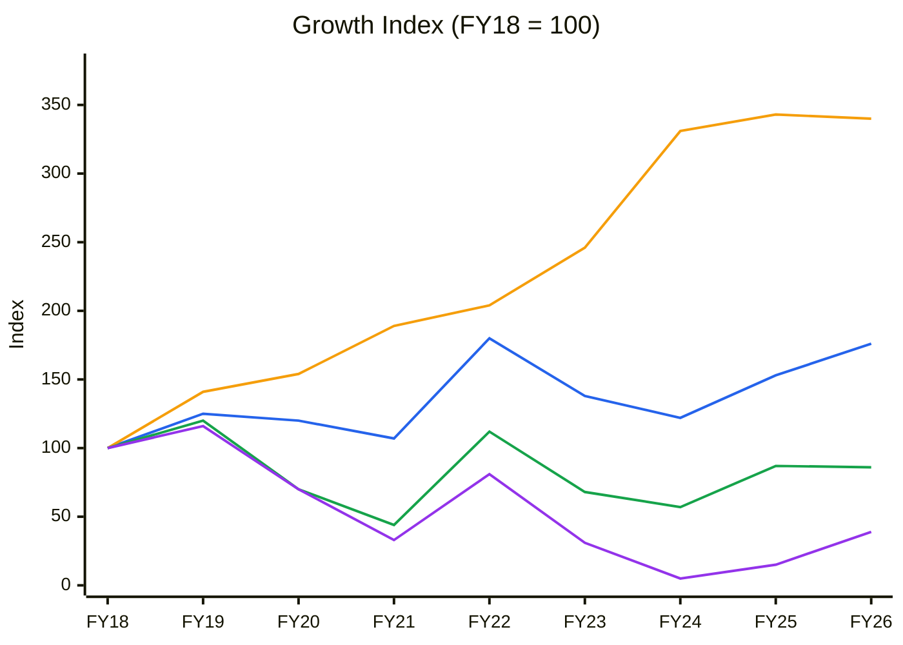
🟦 Revenue (CAGR 7.3%) · 🟧 Tangible gross block (16.5%) · 🟩 EBITDA (−1.9%) · 🟪 PAT (−11.0%)

**Read:** Since FY18 the tangible gross block has grown 3.4× while revenue grew only 1.76×. EBITDA is still 14% below FY18 and PAT 61% below, and the reported FY26 PAT (index 39) is itself flattered by one-offs.

**Business inference:** Bodal has spent eight years buying revenue with capital: the FY21–FY24 expansion (Saykha, chlor-alkali upgrade) roughly doubled the asset base without lifting absolute profit. Until utilisation and spreads earn a return on that block, the equity is not compounding. That is the core reason ROIC sits below WACC (→ Module 5, Module 10 AT anchors).

**Order book:** not applicable. This is spot/short-contract commodity chemicals, and no Reg 30 "Award/Receipt of Order" filings were found in the BSE harvest from Jan-2024 to 10-Oct-2026.

---

## Business Primer

Bodal Chemicals is a Gujarat-based, vertically integrated chemical manufacturer built around the dyestuff value chain. It makes **dye intermediates** (vinyl sulphone, H-acid, DASA, gamma/K acid; 38,400 MTPA, FY26 standalone sales ₹711 Cr) and **dyestuffs** (reactive, acid, direct and liquid dyes; 40,000 MTPA, ₹506 Cr). It also makes **basic chemicals** (sulphuric acid, oleum, chlorosulphonic acid; 2,17,600 MTPA) and **chlor-alkali** (caustic soda 99,000 MTPA at Rajpura, Punjab; ₹339 Cr). Since FY24 it also has **benzene derivatives** (MCB/PNCB/ONCB/DCB, 63,000 MTPA at Saykha, Gujarat), plus 12,000 MTPA of TCCA (FY26 AR Note 26.1; Q1FY27 presentation). Customers are textile, leather and paper dye formulators, plus water-treatment, pharma and agro users. Revenue is about 79% domestic and 21% export, and is pure B2B volume × realisation. Roughly 40% of basic-chemical output feeds the intermediates, and about 40% of intermediates feed the dyestuffs. That integration is the company's cost edge. Earnings depend on two things: the spread between crude/sulphur/naphthalene-linked inputs and dye-chain prices, which Chinese capacity sets, and utilisation of a much-enlarged asset base.

This is a **cyclical, asset-heavy commodity-chemicals business with a narrow cost/integration moat**, a leveraged balance sheet (₹813 Cr debt, ₹79 Cr interest) and returns that have been below the cost of capital since FY20. The value driver is spread × utilisation; operating leverage is high and financial leverage amplifies it. The key risks are Chinese pricing in dye intermediates and input-price shocks. The current shock (Strait-of-Hormuz sulphur and crude spike) helps the captive sulphuric-acid chain on revenue, but squeezes the spread: gross margin hit a 13-quarter low of 40% in Q1FY27. Two structural features colour this report: (1) reported earnings in FY26 were dominated by non-recurring items, so every multiple must be computed on normalised profit; and (2) the share price has decoupled from fundamentals in a speculative, retail-driven run. Shareholder count fell from 67,902 to 60,997 in the September quarter while FIIs rose from 0.02% to 1.79%.

**Segment check (New Segment Protocol):** The nearest block is **Specialty Chemicals** (`references/05-industry-kpis-india.md`, line 449), and it is used here. It is a poor fit: it is built for custom-synthesis/CRAMS players (order book, 20–30% EBITDA, >50% exports). No dye / dye-intermediate / chlor-alkali / sulphuric-acid block exists. **Flag: proposed new segment "Dyes, Dye Intermediates & Chlor-Alkali (integrated commodity chain)".** The KPI file was not edited, as instructed.

---

## Module 1 — Market, Sector & Stock Cycle

### 1 — Broad Market Cycle (Marks)
Nifty 50 at **22,520 (9-Oct-2026)** is −12.4% YoY and below a **declining 30-wk MA (23,718)**: **Stage 4**. India VIX is rising, and the Hormuz-linked crude spike is pressuring INR and inflation (CRU/Procurement Resource coverage). **Assessment: Cautious → Fearful.** Marks would allow larger sizing in fear, but only for names with margin of safety. A small-cap that tripled against a falling market is the opposite of what fear-driven bargains look like.

### 1b — Sector Cycle: Tailwinds & Headwinds
- **Input-cost cycle: sharp spike (headwind to spread, tailwind to nominal revenue).** QatarEnergy sulphur hit a record **$740/t FOB in May-2026 and $805/t in June** (about +55% vs February). India CIF is around **$1,050/t in July-2026 vs $280 a year earlier**, driven by the Strait-of-Hormuz disruption ([CRU/BC Insight](https://www.bcinsight.crugroup.com/2026/05/21/price-trends-75/), [Drishti, 1-Oct-2026](https://www.drishtiias.com/daily-updates/daily-news-analysis/surging-sulphur-prices-impact-on-india)). Bodal's basic-chemicals revenue rose 89% YoY in Q1FY27 "mainly due to increase in its main RM i.e. Sulphur" (Q1FY27 presentation). That is pass-through, not spread expansion.
- **Dye intermediates / China:** No usable 2026 China H-acid or vinyl-sulphone price series was found ⚠️. IMARC reports the US H-acid price at $5,268/t in Q1-2026 (+1.9% QoQ), with higher landed costs into India ([IMARC](https://www.imarcgroup.com/news/h-acid-price-index)). Bodal's DI revenue rose 44% with volume +18%, so price did the rest.
- **Secular vs cyclical decomposition:** Of the +56% Q1FY27 revenue growth, the volume-led portion is roughly DI volume (+18%) plus "Others"/Saykha. Most of the rest is cyclical **price pass-through of an input shock that will mean-revert** when Hormuz normalises. The DCF must not capitalise Q1FY27 revenue. Durable baseline: FY26 revenue ex-SGST (~₹1,985 Cr) growing 5–7%.
- **Competitive capacity:** Chinese dye-intermediate capacity remains the price-setter. Kiri Industries (a domestic DI/dye peer) is still loss-making at the operating level (TTM OPM negative, Screener), which shows the sector is not in an upcycle.
- **Geopolitical map:** Raw material (sulphur, benzene, naphthalene) is Gulf/crude-linked. Hormuz is **transient-to-structural**: re-routable supply is limited, so widen MoS by 5pp. FX: about 21% export revenue against crude-linked imported inputs, so weak INR is roughly neutral to mildly positive.
- **Sector verdict: Headwind on spreads (input spike + China), tailwind on nominal revenue only.** Expected duration: tied to the Gulf disruption.

**CY6 source table: Spread proxy (gross margin % = 100 − material cost %, consolidated quarterly, Screener schedule)**
| Q1FY24 | Q2FY24 | Q3FY24 | Q4FY24 | Q1FY25 | Q2FY25 | Q3FY25 | Q4FY25 | Q1FY26 | Q2FY26 | Q3FY26 | Q4FY26 | Q1FY27 |
|---|---|---|---|---|---|---|---|---|---|---|---|---|
| 48 | 49 | 51 | 50 | 47 | 47 | 51 | 52 | 48 | 43 | 44 | 45 | 40 |

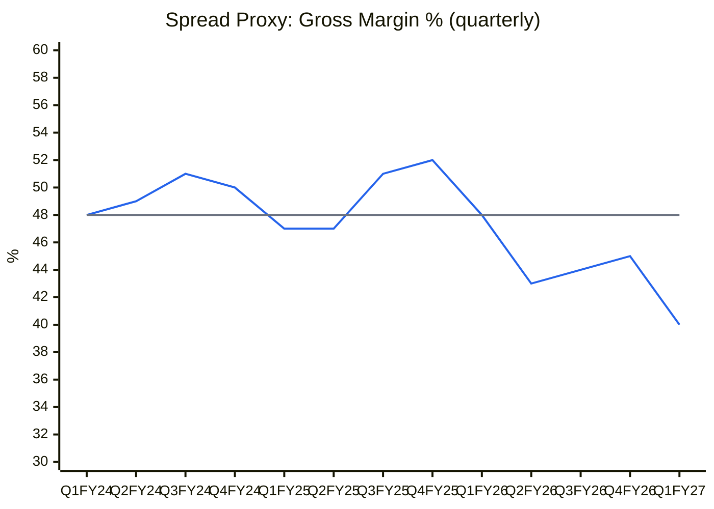
🟦 Gross margin % · ⬜ 13-quarter median 48%

**Read:** The spread proxy has fallen five quarters in a row from 52% (Q4FY25) to **40% in Q1FY27, the lowest of 13 quarters (0th percentile)**, eight points below the median.

**Business inference:** Bodal is passing *cost* through but not *margin*: every rupee of extra revenue in Q1FY27 carried less gross profit. The headline revenue boom is an input-price echo, not pricing power. If sulphur and crude ease, revenue falls back, and the spread only recovers if China-set DI prices hold (→ Module 9 base case does not capitalise Q1FY27).

**CY5 Industry demand vs supply:** ⚠️ Not charted. No sourced industry capacity/demand series exists for Indian dye intermediates or reactive dyes (CRISIL/ICRA sector data not accessible this run).

### 1c — Stock Cycle: Company-Specific Positioning

**C2 source table: Quarterly YoY growth (consolidated, Screener; EBITDA = operating profit)**
| | Q2FY25 | Q3FY25 | Q4FY25 | Q1FY26 | Q2FY26 | Q3FY26 | Q4FY26 | Q1FY27 |
|---|---|---|---|---|---|---|---|---|
| Revenue ₹Cr | 429 | 443 | 451 | 454 | 480 | 490 | 588 | 709 |
| Revenue YoY % | 30 | 31 | 14 | 8 | 12 | 11 | 30 | 56 |
| Op. profit ₹Cr | 33 | 44 | 47 | 48 | 23 | 22 | 69 | 69 |
| Op. profit YoY % | 43 | 83 | 88 | 41 | −30 | −50 | 47 | 44 |

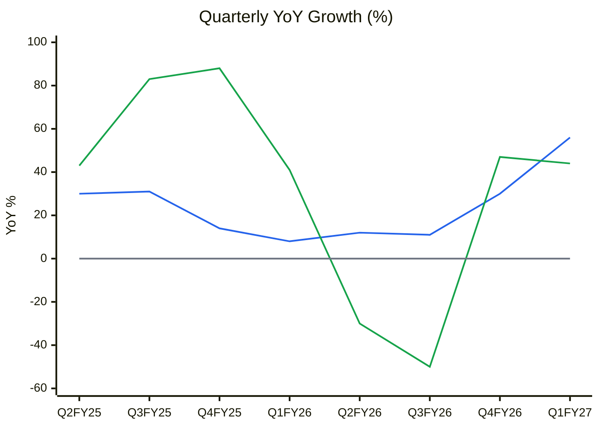
🟦 Revenue YoY % · 🟩 EBITDA YoY % · ⬜ zero line

**Read:** Revenue growth accelerated from 8% (Q1FY26) to 56% (Q1FY27). EBITDA growth swung from +88% to −50% and back to +44%, and in Q1FY27 lagged revenue (44% vs 56%).

**Business inference:** The volatile, sub-revenue EBITDA growth shows a price-taker. Q4FY26's +47% included the ₹27 Cr SGST catch-up booked in revenue, and Q1FY27's +44% rode an input spike. Neither is a durable operating-leverage signal, so "accelerating revenue" here is not the buy signal it would be for a pricing-power business.

- **Volume / price / mix (Q1FY27 vs Q1FY26, standalone production MT, Q1FY27 presentation):** DI 6,892→8,126 (+18%), dyestuff 3,741→3,742 (flat), basic chemicals 56,731→54,969 (−3%), caustic 20,557→18,763 (−9%). Segment revenue: DI ₹150→₹217 Cr (+44%), dyestuff ₹122→₹149 Cr (+23%), basic chem ₹45→₹84 Cr (+89%), chlor-alkali ₹84→₹87 Cr (+3%). "Others" (benzene derivatives, TCCA etc.) went from ~10% to ~23% of sales, i.e. from about ₹45 Cr to ₹160 Cr. **The dominant driver is price. Mix (Saykha) is a secondary positive.** Note: the presentation's slide labels are scrambled in text extraction. The order used is the one consistent with the stated segment growth rates ⚠️.
- **Physical capacity model (Q1FY27 annualised utilisation):** DI 32,500/38,400 = **85%**; basic chemicals ~2,19,900/2,17,600 = **~100%**; caustic 75,100/99,000 = **76%**; dyestuff 14,970/40,000 = **37%** (incl. liquid); Saykha benzene derivatives ⚠️ not disclosed (20–30% in Aug-2025 per concall). **The capacity ceiling has already been reached in DI and basic chemicals.** Further volume can only come from dyestuff, caustic and Saykha, which are the lowest-return lines (Saykha "margins remain under pressure", per Q4FY26 and Q1FY27 presentations).
- **Operating leverage:** DFL FY26 = EBIT 133 / (133 − 79) = **2.5×**. In Q1FY27, EBIT 57.7 / (57.7 − 18.6) = 1.5×. A 10% EBIT miss therefore costs 15–25% of EPS. Projected ICR (base): FY27 ~2.9×, so not < 2.5×, but FY26 normalised ICR was ~1.0×.
- **FCF inflection:** reached on capex: FY26 FCF ₹180 Cr (Screener), capex ₹35.6 Cr vs depreciation ₹70 Cr. But **₹141 Cr of term-loan maturities fall due in FY27** (FY26 AR Note 19), so FCF goes to repayment, not equity.
- **Stock-cycle classification: Trough / Recovery, unconfirmed** (revised from "early-to-mid cycle"). Margin and ROCE sit at the 20th and 30th percentiles of their 10-yr ranges (CY7), and the cause is partly reversible (Saykha utilisation, spread). Trough classification → widest MoS, small initial size only after a confirmed turn.

---

## Module 2 — Industry Structure & Capital Cycle

**Porter Five Forces (✅ validated, unchanged):**
| Force | Read | Signal |
|---|---|---|
| New entrants | Environmental clearances (ZLD/CETP), Gujarat cluster scrutiny, integration capex | Moderate–High barrier |
| Supplier power | Sulphur/crude/benzene are global commodities; the 2026 Hormuz shock shows power sits with suppliers | **High (raised)** |
| Buyer power | Fragmented, price-sensitive textile/leather dye formulators | High |
| Substitutes | Limited in reactive-dye chemistry | Low–Moderate |
| Rivalry | Chinese DI capacity sets prices; domestic peers (Kiri) loss-making | High |

**Industry verdict: Unattractive-to-Neutral** (downgraded one notch because supplier power is now visible in the spread).

**Capital cycle:** Bodal's own capex/depreciation fell from ~4× (FY23–24) to **0.5× (FY26: ₹35.6 Cr vs ₹70 Cr)**: supply discipline at the company level. Peer capital-cycle data (CY8) ⚠️ not compiled. The *company* cycle has turned (capex done, FCF positive). The *industry* return cycle has not: ROCE across Bodal, Kiri and Aarti is 3–7%.

---

## Module 3 — Business Quality & Moat
- **Greenwald:** (1) Cost advantage from integration: **yes, narrow** (captive acid → DI → dyes, ~40% captive at each step). (2) Customer captivity: none. (3) Local scale: partial (largest domestic DI producer). **Moat: Narrow.**
- **Buffett 10% price test:** Fail. Q1FY27 shows the company cannot even hold gross margin while passing through input inflation.
- **ROIC vs WACC (computed, Module 5):** ROIC **5.1% FY26 vs WACC 12.2%**, below WACC every year FY20–FY26.
- **Market share stability:** ⚠️ Not sourced (no industry share data).
- **Fisher 15-point (re-scored):** 1 market potential 2 · 2 new products 2 (Saykha) · 3 R&D 1 · 4 sales org 2 · 5 margin 1 · 6 margin improvement 1 · 7 labour 2 · 8 exec relations 2 · 9 depth below CEO 1 (family-run: CMD + two sons as EDs) · 10 cost controls 2 · 11 industry advantages 2 · 12 long-range orientation 2 · 13 dilution 3 (none) · 14 communication in adversity **1** (concalls stopped after Aug-2025; recurring "gradual contribution" language) · 15 integrity **2 (Pass)**: no enforcement found, but a fake-merger rumour was handled by a filing, not a call. **Total 26/45.**

---

## Module 4 — Management & Capital Allocation
- **Promoter:** 56.99% (Sep-2026; 57.39% in Dec-2023, with some promoter-group members reclassified to public, approval per BSE 22-Aug-2025). **Pledge: nil** (no encumbrance in SAST 29(2) filings of 30-Sep-2026) → Normal.
- **Insider action:** Promoter-group member **Ramesh D Patel sold 1,70,000 shares (0.13%) on 29-Sep-2026** at ~₹185–195, after the stock tripled (SAST 29(2)). **Mildly bearish:** small in size, but timed at the top, and no promoter has bought.
- **Remuneration:** CMD and two EDs ₹3.78 Cr in FY26 (₹1.62 + 1.08 + 1.08 Cr; FY26 AR Note 40). That is 8% of reported standalone PAT (₹47 Cr), under the 10% flag, but **> 100% of normalised PAT**.
- **RPTs / ICDs:** RPTs are placed before the Audit Committee. No ICDs to group entities were identified in the RPT note ⚠️ (full schedule not tabulated).
- **Capital allocation:** The FY21–FY24 debt-funded capex (borrowings ₹257→₹904 Cr) doubled the asset base into a downcycle. Since then: no dilution, Vatva units decommissioned and sold (₹28.8 Cr gain), capex cut to below depreciation, net debt −₹99 Cr in FY26. **Rating: Average** (good discipline now, poor timing then). Dividend: nil since FY24.
- **Buffett 3 C's:** Candor **weak** (no concall since Q1FY26; quarterly decks repeat "gradual/meaningful contribution" from Saykha for 6 quarters). Competence: operations adequate, capital timing poor. Caring: no dilution, no pledge, but promoter-group selling into the rally.

### Walk the Talk Scorecard (ledger carried forward + new points)
Sources: Q1FY26 concall transcript (BSE 14-Aug-2025), BSE 29-Mar-2024 Saykha filing, quarterly presentations, FY26 AR.
| Guided (source) | Statement | Guided | Actual | Verdict |
|---|---|---|---|---|
| Q4FY25 call / Q1FY26 call | FY26 revenue | ~₹1,900 Cr (">₹1,950 Cr incl. op. income") | ₹2,012 Cr | ✅ Hit (price-aided) |
| Q1FY26 call | FY26 EBITDA margin | 11–12% | 9.9% company basis (₹203 Cr / ₹2,054 Cr) / 8.3% Screener, and 7.5% ex-SGST catch-up | ❌ Miss |
| Q1FY26 call | FY26 term-debt reduction | ₹150–175 Cr | Gross term loans −₹39 Cr (₹520.7→₹481.6 Cr); total debt −₹98 Cr | ❌ Miss |
| Q1FY26 call | Chlor-alkali utilisation | 90–95% "in coming couple of quarters" | Caustic volume Q1FY27 −9% YoY; ~76% annualised | ❌ Miss |
| Q1FY26 call | Debt/EBITDA | ~2.5× | FY26 4.0× (₹813 / ₹203 Cr) | ❌ Miss |
| Q1FY26 call | Asset sales (Vatva, part Punjab) to fund debt cut | Execute | Done: ₹28.8 Cr PPE gain, Vatva decommissioned (AGM 25-Sep-2026) | ✅ Hit |
| Q1FY26 call | No major capex in next couple of years | Nil major | FY26 capex ₹35.6 Cr, CWIP ₹67 Cr | ✅ Hit |
| Q1FY26 call | Saykha utilisation >70% "within 3 months"; FY26 Saykha revenue ~₹100 Cr | 70%+ by ~Nov-2025 | Not disclosed; decks still say "gradual" through Q1FY27 | ⚠️ Unverifiable (not scored) |
| BSE 29-Mar-2024 | Saykha potential ₹320 Cr revenue at 12–15% margin at optimum utilisation | No date | Margins "under pressure" through Q1FY27 | ⚠️ Not time-bound (not scored) |
| Q1FY26 call | FY27: revenue ₹2,000–2,100 Cr, EBITDA 12–13%, PAT ₹70–80 Cr | FY27 | Q1FY27: run-rate ₹2,836 Cr / 10.5% / ₹122 Cr | In progress (not scored) |

**WTT Score: 0.43 / 1.00 — LOW** (7 scored points: 3 hits, 0 near-misses, 4 misses, 0 reversals).
**Key pattern:** One-way misses on **margin, deleveraging and utilisation**; hits only on price-driven revenue and on *not* spending. Selective disclosure: concall transcripts stopped after Aug-2025 while results worsened (Q2/Q3FY26 OPM 4.5–4.8%).
**Insider action:** Promoter-group sale 29-Sep-2026 → **BEARISH (minor)**.
**DCF impact:** Margin guidance haircut 25% (12–13% → ~9.5% base); deleveraging assumed at the scheduled repayment rate only.
**Overall management credibility: LOW-to-MODERATE.**

---

## Module 5 — Financial Forensics
- **Indian red flags:** Pledge nil ✅. ICDs none found ✅. Auditor: Naresh J Patel & Co merged into BNPS & Associates LLP (Sep-2025), a small firm for a ₹2,000 Cr company ⚠️. **Emphasis of Matter** on government-incentive recognition (FY26 standalone audit report). No KAMs reported. Dec-2024 fire at Unit 7 Dyes plant, insurance ₹4.7 Cr received, ₹1.28 Cr loss (Q1FY27 results note 3).
- **Revenue quality:** FY26 "revenue from operations" includes **₹27.0 Cr of State SGST incentive covering FY23–FY26**, recognised in Q4 as an Ind AS 10 adjusting event after approval of a ₹150.09 Cr eligible FCI (FY26 AR Note 26). It recurs at about ₹2.6 Cr per quarter (Q1FY27 note 4: ₹2.57 Cr). The prior-year catch-up (~₹17 Cr, estimated from the ₹10.3 Cr FY26 run-rate ⚠️) is non-recurring.
- **Beneish M-Score (FY26 vs FY25): −2.54 → unlikely manipulator.** DSRI 0.96, GMI 1.09, AQI 1.08, SGI 1.15, DEPI 0.94, SGAI 0.93, LVGI 0.96, TATA −0.055.
- **Altman Z'' (FY24 / FY25 / FY26): 3.03 / 3.17 / 3.57 → Safe**, improving (X1 0.09, X2 0.49, X3 0.06, X4 0.98 in FY26). On normalised EBIT, Z'' ≈ 3.4.
- **Piotroski F: 8/9 reported** (gross margin fell 49%→45%). **7/9 on normalised ROA.**
- **Sloan accrual ratio: −5.9%** → cash-backed (CFO ₹176 Cr > PAT ₹48 Cr).
- **Schilit screen:** Other income / EBIT = 26% in FY26 (EMS #3 one-time boosts) ⚠️. One-off items in three consecutive years: FY24 tax credit (tax −37%), FY25 fire loss, FY26 asset sale + SGST + tax refund ⚠️. CFS: no factoring evident; DSO 83→80 days.
- **Forensic red-flag count: 3 / 15** (other income/EBIT, recurring "one-offs", low consolidated tax rate: 4% FY25, 12% FY26). **All three are explained and quantified** (normalisation below), so the "≥3 unresolved" hard stop is *not* triggered.
- **Overall forensic verdict: Minor concerns.** The books are clean and cash-backed. The issue is that **headline profit is low-quality, not fraudulent**.

---

## Module 6 — Earnings Quality & Financial Statements

**10-yr P&L / returns (consolidated, Screener; ROIC computed = (PBT+interest)×(1−t) / avg(equity + borrowings − cash))**
| | FY17 | FY18 | FY19 | FY20 | FY21 | FY22 | FY23 | FY24 | FY25 | FY26 |
|---|---|---|---|---|---|---|---|---|---|---|
| Sales ₹Cr | 1,233 | 1,142 | 1,424 | 1,375 | 1,226 | 2,055 | 1,574 | 1,395 | 1,748 | 2,012 |
| Gross margin % | 35 | 38 | 38 | 36 | 35 | 44 | 43 | 50 | 49 | 45 |
| EBITDA margin % | 18.3 | 17.2 | 16.6 | 10.0 | 7.1 | 10.7 | 8.4 | 8.0 | 9.8 | 8.3 |
| PAT margin % | 10.8 | 10.7 | 9.9 | 6.3 | 3.3 | 4.8 | 2.4 | 0.4 | 1.0 | 2.4 |
| Interest ₹Cr | 9 | 5 | 9 | 19 | 17 | 29 | 41 | 54 | 82 | 79 |
| ROCE % (Screener) | 46 | 27 | 24 | 11 | 5 | 12 | 5 | 3 | 6 | 6 |
| ROIC % (computed) | 31.8 | 18.7 | 15.9 | 9.5 | 4.0 | 7.5 | 3.9 | 2.3 | 3.9 | 5.1 |
| ROE % (avg equity) | 44.5 | 23.0 | 18.5 | 9.8 | 4.2 | 9.8 | 3.6 | 0.6 | 1.6 | 4.2 |
| CFO ₹Cr | 104 | 7 | 186 | 10 | −13 | −14 | 290 | 204 | 114 | 176 |

**C4 Margin trend**
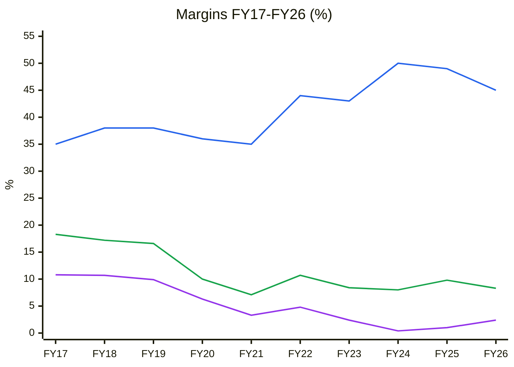
🟦 Gross margin % · 🟩 EBITDA margin % · 🟪 PAT margin %

**Read:** Gross margin *rose* from 35% to 45–50% after FY21, yet EBITDA margin halved from 18% to 8% and PAT margin from 11% to about 2%.

**Business inference:** The higher gross margin reflects mix (captive chlor-alkali/basic chemicals carry more manufacturing cost below the RM line: manufacturing cost went from 10% to 23% of sales), not pricing power. The new asset base brought fixed power, manufacturing and interest costs that the spread has not covered. Profitability is a utilisation problem and a debt problem, not a demand problem.

**C5 ROIC vs WACC**
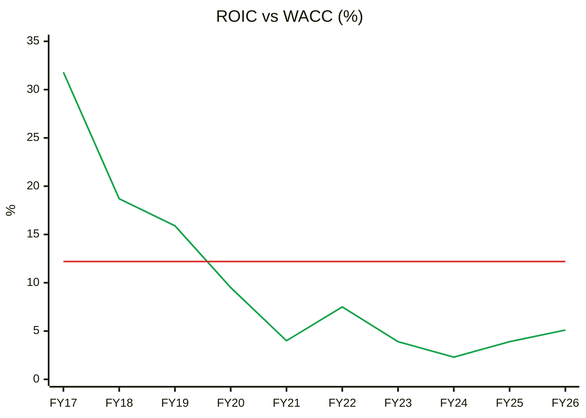
🟩 ROIC (computed) · 🟥 WACC 12.2%

**Read:** ROIC was above WACC FY17–FY19 (31.8%→15.9%) and has been **below it for seven straight years (FY20–FY26)**. It reached 5.1% in FY26, about 7pp short, and lower still on normalised profit.

**Business inference:** Every rupee invested since FY20 has destroyed value at the margin. Economic profit is negative (~−₹140 Cr/yr on ~₹1,950 Cr of invested capital). This triggers the **"ROIC < WACC 5+ yrs" hard stop**: the turnaround thesis exists (Saykha utilisation + deleveraging) but has a LOW WTT score behind it.

**CY7 Margin & ROCE vs 10-yr average**
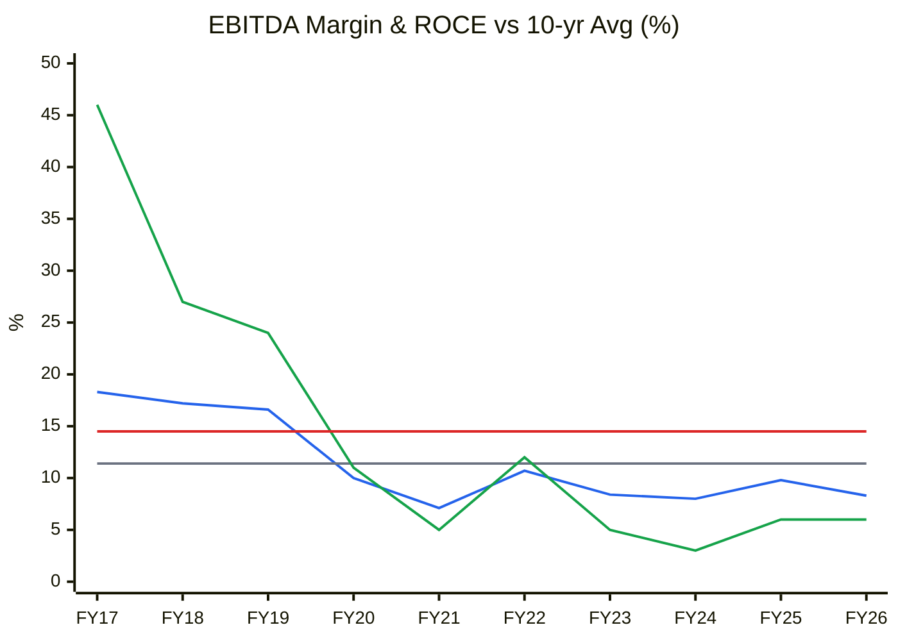
🟦 EBITDA margin · ⬜ its 10-yr avg 11.4% · 🟩 ROCE · 🟥 its 10-yr avg 14.5%

**Read:** FY26 EBITDA margin of 8.3% is 3.1pp below its 10-yr average (TTM 8.1% = **20th percentile**; −1SD = 7.4%). ROCE of 6% is 8.5pp below its average (**30th percentile**).

**Business inference:** On operating metrics Bodal sits at the **trough** of its own cycle. That argues for valuing it on normalised (10-yr average) margins rather than today's depressed ones. Even on those normalised margins (Module 9 EPV: ₹32–44/share), the current price is far above value.

**C7 Earnings quality: cumulative PAT vs CFO (FY17–FY26, Screener)**
| | FY17 | FY18 | FY19 | FY20 | FY21 | FY22 | FY23 | FY24 | FY25 | FY26 |
|---|---|---|---|---|---|---|---|---|---|---|
| Cum. PAT ₹Cr | 133 | 255 | 396 | 482 | 522 | 621 | 659 | 665 | 683 | 731 |
| Cum. CFO ₹Cr | 104 | 111 | 297 | 307 | 294 | 280 | 570 | 774 | 888 | 1,064 |

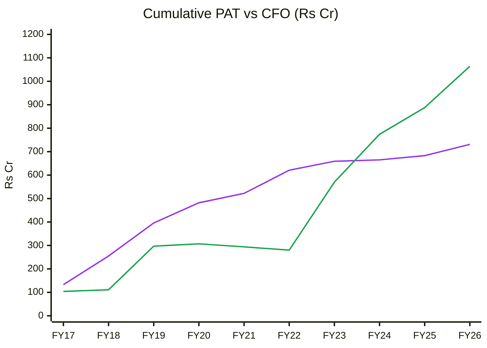
🟪 Cumulative PAT · 🟩 Cumulative CFO

**Read:** Ten-year cumulative CFO of ₹1,064 Cr is **1.46×** cumulative PAT of ₹731 Cr (5-yr FY22–26: 3.7×). CFO lagged PAT through FY22, when the inventory/receivable build peaked, then overtook it as working capital unwound (CCC 165→105 days).

**Business inference:** Reported profits are cash-backed. The FY23–FY26 CFO surge was mostly working-capital release plus D&A on a large block, not earnings power, and it cannot repeat once CCC normalises. The earnings-quality issue is **low and one-off-heavy profit**, not accruals (→ forensic verdict "minor").

**FY26 normalisation (consolidated, ₹ Cr; FY26 AR Notes 26/27):**
| Item | Amount | Recurring? |
|---|---|---|
| Reported PBT FY26 | 54.0 | — |
| Less: profit on sale of PPE / assets held for sale | −28.8 | No |
| Less: interest on income-tax refund | −6.3 | No |
| Less: SGST incentive relating to FY23–FY25 (₹27.0 Cr total − ~₹10.3 Cr FY26 run-rate ⚠️ est.) | −16.7 | No |
| **Normalised PBT FY26** | **≈ 2.2** | |
| Normalised EBITDA FY26 (₹168 − 16.7) | 151 (7.5% margin) | |
| Normalised TTM PBT (also less ₹4.7 Cr insurance in Q2FY26) | ≈ 24.5 → PAT ≈ ₹18 Cr, **EPS ≈ ₹1.46** | |

### DuPont (5-factor, average balances; Screener consolidated)
| Year | EBIT Margin | Asset Turnover | Equity Multiplier | Interest Burden | Tax Burden | ROE |
|---|---|---|---|---|---|---|
| FY22 | 8.3% | 1.07× | 1.90× | 0.83 | 0.70 | 9.8% |
| FY23 | 5.8% | 0.74× | 1.99× | 0.55 | 0.75 | 3.6% |
| FY24 | 4.2% | 0.63× | 2.04× | 0.08 | 1.20 | 0.6% |
| FY25 | 5.8% | 0.76× | 2.11× | 0.19 | 0.95 | 1.6% |
| FY26 | 6.6% | 0.86× | 2.07× | 0.41 | 0.89 | 4.2% |
| **Change FY22→26** | −1.7pp | −0.21× | +0.17× | −0.42 | +0.19 | **−5.6pp** |

**Operating contribution (EBIT margin × AT):** 8.9% → 5.7%, **declining**. **Financing contribution:** equity multiplier up (1.90→2.07) while the interest burden collapsed. **DuPont verdict:** The ROE collapse is operational (margin and asset turn both down), *and* leverage rose while operations weakened, which is the financial-engineering warning pattern, although the multiplier has now started to fall. FY26's ROE uptick owes as much to one-offs (EBIT margin incl. ₹35 Cr other income) as to operations. **AT trend → Module 10 base AT: 5-yr average 1.33× on tangible gross block (Declining→Stabilising).**

**Peer DuPont (TTM, Screener):** Atul ROE 11.5% on 18% OPM with low leverage (operational quality). Aarti ROE 7.1% at 15% OPM with high capex. Bodal ROE 2.0% at 8% OPM with an equity multiplier of ~2.1×. Bodal's ROE is the lowest quality in the group.

**Module 5 C1 repeat (headline):**

🟦 Revenue · 🟧 Tangible gross block · 🟩 EBITDA · 🟪 PAT

**Read:** The 🟧 gross-block line sits about 160 index points above 🟦 revenue in FY26 (340 vs 176), and the gap has widened every year since FY21.

**Business inference:** This is the visual form of the DuPont AT decline. New capacity earns far less than the old base, so the bear AT anchor (1.24×) is just today's reality, not a stress case.

---

## Module 7 — Industry KPIs & Peer Analysis
**Sector:** Specialty Chemicals block (near-match; see KPI-file flag above).

| KPI (Specialty Chem block) | Bodal | Healthy | Assessment |
|---|---|---|---|
| Order book / revenue | n/a (spot sales) | > 1.5× | Not applicable |
| EBITDA margin | 8.1% TTM (7.5% FY26 normalised) | 20–30% (block); dye peers 10–18% | **Below** (red flag < 15%: commoditisation) |
| Export revenue % | 21% FY26 (25% FY25, 33% FY23) | > 50% | **Below and declining** |
| Capacity utilisation | DI 85%, basic ~100%, caustic 76%, dyestuff 37%, Saykha ⚠️ | > 75% | Mixed |
| Capex % of revenue | 1.8% FY26 | 8–15% in expansion | Harvest mode |
| R&D % | ⚠️ not disclosed separately | > 3% | Likely below |
| Client concentration | 600+ customers | < 40% top-3 | **Good** |

**Peer comparison (Screener, 10-Oct-2026, consolidated)**
| Metric | Bodal | Kiri Industries | Atul | Aarti Industries | Sudarshan Chem |
|---|---|---|---|---|---|
| Market cap ₹Cr | 2,174 | 3,547 | 17,319 | 16,692 | 9,290 |
| Revenue 3-yr CAGR (FY23→26) | 8.5% | −3.9% | 4.9% | 7.8% | 61% (Heubach acq.) |
| TTM OPM | 8.1% | negative | 17.9% | 14.8% | 6.6% |
| ROCE | 5.6% | 3.4% | 14.9% | 6.9% | 5.5% |
| P/E (TTM) | 31.6× (≈118× normalised) | 4.4× (one-off DyStar gain) | 21.8× | 32.0× | 91.5× |
| P/B | 1.88× | 0.51× | 2.78× | 2.80× | 2.66× |

**C12 source: ROCE row above**
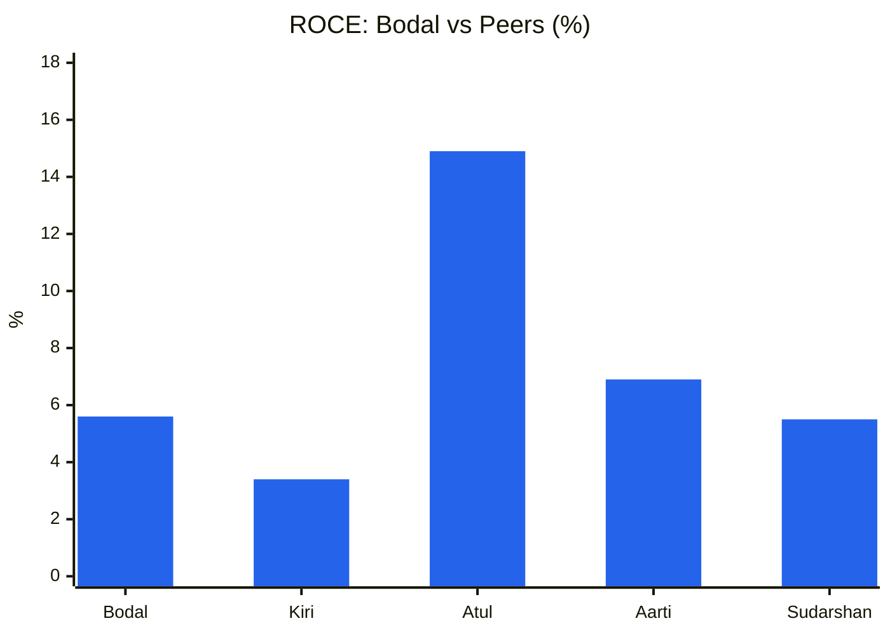
🟦 ROCE (TTM, Screener)

**Read:** Bodal's ROCE of 5.6% is a third of Atul's 14.9%, below Aarti's 6.9%, and above only Kiri at 3.4%.

**Business inference:** Bodal trades at 1.88× book (0.68× Atul's P/B) while earning about 38% of Atul's returns. The market is pricing it closer to a quality chemist than its returns justify. The P/B gap to Kiri (0.51×, same dye chain) is the cleaner read of where a sub-WACC dye business usually trades.

**Order Book Tracker:** not applicable. No disclosed order book and no Reg 30 order filings (BSE harvest Jan-2024 to 10-Oct-2026). Revenue is spot/short-contract commodity sales.

---

## Module 8 — Market Size & Market Share
- **TAM:** India is a global hub for reactive dyes and dye intermediates (China+1). ⚠️ No sourced 2026 TAM or market-share figures were accessible. The vinyl-sulfone global market is estimated at ~$2.3 bn by 2030, growing ~3% CAGR (Lucintel via GII), which is low-single-digit structural growth.
- **Share trend:** ⚠️ Unverifiable. Indirect evidence: Bodal's DI volume +18% YoY in Q1FY27 while peer Kiri's revenue fell over 3 years suggests share gains domestically. Exports fell from 33% of revenue (FY23) to 21% (FY26), suggesting weaker global competitiveness against China.
- **Verdict:** Growing with a low-growth market domestically, losing export share. Not a share-gain compounder.

---

## Module 9 — Valuation: PIE First, Then DCF

**Inputs:** CMP ₹172.59 · Market cap ₹2,174 Cr · Debt ₹813 Cr, cash ₹21 Cr → **EV ₹2,966 Cr**. WACC 12.2% (Rf 7%, β 1.2, ERP 6% → Ke 14.2%; Kd 9% pre-tax, per Q1FY26 call; D/V 27%). Terminal growth 5%.
EV/EBITDA: FY26 reported 17.7×, FY26 normalised 19.6×, Q1FY27 annualised 10.7×.

### 9A — Price-Implied Expectations (reverse DCF, sales-to-capital reinvestment form)
Model: revenue base TTM ₹2,267 Cr; 5 yrs at growth g, fading to 5% by year 10; NOPAT = revenue × EBIT margin × 0.75; reinvestment = ΔRevenue ÷ sales-to-capital (S2C); solved for the margin that sets DCF = EV.
| Sales-to-capital | 6% growth | 8% growth | 10% growth | 12% growth |
|---|---|---|---|---|
| 1.0× (Bodal's historical incremental S2C was ~0.8× FY18→26) | 17.8% | 17.4% | 17.1% | 16.8% |
| 2.0× (generous: spare Saykha/dyestuff capacity) | 14.4% | 13.6% | 13.0% | 12.4% |
| 3.0× | 13.3% | 12.4% | 11.6% | 10.9% |

At any EBIT margin ≤ 8% the price cannot be justified at *any* growth rate: growth at ROIC < WACC destroys value, so the solver diverges. Quick formula check: g = (EV×WACC − NOPAT₀)/(EV + NOPAT₀) on normalised NOPAT (3.5% EBIT) ≈ 10% perpetual.

| PIE driver | Market-implied | My base | Gap |
|---|---|---|---|
| Revenue CAGR (5-yr) | 8% | 4–5% (FY26 ex-SGST base ₹1,985 Cr → ₹2,290 Cr FY29, AT 1.33×) | −3 to −4pp |
| Steady-state EBIT margin | **13.6–17.4%** | 7.5% (10% EBITDA − 2.5–3% D&A) | **−6 to −10pp** |
| Investment rate (ΔIC/ΔRev) | 0.5–1.0 | ~0.5 (spare capacity until ~FY29) | ≈ |

**Classification: Optimistic gap.** The price is betting that EBIT margin returns to the FY17–FY19 franchise level (16–17%), which has not happened in seven years. That is above management's own FY27 EBITDA target of 12–13% (≈ 9–10% EBIT after ₹70 Cr D&A).
**Expectations treadmill:** To outperform from ₹173, Bodal must deliver a sustained EBIT margin above ~14% *and* 8%+ growth. Merely hitting management's 12–13% EBITDA earns less than the cost of capital.
**Physical plausibility:** DI and basic chemicals are already at 85–100% utilisation. An 8% 5-yr CAGR needs Saykha and dyestuff to fill *and* another expansion, so **the market is pricing an unannounced expansion** on top of margin recovery.
**Triggers. Positive:** (1) Q2FY27 clean PBT ≥ ₹35 Cr with stable gross margin; (2) disclosed Saykha utilisation > 70%; (3) a sustained Hormuz-driven sulphuric-acid premium. **Negative:** (1) sulphur/crude normalise and pass-through revenue reverses; (2) Q2FY27 margin < 9% (spread squeeze continuing); (3) further promoter-group selling.
**SVAR:** Bear value ₹67 → (172.6 − 67)/172.6 = **61% > 40% → asymmetry unfavourable (hard-stop flag).**

### 9B — Intrinsic Value (own models)
| Method | Bear | Base | Bull |
|---|---|---|---|
| DCF (S2C 2.0×, WACC 12.2%, g_T 5%: bear 3%/5% EBIT, base 6%/7.5%, bull 10%/11%) | < ₹0 (EV ₹523 Cr < net debt) | ₹25 | ₹120 |
| Relative (P/B 0.56× FY26 Mar low · P/B 0.94× 10-yr median · P/E 13.2× median on Q1FY27-annualised EPS ₹9.64) | ₹51 | ₹86 | ₹127 |
| EPV (Klarman: EBIT margin × revenue × 0.75 / 12% − net debt; 7.5% median on FY26 rev · 9.5% avg on FY26 · 9.5% on TTM) | ₹12 | ₹32 | ₹44 |
| **Consensus range** | **₹12–51** | **₹25–86** | **₹44–127** |

**Graham Number** (5-yr avg EPS ₹3.46 × BVPS ₹91.9): **₹85**. **Graham defensive screen: 3/7** (revenue > ₹2,000 Cr ✅; current ratio 1.25 ❌; 7 yrs positive EPS ✅; dividend stopped FY24 ❌; 7-yr EPS growth ₹11.72→₹3.80 ❌; P/E 31.6 ❌; P/B 1.88 ✅).
**Margin of safety (base, mid of ₹25–94):** None. The price is 84–590% *above* every base estimate.
**Misprice reason:** A momentum and retail-driven rally on a headline +218% PAT quarter and a "Hormuz beneficiary" narrative. The company told BSE the move is "purely market driven" (1-Sep-2026) and denied a merger rumour (14-Sep-2026).

**CY1 P/E band (March-end price / FY EPS; FY24 excluded, P/E 144× on EPS ₹0.51 is meaningless; Oct26 = CMP / TTM EPS ₹5.46)**
| FY17 | FY18 | FY19 | FY20 | FY21 | FY22 | FY23 | FY25 | FY26 | Oct26 |
|---|---|---|---|---|---|---|---|---|---|
| 13.2 | 12.0 | 10.8 | 6.0 | 26.3 | 11.9 | 19.0 | 39.7 | 13.5 | 31.6 |

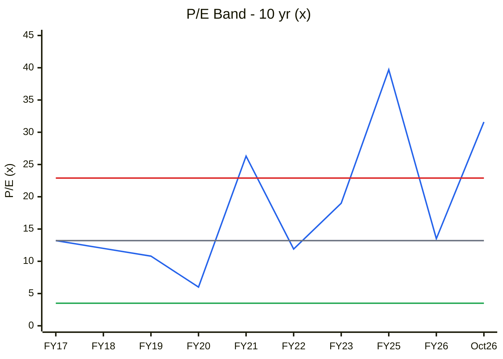
🟦 P/E · ⬜ Median 13.2× · 🟥 +1SD 22.9× · 🟩 −1SD 3.5×

**Read:** Trailing P/E of 31.6× is above +1SD and at the **89th percentile** of 10 years. On normalised TTM EPS (₹1.46) it would be ~118×, off the chart.

**Business inference:** Per the cyclical P/E rule, a high P/E on trough earnings *can* be a buy signal, but only when price sits near trough multiples of *book*. Here P/B is also near the top (CY2), so the market is paying a recovery multiple on top of a recovery that has not shown up in normalised profit. This is a double-premium, not a cyclical bargain.

**CY2 P/B band (March-end price / BVPS; Oct26 = CMP / ₹91.9)**
| FY17 | FY18 | FY19 | FY20 | FY21 | FY22 | FY23 | FY24 | FY25 | FY26 | Oct26 |
|---|---|---|---|---|---|---|---|---|---|---|
| 4.83 | 2.10 | 1.84 | 0.55 | 1.08 | 1.12 | 0.67 | 0.80 | 0.65 | 0.56 | 1.88 |

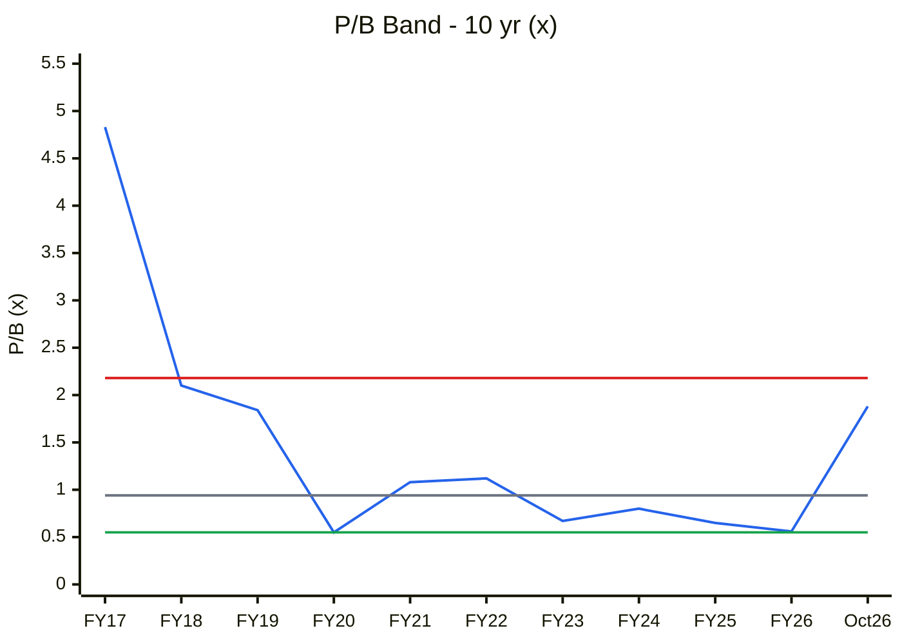
🟦 P/B · ⬜ Median 0.94× · 🟥 +1SD 2.18× · 🟩 10-yr low 0.55× (−1SD is negative, so the low is used)

**Read:** P/B of 1.88× is twice the 10-yr median and at the **80th percentile**. It was last this high in FY19, when ROE was 18.5%. Today's ROE is 2–4%.

**Business inference:** Justified P/B = (ROE − g)/(Ke − g). At ROE 4%, Ke 14.2% and g 5%, that is negative, so the business is worth *less* than book until ROE clears ~14%. The FY20–FY26 sub-1× P/B was the market correctly pricing a sub-WACC business. The re-rating anticipates a return transition that has not yet happened.

**ROE (beneath CY2)**
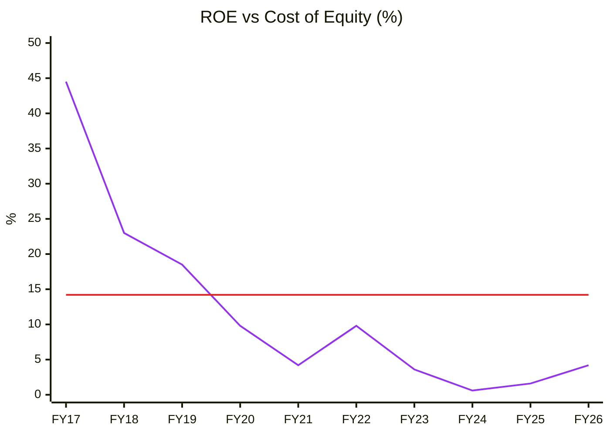
🟪 ROE (avg equity) · 🟥 Cost of equity 14.2%

**Read:** ROE has been below the 14.2% cost of equity since FY20, averaging 4.0% over FY21–FY26 (10-yr average 12.0%, dragged up by FY17–FY19).

**Business inference:** Shareholders' equity has compounded at about a quarter of its required return for six years. A P/B premium needs either margin recovery to ~15% EBITDA or a sharp cut in debt and interest, and neither is in evidence yet.

**CY4 Price vs EPS index (FY18 = 100; Oct26 = CMP / TTM EPS)**
| | FY18 | FY19 | FY20 | FY21 | FY22 | FY23 | FY24 | FY25 | FY26 | Oct26 |
|---|---|---|---|---|---|---|---|---|---|---|
| Price (₹, Mar) | 120.6 | 126.75 | 42.4 | 90.1 | 100.95 | 57.7 | 73.45 | 58.37 | 51.2 | 172.59 |
| EPS (₹) | 10.03 | 11.72 | 7.12 | 3.43 | 8.51 | 3.03 | 0.51 | 1.47 | 3.80 | 5.46 TTM |

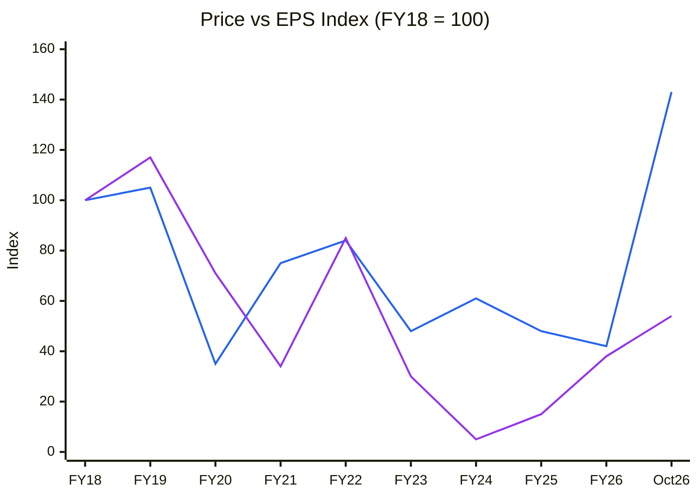
🟦 Price index · 🟪 EPS index

**Read:** Price is at index 143 while EPS (TTM, *including* one-offs) is at 54. On normalised EPS of ₹1.46 the EPS index would be 15. The gap opened entirely in the last three months.

**Business inference:** The entire 2026 return is multiple expansion, not earnings growth: returns are borrowed from a future margin recovery. When price and earnings diverge this far in a commodity name, mean reversion usually comes through the price.

### Cycle Position Dashboard
| Dimension | Current | 10-yr Median | Percentile | Signal |
|---|---|---|---|---|
| P/E (TTM) | 31.6× (≈118× normalised) | 13.2× | 89% | **Expensive** |
| P/B | 1.88× | 0.94× | 80% | **Expensive** |
| EBITDA margin | 8.1% TTM | 9.9% | 20% | **Trough** |
| ROCE | 5.6% | 8.5% | 30% | **Trough** |
| Industry utilisation | ⚠️ n/a | — | — | Unknown (Kiri loss-making → oversupplied proxy) |
| Spread (gross margin proxy) | 40% (Q1FY27) | 48% (13-qtr) | 0% | **Compressed** |
| Company capex/dep | 0.5× | — | — | Disciplined |
| **Overall cycle position** | | | | **Trough fundamentals, late-cycle valuation** |

**Consistency:** This matches Module 1c ("Trough / Recovery, unconfirmed") and Module 1b ("Headwind on spreads"). The dashboard's message is that valuation has run ahead of the cycle.

### 9C — Scenarios (FY29, AT-driven on tangible gross block ₹1,737 Cr = ₹1,617 Cr + ₹40 Cr/yr; D&A ₹72 Cr; other income ₹10 Cr; tax 25%; 12.59 Cr shares)
| Scenario | AT | Revenue FY29 | EBITDA margin | Interest | PAT | EPS | Multiple | Target | Prob |
|---|---|---|---|---|---|---|---|---|---|
| **Bull**: Q1FY27 price level holds + Saykha full + mgmt margin target | 1.75× (Q1FY27 run-rate) | ₹3,040 Cr | 13% | ₹45 Cr | ₹216 Cr | ₹17.2 | 15× | **₹257** | 25% |
| **Base**: 5-yr avg AT, 10-yr median margin | 1.33× | ₹2,293 Cr | 10% | ₹55 Cr | ₹84 Cr | ₹6.7 | 14× | **₹94** | 50% |
| **Bear**: AT stays current, spread squeeze | 1.24× | ₹2,154 Cr | 7% | ₹62 Cr | ₹20 Cr | ₹1.6 | 0.7× BV ₹96 | **₹67** | 25% |
| **Expected value** | | | | | | | | **₹128** | |

**Return from CMP to expected value: −26%.** **U/D = (257 − 173) / (173 − 67) = 0.8:1 → hard stop (< 1.5:1).** Required MoS for a leveraged small-cap cyclical with LOW WTT is 40%+, which gives a **buy-below ≈ ₹77**.

**C13 Scenario targets vs CMP**
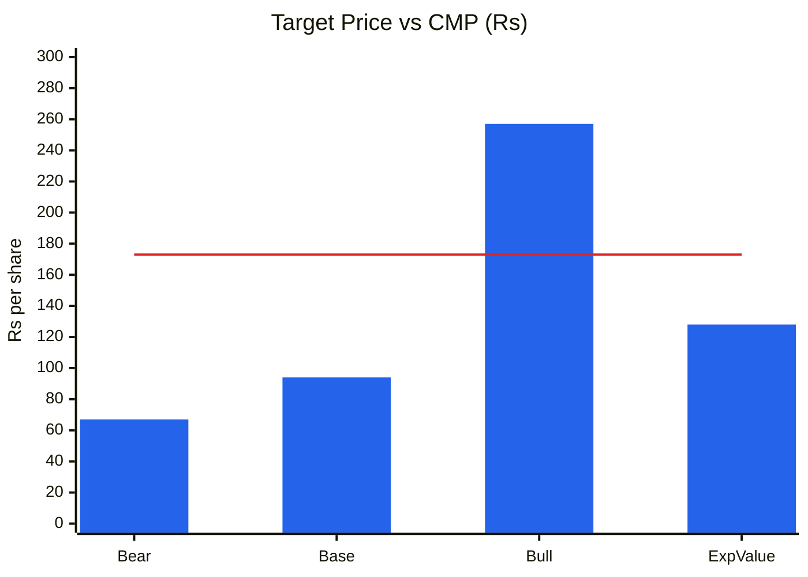
🟦 Scenario price · 🟥 CMP ₹173

**Read:** Only the bull case (₹257, +49%) clears the CMP. Base (₹94) is −46% and bear (₹67) is −61%, so the probability-weighted value of ₹128 sits 26% below the price. U/D 0.8:1.

**Business inference:** The market is already pricing something *beyond* the bull case's margin assumption (PIE ≥ 13.6% EBIT vs bull ~10.6% EBIT). To own the stock here is to bet that a temporary input-price windfall becomes permanent. The payoff is asymmetric to the downside.

---

## Module 10 — Technical Stage (Weinstein + CANSLIM)
Data: Yahoo Finance weekly (BODALCHEM.NS, ^NSEI), 3-yr, to 9-Oct-2026.
| Metric | Value |
|---|---|
| Close | ₹172.59 |
| 30-wk SMA | ₹94.69, rising steeply (₹62.3 on 16-Aug → ₹76.4 13-Sep → ₹90.8 4-Oct) |
| Price vs 30-wk SMA | **+82%** (extreme extension) |
| 52-wk high / low | ₹207.70 (week of 28-Sep) / ₹42.81 (Mar-2026) · now −17% from high |
| Returns vs Nifty | 4-wk −9.7% (Nifty −3.5%, RS −6.2pp) · 13-wk +169% (+176.5pp) · 26-wk +155% (+162pp) · 52-wk +190% (+203pp) |
| Volume | Climax week 31-Aug→4-Sep 63.8 mn shares (~12× the 30-wk average of 5.4 mn). Last 4 weeks at 0.90× a climax-inflated average, falling each week (12.2→3.2→1.7 mn) |
| Nifty 50 | 22,520 < declining 30-wk MA 23,718 → **Stage 4** |

- **Stock stage: Late Stage 2 / climax run with early Stage-3 risk.** The MA is still rising, so this is not Stage 4. But a vertical move of 82% above the MA on 12× volume, followed by four weeks of lower highs on fading volume, is the classic climax-top signature. A sideways range of ₹165–₹208 with the MA catching up would be Stage 3.
- **Sector:** Nifty Chemicals/commodity peers mixed; no sector-index stage computed ⚠️.
- **CANSLIM: 3/7.** C ✅ (Q1 EPS +217%, but price-driven) · A ❌ (3-yr EPS down; ROE 2%) · N ✅ (new highs) · S ❌ (supply: promoter-group selling, shareholder base churning) · L ✅ (RS leader) · I ✅ (FII 0.02→1.79%, DII 0→0.51%) · M ❌ (Nifty Stage 4).
- **Verdict:** Weinstein forbids new longs with the market in Stage 4. The stock is 20%+ beyond any base, so it is a late entry even for momentum. Stop discipline for holders: **weekly close below ₹157** (the 7-Sep week low, the last higher low) means exit. **Stage/fundamental alignment: Misaligned** (strong tape, weak normalised fundamentals).

---

## Module 11 — Forward View: 2–3 Year Thesis

### Capex classification (FY26 AR, Directors' Report; Screener schedules)
| Capex type | FY27E | FY28E | FY29E | In AT model? |
|---|---|---|---|---|
| Tangible growth capex | ~₹0–10 Cr (debottlenecking only; "not targeting any capex" per Q1FY26 call) | ~₹10 Cr | ~₹10 Cr | ✅ |
| Maintenance (≈ depreciation ₹70 Cr; actual run-rate ₹35–45 Cr) | ₹30–40 Cr | ₹30–40 Cr | ₹30–40 Cr | ❌ sustains |
| Intangibles | ~₹0 (₹15 Cr block) | — | — | ❌ |
| CWIP | ₹67 Cr at Mar-26 (project split ⚠️ not disclosed) | | | ❌ until capitalised |
| ROU (lease liab. ₹13 Cr) | immaterial | | | ⚠️ |

**Tangible PPE gross block & asset turnover (C6 source)**
| | FY18 | FY19 | FY20 | FY21 | FY22 | FY23 | FY24 | FY25 | FY26 |
|---|---|---|---|---|---|---|---|---|---|
| Tangible gross block ₹Cr | 476 | 670 | 734 | 902 | 971 | 1,172 | 1,575 | 1,632 | 1,617 |
| Revenue ₹Cr | 1,142 | 1,424 | 1,375 | 1,226 | 2,055 | 1,574 | 1,395 | 1,748 | 2,012 |
| AT (×) | 2.40 | 2.13 | 1.87 | 1.36 | 2.12 | 1.34 | 0.89 | 1.07 | 1.24 |

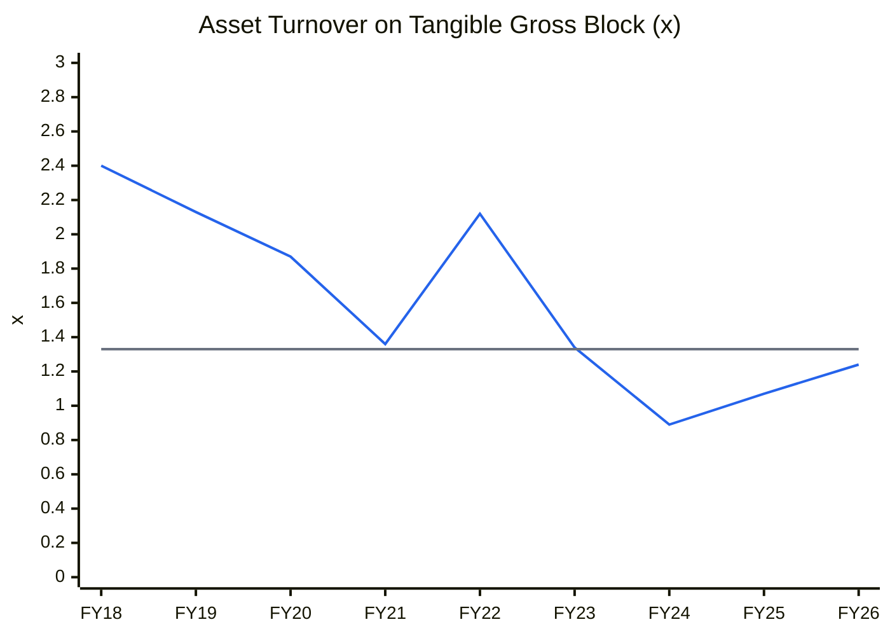
🟦 Asset turnover · ⬜ 5-yr avg (FY22–26) 1.33×

**Read:** AT fell from 2.40× (FY18) to a 0.89× trough (FY24) and has recovered to 1.24× (FY26), still below the 1.33× 5-yr average. Q1FY27's annualised 1.75× is price-inflated.

**Business inference:** The FY24 trough was Saykha capitalised before revenue. The recovery since is real but partial. Even the FY22 2.1× was a price-spike year (sales ₹2,055 Cr), so the bull AT of 1.75× should be read as "price spike persists", not as structural efficiency. Base AT stays at 1.33× (→ scenario anchors).

**Capex-model implied revenue CAGR (FY26→FY29, base):** (2,293/2,012)^(1/3) − 1 = **4.5%**, versus PIE-implied ~8% at a 13.6%+ margin. **Market is pricing an unannounced expansion.**
**Incremental ROIC (FY21→FY26 block addition):** ΔRevenue ₹786 Cr × 6.6% EBIT × 0.75 / Δtangible block ₹715 Cr ≈ **5.4% vs WACC 12.2% → value-destroying** (flagged in Module 4).

### Capex-to-earnings model (base)
| Metric | FY27E | FY28E | FY29E |
|---|---|---|---|
| Opening tangible GB (₹Cr) | 1,617 | 1,657 | 1,697 |
| Closing tangible GB (₹Cr) | 1,657 | 1,697 | 1,737 |
| AT applied (×) | 1.40 (Q1 price carry-over) | 1.35 | 1.33 |
| Revenue (₹Cr) | 2,290 | 2,265 | 2,293 |
| EBITDA margin | 9.5% | 9.8% | 10% |
| EBITDA (₹Cr) | 218 | 222 | 229 |
| D&A (₹Cr) | 70 | 71 | 72 |
| Other income (₹Cr) | 15 | 10 | 10 |
| Interest (₹Cr) | 68 | 61 | 55 |
| ICR (EBIT/interest) | 2.4× ⚠️ | 2.6× | 3.0× |
| Debt / EBITDA (closing debt ₹740/670/600 Cr) | 3.4× ⚠️ | 3.0× | 2.6× |
| PAT (₹Cr) | 71 | 75 | 84 |
| EPS (₹) | 5.6 | 6.0 | 6.7 |
| FCF (PAT + D&A − capex ₹45 Cr − ΔWC) (₹Cr) | ~85 | ~95 | ~105 |

**FCF inflection:** already reached (FY25). It goes to the ₹141 Cr FY27 term-loan maturities. **Debt ceiling:** FY26 debt/EBITDA is 4.0× on reported EBITDA (₹813 / ₹203 Cr) and **5.4× on normalised EBITDA (₹813 / ₹151 Cr)**, which is **above the 4.5× distress line on normalised numbers**. FY27E 3.4× is above the 3.0× covenant zone, and ICR 2.4× < 2.5× → **lender-behaviour risk; widen MoS by 5–10pp.** Note the base EPS of ₹6.7 by FY29 needs normalised profit to rise ~4.5× from TTM. That is itself generous.

### Key catalysts
1. **Q2FY27 results (due ~mid-Nov-2026):** the first quarter showing whether the Q1 pass-through held without one-offs.
2. Disclosure of Saykha utilisation / benzene-derivative revenue (concall resumption would itself be positive).
3. Scheduled term-debt repayment (₹141 Cr in FY27) cutting interest below ₹60 Cr/yr.
4. Sulphur/crude normalisation, which would test whether DI spreads recover (cuts both ways).
5. Recurring SGST incentive ~₹10 Cr/yr, capped at the ₹150 Cr FCI over 7 years: small but genuine.

### Key risks
1. **Input-price reversal:** Hormuz normalisation deflates pass-through revenue (High).
2. **Speculative price unwind** after a 3× run with promoter-group selling and a 12× climax volume week (High).
3. Leverage: ₹813 Cr debt, ICR ~2.4× FY27E, ₹141 Cr maturities (Medium).
4. China DI price pressure / export share loss (33%→21%) (Medium).
5. SGST incentive "subject to final verification" (EOM): reversal risk (Low–Medium). Environmental/GPCB actions and fire incidents in the Gujarat dye cluster (Low–Medium).

---

## Checklist Summary
**Section 0 (Existing Report Protocol):** 3/3: base report read; Revision Log + validation table written (14 ❌ items listed); file renamed via `git mv` (one file remains).
**Section A (Business Quality):** 15/18. Scuttlebutt, market-share data and the full RPT schedule were not obtained ⚠️.
**Section B (Forensics):** 9/9.
**Section C (Financial Statements):** 11/12. Ind AS 116 adjustment immaterial (lease ₹13 Cr), noted.
**Section D (KPIs & Peers):** 6/7. The KPI block is a poor fit (flagged).
**Section E (Market Size & Share):** 2/7. TAM/share not sourced ⚠️.
**Section F (Valuation):** 10/10.
**Section G (Technical):** 7/8. Sector index stage not computed ⚠️.
**Section H (Forward View):** 25/30. CWIP project split and Saykha utilisation are undisclosed. Unit-economics build not applicable.
**Section I (Charts):** 5/5. CY5 not possible (no industry data ⚠️). Pre-save chart validation script passed (see data notes).
**Order Book Tracker:** Not applicable (non-order-driven; no Reg 30 order filings).
**Hard stops triggered:** **(1) U/D 0.8:1 < 1.5:1. (2) ROIC < WACC for 7 years (FY20–FY26), with the turnaround thesis carrying LOW credibility.** Additional flags: SVAR 61% > 40%; Nifty in Stage 4 (market, not stock). Not triggered: integrity, pledge, Beneish, ICDs, auditor resignation, stock Stage 4, forensic ≥ 3 *unresolved*.
**Did the previous report apply hard stops correctly? No.** It recorded U/D 1.3:1 yet wrote "None triggered". It did not compute SVAR (59% on its own bear case). It did not test ROIC < WACC for 5+ years (true from FY20). On the skill's rules, the 31-Aug report should already have been **AVOID**.

---

## Investment Decision
**Conviction scoring:** Cycle 0.5/1 (market Stage 4, sector spread headwind, stock trough) · Industry 0.5/1 · Moat 0.75/2 (narrow cost moat, ROIC < WACC) · Management 0.5/1 (WTT 0.43, no concalls, promoter-group sale; no pledge) · Financial/earnings quality 1.0/2 (cash-backed, clean M-score; FY26 profit ≈ one-offs, EOM) · Valuation 0/2 · Technical 0.25/1 (RS leader, but climax + Stage-4 market) → **3.5 / 10**.

| | |
|---|---|
| **Recommendation** | **AVOID** (was WATCHLIST / ACCUMULATE ON DIPS) |
| **Conviction Score** | **3.5 / 10** (was 5 / 10) |
| **Suggested position size** | 0%. Holders: trail a stop at a weekly close < ₹157 |
| **Re-entry zone** | ≤ ₹77 (40% MoS to ₹128 EV), or re-underwrite if two consecutive quarters show clean PBT ≥ ₹35 Cr *and* gross margin ≥ 45%, which would lift the base case |
| **Target (base, FY29)** | ₹94 · Expected value ₹128 |
| **Review trigger** | Q2FY27 results (Nov-2026); resumption of concalls with Saykha utilisation; any further promoter-group sales (SAST); a weekly close below ₹157 (Stage-3/4 confirmation) |

---

### Data Notes & Sources
- **Financials:** Screener.in BODALCHEM consolidated and standalone (P&L, quarters, balance sheet, cash flow, ratios, shareholding, schedules), fetched 10-Oct-2026.
- **BSE filings** (harvested via BSE API, Jan-2024 to 10-Oct-2026, scrip 524370 verified): Q1FY27 results and investor presentation (5-Aug-2026); FY26 Annual Report (31-Aug-2026: Notes 19, 26, 27, 40, auditor's report EOM, Directors' Report); Q4FY25–Q4FY26 presentations; Q1FY26 earnings-call transcript (14-Aug-2025); price-movement clarifications (23-Mar-2026, 1-Sep-2026); fake-merger rumour clarification (14-Sep-2026); SAST 29(1) Ashokkumar Bansal (12-Sep-2026); SAST 29(2) R D Patel (30-Sep-2026); AGM minutes (3-Oct-2026); credit ratings (22-Jul-2025 India Ratings; 9-Dec-2025 Infomerics); Saykha commissioning (29-Mar-2024); auditor-firm merger (23-Sep-2025).
- **Prices:** Yahoo Finance chart API (weekly 3y; monthly 12y, March closes in IST) for BODALCHEM.NS and ^NSEI.
- **Context:** sulphur/Hormuz: [CRU/BC Insight](https://www.bcinsight.crugroup.com/2026/05/21/price-trends-75/), [Drishti IAS](https://www.drishtiias.com/daily-updates/daily-news-analysis/surging-sulphur-prices-impact-on-india), [Procurement Resource](https://www.procurementresource.com/resource-center/sulphur-price-trends). H-acid: [IMARC](https://www.imarcgroup.com/news/h-acid-price-index). Rally coverage: [Univest](https://univest.in/blogs/why-bodal-chemicals-ltd-share-price-52-week-high-2026-09-18), [Multibagg](https://www.multibagg.ai/market-pulse/articles/bodal-chemicals-rally-q1-jump-cmtb4uw8n001e0znoicuttl1g).
- **Peers:** Screener consolidated pages for KIRIINDUS, ATUL, AARTIIND, SUDARSCHEM (10-Oct-2026).
- **Remaining data gaps (⚠️):** Saykha utilisation and benzene-derivative revenue; FY26-only vs catch-up split of SGST (estimated); industry capacity/demand (CY5) and market share; China H-acid / vinyl-sulphone price series; CWIP by project; the "lead holder 29.47%" detail; Q2FY27 results (not yet reported); sector-index stage. No concall transcripts were filed for Q2FY26–Q1FY27.
- **Estimates:** WACC inputs (β 1.2 assumed), scenario margins/AT and SGST catch-up split are analyst estimates, labelled as such.

---
*Report generated by Stock Fundamental Analysis Skill v3.3 | Indian Markets Context*
*Save path: C:\Users\anubh\Documents\Anubhav\Stock Analysis\Stock Analysis\BODALCHEM_BodalChemicals_2026-10-10.md*
