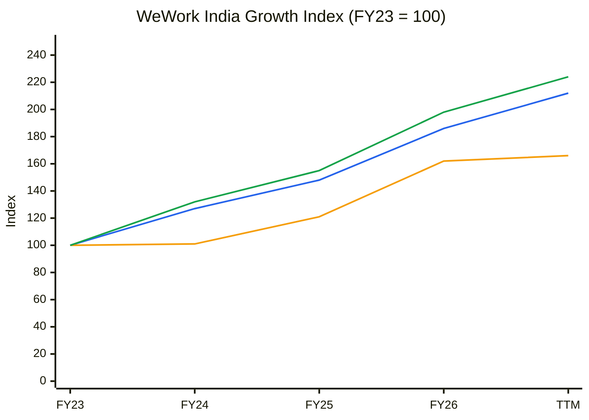
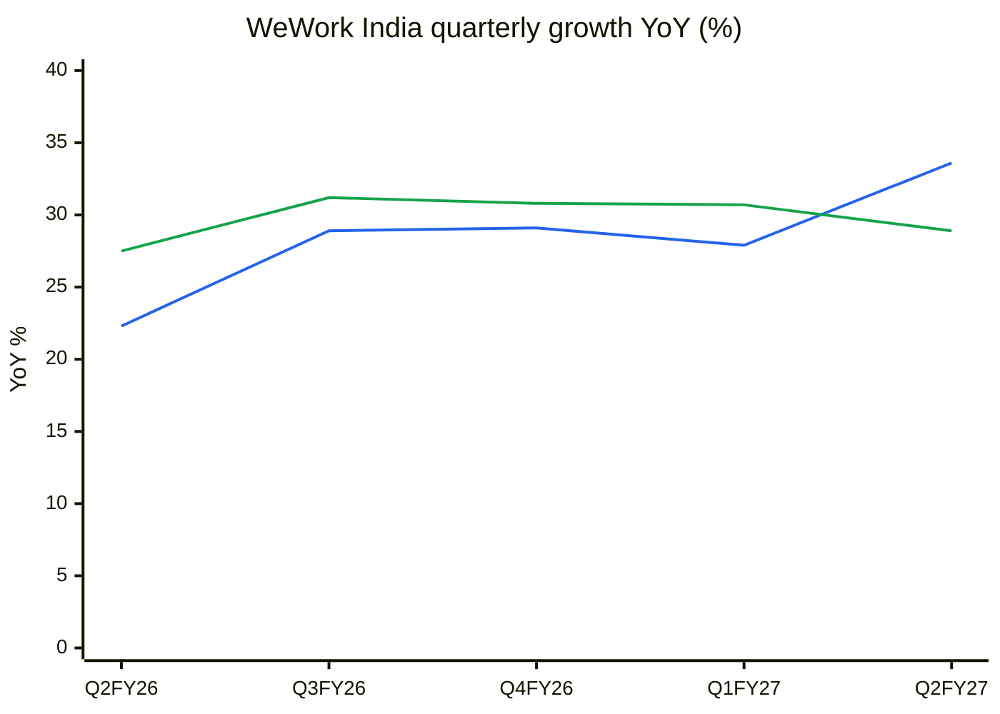
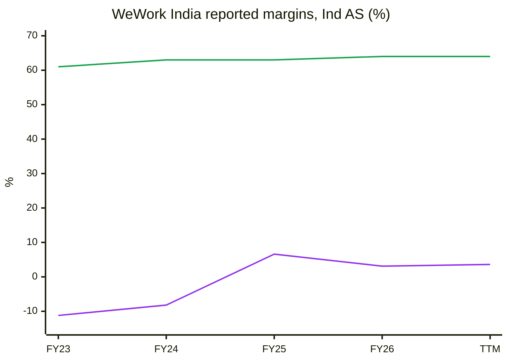
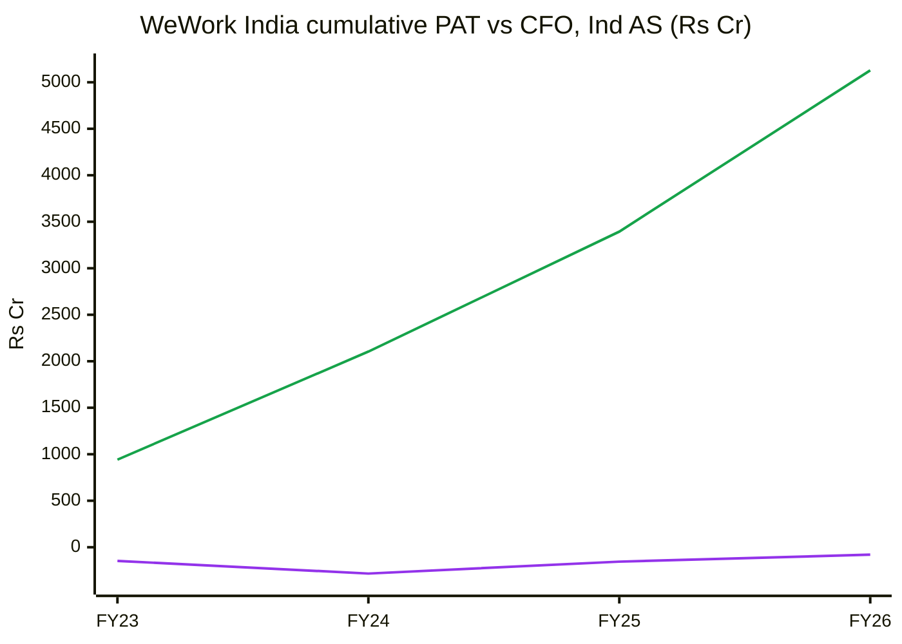
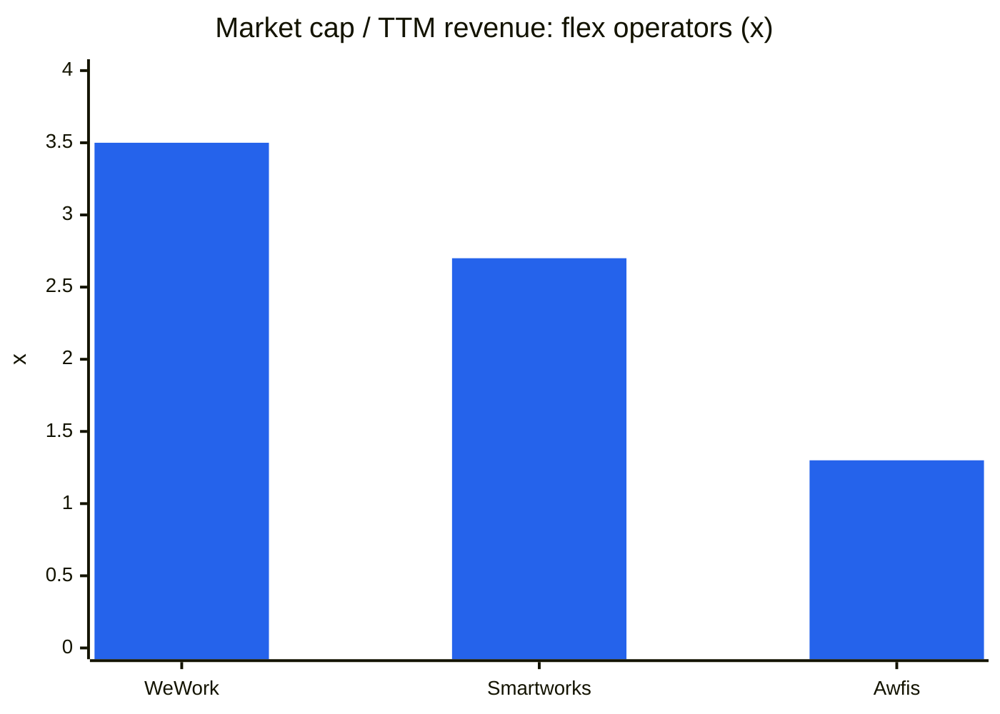
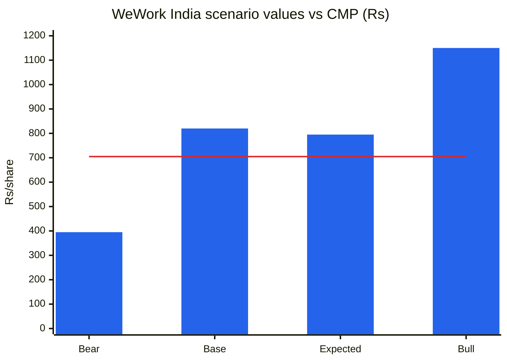

# Stock Analysis Report — WeWork India Management Ltd (WEWORK)
**Date:** 2026-11-17
**Analyst:** Claude (Stock Fundamental Analysis Skill v3.3)
**Investment Horizon:** 2–3 Years
**Recommendation:** WATCHLIST — Quality at Wrong Price (buy below ₹550)
**Conviction Score:** 5.5 / 10
**CMP:** ₹705 (NSE close 16-Nov-2026) · Market cap ₹9,799 Cr · ~13.9 Cr shares · BVPS ₹24.5 · 52-wk ₹420–794 · IPO Oct-2025
**Filed under:** Building-Materials-and-Real-Estate / Workspace-and-Commercial-RE · Themes: Flex workspace & GCC office demand

## Revision Log
| Version | Date | Recommendation | Conviction | Price | Key change |
|---|---|---|---|---|---|
| Current | 2026-11-17 | WATCHLIST (Quality at Wrong Price) | 5.5/10 | ₹705 | Initial report |

Initial report. No earlier report existed in the library. This report added the new **Flex Workspace Operators** KPI block to the skill reference (approved by the user on 2026-11-17) and created the theme "Flex workspace & GCC office demand".

**Sourcing note.** Ind AS financials come from Screener.in (consolidated, FY18–Q2 FY27). Operating KPIs and IGAAP-equivalent ("cash") numbers come from secondary summaries of the Q2 FY27 presentation and call (Investing.com transcript, 27-Oct-2026; multibagg.ai). Pledge and stake-sale data come from press reports (Free Press Journal, The Week). Secondary-only facts are marked *(sec.)*. The DRHP/RHP and FY26 annual report were not read directly.

---

## Business Primer

WeWork India is the exclusive Indian licensee of the WeWork brand and is majority-owned by the Embassy Group (Bengaluru). It leases Grade-A office floors from landlords on 9–15-year leases, fits them out, and sub-licenses desks, private offices and managed floors to members on contracts averaging **27–28 months** (about 32 months for large enterprises) *(sec.)*. At Sep-2026 it ran **85 centres, 145.3k desks, 9.8 msf across 8 cities**, Bengaluru-heavy (54k desks). Members numbered 121.7k. Enterprise clients make up 77% of core revenue, Fortune-500 companies about 28.5%, and the top 10 members 23% *(sec.)*. Revenue is 86% core (private offices 61%, managed offices 25%) and 14% ancillary: value-added services, F&B, customisation, and digital products (All Access, Virtual Office, On Demand) at ~80% EBITDA margin *(sec.)*. Returns depend on two things: **occupancy above the 55.7% portfolio breakeven** and **the spread between member pricing and landlord rent**.

This is an **asset-light-on-property, asset-heavy-on-fit-out lease-arbitrage platform**: a consumer/enterprise rollout business, not a real-estate owner. The value driver is **occupancy × price per desk minus rent**, scaled by desk additions. Reported Ind AS 116 numbers (64% EBITDA margins, ₹5,600 Cr of "borrowings") are distorted by lease capitalisation. The investable numbers are the company's **IGAAP-equivalent EBITDA (21.2% margin in Q2 FY27) and lease-adjusted net cash (₹23 Cr)**. The key risks are the **duration mismatch between long leases and short member contracts**, a demand shock from GCC or IT hiring, **promoter pledging** (35% of the promoter holding), WeWork Global's selling overhang, and brand-licence dependence. Unit-economics analysis (Module 11 Step 10A-ii) is the correct forward lens, not asset turnover.

**Segment check:** Flex Workspace Operators — **new KPI block added** to `references/05-industry-kpis-india.md` (end of file) ✓

---

## Executive Summary
WeWork India is the best-run listed Indian flex operator by brand, enterprise mix and occupancy (mature centres at 87.7%). It is now profitable on a cash basis: H1 FY27 IGAAP EBITDA ₹301 Cr (20.5%), PAT ₹119 Cr, and lease-adjusted net cash. Growth is about 30% a year, with visibility to 190–195k desks *(sec.)*. Execution has been clean since the IPO. **The problem is price.** At ₹705 the stock trades at about 15× FY27E and 11× FY28E cash EBITDA, or 38× FY27E IGAAP PAT, which already discounts the guided desk ramp and margin expansion to 22–23%. The probability-weighted FY29 value is about ₹795 (+13%), and upside/downside of about 1.4:1 fails the hard stop at this price. **The business quality is real; the asymmetry is not.** Buy zone ≤ ₹550.

**C1 — Growth Index (FY23 = 100)**

| | FY23 | FY24 | FY25 | FY26 | TTM / Sep-26 |
|---|---|---|---|---|---|
| Revenue (₹ Cr) | 1,315 | 1,665 | 1,949 | 2,440 | 2,782 |
| Fixed assets incl. ROU (₹ Cr) | 3,576 | 3,600 | 4,313 | 5,777 | 5,939 |
| Reported EBITDA, Ind AS (₹ Cr) | 796 | 1,047 | 1,237 | 1,574 | 1,786 |

🟦 Revenue (FY23–26 CAGR 22.9%) · 🟧 Fixed assets incl. right-of-use (17.4%) · 🟩 Reported EBITDA (25.5%). PAT is not indexed because it was negative in the base year.
**Read:** Revenue and EBITDA have outgrown the (lease-inflated) asset base since FY23, but the asset base jumped 34% in FY26 as new leases were signed ahead of revenue.
**Business inference:** New centres are booked as ROU assets on signing and occupancy follows 6–12 months later, so FY27–28 revenue should "catch up" to the FY26 asset jump. That is what the new-centre occupancy (51% → 65% YoY) is showing. If occupancy stalls, the orange line becomes stranded fixed rent.

---

## Module 1 — Market, Sector & Stock Cycle
**1. Market:** Nifty about 25,000 (Nov-26), flat-to-down YoY; VIX about 17.5; a heavy IPO calendar in 2025–26 → **Neutral-to-Cautious**.

**1b. Sector: Tailwind (secular), with late-cycle supply signals.**
- **Secular:** GCC expansion (1,800+ GCCs in India), hybrid-work-driven enterprise flex adoption, and flex at ~15–20% of Grade-A leasing. This is a multi-year structural shift → **embed ~15–18% industry growth**.
- **Cyclical:** post-COVID return-to-office plus a GCC hiring boom (FY24–26) adds an estimated 5–10 pp on top. That part mean-reverts if US tech/BFSI budgets tighten (66% of WeWork India revenue comes from global members) *(sec.)*.
- **Input cost:** Grade-A rents are rising in Bengaluru, Hyderabad and Pune. That squeezes rent cover on *new* centres, while existing leases carry fixed 4–5% escalations against 6–7% member escalations *(sec.)*.
- **Capacity pipeline / capital cycle:** **red flag.** Awfis (2024), Smartworks, IndiQube and WeWork India (2025) all listed within about 18 months, and each is adding 20–40% capacity a year. Operator supply is growing faster than flex demand, and price competition for enterprise mandates is likely by FY28.
- **FX:** INR revenue, INR costs. Indirect USD exposure through GCC budgets.

**1c. Stock cycle: Mid-cycle compounder (early in public life).**

**C2 — Quarterly YoY growth**

| Qtr | Q2FY26 | Q3FY26 | Q4FY26 | Q1FY27 | Q2FY27 |
|---|---|---|---|---|---|
| Revenue (₹ Cr) | 575 | 634 | 696 | 684 | 768 |
| Revenue YoY % | +22.3 | +28.9 | +29.1 | +27.9 | +33.6 |
| Reported EBITDA YoY % | +27.5 | +31.2 | +30.8 | +30.7 | +28.9 |

🟦 Revenue YoY · 🟩 Reported EBITDA YoY
**Read:** Revenue growth is **accelerating** (22% → 34%), driven by record desk additions (11.7k in Q2 FY27).
**Business inference:** Growth is capacity-led (desks +27% YoY) plus occupancy (+3.6 pp), not price-led. That is the healthier mix, but it means growth is capital-consumptive (H1 capex ₹364 Cr) *(sec.)*.

- **Volume / price / mix:** desks +27%, occupancy +3.6 pp, ancillary +38% (mix up), price/escalation ~6–7%.
- **Capacity model:** 145.3k desks → ~150k by Oct-26 → guided 150–155k by Mar-27 and 190–195k thereafter (signed leases 0.5 msf + LOIs 2.7 msf) *(sec.)*. A capacity ceiling is not binding; growth is limited by leasing velocity.
- **Operating leverage:** the breakeven occupancy of 55.7% against 83.7% actual is a large cushion. Each 1 pp of occupancy ≈ ₹30 Cr of revenue at near-full flow-through *(estimate)*.
- **Guidance accuracy:** see WTT (HIGH, short history).
- **FCF inflection:** FCFF turned positive in Q2 FY27 (₹62 Cr) but was only ₹16 Cr in H1 *(sec.)*. Inflection comes when desk additions slow (not before FY29 on the current plan).

---

## Module 2 — Industry Structure
| Force | Assessment |
|---|---|
| New entrants | **Low barriers**: anyone can lease and fit out a floor. Brand, enterprise sales and landlord relationships are soft barriers |
| Supplier power (landlords) | **High** in Grade-A micro-markets (Embassy, RMZ, Brookfield, DLF). Rents are rising |
| Buyer power | Medium-high: enterprises negotiate 300–3,000-seat deals; 23% top-10 concentration |
| Substitutes | Conventional leasing (enterprises can go direct) and work-from-home |
| Rivalry | High and rising (IWG/Regus, Awfis, Smartworks, IndiQube, Table Space, CoWrks, Bhive) |

**Industry verdict: Neutral** (secular demand, weak structural barriers).
**Capital cycle: mid-to-late.** A listing wave, aggressive capacity additions and rising landlord rents are classic late-cycle signals. Returns are still above WACC (company ROCE 34.5% on IGAAP capital) *(sec.)*.

---

## Module 3 — Business Quality & Moat
- **Greenwald:** (1) **Supply/cost:** partial. Scale gives procurement and landlord leverage, and the Embassy promoter supplies a pipeline of Embassy-owned buildings (an RPT-dependent advantage). (2) **Customer captivity:** moderate. Enterprises face real switching costs (fit-out customisation, relocation disruption), shown by renewals of 80–85% and 27–32-month commitments *(sec.)*. (3) **Local scale:** Bengaluru density (32 centres) gives network value for All Access/On Demand.
- **Buffett 10% test:** partial. 6–7% contracted escalations stick; a 10% price rise in a competitive market would likely cost occupancy.
- **Brand:** the WeWork brand commands a premium price per desk (estimated 15–25% above unbranded peers), but it is **licensed, not owned**.
- **Moat verdict: Narrow** (brand + enterprise switching costs + Bengaluru density).

**Fisher 15-point:** market potential 3 · new products 2 (digital, managed) · R&D/tech 2 · sales org 3 · margin 2 · margin improvement 3 · labour 2 · executive relations 2 · depth 2 · cost/accounting 2 · unique advantage 2 · long-range orientation 2 · dilution 2 (ESOPs) · candour 2 · **integrity 2 (no veto; watch RPT rents with Embassy and the pledge)** → **33/45**.

---

## Module 4 — Management & Capital Allocation
- **Promoter (Embassy Buildcon LLP and group):** 49.80% → 48.20% (Dec-25 → Sep-26), drifting down. **Pledge: 35% of promoter holding** (Screener). That includes ~2.41 Cr shares pledged in Feb-2026 to Catalyst Trusteeship for ₹577.5 Cr of NCDs *(sec.)*. **Elevated (20–40% band).** A large share price fall could trigger top-ups or invocation.
- **WeWork Global (1 Ariel Way):** sold 2.52% in Aug-2026 at ~₹698 (₹244 Cr) and still holds ~12.3%. That is a **supply overhang** *(sec.)*.
- **FIIs:** 21.97% → 17.44% over three quarters; DIIs 24.8% → 27.1%.
- **Capital allocation:** capex FY27 ≤ ₹500 Cr, FY28 ~₹600 Cr *(sec.)*. Net debt was cut from ₹310 Cr to net cash of ₹23 Cr in 12 months. No dividend (appropriate in the growth phase). Borrowing cost down 184 bp to 8.5%. Rating A+ *(sec.)*.
- **RPT:** Embassy-group landlord leases (rent to the promoter group) and the WeWork Global brand licence fee are both material RPT-type cash leakages. **Terms not verified** (data gap; read the RHP/AR RPT schedule).
- **Three C's:** Candour: good (IGAAP-to-Ind AS reconciliation provided) · Competence: strong post-COVID turnaround (losses of ₹648 Cr in FY21 → profit) · Caring: ESOP dilution modest; the promoter pledge is a negative.

### Walk-the-Talk Scorecard (since the Oct-2025 IPO)
| Guided | Statement | Outcome | Verdict |
|---|---|---|---|
| IPO / Q3 FY26 | Margin expansion with occupancy | H1 FY27 EBITDA margin 20.5% vs 17.7% | ✅ |
| FY27 | 150–155k desks by Mar-27 | ~150k by 5-Oct-26 | ✅ |
| FY27 | PAT margin 7–10% | H1 8.1% | ✅ |
| FY27 | Capex within ₹500 Cr | H1 ₹364 Cr (73% used in H1) | ⚠️ |
| FY28 | EBITDA margin 22–23% | Pending | — |

**WTT Score: 0.88 / 1.00 — HIGH** (4 points; short history).
**Key pattern:** conservative operating guidance; capex runs ahead of plan.
**Insider action:** promoter pledge increased in 2026, and WeWork Global is selling → **BEARISH supply signal** despite strong operations.
**DCF impact:** guidance used, with a capex overshoot assumption (FY27 ~₹600 Cr).
**Credibility: HIGH (operations) / MODERATE (shareholder alignment).**

---

## Module 5 — Financial Forensics
*Ind AS 116 distorts most models (ROU assets and lease liabilities of ~₹5,200 Cr). Read the results with that caveat.*
| Model | Value | Verdict |
|---|---|---|
| Altman Z'' (FY26, Ind AS) | ≈ −0.1 (negative WC, retained losses, lease liabilities in total liabilities) | Distress on paper. **Artefact of Ind AS 116 and accumulated pre-IPO losses**; lease-adjusted net cash ₹23 Cr |
| Piotroski F (FY26) | 5/9 | Average |
| Sloan accrual | (75 − 1,734 + 647) / 6,242 = **−16%** | Clean (CFO inflated by leases: principal sits in financing) |
| Tax rate | Negative (deferred-tax-asset recognition FY25–26) | Flag: FY25 PAT ₹128 Cr includes a DTA credit (PBT −₹157 Cr) |

**Indian-specific flags:** (1) promoter pledge 35%; (2) RPT rent to Embassy-group landlords (unverified); (3) FY25 "profit" created by a DTA credit (O'Glove #13); (4) the CFO definition: Ind AS CFO (₹1,734 Cr) far overstates cash. Use the company's FCFO (₹586 Cr FY26) and FCFF (H1 FY27 ₹16 Cr) *(sec.)*.
**Forensic red-flag count: 2 / 15 substantive** (pledge, DTA-driven profit). The rest are accounting artefacts.
**Overall forensic verdict: Minor concerns.**

---

## Module 6 — Earnings Quality & Financial Statements

**Cash-basis (IGAAP-equivalent) P&L** *(sec.)*
| ₹ Cr | H1 FY26 | Q1 FY27 | Q2 FY27 | H1 FY27 |
|---|---|---|---|---|
| Total revenue | 1,128 | 698 | 769 | 1,467 |
| EBITDA (post-rent) | 200 | 138 | 163 | 301 |
| EBITDA margin | 17.7% | 19.8% | 21.2% | 20.5% |
| PAT (IGAAP-eq.) | 48 | 53 | 66 | 119 |
| Ind AS PAT (reported) | −8 | −4 | 20 | 16 |

**C4 — Margin trend (Ind AS reported, for comparability)**

| FY | 23 | 24 | 25 | 26 | TTM |
|---|---|---|---|---|---|
| Ind AS EBITDA margin % | 61 | 63 | 63 | 64 | 64 |
| Ind AS PAT margin % | −11.2 | −8.2 | 6.6 | 3.1 | 3.6 |

🟩 Ind AS EBITDA margin (excludes rent) · 🟪 Ind AS PAT margin
**Read:** The Ind AS EBITDA margin is flat at ~63–64% and says nothing. PAT margin turned positive in FY25, but that year was flattered by a DTA credit. The cash EBITDA margin (17.7% → 21.2% in a year) is the real trend.
**Business inference:** Operating leverage is working (cash margin +350 bp in 12 months as occupancy rose). The guided 22–23% FY28 margin is consistent with mature-centre economics and leaves limited further upside beyond that.

**C7 — Cumulative PAT vs CFO (Ind AS, ₹ Cr)**

| FY | 23 | 24 | 25 | 26 |
|---|---|---|---|---|
| Cum PAT | −147 | −283 | −155 | −80 |
| Cum CFO | 942 | 2,104 | 3,394 | 5,128 |

🟪 Cumulative PAT · 🟩 Cumulative CFO (Ind AS; lease principal sits in financing)
**Read:** Ind AS CFO of ₹5,128 Cr against cumulative losses is a pure lease-accounting artefact. Cumulative lease payments in financing are about ₹3,300 Cr *(estimate)*.
**Business inference:** Do not value on Ind AS CFO. The true owner cash flow is FCFF (₹16 Cr in H1 FY27): the business is self-funding its growth and little more.

**ROIC / DuPont:** a 5-year DuPont is not meaningful (equity negative until FY25). FY26 Ind AS ROE of 30% sits on a tiny ₹298 Cr equity base. The company-reported IGAAP ROCE is 34.5% (Q2 FY27) *(sec.)*. **Asset-level incremental ROIC estimate:** fit-out capex ≈ ₹2.6–3.4 L/desk (FY26 capex/desks added; Hyderabad ₹144 Cr for 4,256 desks). Centre EBITDA ≈ ₹60–70k per capacity desk a year → pre-tax return ≈ 17% after fit-out depreciation and before corporate overhead → **post-tax ~13%, close to WACC (12.5%)**. Platform value comes from ancillary/digital and the overhead leverage on top.
**O'Glove: 3/15** (DTA-driven profit; Z'' artefact; capex ahead of guidance).

---

## Module 7 — Industry KPIs & Peers
*KPI block: Flex Workspace Operators (new).*
| KPI | WeWork India | Benchmark | Assessment |
|---|---|---|---|
| Mature-centre occupancy | 87.7% | 80–90% | **Above / top of range** |
| Portfolio occupancy | 83.7% (new centres 64.8%) | — | Strong |
| Cash EBITDA margin | 21.2% (Q2), 20.5% (H1) | 12–20% | **Above** |
| Revenue/rent cover | Locked revenue ₹3,843 Cr vs locked rent ₹1,421 Cr ≈ 2.7× (contracted) *(sec.)* | > 1.6× | Above (forward-contracted basis) |
| Avg member lock-in | 27–28 months (enterprise 32) | > 24 months | In line |
| Enterprise mix | 77.3% of core revenue | > 50% | **Above** |
| Fit-out payback | ~4–5 years (estimate, centre EBITDA basis) | < 30 months | **Below** (longer) |
| Managed-office share | 24.7% of revenue | Rising | In line |

**Peers (Screener, FY26 / TTM)**
| Metric | WeWork India | Smartworks | Awfis | IndiQube |
|---|---|---|---|---|
| Mkt cap (₹ Cr) | 9,799 | 5,846 | 2,076 | n/a (data unavailable) |
| Revenue TTM (₹ Cr) | 2,782 | 2,129 | 1,656 | 1,451 |
| Revenue growth (TTM) | ~30% | +41% | +22% | +37% |
| Ind AS PAT TTM (₹ Cr) | 99 | 57 | 100 | −106 |
| Mkt cap / revenue | 3.5× | 2.7× | 1.3× | — |
| P/E (Ind AS) | 95.6× | 103× | 20.8× | n/m |

🟦 Market cap / revenue
**Read:** WeWork India trades at the highest revenue multiple in the group: 30% above Smartworks and 2.7× Awfis.
**Business inference:** The premium reflects brand, enterprise mix and the highest cash margins in the group. That is partly justified, but Awfis (more managed/asset-light) at 1.3× shows how far the multiple can compress if the market stops paying for growth. **Positioning: premium, partially justified.**

---

## Module 8 — Market Size & Share
- **TAM:** Indian flex stock ~80–90 msf (2025), projected 125–150 msf by 2028–30 (industry estimates, ~15–18% CAGR). WeWork India's 9.8 msf ≈ **11–12% share of total flex** and ~26% of branded/organised flex space *(sec.)*.
- **Share trend:** gaining. Desks +27% against the market's ~15–18%.
- **Revenue vs market:** 30% growth against ~16% market growth → share gain driven by capacity additions plus enterprise wins (structural, contingent on leasing velocity).
- **Verdict: taking share.**

---

## Module 9 — Valuation (PIE first)
**EV ex-leases** = ₹9,799 Cr − ₹23 Cr net cash ≈ **₹9,776 Cr**. EV incl. leases ≈ ₹15,000 Cr (EV/Ind AS TTM EBITDA 8.4×).
**Estimates (cash basis):** FY27E revenue ~₹3,050 Cr, EBITDA ~₹650 Cr (21.3%), PAT ~₹260 Cr. FY28E revenue ~₹3,800 Cr, EBITDA ~₹855 Cr (22.5%), PAT ~₹320 Cr.
**Multiples:** EV/cash EBITDA 15.0× FY27E / 11.4× FY28E · P/E (cash PAT) 38× / 31×.

**PIE (reverse DCF):** WACC 12.5%, terminal g 6%. A steady-state FCFF of 9,776 × 0.065 / 1.06 ≈ **₹600 Cr** is required. At maturity, FCFF ≈ 13.5% of revenue (22% EBITDA × (1 − 25% tax) − 3% maintenance capex) → **implied mature revenue ≈ ₹4,450 Cr** (≈ FY29–30 on the guided ramp), then growth of 6% a year.
| PIE driver | Market-implied | Base case | Gap |
|---|---|---|---|
| Revenue CAGR (FY26–30) | ~16% to ₹4,450 Cr | ~22% to ₹4,500 Cr by FY29 | Base slightly ahead |
| Steady cash EBITDA margin | ~22% | 22.5% | ≈ fair |
| Reinvestment | Falls to maintenance after FY30 | Growth capex ₹500–600 Cr/yr through FY29 | Market may underprice the capex treadmill |

**Gap: fairly priced.** To outperform, WeWork India must keep adding about 25–30k desks a year beyond FY29 *at* 22%+ margins, or lift digital/ancillary to more than 20% of revenue.
**Positive triggers:** FY28 margin above 23%; a large GCC managed-office win; release of the promoter pledge; WeWork Global completing its exit (overhang removed).
**Negative triggers:** occupancy below 80%; US-tech/GCC hiring freeze; a pledge top-up or invocation; a price war among listed peers; a brand-licence dispute.
**SVAR:** downside to bear ₹395 → **44%** (unfavourable).

**CY1/CY4 not drawable:** listed Oct-2025, so less than one fiscal year-end of price history (Mar-26 ₹455). The post-IPO range ₹420–794 is the only band. P/B (28.8×) is meaningless on lease-depressed equity.

### Cycle Position Dashboard
| Dimension | Current | Reference | Signal |
|---|---|---|---|
| EV/cash EBITDA | 15× FY27E | Peers 10–20× (KPI block) | Fair-to-full |
| Cash EBITDA margin | 21.2% | Guide 22–23% | Mid-to-late in margin expansion |
| Mature occupancy | 87.7% | 80–90% healthy | **Near peak** |
| Industry supply | 4 listed operators adding 20–40% a year | — | **Loosening** |
| **Overall** | | | **Mid-cycle operations, late-cycle sector supply** |

---

## Module 10 — Technical Stage
- **Stock:** ₹705, above the 200-DMA (₹642, rising) and the 50-DMA (₹670, flattening/slightly falling). The post-IPO base runs ₹420 (Mar-26 low) → ₹794 high (Aug-26). It has consolidated ₹650–750 for three months.
- **Stage: Stage 2, mid-base consolidation.** A valid new entry needs a weekly close above ~₹795 on volume of at least 1.5× average.
- **RS vs Nifty:** +15% 1-year (positive).
- **CANSLIM: 4/7** (C: Q2 IGAAP PAT +67% · N: new IPO, record desk additions · L: sector leader · I: DII rising, FII falling, so mixed, scored 0.5) · fails A (no three-year record) and M.
- **Stop (if held):** weekly close below ₹620.

---

## Module 11 — Forward View (Unit Economics Build, 10A-ii)
**Unit = operational desk.**
| Unit metric | Value | Source |
|---|---|---|
| Desks (Sep-26 → Mar-27E → FY29E) | 145.3k → ~153k → ~195k | *(sec.)* guidance |
| Revenue per occupied desk / month | ≈ ₹21,000 total (₹18,000 core) | 769 Cr ÷ 3 ÷ 121.7k members |
| Centre-level EBITDA margin | 28.4% (post-rent) | *(sec.)* |
| Fit-out capex per desk | ₹2.6–3.4 L | FY26 capex ÷ desks added; Hyderabad filing |
| Ramp | New centres 51% → 65% occupancy YoY | *(sec.)* |
| Breakeven occupancy | 55.7% | *(sec.)* |
| Cohort quality | Mature 87.7% (+3.6 pp YoY); renewals 80–85% | *(sec.)* |
| Payback | ~4–5 years per desk (estimate) | Derived |

**Blended vs marginal:** blended economics are strong. *Marginal* desks carry higher rents (new Grade-A leases at rising rents) and higher capex per desk (Hyderabad ₹3.4 L), so marginal returns are **thinner than blended**. Watch new-cohort occupancy at 12 months (currently 64.8%).
**Contribution-to-profit bridge:** corporate overhead ≈ 7% of revenue, covered with room to spare (portfolio breakeven occupancy 55.7%).

### Forward model (cash basis)
| ₹ Cr | FY27E | FY28E | FY29E |
|---|---|---|---|
| Avg desks (k) | 145 | 172 | 192 |
| Revenue | 3,050 | 3,800 | 4,500 |
| EBITDA (post-rent) | 650 (21.3%) | 855 (22.5%) | 1,010 (22.4%) |
| Capex | 600 | 600 | 550 |
| Cash PAT | 260 | 320 | 390 |
| EPS (cash, ₹) | 18.7 | 23.0 | 28.1 |
| FCFF (approx.) | ~50 | ~150 | ~330 |

### Catalysts
1. FY28 margin at 22–23% delivered — FY28
2. Promoter pledge release (Embassy deleveraging) — FY27–28
3. WeWork Global exit completed in one block — any time
4. Index inclusions (MSCI already referenced *(sec.)*), plus F&O eligibility — FY27–28
5. Digital/ancillary scaling (80% margin) — ongoing

### Risks
1. GCC/US-tech demand slowdown hitting occupancy — **Medium**
2. Listed-peer price war on enterprise deals — **Medium**
3. Promoter pledge stress (Embassy group leverage) — **Medium**
4. WeWork brand licence / parent risk — **Low-Medium**
5. Landlord rent inflation compressing new-centre spreads — **Medium**

### Scenarios (FY29)
| Scenario | Assumption | Revenue | Cash EBITDA % | EBITDA | EV/EBITDA | Target | Prob. |
|---|---|---|---|---|---|---|---|
| Bull | 200k desks, 88% occupancy, digital > 15% | ₹5,000 Cr | 24% | ₹1,200 Cr | 13× | **₹1,150** | 25% |
| Base | 195k desks, 85% occupancy, guide met | ₹4,500 Cr | 22.4% | ₹1,010 Cr | 11× | **₹820** | 50% |
| Bear | Demand shock, occupancy ~75%, price war | ₹3,600 Cr | 17% | ₹610 Cr | 9× | **₹395** | 25% |
| **Expected value** | | | | | | **₹795 (+13%)** | |

🟦 Scenario value · 🟥 CMP ₹705
**Read:** The base case is 16% above CMP, the expected value 13%. Upside/downside is 445/310 ≈ **1.4:1**.
**Business inference:** A good operator priced for its plan. Because rent is fixed, the bear case is a true operating-leverage cliff. At ₹550 the asymmetry becomes about 3.6:1 (+103% / −28%), which is the entry level that pays for that risk.

---

## Checklist Summary
**A:** 16/18 (RPT terms, licence terms) · **B:** 8/9 · **C:** 8/12 (DuPont n/m) · **D:** 7/7 · **E:** 6/7 · **F:** 9/10 · **G:** 7/8 · **H:** unit-economics track 9/10 (capex track N/A) · **I:** 4/5 (CY1/CY4 not possible, under one year listed) · **Order book:** N/A (locked-in revenue ₹3,843 Cr is the analogue).
**Hard stops triggered:** **Upside/downside < 1.5:1 at CMP** (price-driven). No business-quality hard stop. Pledge of 35% is below the 60% hard-stop line.

## Investment Decision
**Recommendation:** WATCHLIST — Quality at Wrong Price
**Conviction:** 5.5/10 (cycle 0.6 · industry 0.5 · moat 1.2 · management 0.6 · financial 1.2 · valuation 0.7 · technical 0.7)
**Position size:** 0% at CMP; 2–3% at or below ₹550
**Entry range:** ₹500–550 (or a confirmed weekly breakout above ₹795 *with* FY28 margin guidance raised)
**Stop (if entered at ₹550):** ₹460
**Target (base, FY29):** ₹820
**Review triggers:** mature occupancy below 85%; new-centre occupancy at 12 months below 60%; any pledge change; a WeWork Global block sale; Q3/Q4 FY27 cash EBITDA margin.

**Data gaps:** brand-licence fee and tenure; RPT rent paid to Embassy entities; exact IGAAP-to-Ind AS reconciliation; lease-liability maturity profile; fit-out capex per desk (company figure).

---
*Report generated by Stock Fundamental Analysis Skill v3.3 | Indian Markets Context*
*Sources: Screener.in (WEWORK consolidated, accessed 2026-11-17); Investing.com Q2 FY27 earnings-call transcript and slides article (27-Oct-2026); multibagg.ai (26-Oct-2026); WeWork India investor page; Free Press Journal (Embassy pledge, Feb-2026); The Week (WeWork Global stake sale, 15-Aug-2026); BSE Reg-30 capacity disclosure (12-Nov-2026, Hyderabad 4,256 desks / ₹144 Cr); Screener price/DMA API.*
