# Stock Analysis Report — Cohance Lifesciences Ltd (NSE: COHANCE · BSE: 543064)
**Date:** 2026-10-10
**Analyst:** Claude (Stock Fundamental Analysis Skill v3.3)
**Investment Horizon:** 2–3 Years
**Recommendation:** AVOID (hard stops: U/D < 1.5:1 and SVAR > 40%). Kept on the watchlist; buy-below ₹365 only after a Stage-2 breakout
**Conviction Score:** 4.0 / 10
**CMP:** ₹441 (NSE close 9-Oct-2026) · MCap ₹16,873 Cr · EV ≈ ₹17,441 Cr (incl. ₹696 Cr NCI buy-out obligation)

## Revision Log
| Version | Date | Recommendation | Conviction | Price | Key change |
|---|---|---|---|---|---|
| **Current** | 2026-10-10 | **AVOID** (watchlist, buy-below ₹365) | **4.0/10** | ₹441 | The previous report's own numbers already breached the U/D hard stop, so the verdict is corrected. Walk-the-Talk is now built from 5 transcripts: 0.20, UNRELIABLE. New issues since the last report: two more USFDA 483s (Shamshabad, Jaggaiahpet), the CFO has left, ~$28m more is going into loss-making NJ Bio plus a preclinical biotech (Aruka), and CRISIL migrated its rating to "Issuer Not Cooperating" before withdrawing it. ₹696 Cr NCI put liability surfaced. Nifty is in Stage 4. Stock RS has improved and its 30-wk MA has turned up. |
| Previous | 2026-08-26 | WATCHLIST (Quality/wrong price) | 4.5/10 | ₹462 | Initial report. Full text is in git history (`git log --follow`). |

### What changed in the thesis (Aug-26 → Oct-10)
1. **Verdict correction (process error).** The previous scenarios were Bull ₹585, Base ₹360 and Bear ₹160 against a ₹462 CMP. That gives U/D = (585−462)/(462−160) = **0.41:1** and SVAR = 65%, so two hard stops were triggered and the report should have read AVOID, not WATCHLIST. The new scenario set gives U/D 1.30:1 and SVAR 50%, so it is still AVOID.
2. **Regulatory pattern is broadening.** Three sites received Form 483s in 7 weeks: Pashamylaram (5 obs, 5-Aug), Shamshabad FDF (4 obs, 5-Sep) and Jaggaiahpet API (5 obs, 21-Sep). This is on top of the **Nacharam Warning Letter (4-Feb-2026)**, which the previous report did not mention.
3. **Capital allocation into the problem child.** On 3-Sep the company announced a USD 13m buy-out to take NJ Bio from 56% to 67.3%. A USD 10m CCPS was remitted on 18-Sep, and USD 5m buys 65% of Aruka Bio (preclinical ADC drug developer). The total is ~USD 28m (~₹271 Cr at ₹96.7/$), roughly equal to the entire ₹251 Cr Jun-26 net cash. NJ Bio revenue fell from USD 32.6m (CY24) to USD 23.5m (CY25), and it lost ₹32.8 Cr adj. EBITDA in Q1 FY27 alone.
4. **Governance and continuity.** CFO and WTD Himanshu Agarwal left on 13-Sep-2026 (resignation filed 17-Jun; the previous report listed him as current management). No successor appears in BSE filings to date. CRISIL migrated its rating to *BB/Stable "Issuer Not Cooperating"* from AA-/Positive and then withdrew it at the company's request (12-Aug). The company says India Ratings' ratings remain in force.
5. **Hidden debt-like item.** The ₹696 Cr *"liability towards obligation to acquire non-controlling interest"* (put options, NJ Bio and Sapala; FY26 AR Note 22) more than offsets the ₹251 Cr headline net cash. On an adjusted basis the company has ~₹445 Cr net financial obligations.
6. **Offsets.** The stock fell only 4.6% while Nifty fell ~7%, so RS vs Nifty is +20pp over 26 weeks. The 30-week MA has turned up (₹389 → ₹428). The new Exec Chairman/CEO Umang Vohra (ex-Cipla) is reorganising the business, and a restocking order plus two newly commercial molecules give some H2 FY27 visibility.

### Validation of previous report
| # | Item | Previous (26-Aug) | Now (10-Oct) | Status |
|---|---|---|---|---|
| 1 | CMP / MCap | ₹462 / ₹17,689 Cr | ₹441 / ₹16,873 Cr (Screener; 38.26 Cr sh) | 🔄 Updated |
| 2 | 52-wk high / low | ₹1,039 → ₹267 | 52-wk H/L ₹918 / ₹267 (Yahoo). ₹1,039 was an older high outside the 52-wk window | 🔄 Updated |
| 3 | FY20–FY24 Sales, OPM, Net Profit | as tabled | Matches Screener | ✅ Validated |
| 4 | **FY25 row** | Sales 1,198 · OPM 31% · NP 265 · EPS 4.7 | Restated merged basis (common-control, Ind AS 103 App. C): **Sales 2,608 · OPM 31% · NP 484 · EPS 12.68** (FY26 AR). 1,198/265 was legacy Suven, which conflicted with the report's own "−13% pro-forma" text | ❌ Corrected |
| 5 | **EPS row FY20–FY26** | 14.2, 17.8, 16.2, 11.8, 10.5, 4.7, 2.8 | **12.45, 14.23, 17.83, 16.16, 11.80, 12.68, 4.68** (Screener/AR). The old row was shifted one year to the right, and FY26 showed TTM EPS (2.78) as FY26 | ❌ Corrected |
| 6 | FY26 Adj EBITDA / margin | ₹477 Cr / 21% | ₹477.5 Cr / 21.0%; standalone 24.6% (FY26 AR MD&A) | ✅ Validated |
| 7 | Q1 FY27 | Rev −23%, EBITDA 2.2%, net loss, CDMO −38.7% | ₹422.3 Cr (−23%), adj EBITDA ₹9.2 Cr (2.2%), NJ Bio adj EBITDA −₹32.8 Cr (Q1 FY27 transcript) | ✅ Validated |
| 8 | Net cash | ₹251 Cr (Jun-26) | ₹251 Cr ✅, **but excludes the ₹696 Cr NCI put obligation** (AR Note 22/43). Adjusted net obligations ≈ ₹445 Cr | ❌ Corrected (omission) |
| 9 | OCF/PAT FY26, Sloan | 2.45×, +0.8% | 368/150 = 2.45× ✅; Sloan +0.6% | ✅ Validated |
| 10 | Debtor/Inventory/CCC days | 87→110 / 199→310 / 190→263 | **108→110 / 209→310 / 197→263** (Screener). The FY25 comparatives were wrong | ❌ Corrected |
| 11 | Piotroski | 4–5/9 | **6/9** (computed FY26 vs restated FY25) | 🔄 Updated |
| 12 | Beneish | "not meaningful" | Restated FY25 makes it computable: **M = −2.85** (unlikely manipulator) | 🔄 Updated |
| 13 | ROIC FY26 | ~8% | **3.9%** after-tax on avg invested capital incl. goodwill and NCI obligation (5.3% ex-goodwill); Screener ROCE 5.8% | ❌ Corrected (overstated) |
| 14 | Niche-tech mix | ">20% of sales (rising)" | **16.2% of FY26 revenue** (AR MD&A). Mgmt had guided "mid-20s" in Aug-25, so the mix is falling, not rising | ❌ Corrected |
| 15 | Segment mix | API+ 48–60%, CDMO ~39% | FY26 API+ ₹1,088 Cr (48%), Pharma CDMO ₹889 Cr (39%), Spec Chem ₹291 Cr (13%) (Q4 FY26 call); Q1 FY27 API+ 60% | ✅ Validated |
| 16 | Oligo subsidiary name | "Seppala" | **Sapala Organics** | ❌ Corrected (name) |
| 17 | USFDA status | "483 at Pasha Milan; Nacharam remediation ongoing"; risk = 483 escalating to WL | Nacharam already under a **Warning Letter (4-Feb-2026)** after OAI. Pashamylaram 483 (5 obs, 5-Aug) ✅. **New:** Shamshabad 483 (4 obs), Jaggaiahpet 483 (5 obs) | ❌ Corrected + 🔄 Updated |
| 18 | Promoter holding / Advent sale | ~57%; sold 8.9% for ₹3,094 Cr (Sep-25) | 57.49% (Berhyanda 33.34% + Jusmiral 24.15%); Sep-25 block of 8.92% for ₹3,094 Cr (Business Standard) | ✅ Validated |
| 19 | Pledge | 94.6% of promoter holding, "acquisition (LBO) financing" | 94.6% ✅ (207.97m sh = 54.36% of capital ÷ 57.49%). It was **created 17-Jun-2026** for a new **USD 285m holdco term loan refinancing** the 2024 notes. Before that the encumbrance was non-disposal covenants plus a Midco-level pledge (SAST Reg 31 filings, 17/18-Jun-2026) | ❌ Corrected (characterisation) |
| 20 | Management | Vohra / D'Herve / **Himanshu Agarwal** | CFO Agarwal resigned (filed 17-Jun, left 13-Sep-2026); Vivek Sharma stepped down as Exec Chair (Apr-26) | ❌ Corrected (missed filing) |
| 21 | $1bn FY30 target | Softened to "aspiration" | Confirmed (Q1 FY27 call); clarity promised "by December" | ✅ Validated |
| 22 | WTT score | ~0.5, LOW-MODERATE, low sample | **0.20, UNRELIABLE** (15-point ledger from 5 transcripts, 10 resolved) | ❌ Corrected |
| 23 | Module 1 market | "Nifty near record highs; Optimistic; Stage 2" | Nifty in the week of 24-Aug was ~24,176, 8% below its 52-wk high of 26,329, with the 30-wk MA rolling over (Stage 3). Now 22,520 and Stage 4 | ❌ Corrected |
| 24 | Stock technicals | "Price below a declining 200-DMA ₹519" | On 26-Aug the 200-DMA was **₹435** (declining) with price ₹462 **above** it; 50-DMA ₹441 (Yahoo daily) | ❌ Corrected |
| 25 | Nifty Pharma stage | Stage 2 | 25,962 vs rising 30-wk MA 25,035; +16.7% YoY | ✅ Validated |
| 26 | EV/EBITDA, P/B | ~37×, 4.5× | EV ₹17,441 Cr / FY26 adj EBITDA ₹477.5 Cr = 36.5×; on TTM reported EBITDA ₹316 Cr = 55×; P/B 4.3× | 🔄 Updated |
| 27 | PIE implied growth | ~18–22% revenue CAGR at 24–26% EBITDA | Reverse DCF (WACC 12%, g 7%, sales-to-capital 1.0–1.3×) gives **~29–34% 5-yr CAGR at 25% EBIT (~33% EBITDA)**, or ~25–29% at 28% EBIT. The old figure understated what the price needs | ❌ Corrected |
| 28 | Peer multiples | Divi's 55–65×, Neuland ~40×, Concord ~45× | Divi's 83×, Neuland 54×, Concord 51×, Syngene 47× (Screener 10-Oct) | 🔄 Updated |
| 29 | Hard-stop application | None stated; WATCHLIST | U/D 0.41:1 and SVAR 65% on the old report's own inputs → AVOID | ❌ Corrected |
| 30 | Restocking order / 2 molecules commercial / patent reset | as stated | Confirmed in the Q1 FY27 transcript | ✅ Validated |
| 31 | Old data gaps (customer concentration, ADC revenue split, restocking value) | open | Still undisclosed. Mgmt declined on the Q4 FY26 and Q1 FY27 calls | ⚠️ Unverifiable |

---

## Executive Summary
Cohance is an Advent-controlled Indian CDMO/API platform (Suven Pharma + Cohance merger, effective 1-May-2025) with niche CNS/controlled-substance APIs, small-molecule CDMO, ADC payloads (NJ Bio) and oligonucleotide building blocks (Sapala). Management called Q1 FY27 its trough (adj EBITDA margin 2.2%, net loss) and promises H2 FY27 growth. However, its guidance record is very poor (Walk-the-Talk 0.20). USFDA findings are spreading across sites. Cash is being redirected into loss-making NJ Bio and a preclinical ADC biotech, and the ₹441 price (158× TTM EPS, 36.5× FY26 adj EBITDA) already requires a ~29% 5-year revenue CAGR at a 25% EBIT margin, which is about three times what current capacity can produce. **Verdict: AVOID on hard stops (U/D 1.30:1, SVAR 50%).** It stays on the watchlist with a buy-below of ₹365, valid only with a Stage-2 breakout above ₹490 and a delivered H2 FY27.

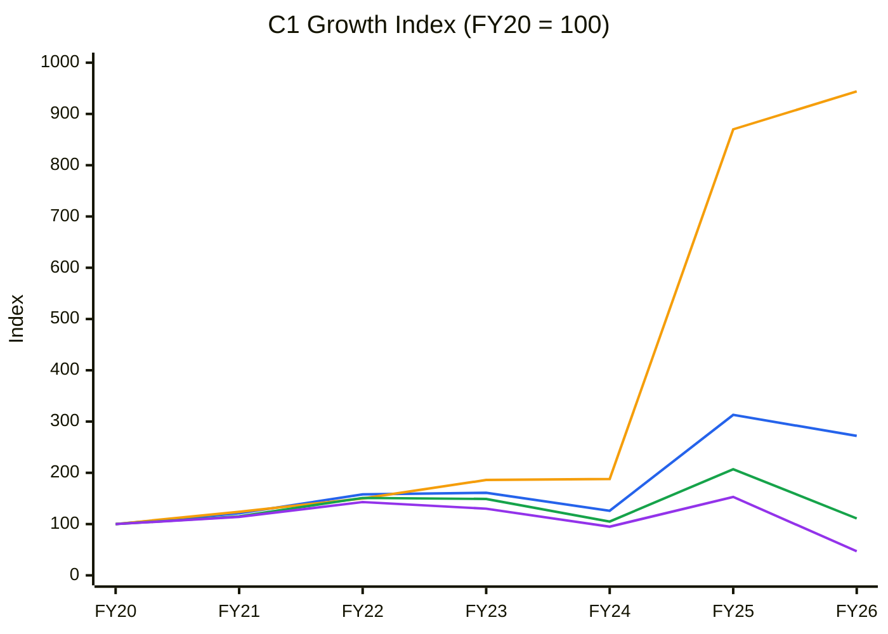
🟦 Revenue (CAGR FY20–26 18.2%) · 🟧 Net Fixed Assets incl. goodwill & intangibles (45.4%) · 🟩 EBITDA (1.8%) · 🟪 PAT (−11.8%). *Source: Screener consolidated. FY20–FY24 are legacy Suven; FY25–FY26 are the restated merged entity, so FY25 is a step change, not organic growth.*

**Read:** Since FY20 the capital base has grown 9.4× while revenue grew 2.7×, EBITDA only 1.1× and PAT fell to 0.47×. The FY25 merger/acquisitions lifted fixed assets 4.6× in a single year.

**Business inference:** Advent bought revenue with capital: the Cohance merger, Sapala and NJ Bio added ₹1,284 Cr of goodwill and a lower-margin mix. Those assets have not yet produced profit, so returns on the enlarged base collapsed. The thesis depends entirely on utilisation and mix recovering inside the existing asset base, and the chart shows no evidence of it yet (→ Module 10 bear anchor: AT stays at 0.9×).

*Order book tracking: not applicable. Cohance discloses no rupee order book and files no Reg 30 "Award/Receipt of Order" announcements; the BSE harvest of 336 filings from 1-Jan-2024 to 10-Oct-2026 found zero. The pipeline is disclosed only as molecule counts (10 Phase-III, 2 newly commercial).*

---

## Business Primer

Cohance Lifesciences is a contract development and manufacturing organisation (CDMO). It sells no branded drugs; it makes chemistry for other companies' drugs and crop-protection products. Revenue comes from three engines. **API+** (48% of FY26 revenue, ₹1,088 Cr) sells niche active ingredients, mainly CNS and controlled substances, where it claims more than 50% global share in some products, plus formulations from Nacharam and Shamshabad. **Pharma CDMO** (39%, ₹889 Cr) makes custom intermediates and APIs for innovators, and adds ADC payload-linkers (US subsidiary NJ Bio, 67.3% after the Sep-2026 deal) and oligonucleotide building blocks (Sapala, path to full ownership by FY30). **Specialty Chemicals** (13%, ₹291 Cr) covers agrochemical CDMO and performance materials (photochromics, OLED). Customers are global innovators and generic leaders, most revenue is exported, and sales are lumpy because they follow customer launch, inventory and funding cycles. The business depends on (a) multi-year qualified relationships with a handful of anchor innovators and (b) clean USFDA standing at its sites.

This is an **asset-heavy specialty-chemistry business currently behaving like a cyclical**. Its value drivers are volume (FY26 utilisation is only 55% of 1,242 KL of API reactor capacity, per the FY26 AR) and mix (niche-tech ADC/oligo, 16.2% of revenue). The key risks are customer concentration and lumpiness, regulatory action (one Warning Letter and three open 483s), and an unusual ownership structure. Controlling shareholder Advent International holds 57.49% through two holdcos. In June 2026 it pledged 94.6% of that stake to raise a USD 285m holdco term loan, after selling 8.9% in Sep-2025. Post-merger accounting also distorts every comparison: FY25 is restated, ₹1,284 Cr of goodwill sits on the balance sheet (₹466 Cr of it on loss-making NJ Bio), and ₹696 Cr of NCI buy-out obligations sit below "net cash".

**Segment check:** Pharma / CDMO. The KPI reference has a **Pharmaceuticals** block (line 201, generics-oriented) that was reused for this report. **There is no dedicated CDMO/CRAMS block.** "Fine Chemicals" and "Consumer CDMO" exist but are different business models. CDMO-specific KPIs are applied ad hoc below and flagged for the user; the KPI file was not edited.

---

## Module 1 — Broad Market Cycle (Marks)
- **Nifty 50:** 22,520 (9-Oct-2026), −12.4% YoY, below a **declining** 30-wk MA of 23,718 (23,895 four weeks ago). India VIX is rising. *(Yahoo ^NSEI weekly; user-supplied context)*
- **Assessment: Cautious → Fearful.** The pendulum has swung from complacency to fear. Fear is usually the better long-term entry zone, but in Stage 4 the rule is no new longs until the index base completes.
- Sizing implication: market fear argues for larger eventual sizing, but the Stage-4 tape argues against acting now. For this name, the stock-specific hard stops dominate.

## Module 1b — Sector Cycle
- **Secular:** Innovator outsourcing to India and the China+1 / "innovation-plus-one" theme are intact. The US **BIOSECURE Act** became law in the FY26 NDAA (Dec-2025). OMB's first "biotech company of concern" list is due by 18-Dec-2026. WuXi AppTec was added to the DoD 1260H list (8-Jun-2026) and then won a preliminary injunction (7-Aug-2026), so the timing benefit for Indian CDMOs is real but slow. Late-stage RFQs are rising, but customers "already have 1 or 2 sources" and switch slowly (Yann D'Herve, Q1 FY27 call). *(Greenberg Traurig Sep-2026; DLA Piper Aug-2026)*
- **Cyclical:** Cohance's FY26–Q1 FY27 collapse is mostly cyclical or company-specific: ₹260 Cr of destocking in two commercial molecules, NJ Bio FTE losses after the biotech-funding slump, ~₹61 Cr Nacharam disruption, and agchem pricing pressure from Chinese generics.
- **Decomposition:** a durable baseline of high-single to low-double-digit growth for API+ and CDMO, plus ADC/oligo optionality. The H2 FY27 rebound (restocking plus new launches) is cyclical and should not be capitalised.
- **Peers diverge.** Neuland (TTM sales +78%), Sai Life (+18%) and Divi's (+16%) are growing, while Syngene (−3%), Concord (−7%) and Cohance (−20%) are not. The sector is *not* in a trough; Cohance's problems are mostly its own.
- **Input/FX:** Cohance is export-heavy and INR is weak (~₹96.7/$), which helps gross margin. Raw-material and freight inflation hit Q1 (~100–150 bp gross-margin impact guided in Q4 FY26).
- **Verdict: sector tailwind (structural); company-specific headwind.** No sector MoS widening is needed; the company-specific MoS widening is applied in Module 9.

## Module 1c — Stock Cycle

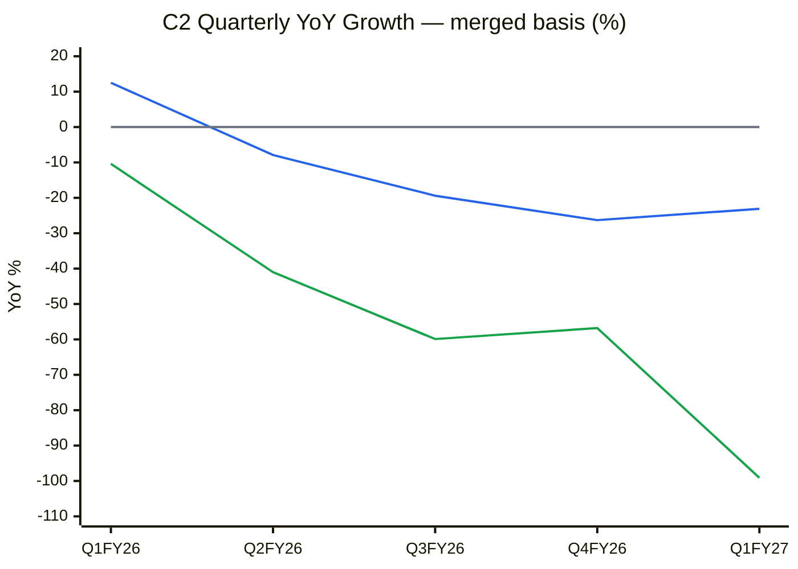
🟦 Revenue YoY % · 🟩 Operating profit (EBITDA) YoY % · ⬜ zero line. *Source: Screener quarterly (₹ Cr): revenue 549/556/545/619/422 vs 488/604/676/840/549; OP 112/121/95/99/1 vs 125/205/237/229/112. Only 5 quarters are shown because quarters before Jun-2024 are legacy Suven and not comparable.*

**Read:** Revenue has fallen YoY for four straight quarters (−8% → −26% → −23%). EBITDA has fallen far faster (−41% to −99%), so the decline slowed only marginally in Q1 FY27 and against an easier base.

**Business inference:** Fixed costs (employees ₹508 Cr, other expenses ₹671 Cr in FY26, both rising) are now sized for a much larger business. Every ₹1 of lost revenue removes nearly ₹1 of EBITDA, so H2 operating leverage will be violent in either direction. This is a trough, but not yet a confirmed turn, which needs Q2 FY27 to show sequential growth (→ trough/recovery classification; small initial size only).

- **Revenue decomposition:** the FY26 decline came from volume (destocking −₹260 Cr; Nacharam −₹61 Cr) and mix (niche tech down to 16.2%). Recovery drivers are volume (restocking, two new commercial molecules, ~10 formulation launches) and later mix (ADC/oligo).
- **Capacity model:** 1,242 KL API reactor capacity at **55% annualised utilisation** (FY26 AR, Manufactured Capital). Revenue at ~85% utilisation would be ≈ ₹2,269 × 85/55 ≈ **₹3,500 Cr** at FY26 realisations, so roughly ₹3,500–4,100 Cr is the ceiling of the existing footprint (85–100%). FY27 capex is ~₹300 Cr (Q1 spent ₹59.8 Cr), mostly debottlenecking, a flow reactor, the oligo GMP block and NJ Bio Princeton.
- **Operating leverage:** Q1 FY27 revenue fell 23% and EBITDA fell 99%, an implied DOL of ~4.3×. FY26 interest is only ₹37 Cr; ICR (EBIT/interest) was 6.6× in FY26 and was negative in Q1 FY27 on reported EBIT.
- **FCF inflection:** FY26 FCF was ₹169 Cr (Screener; company says ₹173 Cr). FY27E FCF is about zero before ~₹271 Cr of NJ Bio/Aruka outflows, so headline net cash is likely exhausted by Mar-27. The FCF inflection is pushed to FY29E.
- **Management guidance accuracy:** 0.20 (Module 4), well below 0.65, so guidance is discounted 20–30% and the scenario range widened.
- **Stock cycle classification: Trough / Recovery (unconfirmed).** Widest MoS; small initial size only after a confirmed turn.

---

## Module 2 — Industry Structure & Capital Cycle
| Force | Read (Indian CDMO) | Signal |
|---|---|---|
| New entrants | High barriers: cGMP record, 7–10-yr qualification (Vohra: trust "has taken 7 years"), controlled-substance licences | Favourable |
| Supplier power | KSM/solvent inflation in Q1 FY27; China-linked inputs | Moderate |
| Buyer power | Concentrated innovators control order timing (₹260 Cr destock in 2 molecules) | Unfavourable |
| Substitutes | In-house manufacturing; Chinese CDMOs (BIOSECURE slows them, injunction delays it) | Neutral-favourable |
| Rivalry | Capability-led at the top (Divi's, Neuland, Sai, Anthem winning); price-led in agchem and simple APIs | Moderate |

**Industry verdict:** structurally attractive at the complex end, neutral at the commodity end. **Capital cycle:** sector capex far exceeds depreciation, multiple recent IPOs (Sai Life, Anthem) and ADC/oligo capacity announcements put it at a **mid-to-late supply build**, with returns at the leaders still high (Anthem ROCE 30%, Neuland 26%). Payload/ADC oversupply over 2–3 years is a watch item.

---

## Module 3 — Business Quality & Moat
- **Greenwald barriers:** (1) **Cost/scale: partial.** CNS/controlled-substance API niche with >50% share in some products and backward integration. (2) **Customer captivity: yes, at the anchor level.** Switching costs are high once a molecule is validated at a site, but the anchors "did not necessarily increase the width of their business with us in the past 2–3 years" (Vohra, Q1 FY27 paraphrase), so captivity is not translating into growth. (3) **Niche scale: yes in select APIs; no in agchem.**
- **Durability tests:** ROCE fell from 50% to 6% over FY20–FY26 (C5). This is part mix dilution from the merger and part cyclical, but three consecutive years below the legacy level, plus the gross-margin rise (68.7% → 70.8%) failing to protect EBITDA, show that the overhead base, not pricing, is the problem. Pricing power test: a **pass** in API+ ("passed on a major chunk" of RM inflation, Q1 FY27), a **fail** in agchem (Chinese generic pressure).
- **Moat verdict: Narrow**, concentrated in niche CNS API + qualified anchor relationships. ADC/oligo is optionality, not yet a moat; NJ Bio is losing customers (FTE renewals at risk).
- **Fisher 15-point: ~28/45** (down from ~30–33). Lower on management depth (#9: Exec Chair and CFO left within 5 months, plus multiple CS changes), accounting controls/communication (#10/#14: CRISIL non-cooperation, guidance credibility) and margin management (#6). **Point 15 Integrity: Pass.** There is no SEBI/SFIO adverse finding, but candor is mixed (see WTT).

---

## Module 4 — Management & Capital Allocation

**Promoter (Advent via Berhyanda 33.34% + Jusmiral 24.15%) = 57.49%** (Jun-2026 SHP) | **Pledge: 94.6% of promoter holding (54.36% of total capital) → pledge matrix: > 60% = "Avoid" zone**
**Pledge trend:** A direct pledge was **created 17-Jun-2026** for a new USD 285m term loan (Berhyanda USD 233.5m, Jusmiral USD 51.5m) that refinanced the 2024 notes (SAST Reg 31 / Reg 29 filings, 17–19-Jun-2026). Value of the pledged stake at ₹441 ≈ ₹9,170 Cr against ≈ ₹2,757 Cr of debt (at ₹96.7/$), giving cover of ~3.3×. A ~50–60% fall would pressure covenants.
**Share count:** diluting. 25.46 Cr → 38.26 Cr on the merger allotment (May-2025), plus ESOP allotments (Mar-26, Jul-26).
**Capital allocation rating: Poor-to-Average.** Roll-up M&A (Sapala ₹~173 Cr goodwill, NJ Bio ₹466 Cr goodwill) has not earned its cost of capital yet. The Sep-2026 follow-on (USD 13m NJ Bio buy-out at USD 53/sh, USD 10m CCPS, USD 5m for 65% of preclinical **Aruka Bio**) adds ~₹271 Cr to a unit whose revenue fell 28% in CY25. Aruka adds drug-discovery risk to a CDMO model, which creates potential conflict with ADC innovator customers. No dividend since FY24.
**RPT:** The NJ Bio transactions are with subsidiaries and the founder (disclosed as arm's length). No Advent-entity trading RPTs were found in the FY26 AR. ⚠️ KMP remuneration vs PAT was not re-checked.
**Three C's:** Candor: mixed (called the Q1 trough correctly, but serial guidance misses and an analyst on the Q2 FY26 call flagged a "consistent gap between what was guided and what has actually played out"). Competence: Vohra is credible but has been in role only ~5 months; the CFO seat is vacant. Caring: PE exit-oriented.

### Walk the Talk Scorecard (carried forward and rebuilt from transcripts)
| # | Quarter guided | Statement | Guided | Actual | Verdict |
|---|---|---|---|---|---|
| 1 | Q4 FY25 call (Jun-25) | FY26 revenue growth | Double-digit growth | −13.0% (₹2,269 Cr) | ❌ |
| 2 | Q4 FY25 call | FY26 EBITDA margin | "Low 30s" | 21.0% adj | ❌ |
| 3 | Q4 FY25 → Q3 FY26 calls (repeated 4×) | FY30 revenue | USD 1bn | "Almost feeling like the target is an aspiration… may be a little bit away" (Q1 FY27) | 🔴 |
| 4 | Q1 FY26 / Q2 FY26 calls | Medium-term EBITDA | Mid-30s | "Whether it will reach 35%… difficult to articulate" (Q1 FY27) | 🔴 |
| 5 | Q1 FY26 call (Aug-25) | Nacharam cGMP oligo building-block plant | Fully operational by end-CY25 | Still "GMP operationalisation and validation… progressing" in Aug-26 | ❌ |
| 6 | Q1 FY26 call | Niche-tech share of revenue | Mid-20s % | 16.2% in FY26 | ❌ |
| 7 | Q2 FY26 call (Nov-25) | FY26 revenue (revised) | Flattish vs FY25 | −13.0% | ❌ |
| 8 | Q2 FY26 call | FY26 EBITDA margin (revised) | High-20s | 21.0% | ❌ |
| 9 | Q3 FY26 call (Feb-26) | FY26 revenue (2nd revision) | Early-to-mid double-digit decline | −13.0% | ✅ |
| 10 | Q4 FY26 call (May-26) | Q1 FY27 | Lowest quarter, weak revenue & EBITDA | ₹422 Cr, 2.2% adj EBITDA | ✅ |
| 11 | Q4 FY26 call | Q2 FY27 | "Stable" / sequential improvement | Results due late Oct/Nov-26 | ⏳ |
| 12 | Q4 FY26 call | Both destocked molecules return in FY27 | 2 of 2 | 1 restocking order received (deliveries Q4 FY27–FY28) | ⏳ |
| 13 | Q4 FY26 call | FY27 capex | ~₹300 Cr | ₹59.8 Cr in Q1 | ⏳ |
| 14 | Q1 FY27 call (Aug-26) | FY27 EBITDA margin | "Closer to previous year" (~21%) | Q1 2.2%; Q2–Q4 would need ~27% | ⏳ (high miss risk) |
| 15 | Q2 FY26 → Q1 FY27 calls | Phase-III → commercial | 4 of 9 in 12–18 months | 2 commercial by Aug-26; window to ~May-27 | ⏳ |
*Sources: BSE-filed transcripts dated 02-Jun-2025, 19-Aug-2025, 17-Nov-2025, 16-Feb-2026, 15-May-2026, 11-Aug-2026.*

```
WTT Score: 0.20 / 1.00 — UNRELIABLE
Guidance points resolved: 10 (of 15 logged) | Hits: 2 | Near Misses: 0 | Misses: 6 | Reversals: 2
Key pattern: Optimism bias with serial downward revisions (FY26 cut three times: double-digit growth → flat → −13%). The only hits are
             "low-ball" calls made after the damage was visible. Headline targets ($1bn, mid-30s) are re-framed rather than withdrawn.
Insider action: No open-market director/promoter purchases found. Advent re-levered its holdco (USD 285m, Jun-26) instead of selling more —
                NEUTRAL-to-BEARISH (supply deferred, not removed). CFO exit = BEARISH signal on continuity.
DCF impact: 25% haircut to management's FY27–FY28 recovery path; the FY27 EBITDA margin is modelled at 14%, not ~21%.
Overall management credibility: LOW (the new CEO resets the slate partially; judge on Q2–Q3 FY27 delivery).
```

---

## Module 5 — Financial Forensics
| Model | Value | Read |
|---|---|---|
| **Beneish M-Score** (FY26 vs restated FY25) | **−2.85** (DSRI 1.01, GMI 0.97, AQI 0.95, SGI 0.87, DEPI 1.07, SGAI 1.41, LVGI 0.96, TATA −0.038) | Unlikely manipulator |
| **Altman Z''** (FY26) | **4.8** (X1 0.20, X2 0.20 retained-earnings basis, X3 0.04, X4 2.38) | Safe |
| **Piotroski F** | **6/9** (ROA+, CFO+, CFO>NI, lower LT debt, higher current ratio, higher GM; fails ΔROA, dilution, asset turnover) | Average |
| **Sloan accrual** | **+0.6%** | Clean |
| OCF / PAT FY26 | 2.45× | Cash-backed (D&A heavy) |

**Indian-specific flags:**
1. Pledge at 94.6% of promoter holding (newly created direct pledge, Jun-26). Explained as PE holdco financing, so treated as mitigated but not resolved.
2. Inventory days 209 → 310 (Screener).
3. "Exceptional items" in consecutive years (FY25 ₹15.8 Cr, FY26 ₹29.5 Cr), and every quarter is reported on an "adjusted" EBITDA basis.
4. CRISIL migrated its rating to "Issuer Not Cooperating" (no information or no-default statements supplied despite letters dated 24-Jul, 30-Jul and 5-Aug-2026) and withdrew it at the company's request. India Ratings remains (company letter, 13-Aug-2026).
5. **Goodwill ₹1,284 Cr (22% of total assets).** ₹466 Cr of it sits on NJ Bio, which made a ₹32.8 Cr EBITDA loss in Q1 FY27. The terminal-growth assumption in the impairment test was cut from 7% to 5%. KAM: goodwill impairment (Walker Chandiok, FY26 AR).
6. ₹696 Cr NCI put obligation (debt-like).

**Auditor:** Walker Chandiok & Co LLP (Grant Thornton), appointed Jul-2024. **Unmodified opinion.** Emphasis of Matter on common-control amalgamation accounting (restated FY25). KAMs include goodwill impairment.
**O'Glove flag count: 2/15** (#4 inventory days, #8 recurring "one-offs"); **forensic flag total 3** (plus pledge), 1 explained, so **2 unresolved**. The ≥3 hard stop is not triggered but is borderline.
**Overall forensic verdict: minor-to-moderate concerns.** There are no accrual-manipulation signals. The risks are balance-sheet: goodwill impairment on NJ Bio, the NCI obligation, and pledge tail risk.

---

## Module 6 — Earnings Quality & Financial Statements

**10-yr table (consolidated, ₹ Cr; FY20–FY24 legacy Suven, FY25–FY26 restated merged; source: Screener + FY26 AR)**
| Metric | FY20 | FY21 | FY22 | FY23 | FY24 | FY25 (R) | FY26 | TTM Jun-26 |
|---|---|---|---|---|---|---|---|---|
| Sales | 834 | 1,010 | 1,320 | 1,340 | 1,051 | 2,608 | 2,269 | 2,142 |
| EBITDA (OP) | 385 | 443 | 582 | 574 | 406 | 797 | 427 | 316 |
| OPM % | 46 | 44 | 44 | 43 | 39 | 31 | 19 | 15 |
| Net Profit | 317 | 362 | 454 | 411 | 300 | 484 | 150 | 59 |
| PAT margin % | 38.0 | 35.8 | 34.4 | 30.7 | 28.5 | 18.6 | 6.6 | 2.8 |
| EPS ₹ | 12.45 | 14.23 | 17.83 | 16.16 | 11.80 | 12.68* | 4.68 | 2.78 |
| CFO | 407 | 383 | 330 | 457 | 358 | 673 | 368 | — |
| FCF | 304 | 272 | 255 | 171 | 307 | 357 | 169 | — |
| ROCE % | 50 | 40 | 41 | 32 | 19 | 21 | 6 | 5.8 |
*FY25 diluted EPS per FY26 AR (restated, merger shares included); Screener shows 19.14 on pre-merger share count.

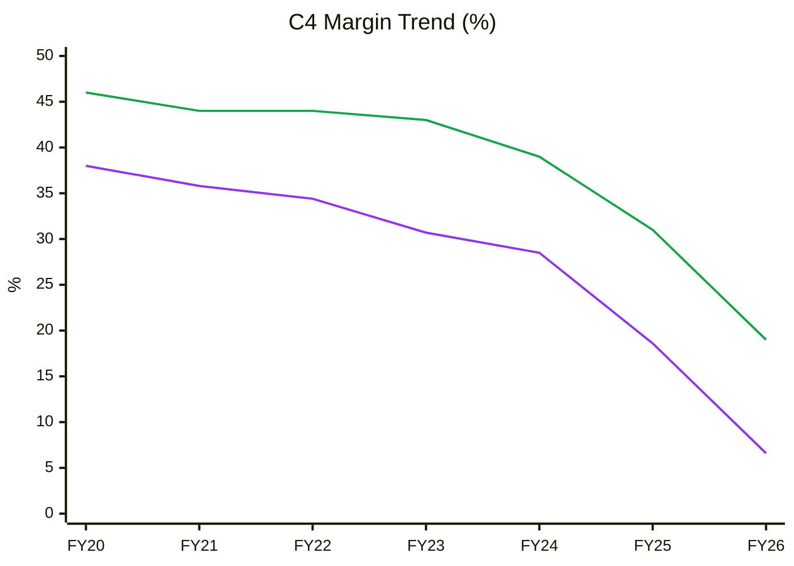
🟩 EBITDA margin (OPM) · 🟪 PAT margin. *Gross margin (68.7% FY25 → 70.8% FY26) exists only on the restated basis, so it is not charted.*

**Read:** EBITDA margin fell 27pp (46% → 19%) and PAT margin 31pp (38% → 6.6%) over six years. The steepest drops came in FY25–FY26 after the merger.

**Business inference:** Gross margin actually rose to 70.8%, so the collapse is not lost pricing. It comes from overheads (people, NJ Bio's US cost base, remediation) that were built for a USD 1bn plan, landing on a shrinking revenue base. Margin repair is mostly a utilisation and cost-discipline question that the new CEO controls, which is better than a pricing problem but depends on management credibility that is currently low.

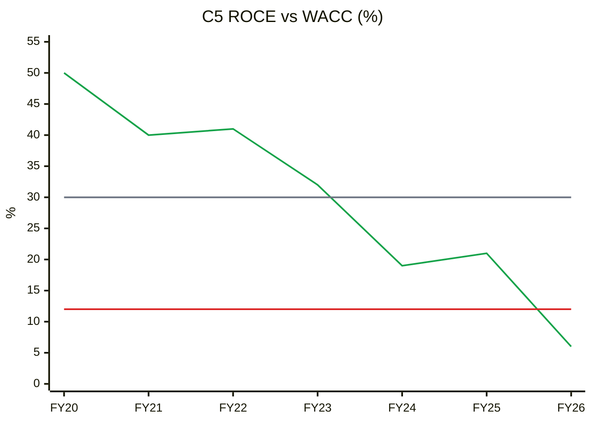
🟩 ROCE (pre-tax, Screener) · 🟥 WACC 12% · ⬜ FY20–26 average 30%. *After-tax ROIC FY26 = 3.9% (NOPAT ₹174 Cr / avg invested capital ₹4,516 Cr incl. goodwill and NCI obligation); FY25 10.6%.*

**Read:** ROCE fell from 50% to 6%, below the 12% WACC for the first time in FY26, and was 5.8% TTM. The FY20–26 average is 30%.

**Business inference:** Legacy Suven was a genuine value creator. The merged entity has destroyed value for one year so far, so the "ROIC < WACC for 5+ years" hard stop is **not** triggered. With ₹1,284 Cr of goodwill in the base, even a full margin recovery to 25% EBIT gets ROIC only to ~13–14%, roughly at WACC. The M&A premium has been paid away, and future value creation must come from incremental organic returns.

### DuPont Decomposition (5-factor, average balances; total equity incl. NCI from FY25)
| Year | EBIT Margin | Asset Turnover | Equity Multiplier | Interest Burden | Tax Burden | **ROE** |
|---|---|---|---|---|---|---|
| FY22 | 51.3% | 0.80 | 1.22 | 0.99 | 0.68 | **33.5%** |
| FY23 | 42.8% | 0.71 | 1.16 | 0.98 | 0.73 | **25.2%** |
| FY24 | 39.3% | 0.50 | 1.11 | 0.98 | 0.74 | **15.9%** |
| FY25* | 26.2% | 0.67 | 1.32 | 0.94 | 0.75 | **16.6%** |
| FY26 | 10.8% | 0.40 | 1.43 | 0.85 | 0.73 | **3.8%** |
| **Change FY22→26** | −40.5pp | −0.40× | +0.21× | −0.14 | +0.05 | **−29.7pp** |
*FY25 averages a legacy FY24 balance sheet with the restated merged FY25 one, which flatters AT. EBIT includes other income.

**Operating contribution (EBIT margin × AT): 41.0 → 4.4, collapsing. Financing contribution:** the multiplier rose 1.22 → 1.43, but that comes from NCI put liabilities and payables, not borrowing; the interest burden worsened. **Verdict:** the ROE decline is entirely operational. Leverage is not masking it. AT has fallen for 4 of 4 years (ex the merger distortion), so per the skill the bear and base AT are anchored at **current** levels (Module 10). Peer DuPont: Neuland and Anthem earn 21–22% ROE on ~1.3× multipliers through 28–40% margins, which is operational superiority.

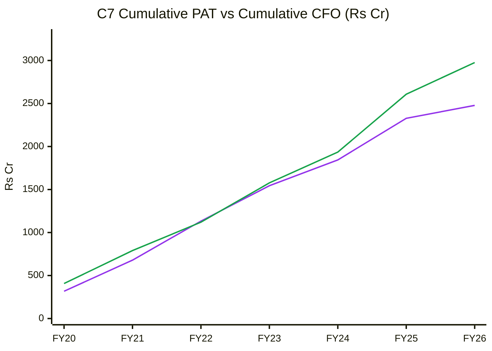
🟪 Cumulative PAT · 🟩 Cumulative CFO

**Read:** Cumulative CFO of ₹2,976 Cr is 1.20× cumulative PAT of ₹2,478 Cr over FY20–FY26, and CFO has stayed above PAT in 6 of 7 years.

**Business inference:** Reported profits are real cash, helped by a heavy D&A load and FY26 receivable collections (+₹102 Cr) that offset the inventory build (−₹95 Cr). The earnings problem is *level*, not *quality*, which is why the forensic models are clean while the valuation case fails.

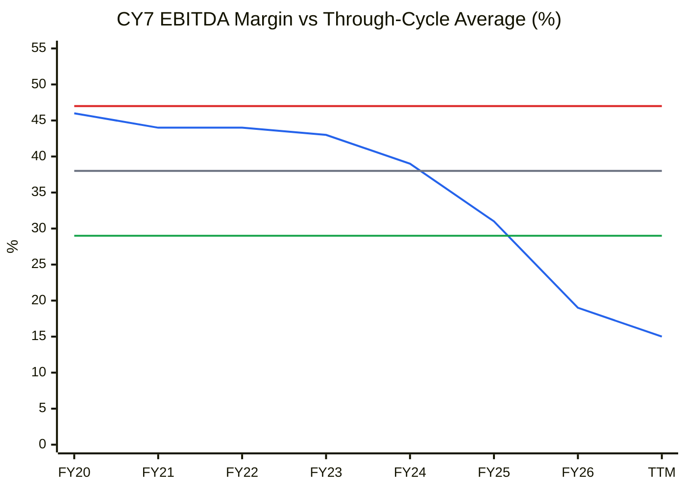
🟦 EBITDA margin · ⬜ FY20–26 average 38% · 🟥 +1SD 47% · 🟩 −1SD 29%

**Read:** TTM EBITDA margin is 15%, 23pp below the 38% average and 14pp below −1SD. That is the 0th percentile of the series and a trough reading.

**Business inference:** By the cycle rule this is the point where cyclicals look most expensive on P/E (158×). The skill says value the business on normalised margins. Normalised merged margins are not 38% (that was the higher-margin legacy mix) but are more likely the 25–30% range FY25 showed (31%). A trough on the chart is not a buy signal until the cause (NJ Bio losses, overheads) is shown to be reversing.

**Working capital (Screener):** Debtor days 108 → 110; inventory days 209 → 310; payable days 120 → 157; CCC 197 → 263; WC days 106 → 133.

---

## Module 7 — Industry KPIs & Peer Analysis
**Sector:** Pharma CDMO (Pharmaceuticals block used; ⚠️ no dedicated CDMO KPI block, flagged).
| KPI | Cohance | Peer context | Assessment |
|---|---|---|---|
| EBITDA margin (FY26) | 19% (adj 21%; Q1 FY27 2.2%) | Divi's 33%, Anthem 39%, Neuland 29%, Sai 29% | Below (KPI red flag < 18% is close) |
| USFDA status | 1 WL (Nacharam) + 3 open 483s (Pashamylaram, Shamshabad, Jaggaiahpet) | Leaders: clean or VAI | Below (critical-risk KPI) |
| Niche-tech / late-stage mix (CDMO-specific) | 16.2% of revenue; 10 Ph-III; commercial:development 57:43 (Q1 FY27) | Sai/Anthem report higher late-stage shares | Below (falling vs mid-20s guidance) |
| Capacity utilisation (CDMO-specific) | 55% of 1,242 KL | n/a disclosed | Low, but this is operating-leverage headroom |
| Customer audits (CDMO-specific) | Q1 FY27 innovator audits "without critical findings"; 11 API audits | — | Positive |

**Peer comparison (Screener consolidated, 10-Oct-2026)**
| Metric | Cohance | Divi's | Neuland | Sai Life | Anthem | Syngene | Concord | Piramal Pharma |
|---|---|---|---|---|---|---|---|---|
| MCap ₹ Cr | 16,873 | 2,47,948 | 26,802 | 31,606 | 48,577 | 14,023 | 14,242 | 26,212 |
| Sales 3-yr CAGR | 19%† | 11% | 19% | 22% | 26% | 5% | 7% | 8% |
| TTM sales growth | −20% | +16% | +78% | +18% | −2% | −3% | −7% | +1% |
| EBITDA margin FY26 | 19% | 33% | 29% | 29% | 39% | 25% | 35% | 10% |
| ROCE (current) | 5.8% | 22.0% | 26.5% | 19.6% | 30.4% | 10.0% | 17.1% | 2.5% |
| P/E (TTM) | 157 | 83 | 54 | 86 | 82 | 47 | 51 | n/m (loss) |
| P/B | 4.3 | 14.8 | 14.3 | 12.7 | 15.9 | 2.9 | 7.1 | 3.2 |
†Merger-inflated.

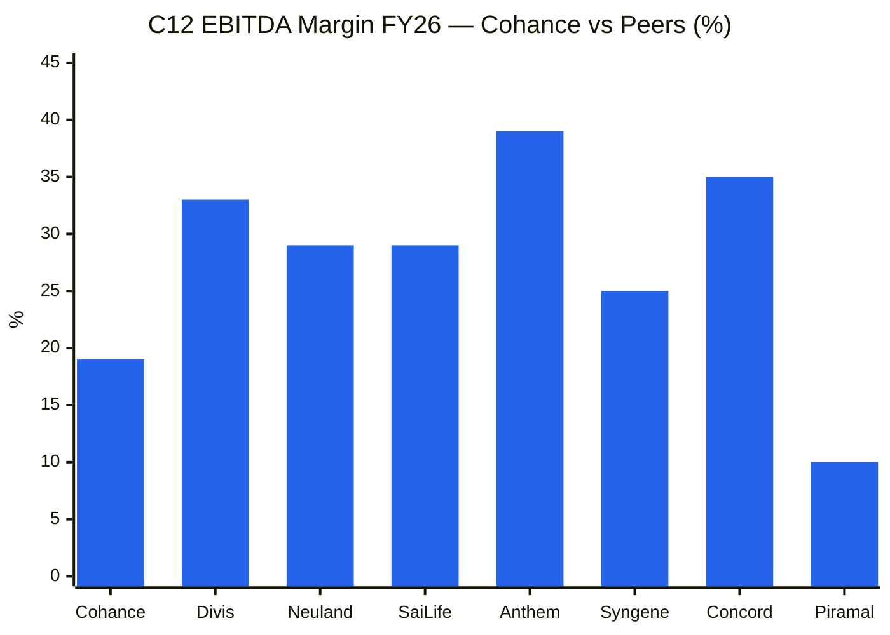
**Read:** Cohance's 19% FY26 EBITDA margin is 10–20pp below the growing CDMO leaders (Neuland/Sai 29%, Divi's 33%, Anthem 39%). Only Piramal (10%) is lower.

**Business inference:** Cohance trades at the highest TTM P/E in the group (157×) with the second-lowest margin and ROCE. The market pays a "Divi's-in-waiting" premium for a business whose returns currently resemble Piramal/Syngene, so the P/E premium is unjustified on present economics. Only its P/B of 4.3× is at the low end, which reflects the goodwill-heavy book.

**Order Book Tracker:** not applicable. There is no disclosed order book and no Reg 30 order filings (harvest 2024-01 → 2026-10-10: 0 order filings out of 336).

---

## Module 8 — Market Size & Market Share
- **TAM:** global CDMO ~USD 150–170bn growing ~7–8%; ADC and oligonucleotide CDMO are the fastest sub-segments (double-digit). India's share is low single digits. ⚠️ These are industry-report estimates carried forward and not re-sourced this session.
- **Penetration:** FY26 revenue ≈ USD 250–270m (₹2,269 Cr at an assumed ₹84–90/$ FY26 average ⚠️), under 0.2% of the global CDMO TAM.
- **Share trend:** **Losing.** Revenue −13% (FY26) and −20% (TTM) while sector peers grow +16% to +78%. Niche leadership in specific CNS APIs is intact (>50% share on some molecules, Q1 FY27 call).
- **Verdict:** a small share of a growing market, currently **losing share**. Management's own words: peers "may have actually moved faster than Cohance," partly due to "leadership churn" (Q1 FY27 paraphrase).

---

## Module 9 — Valuation: PIE First, Then Own Model

### 9A. Price-Implied Expectations (reverse DCF, sales-to-capital form)
**EV** = MCap ₹16,873 Cr − net cash ₹251 Cr + NCI put obligation ₹696 Cr + NCI book ₹123 Cr = **₹17,441 Cr**. WACC 12% (Rf 7% + β~1.0 × ERP 5.5%; negligible debt), terminal g 7%, tax 25%, FY26 revenue base ₹2,269 Cr, EBIT margin ramping linearly to steady state by year 5, growth constant for years 1–5 and fading linearly to 7% by year 10, reinvestment = ΔRevenue ÷ sales-to-capital.

| Steady-state EBIT margin (≈ EBITDA) | Implied 5-yr revenue CAGR, S/C 1.0× | Implied, S/C 1.3× |
|---|---|---|
| 20% (≈ 28%) | 46% | 38% |
| 25% (≈ 33%, mgmt's "mid-30s") | 34% | 29% |
| 28% (≈ 36%, legacy-like) | 29% | 25% |
| 30% (≈ 38%) | 26% | 23% |

| PIE driver | Market-implied | My base case | Gap |
|---|---|---|---|
| Revenue CAGR FY26–31 | ~29% (at 25% EBIT, S/C 1.3) | 10.6% | **Optimistic, ~18pp** |
| Steady-state EBIT margin | 25% | 20% (28% EBITDA − 8% D&A) | Optimistic, 5pp |
| Investment rate (ΔIC/ΔRev) | 0.77 (S/C 1.3) | 1.0 (capital-heavy, plus acquisitions) | Optimistic |

**Physical plausibility check:** A ~29% CAGR means FY31 revenue of roughly ₹8,100 Cr, about 3.6× FY26. Existing capacity at 85–100% utilisation supports only ~₹3,500–4,100 Cr. **The price assumes an unannounced expansion or further M&A** worth roughly 2× the current footprint, which is the most actionable disagreement in this analysis. There is no capex plan beyond ₹300 Cr/yr.
**Classification: optimistic gap.** The market pays for a successful USD 1bn-style plan that management itself has just downgraded to "aspiration".
**Expectations treadmill:** To merely earn the cost of capital from ₹441, Cohance must compound revenue ~25–29% for five years *and* lift EBIT margin from 11% to 25–28%.
**Triggers.** Positive: (1) Q2–Q3 FY27 sequential growth with EBITDA >20%; (2) December strategy update with a credible, funded FY30 plan; (3) a large ADC/oligo commercial award or NJ Bio breakeven. Negative: (1) a Q2 miss of the "stable/improving" guide; (2) a 483 escalating to OAI/WL at an API site (Jaggaiahpet/Pashamylaram serve CDMO/API exports); (3) NJ Bio goodwill impairment, or Advent block supply.
**SVAR:** Bear target ₹219 (below), so SVAR = (441 − 219)/441 = **50% > 40% → hard stop.**

### 9B. Own Model — Intrinsic Value (three methods)
| Method | Bear | Base | Bull | Notes |
|---|---|---|---|---|
| DCF (FCFF, WACC 12%, g 7%, S/C 1.3×) | ₹28 | ₹123 | ₹219 | Base: FY27 ₹2,260 Cr → +15/14/13/12/11% → fades to 8%; EBITDA 14% → 28%. Bull: 20% growth start, 33% EBITDA. Bear: 8% growth, 20% EBITDA |
| Relative (FY29E EPS × exit P/E; bear on EV/EBITDA) | ₹219 | ₹407 | ₹730 | Base EPS ₹9.7 × 42×; bull ₹14.6 × 50×; bear EBITDA ₹434 Cr × 22× less net obligations. Undiscounted ~2.5-yr targets |
| EPV (no growth; normalised EBIT 15/18/20% on FY26 sales) | ₹41 | ₹52 | ₹59 | Adjusted for net obligations |
| **Blended (50% relative / 30% DCF / 20% EPV)** | **₹126** | **₹251** | **₹443** | |

**Current price ₹441 ≈ blended bull case.** MoS on blended base: −76%. **Graham number:** √(22.5 × 5-yr avg EPS ₹12.63 × BVPS ₹102.2) = **₹170**. Graham screen fails on P/E, P/B, EPS growth and dividend record (4/7 fail).
**Misprice reason:** not cheap. The premium persists because of the "Indian CDMO" sector multiple (peers 50–86×), the Vohra halo and a thin free float (Advent 57.5% pledged, DIIs 20%).

### Scenario Analysis (AT-driven)
| Scenario | AT assumption (Rev / Tangible PPE GB) | Revenue FY29E | EBITDA margin | EPS FY29E | Multiple | Target | Prob |
|---|---|---|---|---|---|---|---|
| Bull | Recovers to ~1.06× (most of the way to FY25's 1.24×) on ₹3,200 Cr GB | ₹3,400 Cr | 29% | ₹14.6 | 50× P/E | **₹730** | 25% |
| Base | ~0.92× (FY26 level) on ₹3,200 Cr GB | ₹2,950 Cr | 25% | ₹9.7 | 42× P/E | **₹407** | 50% |
| Bear | Stays ~0.80× (FY27E trough) | ₹2,550 Cr | 17% | ₹4.1 | 22× EV/EBITDA | **₹219** | 25% |
| **Expected value** | | | | | | **₹441** | |

**Expected value ₹441 = CMP (0% return). U/D:** simple (730 − 441)/(441 − 219) = **1.30:1**; probability-weighted 72.3 / 72.5 = **1.0:1**. Both are below 1.5, so **hard stop → AVOID.** **Buy-below:** U/D ≥ 2:1 at ≤ ₹389 and SVAR ≤ 40% at ≤ ₹365, so the binding level is **₹365**.

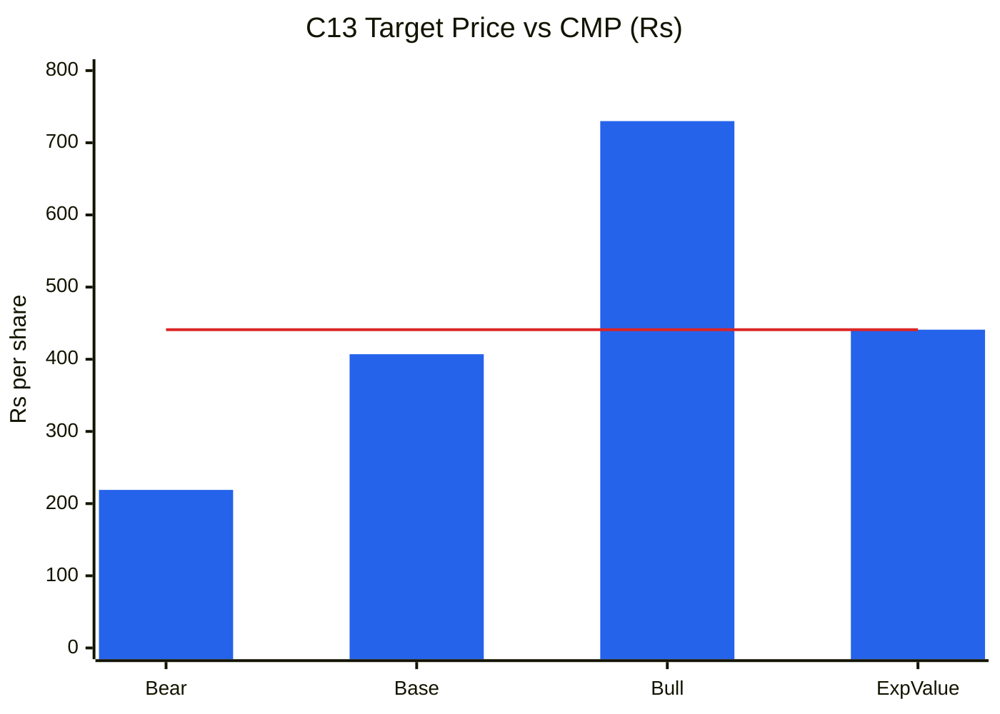
🟦 Scenario price (2.5-yr) · 🟥 CMP ₹441

**Read:** Downside to bear is −50% versus +66% upside to bull, base sits 8% below CMP, and the probability-weighted value equals the CMP, giving U/D 1.30:1.

**Business inference:** The price already assumes the turnaround succeeds. Execution only earns a fair return, while any repeat of FY26-style guidance misses, an API-site regulatory escalation or an NJ Bio write-down exposes a 50% drop. The asymmetry favours waiting: the thesis needs a lower price or proof of delivery, not more conviction.

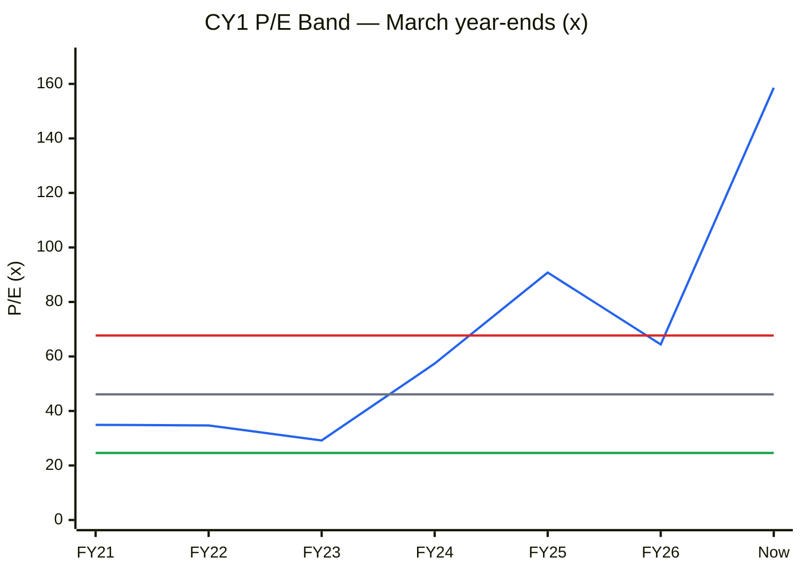
🟦 P/E (March close ÷ FY EPS; "Now" = ₹441 ÷ TTM ₹2.78) · ⬜ median 46.1× · 🟥 +1SD 67.7× · 🟩 −1SD 24.6×. *March closes (Yahoo monthly, IST-adjusted): ₹496.8, 618.5, 472.4, 677.1, 1,151.0, 301.5. Only 6 year-ends exist because the company listed in Apr-2020.*

**Read:** At 158.6× TTM EPS the stock is at the 100th percentile, 2.3× above the +1SD line. Even FY26's trough-price P/E (64.4×) was near +1SD.

**Business inference:** The cyclical-P/E rule applies, since a high P/E on trough earnings *can* be a buy. That works only if earnings normalise toward the old ₹12–18 EPS, and with WTT at 0.20 there is no reliable path to that. The price is discounting recovered earnings that do not yet exist.

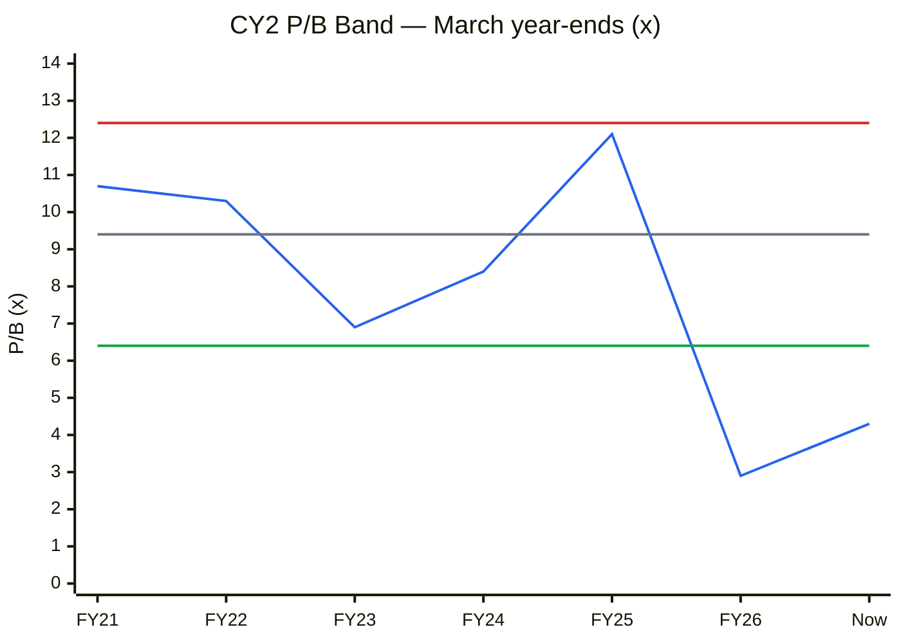
🟦 P/B · ⬜ median 9.4× · 🟥 +1SD 12.4× · 🟩 −1SD 6.4×. *BVPS: legacy equity ÷ 25.46 Cr sh to FY24; restated equity ÷ 38.26 Cr sh for FY25–FY26.*

**Read:** P/B of 4.3× is at the 17th percentile, below −1SD (6.4×), and above only the Mar-2026 low of 2.9×.

**Business inference:** P/B looks cheap only against legacy Suven, which earned 25–36% ROE. The merged book is 32% goodwill (₹1,284 Cr of ₹4,034 Cr) and earns 3.8% ROE. Justified P/B = (ROE − g)/(Ke − g) is below 1× at today's ROE and ~2.4× at a recovered 18% ROE (Ke 13%, g 9.5%), so 4.3× is not cheap.

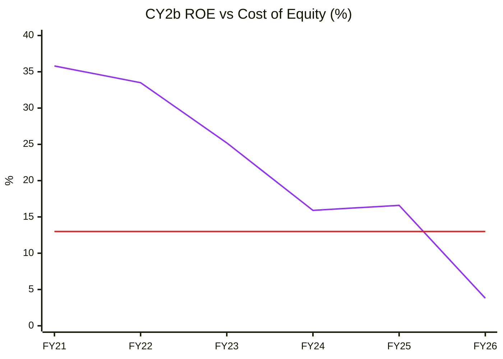
🟪 ROE (avg equity) · 🟥 Cost of equity 13%

**Read:** ROE fell from 35.8% to 3.8% and was below the 13% cost of equity for the first time in FY26.

**Business inference:** The legacy ROE engine has been diluted by the merger's equity issuance and acquisition goodwill. Until ROE is back above ~13%, every rupee of book value is worth less than a rupee to shareholders, and the 4.3× P/B is a bet on a return recovery that management has not yet shown it can deliver.

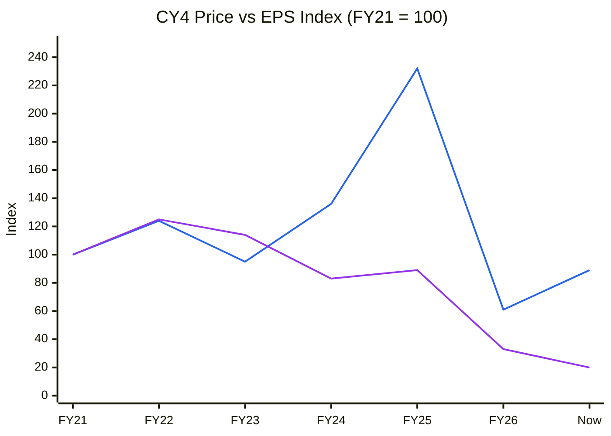
🟦 Price index (March close; Now ₹441) · 🟪 EPS index (FY EPS; Now = TTM ₹2.78)

**Read:** The price index is at 89 while the EPS index is at 20, so the price trades 4.5× ahead of earnings since FY21. The gap opened in FY24–FY25 (price 232 vs EPS 89) and has re-opened since March 2026.

**Business inference:** The FY24–FY25 run was a pure re-rating on the Advent/USD 1bn narrative and reversed violently (−74% to Mar-26). The 46% rebound since then (₹301 → ₹441) is again re-rating, now on the Vohra appointment, while EPS fell further. Returns borrowed from the future have already been reclaimed once by the market.

### Cycle Position Dashboard
| Dimension | Current | Median (FY20/21–26) | Percentile | Signal |
|---|---|---|---|---|
| P/E | 158.6× (TTM) | 46.1× | 100% | Expensive |
| P/B | 4.3× | 9.4× | 17% | Cheap vs history, not vs ROE |
| EBITDA margin | 15% (TTM) | 43% (FY20–26) | 0% | Trough |
| ROCE | 5.8% | 32% | 0% | Trough |
| Utilisation | 55% (FY26) | n/a | — | Slack (headroom) |
| Industry capex | Peers adding ADC/oligo capacity; new IPOs | — | — | Building (mid-late) |
| **Overall cycle position** | | | | **Trough (company), not sector**, consistent with Module 1b/1c |

---

## Module 10 — Technical Stage (Weinstein + CANSLIM)
| Item | Reading (Yahoo weekly/daily, close 9-Oct-2026) |
|---|---|
| **Nifty 50** | 22,520 < 30-wk MA 23,718 (declining) → **Stage 4** |
| **Nifty Pharma** | 25,962 > 30-wk MA 25,035 (rising); +16.7% YoY; 4% below high → **Stage 2** |
| **Stock** | ₹441 vs 30-wk MA **₹427.5, rising** (₹389 → ₹407 → ₹428 over 10 weeks); 200-DMA ₹415 (still declining); 50-DMA ₹448 |
| Base | Sideways **₹417–₹488 weekly-close range since May-2026** (~22 weeks) after the 280 → 488 thrust. Pivot ≈ ₹490 |
| Volume | 10-wk avg 6.0m vs 30-wk avg 11.4m, so volume is drying up in the base (constructive). 11.5m spike in the week of 21-Sep (+4.8%) |
| RS vs Nifty | 4-wk +0.7% vs −3.5%; 13-wk −0.2% vs −7.5%; 26-wk +12.9% vs −7.5%; 52-wk −50.4% vs −12.4% → **short-term RS strongly positive; long-term negative** |
| 52-wk H/L | ₹918 / ₹267 |

**Stock stage: late Stage 1 (base with a rising 30-wk MA). It is not Stage 4**, so the Stage-4 hard stop is not triggered. **Stage 2 is not confirmed** without a weekly close above ~₹490 on ≥1.5× average volume. The market is Stage 4, which overrides individual-stock strength, so there are no new longs. The previous report's "below a falling 200-DMA" was wrong (see validation #24).
**CANSLIM 2/7:** C ✗ (EPS −149% YoY), A ✗, N ½ (new CEO), S ½ (pledged float, drying volume), L ✗ (ROCE/growth laggard), I ✗ (FII 6.5%, DII down 21.8% → 20.1%; DSP crossed a Reg 29(2) threshold on 12-Aug-26 ⚠️ direction unreadable), M ✗ (Nifty Stage 4) ≈ 2/7.
**Stop-loss reference (if held):** weekly close below ₹415 (base floor and 200-DMA). **Alignment:** misaligned. Technicals are improving while fundamentals and valuation are not.

---

## Module 11 — Forward View: 2–3 Year Thesis

### Capex Classification (₹ Cr)
| Capex type | FY27E | FY28E | FY29E | In AT model? |
|---|---|---|---|---|
| Tangible growth capex (flow reactor, oligo GMP, debottlenecking, NJ Bio Princeton) | ~100 | ~65 | ~50 | ✅ |
| Maintenance (≈ D&A) | ~200 | ~215 | ~230 | ❌ Sustains only |
| Acquisitions / NCI buy-outs (NJ Bio USD 13m + CCPS USD 10m, Aruka USD 5m) | ~271 | Sapala buy-out (path by FY30; ₹ ⚠️) | — | ❌ Goodwill/financial |
| CWIP (Mar-26) | ₹173 Cr (down from ₹332 Cr) | | | Transfers FY27 |
| ROU (Ind AS 116) | ₹231 Cr | | | ⚠️ Excluded |
| **Total capex (ex-M&A)** | **~300** (guided) | ~280 | ~280 | |

**Tangible PPE gross block & AT (FY26 AR Note 3a):** Mar-24 (restated) ₹1,523 Cr · Mar-25 ₹2,097 Cr · Mar-26 ₹2,458 Cr. AT FY25 = 2,608/2,097 = **1.24×**; FY26 = 2,269/2,458 = **0.92×**, declining. There are only two restated AT points, so chart C6 is omitted (<4 points). Utilisation is a single disclosed point (55%), so C10 is omitted too.
**Incremental ROIC (FY26 → FY29E base):** ΔRevenue ₹681 Cr × EBIT 17% × 0.74 ≈ ₹86 Cr NOPAT, divided by incremental capital ≈ ₹735 Cr (growth capex ₹215 Cr + M&A ₹271 Cr + ΔWC ₹249 Cr) ≈ **11.7% ≈ WACC, so value-neutral.** Capex-model CAGR FY26–29E is **9.1%** vs PIE ~29%, so the market is **pricing an unannounced expansion**.

### Capex-to-Earnings Model (Base, ₹ Cr)
| Metric | FY27E | FY28E | FY29E |
|---|---|---|---|
| Opening tangible PPE GB | 2,458 | 2,700 | 2,950 |
| Closing tangible PPE GB | 2,700 | 2,950 | 3,200 |
| AT applied (×, on closing GB) | 0.84 | 0.88 | 0.92 |
| **Revenue** | **2,260** | **2,600** | **2,950** |
| EBITDA margin | 14% | 22% | 25% |
| EBITDA | 316 | 572 | 738 |
| D&A | 200 | 215 | 230 |
| EBIT | 116 | 357 | 508 |
| Other income | 30 | 35 | 35 |
| Interest | 32 | 30 | 30 |
| ICR (×) | 3.6 | 11.9 | 16.9 |
| PAT (26% tax, after NCI) | 84 | 268 | 372 |
| EPS (₹, 38.4 Cr sh) | 2.2 | 7.0 | 9.7 |
| ΔWorking capital (36% of ΔRev) | −3 | 124 | 128 |
| Capex | 300 | 280 | 280 |
| **FCF (pre-M&A)** | **−13** | **79** | **194** |
| Peak debt / EBITDA | ~0 gross; adjusted (incl. NCI obligation ~₹500 Cr) ≈ 1.6× FY27E | | |
**FCF inflection:** FY29E. **Debt ceiling:** within safe zone. The hidden leverage is at the Advent holdco (USD 285m), not the company.

### Key Catalysts
1. **Q2 FY27 results** (late Oct/Nov-2026): delivery of the ADC payload order and two-molecule shipments; sequential growth is a must.
2. **December-2026 strategy update** (FY30 target re-set, capital-allocation framework, CFO appointment).
3. **USFDA closure** of the Pashamylaram, Shamshabad and Jaggaiahpet 483s (VAI outcomes) and Nacharam WL close-out (FY27–FY28).
4. **H2 FY27 restocking** deliveries (Q4 FY27–FY28) and Sapala oligo programme scale-up.
5. **BIOSECURE:** OMB designation list due 18-Dec-2026.

### Key Risks
1. **Another guidance miss** (FY27 margin "close to FY26" looks unreachable after a 2.2% Q1): **High.**
2. **Regulatory escalation**: any of three open 483s turns OAI/WL at an API/CDMO export site: **Medium.**
3. **NJ Bio goodwill impairment (₹466 Cr)** and continued cash support (₹271 Cr in FY27): **Medium-High.**
4. **Advent supply / pledge tail**: holdco USD 285m loan, 94.6% pledged; a ~50%+ price fall stresses cover; block sales cap rallies: **Medium.**
5. **Leadership churn** (CFO vacancy; three chairpersons/CEOs in 18 months) slows customer conversion: **Medium.**

---

## Checklist Summary
**Section 0 (Existing report protocol):** 3/3 (git mv done; validation table with 31 items; one file remains)
**Section A (Business Quality):** 16/18 (scuttlebutt beyond filings ⚠️; KMP remuneration ⚠️)
**Section B (Forensics):** 9/9
**Section C (Financial Statements):** 11/12 (Ind AS 116 pre-lease EBITDA not rebuilt ⚠️)
**Section D (KPIs & Peers):** 6/7 (no dedicated CDMO KPI block)
**Section E (Market Size & Share):** 5/7 (TAM not re-sourced ⚠️; no independent market-share data)
**Section F (Valuation):** 10/10
**Section G (Technical):** 8/8
**Section H (Forward View):** 26/32 (segment-level capex/AT not disclosed; single-segment reporting under Ind AS 108)
**Section I (Charts):** 12 charts. Pre-save check passed (python validator: series lengths, axis ranges, bar rules, Read and Business inference present). C6 and C10 omitted (<4 data points)
**Order Book Tracker:** not applicable (no order book or Reg 30 order filings)
**Hard stops triggered:** **(1) Upside/downside 1.30:1 < 1.5:1; (2) SVAR 50% > 40%.** Borderline, not triggered: pledge > 60% (94.6%, re-created as a refinancing, not increased in encumbrance terms); forensic flags 2 unresolved (< 3). Not triggered: ROIC < WACC 5+ yrs (1 year only), Stage 4 (stock is late Stage 1), Beneish, auditor, integrity.
**Previous report's hard-stop application:** **incorrect.** Its own numbers gave U/D 0.41:1 and SVAR ~65%, so it should have been AVOID.

### Conviction Score
| Component | Max | Score | Note |
|---|---|---|---|
| Market + sector + stock cycle | 1 | 0.5 | Nifty Stage 4/fearful; sector tailwind; stock trough |
| Industry structure | 1 | 0.7 | Attractive at the complex end |
| Business quality & moat | 2 | 1.0 | Narrow moat; losing share |
| Management | 1 | 0.2 | WTT 0.20; CFO exit; CRISIL non-cooperation |
| Financial + earnings quality | 2 | 1.0 | Clean accruals; goodwill/NCI/pledge risks |
| Valuation & PIE asymmetry | 2 | 0.2 | Optimistic gap; EV = CMP |
| Technical + CANSLIM | 1 | 0.4 | Stock RS improving; market Stage 4; CANSLIM 2/7 |
| **Total** | **10** | **4.0** | |

---

## Investment Decision
**Recommendation:** **AVOID** (hard stops: U/D 1.30:1, SVAR 50%). It remains on the **watchlist** because the CNS API franchise and the new CEO are real assets.
**Conviction Score:** 4.0 / 10 (was 4.5)
**Suggested position size:** 0%.
**Re-entry conditions (all three):**
1. Price ≤ **₹365** (U/D ≥ 2:1 and SVAR ≤ 40% on the current scenario set), **or** scenario values rise because delivery improves.
2. **Two quarters** of delivered recovery: Q2 FY27 sequential growth and Q3 FY27 YoY growth with consolidated EBITDA > 20%, plus NJ Bio losses visibly narrowing.
3. A weekly close above **₹490** on ≥1.5× average volume (Stage 2), with Nifty out of Stage 4.

**Stop-loss (if held):** weekly close below ₹415.
**Target (base, ~2.5 yr):** ₹407.
**Review triggers:** Q2 FY27 results; Dec-2026 strategy/guidance reset; CFO appointment; USFDA 483 classifications; any Advent block or pledge change; NJ Bio impairment test (Mar-2027).

---
### Sources
BSE filings (scrip 543064), harvested 1-Jan-2024 → 10-Oct-2026 (336 announcements): Q1 FY27 transcript (11-Aug-2026); Q4 FY26 (15-May-2026), Q3 FY26 (16-Feb-2026), Q2 FY26 (17-Nov-2025), Q1 FY26 (19-Aug-2025) and Q4 FY25 (02-Jun-2025) transcripts; FY26 Annual Report (26-Aug-2026: consolidated BS/P&L, Notes 3a, 6, 22, 40, 43, MD&A, auditor's report); NJ Bio/Aruka press release and Reg 30 (3-Sep-2026); NJ Bio CCPS (18-Sep-2026); USFDA filings (4/6-Feb-2026 WL; 5-Aug, 5-Sep, 21-Sep-2026 483s); CRISIL rationale (12/13-Aug-2026); CFO resignation (17-Jun-2026); SAST Reg 29/31 (17–19-Jun-2026); Vohra press release (27-Apr-2026); AGM outcome (17-Sep-2026). Screener.in consolidated (10-Oct-2026) for the company and peers. Yahoo Finance (COHANCE.NS, ^NSEI, ^CNXPHARMA, INR=X). [Business Standard: Advent 8.9% sale](https://www.business-standard.com/amp/markets/news/advent-international-sells-8-9-stake-in-cohance-lifesciences-for-3-094-cr-125091801454_1.html) · [Greenberg Traurig BIOSECURE update, Sep-2026](https://www.gtlaw.com/en/insights/2026/9/biosecure-act-update-court-enjoins-wuxi-apptecs-1260h-designation-but-strategic-and-compliance-clocks-keep-running) · [DLA Piper US-China life sciences, Aug-2026](https://www.dlapiper.com/en/insights/publications/2026/08/us-china-life-sciences-policy-developments-top-points-for-companies).

*Report generated by Stock Fundamental Analysis Skill v3.3 | Indian Markets Context. Not investment advice. Post-merger financials (eff. 1-May-2025; FY25 restated under common-control accounting) are discontinuous with FY20–FY24 legacy Suven data.*
*Save path: C:\Users\anubh\Documents\Anubhav\Stock Analysis\Stock Analysis\COHANCE_CohanceLifesciences_2026-10-10.md*
