# Stock Analysis Report — Concord Biotech Ltd (CONCORDBIO)
**Date:** 2026-10-11
**Analyst:** Claude (Stock Fundamental Analysis Skill v3.3)
**Investment Horizon:** 2–3 Years
**Recommendation:** WATCHLIST (Quality at Wrong Price)
**Conviction Score:** 5.8 / 10
**CMP:** ₹1,361.40 (NSE close 09-Oct-2026, Screener) · MCap ₹14,242 Cr · TTM P/E 51.3× · P/B 7.06×

> **Per-share basis:** all per-share numbers in this report are **pre-bonus** (10.46 Cr shares). The Board approved a **1:1 bonus** on 23-Sep-2026 (postal ballot e-voting closes 24-Oct-2026; credit targeted by 22-Nov-2026) → after the record date, divide every price, EPS, BVPS and DPS here by 2 (share count 20.92 Cr). Valuation is unchanged by the bonus.

## Revision Log
| Version | Date | Recommendation | Conviction | Price | Key change |
|---|---|---|---|---|---|
| **Current** | 2026-10-11 | WATCHLIST (Quality at Wrong Price) | 5.8/10 | ₹1,361 | Price −10%, but scenario EPS corrected down ~15–20% and WACC raised (RBI hiking) → expected value falls to ₹1,538 (vs ₹1,450 old on wrong EPS); buy zone lowered to ₹1,050–1,150. Pledge corrected to 0%; peers have re-rated so Concord is now a P/B *discount*, not premium. 1:1 bonus approved. |
| Previous | 2026-08-17 | WATCHLIST (Quality at Wrong Price) | 5.5/10 | ₹1,505 | Initial report (full text in git history) |

**What changed in the thesis:** Nothing structural. Q1 FY27 (+26% revenue, +34% EBITDA) confirmed the FY26 dip was largely timing, and management re-confirmed 40% EBITDA only in FY28. What changed is (a) the arithmetic — the previous report's scenario EPS were overstated, so the "good outcome" is worth less than shown; (b) the market — Nifty is down 10.6% YoY and in a downtrend while pharma peers trade at 80–100× P/E; and (c) governance facts — zero pledge (not 9.4%), top-10 customers only 37.6% of revenue. Net: verdict unchanged, conviction marginally up (cleaner governance, cheaper vs peers), entry price marginally down (lower EPS base).

**Validation of previous report:**
| Item | Previous (2026-08-17) | Now (2026-10-11) | Status |
|---|---|---|---|
| Promoter pledge | ~9.4% | **0%** — Jun-2026 SHP XBRL (NSE): pledged/NDU/other encumbrance all "false"; NSE pledge database empty | ❌ Corrected |
| Export share of revenue | "~70%+" | **47% FY26** (exports ₹491 Cr = US ₹108 Cr + others ₹383 Cr; AR FY26 Note 40); 53% in Q1 FY27 (₹135.8/257.5 Cr, Q1 PPT) | ❌ Corrected |
| Customer concentration | "handful of large generic customers" | Top-10 = **37.6%** of FY26 revenue (48.2% FY21); **no customer >10%** (AR FY26 p.13/p.19, Note 40) | ❌ Corrected (overstated) |
| FX effect in Q1 FY27 | "10–12% USD move **hit** Q1 EBITDA 3–5%" (listed as a risk) | It was a **tailwind**: INR depreciation ~10% vs historic 3–4%; net of input costs up to ~5% flowed **into** EBITDA (Q1 FY27 call, CFO) → Q1 growth/margin partly FX-flattered | ❌ Corrected (direction) |
| ROIC vs WACC | "ROIC ~17% vs WACC ~11% → +6pp" | 17% is Screener **pre-tax ROCE**. Post-tax ROIC ex-cash/other income ≈ **14.4%** vs WACC 11.5% → **+2.9pp** | ❌ Corrected |
| Scenario EPS (FY29) | Bull ~54 / Base ~44 / Bear ~34 | Recomputing the old report's own revenue & margin inputs gives ~46.5 / ~37 / ~28; old base revenue ₹1,450 Cr was also inconsistent with its stated 14–16% CAGR (→ ₹1,560–1,650 Cr). Old EV with corrected EPS ≈ ₹1,279, not ₹1,450 | ❌ Corrected |
| Dividend payout | "modest ~15%" | **25–30%** (FY25 30%, FY26 ₹7.55 DPS on EPS ₹24.78 = 30%; AR FY26 Directors' Report) | ❌ Corrected |
| Net cash / treasury | "~₹490 Cr investments"; EV used "~₹550 Cr net cash" | Liquid treasury **₹414 Cr** (Mar-26) / **₹442 Cr** (Jun-26, Q1 call); plus ₹84 Cr Palvella Therapeutics equity (FVOCI) and ₹85 Cr total NC investments. ₹550 Cr overstated by ~₹110–135 Cr (~₹11–13/share) | ❌ Corrected |
| Peer P/B (Divi's ~7–8×, Laurus ~4×); "Concord 78% premium to peer median" | Divi's BV ₹631 and 52-wk low ₹5,648 → P/B never below ~9× in the window; Laurus BV ₹98, 52-wk low ₹865 → ≥8.8×. Today: Divi's 14.8×, Laurus 20.7×, Anthem 15.9×, Gland 4.9× → Concord 7.06× is a **~54% discount** to peer median | ❌ Corrected |
| Stock history | "ran to ~₹2,150 (Jun-2025)" | All-time weekly-close high **₹2,601 (20-Sep-2024)**; ~₹2,172 in Dec-2024; Jun-2025 traded ~₹1,700 (Screener weekly price API) | ❌ Corrected |
| Market context | "Nifty near record highs in mid-2026" | Nifty was ~24,100–24,230 in Jun–Aug 2026, ~8–9% below its 52-wk high 26,373 (NSE index history); now 22,520, −10.6% YoY | ❌ Corrected |
| Price / valuation | ₹1,505; MCap ₹15,745 Cr; P/E ~57×; P/B 7.8×; 52-wk ₹987–1,802 | ₹1,361; MCap ₹14,242 Cr; P/E 51.3×; P/B 7.06×; 52-wk ₹987–1,622 (Screener) | 🔄 Updated |
| Share count | Flat ~10.46 Cr | 10.46 Cr → **20.92 Cr after 1:1 bonus** (Board outcome 23-Sep-2026) | 🔄 Updated |
| Debtor days | "~159 (up from 125)" | 159 in **both** FY25 and FY26; receivables actually fell ₹61 Cr in FY26 (AR CFS). Inventory (+₹87 Cr to ₹326 Cr) is the real WC issue | 🔄 Updated (re-framed) |
| Piotroski F | ~5–6/9 | **7/9** (computed — only ΔROA and Δasset turnover fail) | 🔄 Updated |
| Peer margins/multiples | Divi's OPM ~31%, Laurus ~22%; P/E 60–70× / 40–50× | Divi's OPM 33%, P/E 83×; Laurus OPM 26%, P/E 101× (Screener, FY26) | 🔄 Updated |
| Q1 FY27: revenue +26%, API +42%, exports +46%, EBITDA margin 32% (37% ex-injectables/Stellon) | as stated | Q1 FY27 PPT & call (1/3-Aug-2026) | ✅ Validated |
| Utilisation: Unit I ~80%, Unit III ~55%, Unit II ~25%, injectables ~5% | as stated | Q1 FY27 call (CFO) | ✅ Validated |
| 40% EBITDA margin pushed to FY28 | as stated | Q1 FY27 call: "more towards FY28 … that's correct" | ✅ Validated |
| Fermentation capacity ~1,250 m³; Unit III land 20–25% used | as stated | Q1 FY27 PPT (Unit I 450 m³ + Unit III 800 m³); Q1 call | ✅ Validated |
| Promoter holding ~44% stable | 44.08% | 44.08% for 12 straight quarters (Screener SHP) | ✅ Validated |
| Debt-free | borrowings ₹2 Cr | Zero borrowings at Mar-26 (AR BS); ₹2.3 Cr = lease liabilities | ✅ Validated |
| OCF ₹267 Cr ≈ PAT ₹259 Cr | as stated | AR FY26 CFS ₹266.9 Cr | ✅ Validated |
| DuPont: ROE fall purely operational, EM ~1.1 | as stated | EM 1.11; see DuPont table | ✅ Validated |
| WTT score ~0.55 | 0.55 | Rebuilt ledger (10 points) → 0.55 | ✅ Validated |
| PIE ~18% CAGR for a decade with ~40% margin | as stated | Two-stage reverse DCF (WACC 11.5%, g 7%) → 18.5% 10-yr revenue CAGR | ✅ Validated |
| Global share "~20%+" in core immunosuppressants | as stated | AR FY26 claims "leading global market share"; Q1 FY26 call cited "30–40% of world market share" (molecule-level); no independent number re-sourced | ⚠️ Unverifiable |
| "Decade of 40%+ margins" | as stated | Screener history starts FY20; OPM FY20–26: 40/53/38/40/42/42/35% — 38% in FY22 and 35% in FY26. Pre-FY20 not re-sourced | ⚠️ Unverifiable (softened) |

**Previous data gaps re-attempted:** pledge (closed — 0%), RPT detail (closed — AR FY26 Note 39), auditor & KAMs (closed — BSR & Co. LLP, unmodified, KAM = revenue recognition), customer concentration (closed — 37.6%). Still open: 10-year history (pre-FY20), segment-level margins (single reported segment), ICRA Sep-2026 rationale (paywalled), Q2 FY27 results (not yet released — trading window closed from 1-Oct-2026).

---

## Executive Summary
Concord Biotech is a debt-free, high-margin global leader in fermentation-based immunosuppressant, oncology and anti-infective APIs whose FY26 earnings fell 30% on customer-timing, CDSCO and tariff disruptions plus start-up costs of a new injectable plant; Q1 FY27 (+26% revenue, +31% PAT) shows the recovery is real. The thesis — operating leverage as Unit III and the injectable facility fill spare capacity that can support ~₹3,000 Cr of revenue — is credible, but the ₹1,361 price still embeds ~18–19% revenue CAGR for a decade with ~40% margins, versus a ~14% base case, leaving a 0.4:1 upside/downside. **Key risk: management's timing optimism (WTT 0.55) — every year the margin recovery slips costs ~₹200–250/share of value.** Watchlist; accumulate at ₹1,050–1,150 (pre-bonus) or on two quarters of ≥36% EBITDA margin plus a volume breakout above ~₹1,620.

**Headline growth chart — Revenue vs Gross Block vs EBITDA vs PAT (FY22 = 100)**

| ₹ Cr | FY22 | FY23 | FY24 | FY25 | FY26 |
|---|---|---|---|---|---|
| Revenue | 713 | 853 | 1,017 | 1,200 | 1,055 |
| Tangible PPE gross block | 706 | 780 | 810 | 1,080 | 1,146 |
| EBITDA | 270 | 344 | 432 | 506 | 368 |
| PAT | 175 | 240 | 308 | 372 | 259 |
*Sources: Screener consolidated P&L; gross block from AR FY24 & AR FY26 PPE notes (Note 5A).*

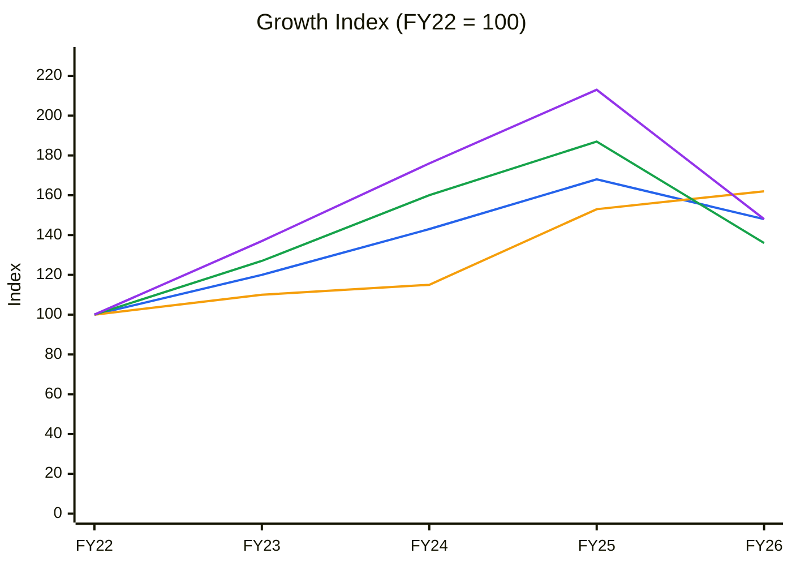
🟦 Revenue (CAGR 10.3%) · 🟧 Gross Block (12.9%) · 🟩 EBITDA (8.1%) · 🟪 PAT (10.3%)
**Read:** Until FY24 revenue (143) outran the asset base (115) and profits outran revenue; the FY25 capex jump (Unit III/injectables, gross block +33%) then put gross block (162) above revenue (148) in FY26 and EBITDA (136) below revenue.

**Business inference:** The FY24–26 plants were built ahead of demand and have so far earned roughly their cost of capital (ΔNOPAT ₹55 Cr on ~₹436 Cr extra invested capital ≈ 13% incremental ROIC); value creation now depends entirely on filling them — the operating-leverage thesis, not new capex, is what must be proven (→ Module 10A).

---

## BUSINESS PRIMER

Concord Biotech makes active pharmaceutical ingredients (APIs) by **fermentation** — growing selected microbial strains in large bioreactors and purifying the molecule they produce — a slower, know-how-heavy process that few companies globally run at scale. Its core franchise is **immunosuppressants** (tacrolimus, mycophenolate, cyclosporine, sirolimus and others used to prevent organ-transplant rejection), with growing **oncology** and **anti-infective/antifungal** lines (30+ fermentation APIs, Q1 FY27 PPT), plus a **formulations** arm (tablets, capsules, softgels and, since FY25, injectables) that was 21% of FY26 revenue. Customers are generic drug makers (and two innovators since FY26) in 70+ countries; FY26 revenue was 53% domestic / 47% export (US only 10%), top-10 customers 37.6%. Revenue is volume × realisation on niche molecules, earned out of ~1,250 m³ of fermentation capacity at Dholka (Unit I) and Limbasi (Unit III) and formulation/injectable plants at Valthera. The business depends on two things: process/cost leadership in fermentation (strain and yield know-how that underpins ~79% gross margins) and a steady pipeline of 2–3 new molecules a year to offset maturing older ones.

This is a **niche, high-margin manufacturing compounder with a heavy working-capital footprint**: pharma-like gross economics, manufacturing-like fixed assets, and an unusually long cash cycle (inventory ₹326 Cr + receivables ₹460 Cr ≈ 75% of FY26 revenue, because fermentation batches and regulatory dispatch take months). The value driver is **utilisation and mix** — Unit III runs at ~55% (partly on in-house key starting materials) and the injectable plant at ~5%, which is why FY26 EBITDA margin fell to 35% (39% ex-injectables/Stellon) from 42%. Key risks are lumpy, regulator-gated demand (FY26 saw CDSCO written-confirmation delays block EU sales for ~3 months), management's recurrent timing optimism, US tariff policy on generics, and a valuation that already discounts the recovery. A ₹442 Cr liquid treasury and a 1:1 bonus (Sep-2026) are capital-structure details, not value drivers.

---

## New Segment Protocol
**Segment: Pharmaceuticals (fermentation API + formulations) — KPI reference available ✓** (`references/05-industry-kpis-india.md`, header line 201). The block is formulation/US-generics oriented; for an API maker the US-revenue and formulation-mix KPIs are read with that caveat (see Module 6). Proceeding to Module 1.

---

## Module 1 — Market, Sector & Stock Cycle

### Module 1 — Broad Market (Marks)
| Indicator (09-Oct-2026, NSE) | Value | Read |
|---|---|---|
| Nifty 50 | 22,520 (52-wk 22,180–26,373) | 1 yr −10.6%, 30 d −3.9%; ~1.5% above 52-wk low |
| Nifty 50 P/E | 19.3× | Below its own recent range — de-rated |
| India VIX | 14.4 (+20% in 30 d) | Rising but not panicked |
| Nifty Midcap 150 / Smallcap 250 | 1 yr −0.2% / +3.3% | Broader market flat |
| Policy rates | RBI hiked 25 bps in Oct-2026; another hike expected Dec-2026 (ICRA research headline, 7-Oct-2026) | Tightening cycle — raises discount rates |

**Assessment: Cautious-to-Fearful.** The pendulum has swung from optimism (old report) toward fear: index in a downtrend, rates rising. Sizing implication: normal sizing is fine for genuinely cheap names, but a rate-hiking cycle argues for a higher WACC (raised to 11.5% from ~11%).

### Module 1b — Sector Cycle
**Nifty Pharma 25,962 (52-wk 21,150–27,255), +18.4% in 1 yr, −2.7% in 30 d, P/E 40.2× (NSE)** — pharma is the market's defensive leader: a sector tailwind in price, but sector multiples are now rich.
- **Secular vs cyclical decomposition:** Global fermentation API market projected at **7–10% CAGR** (Spherical Insights, cited AR FY26 p.~10). Concord's durable structural growth = market 7–10% + share gains / new molecules / CDMO / injectables ≈ **12–15%**. FY25's +18% and Q1 FY27's +26% contain a cyclical/timing component (FY26 deferrals spilling over, per Q1 FY27 call) and an FX component (~10% INR depreciation vs 3–4% normal). **Do not embed >15% in the mid-period DCF.**
- **Input costs:** ~20% of costs are power & fuel; ~10% LPG/furnace-oil based — fuel prices spiked in Apr-2026 (supply restrictions) and remain elevated; solar captive power to add 1–1.5% to EBITDA (Q4 FY26 call). Net: mild headwind offset by renewables.
- **Inventory cycle:** Customers shifted from bulk to staggered quarterly buying in H2 FY26 (Q4 FY26 call) → lower peak-quarter lumpiness ahead, but Concord's own inventory rose 36% to ₹326 Cr; management expects it to unwind in H1 FY27 (verify in Q2).
- **Competitive capacity:** Fermentation capacity is not being added aggressively by peers that we can verify; Concord itself needs no capex until Unit III reaches 80–85% (Q1 FY27 call). No visible supply flood.
- **Geopolitics/FX:** US tariffs — generics exempted (Sep-2025 clarification) but a mooted 100% generic tariff "2 years from now" was raised on the Q1 FY27 call (management: no customer concern yet); US is only 10% of revenue, but US-bound volumes via customers are larger. Middle East exposure ~₹50 Cr; ₹25 Cr tender still in abeyance (Q4 FY26 call). FX: net exporter — INR weakness is a tailwind (~+3–5% to EBITDA in Q1 FY27). Classification: **transient** (re-routable) → no extra MoS.

**Sector cycle verdict: Tailwind (structural) with stretched sector valuations.** CY5/CY6 (industry capacity vs demand, spread) are not charted — no reliable industry capacity series exists for fermentation APIs (data gap).

### Module 1c — Stock Cycle

**Quarterly revenue and EBITDA (₹ Cr, Screener consolidated)**
| Quarter | Q2FY25 | Q3FY25 | Q4FY25 | Q1FY26 | Q2FY26 | Q3FY26 | Q4FY26 | Q1FY27 |
|---|---|---|---|---|---|---|---|---|
| Revenue | 310 | 244 | 430 | 204 | 247 | 278 | 326 | 257 |
| Revenue YoY % | 18.3 | 1.2 | 34.8 | −5.6 | −20.3 | 13.9 | −24.2 | 26.0 |
| EBITDA | 134 | 98 | 189 | 61 | 88 | 98 | 118 | 82 |
| EBITDA YoY % | 15.5 | −7.5 | 43.2 | −24.7 | −34.3 | 0.0 | −37.6 | 34.4 |
| OPM % | 43 | 40 | 44 | 30 | 36 | 35 | 36 | 32 |

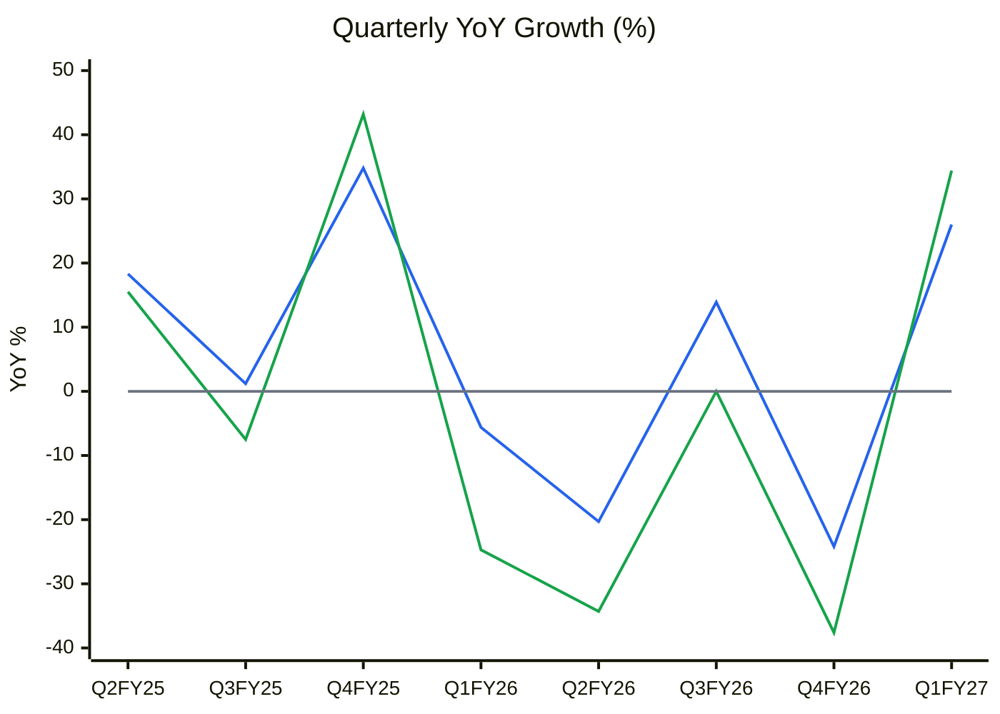
🟦 Revenue YoY % · 🟩 EBITDA YoY % · ⬜ zero line
**Read:** Growth whipsaws between +35% and −24% quarter to quarter; Q1 FY27 is the first quarter since Q4 FY25 where both revenue (+26%) and EBITDA (+34%) grew strongly, against an easy base (Q1 FY26 was −6%).

**Business inference:** Concord is a lumpy, regulator- and customer-timing-driven business — single quarters say little, and Q1 FY27 is flattered by a weak base, FY26 spillovers and FX; the test is whether H1 FY27 grows ≥18% *and* the Q4 FY27 comparison (vs ₹326 Cr) holds. Re-acceleration is real but unconfirmed → early-cycle, not yet an earnings-upgrade cycle.

- **Volume/price/mix:** FY26 had **no price growth — all volume** (Q4 FY26 call). Q1 FY27 wallet-share gains were "**primarily driven by pricing**" — Concord used its scale cost advantage to undercut competitors on existing products (Q1 FY27 call), while gross margin still rose 100 bps to 78.9%. Mix: oncology and anti-infectives growing much faster than immunosuppressants. Driver going forward: volume + mix, with price used as a weapon (durable only while the cost lead lasts).
- **Physical capacity:** Unit I (450 m³) ~80%; Unit III (800 m³) ~55% incl. in-house KSMs (ex-KSM "slightly higher than 20–25%"); Unit II formulations ~25%; injectables (13 Mn vials + 12 Mn dry powder + 2,200 kg lyo) ~5% — capacity ~₹600 Cr revenue (Q1 FY27 call). Management: total infrastructure supports ~₹3,000 Cr (≈₹2,200–2,300 Cr API + ₹600–700 Cr formulations) "in 5 to 6 years". **Capacity ceiling year:** at ~14% growth, Unit III reaches 80–85% around FY30 → next capex decision then.
- **Operating leverage:** Fixed-cost-heavy (injectable plant alone carries ~₹38–39 Cr/yr of costs, Q4 FY26 call). DOL ≈ contribution margin / EBIT margin ≈ 0.79 GM / 0.28 EBIT ≈ **2.8×** (a 10% revenue miss ≈ 28% EBIT miss); DFL = 1.0 (no debt).
- **Guidance accuracy (Module 3D):** 0.55 → haircut guidance 20–30%.
- **FCF inflection:** already passed — FCF positive every year since FY22 (₹52→101→180→134→172 Cr).
- **Classification: Early cycle / ramp-up (recovery from a trough in margin and ROCE).** Supported by CY7 (margin 35% and ROCE 17% both ~1SD below their FY20–26 averages). Standard MoS, normal sizing if price and thesis align.

---

## Module 2 — Industry Structure & Moat

**Porter Five Forces — fermentation APIs:**
| Force | Assessment | Evidence |
|---|---|---|
| New entrants | **Low** | Multi-year strain/yield know-how, large fermentation capex and regulatory filings (150+ DMFs, Q1 FY27 PPT); few global scale players |
| Supplier power | Low–Moderate | Inputs are media/fuel; fuel spike Apr-2026 showed energy exposure |
| Buyer power | Moderate | Generic makers dual-source, but switching an API in a filed DMF/ANDA is slow; top-10 only 37.6% |
| Substitutes | Low | Small-molecule immunosuppressants/oncology APIs have no direct biological substitute |
| Rivalry | Low in immunosuppressants, higher in oncology/anti-infectives | Concord competes on price from a cost lead (Q1 FY27 call) |
**Industry verdict: Structurally attractive (niche).**

**Capital cycle:** Concord's own capex/depreciation fell from ~5× in FY25 (₹111 Cr cash capex vs ₹54 Cr D&A) to ~1.3× in FY26 (₹95 Cr vs ₹74 Cr) and guided maintenance-only (₹30–40 Cr) — supply discipline. Peer capex (Divi's, Laurus, Anthem) is heavy but mostly in custom synthesis/CDMO, not fermentation APIs. **Position: mid-cycle, no capacity flood visible in the niche.**

**Greenwald barriers:** (1) **Supply/cost advantage — YES**: gross margin 74–79% (FY25–Q1 FY27), and Concord can undercut competitors' prices while keeping margins (Q1 FY27 call; Q1 FY26 call: a product launched at ~25% below a $350–400 market price). (2) **Customer captivity — PARTIAL**: DMF/ANDA qualification creates switching friction; top-10 share falling (diversifying). (3) Local scale — N/A. **Buffett 10% price test:** largely yes in core immunosuppressants, but management currently chooses share over price. **Moat: Narrow-to-Wide** — real in immunosuppressants, narrower in newer molecules.

**Market share stability:** no independent 5–10-yr share series (data gap); the falling top-10 concentration (48%→38%) while revenue doubled FY21→FY25 implies broadening, not loss, of share.

**Fisher 15-point (1–3 each):**
| # | Point | Score | Note |
|---|---|---|---|
| 1 | Market potential | 3 | Fermentation API market 7–10% CAGR + adjacencies |
| 2 | New products | 3 | 2–3 launches/yr; 8–10 pipeline molecules (Q1 FY27 call) |
| 3 | R&D effectiveness | 2 | R&D only 2.8% of sales (₹29 Cr FY26) but high conversion (nystatin, fusidic acid) |
| 4 | Sales organisation | 2 | B2B; Stellon US front-end just started |
| 5 | Profit margin | 3 | 79% gross / 32–42% EBITDA |
| 6 | Margin improvement | 2 | Renewables, operating leverage; but price used to win share |
| 7 | Labour relations | 2 | No issues found; Labour Code exceptional item ₹3.3 Cr |
| 8 | Executive relations | 2 | CFO changed in FY26 (Lalit Sethi → Raviraj Karia, Note 39) |
| 9 | Management depth | 2 | Founder-led (Sudhir & Ankur Vaid); bench thin publicly |
| 10 | Cost/accounting controls | 3 | BSR & Co. (KPMG network), unmodified opinion |
| 11 | Industry advantages | 3 | Few global fermentation players |
| 12 | Long-range orientation | 3 | Built capacity ahead of demand |
| 13 | Dilution | 3 | No equity raised; bonus only |
| 14 | Candor in adversity | 2 | Explained FY26 openly but repeatedly over-promised timing |
| 15 | **Integrity** | 3 | **PASS** — 0 pledge, modest RPTs, clean audit |
| | **Total** | **38/45** | No veto |

---

## Module 3 — Management & Capital Allocation

**Promoter Holding:** 44.08% (unchanged 12 quarters) | **Pledge: 0%** of promoter holding (Jun-2026 SHP) → Risk: **Normal**
**FII / DII:** FII 9.35% (Mar-25) → 7.53% (Jun-26), DII 9.16% → 9.37% — institutions trimming, not adding.
**Insider trades:** No SEBI PIT disclosures on NSE for CONCORDBIO from Jan-2025 to Oct-2026 → **NEUTRAL** (no buying into the dip, no selling).
**Share count:** Stable at 10.46 Cr since IPO (IPO was 100% OFS by Helix/Quadria); 1:1 bonus pending (capitalising ₹10.46 Cr of share premium).
**Capital allocation:** FY26 CFO ₹267 Cr → capex ₹95 Cr, dividend ₹112 Cr, rest to treasury. Payout 25–30%; FY26 DPS ₹7.55 (down from ₹10.70 with EPS). Management is now "exploring inorganic options in fermentation adjacencies" (peptides, veterinary) for the ₹442 Cr cash pile (Q1 FY27 call) — an unproven new risk/option. Small strategic stake in **Palvella Therapeutics (US, 0.31%)** marked up to ₹84 Cr via OCI (+₹67 Cr in FY26) — not in P&L.
**Capital allocation rating: Good** (no debt, no dilution, rising payout over time) — but the FY24–26 capex has so far returned only ~WACC (see C1 inference).

**RPTs (AR FY26 Note 39):** KMP remuneration ₹14.1 Cr incl. relatives (Sudhir Vaid ₹7.1 Cr, Ankur Vaid ₹3.9 Cr) = 5.4% of PAT (<10% threshold); rent to promoters ₹2.0 Cr; sales to Japan JV ₹29 Cr; tiny ₹1.2 lakh stake in Celliimune Biotech bought from director Ravi Kapoor. No ICDs, no guarantees. **No material RPT concern.**
**Buffett Three C's:** Candor **Moderate** (explains setbacks, but timing promises keep slipping); Competence **High**; Caring **Moderate-High** (rising payout, zero pledge).

### Walk the Talk Scorecard
| Quarter guided | Statement | Guided | Actual | Verdict |
|---|---|---|---|---|
| Q1 FY26 call (Aug-25) | Injectable unit to break even by end-FY26 ("I would hope so") | FY26 | Still ~5% utilised; ~₹38–39 Cr annual cost (Q4 FY26/Q1 FY27 calls) | ❌ Miss |
| Q1 FY26 call | Gross margins stable | Stable | FY26 GM 76.7% vs 74.5% FY25 (AR P&L) | ✅ Hit |
| Q2 FY26 call (Nov-25) | "Stronger performance in H2"; deferred revenue recovered | H2 growth | H2 FY26 ₹604 Cr vs H2 FY25 ₹674 Cr (−10%) | ❌ Miss |
| Q2 FY26 call | FY26 disruptions are timing, revenue not lost | Recovery | Q1 FY27 +26%, partly spillover (Q1 FY27 call); FY26 −12% | ⚠️ Near miss |
| Q3 FY26 call (Feb-26) | Capex is maintenance, ~₹30–40 Cr | ₹30–40 Cr | FY26 capex ₹65 Cr (mgmt) / ₹95 Cr cash (CFS) | ❌ Miss |
| Q3 FY26 call | FY27 to grow at least at historical CAGR (~18%) | ≥18% | Q1 FY27 +26% (1 of 4 quarters) | ✅ Hit (so far) |
| Q4 FY26 call (Jun-26) | Strong H1 FY27 visibility | Growth in H1 | Q1 FY27 +26% | ✅ Hit (so far) |
| Q4 FY26 call | Stellon US supplies in H1 FY27 | H1 FY27 | Commercial sales started Q1 FY27 (PPT) | ✅ Hit |
| FY25-era | 40% EBITDA margin in FY26–27 | FY26–27 | 35% FY26; now "towards FY28" (Q1 FY27 call) | 🔴 Reversal/reframed |
| Ongoing | 2–3 product launches a year | 2–3 | Nystatin, fusidic acid; ANDAs mycophenolate, tofacitinib | ✅ Hit |

**WTT Score: 0.55 / 1.00 — LOW**
**Guidance points assessed:** 10 | Hits: 5 | Near Misses: 1 | Misses: 3 | Reversals: 1
**Key pattern:** **Timing optimism** — every dated promise (injectable breakeven, H2 recovery, 40% margin, capex) slipped; product/regulatory delivery is reliable. Also a narrative-vs-numbers gap: management cites "historical growth ~18%" (true for FY20→FY25: 512→1,200) while its own AR states a **10.3% FY22–26 revenue CAGR**.
**Insider action:** None — NEUTRAL.
**DCF impact:** Management's ₹3,000 Cr in 5–6 yrs (≈19–20% CAGR) haircut ~30% → base 14%; 40% margin pushed to FY29 in base, never reached in bear.
**Overall management credibility:** MODERATE (integrity high, forecasting low).

---

## Module 4 — Financial Forensics

| Model | FY26 reading | Verdict |
|---|---|---|
| Beneish M-Score | DSRI 1.00, GMI 0.97, AQI 1.68 (CWIP + Palvella/NC investments), SGI 0.88, DEPI 0.74, SGAI 1.34, LVGI 0.90, TATA −0.004 → **M = −2.40** | Unlikely manipulator (< −2.22) |
| Altman Z'' | X1 0.48, X2 0.85, X3 0.15, X4 9.2 → **16.6** | Safe |
| Piotroski F | ROA>0 ✓, CFO>0 ✓, ΔROA ✗, CFO>NI ✓, lower leverage ✓, higher current ratio ✓ (7.4 vs 6.2), no dilution ✓, higher GM ✓, ΔAT ✗ → **7/9** | Strong |
| Sloan accrual | (259 − 267 + 143) / avg TA 2,134 = **+6.3%** (inflated by treasury purchases in CFI) | Acceptable (<10%) |
*Inputs: AR FY26 consolidated BS/P&L/CFS; FY25 comparatives from same.*

**Indian-specific flags:** Pledge 0% ✓ · RPTs modest, arm's-length per auditor ✓ · Auditor BSR & Co. LLP, **unmodified opinion**, KAM = revenue recognition (timing of dispatch-based recognition — relevant given quarter-end lumpiness) ✓ · No auditor change (re-appointed to FY29) ✓ · No ICDs/guarantees ✓.

**Schilit screen:** (1) Revenue too soon — DSO flat at 159 d, receivables fell ₹61 Cr, cash collections strong → clean. (3) One-time boosts — **other income ₹52 Cr = 15% of EBIT** (incl. ₹11.5 Cr gains on investment sales, ₹9.6 Cr fair-value gains, ₹10.9 Cr unrealised FX) → borderline flag. (4) Capitalising expenses — capex/depreciation 1.3× → clean. Others clean.

**The genuine watch item — inventory:** ₹240 Cr → ₹326 Cr (+36%) while revenue fell 12% (Screener inventory days 286 → 485). Management: it is API (long shelf life), aimed at identified new-customer demand, and will unwind in H1 FY27; no formulation inventory held for the Middle East (Q4 FY26 call). Verify in the Sep-2026 balance sheet (Q2 FY27).

**Forensic red-flag count: 2 / 15 (inventory build; other income ~15% of EBIT) — Clean, with a working-capital watch item.**

---

## Module 5 — Earnings Quality & Financial Statements

**Restated P&L (₹ Cr, Screener consolidated; FY26 cross-checked to AR)**
| FY | Sales | EBITDA | OPM % | Other inc. | D&A | PAT | EPS (₹) | CFO | FCF |
|---|---|---|---|---|---|---|---|---|---|
| FY20 | 512 | 205 | 40 | 32 | 21 | 169 | — | 155 | −1 |
| FY21 | 616 | 327 | 53* | 14 | 28 | 235 | — | 167 | −38 |
| FY22 | 713 | 270 | 38 | 23 | 50 | 175 | — | 207 | 52 |
| FY23 | 853 | 344 | 40 | 37 | 54 | 240 | 22.95 | 246 | 101 |
| FY24 | 1,017 | 432 | 42 | 37 | 54 | 308 | 29.45 | 265 | 180 |
| FY25 | 1,200 | 506 | 42 | 44 | 54 | 372 | 35.52 | 245 | 134 |
| FY26 | 1,055 | 368 | 35 | 52 | 74 | 259 | 24.94 | 267 | 172 |
| TTM (Jun-26) | 1,108 | 388 | 35 | 52 | 75 | 273 | 26.32 | — | — |
*FY21 COVID demand spike. Pre-FY23 EPS not comparable (pre-split). FY26 AR EPS (owners) ₹24.78 — Screener ₹24.94 includes NCI loss of Stellon.*

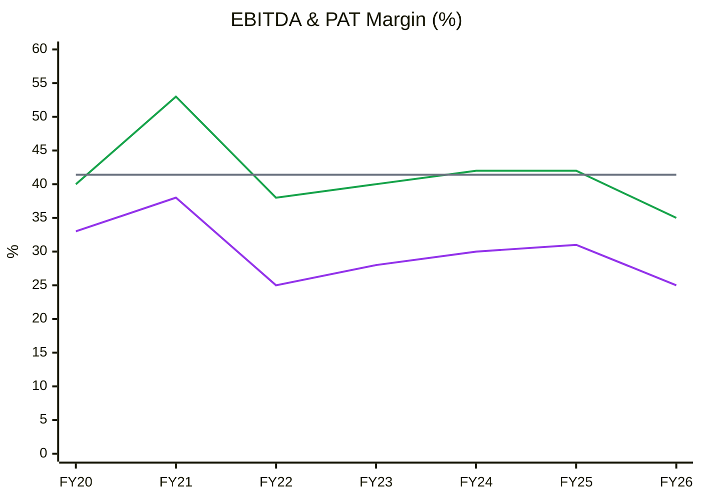
🟩 EBITDA margin · 🟪 PAT margin · ⬜ FY20–26 average EBITDA margin 41.4% *(gross margin not charted: only FY25–26 computed — 74.5% / 76.7%)*
**Read:** EBITDA margin held a tight 38–42% band in every normal year; FY26's 35% is the lowest in the 7-year record, ~1SD (≈5pp incl. FY21) below average, while PAT margin fell to 25%.

**Business inference:** The FY26 drop came from fixed costs of the injectable plant and Stellon (₹~45 Cr) on lower sales, not from price erosion (gross margin actually rose) — this is under-absorption, which reverses with volume; the risk is only that the reversal takes longer than guided (Module 3D).

**ROIC (post-tax, ex-treasury and other income; WACC 11.5%)**
| FY | EBIT ex-OI | NOPAT | Invested capital (equity + debt − investments) | ROIC | Pre-tax ROCE (Screener) |
|---|---|---|---|---|---|
| FY20 | 183 | 145 | 624 | 23% | — |
| FY21 | 300 | 225 | 945 | 24% | 32% |
| FY22 | 221 | 164 | 1,092 | 15% | 21% |
| FY23 | 290 | 218 | 1,185 | 18% | 26% |
| FY24 | 379 | 284 | 1,290 | 22% | 28% |
| FY25 | 452 | 339 | 1,480 | 23% | 28% |
| FY26 | 294 | 220 | 1,528 | 14% | 17% |

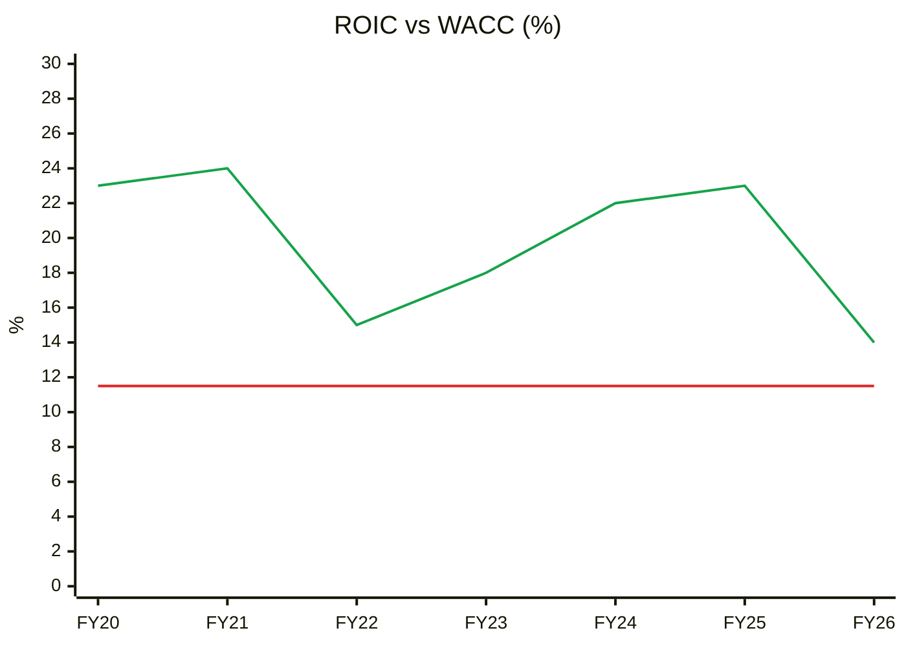
🟩 ROIC · 🟥 WACC 11.5%
**Read:** ROIC stayed above WACC every year (range 14–24%, avg 20%); FY26's 14% is the low, with the spread compressed to ~+3pp.

**Business inference:** The moat shows in a positive spread even in the worst year — but the spread is now thin enough that the stock's value hinges on ROIC returning to the 20%+ range, which requires the new capacity to fill; at today's ROIC the business earns barely above its cost of capital on the incremental FY24–26 investment.

**Earnings quality — cumulative PAT vs CFO (₹ Cr)**
| | FY20 | FY21 | FY22 | FY23 | FY24 | FY25 | FY26 |
|---|---|---|---|---|---|---|---|
| Cum. PAT | 169 | 404 | 579 | 819 | 1,127 | 1,499 | 1,758 |
| Cum. CFO | 155 | 322 | 529 | 775 | 1,040 | 1,285 | 1,552 |

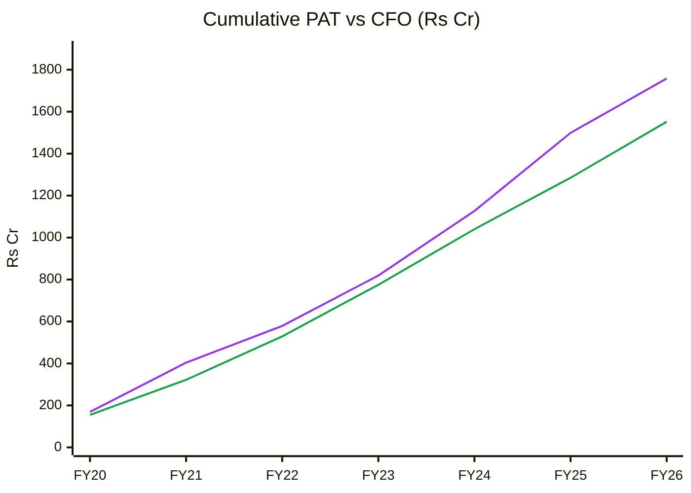
🟪 Cumulative PAT · 🟩 Cumulative CFO
**Read:** Cumulative CFO/PAT = 0.88 over FY20–26 and 0.91 over FY22–26 (≥0.85 healthy); the gap widened in FY25 (receivables +₹171 Cr) and narrowed in FY26.

**Business inference:** Profits convert to cash, but with a lag driven by the long fermentation/regulatory cycle — the business needs ~₹0.65 of working capital per ₹1 of new revenue, which caps FCF during growth and is the main reason FCF trails PAT.

### DuPont Decomposition (5-Factor, year-end balances)
| Year | EBIT Margin | Asset Turnover | Equity Multiplier | Interest Burden | Tax Burden | ROE |
|---|---|---|---|---|---|---|
| FY22 | 34.2% | 0.54× | 1.19× | 0.975 | 0.735 | 15.9% |
| FY23 | 38.3% | 0.56× | 1.17× | 0.985 | 0.745 | 18.6% |
| FY24 | 40.9% | 0.60× | 1.11× | 0.993 | 0.746 | 20.2% |
| FY25 | 41.3% | 0.59× | 1.12× | 0.998 | 0.752 | 20.5% |
| FY26 | 32.8% | 0.47× | 1.11× | 0.997 | 0.751 | 12.8% |
| **Change FY22→26** | −1.4pp | −0.07× | −0.08× | +0.02 | +0.02 | **−3.1pp** |
*EBIT incl. other income; assets incl. ~₹490 Cr investments, which depress AT.*

**Operating contribution (EBIT margin × AT):** Declined sharply in FY26 (0.244 → 0.155) after improving FY22–25.
**Financing contribution:** Falling (EM 1.19 → 1.11) — leverage is not masking anything.
**DuPont verdict:** The FY26 ROE fall (20.5% → 12.8%) is **entirely operational** — margin and asset turnover both fell as new assets sat idle; balance sheet is getting *less* leveraged.
**Peer DuPont:** Divi's (ROE 16.5%, no debt) and Anthem (22.3%) earn their ROE operationally; Laurus (18.3%) uses ₹2,518 Cr of debt. Concord's ROE quality matches the best, but its level is currently the lowest.
**AT trend → Module 10A:** gross-block AT 1.26× (FY24 peak) → 0.92× (FY26); base case assumes recovery to ~1.20× by FY29.

**Ind AS 116:** lease liabilities ₹2.3 Cr — immaterial.
**O'Glove flags: 2/15** (inventory days rising; other income ≈15% of EBIT). **Key accounting concern:** none beyond inventory.

### Cycle charts — margin & ROCE vs average (CY7)
| | FY21 | FY22 | FY23 | FY24 | FY25 | FY26 |
|---|---|---|---|---|---|---|
| ROCE % (Screener) | 32 | 21 | 26 | 28 | 28 | 17 |

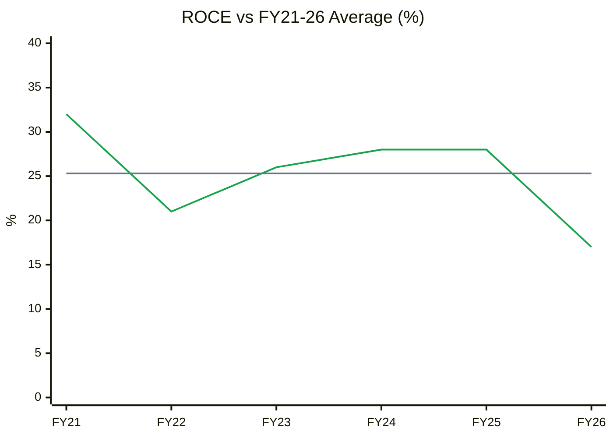
🟩 ROCE · ⬜ average 25.3% (SD ≈ 4.9pp)
**Read:** ROCE 17% is ~1.7 SD below its 6-yr average (25.3%) — 0th percentile of the record; EBITDA margin 35% is similarly ~1 SD below its 41% average.

**Business inference:** On returns, Concord is at a trough, not a peak — which supports an "early-cycle recovery" classification and means trailing P/E overstates how expensive the business is on normalised earnings; but it trades at a mid-range P/E despite trough earnings, so the recovery is already being paid for.

---

## Module 6 — Industry KPIs & Peer Analysis
**Sector:** Pharmaceuticals (fermentation API) — KPI block line 201.

| KPI (reference block) | Concord | Healthy range | Assessment |
|---|---|---|---|
| US revenue growth / % of total | US ₹108 Cr, **10%** of FY26, **−22% YoY** (₹138 Cr FY25; AR Note 40) | 30–55% (formulation cos.) | Below — but Concord is an API supplier whose US exposure is indirect via customers; Stellon just started |
| EBITDA margin | 35% FY26 / 32% Q1 FY27 (37% ex-injectables/Stellon); 42% FY24–25 | 22–30% | **Above** range |
| ANDA pipeline | 7 ANDAs approved; mycophenolate & tofacitinib approved Q1 FY27; 150+ DMFs | >100 pending (large caps) | Small but appropriate for an API player |
| R&D / revenue | 2.8% (₹29 Cr FY26, Q1 FY27 PPT) | 7–12% (US-focused) | Below — red-flag threshold (<4%) applies to formulation cos.; for a process-IP API maker it is low but productive |
| USFDA status | Unit I USFDA-inspected FY26; EU GMP, Russian GMP, ANVISA (Q1 FY27), WHO-GMP injectables; no warning letter/import alert found | None | ✅ Clean |
| API vs formulation mix | 79% / 21% | Formulations >60% (for formulation cos.) | N/A — API-led model by design |

**Peer comparison (Screener consolidated, 09-Oct-2026 prices; FY26 financials)**
| Metric | Concord | Divi's Labs | Laurus Labs | Anthem Biosciences | Gland Pharma |
|---|---|---|---|---|---|
| Business | Fermentation API + formulations | API / custom synthesis | API + CDMO + FDF | CRDMO incl. fermentation | Injectables CDMO |
| Revenue FY26 (₹ Cr) | 1,055 | 10,560 | 6,813 | 2,124 | 6,431 |
| Revenue CAGR FY23–26 | 7.3% | 10.8% | 4.1% | 26.2% | 21.1% (acq.-aided) |
| EBITDA margin FY26 | 35% | 33% | 26% | 39% | 25% |
| ROCE FY26 | 17% | 22% | 18% | 30% | 15% |
| Net debt | Net cash ₹442 Cr | ~Nil debt | Debt ₹2,518 Cr | ~Nil | Debt ₹284 Cr |
| Inventory days | 485 | 311 | 285 | 167 | 294 |
| P/E (TTM) | **51.3×** | 83.2× | 101× | 81.9× | 44.1× |
| P/B | **7.1×** | 14.8× | 20.7× | 15.9× | 4.9× |

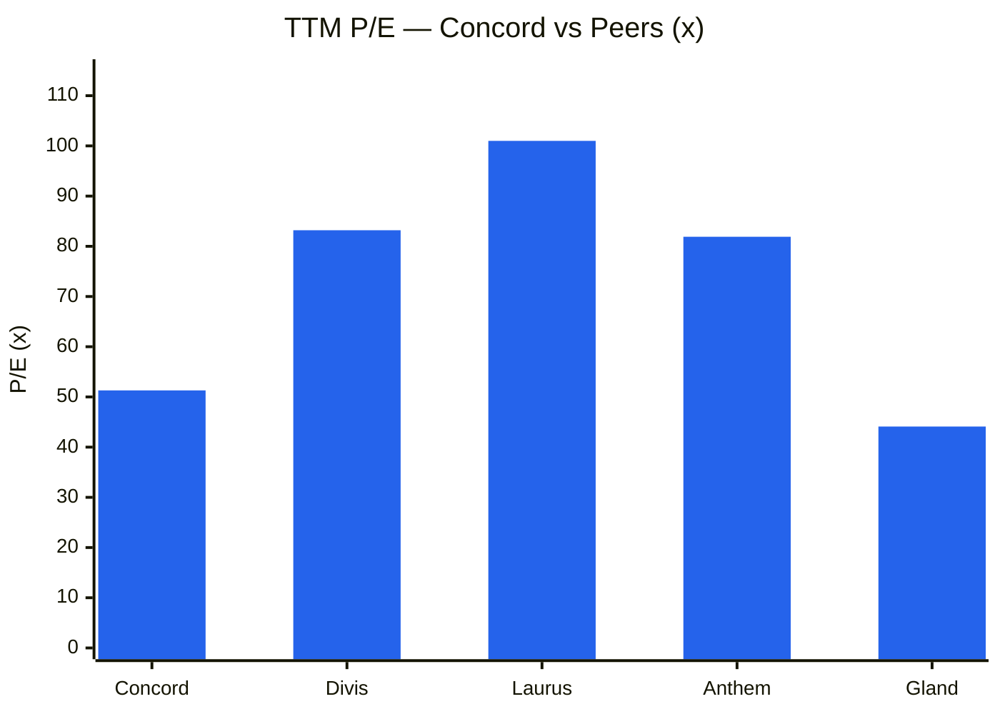
**Read:** Concord trades at 51× vs a peer median of 82× — a ~37% discount on P/E and ~54% on P/B, despite margins in line with the best (35% vs Divi's 33%, Anthem 39%).

**Business inference:** The discount reflects Concord's slower 3-year growth (7%), trough ROCE (17%) and lumpy history, while peers are being paid for CDMO/GLP-1 growth narratives; relative valuation now *supports* Concord — but the whole peer set is expensive, so "cheap vs peers" is not the same as cheap (Module 8 absolute test still fails).

**Peer positioning:** Discount to peers — **justified in part** (slower growth, trough returns), **excessive if** the FY27–28 recovery delivers. Sector-appropriate multiple: 35–45× normalised EPS (Nifty Pharma P/E 40.2×).
**Promoter capital structure adjustment:** not needed (no ICDs, guarantees or group leverage).
**Order Book Tracker:** Not applicable — Concord is not order-driven (no Reg 30 order filings; revenue is product supply against forecasts).

---

## Module 7 — Market Size & Market Share
**TAM:** Global fermentation-API market — company cites **7–10% CAGR for the next decade** (Spherical Insights, AR FY26); absolute size not re-sourced (⚠️ gap). Adjacent TAMs: generic injectables in India/EMs (injectable plant ≈ ₹600 Cr revenue capacity), fermentation CDMO (currently 1–2% of Concord's sales; target double-digit), US formulations via Stellon.
**Company penetration:** not computable without a sourced TAM value (gap).
**Market share:** "Leading global market share in immunosuppressants, oncology & anti-infectives" (AR FY26); management cites 30–40% world share in key molecule(s) with "another 40–50% to target" (Q1 FY26 call). ⚠️ No independent share series.
**Revenue vs market check:** Concord FY22–26 revenue CAGR 10.3% (AR) vs market 7–10% → roughly **growing with to slightly ahead of the market**; FY20–25 (18.6%) was well ahead. Share gains in Q1 FY27 were price-led (Q1 FY27 call) — structural only while the cost lead lasts.
**Verdict:** Taking share modestly in core; real upside from new molecules and adjacencies, none yet proven at scale.

---

## Module 8 — Valuation: PIE First, Then Intrinsic

### 8A. Price-Implied Expectations (Mauboussin)
EV = MCap ₹14,242 Cr − liquid treasury ₹442 Cr = **₹13,800 Cr** (Palvella stake ₹84 Cr ignored — conservative). TTM EV/EBITDA **35.6×**; EV / TTM NOPAT (₹235 Cr ex-other income) **~59×**.

Two-stage reverse DCF (WACC 11.5%; terminal growth 7%; NOPAT margin rising from 23.5% to 28% ≈ 40% EBITDA; incremental ROIC 40% since growth needs mainly working capital):

| PIE value driver | Market-implied | My base case | Expectations gap |
|---|---|---|---|
| Revenue CAGR (10-yr) | **~18.5%** (range 14–22% across WACC 11–12%, g 6–8%) | ~14% | **Optimistic (−4.5pp)** |
| Steady-state EBITDA margin | ~40% | ~37.5% | Optimistic |
| Investment rate | ~WC 65% of ΔRevenue, minimal capex | Same | In line |
| Margin-recovery timing | FY28 (management) | FY29 (WTT haircut) | Optimistic |

**Gap classification: Optimistic** — the price requires management's full plan (₹3,000 Cr in 5–6 yrs is ~19–20% CAGR); delivery earns only the cost of capital; outperformance needs *more* than guidance.
**Expectations treadmill:** To outperform, Concord must sustain ≥19% revenue growth *and* reach ≥40% EBITDA margin by FY28 — i.e., injectables + Stellon must ramp on schedule for the first time.
**Triggers:** Positive — a large innovator/CDMO contract; injectable third-party contracts in H2 FY27 (guided); inventory unwind + ≥18% H1 growth in Q2. Negative — Q2/Q3 growth <15% (would confirm Q1 as spillover); a US generic tariff; any regulatory delay (CDSCO/EU); a large, low-return acquisition with the cash.
**Physical plausibility:** PIE's ~18.5% CAGR is physically feasible (capacity supports ~₹3,000 Cr) — the disagreement is about **utilisation speed and pricing**, not capacity.
**SVAR:** Bear-case price ₹857 → SVAR = (1,361 − 857)/1,361 = **37%** (above the 30% sizing threshold; below the 40% hard limit).

### 8B. Intrinsic value
| Method | Bear | Base | Bull |
|---|---|---|---|
| DCF (WACC 11.5%, g 7%; 10-yr CAGR 9% / 14% / 18%; NOPAT margin 24% / 27% / 29%) | ₹618 | ₹964 | ₹1,363 |
| Relative (30× / 38× / 46× FY28E base EPS ₹35.0) | ₹1,050 | ₹1,330 | ₹1,610 |
| **Consensus range** | **₹835** | **₹1,150** | **₹1,485** |
| 2-yr scenario targets (Module 10, FY29E EPS × exit multiple) | ₹857 | ₹1,568 | ₹2,160 |

*DCF value per share includes ₹442 Cr cash. The previous report's DCF (₹950 / ₹1,300 / ₹1,750) is superseded — WACC raised 11%→11.5% (rate hikes), base CAGR made consistent with the scenario table.*

**Current price ₹1,361 vs consensus base ₹1,150 → ~18% premium; MoS negative.** Probability-weighted 2-yr value ₹1,538 → +13% (≈6% a year + 0.55% yield) — below the cost of equity.
**Upside/Downside (base vs bear): +₹207 / −₹504 → 0.41:1 — Unacceptable.**
**Graham number:** √(22.5 × 5-yr avg EPS ₹25.9 × BVPS ₹192.8) = **₹335**; Graham defensive screen fails on P/E (51×) and P/B (7.1×) and EPS growth.
**Misprice reason:** none supporting a buy — the market is not forced-selling; it is pricing a full recovery. The discount to peers is the one pocket of mispricing.
**Catalyst:** Q2 FY27 results (Nov-2026) and injectable third-party contracts (guided H2 FY27).

### Valuation band charts

**P/E band (weekly since listing, Screener; median 52.6×, SD 10.2)**
| | Oct-23 | Jan-24 | Apr-24 | Jul-24 | Oct-24 | Jan-25 | Apr-25 | Jul-25 | Oct-25 | Jan-26 | Apr-26 | Jul-26 | Oct-26 |
|---|---|---|---|---|---|---|---|---|---|---|---|---|---|
| P/E (×) | 50.3 | 63.0 | 53.6 | 59.4 | 63.3 | 72.0 | 53.0 | 50.8 | 48.7 | 40.1 | 32.2 | 57.2 | 51.3 |

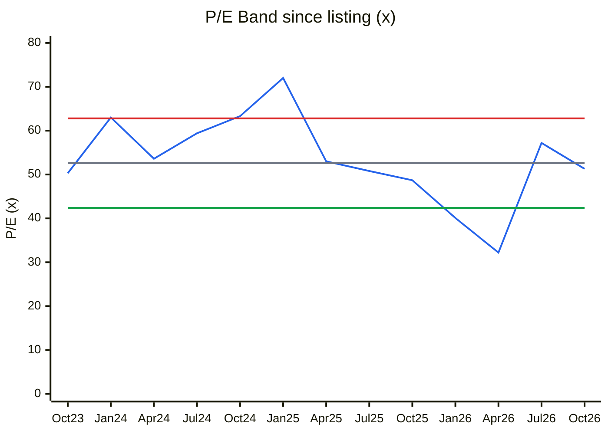
🟦 P/E · ⬜ Median 52.6× · 🟥 +1SD 62.8× · 🟩 −1SD 42.4× *(only 3 yrs of listed history — not a 10-yr band)*
**Read:** P/E 51.3× = 45th percentile of its 3-yr listed range (30.9–86.9×), near the median; the only time it was "cheap" was Mar–Apr 2026 (31–32×).

**Business inference:** On trough earnings a median P/E is not demanding — but the listed history is short and was set during an IPO-era premium; the April-2026 low (~31×) is the market's own estimate of "cheap" for this business, which anchors the buy zone.

**P/B band (price ÷ latest reported BVPS; median 10.1×, SD 2.6)**
| | Oct-23 | Jan-24 | Apr-24 | Jul-24 | Oct-24 | Jan-25 | Apr-25 | Jul-25 | Oct-25 | Jan-26 | Apr-26 | Jul-26 | Oct-26 |
|---|---|---|---|---|---|---|---|---|---|---|---|---|---|
| P/B (×) | 9.3 | 11.6 | 10.7 | 11.6 | 13.0 | 15.5 | 9.6 | 10.4 | 9.3 | 7.6 | 5.5 | 6.8 | 7.1 |

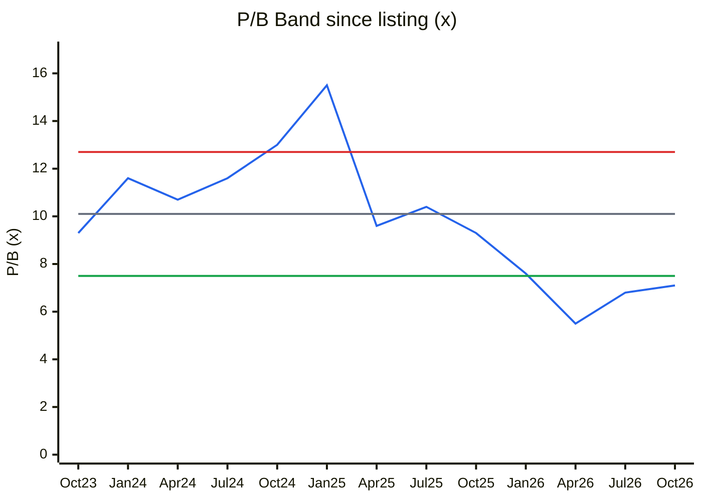
🟦 P/B · ⬜ Median 10.1× · 🟥 +1SD 12.7× · 🟩 −1SD 7.5× *(BVPS ₹123 / 146 / 173 / 193 for FY23–26)*
**Read:** P/B 7.1× = 17th percentile, below −1SD, while ROE has fallen to 12.5% (from ~21% FY24–25).

**Business inference:** P/B is cheap only if ROE returns toward 20%: justified P/B = (ROE − g)/(Ke − g) = (20 − 9)/(12 − 9) ≈ 3.7× even at a recovered 20% ROE and 9% long-run growth — the market is paying ~2× that, i.e. for a long growth runway, not for current returns.

**Price vs EPS index (FY24 = 100)**
| | Mar-24 (FY24) | Mar-25 (FY25) | Mar-26 (FY26) | Oct-26 (TTM) |
|---|---|---|---|---|
| Price (₹) | 1,520.8 | 1,680.6 | 1,014.8 | 1,361.4 |
| EPS (₹) | 29.45 | 35.52 | 24.94 | 26.32 |
| Price index | 100 | 111 | 67 | 90 |
| EPS index | 100 | 121 | 85 | 89 |

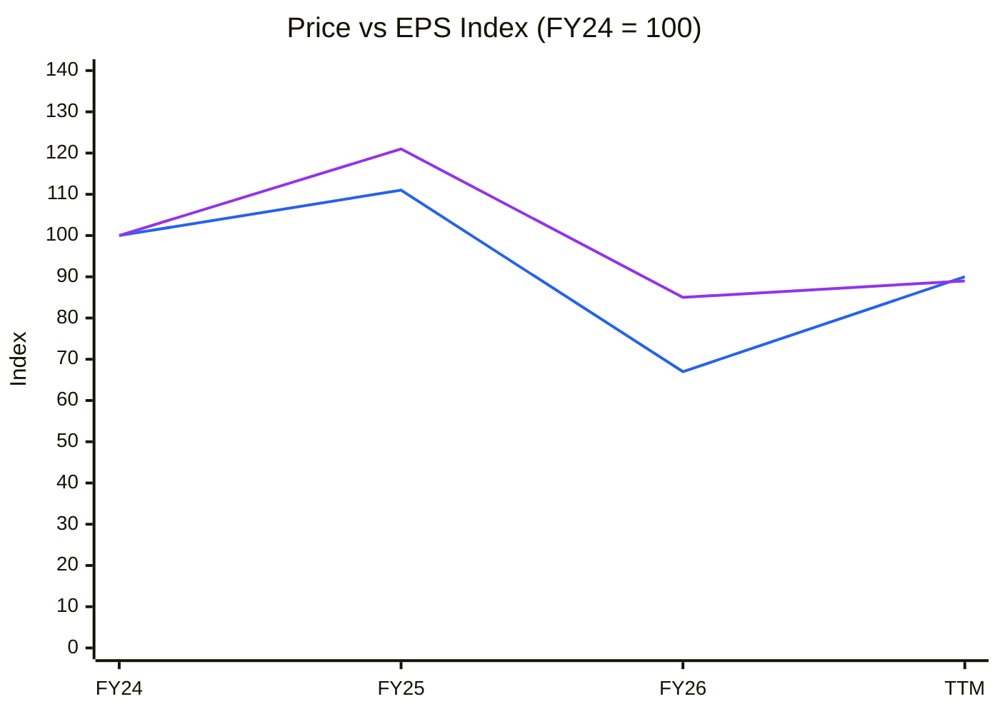
🟦 Price index · 🟪 EPS index
**Read:** Price (90) and EPS (89) are back in step after price undershot EPS at the March-2026 low (67 vs 85).

**Business inference:** Since FY24 the stock's return has been earnings-driven, with no net re-rating — the March-2026 overshoot was the opportunity; today's price neither borrows from nor discounts future earnings relative to FY24, so returns from here must come from EPS growth, i.e. execution.

### Cycle Position Dashboard
| Dimension | Current | Median (listed/FY20–26) | Percentile | Signal |
|---|---|---|---|---|
| P/E | 51.3× | 52.6× | 45% | Fair |
| P/B | 7.1× | 10.1× | 17% | Cheap vs own history |
| EBITDA margin | 35% (TTM) | 41% | ~10% | Trough |
| ROCE | 17% | 26% | 0% | Trough |
| Industry utilisation | n/a (no data) | — | — | — |
| Spread / realisation | Stable GM 77–79% | — | — | Stable |
| **Overall cycle position** | | | | **Early cycle / recovery from trough** |
*Consistent with Module 1b (structural tailwind) and 1c (early-cycle ramp-up).*

---

## Module 9 — Technical Stage (Weinstein)
| Item | Reading (weekly, Screener price API / NSE) |
|---|---|
| Nifty 50 stage | **Stage 4 (declining)** — 22,520, down from ~24,100–24,230 in Jun–Aug 2026 and 25,942 in Dec-2025; 1 yr −10.6%, near 52-wk low (index history partial — approximate) |
| Sector: Nifty Pharma | **Stage 2 with pullback** — +18.4% 1 yr, ~5% off 52-wk high |
| Stock stage | **Early Stage 2, pulling back** — 30-wk SMA turned up in Jul-2026 (₹1,196 → ₹1,273); price ₹1,361 is 7% above it |
| Breakout history | Base Mar–May 2026 (₹1,015–1,175) → breakout week of 5-Jun-2026 on 9.3 M shares (~6.7× 30-wk avg) after Q4 results; high weekly close ₹1,571 (21-Aug); 52-wk high ₹1,622 |
| Pullback | −13% from the August high on falling volume (last week 0.48 M vs 30-wk avg 1.39 M) — orderly |
| RS vs Nifty | 1 yr: −15.1% vs −10.6% (negative); 3 m: +4.3% vs ~−6% (positive, improving) |
| 50-DMA / 200-DMA | ₹1,418 / ₹1,365 — price just below both (short-term weakness) |
| Stop-loss reference | Weekly close below ~₹1,240 (30-wk SMA/July pivot zone) for a trader; thesis-level below ₹1,015 (March base) |
| Pivot for a new buy | Weekly close above ~₹1,620 on ≥1.5× average volume |

**CANSLIM: ~2/7** — C ✓ (Q1 EPS +33%), A ✗ (3-yr EPS CAGR ~3%, ROE 12.5%), N ½ (new products/injectables, but no new high), S ½ (bonus expands float), L ✗ (lags Divi's/Laurus near highs), I ✗ (FII 9.4%→7.5%), M ✗ (Nifty in downtrend).
**Stage + fundamental alignment:** Partly aligned — stock and sector constructive, market not; fundamentals say "wait for price", technicals say "wait for pivot or base retest". **Weinstein + CANSLIM → not a Strong Setup.**

---

## Module 10 — Forward View: 2–3 Year Thesis

**Thesis in one line:** *A debt-free fermentation leader at trough margins and returns, with idle capacity already paid for; if utilisation rises, operating leverage restores ~38–40% margins and 20%+ ROIC — but the price already assumes management's (repeatedly late) timetable.*

### Capex Classification (₹ Cr)
| Capex type | FY27E | FY28E | FY29E | In AT model? |
|---|---|---|---|---|
| Tangible growth capex | ~0 (no growth capex until Unit III 80–85%) | 0 | 0 | ✅ (nil) |
| Maintenance capex (≈ guidance ₹30–40 Cr; D&A ₹75–85 Cr) | 40 | 40 | 40 | ❌ sustains only |
| CWIP commissioning (₹78 Cr at Mar-26) | 78 → PPE | — | — | ❌ until capitalised |
| Intangibles | ~1 | ~1 | ~1 | ❌ |
| ROU (Ind AS 116) | immaterial | | | ⚠️ |
| **Total cash capex** | **~40** | **~40** | **~40** | |
*Growth capex = total − maintenance ≈ 0 → all revenue growth must come from utilisation, price and mix — appropriate here because idle capacity exists.*

### Tangible PPE Gross Block & Asset Turnover
| Year | Tangible PPE gross block (₹ Cr) | Revenue (₹ Cr) | AT (×) |
|---|---|---|---|
| FY22 | 706 | 713 | 1.01 |
| FY23 | 780 | 853 | 1.09 |
| FY24 | 810 | 1,017 | 1.26 |
| FY25 | 1,080 | 1,200 | 1.11 |
| FY26 | 1,146 | 1,055 | 0.92 |
| **5-yr avg AT** | | | **1.08** |
| **AT trend (DuPont)** | | | Declining (capex-led; cyclical, not structural) |
*Source: AR FY24/FY26 Note 5(A); TTM AT = 1,108/1,146 = 0.97×.*

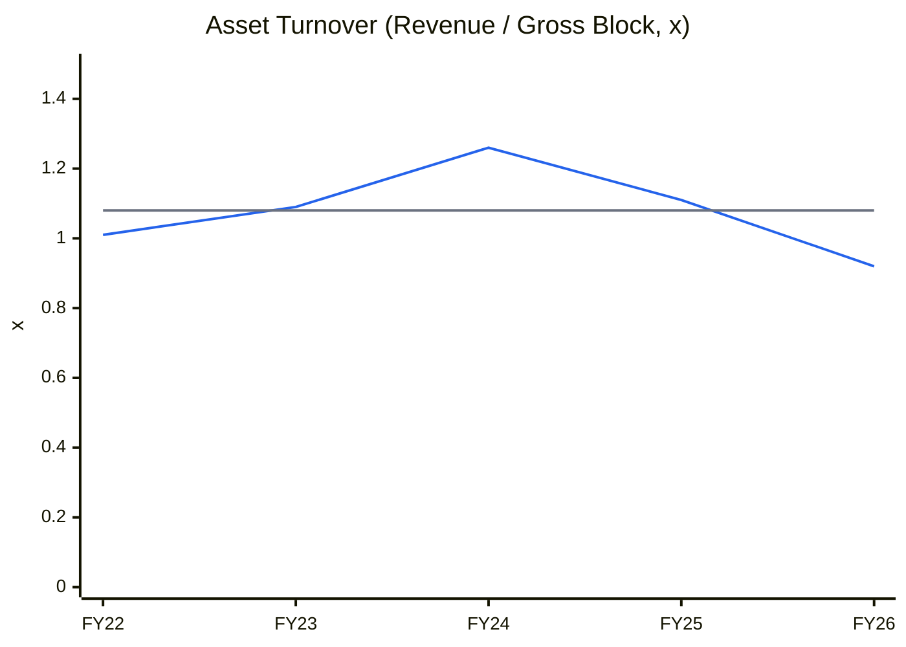
🟦 Asset turnover · ⬜ 5-yr average 1.08×
**Read:** AT rose to a 1.26× peak in FY24 as the FY21–22 assets filled, then fell to 0.92× after the FY25 block jump (+₹270 Cr).

**Business inference:** This is the same capex-then-ramp pattern as FY21–24 — the earlier cycle took ~3 years to lift AT from 1.0× to 1.26×; a repeat (AT back to ~1.2× by FY29) is the base case, and management's ₹3,000 Cr plan implies an AT of ~2.3×, far beyond anything delivered so far.

**Incremental ROIC:** Forward growth needs no growth capex — only working capital (~65% of ΔRevenue). Base case ΔRevenue FY26→FY29 ₹495 Cr × 65% ≈ ₹322 Cr WC + ~₹0 growth capex; ΔNOPAT = (496 − 294) × 0.75 ≈ ₹152 Cr → **incremental ROIC ≈ 47% vs WACC 11.5% → Value-creating** (because the FY24–26 plants, which earned only ~13% so far, are sunk).
**Capex-model implied revenue CAGR (base):** **13.9%** (FY26 ₹1,055 Cr → FY29E ₹1,550 Cr at AT 1.20×) vs PIE-implied ~18.5% → **market prices utilisation faster than our base** (capacity is there; the gap is speed, not "unannounced expansion").

### Capex-to-Earnings Model (Base case; ₹ Cr unless stated)
| Metric | FY27E | FY28E | FY29E |
|---|---|---|---|
| Opening tangible PPE gross block | 1,146 | 1,216 | 1,256 |
| Additions (CWIP transfer + maintenance) | 70 | 40 | 40 |
| Closing gross block | 1,216 | 1,256 | 1,296 |
| AT applied (on closing block) | 1.01× | 1.11× | 1.20× |
| **Revenue** | **1,230** | **1,395** | **1,550** |
| EBITDA margin | 34.5% | 36.5% | 37.5% |
| EBITDA | 424 | 509 | 581 |
| D&A (6.7% of avg block) | 79 | 83 | 85 |
| Other income | 50 | 50 | 50 |
| PBT (interest ~0) | 395 | 476 | 546 |
| ICR | n.m. (debt-free) | n.m. | n.m. |
| Peak debt / EBITDA | 0 | 0 | 0 |
| PAT (25% tax) | 296 | 357 | 410 |
| **EPS pre-bonus (₹)** | **28.3** | **34.1** | **39.2** |
| EPS post-bonus (₹) | 14.2 | 17.1 | 19.6 |
| ΔWorking capital (65% × ΔRevenue) | 114 | 107 | 101 |
| Capex (cash) | 40 | 40 | 40 |
| **FCF** | **221** | **293** | **354** |
*FY27E: Q1 actual ₹257 Cr + ~17% growth on the remaining FY26 quarters. Revenue line split (existing vs new assets) is not meaningful here — there are no new assets, only higher utilisation of FY25 assets.*

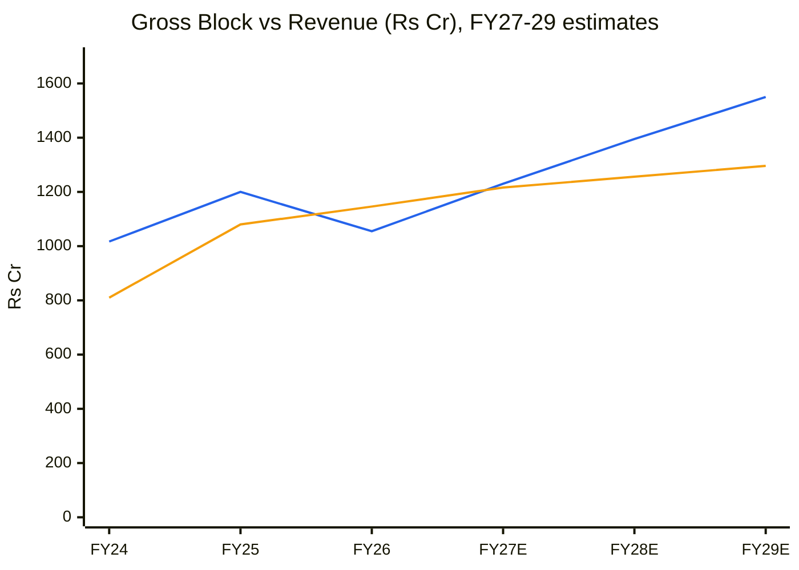
🟦 Revenue · 🟧 Tangible PPE gross block
**Read:** In the base case revenue re-crosses the gross block in FY27 and opens a ₹250 Cr gap by FY29 with only ₹150 Cr of additions.

**Business inference:** Growth from here is capital-light — every rupee of revenue above ~₹1,150 Cr drops through at high incremental margin, which is why FCF can rise to ~₹350 Cr even with heavy working capital; the risk is purely volume timing, not capital.

**FCF inflection year:** Passed (FY22). **Debt ceiling verdict:** No debt; no refinancing or dilution risk.

### Key Catalysts
1. Q2 FY27 results (Nov-2026): H1 growth ≥18% and inventory unwinding from ₹326 Cr — **Q3 FY27**
2. Injectable third-party/contract manufacturing wins (guided H2 FY27); EM injectable filings → sales from FY28 — **H2 FY27–FY28**
3. Large innovator/second-source or CDMO contract (one of "a couple" targeted this year) — **FY27**
4. EU CEP for fusidic acid; further ANDA launches via Stellon — **FY27–28**
5. 1:1 bonus (credit by 22-Nov-2026) — liquidity, no value change — **Q3 FY27**

### Key Risks
1. Recovery timing slips again (WTT 0.55) — 40% margin moves to FY29+ — **Probability: High**
2. Q1 FY27 proves to be spillover + FX; growth reverts to ~10% — **Medium**
3. Regulatory/trade shock: CDSCO/EU delays, US generic tariffs (100% tariff mooted for ~2028), Middle East tender — **Medium**
4. Inventory (₹326 Cr) fails to convert → write-downs or price cuts — **Low–Medium**
5. Value-destructive acquisition with the ₹442 Cr cash ("exploring inorganic options") — **Low–Medium**
6. Rate-hiking cycle compresses premium pharma multiples (sector P/E 40×) — **Medium**

### Scenario Analysis (AT-driven; FY29E EPS, valued at end-FY28)
| Scenario | AT assumption | Revenue FY29E | EBITDA margin | EPS FY29E (pre-bonus) | Multiple | Target | Probability |
|---|---|---|---|---|---|---|---|
| Bull | 1.35× (above FY24 peak — injectables + CDMO scale) | ₹1,750 Cr | 40% | ₹48.0 | 45× | ₹2,160 | 25% |
| Base | 1.20× (between 5-yr avg and peak) | ₹1,550 Cr | 37.5% | ₹39.2 | 40× | ₹1,568 | 50% |
| Bear | 0.97× (stays at TTM) | ₹1,250 Cr | 33% | ₹26.8 | 32× | ₹857 | 25% |
| **Expected value** | | | | | | **₹1,538** | |
*EPS build: EBITDA − D&A ₹85 Cr + other income (₹55 / 50 / 45 Cr) − 25% tax ÷ 10.46 Cr shares.*

**Return from current price (expected value): +13% over ~2 years (~6% p.a. + 0.55% dividend yield) — below the ~12% cost of equity.**

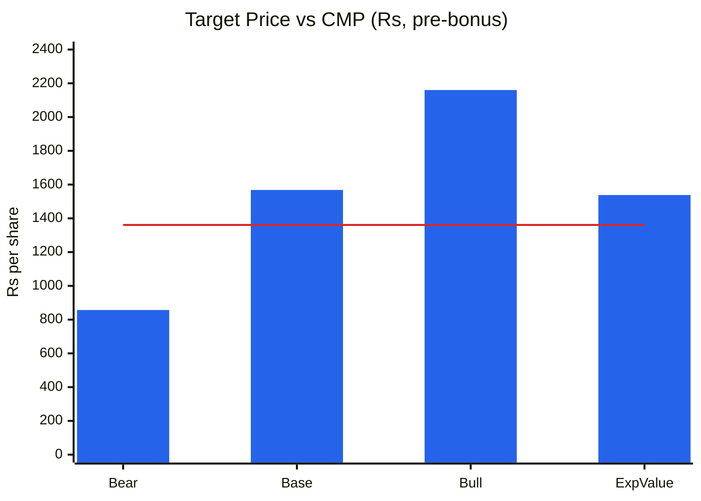
🟦 Scenario price · 🟥 CMP ₹1,361
**Read:** Downside to bear −37% vs upside to base +15% (bull +59%) → base-vs-bear U/D 0.41:1; expected value only 13% above CMP.

**Business inference:** The payoff is skewed the wrong way at this price because the base case is already largely in the price and the bear case (Q1 was a one-off) is not — the stock becomes attractive only near ₹1,050–1,150, where the base case alone delivers ~15% a year.

---

## Checklist Summary
*(checklists/master-analysis-checklist.md and checklists/pre-buy-final-check.md run)*
**Section 0 (Existing Report Protocol):** 3/3 — base report read, 28 items validated (11 ❌ corrected, 5 🔄 updated, 10 ✅, 2 ⚠️), saved by `git mv`; one file remains
**Section A (Business Quality):** 16/18 — gaps: market-share stability series; scuttlebutt beyond filings (AmbitionBox/channel checks not done)
**Section B (Forensics):** 9/9
**Section C (Financial Statements):** 12/12 (10-yr ROIC limited to FY20–26 — pre-IPO history not on Screener)
**Section D (KPIs & Peers):** 7/7
**Section E (Market Size & Share):** 4/7 — TAM value, penetration and share series not sourced
**Section F (Valuation):** 10/10
**Section G (Technical Stage):** 8/8 (Nifty index history partial)
**Section H (Forward View):** 26/28 — segment-level capex not disclosed (single segment); unit-economics track N/A
**Section I (Charts):** 5/5 — C1, C2, C4, C5, C6, C7, C12, C13, C14, CY1, CY2, CY4, CY7 + Cycle Position Dashboard; CY5/CY6 omitted (no industry capacity/spread series)
**Order Book Tracker:** Not applicable (not order-driven)

**Pre-buy final check:**
- *Falsifiability:* downgrade if (a) Q2+Q3 FY27 revenue growth <15% combined, (b) inventory >₹350 Cr at Sep-26 with flat sales, (c) FY27 EBITDA margin <34%. Upgrade if two consecutive quarters ≥36% margin with ≥18% growth.
- *Inversion (failure reasons):* timing slips; spillover-only recovery; regulatory/tariff shock; inventory write-down; bad acquisition; multiple de-rating in a hiking cycle — the price discounts none of the first four.
- *Circle of competence:* business explainable in two sentences ✓; fermentation economics understood at a high level; molecule-level share data a gap.
- *Asymmetry:* U/D 0.41:1 ✗; SVAR 37% (<40%) — **stop: do not override with narrative.**
- *Buffett 5-yr test:* moat ✓, balance sheet ✓, capital allocation ✓ (watch M&A).
- *Narrative vs numbers:* management's "18% historical growth" vs AR's 10.3% FY22–26 CAGR — narrative > numbers; numbers weighted.
- *Recency bias:* base uses 37.5% margin (below 41% avg) and 14% growth fading to 7% ✓.
- *Confirmation bias:* concall analyst pushback read (Unit III utilisation math, formulation decline ex-Middle East, 40% margin timing) ✓; no short-seller reports found.
- *Crowd test:* sell-side consensus not sourced (gap); institutional ownership falling (FII −1.8pp in 5 quarters) — not a crowded long.
- *Governance:* pledge 0% ✓, unmodified audit ✓, no SEBI/ED/SFIO matter found ✓, CFO change in FY26 (orderly) ✓, RPTs stable ✓.

**Hard stops triggered:** None (U/D 0.41:1 is below the 1.5:1 hard-stop threshold for *buying* — it blocks entry at this price, consistent with the WATCHLIST verdict).

### Conviction Score
| Component | Max | Score | Note |
|---|---|---|---|
| Market + Sector + Stock cycle | 1 | 0.5 | Market Stage 4, sector Stage 2, stock early-cycle |
| Industry structure | 1 | 0.8 | Attractive niche |
| Business quality & moat | 2 | 1.5 | Narrow-to-wide; cost leadership |
| Management quality | 1 | 0.6 | Integrity high, forecasting low (WTT 0.55) |
| Financial + earnings quality | 2 | 1.5 | Clean; inventory and other-income watch |
| Valuation & PIE asymmetry | 2 | 0.5 | Optimistic PIE; U/D 0.41; cheap only vs peers |
| Technical + CANSLIM | 1 | 0.4 | Early Stage 2 pullback; CANSLIM 2/7; weak market |
| **Total** | **10** | **5.8** | Small / watchlist band |

---

## Investment Decision
**Verdict: QUALITY AT WRONG PRICE → WATCHLIST** (unchanged).
Concord passes every quality gate — fermentation cost leadership, 77–79% gross margin, debt-free with ₹442 Cr cash, zero pledge, clean audit, ROIC above WACC even at the trough, and a visible Q1 FY27 recovery. It fails the price gate: ₹1,361 embeds ~18.5% revenue growth for a decade at ~40% margins (management's full plan, from a team whose dated promises have slipped repeatedly), leaving 0.41:1 upside/downside and a 2-year expected return of ~13%. Relative to Divi's/Laurus/Anthem (80–100× P/E) Concord looks cheap — but that is a statement about the peer set, not about Concord's intrinsic value.

- **Recommendation:** WATCHLIST — do not buy at ₹1,361.
- **Conviction Score:** 5.8 / 10 (was 5.5)
- **Suggested position size:** 0% now; 2–3% if bought in the entry zone (halve if SVAR >30% persists).
- **Entry price range:** **₹1,050–1,150 pre-bonus (₹525–575 post-bonus)** — ~30–33× FY28E EPS, near the March–May 2026 base and the stock's own 3-yr P/E low; at ₹1,100 the base case alone delivers ~19% a year. *Alternative trigger:* two consecutive quarters of ≥36% EBITDA margin with ≥18% revenue growth **and** a weekly close above ~₹1,620 on ≥1.5× volume.
- **Stop-loss (if entered):** weekly close below ₹1,015 (March-2026 base low) — pre-bonus.
- **Target price (base, 2-yr):** ₹1,568 (pre-bonus) / ₹784 (post-bonus).
- **Review trigger:** Q2 FY27 results (Nov-2026) — H1 growth, Sep-26 inventory level, injectable utilisation and contract wins; any acquisition announcement; changes in US generic tariff policy.

---
*Report generated by Stock Fundamental Analysis Skill v3.3 | Indian Markets Context*
*Sources: Concord Biotech Annual Report FY2025-26 (BSE, consolidated statements & Notes 5, 8, 39, 40; Directors' Report) and FY2023-24 (PPE note); Q1 FY27 investor presentation (BSE, 1-Aug-2026) and earnings-call transcripts for Q1 FY26 (11-Aug-2025), Q2 FY26 (14-Nov-2025), Q3 FY26 (12-Feb-2026), Q4 FY26 (1-Jun-2026), Q1 FY27 (3-Aug-2026) (BSE); Board outcome 23-Sep-2026 (bonus) and postal ballot notice (BSE); NSE shareholding-pattern XBRL (Jun-2026), NSE PIT/pledge databases, NSE index data (09-Oct-2026); Screener.in consolidated financials, price/P-E chart API and peer pages (DIVISLAB, LAURUSLABS, ANTHEM, GLAND); ICRA research headlines (RBI rate action). ICRA rating rationale of 23-Sep-2026 is paywalled (not read).*
*Save path: C:\Users\anubh\Documents\Anubhav\Stock Analysis\Stock Analysis\*
