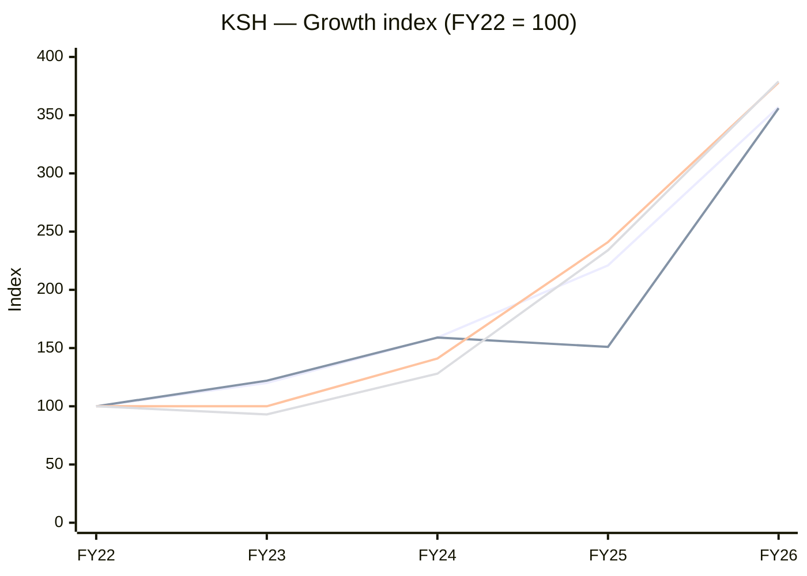
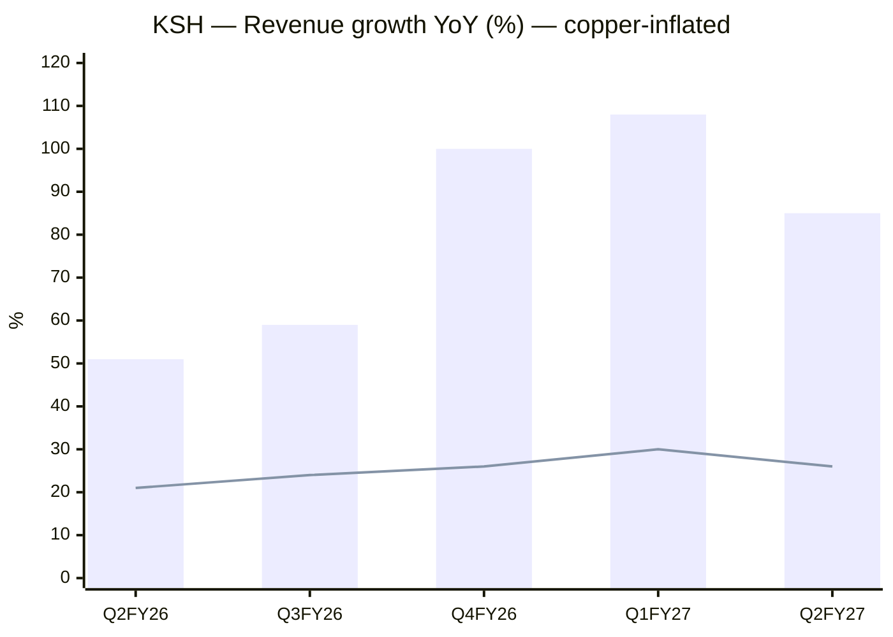
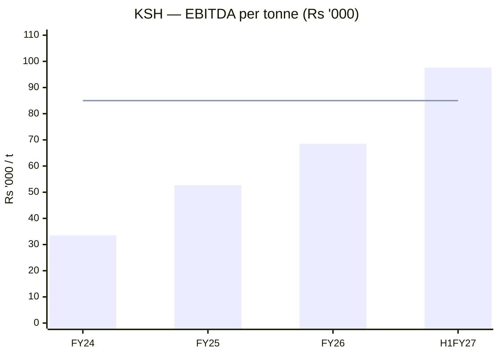
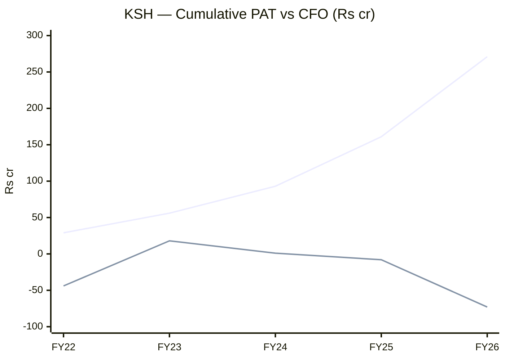
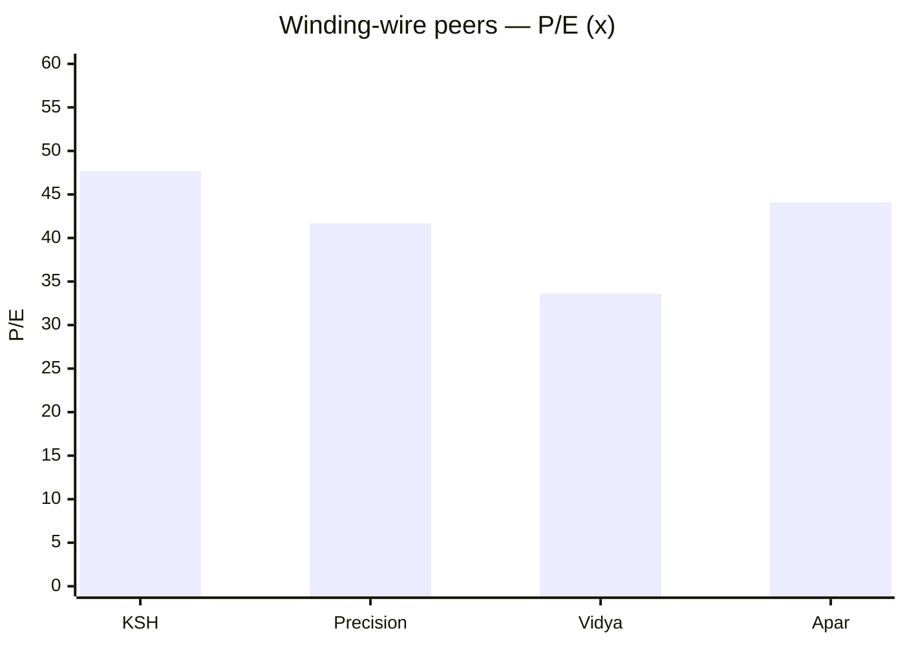
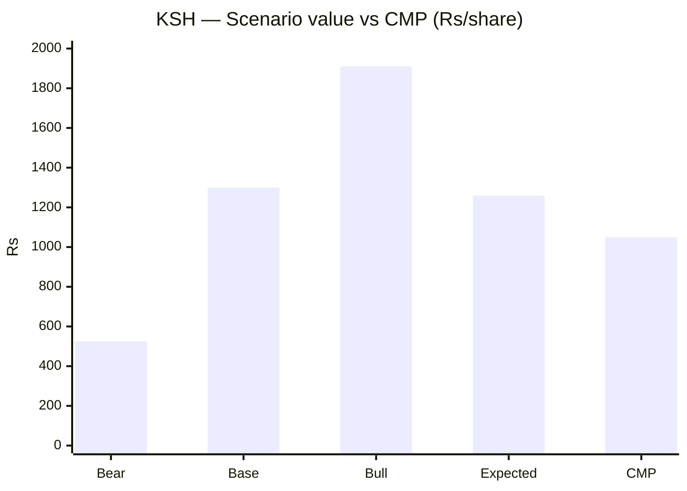

# Stock Analysis Report — KSH International Ltd (NSE: KSHINTL | BSE: 544664)
**Date:** 2026-11-11
**Analyst:** Claude (Stock Fundamental Analysis Skill v3.3)
**Investment Horizon:** 2–3 Years
**CMP:** ₹1,050 (11 Nov 2026, 11:10, +6.0% on the day) | **Market Cap:** ₹7,118 cr | **TTM P/E:** 47.7× | **P/B:** 7.9× | **EV/EBITDA (TTM):** ~27×
**Filed under:** Capital Goods / Cables-Wires-and-Conductors · Themes: Power T&D & grid capex, Export-led manufacturing
**Recommendation:** WATCHLIST — *Quality at Wrong Price* (buy-below ~₹800; cash-flow proof needed)
**Conviction Score:** 5 / 10

## Revision Log
| Version | Date | Recommendation | Conviction | Price | Key change |
|---|---|---|---|---|---|
| Current | 2026-11-11 | WATCHLIST (Quality at Wrong Price) | 5/10 | ₹1,050 | Initial report |

**Validation of previous report:** Initial report — no earlier KSHINTL report in the library (searched by ticker and the "ksh" name fragment).

**Sources used:** Screener.in standalone financials (FY21–FY26, quarterly Sep-2024 to Sep-2026, shareholding); Q2/H1 FY27 earnings presentation (BSE, 4 Nov 2026); Q2 FY27 concall transcript (5 Nov 2026); Q1 FY27 concall (11–14 Aug 2026); Q4 FY26 concall (26–30 May 2026); Q3 FY26 concall (12 Feb 2026); Annual Report FY26 (auditor report, borrowings, contingent liabilities); CARE monitoring-agency summary Q2 FY27; library peer report VIDYAWIRES (9 Oct 2026); Screener peer pages (Precision Wires, Apar).

---

## Business Primer

KSH International, founded in 1979 and based in Pune, makes **magnet winding wires**: insulated copper and aluminium conductors that form the coils inside power transformers, reactors, traction motors, EV motors, generators and AC compressors. About 75% of revenue is **specialised wires**, chiefly continuously transposed conductors (CTC) and paper-insulated rectangular strips for high-voltage power transformers up to 765 kV and HVDC. KSH says it is the only Indian supplier approved for HVDC transformers. The other 25% is **standard round enamelled wire** for motors and appliances (Q2 FY27 presentation). Customers are 120+ B2B OEMs (Hitachi Energy, CG Power, BHEL, GE Vernova, Siemens Energy, ABB, Bharat Bijlee, Suzlon, Bosch), with >95% repeat revenue. Exports to 26 countries were ~32% of Q2 FY27 revenue, and management wants to return to ~40%. Production runs across four Maharashtra plants (Taloja, two at Chakan, and the new Supa site). Business is make-to-order: copper is bought against a purchase order and the LME/FX cost is passed through. **Revenue = metal pass-through + a fixed value-add per tonne.** That makes **volume (MT) × EBITDA per tonne**, not OPM %, the real earnings engine. Returns depend on transformer and T&D capex (India's transformer capacity is projected to roughly triple to ~300 GVA by FY28E, ICICI Securities, cited by the company) and on KSH keeping its premium CTC/HVDC mix.

This is a **commodity-adjacent conversion manufacturer with a specialised-mix edge**. Reported revenue (+85% YoY in Q2) is inflated by copper prices (realisation per tonne up ~47% YoY). The true value drivers are volume (+26%) and EBITDA/t (₹65.5k → ₹101.5k). Three features colour the analysis. (1) A **capacity doubling** (29,045 → 57,845 MT, done Sept 2026, six months early) plus a newly approved Phase 3 (→ 72,200 MT by Q1 FY29, ₹185 cr). (2) A **cash-hungry working-capital model**: CFO was negative in four of the last five years, and the H1 FY27 turnaround leaned on supplier credit. (3) A **recent IPO** (listed 23 Dec 2025, first trade ~₹355) after which the stock nearly tripled, so expectations are now the main risk. The key business risk is EBITDA/t mean-reverting from today's ~₹1 lakh toward management's own "sustainable" ₹75–85k as the CTC/export mix and the weak rupee normalise, while every major peer adds capacity.

**Segment check:** Winding Wires & Copper/Aluminium Conductors — KPI reference available ✓ (`05-industry-kpis-india.md`, line 2505).

---

## Executive Summary

KSH is India's leader in CTC winding wire for big transformers and the country's largest winding-wire exporter. Its numbers are outstanding: volumes are up 26–30% YoY, EBITDA/kg of ~₹98 in H1 FY27 is about twice peers (Vidya ~₹48/kg), and the Supa capacity doubling arrived six months early. On guidance, management is among the most reliable in the library (WTT 0.94, with a sandbagging pattern). The worries are cash and price. Five-year cumulative CFO is **−₹73 cr against ₹271 cr of PAT**. The ₹140 cr "debt reduction" in Q2 coincided with a ~₹290 cr jump in other liabilities (supplier and LC credit, whose cost now sits in finance costs). And the stock at ₹1,050 implies ~28% PAT CAGR for five years. That needs ~95,000 MT at ₹85k/t, versus a post-Phase-3 practical ceiling of ~61,000 MT. **A real franchise priced for an unannounced Phase 4.** Watchlist, buy below ~₹800, or upgrade on clean cash conversion.

### Chart C1 — Growth Index (FY22 = 100)
| Year | Revenue (₹cr) | Net fixed assets (₹cr) | EBITDA (₹cr) | PAT (₹cr) |
|---|---|---|---|---|
| FY22 | 871 | 88 | 51 | 29 |
| FY23 | 1,049 | 107 | 51 | 27 |
| FY24 | 1,383 | 140 | 72 | 37 |
| FY25 | 1,928 | 133 | 123 | 68 |
| FY26 | 3,107 | 313 | 193 | 110 |
*Screener standalone. Volume series (MT): FY24 21,495 · FY25 23,324 · FY26 28,168 (presentation).*

*Series order: (1) Revenue, (2) Net fixed assets, (3) EBITDA, (4) PAT.*
**Read:** EBITDA and PAT (3.8×) slightly outgrew revenue (3.6×), and revenue itself is copper-inflated. Volumes grew only ~31% over FY24–26.
**Business inference:** Profit growth came mainly from **higher value-add per tonne** (mix and exports), not tonnage. Fixed assets jumped 2.4× in FY26 with Supa, so the next two years must be volume-led as Supa fills.

---

## Module 1 — Market, Sector & Stock Cycle

**Broad market:** Nifty ~25,045 (9 Nov 2026), below its level a year ago; India VIX ~17.4 (vs 12.3 a year earlier), with geopolitical and crude stress (market wraps, Nov 2026). Heavy 2025–26 IPO supply (KSH and Vidya Wires both listed in Dec 2025). **Assessment: Cautious.**

**Sector cycle — winding wires for T&D: Strong tailwind, late-ish capital cycle.**
- *Secular:* India's grid and transformer build-out (green-energy corridors, 765 kV and HVDC lines, RDSS), global transformer shortages with OEM order books "up to 2032 or beyond" (Q2 FY27 concall), renewables, railways, EV motors, data centres (a small share for KSH). Management sees Indian CTC demand at ~120,000–130,000 MT by FY30, against ~40,000 MT in FY25 and ~70–75k MT in FY27–28 (Q4 FY26 and Q2 FY27 concalls).
- *Cyclical:* Copper price inflation (realisation/t +47% YoY) flatters revenue. A weak rupee and a tight transformer supply chain flatter EBITDA/t. **Decomposition (my estimate):** of the +85% Q2 revenue growth, ~26pp is volume (structural plus capacity) and ~59pp is copper/FX (cyclical, zero value-add). Of the +55% EBITDA/t, roughly half is mix (CTC/exports, partly durable) and half is utilisation, FX, recycling and scrap (partly transient). Management's own "sustainable" EBITDA/t of **₹75–85k** (vs ₹101k in Q2) implies they also see ~15–25% of today's spread as transient.
- *Input cost:* LME copper is passed through, but high copper inflates working capital and finance cost (suppliers give little credit; KPI block).
- *Competitive capacity:* Precision Wires (~49k MT), Ram Ratna (~48.6k MT) and Vidya (19.7k → 37.7k MT) are all expanding, and **one or two transformer OEMs are backward-integrating into CTC** (Q2 FY27 concall). → Watch EBITDA/t.
- *FX:* Exports ~32%, priced in USD/EUR, with the copper pass-through in the same currency. Net exposure is on the **value-add only**: ~30% × ~₹1 lakh/t ≈ 3–4% of EBITDA per 1% move (my estimate). A weaker rupee is currently helping.
- *Geopolitics:* Middle East ~10–11% of revenue. Transit times and freight are up, but demand has held (Q2 FY27).

**Chart C2 — Quarterly revenue YoY growth** (only five comparable quarters on Screener)
| Q2FY26 | Q3FY26 | Q4FY26 | Q1FY27 | Q2FY27 |
|---|---|---|---|---|
| +51% | +59% | +100% | +108% | +85% |
*Volume YoY for comparison: Q3FY26 +24% · Q1FY27 +30% · Q2FY27 +26% (concalls).*

*Bar = revenue YoY; line = approximate volume YoY (Q2/Q4 FY26 volume growth derived from management's FY26 full-year 21% and quarterly commentary — approximate).*
**Read:** Revenue growth peaked at +108% and is now decelerating, while volume growth is steady at 25–30%.
**Business inference:** Ignore the headline revenue rate. The franchise is growing volume at ~26%, and that is the number to underwrite. Copper deflation would cut revenue sharply without hurting EBITDA (it would even ease working capital).

**Stock cycle:**
- *Volume/price/mix:* volume (capacity-bound) plus mix (CTC/HVDC/exports) are the drivers. Like-for-like price increases are explicitly **not** assumed by management (Q2 FY27).
- *Capacity:* FY25 29,045 MT (80% utilisation); Sept 2026 57,845 MT available (Q2 utilisation 76% of available; specialised >80%); Phase 2 total 59,045 MT; Phase 3 → **72,200 MT by Q1 FY29**. Management expects 85% utilisation of 72,200 MT around FY30–31 (≈ 61,400 MT). **Capacity ceiling year: ~FY30.**
- *Operating leverage:* DFL ≈ 1.39 (TTM EBIT ₹238 cr vs interest ₹67 cr). ICR ≈ 3.6–3.9×, adequate but falling, because finance cost is rising even as reported debt falls.
- *FCF inflection:* Not yet. FY26 FCF was −₹228 cr; H1 FY27 CFO +₹43 cr. Phase 3 (₹185 cr) plus WC on ~13,000 MT of new volume (~₹240 cr at today's copper) keeps FCF near zero through FY28. **Inflection ~FY29**, if WC days hold around 52.
- **Classification: Mid-cycle compounder in a ramp-up**, with **late-cycle signals** on EBITDA/t (peak-ish) and industry capacity. MoS +5pp.

---

## Module 2 — Industry Structure & Capital Cycle

| Force | Assessment | Signal |
|---|---|---|
| New entrants | Commodity round wire: low barrier. CTC / 765 kV / HVDC: multi-year approvals (PowerGrid, NTPC, NPCIL, RDSO; global OEM audits) | Split: low (standard) / **high (specialised)** |
| Supplier power | Copper from Hindalco, Adani and importers; little credit; LME-linked | **High** |
| Buyer power | Concentrated global transformer OEMs; some backward-integrating into CTC | **High**, but tempered by OEM capacity shortages |
| Substitutes | Aluminium in distribution transformers (lower value-add); no substitute in HV CTC | Low |
| Rivalry | Fragmented overall (top 5 ~46%, CRISIL via Vidya DRHP); KSH leads CTC in India | Moderate |

**Industry verdict:** Neutral overall; **attractive in the specialised niche**.
**Capital cycle (Chancellor): Mid-to-late upcycle.** Returns are above history (KSH ROCE 21% vs ~16% FY22–24; Precision ~33%; Vidya 21–24%). Several players are adding capacity, two winding-wire IPOs came in Dec 2025, and OEMs are integrating backward. Every one of these is a "deteriorating future returns" signal on the supply side. The offset is that demand (transformer backlog to 2030–32) is unusually visible.

---

## Module 3 — Business Quality & Moat

**Moat verdict: Narrow.**
**Greenwald:** (1) *Customer captivity — yes, in specialised wires.* 765 kV and HVDC qualifications take years; >95% repeat revenue; a 5-year framework agreement with Hitachi Energy (volumes still being finalised); PowerGrid approved the Supa plant for 765 kV in Oct 2026. (2) *Cost advantage — partial:* scale, own copper-scrap upcasting (5,000 MT), 4 MW of captive solar, and plants near JNPT and customers. (3) *Local scale — partial:* Indian CTC leadership.
**Evidence of the moat in numbers:** EBITDA/kg of ~₹98 (H1 FY27) vs Vidya ~₹48/kg and the KPI healthy range of ₹30–45/kg. Even management's "sustainable" ₹75–85/kg is about 1.6–1.8× the peer level. **This spread is the moat.**
**Buffett price test:** Uncertain. Management says it does not push like-for-like price increases ("people who squeeze customers don't end well"), and value-add rises through mix. Pricing is relationship-based and annual or two-yearly.
**Market share (5-yr):** Gaining in CTC and exports (export revenue +108% YoY in Q2).
**Fisher 15-point:** 32/45. Strong on market potential (1), new products (2: HVDC, 765 kV, EV traction), sales organisation (4: 26 countries) and management depth (9: MD, CEO, CFO, head of IR). Weak on margin (5: OPM ~6%, structurally thin), cost and cash controls (10: WC history), and dilution (13: IPO plus ESOP 2025). **Point 15 (integrity): 2/3 — Pass.** No adverse findings; 74.58% promoter holding, unchanged since listing.

---

## Module 4 — Management & Capital Allocation

**Promoter holding:** 74.58%, flat for four quarters since listing | **Pledge:** none disclosed in sources reviewed ⚠️ *(verify on the BSE SHP annexure; the AR's "pledged assets" note refers to company receivables and assets charged to lenders, not promoter shares)* → Normal
**Institutional churn:** DII 13.09% → 7.74% (anchor and MF exits after lock-in); FII 3.72% → 6.60% (rising); retail 8.6% → 11.1%.
**Share count:** Diluted by the IPO (equity rose ₹510 cr in FY26, of which PAT was ₹110 cr, so a ~₹400 cr fresh issue, derived) plus ESOP 2025.
**Capital allocation: Good.** IPO objects were delivered on time or early (upcast plant, rooftop solar, Supa expansion 6 months ahead). Long-term debt was largely repaid (debt/EBITDA 1.21× FY25 → 0.39× FY26, Q4 FY26 concall). Phase 3 is triggered only after specialised utilisation passed 80%, which is disciplined. ₹44.01 cr of IPO money is still unused (CARE MA report, nil deviation). No dividends.
**RPT / ICD:** None flagged in sources reviewed. **Auditor:** FRN 105215W/W100057 (Kirtane & Pandit LLP), unmodified opinion. **Bank guarantees:** ₹84.9 cr (vs ₹34.9 cr) — rising with export and OEM business.
**Three C's:** Candor — high (they explain the EBITDA/t drivers, call ₹1 lakh/t non-sustainable, and confirmed the analyst's supplier-credit reading). Competence — high. Caring — average (no payout yet).

### Walk the Talk Scorecard
| Quarter guided | Statement | Guided | Actual | Verdict |
|---|---|---|---|---|
| Q3 FY26 (Feb-26) | FY26 volume growth | ~24% (≈ 28,950 MT) | 21% (28,168 MT, −2.7%) | ⚠️ Near miss |
| Q3 FY26 | WC days to trend lower from 75–80 | Lower | 52 days (Q2 FY27) | ✅ |
| Q4 FY26 (May-26) | FY27 volume growth ≥ FY26's 21% | ≥21% | H1 +27.8% | ✅ |
| Q4 FY26 | Sustainable EBITDA/t | ~₹67–74k | H1 ₹97.6k | ✅ Beat |
| Q4 FY26 | Next Supa capacity online | ~Q2 FY27 | 96% complete 9 Sep 2026 | ✅ |
| Q4 FY26 | Rooftop solar (IPO object) | May-26 | Commissioned | ✅ |
| Q1 FY27 (Aug-26) | Upcast recycling plant (IPO object) | On time | Commissioned Aug-26 | ✅ |
| Q1 FY27 | FY27 EBITDA/t | ~₹75k | Q2 ₹101.5k | ✅ Beat |
| Q4 FY26 | Deleveraging / debt down | Lower | ₹481 → ₹341 cr in Q2 (but see forensics) | ✅ (qualified) |

**WTT Score:** (8 + 0.5) / 9 = **0.94 — HIGH**
**Hits:** 8 | **Near misses:** 1 | **Misses:** 0 | **Reversals:** 0
**Key pattern:** **Sandbagging.** EBITDA/t guidance has been beaten every quarter (analysts on the Q2 call openly said management "low-balls"). Timelines are delivered early.
**Insider action:** No open-market promoter trades; holding steady → NEUTRAL.
**DCF impact:** Volume guidance used as-is (26%+). EBITDA/t base set at **₹90k for FY27, ₹85k long term** (management's sustainable figure, which has historically been beaten).
**Overall management credibility:** HIGH.

---

## Module 5 — Financial Forensics

| Test | Value | Read |
|---|---|---|
| Beneish M (6-variable proxy; AQI, SGAI = 1) | **−1.20** | Above −1.78. **Explained mostly:** SGI 1.61 is copper inflation (volume SGI ~1.21; re-run M ≈ −1.56), and TATA 0.132 is the WC build in a capacity-doubling year. Still a flag |
| Altman Z'' (approx.) | ~7.4 | Safe |
| Piotroski F (FY26) | 4/9 | ROA>0 ✓, ΔROA ✗ (equity jump), CFO<0 ✗, accruals ✗, LT debt down ✓, CR up ✓, dilution ✗, margin flat ✗, AT down ✗ → Average-weak |
| Sloan accrual (NI−CFO−CFI)/avg TA | **34%** | ⚠️ Red flag (CFO −65 and CFI −179 against PAT 110) |
| 5-yr cumulative CFO / PAT | **−73 / 271 = −0.27** | ⚠️ Red flag |
| Other income / EBIT | ~8–10% | OK |
| H1 FY27: other liabilities ₹193 → ₹485 cr; borrowings ₹321 → ₹372 cr (Screener) vs management "debt ₹341 cr" | +₹292 cr non-debt liabilities | ⚠️ **Supplier/LC credit funding the CFO turnaround** (Schilit CFS #3, payables stretch). Management confirmed finance cost "includes finance cost charged by suppliers" (Q2 FY27) |
| Finance cost | Q2 ₹22 cr vs ₹9 cr YoY, while reported debt fell | Consistent with the above |
| EBITDA/t jump ₹65k → ₹101k in four quarters | Mix + FX + utilisation + scrap/recycling | ⚠️ Partly metal- or FX-linked; must be tested against management's ₹85k sustainable level |
| Auditor | Kirtane & Pandit, unmodified | Clean |
| Pledge / RPT / ICD | None found | Clean |

**Forensic red-flag count:** **4 / 15** (Sloan; CFO/PAT; Beneish proxy; supplier-credit funding). **Two are explained** (copper-inflated sales growth; WC build in a capacity doubling). **Two remain open**: (a) how much of the "positive OCF and lower debt" is just a reclassification into supplier credit; (b) how much of the EBITDA/t is copper or FX timing.
**Hard-stop assessment:** The "≥3 unresolved" test is **not triggered** (only 2 are unresolved), but it is close. This caps conviction and sizing.
**Overall forensic verdict:** **Significant-but-explainable concerns on cash; clean on governance.**

---

## Module 6 — Earnings Quality & Financial Statements

**ROCE (EBIT / (equity + debt)):** FY26 16.9% (Screener ROCE 21.5% on average capital) | **WACC:** ~12.5%
**ROIC vs WACC:** +4–8pp → value-creating | **Trend:** improving (FY22–24 ~15.5% → FY25–26 17–21%)
**Driver:** Margin-led recently (EBIT margin 4.8% → 6.1%); asset turnover is falling (2.9× → 2.35×) as Supa and working capital grow.
**OCF / NI (5-yr):** negative → **Quality: Low (cash)** | **O'Glove flags:** 4/15

### DuPont (5-factor)
| Year | EBIT margin | Asset turnover | Equity multiplier | Interest burden | Tax burden | ROE |
|---|---|---|---|---|---|---|
| FY22 | 5.7% | 2.36 | 2.16 | 0.80 | 0.72 | 17.0% |
| FY23 | 4.8% | 2.92 | 1.85 | 0.70 | 0.77 | 13.9% |
| FY24 | 5.0% | 2.86 | 2.09 | 0.74 | 0.73 | 16.0% |
| FY25 | 6.2% | 2.59 | 2.50 | 0.76 | 0.76 | 22.8% |
| FY26 | 6.1% | 2.35 | 1.64 | 0.76 | 0.75 | 13.6%* |
*Year-end equity (inflated by the Dec-2025 IPO). Screener ROE on average equity ≈ 20%.*

**Operating contribution (EBIT margin × AT):** FY24 0.143 → FY26 0.143, **stable**: rising margin offset by falling asset turns.
**Financing contribution:** FY25 peak (multiplier 2.50) fell after the IPO.
**DuPont verdict:** FY25's 22.8% ROE was **leverage-assisted** (multiplier 2.5×). FY26's operating engine is unchanged, and the drop in ROE is the IPO equity. H1 FY27 annualised ROE of ~21% (presentation) reflects the EBITDA/t jump. No sign of leverage masking operational decline. If you count supplier credit as quasi-debt, though, effective leverage is higher than reported.
**AT trend → Module 11:** Revenue / net fixed assets 9.9× (FY26). Copper-distorted, so the forward model uses **MT per MTPA (utilisation)** instead.

### Chart — Volume & EBITDA per tonne
| Period | Volume (MT) | EBITDA/t (₹) | Utilisation |
|---|---|---|---|
| FY24 | 21,495 | 33,500 | ~75.6% |
| FY25 | 23,324 | 52,700 | 80.3% |
| FY26 | 28,168 | 68,500 | 64.8% |
| H1 FY27 (annualised) | 33,624 | 97,600 | 76.0% |
*EBITDA/t computed as Screener EBITDA ÷ presentation volumes; H1 FY27 per company. Utilisation figures as printed in the Q2 FY27 presentation (mapping to years inferred from layout ⚠️).*

*Bar = EBITDA/t; line = management's "long-term sustainable" ₹85k/t.*
**Read:** EBITDA/t nearly tripled in 2.5 years and now runs ~15% above management's own sustainable level.
**Business inference:** This is the single most important number in the thesis. The base case assumes partial mean reversion (₹90k FY27 → ₹85k), so any valuation built on ₹1 lakh/t is building on a peak.

### Chart C7 — Cumulative PAT vs CFO (₹cr, from FY22)
| | FY22 | FY23 | FY24 | FY25 | FY26 |
|---|---|---|---|---|---|
| Cum. PAT | 29 | 56 | 93 | 161 | 271 |
| Cum. CFO | −44 | 18 | 1 | −8 | −73 |

*Series order: (1) Cumulative PAT, (2) Cumulative CFO.*
**Read:** Over five years, ₹271 cr of profit produced **negative** cumulative operating cash.
**Business inference:** Rising copper plus fast growth means every tonne of growth needs ~₹1.5 lakh+ of working capital. Profit has been reinvested into receivables and inventory, funded by debt, the IPO and now supplier credit. H1 FY27's +₹43 cr is the first real break in the pattern. It must repeat **without** further payables stretch before the earnings deserve a compounder multiple.

---

## Module 7 — Industry KPIs & Peer Analysis

| KPI (Winding Wires block) | KSH | Healthy range / peer | Assessment |
|---|---|---|---|
| EBITDA/kg | **₹97.6** (H1 FY27); ₹68.5 (FY26) | ₹30–45; Vidya ₹47.6 (FY26) | **Far above** |
| Volume growth & utilisation | +26–28%; 76% of available | +10–20%; >80% | Above (growth) / in line (utilisation, post-expansion) |
| Value-added mix % | Specialised 75% of revenue | Rising | Above |
| Cash conversion cycle | ~52 WC days (avg, Q2 FY27); Screener FY26 CCC 80 | <60 | In line now (was weak) |
| Metal pass-through quality | Make-to-order, LME-linked | Gains <10% of EBITDA | ⚠️ Not disclosed. Scrap/recycling benefit cited as one EBITDA/t driver |
| Export share | ~32% (Q2 FY27) | 15–30% | Above |

**Peer comparison (Screener, 11 Nov 2026; Vidya from library report, 9 Oct 2026):**
| Metric | KSH | Precision Wires | Vidya Wires | Apar Industries |
|---|---|---|---|---|
| Revenue (TTM, ₹cr) | 4,320 | 6,862 | n/a | 24,968 |
| Revenue 3-yr CAGR | 44% | ~27% | n/a | ~19% |
| EBITDA margin (OPM) | 6.2% | ~5% | 4.7% (FY26) | ~9% |
| EBITDA/kg | ~₹98 (H1) | n/a | ₹47.6 | n/a |
| ROCE | 21.5% | 32.9% | 21–24% | 32.9% |
| Net D/E | ~0.35 (+ supplier credit) | low | low | low |
| P/E (TTM) | **47.7×** | 41.7× | 33.6× | 44.1× |
| Mcap / TTM EBITDA | ~26× | ~22× | — | — |

**Peer positioning:** Premium to every pure-play winding-wire peer. **Partly justified** by roughly double the EBITDA/kg (specialised CTC/HVDC mix) and faster volume growth. **Not justified** on ROCE (Precision earns ~33% with a cleaner cash cycle) or on cash conversion.

**Read:** KSH carries the highest P/E in the group.
**Business inference:** The market already credits the specialised-mix moat. The premium becomes vulnerable if EBITDA/t reverts toward ₹75k, because the P/E is struck on peak value-add.

**Order Book Tracker:** Not applicable. Business is make-to-order on annual or multi-year OEM contracts; no order book is disclosed, and there are no Reg-30 order filings (the Hitachi 5-year framework has no disclosed volume).

---

## Module 8 — Market Size & Market Share

**TAM:** Indian winding-wire industry ~343,000 MT (FY25, CRISIL via Vidya DRHP). Indian CTC ~40,000 MT (FY25), heading to ~70–75k MT by FY27–28 and ~120–130k MT by FY30 (management). Exports are a larger, untapped pool.
**Penetration:** KSH FY26 volume 28,168 MT ≈ **8% of the Indian winding-wire market by volume**. In CTC, KSH is the market leader (an exact share is not disclosed; the FY26 specialised volume of ~19–21k MT, my estimate from the 75% revenue mix, suggests ~35–45% of Indian CTC).
**Market share trend:** Gaining (volume +21% FY26 and +28% H1 FY27, vs industry ~8–12%).
**Driver:** **Structural** (qualifications, HVDC/765 kV approvals, export wins), with a temporary help from transformer-industry tightness.
**Revenue vs market check:** volume growth ~26% vs CTC market growth ~25–30% a year (FY25 → FY28E) → **holding share in a fast-growing core niche**, gaining in standard wires and exports.
**Verdict:** Growing with a booming niche. The CTC TAM roughly triples by FY30, so demand is not the binding constraint before ~FY30. Capacity and OEM backward integration are.

---

## Module 9 — Valuation: PIE First, Then Own Model

### 9A. Price-Implied Expectations
Method: EV ≈ ₹7,410 cr (Mcap ₹7,118 + debt ~₹372 − cash/IPO funds ~₹80 cr, estimate). 5-year hold, required return 12.5%, exit P/E 25×. Price-implied FY31 PAT ≈ ₹7,118 × 1.125⁵ / 25 ≈ **₹513 cr** (vs TTM ₹148 cr).

| PIE driver | Market-implied | My base case | Gap |
|---|---|---|---|
| PAT CAGR FY26–31 | ~28% | ~19% | Optimistic by ~9pp |
| Volume CAGR FY26–31 | ~28% (→ ~95,000 MT at ₹85k/t) | ~17% (→ ~61,000 MT) | Optimistic |
| EBITDA/t (steady state) | ₹85–100k | ₹85k | Slightly optimistic |
| Investment rate | Needs Phase 4 plus WC | Phase 3 only | — |

**Classification: Optimistic gap.**
**Physical plausibility check:** Phase 3 takes capacity to 72,200 MT. At management's own 85% optimum that is ~61,400 MT, reached around FY30–31. The PIE needs **~95,000 MT** at ₹85k/t, or ~72,000 MT at ~₹1.15 lakh/t. → **"Unannounced Expansion Pricing"** (≈ 33,000 MT more, or about another Phase 2-sized step). The extra 10 acres at Supa makes Phase 4 plausible. It is not announced.
**Treadmill:** To beat the PIE, KSH must hold EBITDA/t ≥ ₹90k through FY29, fill Phase 2 and Phase 3 on schedule, announce Phase 4 by FY28, and keep CFO positive without stretching supplier credit.
**Positive triggers:** firm Hitachi and other long-term-agreement volumes; HVDC export repeat orders; EBITDA/t ≥ ₹90k for two more quarters; positive CFO with flat payables.
**Negative triggers:** EBITDA/t falling toward ₹75k (mix normalising, rupee firming); a sharp copper spike re-inflating WC; CTC backward integration by a top-3 customer; a capital-goods de-rating.
**SVAR (bear):** (1,050 − 525) / 1,050 = **50%** → unfavourable.

### 9B. Intrinsic value
| Method | Bear | Base | Bull |
|---|---|---|---|
| FY29E EPS × exit P/E (Module 11) | ₹525 (21.0 × 25) | ₹1,300 (37.1 × 35) | ₹1,910 (47.7 × 40) |
| Present value today (13%, 2.4 yrs) | ₹392 | ₹970 | ₹1,425 |
| Relative (peer-median ~40× FY27E EPS ₹26.1) | — | ₹1,045 | — |
| Graham Number (3-yr avg EPS 16.7, BVPS 133) | ₹223 | — | — |

**CMP:** ₹1,050 | **MoS vs base PV (₹970):** −8% → **Inadequate**
**Upside / downside (base vs bear):** (1,300 − 1,050) / (1,050 − 525) = **0.48 : 1** → Unacceptable
**Reverse-DCF implied growth:** ~28% PAT CAGR × 5 years → **Aggressive** (beyond announced capacity)
**Misprice reason:** None in our favour. Post-IPO re-rating of ~3×, a 25% free float, and the T&D theme premium.
**Catalyst:** Q3 FY27 (Feb 2027) — first full quarter of 57,845 MT, an EBITDA/t reading as the mix normalises, and CFO.

**Chart C13 — Scenario targets vs CMP**

**Read:** The expected value (₹1,259) is ~20% above CMP over ~2.4 years (~8% a year), below the hurdle.
**Business inference:** Even if KSH executes everything it has announced (base case), the stock delivers below the cost of equity from here. The upside lives in the bull case: EBITDA/t holding near ₹95k plus Phase 4.

### Cycle Position Dashboard
| Dimension | Current | History (FY22–26) | Percentile | Signal |
|---|---|---|---|---|
| P/E | 47.7× | listed 11 months; peer band 30–50× | top of band | Expensive |
| P/B | 7.9× | — | — | Expensive |
| EBITDA/t | ₹101k (Q2) | ₹33–69k | 100th (record) | **Peak** |
| ROCE | 21.5% | 15.5–18% | top | Peak-ish |
| Industry utilisation | Tight (transformer OEM backlogs) but peers adding capacity | — | — | Tight → balancing |
| Spread (EBITDA/kg vs peers) | ~2× peers | — | — | Elevated |
| **Overall cycle position** | | | | **Mid-to-late** |

*P/E and P/B band charts (CY1/CY2) omitted: 11 months of listed history.*

---

## Module 10 — Technical Stage (Weinstein) + CANSLIM

**Nifty 50:** below its year-ago level, VIX ~17 → Stage 3/sideways (unconfirmed)
**Sector (Nifty/BSE capital goods, cables):** Peers' quarterly sales growth is +25–65% (Screener peer table). Index stage not verified ⚠️
**Stock stage: Stage 2 — pulling back and re-basing.** The IPO base ran ₹344–387 from Dec-25 to Mar-26. The breakout came in late March, followed by an advance to a ₹1,177 close on 8 Sep (52-week high ₹1,198). A 24% correction followed to ₹888 (23 Oct), and the stock has rebounded to ₹1,050 on Q2 results.
**30-week MA:** Rising (approx. ₹880–920). 200-DMA ₹796, rising (from ₹629 in mid-Aug). Price is above both.
**RS vs Nifty:** Strongly positive (+195% since listing).
**Base:** The new ₹888–1,198 base is ~9 weeks old, under the 12-week minimum. **No valid fresh breakout yet.** Pivot: **₹1,198**.
**Stop-loss:** Weekly close below **₹880** (base low / 30-week MA).

| CANSLIM | Evidence | Score |
|---|---|---|
| C | Q2 EPS ₹7.08 vs ₹5.21 = +36% | 1 |
| A | EPS ₹6.55 (FY24) → ₹16.25 (FY26) → ₹21.85 TTM; ROE ~20% | 1 |
| N | Phase 2 early, Phase 3, HVDC export trial orders | 1 |
| S | 25% free float, small | 1 |
| L | Sector RS leader | 1 |
| I | FII rising, DII falling (anchor exits) — mixed | 0 |
| M | Market not in a confirmed uptrend | 0 |
| **Total** | | **5 / 7** |

**Stage + fundamental alignment:** Technically "Stage 1-within-2 re-base, wait for the ₹1,198 pivot". Fundamentally the price is full. **Misaligned on price; aligned on business momentum.**

---

## Module 11 — Forward View: 2–3 Year Thesis

### Capex classification
| Capex type | FY27E | FY28E | FY29E | In model? |
|---|---|---|---|---|
| Growth: Supa Phase 2 balance (4% left) | ~₹15 cr | — | — | ✅ |
| Growth: Phase 3 (land 10 acres + building + P&M, up to ₹185 cr) | ~₹35 cr | ~₹130 cr | ~₹20 cr | ✅ (land ❌) |
| Maintenance (≈ depreciation) | ~₹38 cr | ~₹45 cr | ~₹55 cr | ❌ Sustains |
| ROU (leased upcast plant) | small | — | — | ⚠️ Productive, included |
| **WC on incremental volume** (the real capital need) | ~₹120 cr | ~₹130 cr | ~₹120 cr | — |

**CWIP:** ₹41 cr (Sep-2026), down from ₹108 cr (Mar-2025) as Supa was capitalised. Net fixed assets ₹437 cr.

**Capacity → volume model (MT is the right "asset turn" for a copper pass-through business):**
| Year | Available capacity (MT) | Utilisation | Volume (MT) | EBITDA/t (₹) | EBITDA (₹cr) |
|---|---|---|---|---|---|
| FY24 | ~28,400 | ~76% | 21,495 | 33,500 | 72 |
| FY25 | 29,045 | 80% | 23,324 | 52,700 | 123 |
| FY26 | ~43,500 (partial Supa) | 65% | 28,168 | 68,500 | 193 |
| FY27E | ~51,000 (avg) | ~71% | 36,000 | 90,000 | 324 |
| FY28E | 59,045 | ~76% | 45,000 | 85,000 | 383 |
| FY29E | ~70,000 (Phase 3 from Q1) | ~76% | 53,000 | 85,000 | 451 |

**Incremental ROIC (Phase 3):** +13,155 MT × 85% × ₹85k/t ≈ ₹95 cr EBITDA (~₹83 cr EBIT) on ₹185 cr capex + ~₹240 cr WC (11,200 MT × ~₹14.9 lakh/t realisation × 52/365) ≈ ₹425 cr → NOPAT ~₹62 cr → **~15% vs WACC 12.5% → modestly value-creating.** Copper working capital, not plant, is what dilutes returns.
**Capex-model implied volume CAGR (FY26–29):** ~24%, vs the PIE's ~28% sustained for five years → near-term fine, but by FY31 the market needs capacity beyond Phase 3.

### Capex-to-earnings model (base)
| Metric | FY27E | FY28E | FY29E |
|---|---|---|---|
| Volume (MT) | 36,000 | 45,000 | 53,000 |
| EBITDA/t (₹) | 90,000 | 85,000 | 85,000 |
| EBITDA (₹cr) | 324 | 383 | 451 |
| D&A | 38 | 45 | 55 |
| Other income | 25 | 20 | 20 |
| Interest (bank + supplier credit) | 75 | 75 | 80 |
| ICR (EBIT incl. OI / interest) | 4.1× | 4.8× | 5.2× |
| PBT | 236 | 283 | 336 |
| PAT (25% tax) | 177 | 212 | 252 |
| EPS (₹, 6.78 cr shares) | 26.1 | 31.3 | 37.1 |
| Capex (growth + maintenance) | ~88 | ~175 | ~75 |
| ΔWC | ~−120 | ~−130 | ~−120 |
| **FCF ≈ PAT + D&A − capex − ΔWC** | **~+7** | **~−48** | **~+112** |
| Debt / EBITDA (incl. supplier credit, my estimate) | ~1.6× | ~1.6× | ~1.2× |

**FCF inflection year:** FY29.
**Debt ceiling:** Peak (debt + supplier credit) / EBITDA ~1.6–2.0× → **within the safe zone**, but watch it if copper rises further.

### Key catalysts
1. Q3 FY27: first full quarter at 57,845 MT, with a print on EBITDA/t and CFO — Feb 2027
2. Long-term supply agreements (Hitachi framework volumes, other OEMs) — "next two quarters" per management
3. HVDC export qualification converting from trial to repeat orders — FY27 delivery
4. Phase 3 execution (Q1 FY29) and any Phase 4 announcement on the new 10 acres
5. Lock-in expiry dynamics are already past; FII accumulation (3.7% → 6.6%) could continue

### Key risks
1. EBITDA/t reverts to ₹70–80k as CTC/export mix and FX normalise — **Medium-High**
2. Working capital or supplier credit unwinds (copper spike, supplier tightening) → cash squeeze — Medium
3. CTC backward integration by transformer OEMs, plus peer capacity additions (Precision, Ram Ratna, Vidya) → spread compression — Medium
4. T&D capex slowdown or deferral (global or Indian), or a data-centre capex reversal (small direct exposure) — Low-Medium
5. Valuation de-rating of the "T&D theme" basket from ~45–50× toward 30× — Medium

### Scenario analysis (FY29E)
| Scenario | Assumption | Volume FY29 | EBITDA/t | EPS FY29 | Multiple | Target | Probability |
|---|---|---|---|---|---|---|---|
| Bull | Phase 3 fills fast, HVDC/export mix holds, Phase 4 announced | 57,000 MT | ₹95k | ₹47.7 | 40× | ₹1,910 | 25% |
| Base | 26%→18% volume growth, mix normalises | 53,000 MT | ₹85k | ₹37.1 | 35× | ₹1,300 | 50% |
| Bear | Spread compression, Phase 3 slow, higher interest | 45,000 MT | ₹70k | ₹21.0 | 25× | ₹525 | 25% |
| **Expected value** | | | | | | **₹1,259** | |

**Return from CMP (expected):** +20% over ~2.4 years (~8% a year) → below the hurdle.
**Thesis (1 line):** India's CTC/HVDC winding-wire leader, earning twice peer value-add with very credible management, but priced at peak spread with cash conversion still unproven.
**Monitoring metrics:** EBITDA/t vs ₹85k; quarterly volume vs 26% growth; CFO and **trade payables / other liabilities** each half-year; finance cost vs reported debt; export share; long-term-agreement announcements.

---

## Checklist Summary
**Section 0 (Existing report / filing):** Complete. New file in an existing folder; themes added; index rebuilt.
**Section A (Business quality):** 16/18 (Form C trades not checked item by item; scuttlebutt limited to concalls)
**Section B (Forensics):** 8/9 (Beneish is a 6-variable proxy)
**Section C (Financial statements):** 10/12 (Ind AS 116 effect from the leased upcast plant is small and not adjusted)
**Section D (KPIs & peers):** 7/7
**Section E (Market size):** 6/7 (exact CTC share not disclosed)
**Section F (Valuation):** 9/10
**Section G (Technical):** 7/8 (sector index stage not verified)
**Section H (Forward view):** Capacity × EBITDA/t model (MT-based in place of the gross-block AT, appropriate for a pass-through business)
**Section I (Charts):** C1, C2, EBITDA/t, C7, C12, C13 included; CY1/CY2 omitted (11-month listing); stated
**Order Book Tracker:** Not applicable
**Hard stops triggered:** None. Forensic flags 4/15 with 2 unresolved, just below the hard-stop line. Upside/downside < 1.5:1 is a valuation failure, which gives the "Quality at Wrong Price" verdict.

### Conviction score
| Component | Max | Score |
|---|---|---|
| Market + sector + stock cycle | 1 | 0.5 |
| Industry structure | 1 | 0.5 |
| Business quality & moat | 2 | 1.5 |
| Management | 1 | 1 |
| Financial + earnings quality | 2 | 0.5 |
| Valuation & PIE asymmetry | 2 | 0 |
| Technical + CANSLIM | 1 | 1 |
| **Total** | **10** | **5** |

---

## Investment Decision
**Recommendation:** **WATCHLIST — Quality at Wrong Price**
**Conviction score:** 5 / 10
**Suggested position size:** 0% now. 1–2% if the price falls into the buy zone **and** H2 FY27 CFO is positive with flat payables. Up to 3–4% on long-term-agreement and Phase 4 visibility.
**Entry price range:** **₹750–800.** At ₹800, upside to base (₹1,300) vs downside to bear (₹525) ≈ 1.8 : 1, improving to ≥2 : 1 below ~₹785. Alternatively, a weekly close above the **₹1,198** pivot on heavy volume would be a momentum signal, but only for traders, given the valuation.
**Stop-loss (momentum holders):** weekly close below ₹880
**Target price (base, FY29E basis):** ₹1,300
**Review trigger:** *Upgrade* on two consecutive half-years of positive CFO without a rise in other liabilities, EBITDA/t holding ≥ ₹90k at higher volume, or a Phase 4 announcement. *Downgrade* on EBITDA/t < ₹75k, CFO negative again in H2 FY27, or customer backward integration into CTC at a top-5 client.

---
*Report generated by Stock Fundamental Analysis Skill v3.3 | Indian Markets Context*
*Save path: C:\Users\anubh\Documents\Anubhav\Stock Analysis\Stock Analysis\Capital-Goods\Cables-Wires-and-Conductors\*
