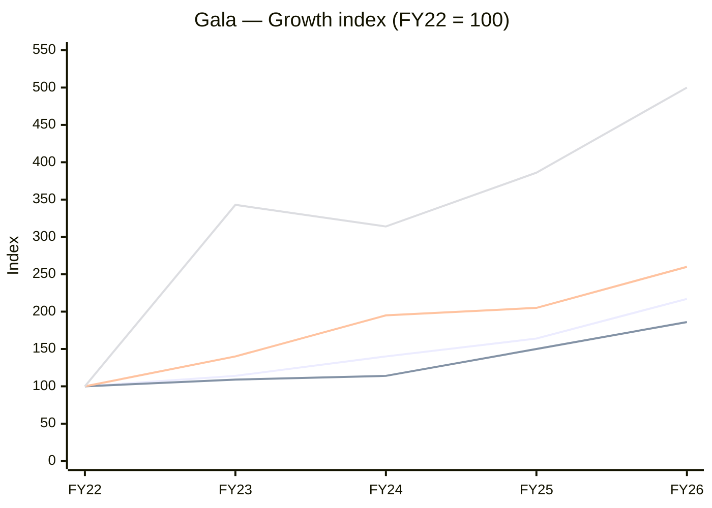
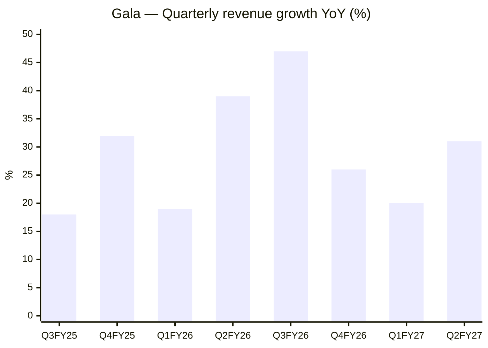
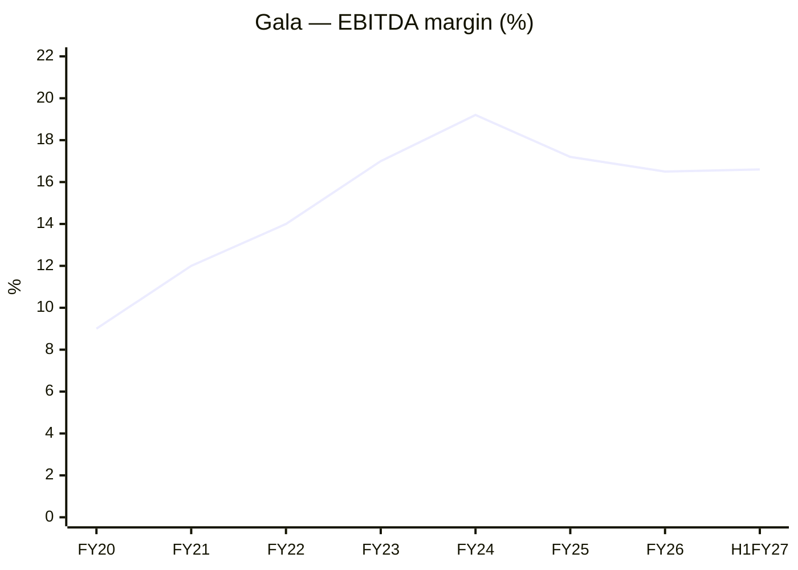
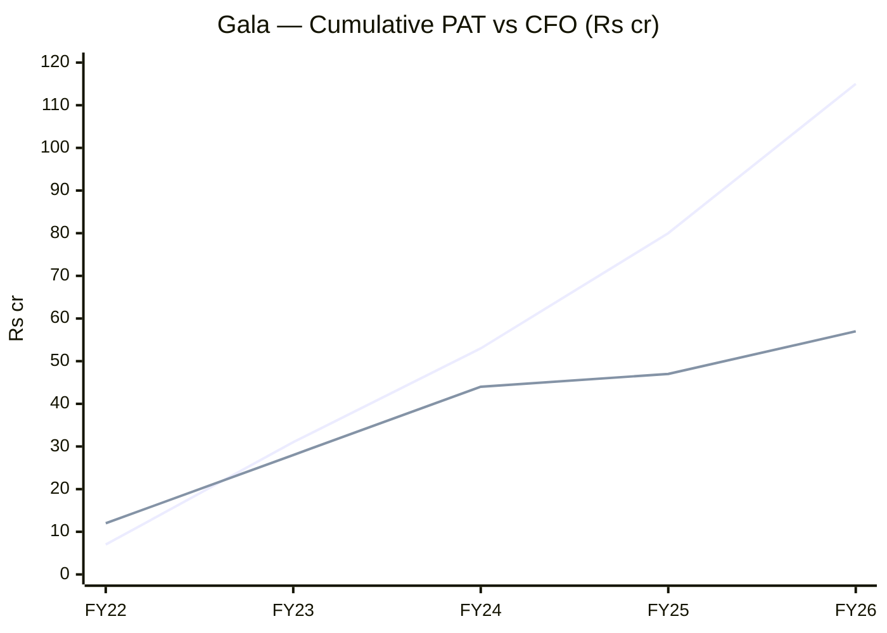
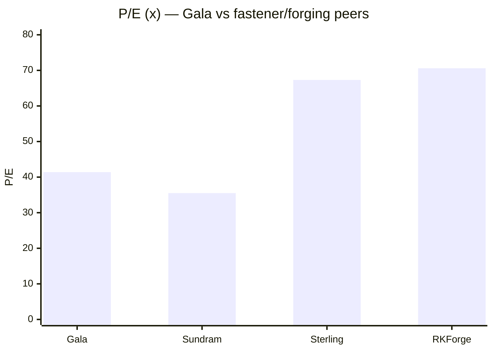
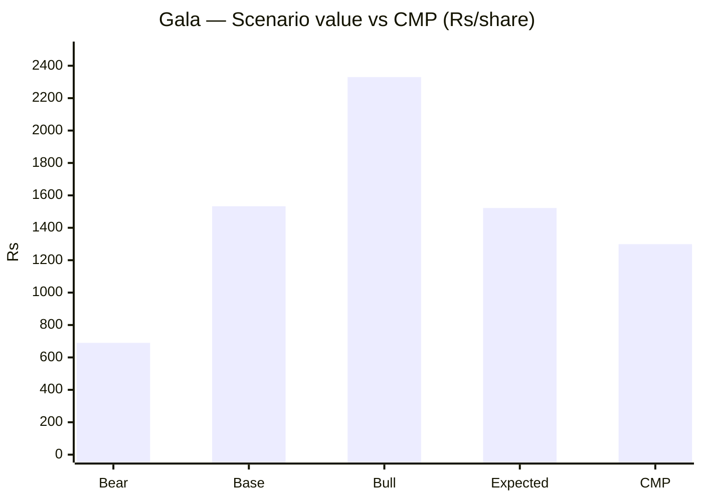
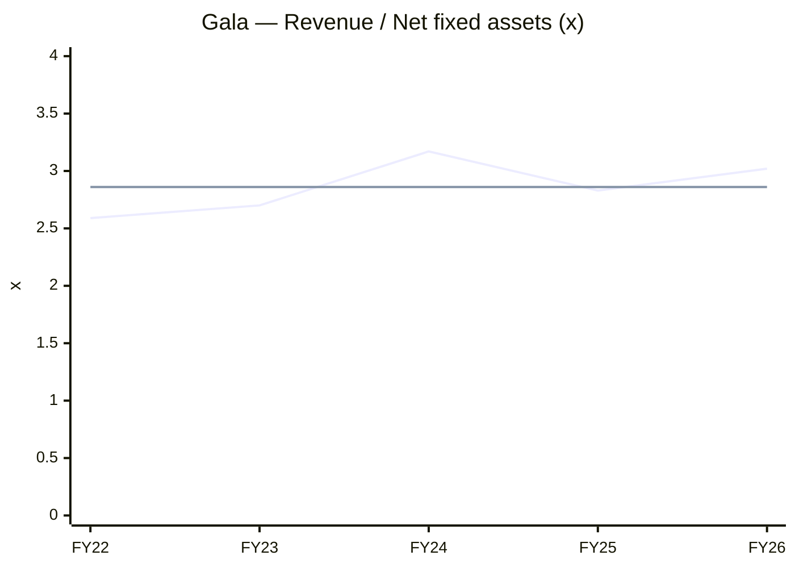

# Stock Analysis Report — Gala Precision Engineering Ltd (NSE: GALAPREC | BSE: 544244)
**Date:** 2026-11-11
**Analyst:** Claude (Stock Fundamental Analysis Skill v3.3)
**Investment Horizon:** 2–3 Years
**CMP:** ₹1,299 (11 Nov 2026, 11:06, +11.8% on the day) | **Market Cap:** ₹1,664 cr | **TTM P/E:** 42.3× | **P/B:** 5.3× | **EV/EBITDA (TTM):** ~28×
**Filed under:** Capital Goods / Castings-Forgings-and-Fabrication · Themes: Renewables & energy transition, Export-led manufacturing
**Recommendation:** WATCHLIST — *Quality at Wrong Price* (buy-below ~₹950)
**Conviction Score:** 5 / 10

## Revision Log
| Version | Date | Recommendation | Conviction | Price | Key change |
|---|---|---|---|---|---|
| Current | 2026-11-11 | WATCHLIST (Quality at Wrong Price) | 5/10 | ₹1,299 | Initial report |

**Validation of previous report:** Initial report — no earlier report for GALAPREC in the library (searched by ticker and name fragment "gala").

**Sources used:** Screener.in consolidated financials (FY20–FY26, quarterly to Sep-2026, shareholding); Q2/H1 FY27 earnings presentation (BSE, 6 Nov 2026); Investor presentation Aug 2026; Q1 FY27 concall transcript (7 Aug 2026); Q4 FY26 concall (15 May 2026); Q3 FY26 concall (Feb 2026); Annual Report FY26 (auditor report, KAMs, shareholders, ESOP); Crisil monitoring-agency report Q2 FY27 (via BSE summary); BSE insider-trading-code filing (10 Nov 2026). The Q2 FY27 concall transcript (6 Nov 2026 call) was **not yet on BSE**; Q2 commentary is from the presentation.

---

## Business Primer

Gala Precision Engineering makes small but critical steel parts that hold heavy machines together under load and vibration. It has three product families: Disc & Strip Springs plus Gallock wedge-lock washers (DSS, 53% of H1 FY27 revenue), Coil & Spiral Springs (CSS, 16%) and Special Fastening Solutions (SFS, 31%): high-tensile studs, anchor bolts, bolts and nuts. Over 800 SKUs, about 85% customised, go to ~175 B2B customers, mostly OEMs and Tier-1s such as Vestas, Siemens Energy, GE Vernova, ABB, Schaeffler and John Deere (Aug 2026 presentation; Q1 FY27 concall). By end market, renewables (mainly wind turbines) are 42% of revenue, industrial 33% and mobility 25%. Exports to 25+ countries were 36.2% of H1 FY27 revenue, mostly to Europe, and are billed largely in EUR. Revenue is volume × realisation per part, from two plants: Wada near Mumbai (all three product lines) and a new fastener plant at Vallam, near Chennai, which started in FY26. Returns depend on two things: winning slow, safety-critical OEM qualifications (12–24 months per customer, per management), and global wind-turbine build volumes.

This is a **niche precision-component manufacturer and import substitute against European incumbents**. It is not a commodity business, but it is not capital-light either: it holds a large ex-stock inventory (Screener inventory days ~257 on a cost basis) and needs steady capex. The key value driver is volume growth from wallet-share gains and the fastener ramp, at a stable 17–19% EBITDA margin. The key risks are concentration in the wind cycle (42% of revenue), EUR/INR moves, and working capital that has absorbed half of all profits over five years. Two structural features colour the analysis. First, the company listed only in September 2024 (IPO at ₹529), so there is just two years of market history. Second, FY23 profit is inflated by ~₹11 cr of other income from selling the surface-engineering business, so EPS trends must start from FY24.

**Segment check:** No exact block in `05-industry-kpis-india.md`. The closest business-model match is **"Forgings & Precision Metal Components Manufacturing"** (line 1046): steel-input precision metal parts, export OEM qualification, EBITDA margin, utilisation, working-capital days. Per the protocol, a near-match counts as covered, so that block is reused, adapted for an SKU business (units, not MT). ✓ *Suggestion for later: a dedicated "Industrial Springs & Specialty Fasteners" block, which needs user approval before the reference is changed.*

---

## Executive Summary

Gala is a well-run niche maker of disc springs and wind-turbine fasteners. Revenue compounded ~21% a year over FY22–26 (₹145 → ₹314 cr) and accelerated to +31% YoY in Q2 FY27, with order booking up 44% and a new Chennai fastener plant ramping. Management has delivered on its growth guidance. The business has real qualification barriers: management says it has "never lost a customer" in 25 years and has a ~70% domestic share in wind DSS. Two things hold it back. Margins have drifted down from 19.2% (FY24) to ~16.6%, below the 17–19% guidance. And cash conversion is weak (5-yr CFO/PAT ≈ 0.50) because inventory and receivables swallow growth. Today's +11.8% breakout to a 52-week high lifts the stock to ~42× TTM and ~33× FY29E base EPS. The price implies roughly 26% PAT CAGR for five years, which needs revenue beyond what Chennai plus the planned Wada expansion can physically produce. The business is good, the setup is technically strong, and the price is ahead of the fundamentals. Accumulate below ~₹950, or on a pullback after the breakout fails.

### Chart C1 — Growth Index (FY22 = 100)
| Year | Revenue (₹cr) | Net Fixed Assets (₹cr) | EBITDA (₹cr) | PAT (₹cr) |
|---|---|---|---|---|
| FY22 | 145 | 56 | 20 | 7 |
| FY23 | 165 | 61 | 28 | 24* |
| FY24 | 203 | 64 | 39 | 22 |
| FY25 | 238 | 84 | 41 | 27 |
| FY26 | 314 | 104 | 52 | 35 |
*FY23 PAT includes ~₹11 cr other income (sale of the surface-engineering business). Source: Screener consolidated. Gross block is not cleanly separable in the FY26 AR table, so net fixed assets are used as the proxy.*

*Series order: (1) Revenue, (2) Net fixed assets, (3) EBITDA, (4) PAT.*
**Read:** Revenue (2.2×) grew faster than fixed assets (1.9×), and EBITDA (2.6×) faster than revenue. Since FY24, though, EBITDA has only kept pace with revenue (margin flat to down), and fixed assets jumped in FY25–26 with Chennai.
**Business inference:** Most of the FY22–24 operating leverage has been harvested. The next leg needs Chennai to fill (fixed-cost absorption) and price/mix gains in exports. Capital intensity has risen with the fastener move.

---

## Module 1 — Market, Sector & Stock Cycle

**Broad market (Marks):** Nifty 50 closed ~25,045 on 9 Nov 2026, below ~25,574 a year earlier, with India VIX ~17.4 (vs 12.3 a year ago) amid US–Iran tensions and crude volatility (HDFC Sky / Muthoot market wraps, Nov 2026). IPO supply has been heavy through 2025–26. **Assessment: Cautious.** Sizing: normal to slightly smaller.

**Sector cycle — wind & industrial components: Tailwind.**
- *Secular:* India's wind additions and grid build-out, global OEMs de-risking from European and Chinese supply ("China+1", Europe-plus-India), and new uses (electrolysers, offshore wind, railway safety). Management sizes new-product customer potential at ~₹100 cr a year (Q2 FY27 presentation).
- *Cyclical:* part of the FY26–27 surge is wind-OEM restocking and Gala winning share from European suppliers during a capacity-tight period. **Decomposition (my estimate):** ~15–18% durable (segment growth of 6–18% plus steady share gains) and ~8–12% cyclical/one-time (Chennai start-up base effect, restocking). The DCF mid-period growth is anchored at ~15–18%, not the 31% of Q2.
- *Input cost:* steel wire, rod and sheet. Pass-through comes "with some lag" (Q1 FY27 concall). Neutral.
- *FX:* exports 36% (mostly EUR) against largely domestic costs, so net EUR exposure is ~30% of revenue. A 5% EUR/INR move ≈ 1.5% of revenue ≈ **~10% of EBITDA**. Forward cover was cut from 70% to 40% in 2026. FY26 had a ₹3.23 cr FX loss (~1pp of margin; Q4 FY26 concall). **Elevated FX sensitivity.**
- *Geopolitics:* Europe is ~26% of sales. War-related EUR volatility is a transient margin risk.

**Chart C2 — Quarterly revenue YoY growth**
| Q3FY25 | Q4FY25 | Q1FY26 | Q2FY26 | Q3FY26 | Q4FY26 | Q1FY27 | Q2FY27 |
|---|---|---|---|---|---|---|---|
| +18% | +32% | +19% | +39% | +47% | +26% | +20% | +31% |
*Screener quarterly sales; Q4FY26/Q1FY27/Q2FY27 per company releases.*

**Read:** Growth is lumpy but stays in the 20–45% band, with no deceleration trend. Q1 FY27 was held back by a ₹3 cr+ dispatch withheld over a payment delay (Q1 FY27 concall).
**Business inference:** Demand is not the constraint. The growth rate is set by capacity (Chennai ramp) and qualification timing, which supports a "stable-to-accelerating" classification.

**Stock cycle:**
- *Volume/price/mix:* growth is volume-led (new customers plus wallet share), with mix improving toward fasteners and exports. Prices are "stable", and Gala still offers customers 10–20% savings versus European suppliers (Q1 FY27).
- *Capacity:* DSS 225.5 mn units at 85% utilisation (near ceiling); CSS 20.9 mn units at 70–75%; SFS Wada 0.42 mn units at 75–78%; SFS Chennai 4,600 MT at 35% in FY26, targeted 70% in FY27. Chennai revenue capacity is ₹120 cr a year after Phase 2 (Q4 FY26 concall). **Capacity ceiling:** Wada at ~95% utilisation ≈ ₹320–330 cr plus Chennai ₹120 cr ≈ **₹440–450 cr of revenue, reached around FY28**. The next phase is the ~10-acre Wada land (MoU signed Aug 2026), with ₹40–45 cr capex mostly in FY28. It is brownfield, so commissioning is likely in FY29.
- *Operating leverage:* gross-to-EBITDA conversion is moderate, with DOL ~2× (my estimate from FY24–26 incremental margins). DFL ≈ 1.07 (interest ₹3 cr vs EBIT ₹46 cr), so ICR is ~15×. **No leverage risk.**
- *FCF inflection:* FCF was negative in FY25–26 (−₹31 / −₹28 cr, Screener). Inflection is likely FY27–28, once Chennai Phase 2 is complete and before the Wada expansion. The KPMG working-capital study (report due Q2–Q3 FY27) is the swing factor.
- **Classification: Early-to-mid cycle / ramp-up** (capex-heavy, margins slightly suppressed by Chennai under-absorption, revenue accelerating). Standard MoS.

---

## Module 2 — Industry Structure & Capital Cycle

| Force | Assessment | Signal |
|---|---|---|
| New entrants | 12–24-month OEM qualification, plant audits, safety-critical parts (yaw brakes, seat-belt retractor springs, railway safety) | **High barrier** ✓ |
| Supplier power | Special steels (wire, rod, sheet). Multiple sources; pass-through with a lag | Low–moderate |
| Buyer power | Global OEMs (Vestas, Siemens Energy, GE Vernova, ABB) are large and price-aware. But the part is a tiny share of their cost, and failure costs are huge | Moderate |
| Substitutes | Few for disc springs and wedge-lock washers in critical joints | Low |
| Rivalry | Mainly long-established European producers, not Chinese (management). Gala competes on 10–20% cost savings at equal quality | Moderate |

**Industry verdict: Structurally attractive niche** (small global DSS market ~US$891 mn; SFS global ~US$97 bn per company presentation, citing an industry study).
**Capital cycle:** Early-to-mid. There are few dedicated listed Indian peers and no visible IPO wave in springs or specialty fasteners. Global incumbents are not adding Indian capacity. Gala's own capex/depreciation is high (FY25–26 ~3–5×) because of Chennai. That is company-specific, not industry overbuild.

---

## Module 3 — Business Quality & Moat

**Moat verdict: Narrow.**
**Greenwald:** (1) *Customer captivity — yes.* Switching costs come from qualification, audits and safety liability. Management says that in 25 years no customer was lost for quality or delivery reasons, and that shares of business grew from 5–10% to 50–75% at several accounts (Q1 FY27). (2) *Cost advantage — partial.* There is a 10–20% landed-cost edge over European rivals, but it rests on Indian labour and overheads, which any qualified Indian rival could copy. (3) *Local scale — partial:* 70% domestic share in wind disc springs (presentation) and ~15% domestic share in wind SFS.
**Buffett 10% price test:** *Fail/uncertain.* Gala wins by being cheaper. It passes steel costs through with a lag but does not show discretionary pricing power, and margins fell from 19.2% to 16.5% while volumes boomed.
**Market share (5-yr):** Gaining. Exports went from ~25% to 36% of revenue, and Europe share gains were explicitly cited (Q1 FY27).
**Fisher 15-point:** 33/45 — strong on market potential (1), new products (2: Gallock, bolts, electrolyser parts, retractor springs), sales effort (4) and long-range orientation (12). Weaker on margin trajectory (5, 6), dilution (13: ESOP 2024 pool of 3 lakh options ≈ 2.3% of shares) and cost controls (10: SAP only went live in Oct 2026). **Point 15 (integrity): 2/3 — Pass.** One minor blot: on 10 Nov 2026 a promoter-group member was found to have breached the insider-trading code (warning plus ₹5,000 penalty, BSE filing).
**Scuttlebutt sources:** concall Q&A (customer-entry process, retractor-spring approval by a European OEM in July 2026), Crisil rating rationale (Dec 2025), and the board link to the Aarti group (non-executive director Rajendra Gogri, CMD of Aarti Industries).

---

## Module 4 — Management & Capital Allocation

**Promoter holding:** 54.25% (Sep 2026), down from 55.45% (Sep 2024) | **Pledge:** none disclosed in sources reviewed ⚠️ *(verify on the BSE SHP annexure)* → Risk: Normal
**Trend:** Slowly declining (−1.2pp in two years; −0.66pp in the Jun-2026 quarter). It is unclear whether this came from ESOP dilution or small sales. ⚠️ Watch.
**Share count:** Diluting modestly (IPO 2024; ESOP 2021 exercised; ESOP 2024 pool of 3 lakh options not yet allotted).
**Capital allocation:** *Good.* IPO money went to Chennai capex (₹45.4 cr, fully used), loan repayment (₹20 cr) and Wada capex. ₹27.7 cr is still unused and parked in FDs, and Crisil notes "some deployment delays" (Q2 FY27 presentation; Crisil MA report). No dividends; all cash is reinvested. A 1.8 MW solar plant (₹1.3 cr annual saving) and SAP are sensible.
**RPT:** AR FY26 says all RPTs were at arm's length. No ICDs to the group were found. **Auditor:** SCA & Associates (FRN 101174W), unmodified opinion; the KAM covers PPE capitalisation (benign); no fraud reported.
**Three C's:** Candor — good (they flagged the withheld dispatch and the FX loss). Competence — good (growth delivered, two plants run). Caring — average (no dividend yet; promoter stake drifting down).

### Walk the Talk Scorecard
| Quarter guided | Statement | Guided | Actual | Verdict |
|---|---|---|---|---|
| Q3 FY26 (Feb-26) | FY26 revenue growth | ~28% | 32% (₹314 cr) | ✅ Beat |
| Q3 FY26 | SAP HANA go-live | Q3 FY27 | Live 7 Oct 2026 | ✅ |
| Q3 FY26 / Q1 FY27 | Solar open-access plant | Q3 FY27 | Commissioned in Q2 FY27 | ✅ Early |
| Q4 FY26 / Q1 FY27 | FY27 revenue growth | 20–25% | H1 +25.7% | ✅ On track |
| Q4 FY26 / Q1 FY27 | FY27 EBITDA margin | 17–19% | H1 16.56% (Q2 16.76%) | ⚠️ Near miss so far |
| IPO (Sep-24) | Deployment of Wada capex / GCP funds | Per offer schedule | ₹27.7 cr unused; "deployment delays" (Crisil) | ❌ Slipped |
| Q4 FY26 | Chennai ~₹80 cr in FY27, 70% utilisation | FY27 | Pending (H2 ramp) | ⏳ Not scored |
| Q1 FY27 | Wada land final agreement in 2–3 months | ~Oct–Nov 2026 | No closing filing seen | ⏳ Not scored |

**WTT Score:** (4 + 0.5) / 6 = **0.75 — MODERATE**
**Hits:** 4 | **Near misses:** 1 | **Misses:** 1 | **Reversals:** 0
**Key pattern:** **Growth guidance is conservative and reliable; margin guidance is optimistic (one-way miss).** Margins have run below the 17–19% guide for two years (FY25 17.2%, FY26 16.5%, H1 FY27 16.6%).
**Insider action:** No open-market promoter buying seen. A slowly falling promoter stake plus the insider-code breach → **NEUTRAL-to-mildly BEARISH**.
**DCF impact:** Revenue guidance used as-is. Margin guidance haircut to **17% base** (lower end), not 18%.
**Overall management credibility:** MODERATE-HIGH.

---

## Module 5 — Financial Forensics

| Test | Value | Read |
|---|---|---|
| Beneish M (6-variable proxy; AQI, SGAI = 1) | **−2.01** | Grey zone. Driven by SGI 1.32 (genuine growth) and TATA 0.067 (WC accruals), not by DSRI (0.87, improving) |
| Altman Z'' (approx.) | ~9.5 | Safe (net cash, low liabilities) |
| Piotroski F (FY26) | 5/9 | ROA>0 ✓, CFO>0 ✓, ΔROA ✓, ΔCR ✓, ΔAT ✓; CFO<PAT ✗, LT debt up ✗, dilution ✗, gross margin down ✗ → Average |
| Sloan accrual (NI−CFO−CFI)/avg TA | 10.4% | Borderline warning (capex-heavy year) |
| 5-yr cumulative CFO / PAT | 57 / 115 = **0.50** | ⚠️ Low — working capital absorbs half of profits |
| Other income / EBIT | FY26 ~9% (₹4 cr / ₹46 cr) | OK (FY23 spike from the business sale, already noted) |
| Capex / depreciation | FY25 ~4×, FY26 ~3× | Growth phase (Chennai), explained |
| Auditor | SCA & Associates, unmodified | Clean |
| Pledge / ICD / RPT | None found / none / arm's length | Clean |
| DSO | 85 → 109 → 95 days | Spiked FY25, now improving |
| Inventory days (cost basis) | 254–267 | Structural (ex-stock model with 100+ standard DSS sizes), but very high |

**Forensic red-flag count:** 3 / 15 (low CFO/PAT, Sloan borderline, working-capital days 142). **All three are explained** by the inventory-heavy, ex-stock SKU model and the Chennai ramp. Management hired KPMG for a WC study and has said FY27 WC will be "similar level".
**Indian-specific flags:** IPO-fund deployment delay; insider-code breach by a promoter-group member (minor).
**Overall forensic verdict:** **Minor concerns** — clean accounting, poor cash conversion.

---

## Module 6 — Earnings Quality & Financial Statements

**ROCE (EBIT / (equity + debt)):** FY26 13.9% (depressed by unused IPO cash); FY24 19.8%; 5-yr average ~16.7% | **WACC:** ~13% (Rf 7% + β ~1.1 × ERP 5.5%)
**ROIC (ex-cash, my estimate):** ~16–17% FY26 → spread over WACC **+3–4pp → modestly value-creating**
**ROIC trend (3-yr):** Declining (FY24 ~21% → FY26 ~16%). The drivers are margin dilution and Chennai assets not yet earning (cyclical, ramp).
**Driver:** Margin-led; asset turnover is low (~0.84× on total assets).
**OCF / NI (5-yr):** 0.50 → **Quality: Medium-Low** (cash) | **O'Glove flags:** 3/15

### DuPont (5-factor)
| Year | EBIT margin | Asset turnover | Equity multiplier | Interest burden | Tax burden | ROE |
|---|---|---|---|---|---|---|
| FY22 | 11.0% | 0.99 | 2.43 | 0.69 | 0.64 | 11.7% |
| FY23 | 20.0%* | 0.97 | 2.02 | 0.82 | 0.89 | 28.6%* |
| FY24 | 15.8% | 1.07 | 1.80 | 0.78 | 0.88 | 21.0% |
| FY25 | 15.5% | 0.74 | 1.25 | 0.89 | 0.82 | 10.5% |
| FY26 | 14.6% | 0.84 | 1.28 | 0.93 | 0.81 | 11.9% |
*FY23 inflated by other income from the business sale. Year-end balances; Screener data.*

**Operating contribution (EBIT margin × AT):** declining (FY24 0.169 → FY26 0.123).
**Financing contribution:** falling (deleveraged; equity multiplier 1.80 → 1.28).
**DuPont verdict:** Most of the fall in ROE is **equity dilution from the IPO plus unused cash** (the equity multiplier fell), with a smaller operating fall from margin and Chennai under-utilisation. Leverage is not masking anything; the reverse is true. Normalised for idle cash and a filled Chennai, ROE should recover to ~15–17%.
**AT trend → Module 10 base AT:** Revenue / net fixed assets at ~3.0× (FY24 3.2×, FY26 3.0×). **Stable** → base case uses 3.0×.

### Chart C4 — EBITDA margin
| FY20 | FY21 | FY22 | FY23 | FY24 | FY25 | FY26 | H1 FY27 |
|---|---|---|---|---|---|---|---|
| 9% | 12% | 14% | 17% | 19.2% | 17.2% | 16.5% | 16.6% |

**Read:** Margins doubled from FY20 to a FY24 peak of 19.2%, then settled at ~16.5–17%.
**Business inference:** FY24 was the peak of operating leverage at Wada. Chennai start-up costs, FX losses and the fastener mix (lower margin than disc springs) now cap margins. The 17–19% guide needs Chennai at 70%+ and calm EUR rates.

### Chart C7 — Cumulative PAT vs CFO (₹cr, from FY22)
| | FY22 | FY23 | FY24 | FY25 | FY26 |
|---|---|---|---|---|---|
| Cum. PAT | 7 | 31 | 53 | 80 | 115 |
| Cum. CFO | 12 | 28 | 44 | 47 | 57 |

*Series order: (1) Cumulative PAT, (2) Cumulative CFO.*
**Read:** The gap opened sharply in FY25–26. CFO was only ₹3 cr and ₹10 cr against PAT of ₹27 cr and ₹35 cr.
**Business inference:** Growth is self-funded only with help from the IPO. If the KPMG study does not cut WC days, every 20% growth year will consume most of that year's profit. That is why the stock deserves a multiple below "compounder" levels.

---

## Module 7 — Industry KPIs & Peer Analysis

*KPI block: "Forgings & Precision Metal Components Manufacturing" (near-match), adapted.*

| KPI | Gala | Benchmark | Assessment |
|---|---|---|---|
| Capacity utilisation | DSS 85%, CSS 70–75%, SFS Wada 75–78%, Chennai 35% → 70% target | >75% | In line (Chennai below, ramping) |
| EBITDA margin | 16.6% (H1 FY27) | Quality forgers 18–22% | Slightly below |
| Export revenue % | 36.2% | >50% for diversification | Below, but rising |
| Working-capital days | 142 (Screener) | <90 for export forgers | **Below (weak)** |
| Non-operating income / PBT | ~9% | <15% | Healthy |

**Peer comparison (Screener, 11 Nov 2026):**
| Metric | Gala | Sundram Fasteners | Sterling Tools | Ramkrishna Forgings | Happy Forgings (KPI ref.) |
|---|---|---|---|---|---|
| Revenue 3-yr CAGR | 24% | ~8% | ~(−5)% | ~15% | n/a |
| EBITDA margin | 16.5% | 15% | 8% | 17% | 20–22% |
| ROCE | 15.6% | 17.6% | 7.2% | 5.6% | 25%+ |
| Net D/E | ~0 | low | low | high | low |
| P/E (TTM) | **41.4×** | 35.5× | 67.3× | 70.6× | 25–30× |
| Market cap (₹cr) | 1,664 | 22,815 | 798 | 13,775 | — |

**Peer positioning:** Premium to Sundram (a larger, steadier fastener leader) and to the KPI reference band for small-cap precision makers (≤20–28×). **Partly justified** by 2–3× faster growth and the wind and export mix. **Not justified** on ROCE (15.6% vs Sundram 17.6%) or cash conversion.

**Chart C12 — P/E vs ROCE (peer bar)**

**Read:** Gala's P/E sits between quality (Sundram) and depressed-earnings peers (Sterling, RK Forgings, whose high P/E reflects cyclically low profits).
**Business inference:** Gala is priced as a growth compounder. Unlike Sterling or RK Forge, its P/E is not inflated by a profit trough, so a re-rating from here needs earnings growth above 25%.

**Order Book Tracker:** Not applicable. Gala is a product/catalogue business. Order booking growth is disclosed (+40% Q1 FY27, +44% Q2 FY27, Q2 above ₹100 cr for the first time ≈ book-to-bill ~1.07 for the quarter), but no order book is reported and there are no Reg-30 order filings.

---

## Module 8 — Market Size & Market Share

**TAM (company presentation, third-party study):** DSS global US$891 mn (CAGR ~6%), DSS domestic US$115 mn (6.6%); CSS domestic US$458 mn (9.8%); SFS global ~US$97 bn, domestic US$6.58 bn (18%).
**Penetration:** FY26 revenue ₹314 cr ≈ US$37 mn. DSS (~₹154 cr ≈ US$18 mn) ≈ **2% of global DSS**. SFS (₹108 cr) ≈ 0.1% of global specialty fasteners. *The relevant SAM for wind/industrial studs, bolts and nuts is ~US$2.5 bn per management (Q4 FY26), so penetration is ~0.5%.*
**Market share:** ~70% of the domestic wind-DSS replacement market; ~15% of domestic wind SFS. **5-yr trend: Gaining.** Revenue growth (24% CAGR) runs at 3–4× market growth (6–10%).
**Share-gain driver:** **Structural** (cost advantage plus qualification wins, compounding wallet share). It is not a temporary factor.
**Verdict:** Taking share in a growing niche. TAM is not the constraint for 5+ years; capacity and working capital are.

---

## Module 9 — Valuation: PIE First, Then Own Model

### 9A. Price-Implied Expectations
Method: 5-year hold, required equity return 13%, exit P/E 25× (mature quality small cap). Price-implied FY31 PAT = ₹1,664 cr × 1.13⁵ / 25 ≈ **₹123 cr** (vs TTM ₹39 cr).

| PIE driver | Market-implied | My base case | Gap |
|---|---|---|---|
| PAT CAGR FY26–31 | ~26% | ~16% | Optimistic by ~10pp |
| Revenue CAGR FY26–31 | ~28% (₹314 → ~₹1,070 cr at 11.5% net margin) | ~16% (→ ~₹650 cr) | Optimistic |
| EBITDA margin (steady state) | ~18% | 17% | Slightly optimistic |
| Investment rate | High (needs 2+ new plants) | Wada expansion only | — |

**Classification: Optimistic gap.** The market is pricing better than my base case.
**Physical plausibility:** Announced capacity (Wada at ~95% + Chennai ₹120 cr + new Wada ~₹120–130 cr at 3× AT on ₹40–45 cr capex) ≈ **~₹570–580 cr of revenue by FY30**. Hitting ~₹1,070 cr by FY31 needs **unannounced expansion of roughly the same size again**, or a large acquisition. → **"Unannounced Expansion Pricing."** Option (b), that management will announce more capex, is plausible given the TAM, but it is not in hand.
**Treadmill:** To outperform, Gala must (1) grow revenue at ≥25% for three more years, (2) lift EBITDA margin to ≥18%, and (3) turn CFO/EBITDA above 60%.
**Positive triggers:** Chennai at ≥70% utilisation with margin ≥18%; the KPMG WC plan cutting ≥30 days; scale-up of offshore-wind, electrolyser or retractor-spring orders; a Wada Phase-3 announcement.
**Negative triggers:** A wind-OEM destocking quarter; a sharp EUR/INR move with only 40% hedge cover; margin stuck at ~16%.
**SVAR (bear case):** (1,299 − 690) / 1,299 = **47%** → asymmetry unfavourable.

### 9B. Intrinsic value
| Method | Bear | Base | Bull |
|---|---|---|---|
| FY29E EPS × exit P/E (from Module 11) | ₹690 (27.5 × 25) | ₹1,533 (43.8 × 35) | ₹2,330 (58 × 40) |
| Present value today (14%, 2.4 yrs) | ₹505 | ₹1,120 | ₹1,700 |
| Relative (Sundram-level 35× FY27E EPS ₹33.3) | — | ₹1,165 | — |
| Graham Number (3-yr avg EPS 26.5, BVPS 243) | ₹381 | — | — |

**Current price:** ₹1,299 | **MoS vs base PV (₹1,120):** −16% (premium) → **Inadequate**
**Upside / downside (base target vs bear):** (1,533 − 1,299) / (1,299 − 690) = **0.38 : 1** → Unacceptable
**Reverse-DCF implied growth:** ~26–28% for five years → **Aggressive**
**Misprice reason:** No mispricing in our favour. The stock is up 76% in a year, re-rated on Q2 results, and has a small float.
**Catalyst:** Q3 FY27 results (Feb 2027) for proof of Chennai utilisation and the margin trend.

**Chart C13 — Scenario targets vs CMP (FY29E-based)**

**Read:** The expected value (₹1,522) is only ~17% above CMP, roughly 2.4 years out (~7% a year), well below the 13–14% hurdle.
**Business inference:** Even the base case, a good business growing ~19% a year, does not pay at this price. Only the bull case (more capacity plus margin expansion) does, so today's price is a bet on the bull case.

### Cycle Position Dashboard
| Dimension | Current | Median (listed history) | Percentile | Signal |
|---|---|---|---|---|
| P/E | 41–42× | ~38× (Screener median, since listing) | ~70th | Fair-to-expensive |
| P/B | 5.3× | n/a (2 yrs) | — | Expensive vs ROE 13% |
| EBITDA margin | 16.6% | ~17% (FY22–26) | ~40th | Mid |
| ROCE | 14–16% | ~17% | ~35th | Mid (idle cash) |
| **Overall** | | | | **Early-mid cycle; valuation late** |

*P/E band chart (CY1) omitted: only four Screener P/E observations since the Sep-2024 listing (55×, 39×, 33×, 41×); too short for a ±1SD band.*

---

## Module 10 — Technical Stage (Weinstein) + CANSLIM

**Nifty 50:** ~25,045, below its year-ago level, VIX ~17 → **Stage 3 / sideways (unconfirmed)**
**Sector (BSE Industrials / capital goods):** Not verified this run ⚠️
**Stock stage: Stage 2 — fresh breakout.** Today's close of ₹1,299 (intraday high ₹1,312) is a new 52-week high. Price had been capped in the ~₹1,040–1,150 band from Aug–Oct 2026 and recovered from a ₹648 low earlier in 2026.
**30-week MA:** Rising (approx. ₹1,050–1,080). 200-DMA ₹990 and rising. Price is well above both.
**RS vs Nifty:** Strongly positive (+76% 1-yr vs Nifty slightly negative).
**Breakout volume:** Today ~1.7× the 50-day average (Screener volume series) → **Confirmed**, though it is a results gap.
**Entry window:** ~13% above the ₹1,150 pivot, at the upper end of the 10–15% rule. → **Late but valid.**
**Stop-loss:** Weekly close below **₹1,100** (back inside the base).

| CANSLIM | Evidence | Score |
|---|---|---|
| C | Q2 FY27 EPS +25.9% YoY | 1 |
| A | 3-yr EPS growth distorted (FY23 one-off); ROE 13% < 17% | 0 |
| N | New 52-week high; new products (bolts, electrolyser, retractor springs) | 1 |
| S | Small float; up-day volume expansion | 1 |
| L | RS top decile in sector over 12 months | 1 |
| I | DII 4.7% → 5.5%, FII flat ~1.3% — no clear accumulation | 0 |
| M | Nifty not in a confirmed uptrend | 0 |
| **Total** | | **4 / 7** |

**Stage + fundamental alignment:** **Misaligned.** The technicals are strong, but the valuation and asymmetry fail. A momentum trader could ride the breakout with a ₹1,100 stop. A 2–3 year fundamental investor should wait.

---

## Module 11 — Forward View: 2–3 Year Thesis

### Capex classification
| Capex type | FY27E | FY28E | FY29E | In AT model? |
|---|---|---|---|---|
| Tangible growth (Chennai Ph-2, hot-dip galvanising plant, Wada debottlenecking, new Wada plant) | ~₹25 cr | ~₹40 cr | ~₹15 cr | ✅ |
| Maintenance (≈ depreciation) | ~₹13 cr | ~₹16 cr | ~₹20 cr | ❌ |
| Intangibles (SAP subscription ₹3.48 cr over 5 yrs) | small | small | small | ❌ |
| Solar 1.8 MW (₹6.2 cr) | done | — | — | ⚠️ Cost saver, not capacity |
| Land, Wada 10 acres | incl. above | | | ❌ until built |

**CWIP:** ₹9 cr (Sep-2026), down from ₹19 cr (Mar-2026) as Chennai/HDG were capitalised.

| Year | Net fixed assets (₹cr) | Revenue (₹cr) | Revenue / NFA (×) |
|---|---|---|---|
| FY22 | 56 | 145 | 2.59 |
| FY23 | 61 | 165 | 2.70 |
| FY24 | 64 | 203 | 3.17 |
| FY25 | 84 | 238 | 2.83 |
| FY26 | 104 | 314 | 3.02 |
| **5-yr avg** | | | **2.86×** |
| Trend | | | Stable |

**Chart C6 — Asset turnover**

*Series order: (1) AT, (2) 5-yr average.*
**Read:** AT dipped in FY25 when the Chennai assets landed, then recovered to 3.0× as they started producing.
**Business inference:** New capacity earns the historical asset turn within about a year. That is evidence the incremental capex is productive, with no structural efficiency erosion.

**Incremental ROIC:** FY24→FY26 ΔRevenue ₹111 cr × 14.6% EBIT margin × 0.81 ≈ ₹13 cr NOPAT on ~₹66 cr of incremental capital (ΔNFA ₹40 cr + ΔWC ~₹26 cr) ≈ **20%** vs WACC 13% → **Value-creating**, though WC eats about 40% of the incremental capital.
**Capex-model implied revenue CAGR (FY26–29):** ~19% (₹314 → ~₹525 cr), versus a PIE of ~28% → **market pricing unannounced expansion.**

### Capex-to-earnings model (base)
| Metric | FY27E | FY28E | FY29E |
|---|---|---|---|
| Revenue (₹cr) | 380 | 455 | 525 |
| EBITDA margin | 17.0% | 17.3% | 17.4% |
| EBITDA | 64.6 | 78.7 | 91.4 |
| D&A | 13 | 16 | 20 |
| EBIT (incl. other income ~₹3–4 cr) | 55.6 | 65.7 | 74.4 |
| Interest | 3 | 4 | 5 |
| ICR | ~18× | ~16× | ~15× |
| PBT | 52.6 | 61.7 | 69.4 |
| PAT (19–20% tax) | 42.6 | 50.0 | 56.0 |
| EPS (₹, 1.28 cr shares) | 33.3 | 39.1 | 43.8 |
| ΔWC (at 40% of Δrevenue) | −26 | −30 | −28 |
| FCF ≈ PAT + D&A − capex − ΔWC | ~−8 | ~−20 | ~+13 |

**FCF inflection year:** FY29 (after the Wada build), unless the KPMG WC programme pulls it forward.
**Debt ceiling:** Peak debt / EBITDA < 1× → Safe zone.

### Key catalysts
1. Chennai reaching ₹10 cr a month (₹120 cr annualised) with margin ≥18% — Q4 FY27
2. KPMG working-capital action plan (targets due Q3 FY27) — Feb–May 2027
3. Wada land closing and Phase-3 capex plan — H2 FY27 / FY28
4. Scale-up of new-product orders (electrolyser bulk order, offshore wind, retractor springs, railway safety Gallock) — FY28
5. Possible index or broker coverage as market cap crosses ₹2,000 cr

### Key risks
1. Wind-OEM destocking or global wind order slowdown (42% revenue exposure) — Medium
2. EUR/INR volatility with only 40% hedge cover — Medium
3. Margin stuck at ~16–16.5% as the fastener mix (lower margin) rises — Medium-High
4. Working capital keeps absorbing growth, which leads to dilution or debt — Medium
5. Execution or legal delay on the Wada land MoU (due diligence ongoing) — Low-Medium

### Scenario analysis (FY29E)
| Scenario | Assumption | Revenue FY29 | EBITDA margin | EPS FY29 | Multiple | Target | Probability |
|---|---|---|---|---|---|---|---|
| Bull | AT 3.2×, new Wada on time + extra capex, offshore/electrolyser scale | ₹600 cr | 19% | ₹58 | 40× | ₹2,330 | 25% |
| Base | AT 3.0×, Wada FY29, guided 20% growth | ₹525 cr | 17.4% | ₹43.8 | 35× | ₹1,533 | 50% |
| Bear | Wind destock, Wada delayed, FX hit | ₹430 cr | 15% | ₹27.5 | 25× | ₹690 | 25% |
| **Expected value** | | | | | | **₹1,522** | |

**Return from CMP (expected):** +17% over ~2.4 years (~7% a year) → **below the hurdle.**
**Thesis (1 line):** A good niche franchise taking share from European incumbents, but the price already discounts a second capacity cycle that has not been announced.
**Monitoring metrics:** quarterly EBITDA margin vs 17%; Chennai monthly run-rate; CFO/EBITDA; inventory days; order booking growth; promoter holding.

---

## Checklist Summary
**Section 0 (Existing report / filing):** Complete. New file in an existing folder; themes added; index rebuilt.
**Section A (Business quality):** 16/18 (scuttlebutt limited to filings and concalls; Form C insider check not done item by item)
**Section B (Forensics):** 8/9 (Beneish is a 6-variable proxy)
**Section C (Financial statements):** 10/12 (no Ind AS 116 adjustment; leases immaterial; gross block proxied by NFA)
**Section D (KPIs & peers):** 6/7 (KPI block is a near-match only)
**Section E (Market size):** 6/7 (no independent share data)
**Section F (Valuation):** 9/10
**Section G (Technical):** 7/8 (sector index stage not verified)
**Section H (Forward view):** Capex-AT model built; order book N/A; unit economics N/A
**Section I (Charts):** C1, C2, C4, C6, C7, C12, C13 included; CY1/CY2/CY4 omitted (two-year listing history); stated
**Order Book Tracker:** Not applicable (catalogue/product business; no disclosed order book)
**Hard stops triggered:** None. Upside/downside < 1.5:1 is a valuation failure, which drives the "Quality at Wrong Price" verdict rather than AVOID because the business quality gates pass.

### Conviction score
| Component | Max | Score |
|---|---|---|
| Market + sector + stock cycle | 1 | 0.5 |
| Industry structure | 1 | 1 |
| Business quality & moat | 2 | 1.5 |
| Management | 1 | 0.5 |
| Financial + earnings quality | 2 | 1 |
| Valuation & PIE asymmetry | 2 | 0 |
| Technical + CANSLIM | 1 | 0.5 |
| **Total** | **10** | **5** |

---

## Investment Decision
**Recommendation:** **WATCHLIST — Quality at Wrong Price**
**Conviction score:** 5 / 10
**Suggested position size:** 0% now. 1–2% starter if the price enters the buy zone, scaling to 3% on proof of Chennai margins and WC improvement.
**Entry price range:** **₹850–950.** At ₹950, upside to base (₹1,533) vs downside to bear (₹690) ≈ 2.2 : 1.
**Stop-loss (for momentum holders):** weekly close below ₹1,100
**Target price (base, FY29E basis):** ₹1,533
**Review trigger:** *Upgrade* if Q3/Q4 FY27 margin is ≥18% and CFO/EBITDA is ≥60%, or a Phase-3 capex plan arrives that lifts the capacity ceiling above ₹700 cr. *Downgrade* if margin is below 16% for two quarters, the promoter stake falls below 53%, or wind orders slow.

---
*Report generated by Stock Fundamental Analysis Skill v3.3 | Indian Markets Context*
*Save path: C:\Users\anubh\Documents\Anubhav\Stock Analysis\Stock Analysis\Capital-Goods\Castings-Forgings-and-Fabrication\*
