# Stock Analysis Report — GE Vernova T&D India Ltd (NSE: GVT&D · BSE: 522275)
**Date:** 2026-10-16
**Analyst:** Claude (Stock Fundamental Analysis Skill v3.3)
**Investment Horizon:** 2–3 Years
**CMP:** ₹3,949 (NSE close 15-Oct-2026) · **M-cap:** ₹1,01,114 Cr · **EV:** ~₹98,200 Cr (net cash ₹2,930 Cr incl. cash-pool ICD, Jun-26)
**Recommendation:** AVOID at CMP → WATCHLIST (buy-below ₹3,250; staged ₹3,000–3,300, only after a fresh Stage-2 base)
**Conviction Score:** 4.5 / 10

## Revision Log
| Version | Date | Recommendation | Conviction | Price | Key change |
|---|---|---|---|---|---|
| Current | 2026-10-16 | AVOID → Watchlist <₹3,250 | 4.5/10 | ₹3,949 | Initial report |

**Validation of previous report:** Initial report. No earlier report for this company exists in the library (searched `GVT*`, `GET*`, `*Vernova*`, `*T&D*`).

---

## Business Primer

GE Vernova T&D India (formerly Alstom T&D India, then GE T&D India) is the Indian listed arm of GE Vernova's Grid Solutions business. It designs, makes and installs the high-voltage equipment that moves power from generators onto the grid: power transformers and shunt reactors up to 1,200 kV, gas-insulated (GIS) and air-insulated (AIS) switchgear and circuit breakers, instrument transformers and bushings, substation automation and grid-control software, and HVDC converter stations (both LCC and VSC technology). It runs six factories at Pallavaram, Padappai, Hosur, Vadodara, Noida and Vallam (new). Revenue is project and product based, invoiced by milestone against a backlog. The customers are private transmission developers winning TBCB (tariff-based competitive bidding) projects, such as Adani, Sterlite/Resonia, ReNew and Tata Projects (77% of the backlog), plus POWERGRID and other PSUs (21%), and a shrinking set of state utilities (2%). About a third of FY26 revenue (₹2,030 Cr) was exports, mostly back-to-back supply to GE group entities in France, the UK, the Middle East, the US and Spain. The business depends on two things: India's transmission capex cycle (renewable evacuation, HVDC corridors, data-centre load) and continued access to GE Vernova's technology, for which it pays a royalty and trademark fee (₹160 Cr in FY26, 2.6% of revenue).

This is an order-driven, asset-light capital-goods business: ₹735 Cr of gross block produces ₹6,700 Cr of revenue, and customer advances fund the working capital. The value drivers are order inflow, execution pace and, above all, margin. EBITDA margin rose from −3% (FY22) to 27.5% (FY26) as loss-making legacy contracts rolled off, prices rose in a supply-tight market, and high-margin group exports were executed. The central question for any investor is therefore cyclical: how much of today's 27% margin and 77% ROCE is structural (technology, lean manufacturing, better underwriting), and how much is a peak-cycle seller's market that capacity additions (by every listed peer plus newly approved Chinese GIS vendors) will erode. Three structural features colour the whole analysis. First, a 51% MNC parent that sells to and buys from the company, lends nothing to it but borrows its surplus cash through a group cash pool (₹971 Cr at Mar-26). Second, a backlog now dominated by long-cycle HVDC whose revenue is back-ended to FY29+. Third, a valuation (75× trailing EPS, 38× book) that already capitalises the upcycle.

**Segment check:** Electrical Equipment & Turnkey Electrical Solutions (Order-driven Capital Goods). KPI reference is available ✓ (`references/05-industry-kpis-india.md` line 2256; GE T&D is listed there as an adjacent player).

---

## Executive Summary

GE Vernova T&D is the cleanest, most profitable large-cap play on India's grid build-out. It has zero debt, ₹2,930 Cr of net cash, a ₹20,930 Cr backlog (3.1× TTM revenue), FY26 revenue +45%, PAT 2×, and an L1 position (7-Sep-2026) on the ~₹13,000 Cr Barmer–South Kalamb HVDC that could lift the tracked book to ~₹33,900 Cr. **But the price already discounts all of it and more.** At ₹3,949 the stock implies roughly **23% revenue CAGR for ten years at a sustained 25% EBITDA margin** (revenue of ~₹52,000 Cr by FY36, about 8× today). That needs capacity far beyond the ₹1,000 Cr expansion announced. Our own DCF (13% WACC) values the shares at ₹1,450 (base). Even very generous inputs (11% WACC, 9% terminal growth) give ₹3,300 base and ₹4,450 bull. Margins are 2.2 SD above their 10-year average, the stock has broken below its 30-week MA in a falling Nifty (Stage 3 topping), and bull/bear asymmetry is 1.45:1, which trips the skill's < 1.5:1 hard stop. **Verdict: AVOID at CMP. It is a quality business at the wrong price; watchlist below ₹3,250.**

**Order-driven summary:** Order book ₹20,930 Cr (3.1× TTM revenue) · firm (excl. L1) 3.1× · book-to-bill TTM 2.2 (implied inflow ₹14,680 Cr ÷ ₹6,712 Cr revenue) · tracked today ₹33,910 Cr incl. Barmer L1 at analyst-estimated ₹12,980 Cr.

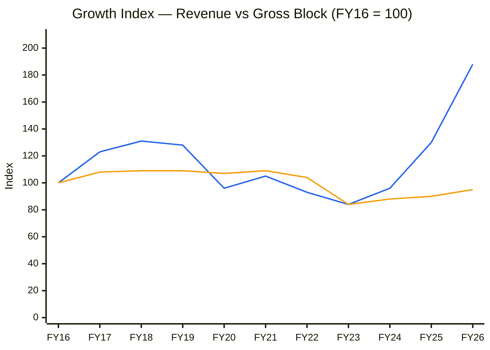
🟦 Revenue (10-yr CAGR 6.5%) · 🟧 Owned PPE gross block, ex-CWIP and ROU (−0.5%/yr; FY23 dip = reclassification to investment property and write-offs). EBITDA and PAT cannot be indexed (negative in several years); see chart C1b.

**Read:** Revenue went sideways-to-down for seven years (FY17 peak ₹4,332 Cr not regained until FY25), then almost doubled in two years, while gross block shrank 5% over the decade. Asset turnover went from 4.3× to 8.4×.

**Business inference:** The FY25–26 surge came from sweating an old, under-invested asset base (lean, debottlenecking, price), not from new capacity. That is extremely capital-efficient, but it means the next leg of volume needs the ₹1,000 Cr capex now underway, and the "free" operating-leverage phase is ending.

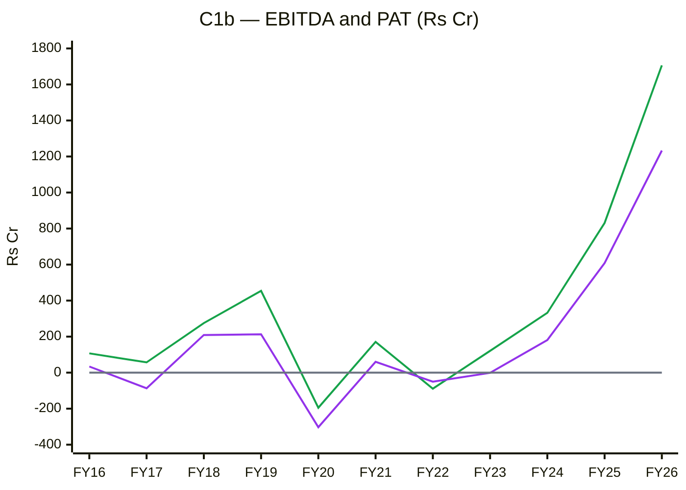
🟩 EBITDA · 🟪 PAT · ⬜ zero line (Screener standalone; FY26 PAT after ₹64 Cr labour-code exceptional)

**Read:** EBITDA was ≤ ₹454 Cr and negative in two of FY16–FY23, then went to ₹1,706 Cr in FY26 (5× FY24).

**Business inference:** The 10-year record is that of a deeply cyclical, previously loss-making contractor. Today's profits are three years old, so "normalised" earnings must sit well below FY26/TTM (→ Module 8 uses a fading margin, not 27%).

---

## Module 1 — Market, Sector and Stock Cycle

### 1A. Broad market (Marks)
| Gauge | Reading (15–16 Oct 2026) | Source |
|---|---|---|
| Nifty 50 | 22,997; −10.8% 1-yr; 26-wk −3.8%; 52-wk high 26,329 | Yahoo Finance weekly |
| Nifty vs 30-wk MA | Below; 30-wk MA 23,740 and falling (23,895 five weeks ago) → **Stage 4** | computed |
| India VIX | 14.0 (52-wk range 9.1–26.8) | Yahoo Finance |
| Capital-goods peers | ABB, Siemens, CG Power, Hitachi Energy, Siemens Energy India all below their 30-wk MAs | Yahoo Finance |

**Assessment: Cautious.** The index is in a downtrend, but volatility is not panicky. Capital goods still trade at 70–110× P/E, so the sector has not de-rated even though the market has. **Sizing: defensive.**

### 1B. Sector cycle: Power T&D equipment
**Secular vs cyclical decomposition:**
- **Secular (durable):** India targets 500 GW non-fossil by 2030 and ~800 GW renewable by 2035. CEA NEP-II transmission investment is ~$65 bn for 2026–30 and $88 bn for 2031–35, average >$15 bn/yr. GVT&D's addressable domestic market is put at $6.6 bn (2025) → $10.9 bn (2030), **~10.6% CAGR**, with HVDC+STATCOM and data centres the fastest sub-segments (company investor deck, 21–23 Sep 2026). The global grid-equipment market is $129 bn → $224 bn (2025–30, 11.7% CAGR, same deck).
- **Cyclical (will fade):** FY24–FY26 combined (a) a catch-up wave of renewable-evacuation TBCB awards, (b) a global transformer/switchgear shortage that let OEMs reprice, and (c) the roll-off of FY19–FY22 loss-making contracts. The company's +45% FY26 revenue growth is roughly ~11% market + ~10–15% share/HVDC + ~20% price/mix/catch-up. **The durable baseline to anchor a DCF is 12–15%, not 30–45%.**
- **Leading indicators turning:** Q4FY26 and Q1FY27 TBCB order intake were soft ("pipeline was soft Jan–Mar"; Q1FY27 orders −30% YoY to ₹1,137 Cr). TBCB timelines are being stretched from 18–24 to 24–30 months, which slows ordering. Management expects the FY27 domestic market to be flat to +6–7%, "not double-digit" (Q1FY27 call).
- **Competitive capacity pipeline:** every listed peer is expanding (Hitachi Energy, Siemens Energy India, CG Power, TARIL, Tier-2 switchgear makers). Four Chinese GIS vendors were recently approved for Indian tenders (Q1FY27 call). Management itself concedes that "if capacities feed only the domestic market … we'll look at an oversupply situation" (Q1FY27 call).
- **Input costs:** copper is up >50% YoY and CRGO is elevated. Transformers carry IEEMA price-variation clauses; the rest of the portfolio does not (Q1FY27 call). Q1FY27 gross margin fell 400 bp to 41.3%, with roughly 1pp attributed to commodities.
- **FX:** exports are 30–33% of revenue (EUR/USD). Imports from the group (₹270 Cr FY26) partially hedge. A net long-FX position means a 5% INR appreciation costs ~₹70–80 Cr of gross profit (~4% of EBIT).
- **Geopolitical:** export customers are mostly GE group entities, so tariff risk is mediated by the parent. The US data-centre RPT order slipped on a "change of state/voltage", and the ₹3,000 Cr RPT order is on hold for the customer's budget.

**Sector cycle verdict:** Tailwind (structural) **but maturing**. Orders are slowing at the margin, supply is responding, and pricing tailwinds are peaking. → Module 8: do **not** embed FY26 margins or 30%+ growth permanently, and widen MoS +5pp.

### 1C. Stock cycle: company positioning

**Quarterly YoY growth trajectory (C2):**
| Quarter | Revenue ₹Cr | Rev YoY | EBITDA ₹Cr | EBITDA YoY | OPM |
|---|---|---|---|---|---|
| Q2FY25 | 1,108 | 59% | 205 | 236% | 18% |
| Q3FY25 | 1,074 | 28% | 180 | 86% | 17% |
| Q4FY25 | 1,153 | 26% | 252 | 127% | 22% |
| Q1FY26 | 1,330 | 39% | 388 | 113% | 29% |
| Q2FY26 | 1,538 | 39% | 396 | 93% | 26% |
| Q3FY26 | 1,701 | 58% | 455 | 153% | 27% |
| Q4FY26 | 1,637 | 42% | 445 | 77% | 27% |
| Q1FY27 | 1,836 | 38% | 461 | 19% | 25% |
*Source: Screener standalone quarterly results (company results filings).*

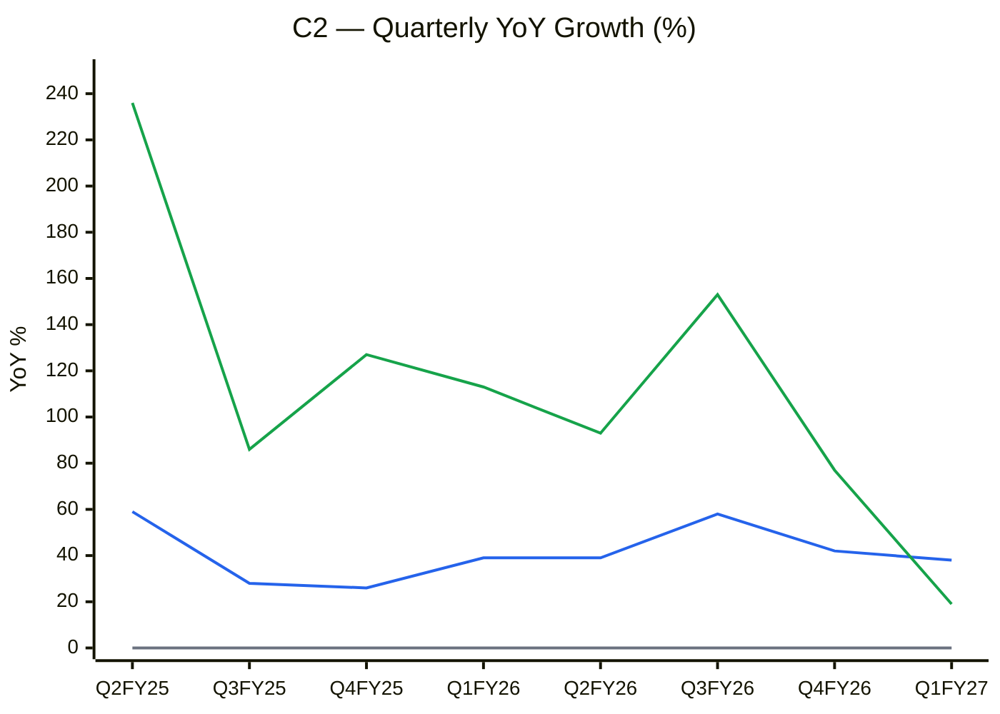
🟦 Revenue YoY · 🟩 EBITDA YoY · ⬜ zero

**Read:** Revenue growth is steady at 38–42%, but EBITDA growth has decelerated from triple digits to **19% in Q1FY27**, the first quarter where EBITDA grew slower than revenue.

**Business inference:** Operating leverage is over. Revenue now grows from backlog execution, but margins have stopped expanding and begun to give back (gross margin 48.4% → 41.3% YoY). From here EPS growth ≈ revenue growth or less. That is the textbook signature of a margin-cycle peak (→ Module 1c classification: late cycle).

**Revenue decomposition (FY24→FY26):** Volume/execution is the main driver (2× revenue on the same plants). Price is a strong secondary driver (FY24–25 repricing and legacy roll-off; management credits "higher price" and "phasing out of old backlog", Q1FY26 call). Mix helped too: exports at 4–6 pp higher margin, plus a better private/PSU mix. **Price and export mix are the fragile pieces, and both are now reversing:** export share of backlog fell from ~40% (Sep-24) and 30–35% (Nov-25) to 10–15% (Jun-26), and HVDC carries lower gross margin.

**Physical capacity model:** see Fixed Assets & Capacity (Module 10). Management: "a few factories we are loaded pretty well, a few we still have opportunity" (Q1FY27). The ₹1,000 Cr programme adds +50% transformer/reactor (Pallavaram), +25% AIS (Padappai), +25% GIS/AIS (Hosur), new HVDC LCC/VSC valve lines (Vadodara) and a new Vallam plant, phased to Dec-2028.

**Order-book revenue model:** see Module 6 tracker. FY27E revenue ≈ non-HVDC backlog ~₹13,000 Cr × ~50% burn (~₹6,500 Cr) + HVDC backlog ~₹8,400 Cr × ~5% (~₹420 Cr) + in-year book-and-bill on base orders (~₹7,500 Cr × 15% ≈ ₹1,100 Cr) ≈ **₹8,000–8,200 Cr (+30–32%)**. Management: "FY27, FY28 healthy growth … meaningful growth from FY29 onward through HVDC" (Q1FY27 call).

**Operating leverage:** contribution margin ≈ gross margin 45% ÷ EBIT margin 27% → **DOL ≈ 1.7×**. DFL = 1.0 (no debt), so **DTL ≈ 1.7×**. A 10% revenue miss means ~17% EPS miss. ICR is not meaningful (finance cost ₹15 Cr).

**Guidance accuracy:** 0.60 (WTT, Module 3). Margin guidance is consistently sandbagged; order-timing, RPT and capex-date guidance consistently slips → haircut order-timing guidance 15%.

**FCF inflection year:** FY24 (already passed; FCF ₹489 → ₹816 → ₹1,521 Cr). FY26 FCF is flattered by ~₹965 Cr of new customer advances (contract liabilities ₹305 → ₹1,270 Cr), mostly the Khavda HVDC mobilisation advance.

**Stock cycle classification: LATE CYCLE / PEAK MARGINS.** EBITDA margin 27.5% vs 10-yr average 7.2% (SD 9.2) = **+2.2 SD**. ROCE 77% vs 10-yr average 21% (SD 25.6) = **+2.2 SD**. Revenue growth is still strong, but margin is peaking. → MoS +5–10pp; position size ×0.5.

---

## Module 2 — Industry Structure & Capital Cycle

### Porter Five Forces (India HV T&D equipment)
| Force | Assessment | Signal |
|---|---|---|
| New entrants | Moderate. 765/800 kV type-tests, PGCIL qualification and HVDC references are real barriers for HVDC/EHV GIS; much lower for AIS, ≤400 kV switchgear and distribution transformers. Chinese GIS vendors were just re-admitted with 60–70% local-content rules. | Barriers eroding at the low end |
| Supplier power | Moderate. CRGO steel, copper and insulating oil are commodities; some critical components come from the GE group (₹270 Cr purchases FY26) at transfer prices | Commodity pass-through only on transformers |
| Buyer power | High structurally (L1 tenders by POWERGRID and TBCB developers; Adani alone is a large share of HVDC). Temporarily weak in the 2024–26 shortage. | Cyclical seller's market |
| Substitutes | Low. HVDC vs EHVAC is a choice within GE's own portfolio (e.g. Begunia converted to EHVAC) | — |
| Rivalry | Moderate–high. Hitachi Energy, Siemens Energy, GE Vernova, BHEL (HVDC); plus CG, TARIL, Toshiba, Tier-2 and Chinese in AC equipment | Rising with capacity |

**Industry verdict: Neutral** (attractive today because supply is tight; structurally an L1-tender oligopoly with high buyer power).

### Capital cycle (Chancellor)
| Signal | Reading | Direction |
|---|---|---|
| Industry capex vs depreciation | GVT&D 4.1× (FY26); Hitachi Energy, Siemens Energy, CG, TARIL and Shilchar all mid-expansion | Deteriorating |
| New listings in sector | Several transformer/switchgear/electrical IPOs FY24–26 | Deteriorating |
| ROIC vs 10-yr average | Sector-wide ROCE at decade highs (GVT&D 77% vs 21% avg; Hitachi 29%, CG 27%) | Peak |
| Pricing | New-order pricing "able to pass on material, not extra margin" (Q1FY27) | Plateau |

**Capital-cycle position: late cycle.** High returns are attracting capacity. The cushion is export demand (a global shortage), which management argues will absorb Indian surplus.

---

## Module 3 — Business Quality & Moat

**Greenwald's three barriers:**
1. **Supply/cost advantage:** Partial. Technology access (HVDC LCC + VSC, 800 kV GIS, 1,200 kV transformers, GridOS software) comes via the parent licence. Old factories sit on long-held land, so expansion needs no land spend (Q1FY27 call). A rival with money cannot quickly buy an HVDC reference list. But the technology is licensed, not owned, and paid for with a royalty.
2. **Customer captivity:** Weak. Utilities and TBCB developers tender on L1 price. Some captivity exists in installed-base services (100+ grid control centres, 800+ power transformers, HVDC refurbishments such as Chandrapur) and in group back-to-back exports.
3. **Local economies of scale:** No.

**Buffett moat test (raise price 10%?):** Passed in FY24–26 (gross margin 40.4% → 45.3% while commodities rose), **failed in FY16–FY23** (OPM −6% to +11%). Pricing power is cycle-dependent.

**Moat durability:**
| Test | Result |
|---|---|
| ROIC > WACC for 10 yrs | **Fail.** ROCE < 13% WACC in 6 of 11 years (FY16, 17, 20, 21, 22, 23) |
| Market share stability | Gaining now (revenue +45% vs TAM +~21% in 2026 per deck); historically lost share FY18–FY23 |
| Pricing power through inflation | Cycle-dependent (above) |
| Activity system | Strong. Lean, localisation and GE global procurement plus the export channel reinforce each other |

**Moat verdict: NARROW, cycle-dependent.** Source: technology/qualification (supply side) plus the parent export channel. Buffett type: switching cost (weak) and low-cost (localised). **Market share 5-yr:** Gaining (after losing FY18–23).

### Fisher 15-Point
| # | Point | Score |
|---|---|---|
| 1 | Market potential | 3 |
| 2 | New products (VSC HVDC, STATCOM, GridOS, data-centre packages) | 3 |
| 3 | R&D effectiveness (parent-owned IP; royalty) | 2 |
| 4 | Sales organisation (tender-driven) | 2 |
| 5 | Profit margin (27%) | 3 |
| 6 | Margin improvement (lean, underwriting) | 3 |
| 7 | Labour relations | 2 |
| 8 | Executive relations | 2 |
| 9 | Management depth (GE bench) | 2 |
| 10 | Cost/accounting controls (Deloitte, clean opinion) | 3 |
| 11 | Industry-specific advantages | 2 |
| 12 | Long-range orientation (cautious capex; surplus parked in parent pool) | 2 |
| 13 | Dilution (none in a decade) | 3 |
| 14 | Candour in adversity (withholds order values; FY20–23 losses) | 2 |
| 15 | **Integrity (veto)** | **2 — Pass.** RPT-heavy, but every material RPT is shareholder-approved and disclosed |
| **Total** | | **36 / 45** |

---

## Module 4 — Management & Capital Allocation

**Promoter:** Grid Equipments Pvt Ltd and GE Grid Alliance B.V. (GE Vernova) = **51.00%** (Jun-26), down from 75.00% via two OFSs: Sep-2024 (11.7% + green-shoe, floor ₹1,400) and Nov-2024 (8.38%, floor ₹1,550) ([BSE filing](https://www.bseindia.com/xml-data/corpfiling/AttachHis/8FFBA48E-FE79-4277-B91D-DEE6E3EFA9C3-171838.pdf); [Business Standard](https://www.business-standard.com/companies/news/ge-vernova-t-d-promoter-to-sell-8-3-pc-stake-via-ofs-124112501195_1.html)). **Pledge: 0%.** Pledge risk: Normal. Further sales below 51% would cede control, so no near-term overhang is expected (⚠️ not confirmed by the parent).

| Holder | Sep-24 | Dec-24 | Jun-25 | Dec-25 | Mar-26 | Jun-26 |
|---|---|---|---|---|---|---|
| Promoter | 59.38 | 51.00 | 51.00 | 51.00 | 51.00 | 51.00 |
| FII | 6.82 | 12.04 | 14.49 | 18.46 | 20.39 | 22.89 |
| DII | 25.61 | 28.40 | 26.75 | 23.27 | 21.39 | 18.46 |
| Public | 8.19 | 8.55 | 7.74 | 7.26 | 7.22 | 7.65 |
*Source: BSE shareholding pattern via Screener. Shareholders 74k → 1.38 lakh.*

**Capital allocation (10-yr):**
- Capex below depreciation FY17–FY24 (under-investment and harvest under Alstom→GE), then ₹1,000 Cr+ expansion from FY25 (capex/dep 1.9× FY25, 4.1× FY26).
- Dividend payout 21% FY25–26 (₹10/share FY26 = ₹256 Cr). No buybacks. No acquisitions. **Zero dilution in 10+ years.**
- **Surplus cash lent to the parent's cash pool:** ICD to LM Wind Power Blades (India) Pvt Ltd, the GE Vernova cash-pool leader, was **₹971 Cr at 31-Mar-26 (₹578 Cr Mar-25) = 36% of equity**, repayable on demand, at **5.49–6.47%** (FY25: 6.47–7.14%). Gross lending in FY26 was ₹3,843 Cr. Shareholder-approved limit is ₹1,000 Cr outstanding. Since 29-Sep-2025 it has been guaranteed by GE Vernova Inc., but **the guarantee lapses 31-Dec-2026** (AR FY26 note 15). Interest earned was ₹39 Cr.
- **Royalty and fees to parent:** technology licence fee ₹117.8 Cr (FY25 ₹63.7 Cr) + trademark fee ₹42.5 Cr (₹35.0 Cr) = **₹160 Cr, 2.6% of revenue (FY25 2.3%)**. This grew 62% vs revenue +45% (AR FY26 note 37). Management says it is a "revenue-linked formula … broadly consistent" (Q4FY26 call), but the rate is drifting up.
- **Sales to group:** ₹1,633 Cr = **26% of FY26 revenue** (FY25 ₹661 Cr, 15%). Largest buyers: Grid Solutions SAS France ₹709 Cr, UK Grid Solutions ₹257 Cr, Grid Solutions Middle East ₹213 Cr (AR FY26 note 37).
- FCF/share vs EPS (5-yr): cumulative FY22–26 CFO ₹3,103 Cr vs PAT ₹1,971 Cr (1.57×). FCF/share has outrun EPS, helped by customer advances.

**Capital allocation rating: Average.** The balance sheet is pristine and there is no dilution, but ~₹1,600 Cr of surplus cash earns ~6% in the parent's pool against a 77% operating ROCE. A special dividend or buyback is "under evaluation, nothing concrete" (Q1FY27 call).

**Key RPT concerns:** (1) the cash-pool ICD at 36% of equity, below FD-equivalent yields, with the guarantee lapsing Dec-2026; (2) a rising royalty rate; (3) 26% of revenue from group entities at transfer prices. Mitigants: majority-of-minority approvals, disclosed rates, a parent guarantee and a Big-4 auditor.

**Buffett's Three C's:** Candour: Medium (detailed margin bridges, but order values withheld "for customer confidentiality"). Competence: High (−3% → 27% margin turnaround). Caring: Medium (dividend raised; cash recycled to the parent; parent sold 24% at ₹1,400–1,550).

### Walk the Talk Scorecard
| Quarter Guided | Statement | Guided | Actual | Verdict |
|---|---|---|---|---|
| Q4FY25 (May-25) | FY26 EBITDA margin | "low 20s" | 27.1% (company basis) | ✅ beat (sandbag) |
| Q2FY26 (Nov-25) | FY26 EBITDA margin | "mid-20s" | 27.1% | ✅ beat |
| Q3FY26 (Jan-26) | FY26 margin | "higher end of mid-20s" | 27.1% | ✅ |
| Q2FY25–Q1FY26 | Base orders ~₹7,000–8,000 Cr/yr | ₹7,000–8,000 Cr | FY26 total ₹14,776 Cr; base ≈ ₹7,400–8,400 Cr (est., ex-HVDC) | ✅ |
| Q3FY25 (Feb-25) | Export revenue to pick up | ↑ | FY26 exports ₹2,030 Cr vs ₹1,110 Cr (+83%) | ✅ |
| Q4FY25 (May-25) | Khavda-Olpad and a Rajasthan HVDC package "upfront in ordering timeline" (FY26) | FY26 | Khavda won Dec-25 ✅; Rajasthan (Barmer) only L1 Sep-26 | ❌ timing (~2 qtrs late) |
| Q4FY26 (May-26) | US data-centre RPT order (≤₹1,300 Cr) to book in Q1FY27 | Q1FY27 | Not booked; now "Q2 or Q3" | ❌ |
| FY26 AGM/calls | ₹3,000 Cr RPT export order expected H2FY27 | H2FY27 | Put on hold by end-customer | 🔴 reversal |
| Q4FY26 (May-26) | Vallam plant (₹55 Cr) by Dec-2026 | Dec-26 | Part capacity "Q1 of '27", balance end-'27 | ❌ ~1-yr slip |
| Q4FY26 (May-26) | FY27 EBITDA "mid-20s" | ~25% | Q1FY27 25.1% | ✅ (in progress) |
| Q4FY26 | Base orders ≥ ₹7,000 Cr in FY27 | ≥₹7,000 Cr | Q1 ₹1,137 Cr (−30%) | ⏳ not scored |

**WTT Score: 0.60 / 1.00 — MODERATE**
**Guidance points assessed:** 10 | Hits: 6 | Near misses: 0 | Misses: 3 | Reversals: 1
**Key pattern:** two-way. **Financial guidance is sandbagged** (margin beats every year), while **order-timing, RPT and capex-date statements slip one-way** (one-way misses).
**Insider action:** Promoter sold 24% via OFS in Sep/Nov-2024 at ₹1,400–1,550 (parent capital recycling, before the stock rose 2.5×). No open-market insider buys found → **NEUTRAL-to-BEARISH**.
**DCF impact:** margin guidance used as-is (base FY27 25%). Order-conversion timing haircut 15% (HVDC and RPT orders lagged one to two quarters in the base case).
**Overall management credibility: MODERATE-HIGH on numbers, LOW on timing.**

---

## Module 5 — Financial Forensics

### 5A. Indian-specific red flags
| Check | Finding | Flag? |
|---|---|---|
| Promoter pledge | 0% | No |
| ICD to group / equity | ₹971 Cr / ₹2,690 Cr = **36%** (> 20% investigate; > 30% hard-stop zone *unless arm's-length*). Arm's-length evidence: shareholder approval, disclosed market-linked rate, GE Vernova Inc. guarantee to 31-Dec-2026 | **⚠️ Yes — investigated, hard stop not triggered (arm's-length evidence exists). Monitor guarantee renewal.** |
| RPT pricing | 26% of revenue to group; royalty 2.6% of revenue and rising | ⚠️ Watch |
| Corporate guarantees for group | None disclosed | No |
| Auditor | Deloitte Haskins & Sells; unqualified FY26; re-appointed for second 5-yr term; no resignation | No |
| KAMs (FY26) | (1) Revenue recognition on over-time contracts (cost-to-complete, LDs, claims); (2) tax claims and litigations | Normal for EPC |
| Contingent liabilities | ₹469 Cr (GST/sales tax ₹267 Cr, customs/excise ₹136 Cr, direct tax ₹33 Cr, legal ₹33 Cr) = 17% of equity | Low |
| Revenue quality (EPC) | Trade receivables ₹2,172 Cr (+48%), incl. retention ₹853 Cr; contract assets ₹372 Cr; provision for doubtful assets ₹39 Cr FY26 (₹77 Cr FY25) | Moderate. Debtors grew in line with revenue |
| Chennai land | 4.84-acre leased land at Chennai: lease expired 1989, SLP dismissed by SC (Sep-24); fresh lease sought | ⚠️ Minor asset-title risk |

### 5B. Quantitative models (FY26 vs FY25, standalone ₹ mn from AR FY26)
| Model | Value | Verdict |
|---|---|---|
| **Beneish M-Score** | **−2.47** (DSRI 1.02, GMI 0.89, AQI 0.77, SGI 1.45, DEPI 1.15, SGAI 0.85, LVGI 1.05, TATA −0.06) | Unlikely manipulator (< −2.22). SGI alone adds +1.29 |
| **Altman Z''** | **4.51** (X1 0.21, X2 0.34, X3 0.22, X4 0.53) | Safe (> 2.60) |
| **Piotroski F** | **8 / 9** (fails only asset turnover: 0.80 vs 0.92 on year-end TA, inflated by cash and advances) | Strong |
| **Sloan accrual** | +0.5% (−5.8% treating ICD lending as financing) | Acceptable |
| Cumulative CFO / PAT | 10-yr 1.88× · 5-yr 1.57× | High quality |

### 5C. Schilit screen
EMS: DSO 128 days (FY25 125). Cash collections roughly match. Other income/EBIT 5% (FY26 ₹91 Cr incl. ₹80 Cr interest). Capex/dep 4.1× is explained by the announced expansion. No big bath; the FY26 ₹69 Cr labour-code charge was a genuine statutory item and ₹5.7 Cr was reversed in Q4. **One watch item:** FY26 had an unrealised derivative loss of ₹50 Cr (FX hedges on exports).
CFS: No factoring disclosed. **Payables days rose 146 → 170 and contract liabilities rose ₹965 Cr.** FY26 CFO ₹1,710 Cr is therefore flattered by working-capital inflows (advances + payables up ₹1,786 Cr vs receivables + inventory up ₹1,268 Cr). Expect CFO < PAT in a year when HVDC advances are consumed.

**Forensic red-flag count: 2 / 15** (ICD to group; CFO flattered by advances). **Overall forensic verdict: Minor concerns — clean accounts, related-party economics to monitor.**

---

## Module 5b — Earnings Quality & Financial Statements

### 10-year financials (standalone, ₹ Cr; Screener / annual reports)
| FY | Sales | EBITDA | OPM | PAT | EPS ₹ | CFO | FCF | Equity | Debt | ROCE | Debtor d | Inv d | Payable d |
|---|---|---|---|---|---|---|---|---|---|---|---|---|---|
| FY16 | 3,303 | 107 | 3.2% | 34 | 1.35 | −91 | −141 | 1,178 | 504 | 10% | 228 | 511 | 823 |
| FY17 | 4,052 | 57 | 1.4% | −87 | −3.38 | 188 | 142 | 1,033 | 518 | 7% | 205 | 542 | 805 |
| FY18 | 4,332 | 275 | 6.3% | 209 | 8.15 | 1,054 | 1,043 | 1,189 | 100 | 30% | 152 | 234 | 389 |
| FY19 | 4,219 | 454 | 10.8% | 213 | 8.31 | −355 | −362 | 1,428 | 81 | 31% | 175 | 136 | 247 |
| FY20 | 3,159 | −195 | −6.2% | −303 | −11.82 | −260 | −292 | 1,051 | 599 | −14% | 219 | 177 | 272 |
| FY21 | 3,452 | 171 | 5.0% | 60 | 2.36 | 311 | 324 | 1,122 | 316 | 11% | 201 | 143 | 275 |
| FY22 | 3,066 | −89 | −2.9% | −50 | −1.94 | 8 | −17 | 1,080 | 226 | −9% | 186 | 159 | 283 |
| FY23 | 2,773 | 121 | 4.4% | −1 | −0.06 | −37 | −54 | 1,073 | 273 | 8% | 204 | 119 | 197 |
| FY24 | 3,168 | 332 | 10.5% | 181 | 7.07 | 518 | 489 | 1,243 | 42 | 23% | 166 | 103 | 156 |
| FY25 | 4,292 | 831 | 19.4% | 608 | 23.76 | 904 | 816 | 1,773 | 35 | 55% | 125 | 100 | 146 |
| FY26 | 6,206 | 1,706 | 27.5% | 1,233 | 48.17 | 1,710 | 1,521 | 2,690 | 24 | 77% | 128 | 132 | 170 |
| TTM Jun-26 | 6,712 | 1,757 | 26.2% | 1,305 | 50.98 | | | | | | | | |
*FY15 was a 15-month year (Dec→Mar change) and is excluded. Debt = lease liabilities from FY24.*

**ROIC:** Operating invested capital is roughly zero to negative. Net fixed assets ₹448 Cr + NWC of −₹870 Cr (contract liabilities and payables exceed receivables and inventory, ex-cash/ICD) gives FY26 ROIC ≫ 100%, which is not meaningful. **ROCE (capital employed incl. cash): FY26 77%, 10-yr average 21%, 10-yr median 11%. WACC 13%** (Rf 7%, β ~1.0–1.1, ERP 6%, no debt). Spread +64pp today, but negative in 6 of 11 years. **ROIC trend (3-yr):** sharply improving. **Driver:** margin-led (EBIT margin −0.3% → 27.2%). **Economic profit:** strongly positive since FY24.

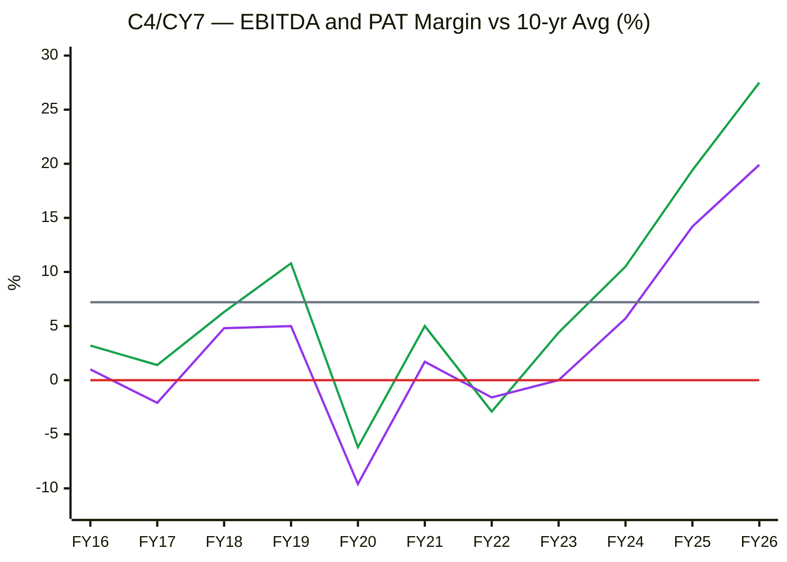
🟩 EBITDA margin · 🟪 PAT margin · ⬜ 10-yr avg EBITDA margin 7.2% (median 5.0%, SD 9.2) · 🟥 zero

**Read:** FY26 EBITDA margin 27.5% is the 100th percentile of the decade and +2.2 SD above average. Before FY25 it never exceeded 11%.

**Business inference:** This is a margin super-cycle, not a stable franchise margin. Management guides "mid-20s" for FY27, and Q1 has already slipped to 25.1%. Even a reversion to a 18–20% "new normal" (still 2.5× the old average) would cut EPS by a quarter (→ bear and base cases fade margins).

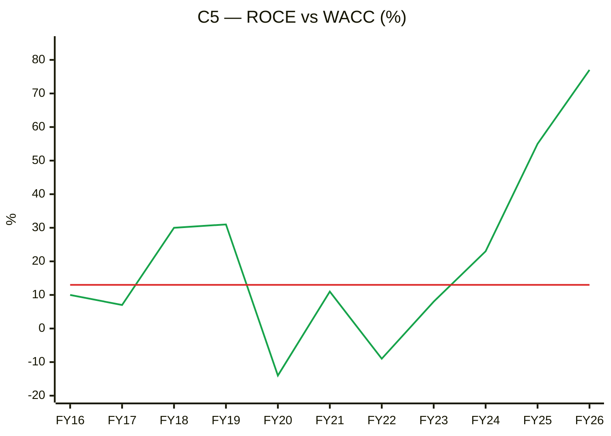
🟩 ROCE (Screener) · 🟥 WACC 13%

**Read:** ROCE was below WACC in 6 of 11 years, then went to 77% (+64pp spread).

**Business inference:** Returns are spectacular but young. The moat has only been proven for three good years. A business whose ROCE swung from −14% to +77% inside six years deserves a cyclical (mean-reverting) valuation, not a perpetual-compounder multiple.

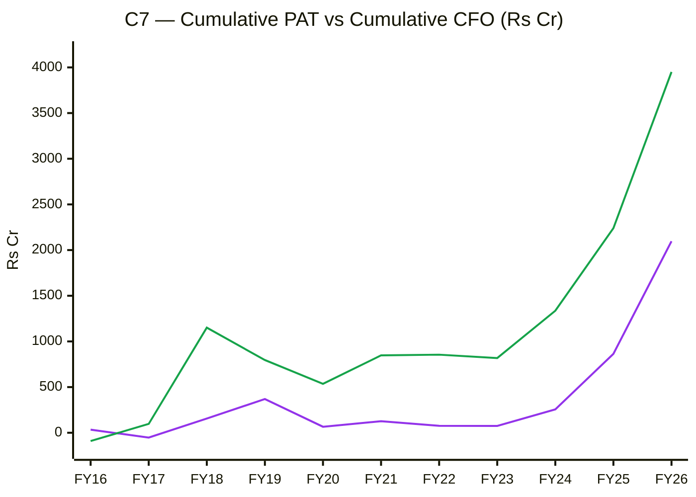
🟪 Cumulative PAT · 🟩 Cumulative CFO

**Read:** 10-yr cumulative CFO ₹3,950 Cr vs PAT ₹2,097 Cr, a ratio of **1.88×**.

**Business inference:** Profits convert to cash and more, because customers (advances, milestone billing) and suppliers fund the working capital. Part of the gap is timing: the ₹965 Cr FY26 jump in customer advances will unwind as HVDC executes, so expect a CFO dip in FY28–29.

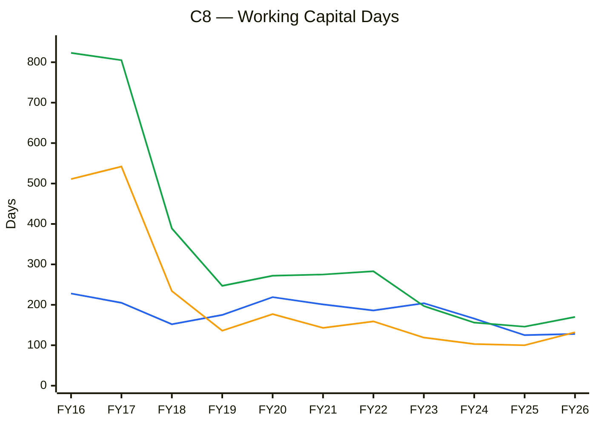
🟦 Debtor days · 🟧 Inventory days · 🟩 Payable days (Screener; FY16–17 distorted by the Ind AS transition)

**Read:** Debtor days fell from ~200 (FY20–23) to 125–128. Inventory days rose 100 → 132 in FY26 (HVDC/large-project WIP).

**Business inference:** De-risking the customer book (state utilities from >10% to 2%) structurally cut receivable days, which is real and durable. Rising inventory with stretched payables is the first sign that HVDC execution will absorb working capital.

### DuPont (5-factor, year-end balances)
| Year | EBIT Margin | Asset Turnover | Equity Multiplier | Interest Burden | Tax Burden | ROE |
|---|---|---|---|---|---|---|
| FY22 | −0.3% | 0.81 | 3.49 | n.m. | n.m. | −4.6% |
| FY23 | 3.2% | 0.75 | 3.43 | 0.31 | n.m. | −0.1% |
| FY24 | 9.6% | 0.88 | 2.88 | 0.87 | 0.69 | 14.6% |
| FY25 | 19.7% | 0.92 | 2.63 | 0.97 | 0.74 | 34.3% |
| FY26 | 27.2% | 0.80 | 2.88 | 0.98 | 0.75 | 45.8% |
| **Change FY23→26** | **+24 pp** | +0.05 | −0.55 | +0.67 | n.m. | **+46 pp** |

**Operating contribution (EBIT margin × AT):** sharply improving (0.02 → 0.22). **Financing contribution:** falling (no debt; the equity multiplier reflects advances/payables, not borrowing).
**DuPont verdict:** ROE expansion is **purely operational, margin-led**. Leverage is not masking anything; the risk is the reverse, a margin mean-reversion that would hit ROE one-for-one.
**Peer DuPont:** Hitachi Energy ROE 22% (EBITDA margin 16%), ABB 22% (15%), CG Power 20% (13%). GVT&D's premium ROE comes from margin, not leverage.
**AT trend → Module 10 base AT:** gross-block AT 8.4× FY26 vs 5-yr average 5.5× → base uses ~6–7× blended on the expanded block (HVDC bought-outs lift it).

**OCF / NI (5-yr):** 1.57 → High. **O'Glove red flags:** 2/15 (#5 rising DPO; #6 capex/dep > 2.5×, explained by expansion). **Key accounting concern:** none material; monitor over-time revenue recognition on HVDC (KAM 1).

---

## Module 6 — Industry KPIs & Peer Analysis

**Sector:** Electrical Equipment & Turnkey Electrical Solutions (Order-driven Capital Goods).

| KPI | GVT&D | Healthy range (KPI ref.) | Assessment |
|---|---|---|---|
| Order book / revenue | 3.1× (Jun-26); 5.1× incl. Barmer L1 | > 1.5× | Above |
| Order inflow growth | FY26 +37% (₹14,776 Cr); Q1FY27 −30% | > 20% sustained | Mixed (lumpy) |
| NWC days / debtor days | NWC ~6 days; debtors 128 | NWC < 100; debtors < 90 | NWC excellent; debtors above range (retention 39% of receivables) |
| EBITDA margin | 27.5% FY26; 25.1% Q1FY27 | 11–18% | Far above (peak) |
| Execution velocity (rev ÷ opening OB) | FY26 0.49 (FY25 0.68) | > 0.6 | Below and falling (HVDC slow burn) |
| ROCE | 77% | > 18% | Far above |
| CFO/PAT (5-yr) | 1.57× | > 0.7× | Above |
| Net debt / EBITDA | Net cash | < 2× | Above |

### Peer comparison (Screener, 15–16 Oct 2026)
| Metric | **GVT&D** | Hitachi Energy India | Siemens Energy India | ABB India | CG Power | Siemens Ltd |
|---|---|---|---|---|---|---|
| M-cap (₹ Cr) | 1,01,114 | 1,28,235 | 1,05,305 | 1,44,437 | 1,28,873 | 1,30,625 |
| Revenue 3-yr CAGR | **31%** | 22% | n.a. (listed 2025) | 16% | 21% | 15% |
| EBITDA margin (latest FY) | **27.5%** | 16% | 21% (TTM) | 15% (CY25) | 13% | 12% |
| ROCE | **77%** | 29% | 68% | 30% | 27% | 21% |
| Net debt | Net cash | Net cash | Net cash | Net cash | Net cash | Net cash |
| P/E (TTM) | 74.9× | 108× | 69× | 94× | 101× | 87× |
| 1-yr price return | +36% | +72% | −6% | +32% | +13% | +16% |

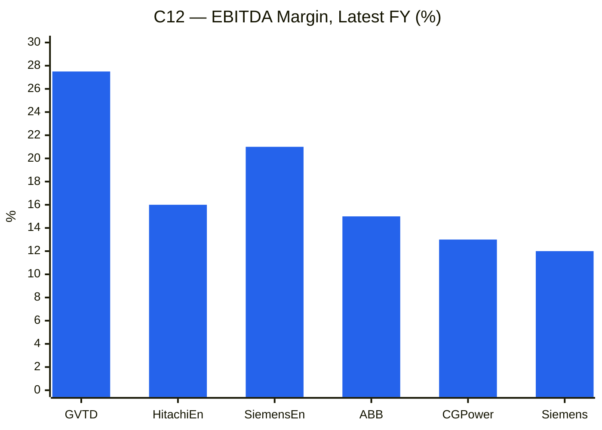
**Read:** GVT&D earns the sector's highest margin (27.5% vs a peer median of ~15%) yet trades at one of the lower P/Es (75× vs a median of ~94×).

**Business inference:** Relative to peers, the stock looks cheap. But the whole peer group trades at 70–110× earnings on peak-cycle margins, so being the cheapest in an expensive basket is not a margin of safety. The market is (rightly) capitalising GVT&D's margin at a discount because it is the one most above its own history.

**Peer positioning:** Discount on P/E, premium on returns. Justified? Partly (margin sustainability risk is highest for GVT&D).

### Order Book Tracker
*Generated 2026-10-16 by `scripts/order_book_tracker.py` from 12 order announcements (0 follow-ups excluded) and 12 period snapshots. Ledger coverage starts 2024-04-01; earlier periods show "—" for announced inflow (unknown, not zero). (est.) = tracked estimate: previous disclosed order book + announced orders − order-linked revenue. **GVT&D does not file values for most domestic orders.** Three ledger values are analyst estimates, labelled in the notes: Khavda VSC ~₹6,300 Cr and Chandrapur ~₹1,100 Cr (derived from quarterly intake), and Barmer L1 ₹12,980 Cr (Nomura).*

#### 1. Disclosed vs tracked order book (reconciliation)

| Period | Revenue (₹ Cr) | Order book (₹ Cr) | Announced inflow | of which Framework | Implied inflow | Announced coverage | OB cover (× TTM rev) | Source |
|---|---|---|---|---|---|---|---|---|
| FY22 | 3,066 | 3,700 | — | — | — | — | 1.2 | Investor deck Sep-2026 (backlog Rs37bn) |
| FY23 | 2,773 | 3,700 | — | — | 2,773 | — | 1.3 | Investor deck Sep-2026 |
| FY24 | 3,168 | 6,270 | — | — | 5,738 | — | 2.0 | Q4FY25 call (Rs62.7bn) |
| Q1FY25 | 958 | 5,312 (est.) | 0 | — | — | — | 1.6 | Screener quarterly |
| Q2FY25 | 1,108 | 9,840 | 3,046 | — | 5,636 | 54% | 2.6 | Q2FY25 call (Rs98.4bn) |
| Q3FY25 | 1,074 | 10,780 | 800 | — | 2,014 | 40% | 2.7 | Q3FY25 call (Rs107.8bn) |
| Q4FY25 | 1,153 | 12,660 | 500 | — | 3,033 | 16% | 2.9 | Q4FY25 call (Rs126.6bn) |
| Q1FY26 | 1,330 | 12,960 | 0 | — | 1,630 | 0% | 2.8 | Q1FY26 call (Rs129.6bn) |
| Q2FY26 | 1,538 | 13,110 | 0 | — | 1,688 | 0% | 2.6 | Q2FY26 call (Rs131.1bn) |
| Q3FY26 | 1,701 | 14,380 | 7,400 | — | 2,971 | 249% | 2.5 | Q3FY26 call (Rs143.8bn) |
| Q4FY26 | 1,637 | 21,460 | 0 | — | 8,717 | 0% | 3.5 | Q4FY26 call (Rs214.6bn) |
| Q1FY27 | 1,836 | 20,930 | 0 | — | 1,306 | 0% | 3.1 | Q1FY27 deck (Rs209.3bn) |

*Implied inflow = OB(t) − OB(t−1) + order-linked revenue(t). Q2FY25 implied inflow spans two quarters (Q1FY25 order book not disclosed). **Coverage extremes explained:** Q3FY26 at 249% and Q4FY26 at 0% are a timing mismatch. The Khavda VSC contract was signed and announced 20-Dec-2025 but booked into the order book in Q4FY26 on reaching a commercial milestone (Q3FY26 call). Combined Q3+Q4 coverage is 7,400 ÷ 11,688 = 63%. Low coverage elsewhere is because GVT&D announces only material (mostly PSU or group) orders; TBCB private orders are rarely filed.*

#### 2. Announced orders aggregated by quarter

| Quarter | # orders | Total (₹ Cr) | Firm | Framework | Largest single | Export | Govt/PSU/Defence | Private domestic |
|---|---|---|---|---|---|---|---|---|
| Q2FY25 | 6 | 3,046 | 3,046 | 0 | 929 | 2,251 | 795 | 0 |
| Q3FY25 | 2 | 800 | 800 | 0 | 400 | 0 | 0 | 800 |
| Q4FY25 | 1 | 500 | 500 | 0 | 500 | 0 | 500 | 0 |
| Q3FY26 | 2 | 7,400 | 7,400 | 0 | 6,300 | 0 | 1,100 | 6,300 |
| Q2FY27 | 1 | 12,980 | 12,980* | 0 | 12,980 | 0 | 12,980 | 0 |
*\*Q2FY27 is an L1 position (not yet LoA); the script counts L1 under "Firm" in this column. Treat it as non-firm.*

#### 3. Macro picture

| Metric | Value |
|---|---|
| Latest disclosed order book | ₹20,930 Cr (Q1FY27) |
| Orders announced since that disclosure | ₹12,980 Cr (1 order, L1, value = analyst estimate) |
| Tracked order book today (before execution since Q1FY27) | ₹33,910 Cr (₹20,930 Cr excl. L1) |
| Order book cover (latest) | 3.1 × TTM revenue (5.1× incl. L1) |
| Framework / "potential value" agreements | ₹0 Cr |
| Orders announced, last 12 months | ₹20,380 Cr (3 orders, all HVDC) |
| Top-3 orders (last 12 m) as % of disclosed OB | 97% (Khavda VSC alone ~30% of the Jun-26 book) |
| Book-to-bill (TTM, implied) | 2.19 (₹14,682 Cr ÷ ₹6,712 Cr) |
| Execution rate (revenue ÷ opening OB) | FY25 0.68 → FY26 0.49 (falling) |

**Geography mix, last 12 months (announced):** Domestic 100%. Disclosed Q1FY27 intake was 46% export, mostly group.
**Customer mix of backlog (Jun-26, company):** Private 77% · Central utilities/PSU 21% · State utilities 2%.
**Segment mix, last 12 months (announced):** HVDC LCC 64% · HVDC VSC 31% · HVDC refurbishment 5%.
**Firmness mix, last 12 months:** L1 64% · Firm 36%.

#### 4. Charts

**OB-1: Order book vs revenue (TTM), index = 100 at FY22**

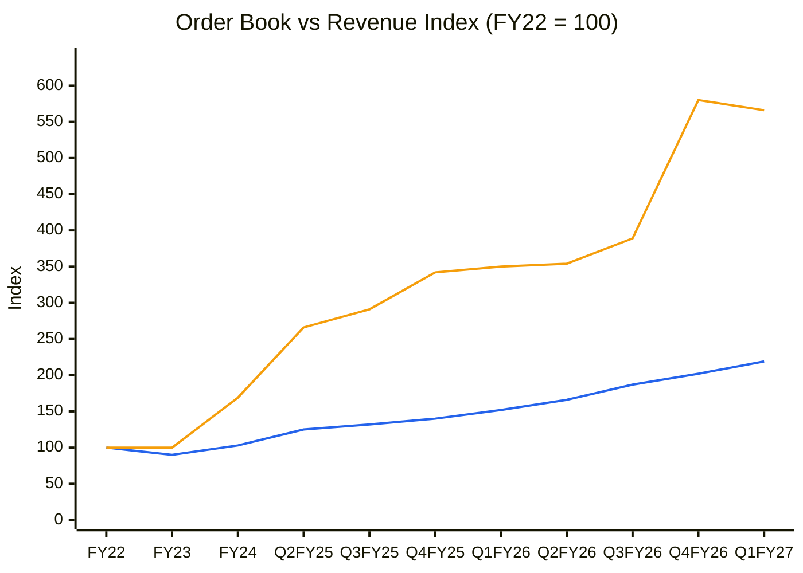
🟦 Revenue (TTM) · 🟧 Order book (disclosed points only; x-axis mixes FY and quarter-ends)

**Read:** Since FY22 the order book is up 5.7× vs TTM revenue 2.2×. The gap widened sharply in Q4FY26 with the Khavda VSC HVDC.

**Business inference:** Demand is not the binding constraint; execution tenor is. About 40% of the book is back-ended HVDC, so the cover overstates near-term revenue visibility. FY27–28 growth must come from the ~₹13,000 Cr non-HVDC book plus base orders, which turned soft in Q4FY26–Q1FY27.

**OB-2: Order book cover (years of TTM revenue)**

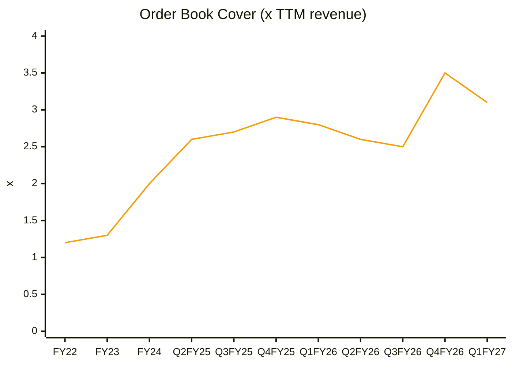
🟧 Order book / TTM revenue

**Read:** Cover rose from 1.2× to 3.5× (Mar-26) and eased to 3.1× as execution outpaced a soft Q1 intake.

**Business inference:** Visibility is multi-year and real, but cover was falling (2.9× → 2.5×) during FY26 before the HVDC lump. Without HVDC, base ordering is not keeping pace with 40% revenue growth, which is why management's ₹7,000 Cr base-order guidance matters more than the HVDC headlines.

**OB-3: Aggregated announced orders vs revenue, by quarter (₹ Cr)**

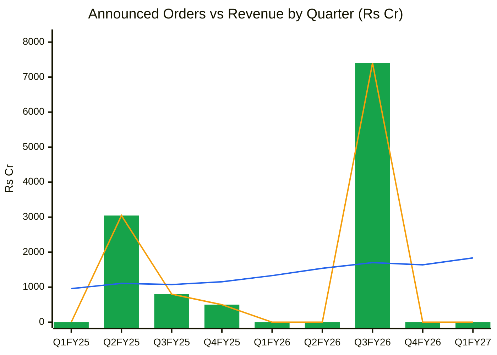
🟩 All announced orders (bars) · 🟧 Firm orders only (no framework deals here, so it overlaps the bars) · 🟦 Revenue

**Read:** Announced orders are lumpy: two quarters (Q2FY25 group exports, Q3FY26 HVDC) make up 90% of announced value. Q2FY27's ₹12,980 Cr Barmer L1 falls outside the chart window.

**Business inference:** The headline order story rests on a few mega-contracts from a few customers (Adani, POWERGRID, GE group). This is concentration risk, and it is why the stock reacts sharply to single awards (+8–9% on the Barmer L1, 8-Sep-2026).

**OB-4: Implied order inflow vs revenue (₹ Cr)**

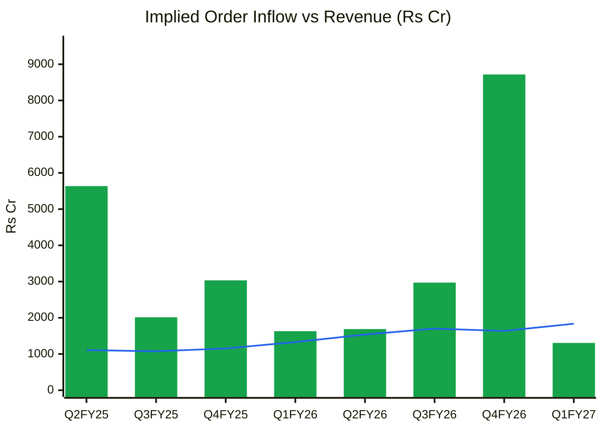
🟩 Implied inflow = ΔOB + revenue (Q2FY25 spans two quarters) · 🟦 Revenue

**Read:** Excluding the Q4FY26 HVDC quarter, implied inflow has trailed revenue in 3 of the last 4 quarters (Q1FY26 1,630 vs 1,330; Q2FY26 1,688 vs 1,538; Q1FY27 **1,306 vs 1,836**).

**Business inference:** Quarterly base book-to-bill is drifting below 1 while revenue grows ~40%. Unless TBCB ordering recovers in H2FY27 (management expects it to), FY29+ revenue rests on HVDC execution. That is lumpy, lower-gross-margin and back-ended, so the FY28 growth "air pocket" risk is real.

#### 5. Order Ledger: every announced order (source of truth; the next run appends here)

| order_id | date | customer | customer_type | segment | geography | value_cr | currency | value_fc | firmness | tenor_months | linked_to | source | notes |
|---|---|---|---|---|---|---|---|---|---|---|---|---|---|
| GVTD-2407-01 | 2024-07-03 | Grid Solutions SAS France (group) | Export | HV products | Export | 577 | EUR | 64 | Firm | 24 |  | [BSE](https://www.bseindia.com/xml-data/corpfiling/AttachHis/cbf9b30b-7da6-4ad4-86e5-c15efee28eb7.pdf) | RPT export; INR at ~90/EUR (filing gave EUR only) |
| GVTD-2407-02 | 2024-07-03 | Grid Solutions Middle East FZE (group) | Export | HV products | Export | 234 | EUR | 26 | Firm | 24 |  | [BSE](https://www.bseindia.com/xml-data/corpfiling/AttachHis/3078a7a1-e3ab-4fe8-b531-c3a631b9ef87.pdf) | RPT export; INR at ~90/EUR |
| GVTD-2407-03 | 2024-07-14 | POWERGRID | PSU | Grid automation (SCADA/EMS) | Domestic | 490 | INR |  | Firm | 18 |  | [BSE](https://www.bseindia.com/xml-data/corpfiling/AttachHis/27e2b2c6-0fb4-40c3-88b1-0e438f27d4af.pdf) | ULDC Ph-III Northern region; basic price ex-GST |
| GVTD-2408-01 | 2024-08-07 | POWERGRID | PSU | Grid automation (SCADA/EMS) | Domestic | 305 | INR |  | Firm | 18 |  | [BSE](https://www.bseindia.com/xml-data/corpfiling/AttachHis/afdd499a-ffd1-4a09-ada2-1565c823eb83.pdf) | ULDC Ph-III Eastern region |
| GVTD-2409-01 | 2024-09-11 | Grid Solutions SAS France (group) | Export | HVDC transformers | Export | 929 | EUR | 100 | Firm | 54 |  | [BSE](https://www.bseindia.com/xml-data/corpfiling/AttachHis/3dfd50d8-4a30-41b6-b3c5-c38163727d25.pdf) | RPT export to 2029 (UK HVDC transformers); INR at ~92.9/EUR |
| GVTD-2409-02 | 2024-09-11 | Grid Solutions Middle East FZE (group) | Export | HV products | Export | 511 | EUR | 55 | Firm | 60 |  | [BSE](https://www.bseindia.com/xml-data/corpfiling/AttachHis/81930138-e3ff-4ca5-9dc5-2209f51e9617.pdf) | RPT export over 5 yrs; INR at ~92.9/EUR |
| GVTD-2412-01 | 2024-12-09 | Sterlite Power | Private | Transformers & reactors | Domestic | 400 | INR |  | Firm | 24 |  | [BSE](https://www.bseindia.com/xml-data/corpfiling/AttachHis/4b9b3484-16af-4de6-bd6b-1e6303d74e3a.pdf) | 765kV transformers/reactors for Khavda (approx) |
| GVTD-2412-02 | 2024-12-19 | Sterlite Grid 32 | Private | HV equipment (TBCB) | Domestic | 400 | INR |  | Firm | 24 |  | [BSE](https://www.bseindia.com/xml-data/corpfiling/AttachHis/b4629d08-cdc1-4638-9083-22a605e66c03.pdf) | 'more than 400 Cr' - lower bound |
| GVTD-2503-01 | 2025-03-04 | POWERGRID | PSU | Transformers & reactors | Domestic | 500 | INR |  | Firm | 36 |  | [BSE](https://www.bseindia.com/xml-data/corpfiling/AttachHis/497442dd-1605-4893-aa8b-347579356484.pdf) | 3 bulk-procurement orders 765kV class |
| GVTD-2512-01 | 2025-12-17 | POWERGRID | PSU | HVDC refurbishment | Domestic | 1100 | INR |  | Firm | 48 |  | [BSE](https://www.bseindia.com/xml-data/corpfiling/AttachHis/4fa51281-363c-48bc-a921-2e620ee0377e.pdf) | Chandrapur 2x500MW HVDC refurb; VALUE NOT DISCLOSED - EST from Q3FY26 intake |
| GVTD-2512-02 | 2025-12-20 | AESL Projects (Adani) | Private | HVDC VSC | Domestic | 6300 | INR |  | Firm | 48 |  | [BSE](https://www.bseindia.com/xml-data/corpfiling/AttachHis/71ffd3a7-48e1-4821-8e88-375c82b959ed.pdf) | Khavda-South Olpad 2.5GW VSC; VALUE NOT DISCLOSED - EST from Q4FY26 intake; booked Q4FY26 on milestone |
| GVTD-2609-01 | 2026-09-07 | POWERGRID | PSU | HVDC LCC | Domestic | 12980 | INR |  | L1 | 60 |  | [BSE](https://www.bseindia.com/xml-data/corpfiling/AttachHis/c541d498-f78d-4291-b128-2d72bdf5ed8c.pdf) | Barmer II-South Kalamb 6GW 800kV LCC; L1 only; value = Nomura est (Business Today 8-Sep-2026) |

#### 6. Order Book Snapshots: revenue and disclosed order book per period

| period | revenue_cr | revenue_ttm_cr | order_book_cr | order_linked_share | as_of_date | source |
|---|---|---|---|---|---|---|
| FY22 | 3066 | 3066 | 3700 | 1.0 |  | Investor deck Sep-2026 (backlog Rs37bn) |
| FY23 | 2773 | 2773 | 3700 | 1.0 |  | Investor deck Sep-2026 |
| FY24 | 3168 | 3168 | 6270 | 1.0 |  | Q4FY25 call (Rs62.7bn) |
| Q1FY25 | 958 | 3409 |  | 1.0 |  | Screener quarterly |
| Q2FY25 | 1108 | 3819 | 9840 | 1.0 |  | Q2FY25 call (Rs98.4bn) |
| Q3FY25 | 1074 | 4054 | 10780 | 1.0 |  | Q3FY25 call (Rs107.8bn) |
| Q4FY25 | 1153 | 4293 | 12660 | 1.0 |  | Q4FY25 call (Rs126.6bn) |
| Q1FY26 | 1330 | 4665 | 12960 | 1.0 |  | Q1FY26 call (Rs129.6bn) |
| Q2FY26 | 1538 | 5095 | 13110 | 1.0 |  | Q2FY26 call (Rs131.1bn) |
| Q3FY26 | 1701 | 5722 | 14380 | 1.0 |  | Q3FY26 call (Rs143.8bn) |
| Q4FY26 | 1637 | 6206 | 21460 | 1.0 |  | Q4FY26 call (Rs214.6bn) |
| Q1FY27 | 1836 | 6712 | 20930 | 1.0 |  | Q1FY27 deck (Rs209.3bn) |

*Annual orders (company deck, ₹ bn): FY22 22 · FY23 28 · FY24 58 · FY25 108 · FY26 148 (domestic 136 / export 12). Backlog FY22–26: 37 / 37 / 63 / 127 / 215.*

**Order-book verdict:** Firm visibility ~3.1 years (excl. L1), but ~40% is back-ended HVDC · book-to-bill (TTM) 2.2, base quarterly < 1.0 in 3 of 4 quarters · framework share 0% · top-3 concentration 97% of last-12-m announced value · execution rate **falling** (0.68 → 0.49).
**Forward link (Module 10):** Revenue FY27E ≈ non-HVDC opening OB ~₹13,000 Cr × ~50% + HVDC ~₹8,400 Cr × ~5% + base inflow ~₹7,500 Cr × ~15% ≈ **₹8,000–8,200 Cr**.

---

## Module 7 — Market Size & Market Share

**TAM (domestic addressable, company deck Sep-2026):** $6.6 bn (2025) → $8.0 bn (2026) → $10.9 bn (2030). Conventional $4.2 → 6.0 bn; Digital $0.6 → 1.0 bn; HVDC+STATCOM $1.4 → 2.4 bn (peaking at $2.9 bn in 2027); Data centre $0.4 → 1.5 bn. **CAGR ~10.6%.** Export TAM (global grid equipment) is $129 bn → $224 bn (11.7% CAGR).
**Penetration:** FY26 domestic revenue ₹4,170 Cr ≈ $0.48 bn → **~6–7% of the 2026 domestic TAM** (~₹70,000 Cr at ₹87/$). Exports of ₹2,030 Cr are <0.2% of the global TAM.
**Market share:** gaining. Company revenue +45% vs domestic TAM ~+21% (2025→26) implies share gain of roughly 1.2×/yr. FY18–FY23 revenue shrank in a growing market, so share was lost then.
**Share-gain driver:** mostly structural (HVDC wins on technology, private TBCB customer focus, lean capacity) plus a temporary factor (capacity-short competitors in FY24–26).
**Revenue reconciliation:** FY26 growth 45% = market ~21% × share gain ~1.2×. Forward market growth is ~10–11%/yr, and with capacity +25–50% the company could plausibly grow 15–20%/yr through FY30 (HVDC-lumpy).
**Verdict: Taking share now, in a market growing ~11%.**

---

## Module 8 — Valuation: PIE First, Then DCF

### 8A. Price-Implied Expectations (Mauboussin)
- EV ~₹98,200 Cr; TTM NOPAT ₹1,279 Cr ((EBITDA 1,757 − D&A 47) × (1 − 25.2%)); **EV/NOPAT 77×; EV/EBITDA 56×; P/E 75×; P/B 37.6×.**
- Quick PIE perpetual growth g = (EV×WACC − NOPAT)/(EV + NOPAT) = **11.5%** forever (WACC 13%).
- **Two-stage reverse DCF** (10-yr explicit at constant margin, 5-yr fade to 8% terminal, 13% WACC, capex 1.2% and ΔNWC 5% of incremental revenue):

| PIE value driver | Market-implied | My base case | Expectations gap |
|---|---|---|---|
| Revenue CAGR (10-yr) | **22.8%** at a 25% EBITDA margin (21.8% at 27%; 25.6% at 20%) | ~14% FY26–31, fading | **−9 pp** (optimistic gap) |
| Revenue in FY36 | ~₹52,000 Cr (7.8× TTM) | ~₹24,500 Cr | −₹27,500 Cr |
| Steady-state EBITDA margin | 25% held for 10+ yrs | 22% → 20% | −3 to −5 pp |
| Investment rate | ~6% of Δrevenue | ~6–8% + ₹1,000 Cr announced capex | in line |

**Classification: OPTIMISTIC GAP.** The market is pricing an 8× revenue scale-up at peak margins. Even flawless execution of the known backlog earns only the cost of capital.
**Expectations treadmill:** to outperform, GVT&D must convert the Barmer L1 and win 1–2 more HVDCs and **hold ≥25% EBITDA margin through FY30** while revenue compounds above 20%. That requires capacity well beyond the announced ₹1,000 Cr programme.
**Positive triggers:** (1) Barmer LoA at or above ₹13,000 Cr plus another HVDC (Lakadia, Kalamb Ph-II) in FY27; (2) FY27 EBITDA ≥ 27% despite the HVDC mix; (3) a new large capex or export-capacity announcement backed by group orders (Prolec/US data centres).
**Negative triggers:** (1) Q2/Q3 EBITDA below 23% (gross margin below 40%); (2) FY27 base orders below ₹7,000 Cr; (3) Chinese GIS pricing visible in POWERGRID tenders, or the cash-pool guarantee not renewed.
**SVAR:** downside scenario (bear ₹1,926) gives (3,949 − 1,926)/3,949 = **51%** → asymmetry unfavourable.
**Physical plausibility:** gross block ₹735 Cr + ₹1,000 Cr capex gives ~₹1,750 Cr by FY29. At 6–7× blended AT plus HVDC bought-outs, the revenue ceiling is ~₹13,000–15,000 Cr by FY30. **PIE needs ~₹26,000 Cr by FY31 and ~₹52,000 Cr by FY36 → the market is pricing unannounced expansion** (a second, larger capex round and an export platform for the group). That is plausible given GE Vernova's global shortage, but it is not in hand.

### Valuation cyclicity charts

**CY1: P/E band** (trailing; only meaningful since FY25, since EPS was negative or near-zero FY20–FY23 and P/E was 120–790× in 2023–24)

| Quarter-end | Mar-25 | Jun-25 | Sep-25 | Dec-25 | Mar-26 | Jun-26 | Sep-26 | 15-Oct-26 |
|---|---|---|---|---|---|---|---|---|
| P/E (×) | 81.8 | 98.3 | 97.3 | 85.5 | 85.8 | 101.0 | 81.2 | 74.9 |
*Source: Screener P/E series. Median 85.7×, SD 9.2.*

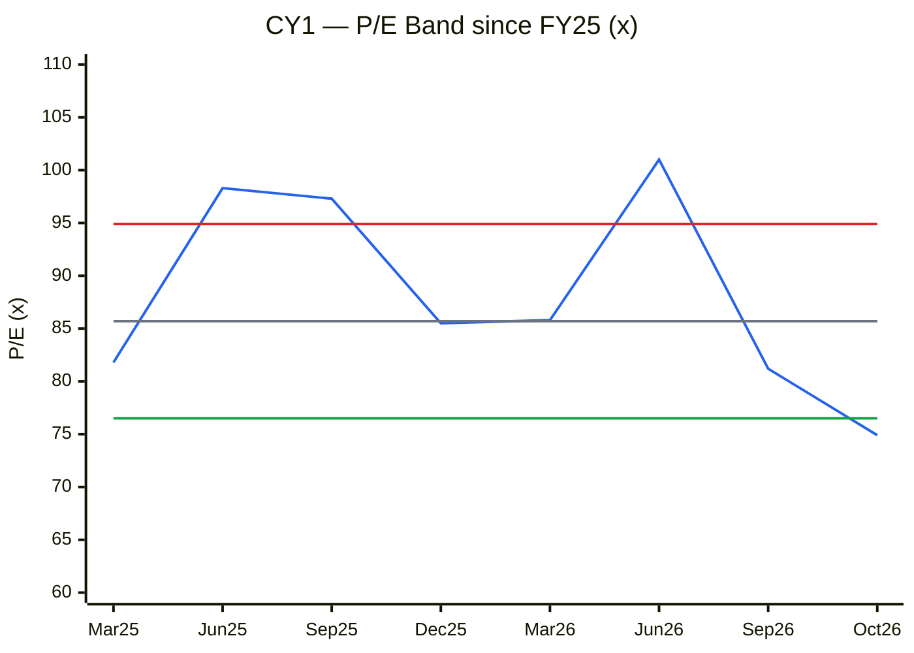
🟦 P/E · ⬜ median 85.7× · 🟥 +1SD 94.9× · 🟩 −1SD 76.5×

**Read:** P/E of 74.9× is at the **0th percentile** of the post-turnaround range, just below −1SD.

**Business inference:** This is the cyclical P/E trap. The multiple looks "cheap vs its own history" only because earnings are at a decade-high margin. On normalised (~20%) margins the stock trades at ~100× earnings.

**CY2: P/B band (10-yr) and ROE**

| FY | FY17 | FY18 | FY19 | FY20 | FY21 | FY22 | FY23 | FY24 | FY25 | FY26 | Now |
|---|---|---|---|---|---|---|---|---|---|---|---|
| P/B (×) | 8.1 | 8.8 | 4.9 | 1.7 | 2.6 | 2.2 | 2.8 | 17.5 | 22.5 | 35.7 | 37.6 |
| ROE (%) | −8.4 | 17.6 | 14.9 | −28.8 | 5.3 | −4.6 | −0.1 | 14.6 | 34.3 | 45.8 | — |

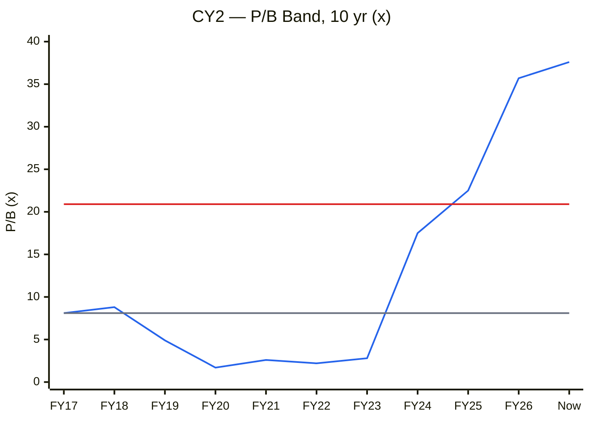
🟦 P/B · ⬜ median 8.1× · 🟥 +1SD 20.9× (−1SD < 0, omitted)

**Read:** P/B 37.6× is the **100th percentile**, 4.6× the 10-yr median. Justified P/B at a sustained 35% ROE, 10% g and 13% Ke = (35 − 10)/(13 − 10) = 8.3×.

**Business inference:** Book value is the cycle-neutral anchor. Even if ROE stays at 35% forever, a justified P/B of ~8–12× implies the market is paying 3–4× that. The price assumes ROE ≥ 45% *and* fast growth, which is a double-peak bet.

**CY4: Price vs EPS index (FY24 = 100)**

| | FY24 | FY25 | FY26 | Now (TTM) |
|---|---|---|---|---|
| Price | 100 | 184 | 442 | 466 |
| EPS | 100 | 336 | 681 | 721 |

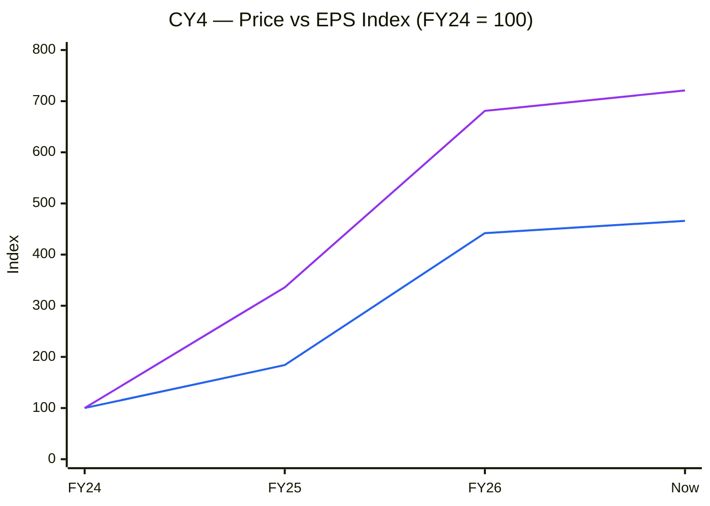
🟦 Price index · 🟪 EPS index

**Read:** Since FY24, EPS rose 7.2× and price 4.7×, so the multiple *de-rated* from 120× to 75×. (From FY23 the price is up 33×.)

**Business inference:** The last two years' returns were earned by profits, not re-rating, which is healthy. But EPS growth is now decelerating (Q1FY27 +25%) while the multiple still discounts years of 20%+ growth. Future returns depend on the multiple holding, the opposite of the FY24–26 setup.

### 8B. Intrinsic value (own model)
**DCF (3-stage FCFF, 13% WACC, 8% terminal growth, 25.2% tax, D&A 0.9% of revenue, capex ₹450/450/300 Cr then 1.2% of revenue, ΔNWC 5% of incremental revenue, net cash ₹2,930 Cr, 25.6 Cr shares):**

| Scenario | FY27E rev | FY29E rev | FY31E rev | EBITDA margin path | Value/share |
|---|---|---|---|---|---|
| Bear | 7,600 | 9,800 | 11,800 | 23% → 18% → 17% terminal; g 7% | **₹811** |
| Base | 8,200 | 12,500 | 16,000 | 25% → 22% → 20% terminal | **₹1,456** |
| Bull | 8,600 | 14,500 | 19,000 | 26% → 25% → 22% terminal | **₹1,920** |

**Sensitivity (base case):**
| WACC \ g | 7% | 8% | 9% |
|---|---|---|---|
| 11% | 1,878 | 2,361 | 3,325 |
| 12% | 1,521 | 1,795 | 2,253 |
| 13% | 1,282 | 1,456 | 1,717 |
*Bull at 11% / 9%: ₹4,448. Terminal value is ~60% of the total.*

**EPV (Greenwald):** NOPAT ₹1,279 Cr ÷ 13% + net cash ₹2,930 Cr ≈ ₹12,770 Cr ≈ **₹499/share**. The market pays ~₹88,000 Cr for growth.

**Relative / exit-multiple (2-yr target, Oct-2028, on FY30E EPS):**
| Scenario | FY27E EPS | FY28E | FY29E | FY30E | Exit P/E | Target |
|---|---|---|---|---|---|---|
| Bear | 54.3 | 52.1 | 55.7 | 60.2 | 32× | ₹1,926 |
| Base | 63.0 | 70.0 | 82.3 | 94.7 | 45× | ₹4,262 |
| Bull | 68.3 | 82.9 | 107.4 | 125.0 | 55× | ₹6,875 |

**Graham Number:** √(22.5 × 5-yr avg EPS ₹15.4 × BVPS ₹105) = **₹191**. Graham defensive screen: fails on P/E, P/B, 7-yr positive EPS and 5-yr dividend continuity → 2/7.

| Method | Bear | Base | Bull |
|---|---|---|---|
| DCF (13%/8%) | ₹811 | ₹1,456 | ₹1,920 |
| DCF (generous 11%/9%) | — | ₹3,325 | ₹4,448 |
| Relative (exit P/E, 2-yr) | ₹1,926 | ₹4,262 | ₹6,875 |
| EPV | ₹499 | — | — |
| **Consensus range** | **₹800–1,900** | **₹1,500–4,250** | **₹1,900–6,900** |

**Current market price:** ₹3,949
**Margin of safety (base):** **negative** on DCF (−63% to −16%). +8% only on the 45× exit-multiple target → **Inadequate**.
**Upside/downside (bull vs bear, exit-multiple):** (6,875 − 3,949) / (3,949 − 1,926) = **1.45 : 1** → **Unacceptable (< 1.5:1 hard stop)**.
**Reverse DCF implied growth:** ~23% revenue CAGR for 10 yrs at 25% margin → **Aggressive**.
**Misprice reason:** none in our favour. If anything it is mispriced upward: sector momentum, FII buying (2% → 23% since Jun-24), scarcity premium for HVDC exposure, and investors capitalising a peak margin.
**Catalyst for re-pricing (either way):** Q2FY27 results on 30-Oct-2026 (margin trajectory), plus Barmer LoA and other HVDC awards over the next 2–3 quarters.

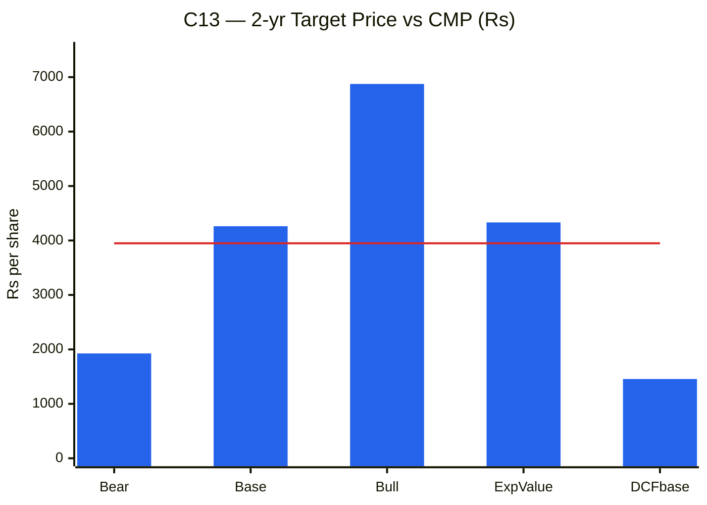
🟦 Scenario value · 🟥 CMP ₹3,949

**Read:** The probability-weighted 2-yr value is ₹4,332 (+9.7%, ~4.7% a year). Downside −51% vs upside +74%; DCF base is ₹1,456.

**Business inference:** At this price the best realistic outcome is a market-like return, and the downside on a margin normalisation is half the capital. The stock needs a perfect execution *and* a sustained-peak-margin world just to tread water.

### Cycle Position Dashboard
| Dimension | Current | 10-yr median | Percentile | Signal |
|---|---|---|---|---|
| P/E (trailing) | 74.9× | 85.7× (post-FY25) | 0% of FY25+ range | Fair-looking, but on peak EPS |
| P/B | 37.6× | 8.1× | 100% | Expensive |
| EBITDA margin | 27.5% (FY26) / 26.2% TTM | 5.0% | 100% (+2.2 SD) | **Peak** |
| ROCE | 77% | 11% | 100% (+2.2 SD) | **Peak** |
| Industry capex/dep | GVT&D 4.1×; peers expanding | ~0.5× (FY17–24) | 100% | Flooding (late) |
| Order momentum | Base book-to-bill < 1 in 3 of 4 qtrs; HVDC lumps | — | — | Plateauing |
| **Overall cycle position** | | | | **LATE (peak margin, plateauing orders)** — consistent with Modules 1b/1c |

---

## Module 9 — Technical Stage (Weinstein + CANSLIM)

| Item | Reading (weekly, 15-Oct-2026) |
|---|---|
| Nifty 50 stage | **Stage 4** (22,997 < falling 30-wk MA 23,740) |
| Sector (heavy electricals) | Stage 3. All of ABB, Siemens, CG, Hitachi Energy and Siemens Energy are below their 30-wk MAs, which are flattening |
| Stock stage | **Stage 3 (topping), at risk of Stage 4** |
| 30-week MA | ₹4,446, still rising but flattening (+₹81 in 5 wks vs +₹199 in the prior 5) |
| Price vs MA | **Below** (−11%) |
| Pattern | Peak ₹5,534 (19-Jun-26); lower highs ₹5,043 → 4,677 → 4,548 (11-Sep, Barmer spike); now breaking below the Jul–Aug floor (₹4,127–4,157) to ₹3,949, −29% from peak |
| RS vs Nifty | 1-yr +47 pp (stock +36% vs Nifty −11%); **26-wk −10 pp** (−14% vs −4%) → deteriorating |
| Volume | Last 5 weeks of decline on 2.1–3.2 m/wk vs 52-wk avg 4.4 m; distribution is not yet heavy |
| Stop-loss (holders) | Weekly close below **₹3,600** (Mar-26 base lows ₹3,604–3,680). Hard exit if the 30-wk MA turns down with price below it |
| Stage + fundamental alignment | **Aligned (both negative at this price)** |

**CANSLIM:** C 0 (Q1 EPS +24.7%, just below 25%, decelerating) · A 1 (3-yr EPS growth and ROE ≥ 17%) · N 0 (29% off the high, no new base) · S 0 · L 0 (RS lags Hitachi Energy) · I 0 (FII up, DII down, total institutional flat at 41%) · M 0 (Nifty Stage 4) → **1 / 7**.

---

## Module 10 — Forward View: 2–3 Year Thesis

### Fixed Assets & Capacity: full-decade, long-life lens
**Owned PPE (ex-CWIP, ex-ROU), ₹ Cr.** Ind AS deemed cost reset on 1-Apr-2015 (FY15 carrying value = new gross block of ₹687 Cr), so pre-2015 accumulated depreciation is not visible and true physical age is understated.
| FY | Gross block | Acc. dep. | Net block | Age (acc ÷ gross) | Capex* | D&A | Capex ÷ D&A | Revenue | AT gross (×) |
|---|---|---|---|---|---|---|---|---|---|
| FY16 | 770 | 86 | 684 | 11% | 50 | 86 | 0.58 | 3,303 | 4.3 |
| FY17 | 830 | 174 | 656 | 21% | 46 | 88 | 0.52 | 4,052 | 4.9 |
| FY18 | 837 | 254 | 583 | 30% | 11 | 90 | 0.12 | 4,332 | 5.2 |
| FY19 | 841 | 331 | 511 | 39% | 7 | 83 | 0.08 | 4,219 | 5.0 |
| FY20 | 820 | 392 | 429 | 48% | 32 | 78 | 0.41 | 3,159 | 3.9 |
| FY21 | 838 | 435 | 403 | 52% | −13 | 66 | n.m. | 3,452 | 4.1 |
| FY22 | 798 | 409 | 389 | 51% | 25 | 58 | 0.43 | 3,066 | 3.8 |
| FY23 | 649 | 287 | 363 | 44% | 17 | 55 | 0.31 | 2,773 | 4.3 |
| FY24 | 677 | 322 | 354 | 48% | 29 | 50 | 0.58 | 3,168 | 4.7 |
| FY25 | 692 | 352 | 340 | 51% | 88 | 47 | 1.87 | 4,292 | 6.2 |
| FY26 | 735 | 352 | 383 | 48% | 189 | 46 | 4.10 | 6,206 | 8.4 |
*\*Capex = CFO − FCF (Screener, net of disposals). D&A includes ROU depreciation (~₹13 Cr from FY20). Gross block from the PPE notes of the FY17, FY19, FY21, FY23 and FY26 annual reports. FY22 moved ₹11 Cr of land and buildings to investment property; FY23 gross and accumulated depreciation fell on disposal/write-off of fully depreciated plant. FY26 split: land ₹42.5 Cr, buildings ₹256 Cr (net ₹167 Cr), plant ₹426 Cr (net ₹172 Cr); CWIP ₹65 Cr (98% < 1 yr); ROU buildings ₹99 Cr gross.*

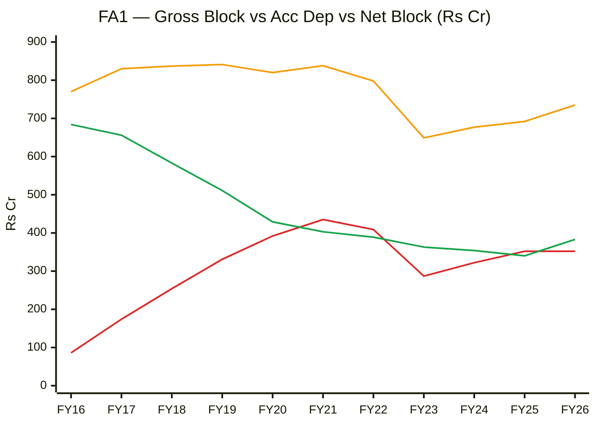
🟧 Gross block · 🟥 Accumulated depreciation · 🟩 Net block

**Read:** The net block fell 50% FY16–FY25 (₹684 → 340 Cr) and only turned up in FY26 (₹383 Cr). Gross block is flat for a decade.

**Business inference:** A decade of harvesting under Alstom→GE ownership left an old, fully-sweated plant base. That is why FY26 ROCE is 77%, but it also means the coming capex will raise the asset base sharply (~2.4× gross block by FY29), and depreciation and capital intensity will rise from historic lows.

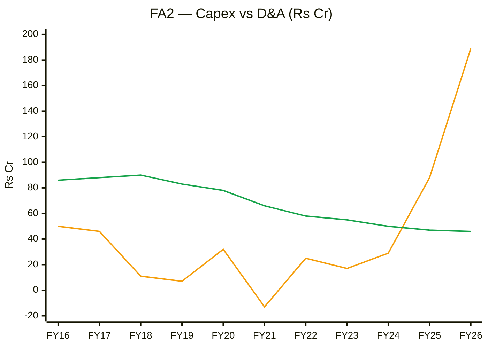
🟧 Capex (net) · 🟩 D&A

**Read:** Capex was below D&A every year FY16–FY24 (cumulative capex ₹204 Cr vs D&A ₹654 Cr), then 1.9× D&A in FY25 and 4.1× in FY26.

**Business inference:** The capital cycle has flipped from under-investment to expansion, at the same time as the whole industry. New capacity will earn lower AT than the depreciated base (C6 bear anchor), and ₹1,000 Cr over FY26–29 roughly equals the cumulative capex of the previous 15 years.

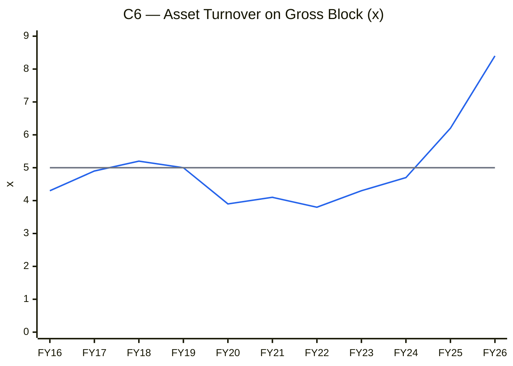
🟦 Revenue ÷ gross block · ⬜ 10-yr average 5.0× (5-yr average 5.5×)

**Read:** AT is 8.4×, 1.7× the decade average and +2 SD.

**Business inference:** Peak utilisation of old plants. Some of it is structural (lean, HVDC bought-out content, which management says lifts AT "quite significantly"), and some is cyclical (overtime, a full order book). Base AT on the expanded block: ~6.5–7×. Bear: the 10-yr average of 5×.

**Asset-age and land notes:** Accumulated depreciation of 48% on a post-2015 deemed-cost base means the plants are in practice 20–40+ years old (Pallavaram/Chennai, Padappai, Hosur, Vadodara and Noida date from the Alstom/Areva/EE era). Freehold land carried at ₹42.5 Cr and buildings at ₹167 Cr net are 2015 deemed values. Industrial land at Chennai, Hosur, Vadodara and Noida is plausibly worth several hundred crore at market (⚠️ no recent sale proof point; the FY22 reclassification of ₹11 Cr of unused land/building to investment property is the only monetisable item disclosed). **This is not a meaningful floor:** even ₹1,000 Cr of land is ~1% of market cap.
**Installed base → aftermarket:** 800+ power transformers, 100+ grid control centres, the 6 GW Champa–Kurukshetra HVDC and the Chandrapur HVDC (now under refurbishment). The service, refurbishment and digital (GridOS, APM) share is not disclosed; the "Digital" TAM is ~$0.7 bn.

### Capacity register and forward ceiling
| Site | Products | Announced expansion (Sep-26 deck) | Timing |
|---|---|---|---|
| Pallavaram (Chennai) | Power transformers & reactors (to 1,200 kV) | +50% transformer & reactor capacity | Phased to Dec-2028 |
| Padappai (TN) | AIS, bushings, air-core reactors | +25% AIS; new bushing and ACR lines | Phased to Dec-2028 |
| Hosur | GIS & AIS switchgear | +25% GIS & AIS | Phased to Dec-2028 |
| Vadodara | HVDC valves (LCC), VSC-STATCOM valves | New lines | ₹140 Cr, to early 2027 |
| Vallam (TN, new) | 765 kV AIS disconnectors, GIS GIB, dead-tank 362 kV | New plant (₹55 Cr) | Part Q1 CY27, balance end-CY27 (slipped) |
| Noida Sec 63 | Engineering & test lab | New | Phased to Dec-2026 |
| **Total** | | **~₹1,010 Cr fresh capex** (₹810 Cr to Dec-2028 + ₹140 Cr + ₹60 Cr) + maintenance | |

**Capacity ceiling:** Plants are partly maxed today ("a few factories loaded pretty well"). Non-HVDC product revenue capacity is ~₹7,000–7,500 Cr on the current block and ~₹9,500–10,500 Cr after expansion (+35–40% weighted). HVDC (bought-out heavy, ~₹3,000–5,000 Cr/yr at peak execution) is additive. **Ceiling FY29–30 ≈ ₹13,000–15,000 Cr.** Base needs ₹14,500 Cr by FY30 (at ceiling) and bull needs ₹17,000 Cr (above ceiling, implying a new capex round). **PIE (~₹26,000 Cr by FY31) requires roughly double the announced capacity → "Unannounced Expansion Pricing."**

### Capex classification
| Capex type | FY27E (₹ Cr) | FY28E | FY29E | In AT model? |
|---|---|---|---|---|
| Tangible growth capex | ~400 | ~400 | ~250 | ✅ |
| Maintenance (≈ D&A) | ~50 | ~60 | ~70 | ❌ sustains |
| Intangibles/software | negligible (₹0.8 Cr net) | — | — | ❌ |
| CWIP (Mar-26 ₹65 Cr, 98% < 1 yr) | transfers FY27 | | | ❌ until capitalised |
| ROU (Ind AS 116, buildings) | ~₹113 Cr gross; renewals | | | ⚠️ excluded |
| **Total** | **~450** | **~460** | **~320** | |

**Incremental ROIC:** ₹1,000 Cr growth capex adds ~₹4,000–5,000 Cr of revenue capacity. At a 20% EBIT margin and 25% tax that is NOPAT of ~₹600–750 Cr → **incremental ROIC ~60–75% ≫ 13% WACC → value-creating** (if priced at today's margins; at a 15% margin it is still ~45%).
**Capex-model implied revenue CAGR (FY26→FY29):** 26% (₹6,206 → ~₹12,500 Cr, HVDC-assisted) vs PIE 23% for 10 yrs. Near term they agree; **beyond FY29 the market is pricing expansion and margins not yet announced.**

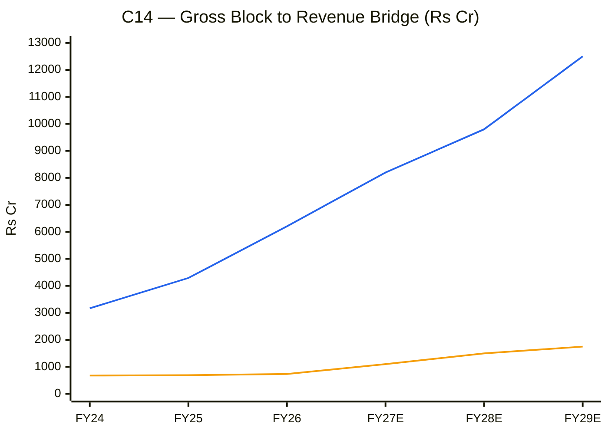
🟦 Revenue (base case) · 🟧 Owned gross block (incl. capitalised expansion)

**Read:** Base revenue doubles FY26→FY29 while gross block rises 2.4×, so AT falls from 8.4× to ~7.1×.

**Business inference:** Growth now consumes capital again (gently, since this is still asset-light), which makes the FY26 ROCE a peak, not a run-rate.

### Capex-to-Earnings model (base case)
| Metric | FY27E | FY28E | FY29E |
|---|---|---|---|
| Opening gross block (₹ Cr) | 735 | 1,100 | 1,500 |
| Growth capex commissioned | ~365 | ~400 | ~250 |
| Closing gross block | 1,100 | 1,500 | 1,750 |
| AT applied (×, on avg block) | 9.0 | 7.5 | 7.7 (HVDC) |
| Revenue: product lines | 7,800 | 8,900 | 9,500 |
| Revenue: HVDC (Khavda, Chandrapur, Barmer from H2FY28) | 400 | 900 | 3,000 |
| **Total revenue** | **8,200** | **9,800** | **12,500** |
| EBITDA margin | 25.0% | 23.5% | 22.0% |
| EBITDA | 2,050 | 2,303 | 2,750 |
| D&A | 74 | 88 | 113 |
| EBIT | 1,976 | 2,215 | 2,637 |
| Other income (cash ~₹2,500–3,500 Cr) | 180 | 180 | 180 |
| Interest | ~15 | ~15 | ~15 |
| ICR (×) | >100 | >100 | >100 |
| Peak debt / EBITDA | 0 (net cash) | 0 | 0 |
| PAT (25.2% tax) | 1,600 | 1,780 | 2,100 |
| EPS (₹) | 63 | 70 | 82 |
| ΔWorking capital (5% of Δrev; advances unwinding) | 100 | 80 | 135 |
| **FCF** (PAT + D&A − capex − ΔWC) | **~1,125** | **~1,330** | **~1,760** |

**FCF inflection year:** FY24 (passed). **Debt ceiling:** n/a (net cash; ICR > 100×).

### Key catalysts
1. **Q2FY27 results, 30-Oct-2026:** EBITDA margin vs "mid-20s" guidance and base-order trajectory.
2. **Barmer–South Kalamb LoA** (L1 7-Sep-2026; analyst value ~₹12,980 Cr). Expected Q3–Q4 FY27; revenue from H2FY28/FY29.
3. **US data-centre RPT export order** (≤ ₹1,300 Cr) in Q2–Q3 FY27, and revival of the ₹3,000 Cr on-hold RPT order.
4. **Surplus cash (~₹1,600 Cr unallocated):** a special dividend or buyback would be value-accretive vs the 6% cash-pool yield. The board is evaluating.
5. **Capex commissioning:** Vadodara HVDC/STATCOM valves (early 2027), Pallavaram transformers (2027–28).

### Key risks
1. **Margin mean-reversion** (HVDC mix at lower gross margin, Chinese GIS re-entry, industry capacity, copper/CRGO). Probability **High**.
2. **Domestic base-order slowdown** (TBCB soft for two quarters; 24–30-month timelines delay ordering). Probability **Medium**.
3. **HVDC concentration and execution** (two or three contracts = 40%+ of the book; LDs on fixed-price HVDC; Barmer L1 not converted or delayed). Probability **Medium**.
4. **Related-party value leakage** (₹971 Cr+ in the parent cash pool at ~6% with the guarantee ending 31-Dec-2026; rising royalty; 26% of sales at transfer prices). Probability **Medium**.
5. **Valuation de-rating** (sector at 70–110× P/E in a Stage-4 Nifty; FIIs now 23% of the float). Probability **High**.

### Scenario analysis (AT- and order-anchored)
| Scenario | AT on expanded block | Revenue FY30E | EBITDA margin | EPS FY30E | Target P/E (Oct-28) | Target price | Probability |
|---|---|---|---|---|---|---|---|
| Bull | Peak ~8× + Barmer and two more HVDCs on time + group export ramp | ₹17,000 Cr | 25% | ₹125 | 55× | ₹6,875 | 25% |
| Base | ~7× (expanded block) + Khavda/Barmer per schedule | ₹14,500 Cr | 22% | ₹95 | 45× | ₹4,262 | 50% |
| Bear | 10-yr avg 5× on the new block; HVDC slips; margin normalises | ₹11,000 Cr | 18% | ₹60 | 32× | ₹1,926 | 25% |
| **Expected value** | | | | | | **₹4,332** | |

**Return from current price (expected value):** **+9.7% over ~2 years (~4.7% a year)**, below the ~13% cost of equity and well below the 20–30% MoS a large/mid-cap needs.

**Thesis (one line):** A genuinely improved, cash-rich grid franchise riding a multi-year transmission upcycle, priced as if its peak 27% margin and 40% growth last a decade. Own it only after the price resets toward ₹3,000–3,300 or after evidence that margins hold ≥ 25% through the HVDC mix shift.

**Monitoring metrics (thesis revision triggers):**
- EBITDA margin < 23% (or gross margin < 40%) in two consecutive quarters → bear case gains weight.
- FY27 base orders < ₹7,000 Cr, or the base book-to-bill below 1.0 for four more quarters → FY28 air pocket.
- Contract liabilities falling with CFO < PAT → advance unwind (expected FY28–29; confirm it is not a receivables problem).
- Cash-pool ICD > ₹1,000 Cr or guarantee not renewed after 31-Dec-2026 → governance flag escalates.
- Royalty and trademark fees > 3% of revenue → value-transfer flag.

---

## Checklist Summary
**Section 0 (Existing report protocol):** 3/3. Searched; none found; initial report.
**Section A (Business Quality):** 16/18. Scuttlebutt is limited to concall Q&A and peer commentary; no direct channel checks.
**Section B (Forensics):** 9/9
**Section C (Financial Statements):** 11/12. Ind AS 116 adjustment is immaterial (lease liabilities ₹24 Cr), noted rather than recomputed.
**Section D (KPIs & Peers):** 7/7
**Section E (Market Size & Share):** 6/7. Historical 5-yr market share is not available from an independent source; inferred from revenue vs TAM.
**Section F (Valuation):** 10/10
**Section G (Technical):** 8/8
**Section H (Forward View):** 31/33. Segment-level capex attribution is not disclosed (single segment); HVDC vs product revenue split is estimated.
**Section I (Charts):** 5/5. C1, C1b, C2, C4/CY7, C5, C6, C7, C8, C12, C13, C14, CY1, CY2, CY4, FA1, FA2, OB-1…OB-4.
**Order Book Tracker:** Run. 12-order ledger and 12 snapshots, carried in this report.
**Hard stops triggered:** **Upside/downside 1.45 : 1 < 1.5 : 1.** The ICD-to-group 36% > 30% test was **not** triggered because arm's-length evidence exists (approval, disclosed rate, parent guarantee). No other hard stops: pledge 0, auditor clean, Beneish −2.47, Stage 3 not 4, no ROIC < WACC streak currently.

**Pre-buy final check:**
- *Falsifiability:* the AVOID view is wrong if FY27 EBITDA is ≥ 27% *and* FY27 orders exceed ₹20,000 Cr (Barmer + base ≥ ₹7,000 Cr), *and* a second capex round is announced. Then the PIE becomes reachable.
- *Inversion (why it could beat):* a global grid-equipment shortage lasting into the 2030s, GE using India as its export hub, an HVDC cadence of 1–2 awards a year, net cash funding growth, and the fact that peers trade higher still. The 25% bull probability accounts for this.
- *Circle of competence:* clear business model. The main uncertainty is HVDC contract margins, which are not disclosed.
- *Asymmetry:* fails (1.45:1).
- *Behaviour:* avoid anchoring on the 52-week high (₹5,534) or "cheapest peer P/E". The relevant anchor is cycle-normalised earnings.

---

## Investment Decision
**Verdict category:** **AVOID** (hard stop: upside/downside < 1.5:1). Fundamentally this is a *Quality at Wrong Price* name: clean books, net cash, real franchise improvement. It moves to Watchlist on price.
**Recommendation:** AVOID fresh buying at ₹3,949. **WATCHLIST, buy-below ₹3,250**, where expected value gives ≥ 15% a year and bull/bear ≥ 2:1 (≤ ₹3,576). Staged entries at ₹3,000–3,300, only after a new Stage-1 base and a weekly close back above a rising 30-week MA.
**Conviction score:** 4.5 / 10 (Cycle 0.4/1 · Industry 0.5/1 · Moat 1.0/2 · Management 0.6/1 · Financial & earnings quality 1.8/2 · Valuation & PIE 0.1/2 · Technical 0.1/1).
**Suggested position size:** 0% now. On the watchlist trigger, 1–2% (late-cycle ×0.5 sizing modifier applies).
**Entry price range:** ₹3,000–3,300 (with technical confirmation).
**Stop-loss (existing holders):** weekly close below ₹3,600; trim into strength above ₹4,450 (30-wk MA).
**Target price (base, 2-yr):** ₹4,262 (45× FY30E EPS ₹95); probability-weighted ₹4,332.
**Review triggers:** Q2FY27 results (30-Oct-2026); Barmer LoA; any HVDC award; cash-pool guarantee status on 31-Dec-2026; FY27 base-order run-rate at Q3. Upgrade to BUY if price ≤ ₹3,250 with margin ≥ 25% intact, or if FY27 EBITDA ≥ 27% with orders ≥ ₹20,000 Cr and a second capex round (which would lift the base case).

---
**Sources:** Company filings on BSE: Q1FY27 analyst presentation (7-Aug-2026) and concall transcript (14-Aug-2026); Q4FY26 (19-May-2026), Q3FY26 (28-Jan-2026), Q2FY26 (3-Nov-2025), Q1FY26 (29-Jul-2025), Q4FY25 (23-May-2025), Q3FY25 (5-Feb-2025) and Q2FY25 (8-Nov-2024) concall transcripts; Nomura investor-forum deck (2-Jun-2026); Mumbai investor-meet deck (21–23 Sep-2026); Annual Reports FY2016-17, FY2018-19, FY2020-21, FY2022-23, FY2024-25 and FY2025-26 (PPE notes 3, ICD note 15, contingent liabilities note 38, related parties note 37, auditor's report/KAMs); Reg 30 order filings listed in the ledger. Market data: Screener.in (financials, ratios, shareholding, P/E series, peers), Yahoo Finance (weekly prices, Nifty, India VIX). Secondary: [Business Today — Barmer L1 / Nomura ₹12,980 Cr estimate](https://www.businesstoday.in/markets/stocks/story/ge-vernova-td-india-shares-jump-9-on-rs-13000-cr-order-nomura-ups-target-price-553890-2026-09-08); [Business Standard — HVDC win](https://www.business-standard.com/markets/news/ge-vernova-t-d-s-hvdc-order-win-boosts-long-term-revenue-visibility-126090801487_1.html); [Business Standard — Nov-2024 OFS](https://www.business-standard.com/companies/news/ge-vernova-t-d-promoter-to-sell-8-3-pc-stake-via-ofs-124112501195_1.html); [Upstox — Barmer L1](https://upstox.com/news/market-news/stocks/ge-vernova-t-and-d-india-stock-jumps-8-as-company-emerges-l1-bidder-for-6-000-mw-hvdc-project/article-199934/).
**Data gaps:** values of the Khavda VSC and Chandrapur HVDC orders (not disclosed; estimated from quarterly intake), the Barmer contract value (analyst estimate; LoA pending), HVDC vs product revenue split, segment-wise capacity utilisation, and independent market-share data.

*Report generated by Stock Fundamental Analysis Skill v3.3 | Indian Markets Context*
*Save path: C:\Users\anubh\Documents\Anubhav\Stock Analysis\Stock Analysis\GVTD_GEVernovaTDIndia_2026-10-16.md*
