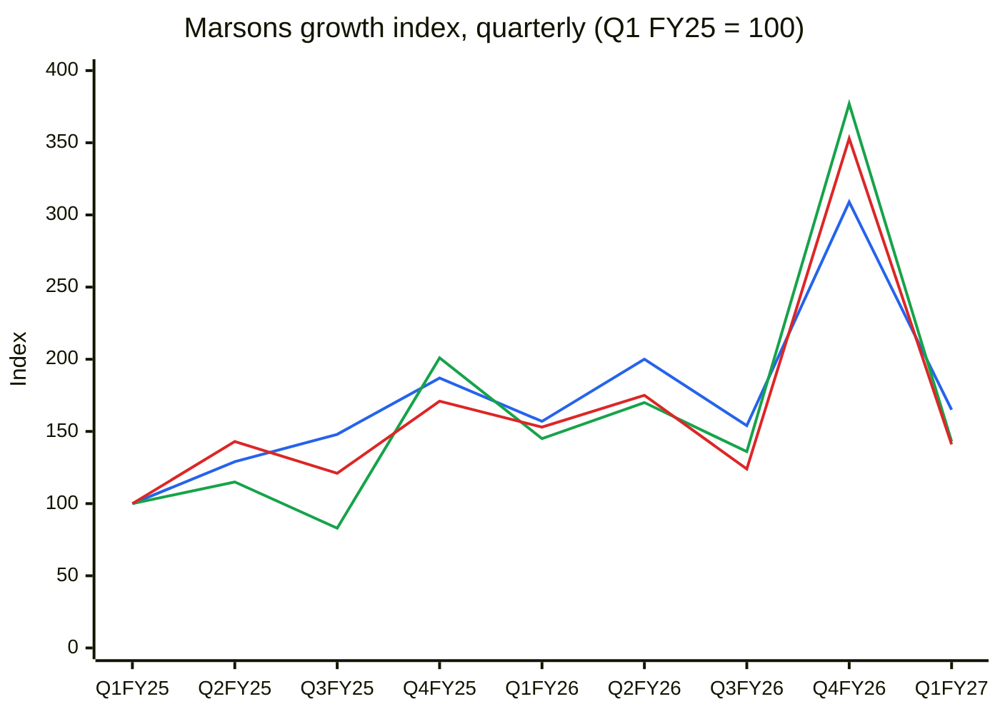
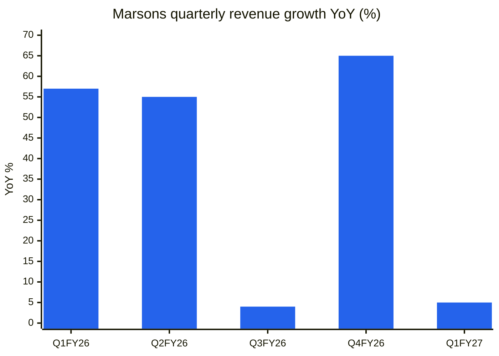
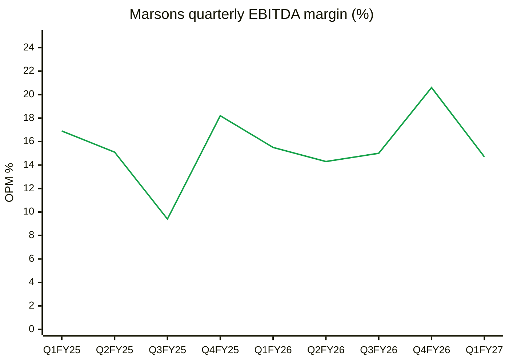
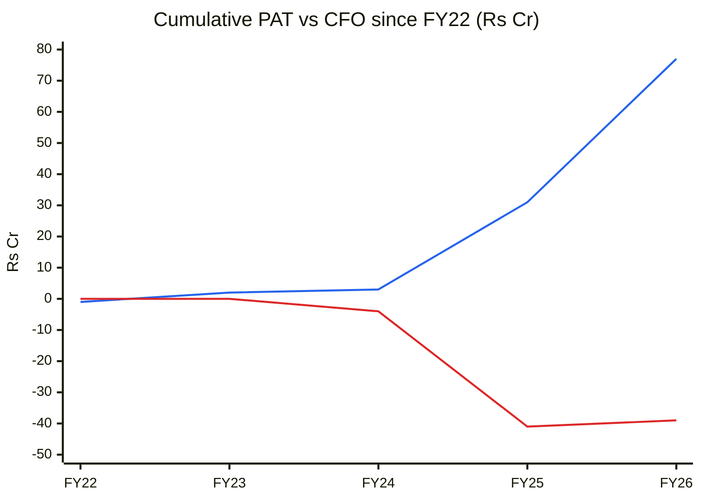
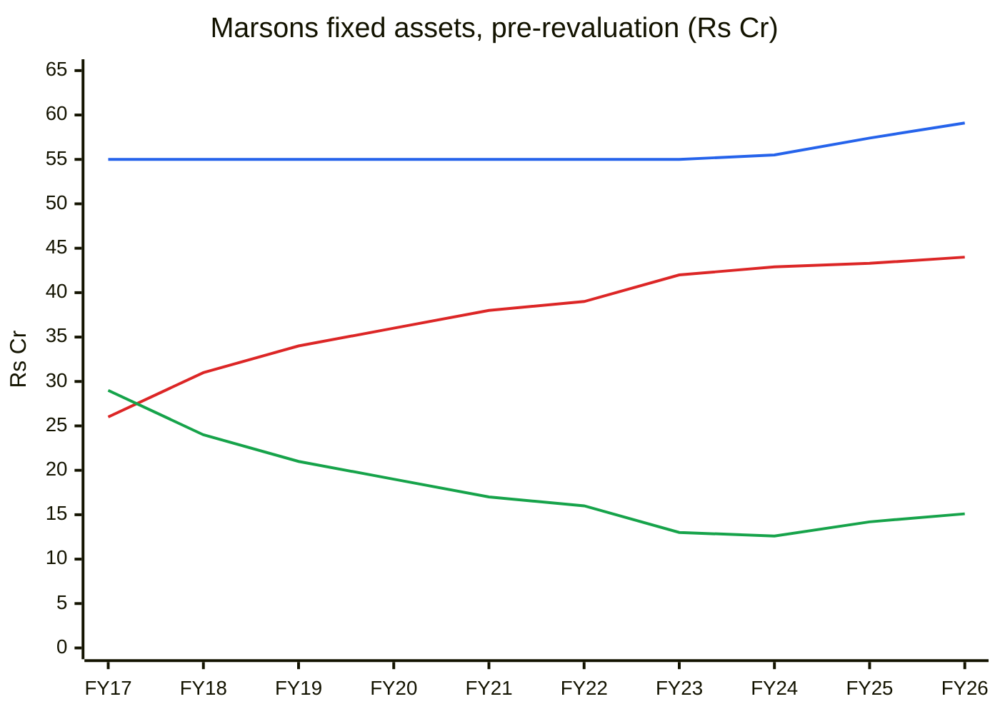
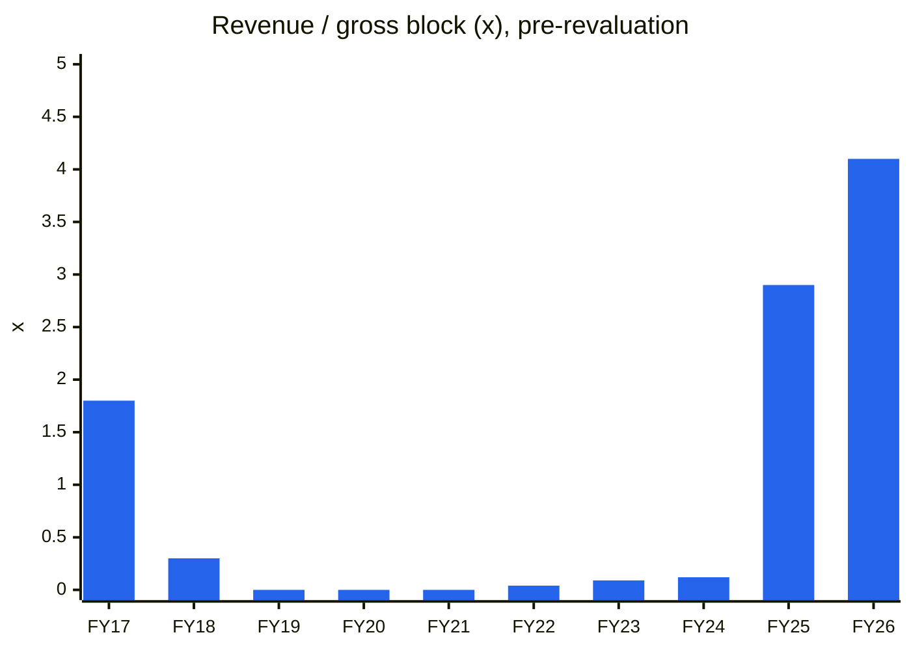
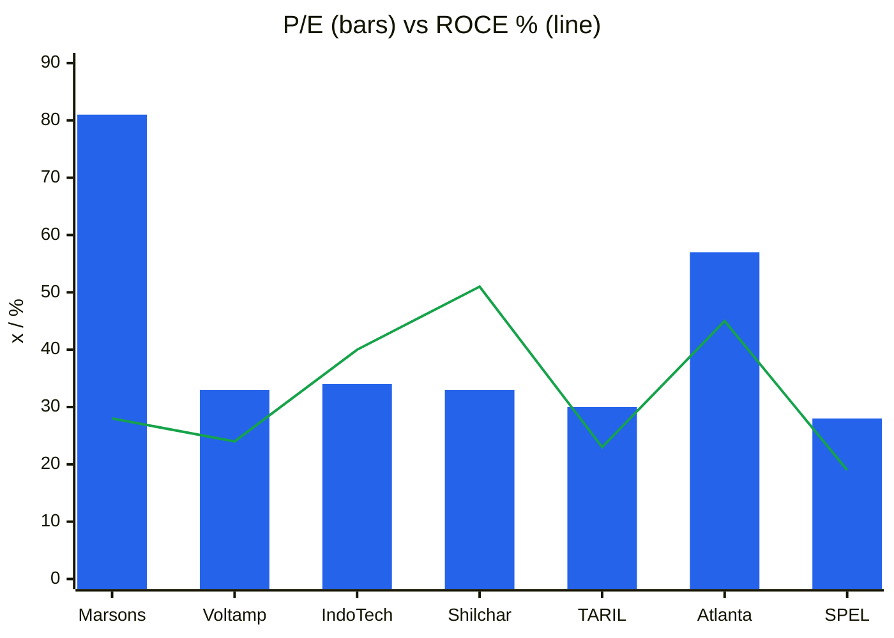
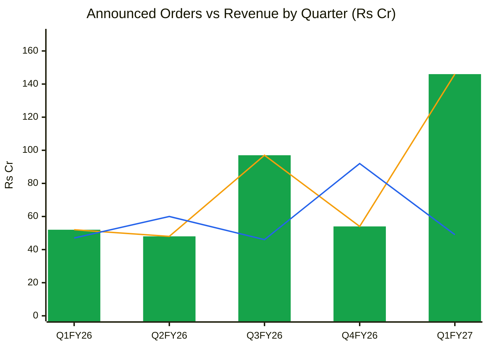
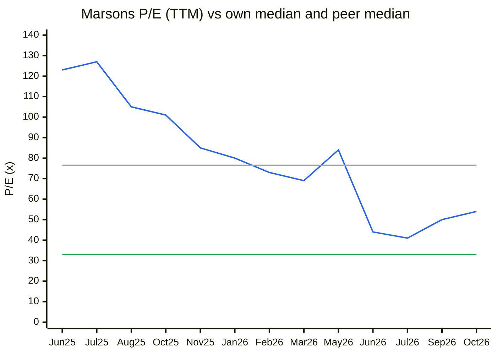
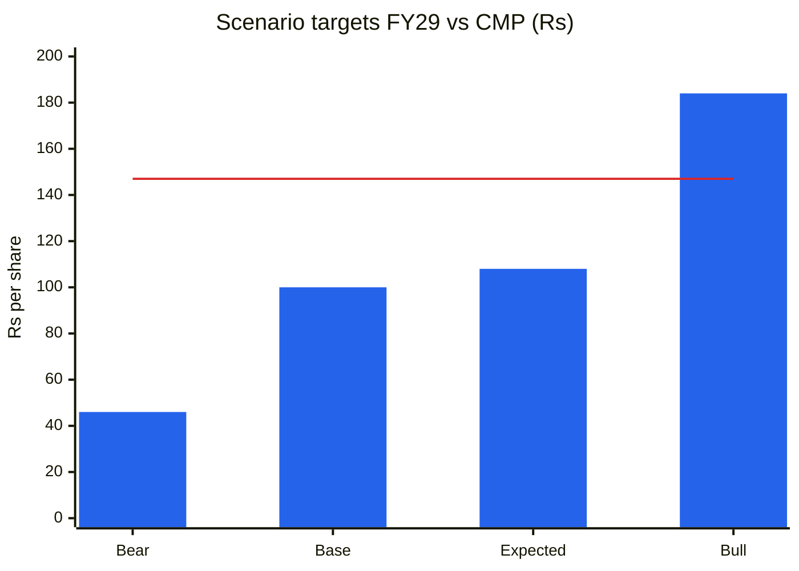

# Stock Analysis Report — Marsons Ltd (NSE: MARSONS · BSE: 517467)
**Date:** 2026-10-30
**Analyst:** Claude (Stock Fundamental Analysis Skill v3.3)
**Investment Horizon:** 2–3 Years
**Recommendation:** AVOID at current price → WATCHLIST (buy-below ~₹60, and only after operating cash flow turns positive)
**Conviction Score:** 2.9 / 10
**CMP:** ₹147 (30-Oct-2026 intraday, Screener.in / Yahoo; weekly close ₹143.55) · Market cap ₹2,530 Cr (17.21 Cr shares, FV ₹1) · 52-wk range ₹104–172 · All-time high ₹341 (Oct-2024)
**Filed under:** Capital-Goods / Electrical-Equipment-and-TnD · Themes: Power T&D & grid capex

> Q2 FY27 results (quarter to 30-Sep-2026) are **not yet out**. No board-meeting intimation had been filed on BSE by 30-Oct-2026. All TTM numbers run to Q1 FY27 (Jun-2026). The stock rose ~21% in the week to 30-Oct on the Cleanhill JV news flow, on delivery of only 11% (Screener volume data), which points to speculative turnover.

## Revision Log
| Version | Date | Recommendation | Conviction | Price | Key change |
|---|---|---|---|---|---|
| Current | 2026-10-30 | AVOID → WATCHLIST (buy-below ~₹60) | 2.9/10 | ₹147 | Initial report |

**Validation of previous report:** Initial report. No earlier Marsons report exists in the library (searched by ticker and name fragment).

---

## Business Primer

Marsons makes oil-filled power and distribution transformers at a single plant at Maheshtala (Budge Budge Trunk Road), on the southern edge of Kolkata. Its range runs from small distribution units and 10 MVA 33/11 kV substation transformers up to 200 MVA, 220 kV "extra-high-voltage" (EHV) units, plus inverter-duty and wind-turbine transformers for solar and wind farms. Customers are state power utilities (WBSEDCL, WBSETCL, Madhyanchal VVNL, AEGCL), EPC contractors working on the government's RDSS distribution scheme (Jakson, Cabcon, Vikran), renewable developers (Inox, Galaxy Solar, NTPC-RE projects through EPCs), and since December 2025 a few US solar developers. Revenue is project-based: each order is a fixed-price or price-variation contract, booked when the unit is dispatched. Economics depend on two things: winning enough tenders to fill a plant whose stated capacity (12,000 MVA) is far larger than current output, and keeping the spread between the contract price and the cost of copper, CRGO steel and transformer oil.

This is a **turnaround of an old, bankrupt manufacturer, now growing out of a near-zero base**. The original Marsons collapsed in FY18–FY20 (revenue fell from ₹100 Cr to zero), went through the insolvency code, and was taken over by Yashoda Inn Pvt Ltd, a Kolkata hospitality and real-estate group, under an NCLT resolution plan (approved 9-May-2019, final order 25-Jan-2022). Revenue went from ₹6 Cr (FY24) to ₹168 Cr (FY25) and ₹245 Cr (FY26), funded by an ₹80 Cr preferential issue at ₹25 per share in April 2024. The share price rose about 100× from ₹3.2 (Nov-2022) to ₹341 (Oct-2024), and has since halved. The key value drivers are order inflow and EHV mix. The key risks are working capital, with profits so far sitting in receivables and raw-material stock rather than cash, and a valuation that already assumes Marsons becomes a TARIL-sized company. Three structural features colour the analysis: (a) the plant is 94% depreciated and was **revalued upward by ₹49.8 Cr in FY26**, which inflates book value; (b) tax has been close to zero because of carried-forward losses, so reported PAT overstates the run rate; (c) there is no concall transcript, no detailed investor deck since FY25, and the auditor is a very small firm (audit fee ₹1.5 lakh).

**New Segment Protocol:** Segment covered → "Electrical Equipment & Turnkey Electrical Solutions (Order-driven Capital Goods)" (references/05-industry-kpis-india.md, line 2256; transformer peers Voltamp, Shilchar and TARIL are listed) ✓. Demand context from "Power & Renewables" (line 479) ✓. Top KPIs: order book/revenue, NWC/debtor days, EBITDA margin and product mix. Order Book Tracker run (25 BSE Reg 30 filings, Jan-2024 to Oct-2026).

---

## Executive Summary

Marsons is the only EHV transformer maker in Eastern and North-Eastern India. It has PGCIL (May-2026) and NTPC-RE approvals, a first US export book of about $4.6 mn, and a proposed US joint venture with Cleanhill Partners (6-Oct-2026). The growth is real: revenue rose from ₹6 Cr to ₹245 Cr in two years at a 17% operating margin, and the order book was about ₹294 Cr in Dec-2025 (Brickwork). **But the stock is priced for a different company.** At ₹147 the market cap is ₹2,530 Cr: 57× reported TTM EPS, about **81× tax-normalised TTM EPS**, and 15× book excluding the revaluation. A reverse DCF at a 15% cost of capital implies **37–41% revenue CAGR for ten years** (₹5,900–7,900 Cr revenue by FY36). That is 4–5× what even the planned 26,000 MVA plant could produce. Meanwhile **cumulative operating cash flow over FY25–26 is −₹35 Cr against ₹74 Cr of PAT**, net working capital is 39% of revenue, Q1 FY27 revenue grew only 5% against a stated "60%+" FY27 ambition, and Q1 PAT fell 26%. Our probability-weighted FY29 value is about ₹108 (−27%), and the bear case is −69%. The upside/downside ratio is about 0.4:1, which is a hard stop. **Verdict: AVOID.** Watchlist buy-below ~₹60 (≈30× FY27E EPS, the peer multiple), and only once CFO turns positive and quarterly revenue shows the order book converting.

### C1 — Growth index, quarterly (Q1 FY25 = 100)

| Quarter | Revenue (₹ Cr) | EBITDA (₹ Cr) | PBT (₹ Cr) | Rev idx | EBITDA idx | PBT idx |
|---|---|---|---|---|---|---|
| Q1 FY25 | 29.9 | 5.05 | 5.24 | 100 | 100 | 100 |
| Q2 FY25 | 38.5 | 5.81 | 7.47 | 129 | 115 | 143 |
| Q3 FY25 | 44.2 | 4.17 | 6.32 | 148 | 83 | 121 |
| Q4 FY25 | 55.8 | 10.13 | 8.98 | 187 | 201 | 171 |
| Q1 FY26 | 47.0 | 7.31 | 8.03 | 157 | 145 | 153 |
| Q2 FY26 | 59.8 | 8.57 | 9.19 | 200 | 170 | 175 |
| Q3 FY26 | 45.9 | 6.87 | 6.48 | 154 | 136 | 124 |
| Q4 FY26 | 92.3 | 19.02 | 18.50 | 309 | 377 | 353 |
| Q1 FY27 | 49.3 | 7.23 | 7.38 | 165 | 143 | 141 |

*Source: Screener.in standalone quarterly results; BSE results filings. PBT used instead of PAT because tax swung from 0% to −22% (DTA credit) to 20%.*

🟦 Revenue · 🟩 EBITDA · 🟥 PBT

**Read:** After the FY25 ramp-up, revenue has moved sideways in a ₹45–60 Cr band for six of the last seven quarters. The one exception is Q4 FY26 (₹92 Cr), a March-quarter spike that Q1 FY27 did not repeat.

**Business inference:** The "hyper-growth" phase ended in FY25. FY26 growth (+46%) came largely from one strong March quarter, which fits year-end dispatch bunching (receivables jumped ₹39 Cr in the same year). The flat run rate is the first thing a 57× multiple has to explain away.

*Gross block is not in the index because it did not change: tangible gross block (pre-revaluation) was ₹55.5 Cr in Apr-2024 and ₹59.1 Cr in Mar-2026 (FY26 AR, Note 2). All growth has come from sweating a fully depreciated legacy plant. See Fixed Assets below.*

**Order book line:** Order book ~₹294 Cr (Dec-2025, Brickwork) = 1.5× TTM revenue then · tracked today ~₹393 Cr gross of GST (≈₹340 Cr ex-GST, ~1.4× TTM) · announced firm orders last 12 m ₹363 Cr · book-to-bill (announced, TTM) ~1.5× · no framework value.

---

## Module 1 — Broad Market Cycle (Marks)

Nifty 50 closed the week at **22,989** (30-Oct-2026, Yahoo Finance weekly). That is 12.7% below its 52-week high of 26,329 and below a **falling 30-week MA (23,704, down from 23,738 four weeks ago)**. The 1-year return is −10.6%. India VIX was ~14 and index P/E ~19× in early October (as cited in the 14-Oct-2026 TARIL report). Small caps that re-rated in 2024 have de-rated hard; Marsons itself is −57% from its high. The IPO/SME pipeline in transformers is still busy (Atlanta, Kanohar, TMC, Supreme Power).

**Assessment: Cautious.** The index is in a downtrend, but froth persists in small-cap "power capex" names.
**Sizing implication:** smaller than normal; no averaging into a falling tape.

---

## Module 1b — Sector Cycle: Tailwinds & Headwinds

**Demand: strong and still rising.** National transmission capex (PGCIL's ISTS build-out), RDSS distribution spending, ~40–50 GW/yr of renewable additions (every solar or wind farm needs inverter-duty transformers and a GSU), data centres and railways all keep transformer demand high. The Eastern and North-Eastern grid is a stated PGCIL priority (Marsons press release, 15-May-2026). US demand is a separate, acute shortage, with lead times above 24 months (Cleanhill JV release, 6-Oct-2026).

**Secular vs cyclical decomposition:**
- **Secular (~10–14% industry volume CAGR):** grid expansion to meet ~6–7% power-demand growth, RE evacuation, replacement of an ageing installed base. This is the long-term anchor for the DCF.
- **Cyclical (the rest):** the FY24–26 tender bunching under RDSS (a scheme with a sunset window), shortage-driven price increases that lifted sector EBITDA margins from 8–10% (FY20–22) to 15–20% (FY25–26), and the US shortage premium. Marsons' own FY25–26 growth is almost entirely **restart from zero**, which is neither secular nor repeatable.

**Input costs:** headwind. Copper and transformer oil spiked in Apr–May 2026, and the Middle East conflict disrupted oil supply, which hit margins on firm-price orders (Q1 FY27 press release, 13-Aug-2026).

**Competitive capacity pipeline: "capital floods in."** TARIL (+37,000 MVA), Siemens Energy (30,000 MVA), Atlanta (+15,000–20,000 MVA), Voltamp, Hitachi, GE T&D, CG, Kanohar and SME entrants are all adding capacity for FY27–28 (see the TARIL, Atlanta and Supreme Power reports in this library). Marsons itself says it is going from 12,000 to 26,000 MVA. Simultaneous additions across the industry point to tender-price normalisation in FY28–29.

**Geopolitical / FX:** US orders (~12% of last-12-month announced orders) carry tariff and freight risk, and FX is unhedged. FY26 foreign-exchange earnings were **nil** (FY26 AR, Annexure II), so the US book is still entirely ahead.

**Sector cycle verdict: Tailwind on demand, turning neutral on pricing.** The driver is multi-year structural demand; the duration of today's margin premium is probably 6–8 quarters.
**Downstream:** do not capitalise FY26 margins; widen MoS by 5pp for late-cycle pricing.

---

## Module 1c — Stock Cycle: Company-Specific Positioning

### C2 — Quarterly YoY revenue growth

| Quarter | Revenue (₹ Cr) | YoY |
|---|---|---|
| Q1 FY26 | 47.0 | +57% |
| Q2 FY26 | 59.8 | +55% |
| Q3 FY26 | 45.9 | +4% |
| Q4 FY26 | 92.3 | +65% |
| Q1 FY27 | 49.3 | +5% |

🟦 Revenue YoY growth %

**Read:** Growth alternates between ~55–65% and ~5%. Two of the last three quarters were near-flat.

**Business inference:** This is lumpy dispatch on a small order base, not steady compounding. The trajectory is **decelerating**. To meet the "60%+ FY27" ambition (GoIndiaStocks investor session, Apr-2026), Q2–Q4 FY27 must average ~₹114 Cr per quarter, 2.3× the Q1 run rate.

### Revenue decomposition
- **Volume:** dominant. FY25–26 growth is a plant restart. Units are mostly 10 MVA 33/11 kV transformers (31% of announced orders in the last 12 months) and inverter-duty transformers (20%).
- **Price:** sector prices rose in FY24–26, but Marsons is a price-taker in RDSS/discom tenders (BWR: "highly competitive and fragmented").
- **Mix:** the claimed driver going forward. Management expects EHV to rise from <10% of revenue in FY26 to 25–30% in FY27 (investor session, Apr-2026), plus US units at "meaningfully higher" margins. The mix shift is real in the order ledger (EHV 132/220 kV, a 200 MVA GSU, a 25 MVA US unit) but not yet visible in Q1 FY27 margins (14.7%).

### Physical capacity model (estimate; company does not disclose MVA output)
- Stated installed capacity: **12,000 MVA/yr**; expansion "ongoing" to **26,000 MVA** (press release 6-Oct-2026). There is **no capex figure, no CWIP (nil at Mar-2026), and FY26 capex was ₹1.65 Cr.** The expansion is therefore unfunded on the balance sheet as of the last audited date.
- Facility size is stated as 45,000 sq m (company) but "~35,000 sq m (4,00,000 sq ft)" by Brickwork. This is a minor discrepancy, noted.
- Revenue capacity proxy: 12,000 MVA × a blended ₹5–7 lakh/MVA (mix of 10 MVA distribution and 100–200 MVA EHV units; industry realisations) ≈ **₹600–840 Cr/yr**. FY26 revenue of ₹245 Cr therefore implies **~30–40% utilisation** (estimate, labelled).
- **Capacity is not the binding constraint. Working capital, testing slots and order wins are.** The capacity ceiling (~90% utilisation ≈ ₹550–750 Cr) is reached only around FY30 in our bull case.
- **Physical plausibility vs PIE:** the price implies ₹5,900–7,900 Cr revenue by FY36, i.e. **7–10× today's plant and 4–5× the 26,000 MVA plan**. The market is pricing several unannounced expansions (or the US JV becoming a large manufacturer). This is the single most actionable disagreement in the analysis.

### Operating leverage
- Contribution margin ≈ 22% (gross margin, FY26: revenue ₹245.0 Cr − materials ₹185.6 Cr − inventory change ₹5.0 Cr). Fixed cost (employees ₹3.4 Cr + other ₹8.7 Cr + depreciation ₹0.75 Cr) ≈ ₹12.9 Cr. EBIT ≈ ₹41.5 Cr → **DOL ≈ 54.4/41.5 ≈ 1.3×**. DFL ≈ 1.0× (interest ₹1.4 Cr). **DTL ≈ 1.3×**.
- Low DOL means margins depend on the **price-to-material spread**, not on volume absorption. A 2pp move in material cost/revenue moves EBIT ~12%. That is why Q1 FY27 PAT fell 26% on +5% revenue.
- ICR >30×; no lender risk.

**Unusually low fixed costs are themselves a question.** Employee cost was ₹3.45 Cr (1.4% of revenue) in FY26 and ₹1.16 Cr in FY25. Listed transformer peers run ~3–5%. Either most shop-floor labour is contract or job-work labour booked inside material/processing costs, or part of the manufacturing is outsourced. The AR does not say. It does not change profit, but it matters for the "manufacturing moat" claim.

### Management guidance accuracy
Small sample (4 resolved points); see the Walk-the-Talk table in Module 3. **Score 0.63 → haircut growth guidance 10–15%.**

### FCF inflection year
FCF was −₹39 Cr in FY25 and ~₹0 in FY26 (Screener). With NWC at ~39% of revenue, every ₹100 Cr of extra revenue needs ~₹39 Cr of working capital, against ~₹13 Cr of NOPAT at a 13% margin. **FCF stays near zero or negative as long as revenue grows >30%/yr.** The inflection comes only when growth slows to <15% or NWC days fall. Base case: FY29.

### Stock cycle classification: **Early cycle / Ramp-up**, but at a late-cycle valuation
Margins (17%) sit at the sector-cycle peak band. ROCE is high mainly because the asset base is a written-down legacy plant. Classification for sizing: Ramp-up, with "late-cycle" pricing risk (+5pp MoS).

### Cycle Position Dashboard (summary; detail in Module 8)
| Dimension | Current | Reference | Signal |
|---|---|---|---|
| P/E (reported TTM) | 54–57× | Own median since profitability (Jun-25 to Oct-26): 76.5× | Below own (frothy) history; far above peers (30–34×) → **Expensive** |
| EBITDA margin | 17.3% (FY26), 14.7% (Q1 FY27) | Sector FY20–22: 8–12%; peers FY26: 15–19% | **Peak band** |
| ROCE (ex-revaluation) | ~28% | Distorted by fully depreciated plant | High, flattering |
| Industry utilisation | Tight now, supply rising FY27–28 | — | **Late** |
| **Overall** | | | **Late-cycle pricing on an early-cycle company** |

---

## Module 2 — Industry Structure & Capital Cycle

### Porter Five Forces (transformers, ≤220 kV, India)
| Force | Assessment | Signal |
|---|---|---|
| New entrants | **Moderate–high.** ≤33 kV is crowded with MSMEs. 132–220 kV needs type tests, short-circuit certification and utility approvals (PGCIL/NTPC/state lists), which take years, but many players already hold them | Barrier only at EHV |
| Supplier power | **High.** CRGO steel (import-dependent, BIS-controlled), copper, transformer oil. Firm-price tenders shift input risk to the maker (Q1 FY27 hit) | Margin volatility |
| Buyer power | **High.** State utilities and RDSS EPCs run L1 tenders; utilities pay in 45–90+ days (BWR); 70% of recent orders are from private EPCs/developers | Pricing and collection pressure |
| Substitutes | **Low.** No substitute for transformers in grid build-out | Neutral |
| Rivalry | **Rising.** Voltamp, Indo Tech, Shilchar, TARIL, Atlanta, Kanohar, BHEL, CG, Kirloskar Electric, Danish, Supreme Power, regional MSMEs; MNCs at 400 kV+ | Price discipline only while supply is short |

**Industry verdict: Neutral.** Attractive today because of the shortage; structurally a tender-driven, input-cost-exposed business.

### Capital cycle (Chancellor): **"Capital floods in."**
Industry capex is far above depreciation (TARIL, Atlanta, Siemens Energy, Voltamp all expanding). There are new IPOs (Atlanta, Kanohar, TMC, Supreme Power) and equity raises (TARIL QIP; Marsons' own ₹80 Cr preferential issue). Sector ROCE is at 10-year highs (Shilchar 51%, Atlanta 45%). These are classic late-cycle supply signals. Marsons' "12,000 → 26,000 MVA" plan adds to the same wave.

---

## Module 3 (Skill Module 2) — Business Quality & Moat

### Greenwald's three barriers
1. **Supply/cost advantage: weak.** Gross margin is ~22%, in line with the sector. The low capital base (written-down plant) gives a high ROCE but no unit-cost edge; a new entrant pays full price for plant, but so will Marsons for the 26,000 MVA expansion. Low employee cost may reflect outsourcing rather than efficiency.
2. **Customer captivity: weak.** Utility tenders are L1; switching costs are low once a vendor is approved.
3. **Local economies of scale: partial, and the best part of the story.** Marsons is the **only PGCIL-approved EHV transformer maker in Eastern India and the ten neighbouring states** (press release, 15-May-2026). Freight on 100–200 MVA units is expensive and route-constrained, and the NE grid build-out is a PGCIL priority. This regional niche is real. But it is a small market, and Kanohar, TARIL and Atlanta deliver into the East from Gujarat and UP.

**Buffett moat test (raise price 10%?):** **Fail** in tenders. Possibly passed on US orders, where the shortage is acute.
**Market share stability:** not measurable. The company went from ~0% share (FY20–24) to a small single-digit share of the regional market.

**Moat verdict: Narrow at best (regional EHV approval niche).** Greenwald source: Local scale. Buffett type: Low-cost/location, partial.

### Fisher 15-point checklist (1–3 each)
| # | Point | Score | Note |
|---|---|---|---|
| 1 | Market potential | 3 | Grid, RE and US demand |
| 2 | New products | 2 | EHV 220 kV → 400 kV / 500 MVA plan; IDTs; US GSUs |
| 3 | R&D effectiveness | 1 | R&D spend reported **nil** (FY26 AR, Annexure II) |
| 4 | Sales organisation | 2 | Diversified wins across utilities, EPCs, US developers |
| 5 | Profit margin | 2 | 15–17% EBITDA, sector-peak band |
| 6 | Margin improvement | 2 | EHV/US mix plan; Q1 FY27 went backwards |
| 7 | Labour relations | 2 | No disputes disclosed; tiny reported payroll |
| 8 | Executive relations | 2 | New CEO (Harshvardhan Kotia, Jul-2025); two independent-director exits (Sep-2024, Jul-2026) |
| 9 | Management depth | 1 | MD salary ₹6 lakh, CEO ₹24 lakh, CFO ₹4.8 lakh; very thin bench for a ₹2,500 Cr company |
| 10 | Cost/accounting controls | 1 | Audit fee ₹1.5 lakh; filing PDFs carry an unrelated 2023 offer letter in their template layer; revaluation in a growth year |
| 11 | Industry advantage | 2 | Only EHV maker in the East (approval niche) |
| 12 | Long-range orientation | 2 | PGCIL/NTPC approvals, US JV; but treasury trading in listed small-caps (incl. peer Voltamp) |
| 13 | Dilution | 2 | ₹80 Cr preferential (FY25); WC funding gap → future raise likely |
| 14 | Communication in adversity | 2 | Q1 FY27 press release explained the input-cost hit; but no concall transcripts or detailed deck |
| 15 | **Integrity** | **2** | No SEBI orders found; no pledge; RPTs small. Not a veto, but the control environment is weak |
| **Total** | | **28 / 45** | Point 15: **Pass (2)** |

**Scuttlebutt sources:** Brickwork rationale (Dec-2025), BSE filings, FY26 AR, T&D India and Transformer Magazine coverage. No employee or customer channel checks were possible: ⚠️ data gap.

---

## Module 4 (Skill Module 3) — Management & Capital Allocation

**Promoter:** Yashoda Inn Pvt Ltd, **53.65%** (Sep-2026 SHP, BSE), unchanged since Jun-2024. **Pledge: nil** ("No" to all encumbrance questions, Sep-2026 SHP). A 15 lakh-share encumbrance was released in Jul-2025. **Risk: Normal.**
**Promoter history:** 96.38% after the NCLT allotment (FY20–22) → 75% (Mar-2023, minimum-public-shareholding sales) → 66.2% (Mar-2024) → 53.65% after the Apr-2024 preferential allotment of 3.21 Cr shares at ₹25 to non-promoter "strategic investors" (₹80.25 Cr; FY25 cash flow).
**Friendly float:** Bodies corporate hold 21.84%, including Anupriya Consultants 5.35%, JMS Mines & Minerals 4.36%, Bagrrys Holding 1.86%, PSL Ltd 1.22% and MKJ Enterprises 1.05% (Sep-2026 SHP). Promoter plus large corporate holders ≈ 75% of equity, so the **effective free float is ~25%**, mostly retail (31,451 shareholders). Thin floats amplify both rallies and falls.
**Board/KMP:** MD Munal Agarwal (promoter family), Director Subhash Kumar Agarwala, CEO Harshvardhan Kotia (since 22-Jul-2025), CFO Sanjay Kumar Rai, CS Uttara Sharma. Independent directors: Varsha Kedia, Rohit Shaw, Mohammad Tinku, plus Rajiv Gupta (appointed Sep-2026). One independent director resigned in Jul-2026.
**Remuneration:** MD ₹6 lakh, CEO ₹24 lakh in FY26. **No extraction risk**, but the numbers sit oddly with the company's size.
**RPTs:** small. They include loans taken and refunded from group entities (Yashoda Inn, Yashoda Buildcon, Kanchrapara Retail, Joy Vincom, Landmark Residency, Pleasant Stay (Kodai) Hotels) of ₹0.1–5 Cr, and in FY25 the promoter's share-issue money. No ICDs to group; "no loans to promoters/directors/KMP" (FY26 AR, Note 33).
**Treasury:** ₹24 Cr in mutual funds plus ₹1.36 Cr in **listed small-cap equities** (Balu Forge, Goldiam, IGI, KP Energy, Mayur Uniquoters, Seamec, and transformer peer **Voltamp**), and ₹38.6 lakh of brokerage expenses in FY26 (Note 3, Note 26). Share trading by a working-capital-hungry manufacturer is poor capital discipline, even though the amount is small.
**Dividend:** first interim dividend of ₹0.05/share (₹0.86 Cr) in Dec-2025.
**FCF/share vs EPS:** EPS ₹0.04 → ₹1.63 → ₹2.69 (FY24–26); FCF/share negative to zero. **Divergence: large** (WC build).
**Share count:** 14.0 Cr → 17.21 Cr (+23%) in FY25; stable since.
**Capital allocation rating: Average–Poor.** The equity raise funded WC (fine), but there is unfunded expansion talk, a revaluation in place of reinvestment, and treasury share trading.
**Buffett's Three C's:** Candor: Medium (input-cost hit disclosed; no transcripts). Competence: Medium-High operationally (restarted a dead plant and won approvals). Caring: Medium.

### Walk the Talk Scorecard
| When guided | Statement | Guided | Actual | Verdict |
|---|---|---|---|---|
| Feb-2024 business update | OB ₹55 Cr, "execution up to June 2024" | Executed by Jun-24 | Q4 FY24 + Q1 FY25 revenue ₹33.7 Cr; cumulative ₹72 Cr by Sep-24 | ⚠️ Near miss (~1 quarter late) |
| Jun-2024 board | ₹5 Cr to upgrade testing to 160 MVA / 220 kV | Upgrade | Inox Wind 160 MVA 220 kV order won Mar-2025; now 200 MVA | ✅ Hit |
| Sep-2024 press release | "Entry into renewable energy sector"; 150 MW solar plant LoI (NACOF OORJA) | EPC entry | No value, no follow-up filing, no EPC revenue; pivoted to RE *transformers* | 🔴 Reversal |
| Q2 FY25 deck | New product lines 30–40% of revenue by FY27 | 30–40% FY27 | EHV <10% in FY26; mgmt now guides 25–30% FY27 | ⏳ Pending (tracking low) |
| BWR rating (Dec-2025) | FY26 projection (~₹218 Cr implied by "H1 ₹107 Cr = 49%") | ~₹218 Cr | ₹245 Cr | ✅ Hit (beat ~12%) |
| Investor session (Apr-2026, secondary source) | FY27 growth "60%+" | ~₹390 Cr | Q1 FY27 ₹49 Cr (+5% YoY) | ⏳ Pending (at risk) |
| Oct-2026 press release | Capacity 12,000 → 26,000 MVA "ongoing" | Expansion | No capex quantum, CWIP nil at Mar-26 | ⚠️ Unverifiable |

**WTT Score: 0.63 / 1.00 — MODERATE** (4 resolved points: 2 hits, 1 near miss, 1 reversal; small sample)
**Key pattern:** big announcements (RE EPC entry, UK subsidiary in Nov-2024 now dormant, 26,000 MVA, US manufacturing JV) with thin follow-through disclosure. Operational delivery on core transformer execution is better than on strategic claims.
**Insider action:** No promoter open-market buying or selling found; the promoter stake has been flat for 9 quarters. **NEUTRAL.**
**DCF impact:** FY27 growth guidance haircut from 60% to ~22% (base case).
**Overall management credibility: MODERATE–LOW.**

---

## Module 5 (Skill Module 4) — Financial Forensics

### Indian-specific checks
| Check | Finding | Flag |
|---|---|---|
| Promoter pledge | Nil | ✅ |
| ICDs / guarantees to group | None disclosed | ✅ |
| RPT | Small loans to/from group entities; no sales/purchases with RPs | ✅ |
| Revenue quality | Receivables ₹107 Cr = **160 days**; ₹8.8 Cr is 1–2 years overdue and ₹1.6 Cr >3 years (FY26 AR, ageing on the ₹68 Cr FY25 balance) | ⚠️ |
| Auditor | NKSJ & Associates (Kolkata), appointed Sep-2024; **audit fee ₹1.5 lakh** for a ₹245 Cr company; unmodified opinion; only KAM is the old NCLT settlement | ⚠️ Tier-3, under-resourced |
| Revaluation | ₹49.8 Cr PPE revaluation credited to reserve in FY26 (land ₹9.0 → ₹32.8 Cr; buildings, P&M) | ⚠️ Inflates book; no P&L effect yet (higher future depreciation) |
| DTA | ₹4.07 Cr DTA on brought-forward losses recognised in Q4 FY26 → Q4 tax −22%; FY26 current tax ₹0.001 Cr | ⚠️ PAT flattered |
| Filing hygiene | Company PDFs on BSE contain a hidden 2023 WBSETCL repair-offer letter in the letterhead layer | Cosmetic, but a controls signal |
| Credit rating | Brickwork BBB+/Stable/A2 on ₹35 Cr (Dec-2025); Brickwork is a smaller agency | ℹ️ |

### Quantitative models (FY26 vs FY25, standalone; ₹ Cr)
**Beneish M-Score: −1.56 → above −1.78 ("likely manipulator" zone).** DSRI 1.08 · GMI 1.06 · AQI 0.41 · SGI 1.45 · DEPI 0.46 (pre-revaluation) · SGAI 0.58 · LVGI 1.27 · **TATA 0.154**. The score is driven by sales growth (SGI) and accruals (TATA = (PAT − CFO)/TA = (46.3 − 1.6)/291). A restart from zero naturally produces both, so this is **explained in part, not resolved**: TATA of 15% means two-thirds of FY26 profit has not been converted to cash.
**Altman Z'': 7.2 → Safe** (X1 WC/TA 0.37; X2 RE/TA 0.22; X3 EBIT/TA 0.14; X4 BV/TL 2.96).
**Piotroski F-Score: 4/9 → Average** (ROA>0 ✓, CFO>0 ✓, LT debt lower ✓, no dilution ✓; ROA down, CFO<NI, current ratio down 3.4→2.5, gross margin down 23.6%→22.2%, asset turnover down).
**Sloan accrual ratio: ~+23% (ex-financial investments) → Warning** (>10%).

### Schilit screen
- Revenue too soon: DSO 148 → 160 days; Q4 = 38% of FY26 revenue with receivables +₹39 Cr. ⚠️ Watch year-end bunching.
- Bogus revenue: no RP sales. ✅
- One-time boosts: other income only 5% of EBIT; DTA credit and revaluation are disclosed. ⚠️ minor.
- Capitalising expenses: capex ₹1.65 Cr vs depreciation ₹0.75 Cr; no CWIP. ✅
- Hiding losses / cookie jar / big bath: none seen. ✅
- CFS: no factoring disclosed; **payables days rose ~64 → 88 and customer advances rose ₹1.7 → ₹14.8 Cr**, which propped up FY26 CFO. ⚠️

**Forensic red-flag count (O'Glove list, Module 6): 6 / 15.** Beneish > −1.78 with only a partial explanation.
**Overall forensic verdict: Significant concerns.** Not fraud signals, but earnings are unproven in cash, and governance and audit capacity are thin for the market cap.

---

## Module 6 (Skill Module 5) — Earnings Quality & Financial Statements

### Annual P&L (standalone, ₹ Cr, Screener.in / AR)
| FY | Revenue | EBITDA | OPM | PBT | PAT | EPS (₹) | CFO |
|---|---|---|---|---|---|---|---|
| FY17 | 100 | 3 | 3% | −8 | −10 | −3.98 | 4 |
| FY18 | 17 | −47 | n.m. | −65 | −65 | −25.90 | −7 |
| FY19 | 0 | −19 | n.m. | −23 | −22 | −8.63 | 1 |
| FY20 | 0 | −1 | n.m. | −3 | −3 | −0.24 | −13 |
| FY21 | 0 | −1 | n.m. | −2 | −2 | −0.18 | 0 |
| FY22 | 2 | 0 | 23% | −1 | −1 | −0.10 | 0 |
| FY23 | 5 | 1 | 18% | 3 | 3 | 0.26 | 0 |
| FY24 | 6 | 1 | 15% | 1 | 1 | 0.04 | −4 |
| FY25 | 168 | 25 | 15–17% | 28 | 28 | 1.63 | −37 |
| FY26 | 245 | 42 | 17.3% | 42 | 46 (31.6 normalised at 25% tax) | 2.69 (1.84 normalised) | 2 |
| TTM Q1 FY27 | 247 | 42 | 16.9% | 42 | 44 (31.1 normalised) | 2.56 (1.81 normalised) | — |

*FY16 and earlier: FY15 (15 months) revenue ₹72 Cr, FY16 (9 months) ₹103 Cr, pre-insolvency. The decade shows two companies: a legacy business that failed (FY17–20) and a restarted one (FY25 on).*

### C4 — Quarterly EBITDA margin

🟩 EBITDA margin %

**Read:** Margins sit in a 14–18% band. The two outliers are Q3 FY25 (9%) and Q4 FY26 (21%), and there is no upward trend despite the claimed EHV mix shift.

**Business inference:** The business earns a sector-average spread and no visible premium yet. Q4 spikes coincide with high dispatch volumes; with low DOL, the swings come from the input-cost spread, not operating leverage. Do not extrapolate 20%.

### C7 — Cumulative PAT vs cumulative CFO (₹ Cr)
| FY | PAT | CFO | Cum PAT | Cum CFO |
|---|---|---|---|---|
| FY22 | −1 | 0 | −1 | 0 |
| FY23 | 3 | 0 | 2 | 0 |
| FY24 | 1 | −4 | 3 | −4 |
| FY25 | 28 | −37 | 31 | −41 |
| FY26 | 46 | 2 | 77 | −39 |

🟦 Cumulative PAT · 🟥 Cumulative CFO

**Read:** Since the restart, ₹77 Cr of profit has produced **−₹39 Cr** of operating cash. The lines are moving apart, not converging.

**Business inference:** Profits are sitting in receivables (₹107 Cr) and raw-material stock (₹52 Cr). The ₹80 Cr equity raise funded the gap. This is the defining weakness of the investment case: growth consumes cash at today's terms, so either growth slows, terms improve, or more equity or debt comes in.

### Working capital (FY26, ₹ Cr)
| Item | FY25 | FY26 | Days (FY26) |
|---|---|---|---|
| Trade receivables | 68.3 | 107.3 | 160 (on revenue) |
| Inventory (RM + FG) | 14.9 | 58.0 | 111 (on COGS) |
| Trade payables | 25.0 | 56.1 | 88 (on purchases) |
| Customer advances | 1.7 | 14.8 | — |
| **NWC** | **56.5 (34% of rev)** | **94.4 (39% of rev)** | CCC ~183 days |
*Source: FY26 AR Notes 6, 10, 15, 17 (₹ lakh converted).*

### Reformulated returns (ex-revaluation)
- FY26 EBIT ₹41.5 Cr (operating, ex other income); NOPAT at 25% = ₹31.1 Cr.
- Net operating assets: FY25 ~₹87 Cr; FY26 ~₹132 Cr (equity ex-revaluation ₹167.7 Cr + debt ₹0.7 Cr − cash and investments ~₹36 Cr). Average ₹110 Cr.
- **ROIC (post-tax) ≈ 28%**; pre-tax ≈ 38%. **WACC 15%** (Rf 7%, β ~1.3, ERP 6%, +0.2pp small-cap/governance). **Spread ≈ +13pp. Economic profit positive (~₹14 Cr).**
- ROIC driver: **asset-turn-led**. The plant is 94% depreciated (P&M gross ₹33.6 Cr vs accumulated depreciation ₹31.7 Cr at Mar-25), so capital is mostly working capital. At replacement cost (new plant ₹150–250 Cr for 12,000 MVA, peer benchmarks) ROIC would be roughly half.
- ROIC trend: one year of data; FY27 is likely lower (Q1 margins, NWC build).

### DuPont (5-factor)
| Year | EBIT margin | Asset turnover | Equity multiplier | Interest burden | Tax burden | ROE |
|---|---|---|---|---|---|---|
| FY24 | n.m. (revenue ₹6 Cr) | — | — | — | — | ~4% |
| FY25 | 16.7% | 1.85× | 1.34× | 0.99 | 1.00 | **41%** |
| FY26 | 17.8% | 1.25× (ex-reval TA) | 1.36× | 0.97 | 1.10 | **32%** (22% at 25% tax) |
| **Change** | +1.1pp | −0.60× | +0.02× | −0.02 | +0.10 | −9pp |

**Operating contribution:** margin stable, **asset turnover falling sharply** (receivables and inventory piling up).
**Financing contribution:** flat (no leverage).
**DuPont verdict:** ROE is falling for operational reasons (capital intensity of WC). The FY26 tax credit masks part of it; normalised ROE is ~22%, not the 26% Screener shows.
**AT trend → Module 10 base-case:** declining. Use ~1.4× on total ex-reval assets, not the FY25 peak.
**Peer DuPont:** Voltamp, Indo Tech and Shilchar earn 24–51% ROCE with zero debt *and* NWC days of 75–91 (TARIL report). Their ROE is higher quality: cash-backed, not receivable-backed.

**Ind AS 116:** no material leases. **OCF/NI (2-yr cumulative): −0.53 → Low quality.**

### O'Glove 15-point checklist
| # | Check | Result |
|---|---|---|
| 1 | NI vs OCF | ❌ NI up, OCF negative/flat |
| 2 | DSO trend | ❌ +12 days to 160 |
| 3 | AR/Revenue | ⚠️ 0.41 → 0.44 (two years only) |
| 4 | Inventory days | ❌ 42 → 111 |
| 5 | DPO trend | ❌ ~64 → 88 days (supports CFO) |
| 6 | Capex/Dep | ✅ |
| 7 | Other income/EBIT | ✅ 5% |
| 8 | Recurring "one-time" items | ✅ (DTA, revaluation are one-off so far) |
| 9 | Sloan | ❌ +23% |
| 10 | Beneish | ❌ −1.56 |
| 11 | Piotroski <4 | ✅ (4) |
| 12 | Altman | ✅ 7.2 |
| 13 | Tax rate | ⚠️ near-zero, explained by NCLT losses (ending) |
| 14 | Auditor change | ✅ no mid-term resignation (but tiny auditor) |
| 15 | Segment vs consolidated | ✅ single segment |
**Flags: 6 / 15 (two more borderline).** ≥3 → deep investigation required. Earnings quality: **Aggressive but defensible**: no evidence of fictitious revenue, but profit has not been converted to cash.

---

## Fixed Assets — Full-Decade, Long-Life Lens

### Gross block, depreciation and net block (₹ Cr; FY26 AR Note 2; Screener net block for earlier years)
| FY | Net block | Gross block (approx.) | Acc. dep. | Asset age (acc dep ÷ gross) | Capex | Depreciation | Revenue | AT on gross block |
|---|---|---|---|---|---|---|---|---|
| FY15 (Jun) | 33 | ~55 | ~22 | ~40% | — | 4 | 72 (15m) | — |
| FY17 | 29 | ~55 | ~26 | ~47% | ~1 | 2 | 100 | 1.8× |
| FY18 | 24 | ~55 | ~31 | ~56% | 0 | 5 | 17 | 0.3× |
| FY19 | 21 | ~55 | ~34 | ~62% | 0 | 3 | 0 | 0 |
| FY20 | 19 | ~55 | ~36 | ~65% | 0 | 2 | 0 | 0 |
| FY21 | 17 | ~55 | ~38 | ~69% | 0 | 2 | 0 | 0 |
| FY22 | 16 | ~55 | ~39 | ~71% | 0 | 1 | 2 | 0.0× |
| FY23 | 13 | ~55 | ~42 | ~76% | 0 | 1 | 5 | 0.1× |
| FY24 | 12.6 | 55.5 | 42.9 | 77% | ~0 | 0.4 (approx.) | 6 | 0.1× |
| FY25 | 14.2 | 57.4 | 43.3 | 75% | 1.9 | 0.4 | 168 | 2.9× |
| FY26 (pre-reval) | 15.1 | 59.1 | 44.0 | 74% | 1.65 | 0.75 | 245 | **4.1×** |
| FY26 (reported, post-reval) | 64.9 | 108.9 | 44.0 | 40% | — | — | 245 | 2.2× |
*FY24–26 gross and accumulated depreciation are exact (AR Note 2). FY15–FY23 gross block is approximated as flat at ~₹55 Cr (no material capex in that decade, Screener CFI) with accumulated depreciation derived as gross − net. Labelled estimates.*

**Split at Mar-2026 (gross, ₹ Cr):** Land 32.8 (cost 9.0 + revaluation 23.8) · Buildings 24.9 · Plant & machinery 45.5 (incl. 11.3 revaluation) · Electrical installation 1.7 · Data processing 2.3 · Others 1.7. **P&M before revaluation: gross ₹34.1 Cr, accumulated depreciation ₹32.0 Cr → 94% depreciated.**

### FA-1 — Gross block vs accumulated depreciation vs net block (₹ Cr)

🟦 Gross block · 🟥 Accumulated depreciation · 🟩 Net block (FY17–23 gross approximated as flat)

**Read:** In ten years essentially nothing was invested. Gross block stayed at ~₹55–59 Cr while net block fell from ₹29 Cr to ₹15 Cr.

**Business inference:** Today's ₹245 Cr of revenue runs on a plant that was largely bought before FY15. That explains the 28% ROIC but not a durable advantage. The 26,000 MVA plan and any 400 kV capability will need fresh capital at today's prices (peers spend ₹100–200 Cr per 10,000 MVA of EHV capacity), so returns will fall towards the sector's.

### FA-2 — Asset turnover on gross block (pre-revaluation)

🟦 Asset turnover on gross block

**Read:** AT is now 4.1×, more than double the legacy peak of 1.8× (FY17), on the same plant.

**Business inference:** Part of this is inflation (FY26 prices are ~2× FY17 per MVA) and part is genuine sweating of idle capacity. Some may be outsourced or contract manufacturing (employee cost of 1.4% of sales). Peer AT on gross block is ~2–4×, so 4.1× is near a ceiling for the existing plant **unless capacity is truly 12,000 MVA**. Forward AT should not exceed ~4–5× without new capex.

### FA-3 — Capex vs depreciation
| FY | FY20 | FY21 | FY22 | FY23 | FY24 | FY25 | FY26 |
|---|---|---|---|---|---|---|---|
| Capex (₹ Cr) | 0 | 0 | 0 | 0 | 0 | 1.9 | 1.65 |
| Depreciation (₹ Cr) | 2 | 2 | 1 | 1 | 0.4 | 0.4 | 0.75 |

**Read:** Capex/depreciation ran at ~2–5× in FY25–26 only because depreciation on a near-fully-depreciated base is tiny. Absolute capex is negligible. **Land value floor:** revalued land ₹32.8 Cr plus buildings ₹16.5 Cr net ≈ ₹49 Cr (~₹2.9/share). That is a bear-case asset floor at ~2% of market cap, so it is irrelevant to the valuation.

**Capacity register:** one site (Maheshtala/Budge Budge, Kolkata), claimed 12,000 MVA. No other sites. A UK subsidiary (Marsons Overseas Ventures, formerly Cosol Developments, GBP 40k cost) is dormant. Utilisation history: ~0% FY19–24 → ~30–40% FY26 (estimate). Forward ceiling at 12,000 MVA: ~₹550–750 Cr revenue (bull FY30, base after FY31). The PIE needs ₹5,900+ Cr.

---

## Module 7 (Skill Module 6) — Industry KPIs & Peer Analysis

**Sector:** Electrical Equipment / transformers (order-driven capital goods).

| KPI | Marsons | Peer reference | Assessment |
|---|---|---|---|
| Order book / revenue | ~1.4–1.5× (OB ₹294 Cr Dec-25; tracked ~₹340 Cr ex-GST) | Healthy >1.5×; TARIL ~2×, Atlanta ~1.7× | **In-line / slightly below** |
| NWC days / debtor days | CCC ~183 days; DSO 160 | <100; Voltamp 87, Indo Tech 75, Shilchar 91, TARIL 170 | **Below ❌** |
| EBITDA margin | 17.3% FY26; 14.7% Q1 FY27 | Voltamp 16%, Indo Tech 17%, TARIL 15%, Shilchar 29% | **In-line** |
| CFO/PAT (cumulative) | −0.5× | >0.7× | **Below ❌** |
| Execution velocity (revenue ÷ opening OB) | ~0.8× (est.) | >0.6× | ✅ |

### Peer comparison (Screener.in; Marsons 30-Oct-2026; peers via TARIL/Supreme Power reports, 13–23 Oct 2026)
| Metric | Marsons | Voltamp | Indo Tech | Shilchar | TARIL | Atlanta | Supreme Power |
|---|---|---|---|---|---|---|---|
| Revenue FY26 (₹ Cr) | 245 | 2,154 | 782 | 652 | 2,507 | 1,852 | 182 |
| Revenue 3-yr CAGR | n.m. (restart; 277% Screener) | 16% | 28% | 33% | 22% | 29% | 22% |
| EBITDA margin FY26 | 17% | 16% | 17% | 29% | 15% | 19% | 18% |
| ROCE (latest) | 24% (Screener) / ~28% ex-reval | 24% | 40% | 51% | 23% | 45% | 19% |
| Net debt (₹ Cr) | net cash ~35 | ~0 | ~0 | ~0 | 574 | ~0 | ~47 |
| P/E (TTM) | **57 (81 normalised)** | 33 | 34 | 33 | 30 | 57 | 28 |
| Market cap (₹ Cr) | 2,530 | 10,451 | 3,407 | 4,515 | 9,125 | 12,453 | 683 |

### C12 — P/E vs ROCE (peers)

🟦 P/E (TTM; Marsons tax-normalised) · 🟩 ROCE %

**Read:** Marsons has the highest P/E in the peer set on normalised earnings. Its ROCE is mid-pack, and its cash conversion is the worst.

**Business inference:** Marsons is about one-tenth of Voltamp by revenue but trades at a quarter of its market cap. **Peer positioning: large premium. Justified? No.** Smaller scale, weaker cash conversion and thinner governance all argue for a *discount* to Voltamp and Indo Tech, not a 2.5× premium.

### Order Book Tracker — MARSONS
*Generated 2026-10-30 by scripts/order_book_tracker.py from 25 order announcements (0 follow-ups excluded) and 7 period snapshots. Ledger coverage starts 2024-01-01; earlier periods show '—' for announced inflow (unknown, not zero). (est.) = tracked estimate: previous disclosed order book + announced orders − order-linked revenue.*

#### 1. Disclosed vs tracked order book (reconciliation)

| Period | Revenue (₹ Cr) | Order book (₹ Cr) | Announced inflow | of which Framework | Implied inflow | Announced coverage | OB cover (× TTM rev) | Source |
|---|---|---|---|---|---|---|---|---|
| FY24 | 6 | — | — | — | — | — | — | Screener (BSE update 15-Feb-2024: OB ₹55 Cr mid-quarter, not a period-end figure) |
| FY25 | 168 | — | 61 | — | — | — | — | Screener / FY25 AR |
| Q1FY26 | 47 | — | 52 | — | — | — | — | Screener |
| Q2FY26 | 60 | — | 48 | — | — | — | — | Screener |
| Q3FY26 | 46 | 294 | 57 | — | — | — | 1.5 | Brickwork rating rationale 05-Dec-2025 (~₹294 Cr) |
| Q4FY26 | 92 | 297 (est.) | 95 | — | — | — | 1.2 | Screener |
| Q1FY27 | 49 | 393 (est.) | 146 | — | — | — | 1.6 | Screener |

*Implied inflow = OB(t) − OB(t−1) + order-linked revenue(t). Announced coverage = announced ÷ implied: < 50% means most orders are below the disclosure threshold (or the OB is restated); > 120% means cancellations, de-scoping or slow-burn framework value not yet in the reported book.*

#### 2. Announced orders aggregated by quarter

| Quarter | # orders | Total (₹ Cr) | Firm | Framework | Largest single | Export | Govt/PSU/Defence | Private domestic |
|---|---|---|---|---|---|---|---|---|
| Q4FY24 | 1 | 40 | 40 | 0 | 40 | 0 | 40 | 0 |
| Q1FY25 | 1 | 9 | 9 | 0 | 9 | 0 | 9 | 0 |
| Q2FY25 | 1 | 0 | 0 | 0 | 0 | 0 | 0 | 0 |
| Q4FY25 | 2 | 52 | 52 | 0 | 43 | 0 | 0 | 52 |
| Q1FY26 | 1 | 52 | 52 | 0 | 52 | 0 | 52 | 0 |
| Q2FY26 | 2 | 48 | 48 | 0 | 27 | 0 | 0 | 48 |
| Q3FY26 | 6 | 97 | 97 | 0 | 26 | 6 | 26 | 66 |
| Q4FY26 | 3 | 54 | 54 | 0 | 23 | 0 | 0 | 54 |
| Q1FY27 | 7 | 146 | 146 | 0 | 33 | 38 | 41 | 67 |
| Q2FY27 | 1 | 18 | 18 | 0 | 18 | 0 | 0 | 18 |

#### 3. Macro picture

| Metric | Value |
|---|---|
| Latest disclosed order book | ₹294 Cr (Q3FY26) |
| Orders announced since that disclosure | ₹218 Cr (11 orders) |
| Tracked order book today (before execution since Q3FY26) | ₹512 Cr |
| Order book cover (latest) | 1.6 × TTM revenue |
| Framework / 'potential value' agreements in ledger | ₹0 Cr (0% of latest disclosed OB) |
| Orders announced, last 12 months | ₹363 Cr (19 orders; avg ₹19 Cr) |
| Top-3 orders (last 12 m) as % of disclosed OB | 32% |

**Geography mix, last 12 months:** Domestic 88% · Export 12%
**Customer type mix, last 12 months:** Private 70% · Govt 18% · Export 12%
**Segment mix, last 12 months:** Medium power (10 MVA) 31% · Renewable (IDT) 20% · EHV/Transmission 9% · GSU 200 MVA 115 kV 8% · Renewable/Medium power 8% · Unspecified 6% · EHV (220 kV) + IDT 5% · Renewable 4% · EHV (132 kV) 3% · Repair services 3% · Power transformer 25 MVA 2% · Pad-mounted 2%
**Firmness mix, last 12 months:** Firm 91% · LoI 9%

**OB-3 — Aggregated announced orders vs revenue, by quarter (₹ Cr)**

🟩 All announced orders (bars) · 🟧 Firm orders only (excl. framework / potential-value agreements) · 🟦 Revenue
**Read:** Announced firm orders have run at ₹50–100 Cr a quarter and jumped to ₹146 Cr in Q1 FY27, which included ₹38 Cr of US export orders. Announced book-to-bill over the last 12 months is ~1.5×, with no framework value. Most values include 18% GST while revenue does not, so the true ex-GST book-to-bill is ~1.25–1.3×.

**Business inference:** Order wins are genuine and broadening: EHV, IDTs and US GSUs, and 70% of recent wins come from private customers. But the book covers only ~1.4× TTM revenue. That supports ~20–30% growth, not the 60%+ FY27 ambition, and nowhere near the 40% decade-long CAGR the price implies. The Q1 FY27 inflow spike (₹146 Cr) is the best leading signal. Whether it converts in Q2–Q3 FY27 is the key test.

*Reconciliation caveats:* only one disclosed order-book figure exists since the restart (₹294 Cr, Brickwork, 5-Dec-2025), so implied inflow and announced coverage cannot be computed. The 15-Feb-2024 figure (₹55 Cr) is a mid-quarter number and was excluded. The tracked ₹393 Cr (Q1 FY27 est.) mixes GST-inclusive orders with ex-GST revenue: ≈₹340 Cr ex-GST. The NACOF OORJA 150 MW solar LoI (Sep-2024) carried no value and never converted. OB-1/OB-2 charts are omitted (fewer than four order-book observations).

#### 5. Order Ledger — every announced order (source of truth; the next run appends here)

| order_id | date | customer | customer_type | segment | geography | value_cr | currency | value_fc | firmness | tenor_months | linked_to | source | notes |
|---|---|---|---|---|---|---|---|---|---|---|---|---|---|
| MRS-2402-01 | 2024-02-15 | WB utilities (RDSS phase 1) | Govt | Distribution/RDSS | Domestic | 40 | INR |  | Firm | 5 |  | [BSE](https://www.bseindia.com/xml-data/corpfiling/AttachHis/945ad905-56b0-4bae-9253-ad83aa9b6007.pdf) | ~₹40 Cr; total OB ₹55 Cr, execution to Jun-2024 |
| MRS-2405-01 | 2024-05-03 | North-Eastern states (RDSS) | Govt | Distribution/RDSS | Domestic | 9 | INR |  | Firm |  |  | [BSE](https://www.bseindia.com/xml-data/corpfiling/AttachHis/95049d4a-1a2a-410f-aa46-aec03d17db71.pdf) | 'over ₹9 Cr' |
| MRS-2409-01 | 2024-09-26 | NACOF OORJA | Private | Solar EPC | Domestic | 0 | INR |  | LoI |  |  | [BSE](https://www.bseindia.com/xml-data/corpfiling/AttachHis/d66bf5b2-d5c2-4a25-bac6-89b81ebaf67d.pdf) | 150 MW(AC) solar plant LoI, no value; no follow-up filing |
| MRS-2502-01 | 2025-02-04 | Jakson Ltd (MSEDCL RDSS) | Private | Medium power (10 MVA) | Domestic | 42.71 | INR |  | Firm |  |  | [BSE](https://www.bseindia.com/xml-data/corpfiling/AttachHis/6ca52236-4875-4529-97fc-3c1f063c7c12.pdf) | LOA 33/11 kV 10 MVA |
| MRS-2503-01 | 2025-03-04 | Inox Wind Ltd | Private | EHV/Renewable | Domestic | 9.49 | INR |  | Firm |  |  | [BSE](https://www.bseindia.com/xml-data/corpfiling/AttachHis/560b05fd-6980-4514-9bf1-9ba1b14ee761.pdf) | 160 MVA 220 kV; ex-taxes |
| MRS-2505-01 | 2025-05-19 | Madhyanchal VVNL (UP) | Govt | Medium power (10 MVA) | Domestic | 52.36 | INR |  | LoI |  |  | [BSE](https://www.bseindia.com/xml-data/corpfiling/AttachHis/5705a1c3-14ea-4051-8fab-76018b65d3f3.pdf) | 56 x 10 MVA; incl GST |
| MRS-2509-01 | 2025-09-02 | Cabcon India Ltd | Private | Renewable/Medium power | Domestic | 27.35 | INR |  | Firm |  |  | [BSE](https://www.bseindia.com/xml-data/corpfiling/AttachHis/90433f85-b909-4d87-8fb8-fe838ce3161c.pdf) | incl GST |
| MRS-2509-02 | 2025-09-26 | Anvil Energy Pvt Ltd | Private | Medium power (10 MVA) | Domestic | 20.15 | INR |  | Firm |  |  | [BSE](https://www.bseindia.com/xml-data/corpfiling/AttachHis/261d9baa-b200-47e9-9248-71f11b341d89.pdf) | 28 x 10 MVA; incl GST |
| MRS-2510-01 | 2025-10-09 | Tarun Enterprise | Private | Medium power (10 MVA) | Domestic | 17.49 | INR |  | Firm |  |  | [BSE](https://www.bseindia.com/xml-data/corpfiling/AttachHis/7f45679b-4186-4ae1-bf89-92154e05f2b7.pdf) | incl GST |
| MRS-2510-02 | 2025-10-15 | WBSEDCL | Govt | Medium power (10 MVA) | Domestic | 25.85 | INR |  | Firm |  |  | [BSE](https://www.bseindia.com/xml-data/corpfiling/AttachHis/a979c5c0-1d6d-4f68-bab0-36d8e843f80b.pdf) | incl GST |
| MRS-2511-01 | 2025-11-28 | LC Infra Projects | Private | Renewable (IDT) | Domestic | 13.46 | INR |  | Firm |  |  | [BSE](https://www.bseindia.com/xml-data/corpfiling/AttachHis/d2337188-0cfa-490e-90a6-7018c6798166.pdf) | Inverter duty transformers |
| MRS-2512-01 | 2025-12-12 | LC Infra Projects | Private | EHV (132 kV) | Domestic | 9.91 | INR |  | Firm |  |  | [BSE](https://www.bseindia.com/xml-data/corpfiling/AttachHis/ec33e052-3a4c-4589-867a-e7984cc33b03.pdf) | 70 + 80 MVA 132 kV; incl GST |
| MRS-2512-02 | 2025-12-12 | Galaxy Solar Energy | Private | Renewable (IDT) | Domestic | 25.03 | INR |  | Firm |  |  | [BSE](https://www.bseindia.com/xml-data/corpfiling/AttachHis/0e92162e-a5c3-4188-b65c-e26671b4fcca.pdf) | 72 IDTs; incl GST |
| MRS-2512-03 | 2025-12-26 | FTC Solar Inc (USA) | Export | Pad-mounted | Export | 5.74 | USD | 0.638 | Firm |  |  | [BSE](https://www.bseindia.com/xml-data/corpfiling/AttachHis/2e7a04d4-379d-4217-ac47-25a40f51fe78.pdf) | FTC Solar is a Cleanhill portfolio company |
| MRS-2601-01 | 2026-01-01 | Cabcon India Ltd | Private | Medium power (10 MVA) | Domestic | 22.39 | INR |  | Firm |  |  | [BSE](https://www.bseindia.com/xml-data/corpfiling/AttachHis/b3af6330-596f-41ce-848d-dca7b1f51a11.pdf) | incl GST |
| MRS-2602-01 | 2026-02-04 | Sugs Lloyd Ltd | Private | Medium power (10 MVA) | Domestic | 9.03 | INR |  | Firm |  |  | [BSE](https://www.bseindia.com/xml-data/corpfiling/AttachHis/a02ef8a5-3706-4261-9935-d701914c9711.pdf) | incl GST |
| MRS-2602-02 | 2026-02-10 | Datta Power Infra | Private | Unspecified | Domestic | 23.01 | INR |  | Firm |  |  | [BSE](https://www.bseindia.com/xml-data/corpfiling/AttachHis/ee4e7789-31cb-4732-8f4c-a9ef67083b0d.pdf) | incl GST |
| MRS-2604-01 | 2026-04-17 | INOX Solar Ltd | Private | Renewable | Domestic | 15.38 | INR |  | Firm |  |  | [BSE](https://www.bseindia.com/xml-data/corpfiling/AttachHis/f0bf62e5-b70c-4118-96a4-0c6d2a569718.pdf) | incl GST |
| MRS-2605-01 | 2026-05-08 | Ram Taranga Solutions | Private | EHV (220 kV) + IDT | Domestic | 18.88 | INR |  | Firm |  |  | [BSE](https://www.bseindia.com/xml-data/corpfiling/AttachHis/a02a256c-0771-4b38-9523-173fbf97ec65.pdf) | 100/125 MVA 220 kV + 16.8 MVA IDTs; incl GST |
| MRS-2605-02 | 2026-05-21 | US solar developer (Alabama) | Export | GSU 200 MVA 115 kV | Export | 29.85 | USD | 3.1 | Firm | 12 |  | [BSE](https://www.bseindia.com/xml-data/corpfiling/AttachHis/09f65766-20c7-48e0-9902-eae017fde748.pdf) | >12 months execution |
| MRS-2606-01 | 2026-06-03 | Assam Electricity Grid Corp (AEGCL) | Govt | EHV/Transmission | Domestic | 31.27 | INR |  | LoI |  |  | [BSE](https://www.bseindia.com/xml-data/corpfiling/AttachHis/477ecae4-05a0-421e-93f2-393266a1fecc.pdf) | incl GST |
| MRS-2606-02 | 2026-06-09 | WBSETCL | Govt | Repair services | Domestic | 9.48 | INR |  | Firm |  |  | [BSE](https://www.bseindia.com/xml-data/corpfiling/AttachHis/30457add-d185-4b89-bde1-20e7ba0d4043.pdf) | Repair of 50 MVA 132/33 kV units; incl GST |
| MRS-2606-03 | 2026-06-10 | Vikran Engineering (NTPC RE) | Private | Renewable (IDT) | Domestic | 33.19 | INR |  | Firm |  |  | [BSE](https://www.bseindia.com/xml-data/corpfiling/AttachHis/14fc5558-dc37-446e-abcf-e96fbb5fb775.pdf) | incl GST |
| MRS-2606-04 | 2026-06-16 | US solar developer (California) | Export | Power transformer 25 MVA | Export | 7.75 | USD | 0.82 | Firm |  |  | [BSE](https://www.bseindia.com/xml-data/corpfiling/AttachHis/a780716f-321c-4822-a527-ab23fa5924d0.pdf) |  |
| MRS-2607-01 | 2026-07-03 | S.T. Electricals Pvt Ltd | Private | Medium power (10 MVA) | Domestic | 17.94 | INR |  | Firm |  |  | [BSE](https://www.bseindia.com/xml-data/corpfiling/AttachHis/a44daf8e-224b-46fe-875e-93462d063623.pdf) | incl GST |

#### 6. Order Book Snapshots — revenue and disclosed order book per period

| period | revenue_cr | revenue_ttm_cr | order_book_cr | order_linked_share | as_of_date | source |
|---|---|---|---|---|---|---|
| FY24 | 6.46 | 6.46 |  | 1.0 |  | Screener (BSE update 15-Feb-2024: OB ₹55 Cr mid-quarter, not a period-end figure) |
| FY25 | 168.36 | 168.36 |  | 1.0 |  | Screener / FY25 AR |
| Q1FY26 | 47.03 | 175.6 |  | 1.0 |  | Screener |
| Q2FY26 | 59.80 | 196.9 |  | 1.0 |  | Screener |
| Q3FY26 | 45.94 | 198.7 | 294 | 1.0 | 2025-12-05 | Brickwork rating rationale 05-Dec-2025 (~₹294 Cr) |
| Q4FY26 | 92.26 | 245.0 |  | 1.0 |  | Screener |
| Q1FY27 | 49.26 | 247.3 |  | 1.0 |  | Screener |

*Every number above traces to the ledger / snapshot rows (source column).*

---

## Module 8 (Skill Module 7) — Market Size & Market Share

**TAM:** the Indian power and distribution transformer market is ~₹45,000–55,000 Cr/yr (industry estimates cited across the TARIL and Atlanta reports; transformer TAM ~$4.9 bn → $6.9 bn by CY30 per the Kanohar RHP). **TAM growth:** ~7–10%/yr in value (secular), higher during the current capex wave.
**SAM (Eastern + NE India, ≤220 kV + RE IDTs + US niche):** perhaps ₹6,000–8,000 Cr (estimate; no source splits the market by region). ⚠️ Data gap.
**Penetration:** ₹245 Cr / ₹50,000 Cr ≈ **0.5% national share**; ~3–4% of the estimated SAM.
**Share trend:** from ~0% (FY20–24) to ~0.5%. The gain is **a restart, i.e. temporary in nature, not structural**, until it holds through a pricing downturn.
**Revenue growth vs market:** +46% vs ~10–15% market → gaining share from a tiny base.
**Verdict:** taking share regionally. The PIE needs a **12–16% national share by FY36** (₹5,900–7,900 Cr of a ₹50,000 Cr+ market growing ~8%), equal to or above TARIL and Voltamp today.

---

## Module 9 (Skill Module 8) — Valuation: PIE First, Then DCF

### 8A. Price-Implied Expectations
EV = market cap ₹2,530 Cr − cash and investments ~₹36 Cr + debt ~₹1 Cr ≈ **₹2,495 Cr**. TTM NOPAT (25% tax) ≈ ₹30.5 Cr. WACC 15%, terminal growth 6%, reinvestment 40% of incremental revenue (NWC 39% + light capex).

- Quick PIE: g = (EV×WACC − NOPAT)/(EV + NOPAT) = (374 − 30.5)/2,525 = **13.6% perpetual**, above nominal GDP, so the two-stage version is needed.
- **Two-stage reverse DCF (10 years, then 6%):** NOPAT margin 12.75% (17% EBIT) → **41% revenue CAGR**; NOPAT margin 15% (20% EBIT) → **37% CAGR**. Revenue FY36 ≈ ₹5,900–7,900 Cr.

| PIE value driver | Market-implied | My base case | Expectations gap |
|---|---|---|---|
| Revenue CAGR (10-yr) | 37–41% | ~13% (22.5% for 3 yrs, fading to 6%) | **−24 to −28pp** |
| NOPAT margin (steady state) | 12.75–15% | 11.6% (15.5% EBITDA) | −1 to −3pp |
| Investment rate (Δcapital/Δrevenue) | 40% assumed | 40% (NWC 39% + capex) | 0 |

**Classification: large optimistic gap.** The market is pricing far more than the business can physically deliver.
**Expectations treadmill:** to outperform, Marsons must compound revenue at >40% for a decade, which means building or acquiring capacity 4–5× the 26,000 MVA plan, presumably via the US JV, **while** cutting NWC days. Matching 25% growth would still lose money.
**Positive triggers:** signed Cleanhill JV with disclosed capital and offtake; large PGCIL 220/400 kV orders; a disclosed, funded capex plan; CFO turning positive with falling DSO.
**Negative triggers:** Q2/Q3 FY27 revenue below ₹70 Cr/quarter; further margin squeeze on firm-price orders; an equity raise to fund WC; a receivable write-off; JV stalling.
**SVAR (downside: growth cut ~30%, trough margins):** bear value ₹46 → **SVAR = 69%** (>40% → unfavourable asymmetry).
**Physical plausibility:** PIE-implied revenue of ₹5,900–7,900 Cr against a ~₹600–840 Cr revenue capacity today and ~₹1,300–1,800 Cr at 26,000 MVA. **The market is pricing unannounced expansions.**

### 8B. Own model
**DCF (3-stage, WACC 15%, g_T 6%, reinvestment 40% of Δrevenue, cash ₹36 Cr added):**
| Scenario | Growth (3 yrs, then fade) | NOPAT margin | Equity value | Per share |
|---|---|---|---|---|
| Bear | 10% | 9.75% (13% EBITDA) | ₹282 Cr | ₹16 |
| Base | 22.5% | 11.6% | ₹532 Cr | ₹31 |
| Bull | 35% | 13.5% | ₹1,062 Cr | ₹62 |

**Relative valuation (peer P/E on FY27E EPS):** FY27E base EPS ₹1.98 (revenue ₹300 Cr, EBITDA 15.5%, 25% tax) × 30× (Voltamp/Indo Tech/TARIL band) = **₹59**. Bear 25× × ₹1.60 = ₹40. Bull 40× × ₹2.60 = ₹104.
**EPV (no growth):** ₹30.5 Cr / 15% + ₹36 Cr cash = ₹240 Cr → **₹14/share**.
**Graham number:** √(22.5 × ₹1.81 × ₹9.75 BV ex-reval) = **₹20**.
**Residual income check:** book ex-revaluation ₹9.75/share. At ~22% normalised ROE vs 15% Ke, a justified P/B of ~(22−6)/(15−6) ≈ 1.8× → **₹17–18**, rising to ~₹30 if ROE holds near 28%.

| Method | Bear | Base | Bull |
|---|---|---|---|
| DCF | ₹16 | ₹31 | ₹62 |
| Relative (peer P/E, FY27E) | ₹40 | ₹59 | ₹104 |
| EPV / RIM | ₹14 | ₹18 | ₹30 |
| **Consensus range** | **₹15–40** | **₹30–60** | **₹60–105** |

**CMP ₹147. Margin of safety (base): −145% to −390% (no MoS).** Even the bull relative value (₹104) is 29% below the price.
**Graham defensive screen:** fails on revenue size (<₹2,000 Cr), 7-year EPS record (losses FY17–22), dividend record, P/E ≤20, P/B ≤3. **0/7 pass except current ratio.**
**Misprice reason:** retail-heavy thin float (~25% effective), the "only EHV maker in the East + US JV" narrative, momentum memory of a 100× run, sector re-rating.
**Catalyst for the price to fall toward value:** Q2/Q3 FY27 results (flat revenue, margin squeeze), equity raise, JV disappointment.

### CY1 — P/E band since profitability (Screener monthly samples)
| Month | Jun-25 | Jul-25 | Aug-25 | Oct-25 | Nov-25 | Jan-26 | Feb-26 | Mar-26 | May-26 | Jun-26 | Jul-26 | Sep-26 | Oct-26 |
|---|---|---|---|---|---|---|---|---|---|---|---|---|---|
| P/E (TTM) | 123 | 127 | 105 | 101 | 85 | 80 | 73 | 69 | 84 | 44 | 41 | 50 | 54 |
*74 weekly observations: median 76.5×, SD 26.9×, range 39–135×; current percentile ~31%.*

🟦 Marsons P/E (TTM, reported) · ⬜ Own median since profitability (76.5×) · 🟩 Peer median (~33×)

**Read:** The P/E has de-rated from ~125× to ~50× as earnings caught up with a falling price, but it is still ~1.6× the peer median on reported EPS (2.4× on normalised EPS).

**Business inference:** The "own history" is only 16 months of a speculative re-rating, so it is no anchor. The peer band (30–34×) is the relevant one, and on that Marsons is still far too expensive.

*CY2 P/B band and CY4 price-vs-EPS index omitted: fewer than four meaningful annual observations since the restart (FY25–26 only) and book value distorted by the FY26 revaluation.*

### C13 — Scenario targets vs CMP (FY29, ~2.5 years)
| Scenario | Revenue FY29 | EBITDA margin | EPS FY29 | Multiple | Target | Probability |
|---|---|---|---|---|---|---|
| Bull | ₹600 Cr (35% CAGR; JV + EHV + PGCIL) | 18% | ₹4.10 (18.5 Cr shares after a WC raise) | 45× | **₹184** | 25% |
| Base | ₹450 Cr (22.5% CAGR) | 15.5% | ₹2.87 | 35× | **₹100** | 50% |
| Bear | ₹330 Cr (10% CAGR) | 13% | ₹1.83 | 25× | **₹46** | 25% |
| **Expected value** | | | | | **₹108** | |

🟦 Scenario target · 🟥 CMP ₹147

**Read:** Only the bull case (25% probability) clears the current price, by 25%. The expected value is 27% below the CMP and the bear case is 69% below.

**Business inference:** Upside/downside ≈ 37/101 ≈ **0.4:1**, well below the 1.5:1 hard stop. The price already discounts the bull case.

---

## Module 10 (Skill Module 9) — Technical Stage (Weinstein + CANSLIM)

**Nifty 50 stage: 4 (declining).** 22,989 vs a falling 30-week MA of 23,704.
**Sector:** the BSE Capital Goods / power-equipment basket has de-rated from 2025 highs. TARIL, Atlanta and Supreme Power reports this month classify the transformer group as **Stage 3–4**.
**Stock stage: Stage 1 base (late), breakout attempt unconfirmed.** The price fell from ₹341 (Oct-2024) to ₹104 (7-Aug-2026), then based between ₹104 and ₹138 for ~12 weeks. The weekly close of ₹143.55 (30-Oct) sits above the Sep-2026 high (₹138) and above the 30-week MA (₹129, **flat**: 129.9 four weeks ago). Price is above the 50-DMA (₹124) and the 200-DMA (₹133).
**Volume:** 2.01 Cr shares vs a 20-week average of 1.40 Cr (+43%). That just meets the ≥40% rule, but **delivery was only 11%**. The breakout is speculative turnover, not accumulation.
**RS vs Nifty (1 yr):** Marsons +6.6% vs Nifty −10.6% → positive (+17pp), but the stock is −57% from its high.
**Base width:** ~12 weeks (minimum), inside a two-year Stage 4 decline. Overhead supply sits at ₹150–170 (Apr–May 2026 congestion) and ₹190–245 (2025).
**Stop-loss (holders):** weekly close below ₹118 (the Oct-2026 swing low); hard exit below ₹104.
**Stage + fundamental alignment: Misaligned.** A tentative technical turn on low-quality volume, against a market and sector in Stage 4 and a fundamental value far below price.

### CANSLIM
| C | Q1 FY27 EPS −26% YoY | 0 |
|---|---|---|
| A | EPS ₹0.04 → 1.63 → 2.69, ROE 26% (off a near-zero base) | 1 |
| N | PGCIL approval, US JV; price 57% below high | 0 |
| S | Effective float ~25%; low-delivery up-moves | 0 |
| L | RS positive but not a group leader | 0 |
| I | FII 0.02% → 1.06%, AIF 0.18% (rising, tiny) | 1 |
| M | Nifty Stage 4 | 0 |
| **Total** | | **2 / 7** |

**Combined verdict:** Stage 1 / unconfirmed with CANSLIM 2/7 → **no technical buy signal.**

---

## Module 11 (Skill Module 10) — Forward View: 2–3 Year Thesis

### Capex classification
| Capex type | FY27E | FY28E | FY29E | In AT model? |
|---|---|---|---|---|
| Tangible growth capex (26,000 MVA / 400 kV) | 15 | 40 | 40 | ✅ (assumed; no company figure) |
| Maintenance (≈ depreciation) | 1 | 2 | 3 | ❌ |
| Intangibles | 0 | 0 | 0 | ❌ |
| CWIP (Mar-26) | nil | — | — | — |
| ROU | 0 | 0 | 0 | — |
| **Total** | 16 | 42 | 43 | |
*Assumption: ~₹95 Cr over three years for the expansion, scaled from peer EHV capex per MVA. Management has given no number. ⚠️*

### Capex pipeline
| Project | Type | CWIP (₹ Cr) | Remaining spend | Commissioning | PPE transfer |
|---|---|---|---|---|---|
| 12,000 → 26,000 MVA; 500 MVA / 400 kV capability | Brownfield | 0 | ~₹95 Cr (est.) | Not disclosed | FY28–29 (assumed, WTT-delayed) |

**Incremental ROIC:** base ΔRevenue FY26→FY29 ₹205 Cr × 13.5% EBIT × 0.75 = ₹20.8 Cr NOPAT, on ~₹95 Cr capex + ~₹80 Cr NWC = ₹175 Cr → **~12% vs WACC 15% → value-neutral to slightly destructive**, because of the NWC drag. Growth only creates value if NWC days fall to ~100.
**Capex-model implied revenue CAGR (FY26–29): ~22.5%** vs PIE 37–41% → **the market is pricing unannounced expansion.**

### Capex-to-earnings model (base)
| Metric | FY27E | FY28E | FY29E |
|---|---|---|---|
| Opening gross block (pre-reval, ₹ Cr) | 59 | 75 | 117 |
| Growth capex commissioned | 15 | 40 | 40 |
| Closing gross block | 75 | 117 | 160 |
| AT applied (× avg gross) | 4.5 | 3.9 | 3.3 |
| **Revenue (₹ Cr)** | **300** | **375** | **450** |
| EBITDA margin | 15.0% | 15.5% | 15.5% |
| EBITDA | 45.0 | 58.1 | 69.8 |
| D&A (incl. revalued assets) | 2.5 | 3.5 | 5.0 |
| EBIT | 42.5 | 54.6 | 64.8 |
| Other income | 1.5 | 1.0 | 1.0 |
| Interest (WC lines) | 1.5 | 3.0 | 4.0 |
| ICR | 28× | 18× | 16× |
| Peak debt / EBITDA | ~0.3× | ~0.8× | ~1.0× |
| PBT | 42.5 | 52.6 | 61.8 |
| PAT (25%) | 31.9 | 39.5 | 46.4 |
| EPS (₹, 17.21 Cr sh) | 1.85 | 2.29 | 2.69 |
| ΔNWC (38% of Δrevenue) | 21 | 29 | 29 |
| **FCF** (PAT + D&A − capex − ΔNWC) | **−2** | **−29** | **−21** |

*Base EPS here (₹2.69 FY29) is below the C13 base (₹2.87) because this table carries expansion depreciation and interest. C13 uses a simpler margin bridge. Both point to ₹90–100 at 35×.*

**FCF inflection year: FY30+ in base.** Growth plus expansion consumes all internal accruals. **Debt ceiling:** within safe zone (≤1× EBITDA), but a ₹50–80 Cr bank line or equity raise is likely by FY28.

### Key catalysts
1. Definitive Cleanhill JV agreement (equity split, capital, US offtake). Timing: H2 FY27.
2. First large PGCIL 132/220 kV order after the May-2026 approval. Timing: FY27–28.
3. Q2/Q3 FY27 results showing ₹70–100 Cr/quarter revenue at ≥16% margin. Timing: Nov-2026 / Feb-2027.
4. Execution of the US GSU (200 MVA) and first FX revenue. Timing: FY27–28.
5. A disclosed, funded expansion plan with CWIP build-up.

### Key risks
1. **Working-capital spiral / equity dilution.** NWC 39% of revenue; growth needs outside funding. **High.**
2. **Valuation de-rating** to the peer P/E (30–34×) on normalised EPS. **High.**
3. **Margin squeeze** from firm-price tenders and copper/oil spikes; sector capacity glut in FY28–29. **Medium–High.**
4. **Governance and controls:** small auditor, revaluation, treasury trading, thin KMP bench. **Medium.**
5. **US/JV execution:** tariffs, freight, warranty claims on first large GSUs; JV stays an MoU. **Medium.**

### Scenario analysis (AT-driven)
| Scenario | AT assumption | Revenue FY29 | EBITDA margin | EPS FY29 | Multiple | Target | Probability |
|---|---|---|---|---|---|---|---|
| Bull | Expansion on time, AT held ~4× on a larger block | ₹600 Cr | 18% | ₹4.10 | 45× | ₹184 | 25% |
| Base | AT drifts to ~3.3× as new capacity ramps | ₹450 Cr | 15.5% | ₹2.69–2.87 | 35× | ₹94–100 | 50% |
| Bear | No expansion, AT capped ~4.5× on old plant + price cuts | ₹330 Cr | 13% | ₹1.83 | 25× | ₹46 | 25% |
| **Expected value** | | | | | | **₹105–108** | |

**Return from current price (expected value): −27%.**

**Thesis (1–3 sentences):** Marsons is a real and improving regional transformer franchise, the only EHV maker in the East with fresh PGCIL and US credentials. But its profits have not yet become cash, its growth has stalled at a ₹50–60 Cr quarterly run rate outside March, and the share price already discounts a decade of 40% growth. Wait for cash conversion and a much lower price.

**Monitoring metrics:** quarterly revenue (≥₹70 Cr), DSO (<130 days), CFO (positive in H1 FY27), disclosed order book (≥2× TTM revenue), CWIP and capex disclosure, JV terms, any equity issue.

---

## Checklist Summary
**Section 0 (Existing Report Protocol / Filing):** 5 / 5. Initial report; folder Capital-Goods/Electrical-Equipment-and-TnD; theme added; index rebuilt and `--check` run.
**Section A (Business Quality):** 15 / 18. Scuttlebutt beyond filings and market-share time series not possible.
**Section B (Forensics):** 9 / 9.
**Section C (Financial Statements):** 11 / 12. ROIC limited to the 2-year post-restart window; pre-FY22 history is a different business.
**Section D (KPIs & Peers):** 7 / 7.
**Section E (Market Size & Share):** 5 / 7. Regional SAM and share history are data gaps.
**Section F (Valuation):** 10 / 10.
**Section G (Technical):** 8 / 8.
**Section H (Forward View):** 26 / 31. Company gives no capex or commissioning data, so expansion inputs are assumptions; no unit-economics track needed.
**Section I (Charts):** 5 / 5. C1, C2, C4, C7, C12, OB-3, FA-1/2, CY1, C13. CY2/CY4 omitted for insufficient data (stated).
**Order Book Tracker:** Run (25 filings).
**Hard stops triggered:** (1) **Upside/downside 0.4:1 < 1.5:1.** (2) **Beneish −1.56 > −1.78**, only partly explained by the restart. (3) **≥3 forensic/O'Glove flags (6)**, unresolved until CFO turns. Weinstein: stock not in Stage 4 (Stage 1), though the market is.

### Pre-buy behavioural check
- Am I anchored on the 100× history or the "only EHV maker in the East" story? The PIE says the story is fully priced. ✔
- Would I buy the whole company at ₹2,530 Cr for ₹31 Cr of normalised NOPAT and negative FCF? No. ✔
- Is there a forced seller or catalyst that makes it cheap now? No. Momentum is up on speculative volume. ✔

---

## Investment Decision
**Recommendation:** **AVOID** at ₹147 → **WATCHLIST**
**Conviction Score:** **2.9 / 10** (cycle 0.3 · industry 0.5 · moat 0.7 · management 0.4 · financial/earnings quality 0.6 · valuation 0.1 · technical 0.3)
**Suggested position size:** 0%
**Entry price range (watchlist):** ₹50–60 (≈25–30× FY27E normalised EPS, near base-case relative value), **and** only after (a) two consecutive quarters of positive CFO, (b) DSO below ~130 days, (c) quarterly revenue ≥₹70 Cr outside the March quarter.
**Stop-loss (for existing holders):** weekly close below ₹118; hard exit below ₹104.
**Target price (base, FY29):** ~₹100 (below CMP).
**Review trigger:** Q2 FY27 results (expected Nov-2026); signing of the Cleanhill JV agreement with disclosed terms; any preferential or QIP issue; a disclosed capex plan for 26,000 MVA.

---
**Sources:** Screener.in (MARSONS, company id 2019; price/P-E chart API) · BSE corporate announcements for scrip 517467 (Jan-2024 to Oct-2026, incl. Reg 30 order filings linked in the ledger) · FY26 Annual Report ([BSE](https://www.bseindia.com/xml-data/corpfiling/AttachHis/c4abd012-bdb0-403f-bbd7-eaf8cb408dd8.pdf)) · Q1 FY27 press release ([BSE](https://www.bseindia.com/xml-data/corpfiling/AttachHis/b1959e52-3849-49e9-8db7-854f8826c2d8.pdf)) · PGCIL approval release ([BSE](https://www.bseindia.com/xml-data/corpfiling/AttachHis/1903cb0d-9e1a-49f6-9bb9-6eb2a94339c4.pdf)) · Cleanhill JV release and board outcome ([BSE](https://www.bseindia.com/xml-data/corpfiling/AttachHis/a00c90c5-68ae-4170-95f6-b27ec0fb9e99.pdf), [BSE](https://www.bseindia.com/xml-data/corpfiling/AttachHis/f9e43bcb-a996-4031-93e6-0a27f3c8036f.pdf)) · Brickwork rating rationale 05-Dec-2025 ([BSE](https://www.bseindia.com/xml-data/corpfiling/AttachHis/730dea13-57e2-4d43-9a60-f68f203f6276.pdf)) · Sep-2026 shareholding pattern (BSE XBRL) · [T&D India](https://www.tndindia.com/marsons-teams-up-with-cleanhill-partners-plans-jv-to-manufacture-transformers-for-north-american-market/) · [PowerPeak Digest](https://powerpeakdigest.com/marsons-expands-500-mva-transformer-capacity/) · [Univest](https://univest.in/blogs/marsons-share-price-rallies-15-percent-cleanhill-us-joint-venture-transformer) · GoIndiaStocks investor-session summary (Apr-2026, secondary, via search snippet) · Yahoo Finance (^NSEI, MARSONS.NS weekly) · peer data from this library's TARIL (2026-10-14), Atlanta (2026-10-26) and Supreme Power (2026-10-26) reports.

*Report generated by Stock Fundamental Analysis Skill v3.3 | Indian Markets Context*
*Save path: C:\Users\anubh\Documents\Anubhav\Stock Analysis\Stock Analysis\Capital-Goods\Electrical-Equipment-and-TnD\*
