# Stock Analysis Report — Supreme Power Equipment Ltd (NSE SME: SUPREMEPWR)
**Date:** 2026-10-26
**Analyst:** Claude (Stock Fundamental Analysis Skill v3.3)
**Investment Horizon:** 2–3 Years
**Recommendation:** AVOID at current price → WATCHLIST (buy-below ~₹160)
**Conviction Score:** 4.2 / 10
**CMP:** ₹273 (NSE close 23-Oct-2026, Screener.in) · Market cap ₹683 Cr (2.499 Cr shares) · fully diluted ₹716 Cr (2.624 Cr shares after ₹169 warrants) · 52-wk range ₹131–304 · NSE Emerge (SME) listing, trading lot 2,000 shares (~₹5.5 lakh minimum ticket)

> H1 FY27 results (half year to 30-Sep-2026) were filed on 21-Oct-2026 with an investor presentation. The H1 FY27 earnings call took place on ~24-Oct-2026 (GuruFocus summary). As an SME company, SPEL reports **half-yearly**. The quarterly splits below are derived from the Q1 FY27 voluntary release and Screener.in quarterly rows.

## Revision Log
| Version | Date | Recommendation | Conviction | Price | Key change |
|---|---|---|---|---|---|
| Current | 2026-10-26 | AVOID at CMP → Watchlist (buy-below ~₹160) | 4.2/10 | ₹273 | **Initial report.** The new Kannur plant (9,000 MVA, up to 200 MVA/220 kV) and an order book of ₹566 Cr (2.3× TTM revenue) are real positives. Against them: Q2 FY27 order inflow fell to ~₹14 Cr announced, margins are falling, working capital is ballooning, a promoter-shared partnership executes the government orders, and the price fails the MoS gate |

**Validation of previous report:** Initial report. No earlier report exists in the library (searched `SUPREME*`, `SPEL*`, "Supreme Power" on 26-Oct-2026). The 14-Oct-2026 TARIL report mentions SPEL only as a new-capacity entrant (capital-cycle evidence). That framing is consistent with this report.

---

## Executive Summary

Supreme Power Equipment (SPEL) is a Chennai transformer maker founded in 1994 and listed on NSE Emerge in Dec-2023 (₹46.7 Cr IPO at ₹65). Until FY26 it made distribution and small power transformers (≤25 MVA, ≤132 kV) on a ~2,500 MVA plant. In Feb-2026 it commissioned a ~₹100 Cr greenfield plant at Kannur (Thiruvallur) that takes capacity to **~9,000 MVA** and its rating to **200 MVA / 220 kV**. Consolidated revenue went from ₹100 Cr (FY23) to ₹182 Cr (FY26) and **₹242 Cr TTM**. H1 FY27 revenue was **₹135 Cr (+80% YoY)** and PAT ₹13.7 Cr (+45%). The order book is **₹566 Cr (21-Oct-2026)**. Management guides FY27 revenue at **₹300–350 Cr** with a 9–12% PAT margin.

**Why it is not a buy at ₹273:**
1. **Order momentum stalled in Q2 FY27.** The H1 order list shows ₹196 Cr won in Q1 and only **₹13.6 Cr of new orders in Q2**. The order book shrank from ₹590 Cr (13-Aug) to ₹566 Cr (21-Oct) while revenue doubled. Implied Q2 inflow was ~₹63 Cr against ₹87 Cr of revenue (book-to-bill <1).
2. **Margins are falling and working capital is rising.** Consolidated EBITDA margin went from 21% (FY24) to 19% (FY25), 18% (FY26) and 17.4% (H1 FY27). Inventory doubled to ₹62 Cr in FY26 (167 days), and management concedes H1 FY27 operating cash flow was negative.
3. **Governance structure needs watching.** The government (TNPDCL) distribution-transformer orders are executed through **Danya Electric, a partnership firm in which the promoters (Vee Rajmohan 7.5%, K.V. Pradeep Kumar 2.5%) share 10% of profits**. The auditor flagged revenue with "significant related party transactions" as a Key Audit Matter (FY25). The amounts are small (minority share ₹0.24 Cr in FY26), but the structure is unusual.
4. **The price already discounts the capacity story.** The reverse DCF needs **~28–31% revenue CAGR for 10 years** (FY36 revenue ₹2,800–3,700 Cr). Management's own full-capacity revenue potential is ₹500–600 Cr. The probability-weighted FY29 value is ₹346, which discounts to **₹248 today, below CMP**. Upside/downside is 1.95:1.

**Positives to track:** the technical setup is a genuine Weinstein **Stage 2 breakout**: the week of 5-Oct-2026 jumped from ₹208 to ₹274 on 4× average volume, above a 26-week base, with relative strength vs Nifty +41pp over a year. CFO roughly matched PAT over FY24–26 (0.98×). Debt is modest (D/E 0.42×). Kannur ramp-up gives operating leverage if orders resume.

**Order-book line:** Order book ₹566 Cr (2.3× TTM revenue of ₹242 Cr) · 100% firm (no framework value) · ~70–80% covered by price-variation clauses · book-to-bill Q4 FY26–Q2 FY27 (implied) 461 ÷ 206 = 2.2×, but **Q2 FY27 alone 0.7×** · tracked today ₹566 Cr (no orders announced since 21-Oct).

### C1 — Growth Index: Revenue vs Fixed Assets (net block + CWIP) vs EBITDA vs PAT (FY23 = 100, consolidated)

| ₹ Cr (consolidated) | FY23 | FY24 | FY25 | FY26 | TTM Sep-26 |
|---|---|---|---|---|---|
| Revenue | 100 | 113.5 | 148.7 | 181.6 | 241.8 |
| Fixed assets incl. CWIP | 5 | 24.7 | 64.0 | 119.7 | 126 (Sep) |
| EBITDA | 18 | 23.3 | 29.1 | 33.3 | 42.6 |
| PAT | 11 | 14.3 | 18.9 | 20.7 | 24.7 |

*Source: Screener.in consolidated (FY23); SPEL H2 FY26 investor presentation pp.35–36 (FY24–FY26); H1 FY27 presentation p.4 and Screener quarterly rows (TTM = Q3 FY26 + Q4 FY26 + H1 FY27). Base year FY23 is the first consolidated year available. Standalone 9-year history is in Module 5.*

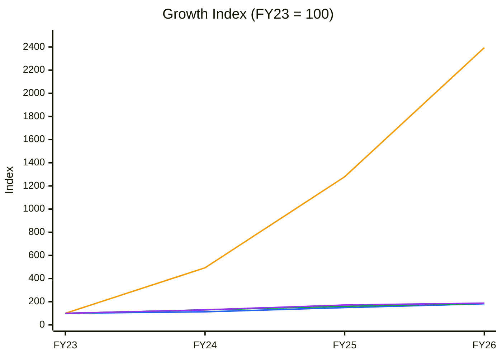
🟦 Revenue (3-yr CAGR 22%) · 🟧 Fixed assets incl. CWIP (×24) · 🟩 EBITDA (23%) · 🟪 PAT (23%)

**Read:** Fixed assets (🟧) grew ×24 in three years while revenue (🟦), EBITDA (🟩) and PAT (🟪) grew under ×2. Revenue per ₹ of fixed assets fell from ~20× to 1.5×.

**Business inference:** SPEL has turned from an asset-light, sub-132 kV assembler into a capital-heavy power-transformer maker. FY23–26 earnings growth came from the *old* plant. Every rupee of value now depends on filling Kannur at decent margins. That makes order inflow and working capital the thesis, not past growth.

---

## Business Primer

Supreme Power Equipment designs and makes oil-cooled transformers: distribution and energy-efficient transformers, power transformers (now up to 200 MVA / 220 kV), inverter-duty/solar and windmill transformers, converter/rectifier and isolation units, plus servicing. It sells to southern state utilities (TANGEDCO/TNPDCL, KSEB, KPTCL; empanelled in Tamil Nadu, Kerala, Karnataka and Andhra Pradesh), EPC contractors (mostly Karnataka- and Hyderabad-based), and renewable developers (Siemens Gamesa, Vestas wind projects historically). Revenue is project-based: orders of ₹5–75 Cr are won by tender or from EPC contractors, built to specification in 5–18 months, and billed on dispatch. Private customers pay 10–30% advance and ~90% before dispatch; government pays in 60–90 days (H1 FY27 call). FY26 standalone mix was power transformers ~41%, distribution ~31%, inverter-duty/solar ~19%, and non-government customers ~68% (H1 FY27 presentation p.34). Returns depend on two things: winning enough orders to fill a plant that is now 3.6× larger, and passing CRGO steel, copper and oil costs (~75% of revenue) through to customers.

This is an **order-driven, working-capital-heavy small-cap capital-goods manufacturer in a cyclical-plus-secular upcycle** (grid T&D, renewables evacuation, GEC-II in South India). The value drivers are volume (MVA throughput at Kannur) and mix (larger power transformers). The key risks are the capital cycle (many transformer makers adding capacity at the same time), customer concentration (top-10 customers 68% of FY26 revenue), commodity pass-through lags, and the qualification ladder: PGCIL approval is still pending, and type-test credentials above 160 MVA are needed for data-centre/EHV work. Three structural features colour the analysis. First, it is a **₹700 Cr SME listing** with thin liquidity, a 2,000-share lot and no institutional ownership left (DIIs 11.3% → 0.2%). Second, the promoter-shared **Danya Electric partnership** sits inside the group. Third, the business model reset in Feb-2026 means history is a weak guide to the future.

**New Segment Protocol:** Segment covered → "Electrical Equipment & Turnkey Electrical Solutions (Order-driven Capital Goods)" (references/05-industry-kpis-india.md, line 2256; transformer makers Voltamp, Shilchar and TARIL are listed there) ✓. Demand context from "Power & Renewables" (line 479) ✓. Top KPIs: order book/revenue, NWC/debtor days, EBITDA margin and product mix. Order-book tracking is mandatory (Reg 30 order filings and half-yearly order lists exist).

---

## Module 1 — Broad Market Cycle (Marks)

Nifty 50 is at **22,524** (26-Oct-2026 weekly bar). That is 14.6% below its 52-week high of 26,373 and **below a falling 30-week MA (23,726, down from 24,120 ten weeks ago)**. The 1-year return is −12.4% (Yahoo Finance weekly series). India VIX was ~14.4 and index P/E ~19.3× in early October (as cited in the 14-Oct-2026 TARIL report: [JM Financial](https://www.jmfinancialservices.in/market-news-and-insights/1735991); [Stockpil](https://stockpil.com/india-markets-today-2026-10-05/)). The SME segment is the frothiest corner of the market: SPEL's own IPO was subscribed 262× (Dec-2023, [5paisa](https://5paisa.com/news/supreme-power-equipment-ipo-final-subscription-details)), and its price fell from ₹241 (Dec-2024) to ~₹108 (Mar-2025, Yahoo weekly close) in the SME sell-off before recovering. **Assessment: CAUTIOUS (leaning fearful) for large caps; SME risk appetite volatile.** Sizing: small.

---

## Module 1b — Sector Cycle: Tailwinds & Headwinds

**Secular (durable):** India's grid transformation capacity is ~1,478 GVA (Jun-2026) against a 2,345 GVA plan for 2032 (SPEL H1 FY27 presentation p.31, citing CEA). CRISIL projects transformer-industry sales above ₹40,000 Cr by FY27 at 10–11% annual growth (Aug-2025, cited in the same presentation, p.32). South India GEC-II substation targets are 4,045 MVA (TN 2,200 / KA 1,225 / KL 620). Renewables (500 GW by 2030), distribution reform (RDSS) and industrial capex sustain distribution and sub-220 kV power-transformer demand.

**Cyclical (fades):** National transformation additions jumped from 70,728 MVA (FY24) to 86,433 (FY25), 113,013 (FY26) and a 158,339 target for FY27. Only 23% of the FY27 target was met in the first four months (TARIL report, CEA data). Global lead-time tightness is expected to ease within ~12 months as capacity arrives ([Rystad via Power Peak Digest](https://powerpeakdigest.com/global-transformer-supply-constraints-ease-rystad/)).

**Decomposition:** SPEL's FY23→TTM revenue CAGR is ~27%. We split it as ~10–12% secular (sub-220 kV T&D and renewables volume) and ~15pp cyclical or company-specific (tight market plus share gains from a tiny base). **Durable baseline for the DCF beyond FY29: 10–12%.**

### CY5 — Demand proxy: India grid transformation capacity additions (220 kV+, MVA)

| | FY23 | FY24 | FY25 | FY26 | FY27 (target) |
|---|---|---|---|---|---|
| AC transformation capacity added (MVA) | 75,902 | 70,728 | 86,433 | 113,013 | 158,339 |

*Source: CEA via [Outlook Business](https://www.outlookbusiness.com/spotlight/news-wire/india-adds-113013-mva-grid-transformation-capacity-in-fy26-meets-90-of-cea-target) and the 14-Oct-2026 TARIL report. SPEL's 220 kV entry gives it its first access to this segment. Most of its sales are below 132 kV, where no national demand series exists (data gap).*

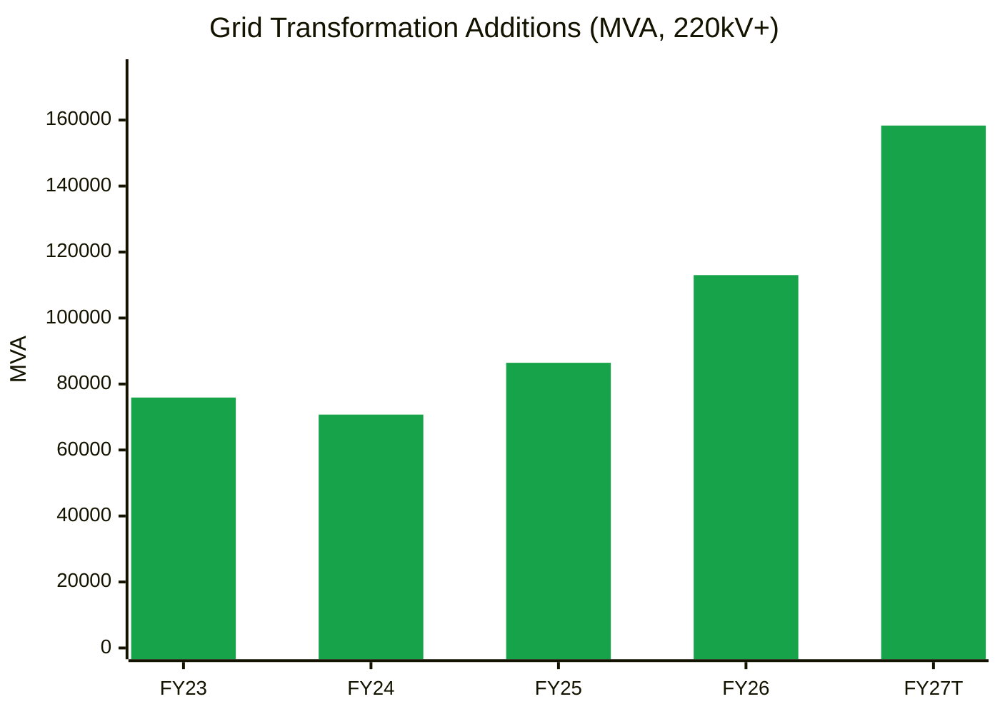
🟩 CEA transformation capacity added (FY27 = target)

**Read:** National additions were flat in FY23–24, then rose 22% and 31%. The FY27 target is another +40%, and delivery is running behind.

**Business inference:** Demand is supportive for at least FY27–28. But SPEL is entering the 220 kV segment just as national capacity floods in (Siemens Energy 30,000 MVA, TARIL +37,000 MVA, Voltamp, Hitachi, GE T&D, CG, plus SME/IPO entrants such as TMC Transformers). That is the late-cycle supply pattern. **Industry supply (capacity) series is a data gap**, so no utilisation line can be drawn.

**Input cost cycle:** CRGO steel and transformer oil rose in H1 FY27 and compressed margins. About 70–80% of the order book carries price-variation clauses (H1 FY27 call). Bushings above 220 kV are sourced from China for some orders (call), which is a structural sourcing risk. **Input-cost cycle: rising → compress margin assumptions.**

**Geopolitical / FX:** There are no exports, so FX exposure is limited to imported inputs (CRGO, bushings).

**Sector cycle verdict: TAILWIND (12–24 months), late-cycle on supply.** Module 8: do not embed FY26–27 growth beyond FY29. Module 8 MoS: +5pp for the late-cycle supply response.

---

## Module 1c — Stock Cycle: Company Positioning

### C2 — Quarterly YoY revenue growth (consolidated)

| | Q1 FY26 | Q2 FY26 | Q3 FY26 | Q4 FY26 | Q1 FY27 | Q2 FY27 |
|---|---|---|---|---|---|---|
| Revenue (₹ Cr) | 35.07 | 40.13 | 35.83 | 70.62 | 48.23 | 87.08 |
| Same quarter last year | 27.52 | 30.63 | 29.11 | 61.46 | 35.07 | 40.13 |
| YoY growth | 27% | 31% | 23% | 15% | 38% | 117% |

*Source: Screener.in consolidated quarterly rows. Q4 FY26 = H2 FY26 (₹106.45 Cr, H2 FY26 presentation p.6) − Q3. Q4 FY25 = FY25 ₹148.72 Cr − 9M. Q2 FY27 = H1 FY27 ₹135.31 Cr − Q1 ₹48.23 Cr.*

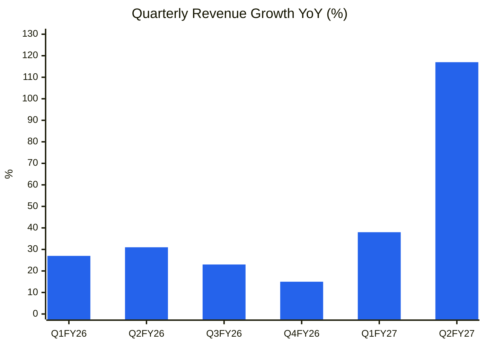
🟦 YoY revenue growth (consolidated)

**Read:** Growth stayed at 15–31% through FY26, then accelerated to 38% and **117%** as Kannur began shipping.

**Business inference:** This is the capacity step-change showing up. Growth is **accelerating** (a positive Module 1c signal), but it is volume from a new plant executing a backlog built in H2 FY26. The Q2 order drought means the acceleration will stall in FY28 unless inflow resumes at ≥₹100 Cr per quarter.

### Revenue decomposition: volume / price / mix
- **Volume (dominant):** capacity rose from 2,500 MVA to 9,000 MVA. Old-plant utilisation was 70–80%; group utilisation was only 20–30% in H1 FY27, with a target of 40–50% for FY27 (call).
- **Mix (positive but early):** the move to 20–160 MVA power transformers (~75–78% of the order book, ~₹440 Cr) from distribution (~16–17%) earns only ~1–1.5pp more margin, which higher overheads absorb (call). The "margin expansion through mix" claim is therefore weak.
- **Price (fragile):** realisations are protected by price-variation clauses, not pricing power.

### Physical capacity model
| Item | Value | Source |
|---|---|---|
| Installed capacity | ~9,000 MVA (Thirumazhisai ~2,500 MVA + Kannur 6,000–6,500 MVA) | H2 FY26 presentation p.20 |
| Rating ceiling | 200 MVA / 220 kV (Kannur); 25 MVA / 132 kV (old plant) | same |
| Kannur investment | ~₹100 Cr | same |
| Revenue at full capacity | ₹500–550 Cr (presentation); "₹550–600 Cr peak, FY28" (call) | p.21; GuruFocus |
| Utilisation H1 FY27 | 20–30% group; Kannur 40–50% FY27 → ~80% FY28 (guided) | call |

**Inconsistency flag:** the call summary gives Unit 1 ₹70–80 Cr + new plant ₹200–250 Cr, which is ₹270–330 Cr, not the ₹550–600 Cr "combined peak". The capacity-revenue number should be verified against the call transcript (data gap). We use **₹500–550 Cr** (presentation, written) as the ceiling.

**Capacity ceiling year:** at ₹500–550 Cr potential and 85–90% practical utilisation, the ceiling is **~₹450–490 Cr**, reached around FY29 in our base case. Growth after that needs a new plant or higher-rated units (PGCIL approval, >160 MVA type tests).

### Order-book revenue model (see Order Book Tracker, Module 6)
- **Firm order book:** ₹566 Cr (21-Oct-2026). Management guides H2 FY27 execution of ₹200–250 Cr; customers want ₹353 Cr by Mar-2027 (call).
- **Revenue anchor FY27E:** H1 ₹135 Cr + H2 ₹175–215 Cr gives **₹310–350 Cr**. We use **₹310 Cr** in the base case (low end of guidance, given the ramp and working capital).
- **FY28 anchor:** opening OB after H2 ≈ ₹566 − ₹200 + H2 inflow. At the Q2 inflow pace (~₹60 Cr/quarter implied), the FY28 opening OB would be only ~₹480 Cr. **FY28 revenue needs inflows to recover to ₹100–150 Cr per quarter** (management targets an order book of ₹600–800 Cr by Mar-2027).

### Operating leverage
FY26 (consolidated): gross contribution (revenue − raw material) is 25.5% and EBITDA 18.3%, so fixed costs (employees + other) are only ~7% of revenue. **DOL ≈ 25.5 ÷ 17.4 (EBIT margin) ≈ 1.5×**, which is low. Kannur adds depreciation (₹0.4 Cr → ~₹4 Cr a year) and staff. **DFL** = EBIT 31.6 ÷ (31.6 − 3.0) = 1.1×. **DTL ≈ 1.6×**, so a 10% revenue miss gives a ~16% EPS miss. ICR is 10.4× (FY26) and fell to ~7.4× in H1 FY27 (EBIT ₹21.6 Cr ÷ interest ₹2.9 Cr). It is not a constraint.

### Management guidance accuracy (see Module 3 WTT): 0.67 on a small sample → **MODERATE**, so guidance gets a ~10–15% haircut.

### FCF inflection year
Capex was heavy in FY24–FY26 (investing outflows ₹22 Cr, ₹41 Cr, ₹57 Cr). It should fall to maintenance (~₹4–6 Cr) in FY28. Working capital is still rising (inventory doubled). **FCF inflection: FY28E**, provided NWC days stabilise near 90.

### CY7 — EBITDA margin vs history (consolidated, %)

| | FY23 | FY24 | FY25 | FY26 | H1 FY27 |
|---|---|---|---|---|---|
| EBITDA margin (consol.) | 18.0 | 20.5 | 19.4 | 18.3 | 17.4 |
| EBITDA margin (standalone) | 17 | 18.2 | 17.8 | 16.1 | — |
| ROCE (consol., company) | — | 27.6 | 25.7 | 18.8 | — |

*Standalone FY18–FY22 EBITDA margin was 4.6–8% (Screener.in), so the 10-year median is ~12%.*

**Cycle classification: Early cycle / ramp-up on capacity (Kannur), but late cycle on industry margins.** Margins are >1 SD above the 9-year standalone average (12%) and already rolling over. **MoS adjustment: +5pp.** The classification is "ramp-up with late-cycle margin risk".

---

## Module 2 — Industry Structure & Capital Cycle

| Force | SPEL's segment (≤220 kV, South India) | Signal |
|---|---|---|
| New entrants | **High threat.** Sub-132 kV distribution/power transformers need BIS/CPRI type tests and utility empanelment (1–3 years). There are hundreds of MSMEs (Chennai, Baroda, Hyderabad clusters), and new SME/IPO entrants are adding capacity | Weak barrier below 132 kV; moderate at 220 kV |
| Supplier power | **High.** CRGO (largely imported; DGTR anti-dumping probe), copper, oil and HV bushings (China for >220 kV) | Input-price takers; PVCs mitigate |
| Buyer power | **High.** Utilities buy L1 by tender. EPC contractors (top-10 customers 68%) negotiate hard; government pays in 60–90 days | Weak pricing power |
| Substitutes | Low. Transformers are essential; dry-type and amorphous-core variants are niche | Neutral |
| Rivalry | **Rising.** Voltamp, Shilchar, Indo Tech, TARIL, Atlanta, Kanohar, Kirloskar Electric, BHEL plus regional MSMEs. Everyone is expanding | Price discipline lasts only while supply is short |

**Industry verdict: NEUTRAL-to-UNATTRACTIVE structurally (low barriers below 132 kV), currently attractive cyclically.**

**Capital cycle (Chancellor):** **"Capital floods in."** (1) SPEL itself raised IPO money (₹46.7 Cr) and warrant money (₹21 Cr at ₹169) and built a plant 2.6× its old capacity. (2) Peers are expanding: Siemens Energy (+30,000 MVA), TARIL (+37,000 MVA), Atlanta (63,060 MVA now, +15,000 MVA 765 kV planned), Voltamp (new Gujarat plant). (3) New listings include TMC Transformers and others ([Kotak Neo](https://www.kotakneo.com/ipo/tmc-transformers-india-ipo/)). (4) Sector ROCE is at 10-year highs (TARIL 23%, Shilchar 51%, Atlanta 45%). (5) SPEL capex/depreciation: FY26 ~₹57 Cr investing outflow against ₹1.7 Cr D&A, which is **~33×**. **Capital-cycle position: late upcycle.** CY8 (industry capex/depreciation) is a data gap beyond the peers cited.

---

## Module 3 — Business Quality & Moat

### Greenwald's three barriers
1. **Supply/cost advantage:** none evident. Consolidated EBITDA margin of 18–21% (FY23–26) looks high for a ≤132 kV maker. Peers: Voltamp 16%, Indo Tech 17%, TARIL 15%. But standalone margins were 4.6–8% in FY18–FY22, so the high margin is a product of the cycle, not of cost structure. In-house core/coil and testing are standard industry practice.
2. **Customer captivity:** weak. Utilities buy L1. Repeat EPC orders come from relationships, not switching costs. Vendor approvals (KPTCL 2023, KSEB 2025) are a qualification hurdle, not captivity.
3. **Local economies of scale:** limited. There is a regional (Tamil Nadu) presence with TANGEDCO/TNPDCL testimonials, but SPEL has no dominant share.

**Buffett 10% price test:** Fail. SPEL could not raise prices 10% without losing L1 tenders. Margins fell in H1 FY27 when input costs rose.

**Moat verdict: NONE (narrow qualification barrier at 220 kV, only if PGCIL/type-test approvals follow).**

### Moat durability tests
| Test | Result |
|---|---|
| ROIC vs WACC (10 yr) | Standalone ROCE FY19–FY22 13–22% (around WACC); FY23–FY26 22–71% (cycle plus a tiny capital base). Mixed |
| Market share stability | Too small to measure (<1% of a >₹40,000 Cr market) |
| Pricing power during inflation | Fail (H1 FY27 margin −1.5pp) |
| Activity system | Basic (design + core/coil + testing). The Danya partnership adds execution capacity, not differentiation |
| Scuttlebutt | Client testimonials only (company-supplied). Two promoters plus one non-executive technical director (ex-TELK, AREVA, Hitachi-trained) give a thin bench. Team of 250 (presentation p.11) |

### Fisher 15-point checklist (1–3)
| # | Point | Score | Note |
|---|---|---|---|
| 1 | Market potential | 3 | Grid/renewables runway |
| 2 | New products | 2 | 220 kV entry; PGCIL and >160 MVA approvals pending |
| 3 | R&D effectiveness | 1 | No R&D disclosure |
| 4 | Sales organisation | 2 | Strong with Karnataka EPCs; narrow geography |
| 5 | Profit margin | 2 | High now, history low |
| 6 | Margin improvement actions | 1 | Margin guidance cut (10–12% → 9–12% PAT) |
| 7 | Labour relations | 2 | No issues found |
| 8 | Executive relations | 2 | Founder-run |
| 9 | Management depth | 1 | CMD-centric; small KMP team |
| 10 | Cost/accounting controls | 2 | CRISIL BBB; auditor KAM on related-party revenue |
| 11 | Industry-specific advantages | 1 | None durable |
| 12 | Long-range orientation | 2 | Capacity built ahead of demand |
| 13 | Dilution | 2 | Warrants +5% |
| 14 | Candour in adversity | 2 | Disclosed margin pressure and the execution gap openly |
| 15 | **Integrity** | **2** | **Pass.** No SEBI/ED actions found; the Danya structure is disclosed and shareholder-approved (AGM resolutions, Reg 23), but promoters share in a group entity's profits |
| | **Total** | **27 / 45** | |

---

## Module 4 — Management & Capital Allocation

**Promoters:** Vee Rajmohan (CMD) and K.V. Pradeep Kumar. **Promoter holding 57.16%** (Sep-2026), up from 56.56% (Dec-2023) after warrant-linked allotments. **Pledge: none shown** in the Screener shareholding data (Sep-2026), so risk is Normal (a BSE pledge-disclosure check is recommended; data gap). Institutional holding: **DIIs fell from 11.31% (Dec-2023) to 0.23%** after anchor/IPO-fund exits; FIIs 0.75%. Shareholders: 4,954.

| Check | Finding | Flag |
|---|---|---|
| Promoter holding trend | Stable/up (56.6% → 57.2%) | ✅ |
| Pledge | None reported | ✅ |
| ICDs to group | None found | ✅ |
| **RPT quality** | **Danya Electric**: a partnership with SPEL 90%, Vee Rajmohan 7.5% and K.V. Pradeep Kumar 2.5% ([NSE integrated filing, Feb-2026](https://nsearchives.nseindia.com/corporate/ixbrl/INTEGRATED_FILING_NONINDAS_141313_09022026182023_iXBRL_WEB.html)). It executes TNPDCL orders (₹113.6 Cr won Mar-2026; ₹159.9 Cr OB at May-2026). SPEL sells to Danya: FY26 standalone revenue ₹190.1 Cr is **above** consolidated ₹181.6 Cr because intra-group sales are eliminated. The auditor's FY25 KAM covers revenue with "significant related party transactions". Shareholders approved material RPTs (AGM notices 2024, 2025) | ⚠️ Structural. Small in value (minority interest ₹0.24 Cr FY26 ≈ 1.2% of PAT) |
| Promoter salary vs PAT | Not found (data gap) | ⚠️ |
| Dividend vs FCF | Nil dividend; FCF negative during capex (acceptable) | Neutral |

**Capital allocation (Thorndike):** FY24–FY26 consolidated CFO was ₹54.5 Cr against capex/investing of ₹119.9 Cr. The gap was funded by IPO money (Dec-2023), warrants (₹21 Cr at ₹169) and debt (₹9 Cr → ₹50 Cr). Share count rose from 0.4 Cr (FY23, pre-bonus and IPO) to 2.50 Cr, and to 2.62 Cr fully diluted. **FCF/share is negative for 3 of the last 4 years**, while EPS has compounded (₹5.60 → ₹8.15, FY24–FY26). The divergence comes from capex, not manipulation. **Incremental ROIC** on the ~₹100 Cr Kannur plant cannot be judged before FY28. At the guided ₹250–300 Cr of extra revenue × 12% EBIT margin × 0.75, it would be ~22–27% before working capital, or **~14–16% including ~₹70 Cr of extra working capital**. That is roughly equal to WACC (15%). **Capital allocation rating: Average.**

**Buffett Three C's:** Candour: Moderate (the call admitted the execution gap and margin pressure; the PAT-margin band was quietly widened). Competence: Moderate (built and commissioned the plant; scale untested). Caring: Moderate (no dividend; the promoter subscribed warrants; the Danya profit-share is a small conflict).

### Walk the Talk Scorecard
| Period guided | Statement | Guided | Actual | Verdict |
|---|---|---|---|---|
| FY26 (presentations) | FY26 revenue target | "Targeted topline growth" (number not found) | +22% revenue (consol.) | ⚠️ Unverifiable (self-reported "achieved") |
| FY26 | PAT margin 10–12% | 10–12% | 11.2% FY26 | ✅ Hit |
| H2 FY26 presentation | "Margin expansion ahead" (mix + operating leverage) | Higher EBITDA % | H1 FY27 17.4% vs FY26 18.3% and H1 FY26 18.9% | ❌ Miss |
| FY26 | Kannur commercial production | FY26 | Feb-2026 | ✅ Hit (original target date not found) |
| FY27 (earlier) | FY27 revenue | ₹275 Cr (earlier, per call Q&A) | Raised to ₹300–350 Cr; H1 ₹135 Cr | Pending (upgrade) |
| H1 FY27 call | PAT margin FY27 | 9–12% (was 10–12%) | H1 10.1% | 🔴 Band widened down (reframing) |
| H1 FY27 call | Order book at Mar-2027 | ₹600–800 Cr | ₹566 Cr (Oct) | Pending |
| H1 FY27 call | OCF positive in H2 FY27 | Positive | — | Pending |

**WTT Score: (2 hits + 0) ÷ 3 scored = 0.67 / 1.00 — MODERATE.** Small sample.
**Guidance points assessed:** 3 scored (+1 unverifiable, 1 reframed, 3 pending) | Hits: 2 | Near misses: 0 | Misses: 1 | Reversals: 1 (margin band)
**Key pattern:** revenue guidance is raised while margin guidance is softened. That is volume-first growth, not margin-led.
**Insider action:** the promoter subscribed ~36% of 12.47 lakh warrants at ₹169 (Aug-2025) → **mildly BULLISH**. No open-market buys or sells found (BSE Form C check: data gap).
**DCF impact:** a 10% haircut to FY27–28 revenue guidance (base FY27 ₹310 Cr vs ₹300–350 Cr guided).
**Overall management credibility: MODERATE.**

---

## Module 5 — Financial Forensics

### 5A. Indian-specific red flags
| Check | Finding | Flag |
|---|---|---|
| Promoter pledge | None reported | ✅ |
| RPT / round-trip | SPEL → Danya (promoter-shared partnership) → TNPDCL. Consolidation eliminates intra-group revenue (standalone > consolidated by ₹8.4 Cr in FY26), so consolidated numbers are the right basis | ⚠️ Structural, not value-material |
| Revenue quality | FY24 receivables were ₹65.7 Cr = **211 debtor days** (IPO year), falling to 111 (FY25) and 94 (FY26). The FY24 spike around the listing is notable | ⚠️ Watch |
| Audit | KAM on revenue / RPTs (FY25). Auditor name and FY26 KAMs not retrieved (data gap). No qualification or EOM found | ⚠️ Data gap |
| Credit rating | CRISIL BBB/Stable (long-term), A3 (short-term) | Neutral (sub-investment-grade feel for lenders) |
| **Pre-IPO margin step-up** | Standalone EBITDA margin was 4.6–8% (FY18–FY22), then 17% in FY23, the year before the IPO, while revenue jumped 47 → 76 Cr. Partly explained by the industry upcycle (TARIL margins also roughly doubled), but the step is unusually sharp | ⚠️ Partly explained |

### 5B. Quantitative models (consolidated FY26 vs FY25)
| Model | Value | Reading |
|---|---|---|
| **Beneish M-Score** (8-var; GMI from raw-material margin, SGAI = 1) | **−2.81** | Unlikely manipulator. DSRI 0.85 · GMI 0.98 · AQI 0.42 · SGI 1.22 · DEPI 1.6 (new-plant life) · LVGI 1.36 · TATA −0.02 |
| **Altman Z''** | **3.17** | Safe (>2.60). X1 0.11 · X2 0.22 (retained earnings ex-IPO premium, estimate) · X3 0.12 · X4 0.85 |
| **Piotroski F** | **5 / 9** | Average. ROA+, CFO+, CFO>NI, gross margin up, no new shares (warrants pending) ✓. ΔROA, leverage up, current ratio down (1.69 → 1.28), asset turnover down ✗ |
| **Sloan CF accrual** (NI − CFO − CFI)/avg TA | **+24.8%** | Above the 10% flag, but driven by Kannur capex (CFI −₹57 Cr). Balance-sheet accrual (NI − CFO)/avg TA = −2.5% (clean) |

### 5C. Schilit screen
| Shenanigan | Check | Result |
|---|---|---|
| Revenue too soon | DSO 211 → 111 → 94 days; CFO/EBITDA 156% (FY25), 105% (FY26) | ✅ Improving (but H1 FY27 CFO negative) |
| Bogus revenue | Related-party sales to Danya; consolidated nets them out | ⚠️ Monitored |
| One-time boosts | Consolidated other income ₹0.46 Cr ≈ 1.5% of EBIT | ✅ |
| Capitalising expenses | Capex ₹57 Cr vs D&A ₹1.7 Cr = new plant, not capitalised opex; pre-operative costs not disclosed | ⚠️ Data gap |
| Hiding losses / cookie jar / big bath | None observed | ✅ |
| Factoring / supply-chain finance | Not disclosed | ⚠️ Data gap |
| **WC manipulation (DPO)** | **Payables doubled ₹31.5 → ₹62.2 Cr (DPO 103 → 168 days)**, financing an inventory build ₹31.5 → ₹62.1 Cr (103 → 167 days) | ⚠️ Payables-funded inventory. CFO flattered in FY26 |

**Forensic red-flag count: 2 unresolved / 15** (inventory–payables build with H1 FY27 CFO negative; the promoter-shared Danya RPT structure), plus 3 watch items (pre-IPO margin step-up, FY24 receivable spike, audit data gaps).
**Overall forensic verdict: Minor-to-moderate concerns. Not a hard stop; deep-dive the FY26 annual report RPT note before buying.**

---

## Module 5 (cont.) — Earnings Quality & Financial Statements

### Standalone 9-year history (Screener.in, ₹ Cr, rounded)
| | FY18 | FY19 | FY20 | FY21 | FY22 | FY23 | FY24 | FY25 | FY26 |
|---|---|---|---|---|---|---|---|---|---|
| Revenue | 31 | 35 | 39 | 35 | 47 | 76 | 107 | 145 | 190 |
| EBITDA margin | 7% | 6% | 4.6% | 8% | 7% | 17% | 16%* | 16%* | 15%* |
| PAT | ~0.4 | ~0.4 | ~0.4 | ~0.3 | 1 | 11 | 14 | 19 | 20 |
| Borrowings | 3 | 4 | 4 | 20 | 10 | 8 | 6 | 16 | 46 |
| ROCE (inferred mapping) | — | 22% | 17% | 13% | 15% | 71% | 37% | 28% | 22% |

*Screener OPM excludes other income; presentation EBITDA (incl. OI) is 18.2/17.8/16.1%. ROCE values are mapped to years by recomputation (FY24–FY26 match the presentation's ±1pp).*

### C4 — EBITDA margin trend (standalone %, FY18–FY26)

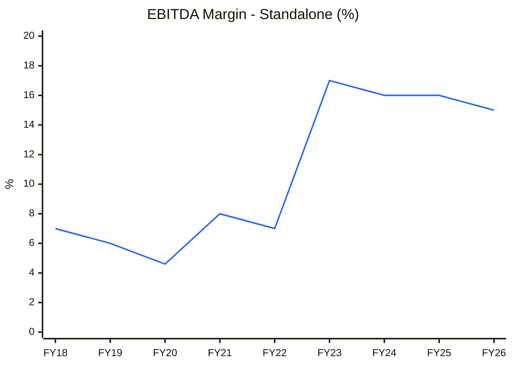
🟦 Standalone OPM (Screener.in)

**Read:** Margins sat at 5–8% for five years, jumped to 17% in FY23, and have edged down every year since.

**Business inference:** Most of SPEL's profitability is a product of the cycle (and the timing of the listing), not a structural feature. A mid-cycle normalised margin is ~11–13%, not 17–18%. Our bear case uses 12.5%.

### ROIC / WACC
| | FY24 | FY25 | FY26 |
|---|---|---|---|
| NOPAT (EBIT ex-OI × (1 − 27%)) | 16.6 | 20.3 | 22.7 |
| Invested capital (NW + debt − cash, year-end) | 83.1 | 105.4 | 158.5 |
| ROIC (avg IC) | ~24% | 21.5% | 17.1% |
| WACC | 15% | 15% | 15% |
| Spread | +9pp | +6.5pp | +2pp |

WACC = Ke 15.5% (Rf 7% + β 1.3 × ERP 6% + ~0.7pp SME/illiquidity) × ~85% + Kd 10% × (1 − 25%) × 15% ≈ **15%**.

### C5 — ROIC vs WACC (%)

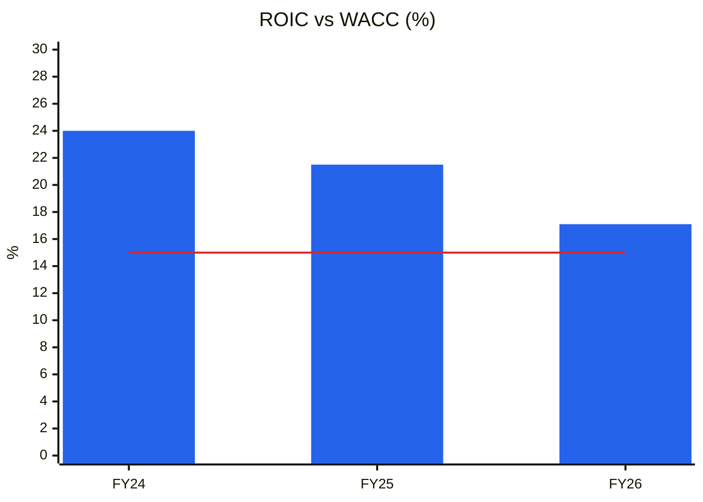
🟦 ROIC (consolidated, avg IC) · 🟥 WACC 15%

**Read:** ROIC is falling (24% → 17%) as Kannur capital comes in ahead of its revenue. The spread over WACC is narrowing to ~2pp. (Three points only: the chart is shown for direction. Standalone ROCE above covers 8 years.)

**Business inference:** Economic profit is still positive but thin. Value creation now hinges on Kannur reaching 70%+ utilisation at ≥15% EBITDA margin. If it stalls at 40–50% (the FY27 guide), ROIC falls below WACC.

### C7 — Cumulative PAT vs CFO (consolidated, ₹ Cr)

| | FY23 | FY24 | FY25 | FY26 |
|---|---|---|---|---|
| PAT | 11 | 14.3 | 18.9 | 20.7 |
| CFO | 5 | −10.7 | 39.4 | 25.9 |
| Cumulative PAT | 11 | 25.3 | 44.2 | 64.9 |
| Cumulative CFO | 5 | −5.7 | 33.7 | 59.6 |

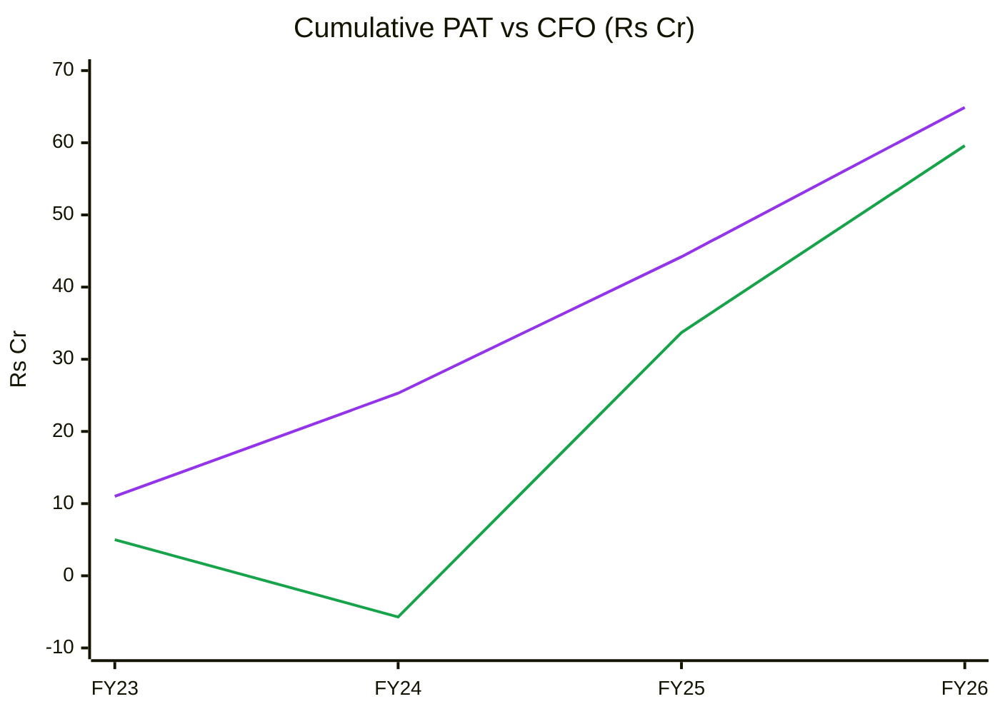
🟪 Cumulative PAT · 🟩 Cumulative CFO

**Read:** Cumulative CFO caught up with PAT (0.92× over FY23–26; 0.98× over FY24–26) after a negative IPO year (FY24).

**Business inference:** Earnings have converted to cash so far. But FY26 CFO was helped by payables doubling, and management says H1 FY27 CFO was negative. A ₹300+ Cr revenue run-rate needs ~₹60–70 Cr of inventory (call). Expect CFO/PAT below 0.6 in FY27.

**OCF / Net income (FY23–26):** 0.92 → **Quality: Medium.**
**O'Glove red flags:** 3 / 15 (#5 DPO rising, #4 inventory days rising, #9 Sloan >10% from capex). **Key accounting concern:** working capital financed by suppliers, and related-party revenue via Danya.

### DuPont Decomposition (5-factor, consolidated, year-end balances)
| Year | EBIT margin | Asset turnover | Equity multiplier | Interest burden | Tax burden | ROE |
|---|---|---|---|---|---|---|
| FY23 | 18.0% | 1.45 | 3.83 | 0.83 | 0.73 | 61% (pre-IPO equity) |
| FY24 | 20.2% | 0.94 | 1.64 | 0.86 | 0.72 | 19.3% |
| FY25 | 19.2% | 0.94 | 1.71 | 0.91 | 0.73 | 20.5% |
| FY26 | 17.4% | 0.69 | 2.21 | 0.90 | 0.73 | 17.5% |
| **Change FY24→FY26** | −2.8pp | −0.25× | +0.57× | +0.04 | 0 | **−1.8pp** |

**Operating contribution (EBIT margin × AT):** **Declining** (19.0% → 12.1%).
**Financing contribution (equity multiplier):** **Rising** (1.64 → 2.21; borrowings ₹9 Cr → ₹50 Cr; payables ₹23 Cr → ₹62 Cr).
**DuPont verdict:** ROE fell only 1.8pp because **leverage (debt plus supplier credit) rose while operations deteriorated**. That is the skill's financial-engineering warning pattern, though here it reflects a capex cycle rather than an attempt to disguise performance. AT should recover as Kannur fills.
**AT trend → Module 10 base-case AT:** fixed-asset turnover 1.52× (FY26, company). Assume ~3.0× on the ₹120 Cr block by FY29 (₹450 Cr revenue ÷ ~₹150 Cr block incl. maintenance). That is below the old-plant 5–20× because the new block is bigger and higher-rated.

---

## Module 6 — Industry KPIs & Peer Analysis

**Sector:** Electrical Equipment / transformers (KPI block line 2256).

| KPI | SPEL | Peer avg / healthy range | Assessment |
|---|---|---|---|
| Order book / revenue | 2.3× TTM | >1.5× | **Above ✅** (but Q2 inflow weak) |
| Net working-capital days | Screener WC days 39 (FY26); inventory 167, debtors 94, payables 168 | <100 | In line, but payables-funded ⚠️ |
| EBITDA margin | 17.4% (H1 FY27) | 11–18%; peers 15–29% | In line (falling) |
| Execution velocity (revenue ÷ opening OB) | FY27E ~₹310 Cr ÷ ₹588 Cr ≈ 0.53 | >0.6 | **Below ⚠️** (ramp constraint) |
| Net debt / EBITDA; ICR | ~1.1× (₹47 Cr ÷ ₹42.6 Cr TTM); ICR ~7× | <2×; >3× | ✅ |
| ROCE | 18.8% (FY26) | >18% | Borderline ✅ |
| CFO/PAT (4-yr) | 0.92 | >0.7 | ✅ |

### Peer comparison (Screener.in; SPEL 23-Oct-2026; peers 13-Oct-2026 via TARIL report; Atlanta 23-Oct-2026)
| Metric | SPEL | Atlanta | TARIL | Voltamp | Indo Tech | Shilchar |
|---|---|---|---|---|---|---|
| Revenue FY26 (₹ Cr) | 182 | 1,852 | 2,507 | 2,154 | 782 | 652 |
| Revenue 3-yr CAGR | 22% | 29% | 22% | 16% | 28% | 33% |
| EBITDA margin (FY26) | 18% | 19% | 15% | 16% | 17% | 29% |
| ROCE (latest) | 19% | 45% | 23% | 24% | 40% | 51% |
| Net debt (₹ Cr) | ~47 | ~0 | 574 (Sep-26) | ~0 | ~0 | ~0 |
| P/E (TTM) | **27.6** | 57 | 30 | 33 | 34 | 33 |
| Market cap (₹ Cr) | 683 | 12,453 | 9,125 | 10,451 | 3,407 | 4,515 |

### C12 — P/E vs ROCE (peers)

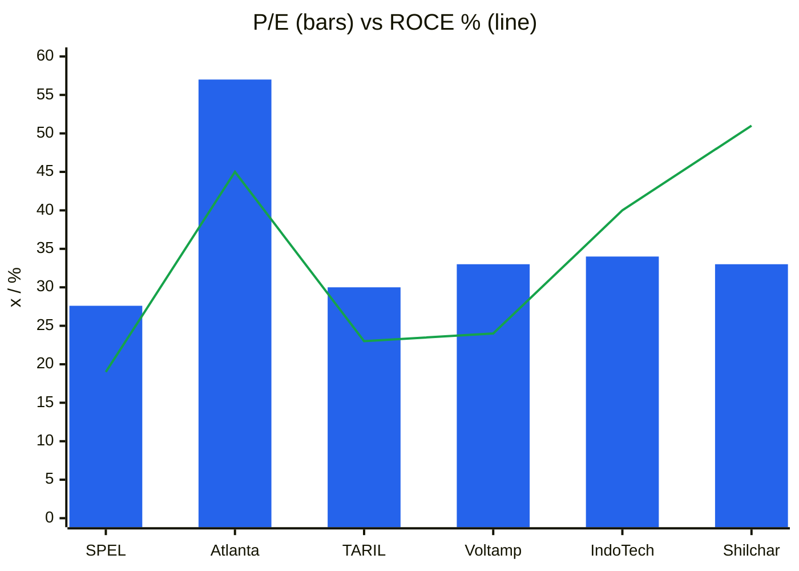
🟦 P/E TTM · 🟩 ROCE latest (%)

**Read:** SPEL trades at a P/E slightly below the domestic transformer pack (30–34×) but has the **lowest ROCE (19%)** of the group, apart from TARIL.

**Business inference:** Indo Tech and Shilchar offer 2× the ROCE, net cash and longer records at only ~20% higher P/E. SPEL's ~15% discount does not cover SME illiquidity, a 9-month-old plant and a promoter-shared subsidiary. **A 25–35% discount to the pack (20–22×) is warranted**, which is the base-case multiple used.

**Peer positioning:** small discount. **Justified? No; a larger discount is warranted.**

### Order Book Tracker *(order-driven; references/13-order-book-tracking.md)*

*Generated 2026-10-26 by scripts/order_book_tracker.py from 22 order announcements and 7 period snapshots. Ledger coverage starts 2026-01-01; earlier periods show '—'. Order dates are approximated to the half-year/quarter lists in the investor presentations, because SPEL lists orders per period rather than as dated Reg 30 filings for every order.*

#### 1. Disclosed vs tracked order book (reconciliation)

| Period | Revenue (₹ Cr) | Order book (₹ Cr) | Announced inflow | of which Framework | Implied inflow | Announced coverage | OB cover (× TTM rev) | Source |
|---|---|---|---|---|---|---|---|---|
| FY25 | 149 | — | — | — | — | — | — | Consolidated P&L (H2 FY26 presentation) |
| Q1FY26 | 35 | — | — | — | — | — | — | Screener consolidated |
| Q2FY26 | 40 | — | — | — | — | — | — | Screener consolidated |
| Q3FY26 | 36 | 311 | — | — | — | — | — | Company update 9-Feb-2026 |
| Q4FY26 | 71 | 588 | 339 | — | 348 | 97% | 3.2 | H2 FY26 presentation (OB as on 27-May-2026) |
| Q1FY27 | 48 | 590 | 54 | — | 50 | 108% | 3.0 | Q1 FY27 presentation (OB as on 13-Aug-2026) |
| Q2FY27 | 87 | 566 | 14 | — | 63 | 22% | 2.3 | H1 FY27 presentation (OB as on 21-Oct-2026) |

*Implied inflow = OB(t) − OB(t−1) + order-linked revenue(t). Because the company quotes the order book "as on" a date after the period end, orders up to that date are attached to that snapshot. Q4 FY26 inflow therefore includes the Apr-2026 Hyderabad order (₹74.6 Cr), and Q1 FY27 announced orders largely precede 13-Aug.*

**Read:** Coverage was ~100% in Q4 FY26 and Q1 FY27: the order lists explain the book. In Q2 FY27 (13-Aug → 21-Oct) only ₹13.6 Cr of announced orders came in, against ~₹63 Cr implied. The book fell for the first time.

#### 2. Announced orders aggregated by quarter

| Quarter | # orders | Total (₹ Cr) | Firm | Framework | Largest single | Export | Govt/PSU | Private domestic |
|---|---|---|---|---|---|---|---|---|
| Q4FY26 | 11 | 197 | 197 | 0 | 71 | 0 | 100 | 97 |
| Q1FY27 | 10 | 196 | 196 | 0 | 51 | 0 | 0 | 196 |
| Q2FY27 | 1 | 14 | 14 | 0 | 14 | 0 | 0 | 14 |

#### 3. Macro picture

| Metric | Value |
|---|---|
| Latest disclosed order book | ₹566 Cr (21-Oct-2026) |
| Orders announced since that disclosure | ₹0 Cr |
| Tracked order book today | ₹566 Cr |
| Order book cover (latest) | 2.3× TTM revenue |
| Framework / 'potential value' agreements | ₹0 Cr (0%) |
| Orders announced, ledger window (Jan–Oct 2026) | ₹406 Cr (22 orders; avg ₹18 Cr) |
| Top-3 orders as % of disclosed OB | 29% |
| Book-to-bill, Q4 FY26–Q2 FY27 (implied inflow ÷ revenue) | 461 ÷ 206 = **2.2×** (Q2 FY27 alone: 0.7×) |
| Execution rate (revenue ÷ opening OB) | Q2 FY27: 87 ÷ 590 = 0.15/qtr (~0.6 annualised) |

**Customer type mix (ledger):** Private 75% · Govt 25% · **Geography:** 100% domestic. Karnataka EPC and Hyderabad customers dominate. Three of the "Company from Hyderabad" orders (₹51.3 + 23.3 + 13.5 + 13.6 Cr) may be one customer. If so, customer concentration within the OB is ~25%.
**Segment mix (ledger):** 20 MVA power transformers 56% · distribution 24% · 112.5 MVA/330 kV and 160 MVA/220 kV units 13%.

**Firmness & capability note:** two orders are for **112.5 MVA, 330 kV transformers** (₹13.5 Cr + ₹13.6 Cr). SPEL's stated capability is up to 220 kV, and the call says >220 kV bushings come from China. Delivery against a voltage class above its stated rating carries technical and type-test execution risk (verify the specification; data gap).

#### OB-1 — Order book vs TTM revenue (₹ Cr)

| | Q4 FY26 | Q1 FY27 | Q2 FY27 |
|---|---|---|---|
| Order book | 588 | 590 | 566 |
| TTM revenue | 182 | 195 | 242 |
| Cover (×) | 3.2 | 3.0 | 2.3 |

*Only three order-book points exist with TTM revenue, so per the skill's 4-point rule an index chart is not drawn. OB-3 is shown instead.*

#### OB-3 — Announced orders vs revenue by quarter (₹ Cr)

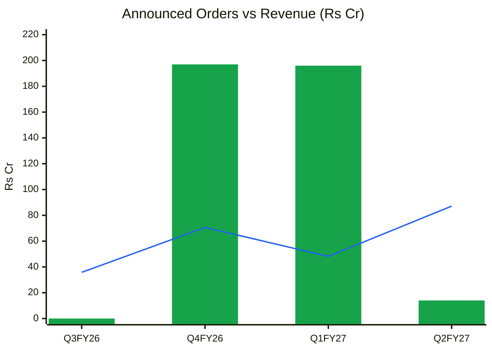
🟩 Announced orders (all firm; Q3 FY26 shows 0 because the ledger starts 1-Jan-2026 and its orders sit in the Q4 list) · 🟦 Revenue

**Read:** Two quarters of ~₹200 Cr order wins (4× revenue) were followed by a quarter of ₹14 Cr. Revenue is now running above inflow.

**Business inference:** Revenue through Q4 FY27 is backed by the order book. The risk is FY28: at the Q2 pace, the book would fall below ₹450 Cr by Mar-2027, short of the ₹600–800 Cr target, and Kannur's FY28 ~80% utilisation target would fail. **The single most important monitorable is H2 FY27 order inflow (≥₹250 Cr needed).**

**Order-book verdict:** Firm visibility ~1.6–2.0 years at FY27E revenue · book-to-bill strong over 3 quarters but <1 in Q2 FY27 · framework share 0% · top-3 concentration 29% · execution rate rising (plant ramp). **Visibility is good for FY27, uncertain for FY28.**

#### Order Ledger — every announced order (source of truth; the next run appends here)

| order_id | date | customer | customer_type | segment | geography | value_cr | currency | value_fc | firmness | tenor_months | linked_to | source | notes |
|---|---|---|---|---|---|---|---|---|---|---|---|---|---|
| S01 | 2026-02-15 | TNPDCL (via Danya Electric) | Govt | Distribution transformers | Domestic | 71.31 | INR |  | Firm | 18 |  | [NSE](https://nsearchives.nseindia.com/corporate/SPEL_01062026224814_InvestorPresentationH2FY26.pdf) | H2FY26 order list; date approximated |
| S02 | 2026-02-15 | Karnataka EPC | Private | 20 MVA power transformers | Domestic | 25.70 | INR |  | Firm | 12 |  | [NSE](https://nsearchives.nseindia.com/corporate/SPEL_01062026224814_InvestorPresentationH2FY26.pdf) | H2FY26 list; date approx |
| S03 | 2026-02-15 | TNPDCL (via Danya Electric) | Govt | Distribution transformers | Domestic | 18.23 | INR |  | Firm | 18 |  | [NSE](https://nsearchives.nseindia.com/corporate/SPEL_01062026224814_InvestorPresentationH2FY26.pdf) | H2FY26 list; date approx |
| S04 | 2026-02-15 | Karnataka EPC | Private | 20 MVA power transformers | Domestic | 17.89 | INR |  | Firm | 9 |  | [NSE](https://nsearchives.nseindia.com/corporate/SPEL_01062026224814_InvestorPresentationH2FY26.pdf) | H2FY26 list; date approx |
| S05 | 2026-02-15 | Karnataka EPC | Private | 20 MVA power transformers | Domestic | 15.35 | INR |  | Firm | 9 |  | [NSE](https://nsearchives.nseindia.com/corporate/SPEL_01062026224814_InvestorPresentationH2FY26.pdf) | H2FY26 list; date approx |
| S06 | 2026-02-15 | Karnataka EPC | Private | 20 MVA power transformers | Domestic | 14.60 | INR |  | Firm | 8 |  | [NSE](https://nsearchives.nseindia.com/corporate/SPEL_01062026224814_InvestorPresentationH2FY26.pdf) | H2FY26 list; date approx |
| S07 | 2026-02-15 | Karnataka EPC | Private | Power transformers | Domestic | 10.40 | INR |  | Firm | 8 |  | [NSE](https://nsearchives.nseindia.com/corporate/SPEL_01062026224814_InvestorPresentationH2FY26.pdf) | H2FY26 list; date approx |
| S08 | 2026-02-15 | Karnataka EPC | Private | Power transformers | Domestic | 8.07 | INR |  | Firm | 5 |  | [NSE](https://nsearchives.nseindia.com/corporate/SPEL_01062026224814_InvestorPresentationH2FY26.pdf) | H2FY26 list; date approx |
| S09 | 2026-02-15 | TNPDCL | Govt | Distribution transformers | Domestic | 6.54 | INR |  | Firm | 12 |  | [NSE](https://nsearchives.nseindia.com/corporate/SPEL_01062026224814_InvestorPresentationH2FY26.pdf) | H2FY26 list; date approx |
| S10 | 2026-02-15 | Karnataka EPC | Private | Power transformers | Domestic | 5.30 | INR |  | Firm | 9 |  | [NSE](https://nsearchives.nseindia.com/corporate/SPEL_01062026224814_InvestorPresentationH2FY26.pdf) | H2FY26 list; date approx |
| S11 | 2026-02-15 | KSEB | Govt | Power transformers | Domestic | 3.76 | INR |  | Firm | 14 |  | [NSE](https://nsearchives.nseindia.com/corporate/SPEL_01062026224814_InvestorPresentationH2FY26.pdf) | H2FY26 list; date approx |
| S12 | 2026-04-20 | Hyderabad company | Private | 20 MVA power transformers | Domestic | 51.30 | INR |  | Firm | 13 |  | [Src](https://tradebrains.in/supreme-power-equipment-secures-record-74-60-cr-order-for-dual-transformers/) | Part of Rs74.60 Cr record order (Apr-2026) |
| S13 | 2026-04-20 | Hyderabad company | Private | 160 MVA 220 kV transformer | Domestic | 23.30 | INR |  | Firm | 13 |  | [Src](https://tradebrains.in/supreme-power-equipment-secures-record-74-60-cr-order-for-dual-transformers/) | Part of Rs74.60 Cr order; first 220 kV unit |
| S14 | 2026-05-15 | Maharashtra EPC | Private | 20 MVA power transformers | Domestic | 13.50 | INR |  | Firm | 7 |  | [NSE](https://nsearchives.nseindia.com/corporate/SPEL_17082026131115_InvestorPresentationQ1FY27.pdf) | Q1FY27 list; date approx |
| S15 | 2026-05-15 | Hyderabad company | Private | 112.5 MVA 330 kV transformer | Domestic | 13.50 | INR |  | Firm | 11 |  | [NSE](https://nsearchives.nseindia.com/corporate/SPEL_17082026131115_InvestorPresentationQ1FY27.pdf) | Q1FY27 list; 330 kV above stated 220 kV capability |
| S16 | 2026-05-15 | Hyderabad EPC | Private | 20 MVA power transformers | Domestic | 39.90 | INR |  | Firm | 15 |  | [NSE](https://nsearchives.nseindia.com/corporate/SPEL_17082026131115_InvestorPresentationQ1FY27.pdf) | Q1FY27 list; date approx |
| S17 | 2026-06-15 | Karnataka EPC | Private | 20 MVA power transformers | Domestic | 28.50 | INR |  | Firm | 8 |  | [NSE](https://nsearchives.nseindia.com/corporate/SPEL_17082026131115_InvestorPresentationQ1FY27.pdf) | Q1FY27 list; date approx |
| S18 | 2026-06-15 | Karnataka company | Private | 20 MVA power transformers | Domestic | 5.70 | INR |  | Firm | 12 |  | [NSE](https://nsearchives.nseindia.com/corporate/SPEL_17082026131115_InvestorPresentationQ1FY27.pdf) | Q1FY27 list |
| S19 | 2026-06-16 | Karnataka company (2nd order) | Private | 20 MVA power transformers | Domestic | 5.70 | INR |  | Firm | 12 |  | [NSE](https://nsearchives.nseindia.com/corporate/SPEL_17082026131115_InvestorPresentationQ1FY27.pdf) | Q1FY27 list |
| S20 | 2026-06-15 | New Delhi EPC | Private | 20 MVA 66/11 kV power transformers | Domestic | 5.60 | INR |  | Firm | 11 |  | [NSE](https://nsearchives.nseindia.com/corporate/SPEL_17082026131115_InvestorPresentationQ1FY27.pdf) | Q1FY27 list |
| S21 | 2026-06-15 | Karnataka EPC | Private | 20 MVA power transformers | Domestic | 8.64 | INR |  | Firm | 11 |  | [NSE](https://nsearchives.nseindia.com/corporate/SPEL_17082026131115_InvestorPresentationQ1FY27.pdf) | Q1FY27 list |
| S22 | 2026-09-15 | Hyderabad company | Private | 112.5 MVA 330 kV transformer | Domestic | 13.60 | INR |  | Firm | 11 |  | [NSE](https://nsearchives.nseindia.com/corporate/SPEL_21102026180524_InvestorPresentationH1FY27.pdf) | Only new order in H1 list beyond Q1 list; date approx |

#### Order Book Snapshots — revenue and disclosed order book per period

| period | revenue_cr | revenue_ttm_cr | order_book_cr | order_linked_share | as_of_date | source |
|---|---|---|---|---|---|---|
| FY25 | 148.72 | 148.72 |  | 1.0 |  | Consolidated P&L (H2FY26 presentation) |
| Q1FY26 | 35.07 |  |  | 1.0 |  | Screener consolidated |
| Q2FY26 | 40.13 |  |  | 1.0 |  | Screener consolidated |
| Q3FY26 | 35.83 |  | 311.11 | 1.0 | 2026-02-09 | Screener; OB per company update 9-Feb-2026 |
| Q4FY26 | 70.62 | 181.65 | 588.17 | 1.0 | 2026-05-27 | H2FY26 presentation (H2 106.45 less Q3) |
| Q1FY27 | 48.23 | 195.31 | 590.06 | 1.0 | 2026-08-13 | Q1FY27 presentation |
| Q2FY27 | 87.08 | 241.76 | 565.80 | 1.0 | 2026-10-21 | H1FY27 presentation (H1 135.31 less Q1) |

*Data gaps: dated Reg 30 filings for each order (e.g. [17-Mar-2026](https://nsearchives.nseindia.com/corporate/SPEL_17032026131727_Intimationbaggingoforder.pdf)) were not individually reconciled. Orders before Jan-2026 (e.g. ₹8.92 Cr solar order Aug-2025, ₹58.94 Cr Jan-2026) are not in the ledger. FY25 and earlier order books not found.*

---

## Module 7 — Market Size & Market Share

**TAM:** Indian transformer-industry sales of >₹40,000 Cr by FY27, growing 10–11% a year (CRISIL, Aug-2025, via SPEL presentation). **SAM** (≤220 kV power + distribution + inverter-duty, South India): ~₹8,000–10,000 Cr (estimate: South India ~25% of national T&D capex; data gap).
**Penetration:** ₹242 Cr ÷ ₹40,000 Cr = **0.6% national**; ~2.5–3% of the southern SAM.
**Market share trend:** gaining from a tiny base. Revenue grew 22% (FY26) and ~33% TTM vs market ~10–11%.
**Share gain driver:** capacity (structural for SPEL) plus a tight market (temporary).
**Revenue growth vs market:** Company 33% (TTM) vs market ~11% → **taking share**, but at sub-1% share this is capacity-led, not franchise-led.

---

## Module 8 — Valuation: PIE First, Then DCF

### 8A. Price-Implied Expectations (Mauboussin)
**EV** = ₹683 Cr mcap + ₹57 Cr borrowings (Sep-2026) − ~₹10 Cr cash = **~₹730 Cr**. EV/EBITDA TTM 17.1×; EV/Sales 3.0×.
Reverse DCF (10-year explicit period, sales-to-capital 2.0, terminal growth 6%, terminal ROIC 18%):

| PIE value driver | Market-implied | My base case | Expectations gap |
|---|---|---|---|
| Revenue CAGR (10-yr) | **31% at WACC 15.5%; 28% at 14.5%** (FY36 revenue ₹2,850–3,700 Cr) | ~18% blended (FY27 +70%, fading to 8%) | **−10 to −13pp (optimistic gap)** |
| NOPAT margin (steady state) | 11.5% | 10.5% | −1pp |
| Investment rate (Δcapital ÷ Δrevenue) | 50% (S/C 2.0) | 50% | 0 |

**Physical plausibility check:** management's full-capacity revenue is ₹500–550 Cr. **The PIE implies ~5–7× today's capacity by FY36.** The market is pricing **several unannounced expansions** (or a re-rating to a much lower cost of capital). That is the main disagreement with the price.

**Expectations treadmill:** to outperform, SPEL must (a) reach ≥₹450 Cr revenue by FY29 at ≥15.5% EBITDA, **and** (b) announce and fund the next capacity step without large dilution, **and** (c) win PGCIL/EHV approvals. Matching guidance alone earns only the cost of capital.

**Triggers:**
- Positive: H2 FY27 order inflow ≥₹250 Cr; PGCIL approval / >160 MVA type-test; migration to the NSE main board (liquidity, institutional access).
- Negative: a second weak order half-year; EBITDA margin <15%; FY27 CFO negative with debt >₹80 Cr; CRGO spike on non-PVC orders.

**SVAR:** downside scenario (revenue stalls at ~₹300 Cr, EBITDA 12.5%, P/E 13×) = **₹96** → SVAR = (273 − 96)/273 = **65%** → **unfavourable asymmetry**.

### 8B. Own DCF (3-stage, capacity-constrained)
WACC 15%, terminal g 6%, terminal ROIC 18%, sales-to-capital 2.0, net debt ₹47 Cr, 2.624 Cr diluted shares.

| Scenario | Revenue path | FY29 revenue | NOPAT margin | Value/share |
|---|---|---|---|---|
| Bull | +85%, +40%, +25%, fading to 8% | ₹589 Cr | 12% | ₹150 |
| Base | +70%, +25%, +15%, fading to 8% | ₹445 Cr | 10.5% | ₹84 |
| Bear | +60%, flat, flat, then 5–7% | ₹291 Cr | 8.5% | ₹35 |

The DCF says the stock is **far above intrinsic value at a 15% cost of capital**, even in the bull case. Indian small-cap capital goods have traded well above DCF value through this cycle. We therefore lean on the multiple-based scenario (8D) for target prices but **treat the DCF as the anchor for margin of safety.**

### 8C. Relative valuation & Graham
- Peer P/E 30–34× (domestic transformer pack). SPEL is warranted at 20–22× (25–35% discount; see Module 6).
- PEG: 27.6× ÷ ~25% forward EPS growth (FY27E) = 1.1.
- **Graham Number** = √(22.5 × ₹9.41 diluted TTM EPS × ₹52.8 BVPS) = **₹106.**
- Graham defensive screen: revenue >₹2,000 Cr ✗ · current ratio ≥2 ✗ (1.28) · positive EPS 7 yrs ✓ · dividend record ✗ · EPS growth ≥30% over 7 yrs ✓ · P/E ≤20 ✗ · P/B ≤3 ✗ (5.2×) → **2/7, fails.**

### CY1 — P/E history (TTM consolidated EPS, half-year points)

| | Sep-25 | Mar-26 | Sep-26 | 23-Oct-26 |
|---|---|---|---|---|
| Price (₹, Yahoo weekly close) | 208 | 166 | 208 | 273 |
| TTM EPS (₹) | 8.29 | 8.18 | 9.88 | 9.88 |
| P/E (×) | 25.1 | 20.3 | 21.1 | 27.6 |

*Earlier: Mar-2025 close ~₹108 on EPS ₹7.44 (14.5×, SME sell-off; verify the price print). Dec-2024 ₹241 (EPS ~₹7, ~34×). History since listing is <3 years, so a 10-year band is not possible (data gap).*

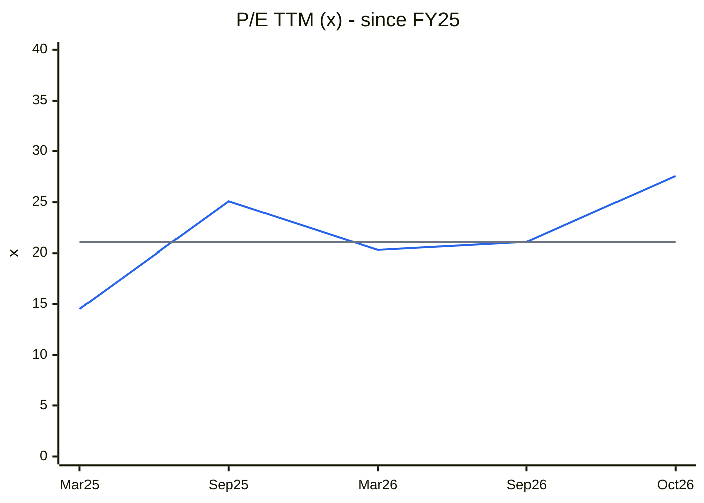
🟦 P/E TTM · ⬜ median of the five points (21.1×)

**Read:** The P/E has ranged 14.5–27.6× in 18 months. Today's 27.6× is the **top of its own range**, after a 31% one-week move.

**Business inference:** The October breakout re-rated the multiple rather than responding to new earnings (TTM EPS was unchanged until the 21-Oct results). The market is paying up front for the H1 acceleration while the order-inflow data turned weaker.

### CY4 — Price vs EPS index (Sep-25 = 100)

| | Sep-25 | Mar-26 | Sep-26 | Oct-26 |
|---|---|---|---|---|
| Price index | 100 | 80 | 100 | 131 |
| TTM EPS index | 100 | 99 | 119 | 119 |

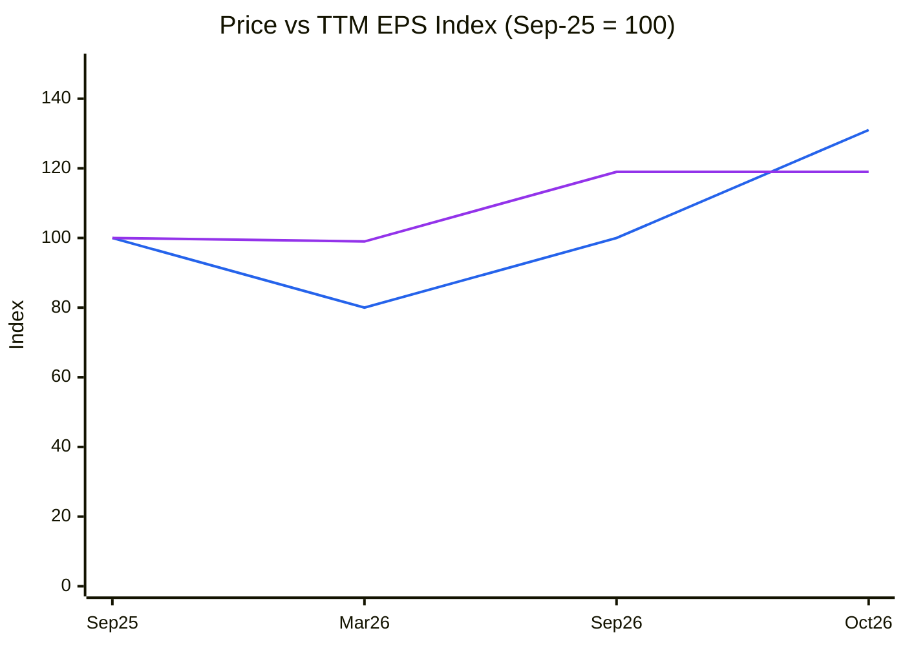
🟦 Price · 🟪 TTM EPS

**Read:** Until Sep-2026 the price lagged EPS (de-rating). In October the price overtook EPS by 12 index points.

**Business inference:** The latest return is multiple expansion (sentiment). For it to stick, H2 FY27 EPS has to grow into it, needing ~₹11–12 diluted EPS for FY27.

### 8D. Scenario analysis (FY29E, multiple-based; diluted 2.624 Cr shares)
| Scenario | Revenue FY29 | EBITDA margin | EPS FY29 | Target P/E | Target price | Probability |
|---|---|---|---|---|---|---|
| Bull | ₹580 Cr (Kannur ~90%, 220 kV mix) | 17% | ₹24.8 | 25× | **₹620** | 25% |
| Base | ₹450 Cr (capacity ceiling ~85%) | 15.5% | ₹16.8 | 20× | **₹335** | 50% |
| Bear | ₹300 Cr (orders stall; FY27 level) | 12.5% | ₹7.4 | 13× | **₹96** | 25% |
| **Expected value (FY29)** | | | | | **₹346 (+27%)** | |

*D&A ₹5–6 Cr, interest ₹6–7 Cr, tax 25%, minority 1%.*
- **PV of expected value** (2.4 yrs @ 15%) = **₹248** → **10% below CMP**. Base-case PV ₹240.
- **Upside/downside:** (620 − 273) ÷ (273 − 96) = **1.95:1** (below the 2:1 minimum, above the 1.5:1 hard stop).
- **Required MoS** (small-cap, SME, promoter-structure complexity): 40% plus 5pp (late-cycle) = 45% on an undiscounted basis. Applied to the PV, which already embeds a 15% discount rate, we use 35%: **buy-below ≈ ₹248 × 0.65 ≈ ₹160**.

### C13 — Scenario target prices vs CMP (₹)

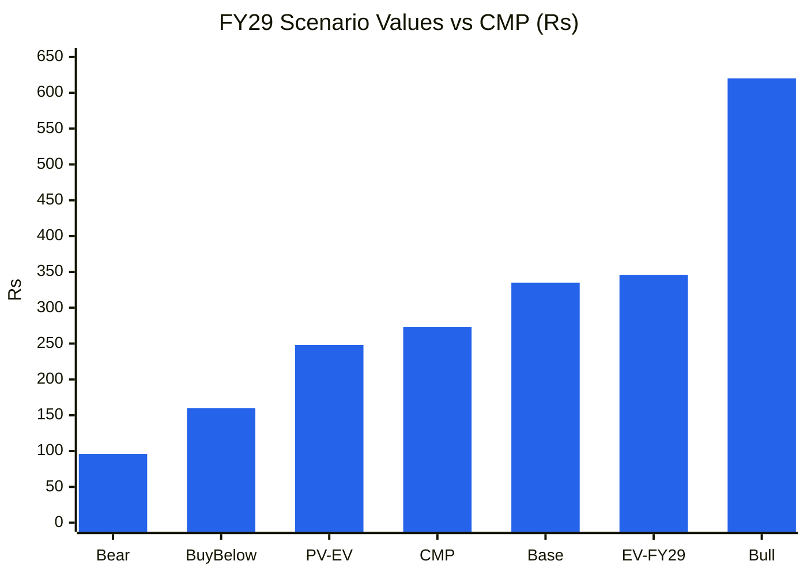
🟦 ₹ per share

**Read:** CMP (₹273) sits above the discounted expected value (₹248) and well above the buy-below (₹160). The bull case needs everything to go right.

**Business inference:** At ₹273 the investor is paid only if the bull case (₹580 Cr revenue, 17% margin, and a 25× multiple held) materialises. The base case gives a ~22% gain over 2.4 years (≈9% a year), below the 15% cost of equity.

### Cycle Position Dashboard
| Dimension | Current | History median | Percentile | Signal |
|---|---|---|---|---|
| P/E | 27.6× | 21.1× (5 pts, 18 m) | 100th | **Expensive** |
| P/B | 5.2× | n.a. (short history) | — | Expensive vs pack (~5–8× for higher-ROE peers) |
| EBITDA margin (standalone basis) | ~16% | 12% (9 yrs) | ~85th | **Late / near peak** |
| ROCE | 19% | 22% (8 yrs, FY19–26) | ~40th | Mid (falling) |
| Industry utilisation | Tight but easing | — | — | Balanced → oversupply risk 2027–28 |
| Order-inflow momentum | Q2 FY27 0.7× book-to-bill | 2.2× (3-qtr) | Low | Weakening |
| **Overall cycle position** | | | | **Late cycle (industry) / early ramp (company)** |

---

## Module 9 — Technical Stage (Weinstein + CANSLIM)

**Nifty 50 market stage: 4 (declining).** Nifty is at 22,524, below its falling 30-week MA (23,726).
**Sector stage (capital goods / T&D):** **Stage 3** (topping) on secondary evidence. Small transformer names have de-rated over a year (TARIL −40%, Shilchar −13%); the MNC T&D names are near highs. No sector-index chart was pulled (data gap).
**Stock stage: Stage 2, confirmed breakout (Oct-2026).**

| # | Breakout check | Requirement | SPEL | ✓/✗ |
|---|---|---|---|---|
| 1 | Weekly close above Stage-1 resistance | Weekly, not intraday | Base ~₹205–257 (Apr–Sep 2026); week of 5-Oct closed ₹274, and held ₹273 for two more weeks | ✓ |
| 2 | Volume | ≥1.4–2× average | 1.11 M shares vs 20-wk avg 0.28 M (**~4×**); next two weeks 0.93 M and 0.77 M | ✓ |
| 3 | 30-week MA | Flat-to-rising, price above | MA ₹227 (rising from ₹200 ten weeks ago); price 20% above | ✓ |
| 4 | RS vs Nifty | Positive | 52-wk: SPEL +28.9% vs Nifty −12.4% → **+41pp** | ✓ |
| 5 | Base width | ≥12–16 weeks | ~26 weeks | ✓ |
| 6 | Entry within 10–15% of pivot | Pivot ~₹257 (Jun-26 weekly close high) | ₹273 = +6% | ✓ |

**Caveat:** this is an **SME stock** trading ~0.3–1 M shares a week (~₹2–3 Cr a day). The skill's volume rules assume >₹50 Cr daily turnover, so volume signals are much noisier here. The 52-week high of ₹304.5 (intraday, week of 12-Oct) was rejected, and the stock has closed ~₹273 for three weeks (tight flag/consolidation).
**Stop-loss:** weekly close below **₹245** (back inside the base, ~10% below CMP); hard exit below the rising 30-week MA (~₹230).

**CANSLIM (0–7)**
| Criterion | Evidence | Score |
|---|---|---|
| C — Current EPS | Q2 FY27 PAT ₹8.75 Cr vs ₹4.99 Cr (+75%); H1 +45% | 1 |
| A — Annual EPS | FY24 → FY26 EPS +33%, +10% (not ≥25% × 3); ROE 17.5% | 0 |
| N — New | New Kannur plant + 220 kV; price at a new high from a base | 1 |
| S — Supply/demand | Small float (~1.07 Cr public shares); up-week volume ≫ down-week volume | 1 |
| L — Leader | RS top-decile vs the market; not a sector leader in scale | 1 |
| I — Institutional | DIIs 11.3% → 0.2%, FIIs 0.75% (no sponsorship) | 0 |
| M — Market | Nifty Stage 4 | 0 |
| **Total** | | **4 / 7** |

**Combined verdict:** Stage 2 breakout + CANSLIM 4/7 → **valid trading setup, but below the 5/7 "buy" bar, against a Stage 4 market.**
**Stage + fundamental alignment: MISALIGNED.** The technicals are bullish; valuation and order momentum are not.

---

## Module 10 — Forward View: 2–3 Year Thesis

### Capex classification
| Capex type | FY27E (₹ Cr) | FY28E | FY29E | In AT model? |
|---|---|---|---|---|
| Tangible growth capex (Kannur completion: testing, cranes, CWIP ₹32 Cr) | ~15 | ~5 | ~10 (next step unannounced) | ✅ |
| Maintenance (~D&A) | ~4 | ~5 | ~5.5 | ❌ |
| Intangibles | ~0 | ~0 | ~0 | ❌ |
| CWIP (Sep-2026) | ₹32 Cr | — | — | ❌ until capitalised |
| ROU (Ind AS 116) | Not disclosed (SME, Indian GAAP/AS; check lease note) | | | ⚠️ |
| **Total** | **~19** | **~10** | **~15** | |

**Current CWIP:** ₹32 Cr (Sep-2026, Screener consolidated), probably Kannur balance-of-plant / test-bay. Project-wise split not disclosed (data gap).

### Tangible block & asset turnover
| Year | Fixed assets incl. CWIP (₹ Cr) | Revenue (₹ Cr) | Turnover (×) |
|---|---|---|---|
| FY23 | 5 | 100 | 20.0 |
| FY24 | 24.7 | 113.5 | 4.6 |
| FY25 | 64.0 | 148.7 | 2.3 |
| FY26 | 119.7 | 181.6 | 1.5 |
| TTM Sep-26 | 126 | 241.8 | 1.9 |

*The gross tangible block from the PPE note is not available (SME annual report not retrieved), so net block + CWIP is used. Trend: **structurally declining** (business-model reset), now recovering as Kannur fills.*

**Incremental ROIC** (Kannur, FY29 base): ΔRevenue ~₹270 Cr × EBIT 14% × 0.75 = ₹28 Cr ÷ (₹115 Cr block + ₹70 Cr extra NWC) = **~15% ≈ WACC → value-neutral** in the base case. In the bull case (₹400 Cr Δ, 15.5% EBIT) it is ~21% → value-creating.
**Capex-model implied revenue CAGR (FY26 → FY29):** ₹182 → ₹450 Cr = **35%** (but only ~23% from TTM). **PIE-implied: 28–31% for 10 years** → the market is pricing growth well past the FY29 capacity ceiling, i.e. **unannounced expansion**.

### C14 — Forward block → revenue bridge (₹ Cr)

| | FY26 | FY27E | FY28E | FY29E |
|---|---|---|---|---|
| Fixed assets incl. CWIP (closing) | 120 | 135 | 135 | 145 |
| Revenue (base) | 182 | 310 | 390 | 450 |
| Turnover (×) | 1.5 | 2.3 | 2.9 | 3.1 |

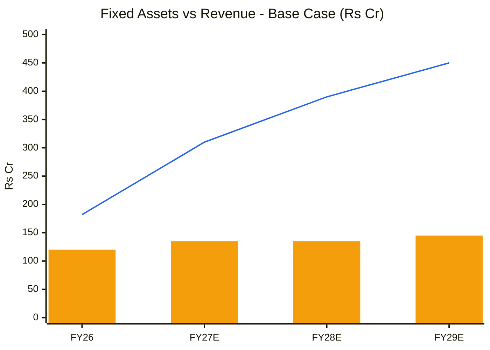
🟧 Fixed assets incl. CWIP · 🟦 Revenue (base)

**Read:** The base case has revenue rising 2.5× on a broadly flat asset base, with turnover going from 1.5× to 3.1×.

**Business inference:** All the operating leverage is in FY27–28. By FY29 the plant is near its practical ceiling (~₹450–490 Cr), and the next leg needs fresh capex (and probably equity, at CRISIL BBB).

### Capex-to-earnings model (base)
| Metric | FY27E | FY28E | FY29E |
|---|---|---|---|
| Revenue (₹ Cr) | 310 | 390 | 450 |
| EBITDA margin | 16.5% | 16.0% | 15.5% |
| EBITDA | 51.2 | 62.4 | 69.8 |
| D&A | 4.5 | 5.0 | 5.5 |
| EBIT (incl. OI ~₹0.6–1 Cr) | 47.3 | 58.2 | 65.3 |
| Interest | 6.0 | 6.5 | 6.0 |
| ICR (×) | 7.9 | 9.0 | 10.9 |
| PAT (25% tax, 1% minority) | 30.7 | 38.4 | 44.0 |
| EPS diluted (₹) | 11.7 | 14.6 | 16.8 |
| NWC (≈ 90 days of revenue) | 76 | 96 | 111 |
| ΔNWC | ~−30 (from ~₹46 Cr) | −20 | −15 |
| Capex | −19 | −10 | −15 |
| **FCF** (PAT + D&A − capex − ΔNWC) | **~−14** | **~13** | **~20** |
| Net debt (peak) | ~₹60–65 Cr (FY27) | ~50 | ~30 |
| Peak debt / EBITDA | ~1.3× | — | — |

**FCF inflection year: FY28E.** **Debt ceiling verdict:** peak ~1.3× EBITDA, within the safe zone. The risk is working capital rather than leverage.

### Key catalysts
1. H2 FY27 order inflow (≥₹250 Cr) restoring the book to ₹600–800 Cr: by Apr/May-2027 (H2 FY27 results).
2. PGCIL vendor approval and >160 MVA type-test credentials, opening EHV/data-centre tenders: FY27–28.
3. Migration from NSE Emerge to the main board (liquidity, MF eligibility): timing unknown (no filing found).
4. Kannur reaching ~80% utilisation in FY28 (guided), giving operating leverage.

### Key risks
1. **Order drought persists** (Q2 FY27 pattern): FY28 revenue flat → bear case. Probability: **Medium.**
2. **Margin compression** from CRGO/copper on the 20–30% of orders without PVCs, plus L1 competition as industry capacity floods in. **Medium-High.**
3. **Working-capital squeeze:** inventory ₹60–70 Cr structurally; government receivables of 60–90 days; CRISIL BBB limits bank lines. **Medium.**
4. **Execution / technical risk** on first 160–330 kV units (type-test failures, China bushing dependency). **Medium.**
5. **Governance / RPT drift** at Danya, and SME liquidity (exit risk in a sell-off; the 2025 drawdown was ~55%). **Low-Medium.**

### Scenario analysis
See 8D: Bull ₹620 (25%) · Base ₹335 (50%) · Bear ₹96 (25%) → EV ₹346 (FY29), PV ₹248. **Return from CMP: +27% nominal over 2.4 years; −9% on a PV basis.**

---

## Checklist Summary
**Section 0 (Existing Report Protocol):** 3/3. Initial report; library searched.
**Section A (Business Quality):** 16/18. Scuttlebutt is company-sourced only; BSE Form C not checked.
**Section B (Forensics):** 8/9. Auditor tier and FY26 KAMs are a data gap.
**Section C (Financial Statements):** 11/12. Ind AS 116 n/a (SME, AS framework); gross PPE note unavailable.
**Section D (KPIs & Peers):** 7/7.
**Section E (Market Size & Share):** 6/7. Share trend from revenue only.
**Section F (Valuation):** 10/10.
**Section G (Technical Stage):** 8/8. Sector index chart is a data gap.
**Section H (Forward View):** 30/34. Project-wise CWIP and gross PPE are data gaps; unit-economics track n/a.
**Section I (Charts):** 5/5. C1, C2, C4, C5, C7, CY1, CY4, CY5, C12, C13, C14, OB-3 included. OB-1 shown as a table (only 3 TTM points); the CY1 band is short-history only.
**Order Book Tracker:** Run (22 orders, 7 snapshots).
**Hard Stops Triggered:** None. Forensic flags are 2 unresolved (<3); M-score −2.81; no pledge; upside/downside 1.95:1 (>1.5); Stage 2 (not Stage 4).

### Pre-buy final check (behavioural)
- **Falsifiable downgrade triggers:** (1) H2 FY27 order inflow <₹150 Cr; (2) FY27 EBITDA margin <15%; (3) FY27 CFO negative with borrowings >₹80 Cr.
- **Inversion:** order drought, margin squeeze, WC lock-up, technical failure on a 220/330 kV unit, SME liquidity crash, RPT drift. The price discounts **none** of these (P/E at the top of its range).
- **Circle of competence:** the transformer business is well understood across the library (TARIL, Atlanta, Kanohar). The SME-specific liquidity and disclosure gaps (half-yearly reporting) are noted as a risk.
- **Asymmetry:** 1.95:1, SVAR 65% → fails.
- **5-year test:** no moat; the balance sheet is OK for a 2-year downturn only if WC is released. → **Trading position at best.**
- **Recency bias:** base-case margins of 15.5–16.5% sit between the 9-year median (12%) and the current level (17.4%).
- **Crowd test:** no sell-side coverage found. The crowd is retail (4,954 holders; DIIs exited).

---

## Investment Decision
**Recommendation:** **AVOID at ₹273 → WATCHLIST**
**Verdict category:** Multiple gates fail (MoS, asymmetry <2:1, no moat) even though there is a technical Stage 2 breakout. The skill's "Avoid / watchlist" outcome applies. It is not "Cheap but Flawed", because the stock is not cheap.
**Conviction Score:** 4.2 / 10

| Component | Max | Score | Note |
|---|---|---|---|
| Market + sector + stock cycle | 1 | 0.4 | Stage 4 market; late-cycle sector; company ramp-up |
| Industry structure | 1 | 0.4 | Low barriers below 132 kV |
| Business quality & moat | 2 | 0.6 | No moat; qualification ladder in progress |
| Management | 1 | 0.5 | WTT 0.67; Danya structure |
| Financial + earnings quality | 2 | 1.1 | CFO ≈ PAT historically; WC deteriorating |
| Valuation & PIE asymmetry | 2 | 0.4 | PV below CMP; 1.95:1; SVAR 65% |
| Technical + CANSLIM | 1 | 0.8 | Stage 2 breakout; CANSLIM 4/7 |
| **Total** | **10** | **4.2** | |

**Suggested position size:** 0% now. On a buy-below trigger: 1–1.5% maximum (SME, small-cap; × 0.5 sizing modifier for the late-cycle sector).
**Entry price range:** ₹150–165 (≈16–17× FY27E diluted EPS), **or** a re-entry above ₹305 on a weekly close **only if** H2 FY27 inflow is ≥₹250 Cr (momentum-plus-fundamental confirmation).
**Stop-loss (for any trading position):** weekly close <₹245.
**Target price (base, FY29 multiple):** ₹335; PV ₹248.
**Review triggers:** H2 FY27 results (~May-2027): order book ≥₹650 Cr, EBITDA ≥16%, FY27 CFO ≥0 → upgrade to WAIT FOR CONFIRMATION / BUY zone. Order book <₹450 Cr or EBITDA <15% → stay away.

---

### Sources
- Screener.in: [SUPREMEPWR standalone](https://www.screener.in/company/SUPREMEPWR/) and [consolidated](https://www.screener.in/company/SUPREMEPWR/consolidated/) (P&L, balance sheet, cash flow, ratios, shareholding; 23-Oct-2026 close).
- NSE filings: [H2 FY26 investor presentation (1-Jun-2026)](https://nsearchives.nseindia.com/corporate/SPEL_01062026224814_InvestorPresentationH2FY26.pdf) · [Q1 FY27 presentation (17-Aug-2026)](https://nsearchives.nseindia.com/corporate/SPEL_17082026131115_InvestorPresentationQ1FY27.pdf) · [H1 FY27 presentation (21-Oct-2026)](https://nsearchives.nseindia.com/corporate/SPEL_21102026180524_InvestorPresentationH1FY27.pdf) · [Integrated filing 9-Feb-2026 (Danya partnership)](https://nsearchives.nseindia.com/corporate/ixbrl/INTEGRATED_FILING_NONINDAS_141313_09022026182023_iXBRL_WEB.html) · [AGM notice FY25 (RPT approval)](https://nsearchives.nseindia.com/corporate/SPEL_26082025234923_20thNoticetoShareholdersSPEL20242025.pdf) · [Order intimation 17-Mar-2026](https://nsearchives.nseindia.com/corporate/SPEL_17032026131727_Intimationbaggingoforder.pdf).
- Earnings call summary: [GuruFocus, H1 FY27 call](https://www.gurufocus.com/news/9141253/supreme-power-equipment-ltd-nsesupremepwr-q3-2027-earnings-call-highlights-80-revenue-surge-565-crore-order-book-and-fy27-guidance-of-300350-crore). Results coverage: [Trade Brains H1 FY27](https://tradebrains.in/indian-markets/supreme-power-equipment-h1-fy27-net-profit-climbs-to-1365-cr-on-robust-transformer-demand-and-kannur-plant-ramp-up-12716746), [Trade Brains FY26](https://tradebrains.in/supreme-power-equipment-wraps-fy26-with-revenue-up-22-9000-mva-and-588-cr-order-book-in-hand/), [T&D India (Kannur commissioning)](https://www.tndindia.com/supreme-power-equipment-starts-commercial-production-at-new-transformer-plant-near-chennai/).
- IPO: [5paisa subscription](https://5paisa.com/news/supreme-power-equipment-ipo-final-subscription-details), [Zerodha IPO page](https://zerodha.com/ipo/366933/supreme-power-equipment-limited).
- Price series: Yahoo Finance weekly chart API (SUPREMEPWR.NS, ^NSEI), pulled 26-Oct-2026.
- Peer data: 14-Oct-2026 TARIL report (Screener.in 13-Oct-2026); Atlanta Electricals (Screener.in 23-Oct-2026).

---
*Report generated by Stock Fundamental Analysis Skill v3.3 | Indian Markets Context*
*Save path: C:\Users\anubh\Documents\Anubhav\Stock Analysis\Stock Analysis\*
