# Stock Analysis Report — Transformers and Rectifiers (India) Ltd (NSE: TARIL · BSE: 532928)
**Date:** 2026-10-13
**Analyst:** Claude (Stock Fundamental Analysis Skill v3.3)
**Investment Horizon:** 2–3 Years
**Recommendation:** AVOID at current price → WATCHLIST (buy-below ~₹220)
**Conviction Score:** 3.8 / 10
**CMP:** ₹304 (NSE close 13-Oct-2026, Screener.in) · Market cap ₹9,125 Cr · 30.02 Cr shares · 52-wk range ₹224–496

> Q2 FY27 results were filed on 13-Oct-2026 after 3:15 pm (board approval 15:15, press release 16:11). The ₹304 close does not yet reflect them. All TTM numbers in this report include Q2 FY27.

## Revision Log
| Version | Date | Recommendation | Conviction | Price | Key change |
|---|---|---|---|---|---|
| Current | 2026-10-13 | AVOID at CMP → Watchlist (buy-below ~₹220) | 3.8/10 | ₹304 | **Initial report.** Record order book (₹7,237 Cr) and strong Q2 FY27, but cash conversion is poor (FY23–26 CFO/PAT 0.19), every capex timeline has slipped, guidance was cut and reframed, and the price implies growth beyond announced capacity |

**Validation of previous report:** Initial report. No earlier report exists in the library (searched `TARIL*`, `TRIL*`, "Transformer", "Rectif" on 13-Oct-2026).

---

## Executive Summary

TARIL is India's second-largest listed transformer maker by claimed capacity. It makes power transformers, reactors, furnace and rectifier transformers, mainly for PGCIL and state transmission utilities. The grid capex cycle has transformed it. Revenue went from ₹742 Cr (FY21) to ₹2,509 Cr (FY26). EBITDA margin rose from 6–10% to 15–17%. ROCE rose from 9% to 23–28%. The order book went from ₹1,008 Cr to a record **₹7,237 Cr (Sep-2026, 2.6× TTM revenue)**. Q2 FY27, reported today, was strong: consolidated revenue **₹739 Cr (+61% YoY)**, EBITDA ₹129 Cr (17.4%), PAT ₹81 Cr (+118%). H1 FY27 order inflow was **₹3,283 Cr (+161%)**, including a ≥₹1,000 Cr PGCIL order.

**Three things count against it.**
1. **Cash conversion is poor.** FY23–FY26 cumulative CFO was ₹109 Cr against ₹577 Cr of PAT (0.19×). FY26 CFO was **−₹105 Cr**. Net working capital is 170 days against a 120–130-day target.
2. **Management credibility is unreliable (WTT 0.25).** The 15,000 MVA Changodar expansion was promised for Dec-2024 and is now due "around Diwali 2026". The 22,000 MVA Moraiya EHV expansion slipped from Feb-2026 to 2027. Full backward integration slipped from Q1 FY27 to Q1 FY28. FY27 growth guidance went from 35–40% (Apr-2026) to 25% (Jul-2026). The "US$1 bn" target became "₹8,000 Cr by FY29". There was also a CEO who left after 4 months, a CFO change, and a World Bank sanctions notice.
3. **The price already discounts much of the growth story.** The reverse DCF needs a **23–31% revenue CAGR for 7 years** (FY33 revenue ₹12,000–19,000 Cr). The physical ceiling of announced capacity (~77,000 MVA at 85% utilisation, plus third-party component sales) is about ₹5,500–6,000 Cr. The market is pricing an **unannounced expansion**.

The probability-weighted FY29-based value is **₹409 (+35%)**. Upside/downside is **2.4:1 (₹678 bull / ₹150 bear)**, which passes the hard-stop test. But the base case is **below CMP once discounted** (PV ₹291), and the DCF base is ₹158, so the margin-of-safety gate fails. **Five forensic red flags** (Module 5) make this an AVOID under the skill's hard stops. **Watchlist buy-below ~₹220.** Upgrade triggers: FY27 CFO ≥ 0.6× PAT, Changodar commissioned with utilisation above 70%, and a weekly Stage-2 breakout above ₹360.

**Order-book line:** Order book ₹7,237 Cr (2.6× TTM revenue of ₹2,831 Cr) · all firm, no framework value · book-to-bill TTM 1.57 (implied inflow ₹4,448 Cr ÷ ₹2,831 Cr) · tracked today ₹7,437 Cr (Q2 book + ≥₹200 Cr announced 2-Oct-2026; band lower bounds).

### C1 — Growth Index: Revenue vs Net Fixed Assets vs EBITDA vs PAT (FY17 = 100)

| ₹ Cr (consolidated) | FY16 | FY17 | FY18 | FY19 | FY20 | FY21 | FY22 | FY23 | FY24 | FY25 | FY26 | TTM Sep-26 |
|---|---|---|---|---|---|---|---|---|---|---|---|---|
| Revenue | 657 | 821 | 716 | 855 | 701 | 742 | 1,158 | 1,396 | 1,291 | 2,017 | 2,507 | 2,831 |
| Net fixed assets | 185 | 187 | 195 | 201 | 193 | 181 | 168 | 153 | 144 | 251 | 250 | 242 (Sep) |
| CWIP | 11 | 6 | 12 | 3 | 2 | 0 | 3 | 3 | 5 | 62 | 138 | 267 (Sep) |
| EBITDA (ex-OI) | 38 | 87 | 65 | 61 | 51 | 69 | 74 | 121 | 134 | 327 | 383 | 465 |
| PAT | −7 | 24 | 6 | 5 | 1 | 8 | 14 | 42 | 47 | 216 | 272 | 312 |

*Source: Screener.in consolidated (FY16–FY26); Q2 FY27 results filing (13-Oct-2026) for TTM. Base year FY17 because FY16 PAT was negative (index rule). Net fixed assets are used because the 10-year tangible gross block is not available; the FY26 consolidated tangible gross block is ₹404 Cr, of which plant and machinery is ₹187 Cr (FY26 AR Note 5).*

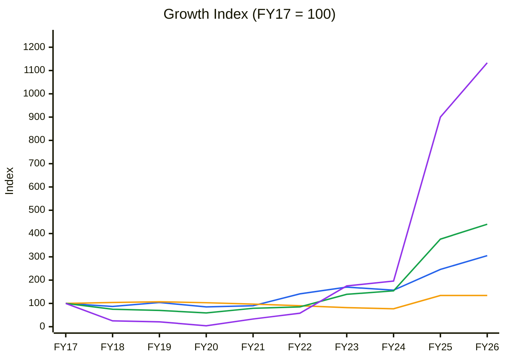
🟦 Revenue (CAGR 13.2%) · 🟧 Net fixed assets (3.3%) · 🟩 EBITDA (17.9%) · 🟪 PAT (30.9%)

**Read:** From FY17 to FY24, revenue went sideways while fixed assets shrank (index 77). From FY25 the cycle turned: revenue ×2.0 and EBITDA ×2.9 in two years on roughly the same asset base. PAT (🟪) is the most leveraged line: ×11 since FY17, almost entirely in FY25–26.

**Business inference:** This is operating leverage on a fixed, depreciated plant during a demand upcycle. It is not a decade of compounding. The FY17–FY24 record shows that the same business earned single-digit ROCE through a full cycle. FY25–26 profits come from price and utilisation at the top of a grid capex cycle, so they should be valued as cyclical, not capitalised as a new steady state.

---

## Business Primer

TARIL designs and builds transformers: large power transformers and auto-transformers (up to 1,200 kV), shunt reactors, distribution transformers, and special-duty units (electric-arc furnace, rectifier, traction, solar inverter-duty). It sells mainly to government buyers, namely PGCIL, NTPC, DVC and state transmission utilities (GETCO, RRVPNL, UPPTCL, APTRANSCO). Other customers are EPC contractors (KEC, MEIL, NCC, Kalpataru), private developers (Adani, Siemens, Hyosung, Avaada, Jindal) and a small export book (US, Sweden, Botswana, Mexico, Middle East). Revenue is project-based. Orders are won on lowest-price (L1) tenders, built over 12–30 months in three plants around Ahmedabad (Moraiya, Changodar, Odhav), and billed on milestone/dispatch, with retention money held until commissioning. FY26 revenue mix was power transformers 56%, reactors 22%, distribution 10%, furnace 3% and rectifier 1% (Q1 FY27 investor presentation). Returns depend on two things: winning enough tenders at prices above the cost of CRGO steel and copper (about 60–65% of revenue), and turning milestone-billed sales into cash from slow-paying utilities.

This is an **order-driven, working-capital-heavy capital-goods manufacturer riding a cyclical-plus-secular demand wave** (grid expansion, renewables integration, data centres and exports). The value drivers are volume (MVA throughput, set by capacity and execution) and margin (tender pricing against commodity costs). The key risks are the industry capital cycle, since many players are adding transformer capacity at once, commodity price spikes on fixed-price orders, and working-capital lock-up with PSU buyers. Two structural features colour the whole analysis. First, a promoter-family-run company (Mamtora family, 64.4%) whose public timelines and capacity numbers have repeatedly failed to reconcile. Second, a balance sheet whose reported profit has not been turning into cash.

**New Segment Protocol:** Segment covered → "Electrical Equipment & Turnkey Electrical Solutions (Order-driven Capital Goods)" (references/05-industry-kpis-india.md, line 2256; TARIL is listed there as a key player) ✓. Demand context from "Power & Renewables" (line 479) ✓. Top KPIs: order book/revenue, NWC/debtor days, EBITDA margin and product mix. Order-book tracking is mandatory (Reg 30 order filings exist).

---

## Module 1 — Broad Market Cycle (Marks)

Nifty 50 closed at **22,520** on 9-Oct-2026, about **14.5% below** its early-January 2026 high of ~26,340. It is below a falling 30-week MA (~23,700) and below its 200-DMA, with India VIX at 14.35 and index P/E ~19.3× ([JM Financial](https://www.jmfinancialservices.in/market-news-and-insights/1735991); [Stockpil](https://stockpil.com/india-markets-today-2026-10-05/); same sources used in the 12-Oct-2026 library reports). Crude oil (Hormuz disruption, cited on TARIL's Apr-2026 call) and bond yields are the macro drivers. **Assessment: CAUTIOUS (leaning fearful).** Sizing: normal-to-small. The tide is not helping high-multiple capital-goods names, and TARIL is −40% over one year against Nifty about −12%.

---

## Module 1b — Sector Cycle: Tailwinds & Headwinds

**Secular (durable):** India's AC transformation capacity (220 kV+) grew at a ~7% CAGR from FY19 to **~1,417 GVA (Mar-2026)** and ~1,486 GVA (Jul-2026). The 2026-27 to 2035-36 transmission plan needs **827,600 MVA** of substation capacity (₹7.93 lakh Cr), with 500 GW of renewables by 2030, data-centre load (~13.6 GW by FY32) and railway electrification on top ([Powerline, May-2026](https://powerline.net.in/2026/05/05/demand-surge-key-trends-growth-drivers-and-outlook-for-the-transformer-industry/); [Outlook Business/CEA](https://www.outlookbusiness.com/spotlight/news-wire/india-adds-113013-mva-grid-transformation-capacity-in-fy26-meets-90-of-cea-target)). Exports add to this: US/EU transformer lead times rose from ~50 weeks (2021) to ~120 weeks (2024) ([Wood Mackenzie](https://woodmac.com/news/opinion/supply-shortages-and-an-inflexible-market-give-rise-to-high-power-transformer-lead-times)).

**Cyclical (fades):** FY25–FY27 grid additions are a step-change, not a trend. CEA additions were 70,728 MVA (FY24), 86,433 (FY25), 113,013 (FY26) and a 158,339 target for FY27, a +124% target jump in three years. Utility tendering of this kind comes in waves. Rystad already expects **peak lead times to ease within 12 months** as global capacity comes online over 2026–28 ([Power Peak Digest/Rystad](https://powerpeakdigest.com/global-transformer-supply-constraints-ease-rystad/)).

**Decomposition:** TARIL's FY24→FY26 revenue CAGR was 39%. Our split is ~12–15% secular (grid capex at 7–8% volume plus mix and exports) and **~25pp cyclical** (price and utilisation on a tight-supply market, plus the restart of its own under-used plant). **Durable baseline for the DCF: 12–15%.**

### CY5 — Demand proxy: India grid transformation capacity additions (220 kV+, MVA)

| | FY23 | FY24 | FY25 | FY26 | FY27 (target) |
|---|---|---|---|---|---|
| AC transformation capacity added (MVA) | 75,902 | 70,728 | 86,433 | 113,013 | 158,339 |
| TARIL production (MVA) | — | 16,428 | 29,118 | 33,763 | — |
| TARIL production ÷ CEA additions (proxy only) | — | 23% | 34% | 30% | — |

*Source: CEA monthly transformation reports via search summary (FY23–FY25) and [Outlook Business](https://www.outlookbusiness.com/spotlight/news-wire/india-adds-113013-mva-grid-transformation-capacity-in-fy26-meets-90-of-cea-target) (FY26, FY27 target); TARIL FY25 and FY26 annual reports (production). The proxy share is not like-for-like: TARIL's MVA includes sub-220 kV units and exports.*

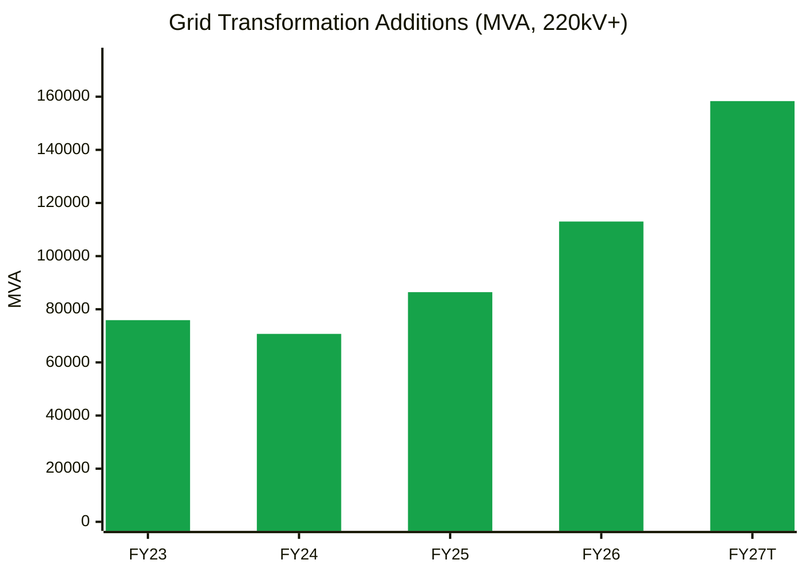
🟩 CEA transformation capacity added (FY27 = target)

**Read:** Grid additions were flat at 71–76 GVA in FY23–24, then rose 22% in FY25 and 31% in FY26. The FY27 target is another +40%. Only 23% of the FY27 target (35,670 MVA) was achieved in the first four months.

**Business inference:** Demand is real and still rising, which supports order inflow through FY27–28. But the slope comes from a policy-driven tendering wave that has to be sustained for TARIL's PIE to work, and the FY27 target is already running behind. **Industry supply series (CY5 capacity line) is a data gap.** The only figure found is TARIL's MD's own claim of ~4.5 lakh MVA demand against ~3.8 lakh MVA supply ([T&D India](https://www.tndindia.com/?p=39722)), which is not an independent source. Announced capacity additions from Siemens Energy (30,000 MVA plant, [Mercom](https://www.mercomindia.com/siemens-energy-to-set-up-30000-mva-power-transformer-factory)), Hitachi Energy, GE Vernova T&D, CG Power, Voltamp (new Gujarat plant), Supreme Power Equipment and TARIL itself (+37,000 MVA) mean supply is catching up. That is the late-cycle pattern.

### CY6 — Input cost vs realisation (partial; insufficient points to chart)

| | FY24 | FY25 | FY26 |
|---|---|---|---|
| Standalone revenue (₹ Cr) | 1,273 | 1,950 | 2,395 |
| Production (MVA) | 16,428 | 29,118 | 33,763 |
| Realisation (₹ lakh / MVA) | 7.75 | 6.70 | 7.09 |
| Consolidated EBITDA margin | 10.4% | 16.2% | 15.3% |

*Sources: FY24 investor presentation and FY26 press release (standalone revenue); FY25/FY26 annual reports (production). Mix shifts (reactors vs 765 kV units vs distribution) distort per-MVA realisation, so read the direction only.*
Realisation per MVA *fell* 14% in FY25 while margin *rose* 5.8pp. The margin gain therefore came from operating leverage (production +77%) and input costs, not price. **CRGO and copper price series are a data gap; no chart (only 3 points).** Input-cost cycle: copper spiked on the 2026 Hormuz disruption (Apr-2026 call). The DGTR is investigating anti-dumping duty on CRGO imports (Q1 FY27 call). Most orders carry price-variation clauses, and TARIL has pre-bought raw material to Dec-2026, which is why inventory is high. **Input-cost cycle: rising → compress margin assumptions.**

**Geopolitical / FX:** Exports were only ~4% of revenue (Q3 FY26 presentation) and standalone export sales were ₹33.7 Cr in FY26 (FY26 AR Directors' Report), so net FX exposure is small. The bigger exposure is imported CRGO, copper and bushings. That is a *structural* sourcing risk being addressed by the backward-integration programme (Q1 FY28).

**Sector cycle verdict: TAILWIND (12–24 months), late-cycle on supply.** Module 9: do not embed the FY25–27 growth rate. Module 9 MoS: +5pp for the late-cycle supply response.

---

## Module 1c — Stock Cycle: Company Positioning

### C2 — Quarterly YoY Growth (consolidated)

| Quarter | Q3FY25 | Q4FY25 | Q1FY26 | Q2FY26 | Q3FY26 | Q4FY26 | Q1FY27 | Q2FY27 |
|---|---|---|---|---|---|---|---|---|
| Revenue (₹ Cr) | 559 | 676 | 529 | 460 | 737 | 783 | 572 | 739 |
| Revenue YoY % | +51.5 | +31.8 | +64.3 | −0.4 | +31.8 | +15.8 | +8.1 | +60.7 |
| EBITDA ex-OI (₹ Cr) | 85 | 131 | 88 | 52 | 125 | 118 | 93 | 129 |
| EBITDA YoY % | +124 | +82 | +110 | −25 | +47 | −10 | +6 | +148 |
| OPM % | 15.2 | 19.4 | 16.6 | 11.3 | 17.0 | 15.1 | 16.3 | 17.4 |
| PAT (₹ Cr) | 55 | 94 | 67 | 37 | 76 | 91 | 64 | 81 |

*Source: Screener.in quarterly (consolidated) to Q1 FY27; Q2 FY27 from the 13-Oct-2026 results filing (revenue ₹739.44 Cr; EBITDA = revenue − materials − purchases − inventory change − employee − other expenses = ₹128.8 Cr).*

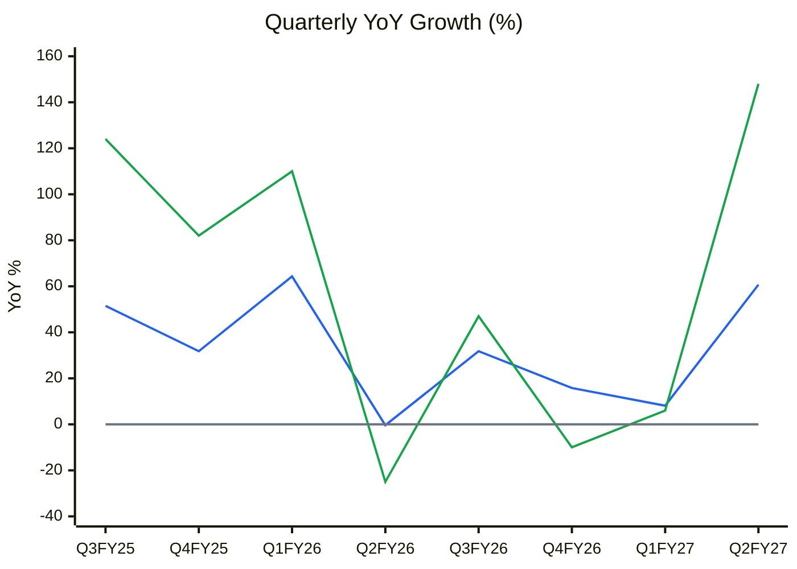
🟦 Revenue YoY % · 🟩 EBITDA YoY % · ⬜ zero line

**Read:** Growth is **erratic, not accelerating**. Revenue growth went +64% → −0.4% → +32% → +16% → +8% → +61%. Q2 FY27's +61% is against the weakest base of the cycle (Q2 FY26: delayed PSU dispatches, low-margin orders, OPM 11.3%).

**Business inference:** Execution, not demand, drives the quarters: dispatch timing at PSU sites, plant shutdowns for expansion, and raw-material availability. Revenue will stay lumpy, and the market will keep over-reacting to single quarters. The useful signal is the H1 FY27 standalone growth of 35% against the 25% FY27 guidance.

### Revenue decomposition (volume / price / mix)
FY24→FY26: production volume **+106%** (16,428 → 33,763 MVA), realisation per MVA **−9%**, revenue +88% (standalone). Growth was **volume-led**, which is bounded by capacity. Mix is moving toward power transformers (80% of the order book in Q1 FY27, up from 66% in FY24) and toward EHV/765 kV and HVDC repair, which is the durable part.

### Physical capacity model

| Plant | Product focus | Capacity claimed (Q1 FY27 PPT) | Q1 FY27 utilisation | Expansion | Status |
|---|---|---|---|---|---|
| Moraiya | Large power transformers to 1,200 kV, reactors to 765 kV | 40,000 MVA | 57% (60–65% per CFO) | +22,000 MVA EHV | Guided "Q3 2027" (originally Feb-2026) |
| Changodar | Medium power to 160 MVA/220 kV, furnace, renewable | 35,000 MVA | 27% (expansion shutdown) | +15,000 MVA | "Around Diwali 2026" (originally Dec-2024) |
| Odhav | ≤10 MVA, 66 kV, distribution | 2,000 MVA | 100% | — | — |
| **Total** | | **77,000 MVA claimed** | FY26 production 33,763 MVA | | |

*Sources: Q1 FY27 investor presentation p.25, Q1 FY27 call, Q2 FY27 press release, FY25/FY26 presentations.*
**The company's capacity figures do not reconcile.** The FY24 presentation shows 37,200 MVA (24,000 + 12,000 + 1,200). The Q3 FY26 presentation shows ~40,000 MVA. The FY26 presentation and AR show ~75,000 MVA "by end of FY26", and the AR says the additions were 22,000 at Changodar and 15,000 at Moraiya, the reverse of the presentations. Yet neither expansion was commissioned on 31-Mar-2026. The FY26 AR puts FY26 utilisation at ~45% of 75,000 MVA. The CFO said "75%" on the Apr-2026 call. **Effective capacity used in this report:** ~40,000 MVA (FY26), ~49,000 (FY27, Changodar from Nov-2026), ~70,000 (FY28, Moraiya from mid-FY28 at partial year), ~77,000 (FY29).

- **Revenue per MVA anchor:** ₹7.1 lakh/MVA (FY26 standalone).
- **Ramp:** brownfield 55% → 80% → 92% of steady state (skill standard). Management guides Changodar to 60–65% in FY27 and 80–85% in FY28.
- **Capacity ceiling:** 77,000 MVA × 85–90% × ₹7.1–7.5 lakh ≈ **₹4,700–5,200 Cr standalone**, plus ₹800–1,000 Cr potential third-party component sales (management) = **₹5,500–6,200 Cr all-in**. Management's own figure: existing capacity "supports ₹5,000–6,000 Cr" (Q1 FY27 call). On our base path the ceiling is reached in **~FY30**.
- **Physical plausibility vs PIE (Module 9):** the price implies FY33 revenue of ₹12,000–19,000 Cr, about **2–3× the announced capacity ceiling.** The market is pricing an unannounced expansion.

### Order-book revenue model (detail in Module 7 tracker)
FY27E revenue ≈ opening OB ₹5,005 Cr × execution 0.55 + in-year inflow ₹4,800 Cr × ~7% burn ≈ ₹3,090 Cr (consolidated base ₹3,100 Cr; management guides "~₹3,200 Cr consolidated", FY26 AR MD&A). The execution rate (revenue ÷ opening OB) fell from 0.78 (FY25) to 0.49 (FY26). That is execution, not demand, as the binding constraint.

### Operating leverage
FY26: contribution margin ≈ 30% (revenue − materials − variable other expenses; estimate) against EBIT margin 16.5% → **DOL ≈ 1.8×**. DFL = EBIT 414 ÷ (414 − 51) = 1.14×. **DTL ≈ 2.1×**: a 10% revenue miss gives ~21% EPS miss. ICR is comfortable at 8.1× (FY26) and ≥8× forward in the base case.

### Guidance accuracy (feeds WTT, Module 4): **0.25 → UNRELIABLE.** Discount guidance 20–30% and add 1–2 quarters to all commissioning dates.

### FCF inflection year: **FY29E** (base). Capex of ₹900–1,150 Cr for backward integration plus Changodar runs through FY28, and WC days have not yet fallen.

### CY7 — EBITDA Margin and ROCE vs Their Own Cycle

| | FY17 | FY18 | FY19 | FY20 | FY21 | FY22 | FY23 | FY24 | FY25 | FY26 | TTM |
|---|---|---|---|---|---|---|---|---|---|---|---|
| EBITDA margin % | 10.6 | 9.1 | 7.1 | 7.3 | 9.3 | 6.4 | 8.7 | 10.4 | 16.2 | 15.3 | 16.4 |
| ROCE % (Screener) | 15 | 9 | 8 | 8 | 9 | 10 | 15 | 15 | 28 | 23 | 23.3 |

*10-yr (FY17–26) EBITDA margin mean 10.0%, SD 3.1pp → current +2.0 SD. ROCE mean 14.0%, SD 6.5pp → current +1.4 SD.*

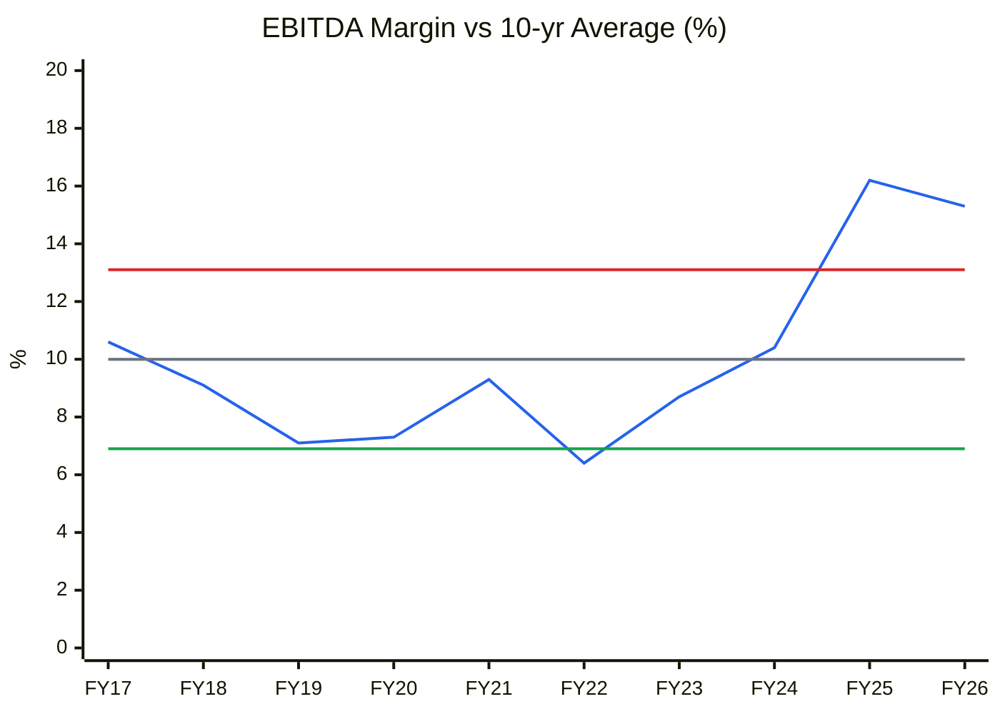
🟦 EBITDA margin · ⬜ 10-yr mean 10.0% · 🟥 +1SD 13.1% · 🟩 −1SD 6.9%

**Read:** FY25, FY26 and TTM margins (15–17%) are the only three readings above +1SD in a decade, at the 100th percentile, 2.0 SD above the mean.

**Business inference:** By the skill's rule (> 1SD above the 10-yr average), this is **late cycle / peak** for margins. The margin is earned partly from a tight-supply market where buyers accept price, not from a cost advantage that survives normal conditions. Value on a normalised 13–14% margin (the bear case uses 13%) and widen the MoS 5–10pp.

**Stock cycle classification: LATE CYCLE / MATURING margins with an EARLY-CYCLE capacity ramp.** Margins and ROCE are at peak. Volume growth depends on capacity that is not yet commissioned. MoS adjustment +5–10pp. Position size × 0.5 (late-cycle modifier).

---

## Module 2 — Industry Structure & Capital Cycle

| Force | Assessment | Signal |
|---|---|---|
| New entrants | Medium. EHV/765 kV needs testing infrastructure, PGCIL/NTPC type approvals and short-circuit test records (2–4 years). Sub-220 kV is easy to enter (Baroda cluster, SMEs; TMC Transformers and Supreme Power listings) | Moat only at the top end |
| Supplier power | **High.** CRGO is import-dependent (anti-dumping probe), copper is global, RIP bushings and OLTCs are scarce. Bushings are "a large bottleneck" (Q1 FY27 call) | Margin squeeze risk; justifies backward integration |
| Buyer power | **High.** PGCIL and state utilities buy on L1 tenders with milestone billing, retention, LDs and site-readiness delays. Utilities were 56% of revenue (Q3 FY26 PPT) | Collection and price pressure; WC drag |
| Substitutes | Low. No substitute for transformers. HVDC (VSC) shifts content toward MNC converter technology | Neutral |
| Rivalry | **Rising.** MNCs (Hitachi Energy, Siemens Energy, GE Vernova T&D) at EHV/HVDC; BHEL, CG Power, Voltamp, Indo Tech, Shilchar, Bharat Bijlee and the Baroda cluster below 220 kV. All are adding capacity | Price discipline holds only while supply is short |

**Industry verdict: NEUTRAL** (attractive today because of shortage, structurally unattractive with concentrated buyers on L1 tenders). That does not lower the required MoS.

**Capital cycle (Chancellor):** Supply-side signals are flashing **"capital floods in."** (1) TARIL is adding +37,000 MVA (+93%), Siemens Energy is building a 30,000 MVA plant, and Voltamp, Hitachi, GE T&D and CG are all expanding. (2) New sector listings: TMC Transformers IPO and Supreme Power Equipment ([Kotak Neo](https://www.kotakneo.com/ipo/tmc-transformers-india-ipo/); [T&D India](https://www.tndindia.com/2026/02/)). (3) Equity issuance: TARIL QIP ₹500 Cr (Jun-2024), preferential ₹120 Cr (Oct-2023), and a ₹750 Cr QIP enabling resolution (Jan-2025). (4) Sector ROCE is at 10-year highs: TARIL 23–28% vs a 14% 10-yr mean, GE T&D 77%, Shilchar 51%. (5) TARIL capex/depreciation: FY26 ~₹130 Cr CWIP build against ₹30 Cr D&A ≈ 4×; H1 FY27 capex ₹153 Cr vs D&A ₹14 Cr ≈ 11×. **CY8 (industry capex/depreciation, peers) is a data gap.** Capital-cycle position: **late upcycle** (returns peaking, capacity arriving 2026–28).

---

## Module 3 — Business Quality & Moat

**Greenwald's three barriers**
1. **Supply/cost advantage:** Weak. EBITDA margin averaged 10% over 10 years, below Voltamp (16–20%) and Shilchar (25–30%), and only matched them at the cycle peak. FY27–28 backward integration (CRGO processing operational, CTC, pressboard, RIP bushings, fabrication; ₹900–1,000 Cr) *could* create a 200–300 bp cost edge from FY28 (management). That is a promise, not yet evidence.
2. **Customer captivity:** Weak to moderate. Utility type-approvals and a 765 kV/1,200 kV track record create qualification barriers. TARIL is among the few Indian-owned makers qualified for 765 kV and is attempting HVDC qualification via a PGCIL repair job. Every order is still L1-priced.
3. **Local economies of scale:** None. Gujarat state utility GETCO is a large repeat buyer (₹726 Cr, ₹390 Cr, ₹103 Cr, ₹228 Cr orders) but share is not dominant.

**Buffett 10% price test:** **Fail.** The company describes itself as L1-bid in every tender (Q1 FY27 call). Realisation per MVA fell in FY25 even in a shortage.
**Market share stability:** Gaining in the cycle. TARIL production as a share of CEA grid additions went 23% → 34% → 30% (proxy). Share gains came with the restart of idle capacity, not a structural edge.
**Activity system / scuttlebutt:** The NABL electrical-steel lab, in-house short-circuit testing, the 1,200 kV unit at the National Test Station Bina and KEMA testing are genuine engineering credentials. Competitors' view: EHV/UHV competition is "mostly multinationals" (MD, Q1 FY27). Customer channel checks are a data gap.

**Moat verdict: NARROW (engineering qualification at EHV) · Source: none of Greenwald's three durably · Pricing power: FAIL · Share: gaining (cyclical).**

### C4 — Margin trend (consolidated)

| % | FY16 | FY17 | FY18 | FY19 | FY20 | FY21 | FY22 | FY23 | FY24 | FY25 | FY26 |
|---|---|---|---|---|---|---|---|---|---|---|---|
| EBITDA margin | 5.8 | 10.6 | 9.1 | 7.1 | 7.3 | 9.3 | 6.4 | 8.7 | 10.4 | 16.2 | 15.3 |
| PAT margin | −1.1 | 2.9 | 0.8 | 0.6 | 0.1 | 1.1 | 1.2 | 3.0 | 3.6 | 10.7 | 10.8 |

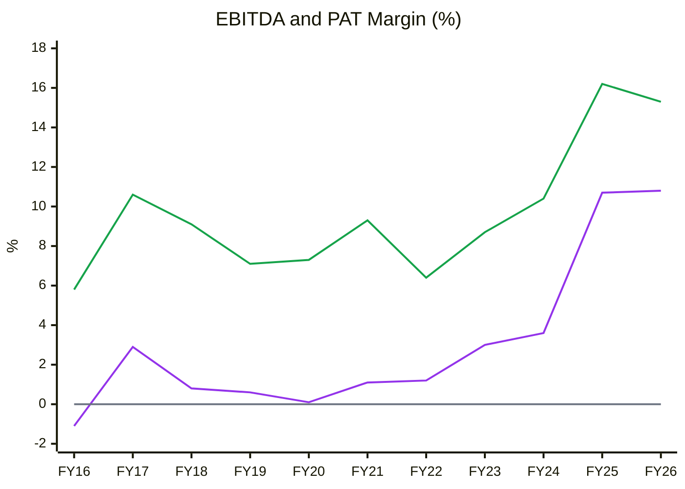
🟩 EBITDA margin · 🟪 PAT margin · ⬜ zero line

**Read:** From FY16 to FY24, PAT margin never exceeded 3.6%, because interest (₹42–51 Cr a year) took most of EBITDA. FY25–26 PAT margin is ~11%, after EBITDA jumped and the QIP removed interest pressure.

**Business inference:** Most of the profit gain comes from cyclical operating leverage and a deleveraged balance sheet, not from structurally higher product margins. One normal year (EBITDA 11–12%) would roughly halve PAT. That is the core reason the bear case lands near ₹150.

**Fisher 15-point score: 27 / 45** · Point 15 (Integrity): **2 — Pass (watch).**
| # | Point | Score | Evidence |
|---|---|---|---|
| 1 | Market potential | 3 | Grid capex plan of 827,600 MVA; exports |
| 2 | New products | 2 | HVDC qualification, RIP bushings, STATCOM, nuclear (NPCIL Kaiga 5&6) |
| 3 | R&D effectiveness | 2 | 1,200 kV unit, KEMA/short-circuit tests; R&D spend not disclosed |
| 4 | Sales organisation | 2 | ₹21,000–23,000 Cr negotiation pipeline, 10–15% win rate |
| 5 | Profit margin | 2 | 15–17% now; 10% 10-yr average |
| 6 | Margin improvement | 2 | Backward integration (delayed) |
| 7 | Labour relations | 2 | 612 permanent employees (FY26 AR) vs "1,700+ people" (PPT); contract-heavy |
| 8 | Executive relations | 1 | CEO left after 4 months (Jul-2025 to Jan-2026); CFO replaced Mar-2026; independent director resigned Nov-2025 |
| 9 | Management depth | 1 | Family-run (father chairman, son MD & CEO, mother ED); professional CEO experiment failed |
| 10 | Cost and accounting controls | 1 | Stock and debtor statements to banks don't match books (AR Note 27(b)); consolidated limited-review report re-submitted (Jan-2026); capacity figures inconsistent across filings; QIP use deviation reported by the monitoring agency |
| 11 | Industry advantage | 2 | EHV approvals, NABL CRGO lab |
| 12 | Long-range orientation | 2 | Backward integration, UK subsidiary |
| 13 | Dilution | 2 | QIP (+5%) in 2024; ₹750 Cr QIP enabling resolution passed Jan-2025 (status unknown) |
| 14 | Communication in adversity | 1 | Guidance cut then reframed; Q4 FY26 low inflow explained as "strategically delaying new orders" |
| 15 | Integrity | 2 | World Bank sanctions notice (Nigeria project; uncontested-proceedings notice, then removed from the debarred list pending reply); no proven misconduct; managerial pay +161% in FY26 |

---

## Module 4 — Management & Capital Allocation

**Promoter holding:** 64.36% (Sep-2026), down from 69.65% (Mar-2024). The drop followed the Jun-2024 QIP (−3.5pp) and a further −1.8pp in Dec-2024 (cause not verified; data gap). It has been flat for seven quarters.
**Pledge:** **4.22 Cr shares, ~21.8% of promoter holding (14.1% of equity)**, held by a director and pledged to banks as collateral for the *company's* working-capital lines (FY26 AR Note 27(a); [Trendlyne](https://trendlyne.com/equity/share-holding/1417/TARIL/30-06-2024/transformers-rectifiers-india-ltd/) shows 21.84%, previously 22.26%). **Risk: ELEVATED (20–40% band), stable/declining.** It supports company borrowing, not promoter leverage. Also, 10 lakh shares are pledged with Bandhan Bank for a term loan, and promoters give personal guarantees and property mortgages.
**Share count:** 13.26 Cr → 30.02 Cr (preferential Oct-2023, QIP Jun-2024 at ₹665 pre-bonus, 1:1 bonus Feb-2025). Real dilution since FY23 is ~13% (preferential + QIP).
**FCF/share vs EPS:** FY21–FY26 cumulative FCF ≈ CFO ₹207 Cr − capex ~₹230 Cr (estimate from CFI ex-treasury) ≈ **negative**, while EPS went from ₹0.27 to ₹8.81. Earnings growth has not produced free cash.
**Capital allocation rating: AVERAGE-TO-POOR.**
- QIP (₹500 Cr, Jun-2024): ₹145 Cr is still unutilised after 27 months. The monitoring agency reported a deviation (₹18.1 Cr booked to GCP, beyond limits). A postal ballot (Aug–Sep 2026) reallocated objects and extended the timeline to Mar-2027 (Board outcome 27-Aug-2026; postal ballot notice).
- Acquisition: 51% of Posco-Poggenamp Electrical Steel (now Triveni Transtech, CRGO processing) in Jan-2025. A sensible integration move, but its returns are not disclosed.
- New ₹900–1,000 Cr backward-integration programme, ~₹500 Cr of it via finance leases (debt-like), plus a UK subsidiary (51%, up to GBP 10 mn).
- Dividend payout 0–6%.

**RPTs (FY26 AR Note 52):** Small in value. Promoter loans to the company, KMP-linked vendors (Skytrek Tours, Benchmark HR, Harsha Engineers) and the Poggenamp Nagarsheth family entity (minority partner in the CRGO subsidiary). No ICDs to promoter entities. **Managerial remuneration +161% in FY26** (Jitendra Mamtora +147%, Satyen Mamtora +169%, Karuna Mamtora +167%) against +27.6% for other staff. The director/median-employee ratio is 78:1 for the MD (FY26 AR Annexure). This is not yet >10% of PAT, but the trend is worth watching.
**Buffett Three C's:** Candor **LOW** (reframing, "deliberately not taking orders" in a 244 Cr inflow quarter) · Competence **MODERATE** (engineering strong, execution and project management weak) · Caring **LOW-MODERATE** (pay jump, minimal dividend).

### Walk the Talk Scorecard

| Quarter guided | Statement | Guided | Actual | Verdict |
|---|---|---|---|---|
| FY24 / Q1 FY25 PPT | Changodar +15,000 MVA commercial production | Dec-2024 | Slipped to May-2025, then Q2 FY26, Aug-2026, and now "around Diwali 2026" (Q2 FY27 PR) | ❌ Miss (~23 months) |
| FY25 PPT (Apr-2025) | Moraiya +22,000 MVA EHV | Feb-2026 | "Q3 2027" (Q1 FY27 call) | ❌ Miss |
| FY25 PPT | 100% backward-integrated | Q1 FY27 | Q1 FY28 (Q1 FY27 PPT) | ❌ Miss |
| FY25 PPT | Capex ₹550 Cr in 15 months | Apr-25 to Jun-26 | Programme re-sized to ₹600 Cr, then ₹900–1,000 Cr + ₹150 Cr; spend lagging (QIP ₹145 Cr unspent) | ❌ Miss |
| FY25 call | Working capital ~120 days | FY26 | 170 days (Q1 FY27 call) | ❌ Miss |
| Q1 FY26 call | FY26 capacity utilisation 85–90% | FY26 | Cut to ~70% (Q2 FY26); ~75% (Apr-2026 call); ~45% of claimed 75k MVA (AR) | ❌ Miss |
| Q2/Q3 FY26 calls | FY26 revenue ~₹2,600 Cr, EBITDA ~16% | FY26 | Standalone ₹2,395 Cr (−8%), EBITDA 15.1% (FY26 PPT); consolidated ₹2,509 Cr | ⚠️ Near miss |
| Q1 FY26 call | Order book ₹5,000–5,500 Cr | FY26 | ₹5,005 Cr | ✅ Hit |
| FY25 PPT | "US$1 bn revenue in next 3 financial years" (FY28) | FY28 | Reframed to "$1 bn by FY28–29", then "₹8,000 Cr by FY29" ("rupee level was different"; Q1 FY27 call) | 🔴 Reversal / reframing |
| FY26 call (Apr-2026) | FY27 revenue growth "35–40%", ~₹3,250 Cr | FY27 | Cut to 25% in Jul-2026 (Q1 FY27 call) | 🔴 Reversal |
| Q1 FY27 call | Changodar complete by Aug-2026 | Aug-2026 | "Around Diwali" (Q2 FY27 PR) | ❌ Miss (small) |
| Q1 FY27 call | FY27 order inflow +30% | FY27 | H1 FY27 inflow ₹3,283 Cr vs FY26 full-year ₹2,374 Cr | ✅ Hit (on track) |

**WTT Score: 0.25 / 1.00 — UNRELIABLE**
Guidance points assessed: 12 (Apr-2024 to Oct-2026) · Hits: 2 | Near misses: 1 | Misses: 7 | Reversals: 2
Key pattern: **one-way misses on capex/commissioning timelines** (average slip 12–23 months), plus **post-event reframing** of the headline target (an O'Glove flag).
Insider action signal: no open-market promoter buying or selling found. Form C filings were not exhaustively checked (data gap). Promoters were diluted in the QIP. NEUTRAL.
DCF impact: commissioning dates +2 quarters in the base case; management revenue targets haircut ~30% (₹8,000 Cr FY29 target → base ₹4,400 Cr).
**Overall management credibility: LOW.** On the Q1 FY27 call the MD said the company would now give only guidance "we are confident of achieving" and appointed EY for investor relations. That acknowledges the problem. It does not yet prove a fix.

### C9 — Shareholding (%)

| | Dec-23 | Mar-24 | Jun-24 | Sep-24 | Dec-24 | Mar-25 | Jun-25 | Sep-25 | Dec-25 | Mar-26 | Jun-26 | Sep-26 |
|---|---|---|---|---|---|---|---|---|---|---|---|---|
| Promoters | 69.65 | 69.65 | 66.16 | 66.16 | 64.36 | 64.36 | 64.36 | 64.36 | 64.36 | 64.36 | 64.36 | 64.36 |
| FIIs | 3.48 | 4.45 | 8.00 | 9.34 | 11.08 | 11.33 | 10.94 | 11.21 | 7.01 | 8.33 | 7.80 | 6.98 |
| DIIs | 0.00 | 1.89 | 6.33 | 6.93 | 7.68 | 7.22 | 6.04 | 5.95 | 4.18 | 1.77 | 1.54 | 1.19 |
| Public | 26.87 | 24.00 | 19.50 | 17.57 | 16.88 | 17.07 | 18.67 | 18.47 | 24.43 | 25.54 | 26.32 | 27.46 |

*Source: Screener.in shareholding (BSE filings). Shareholders rose from 61,972 to 2,23,850.*

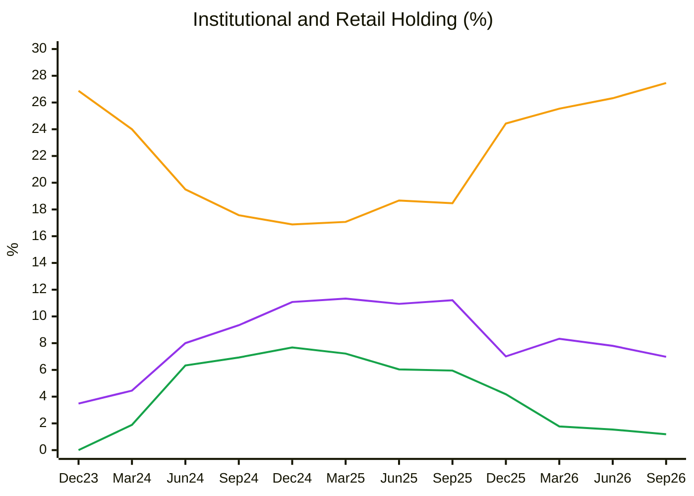
🟪 FIIs · 🟩 DIIs · 🟧 Public/retail (promoters flat at 64.36% since Dec-24; not plotted)

**Read:** Institutions came in through the QIP (FII+DII 18.8% in Dec-2024) and have since halved to 8.2%. DIIs are almost out (7.7% → 1.2%). Retail rose from 16.9% to 27.5% and shareholder count tripled.

**Business inference:** Institutions sold through the guidance cuts, World Bank news and the CEO exit (Q3 FY26–Q1 FY27), and retail absorbed the supply. That is the classic "smart money exits, retail averages down" pattern. Institutions will need several quarters of clean execution and cash flow before they return, which caps re-rating near term (CANSLIM "I" = 0).

---

## Module 5 — Financial Forensics

**Indian-specific screen**
- **Pledge:** 21.8% of promoter holding (Elevated), collateral for company debt, stable.
- **RPT / ICD:** small; no ICDs to promoter group. ✅
- **Revenue quality (EPC/capital goods):** trade receivables ₹1,057.7 Cr standalone = **42.3% of standalone total assets** (FY26 auditor KAM). Debtor days rose from 85 (FY25) to 129 (FY26). Management says Mar-2026 receivables were collected in April. Consolidated receivables were ₹887 Cr (Mar-2026) and ₹837 Cr (Sep-2026, −6%), so the improvement is partial.
- **Auditor:** Manubhai & Shah LLP (mid-tier, Ahmedabad), reappointed to the 36th AGM. **Unmodified opinion.** KAMs: revenue recognition (variable consideration, cut-off), recoverability of trade receivables, contingent liabilities. Indirect-tax contingent liabilities **jumped from ₹58 Cr to ₹183 Cr** (FY26 AR Note 45). The consolidated limited-review report for Sep-2025 was **re-submitted** on 16-Jan-2026. Bank stock/debtor statements don't match the books (AR Note 27(b), a CARO-type observation). The FY26 AR's current-borrowings note carries prior-year column headers ("31st March 2025 / 2024"), a reporting-quality slip. The warranty contract liability tripled from ₹5.8 Cr to ₹17.2 Cr (AR Note 26), consistent with more units in the field but worth tracking after the TGV failure.
- **World Bank sanctions (Case 788):** notice of uncontested sanctions proceedings dated 4-Nov-2025, about alleged irregularities in a US$24.74 mn FY20 Nigeria (TCN) transformer supply. The company says it never received the Jul-2025 notice. It was removed from the debarred list on 14-Nov-2025 pending its response (deadline 12-Jan-2026). **Final outcome not disclosed (data gap).** There is no current World Bank-funded business, so the direct impact is small. It is a governance flag.
- **Field failure:** a TGV SRAAC transformer supplied in 2015 failed in Oct-2025 (out of warranty; TARIL clarification 27-Oct-2025). A single event.
- **Disclosure downgrade:** since Jun-2026, Reg 30 order filings give only value *bands* (e.g., "Large Order: ₹100–500 Cr"), not values. The Q3 FY26 presentation reused the "Order Inflow Q1 ₹665 Cr" label. Capacity numbers conflict across filings.

**Quantitative models**
| Model | Value | Read |
|---|---|---|
| Beneish M-Score (FY26, approximate; DSRI 1.52, SGI 1.24, TATA 0.14, other indices ≈ 1) | **≈ −1.2** | **> −1.78: likely-manipulator zone.** Driven by the receivables jump and accruals. Partly explained by year-end milestone billing collected in April, but FY23–26 cash conversion says it is not just timing. *Approximate: GMI/AQI/DEPI/SGAI/LVGI set to ~1 for lack of a clean breakdown.* |
| Altman Z'' (FY26) | ~7.7 (FY24 6.8, FY25 7.1) | Safe (> 2.6). Low leverage post-QIP |
| Piotroski F (FY26) | 4 / 9 | Average. Fails CFO > 0, CFO > NI, lower leverage, gross-margin improvement |
| Sloan accrual (FY26) | **15.8%** (FY24 3.4%; FY25 distorted by QIP treasury outflows) | **> 10%: red flag** |
| Operating accruals (NI − CFO)/avg TA | FY24 1.5% · FY25 3.6% · **FY26 14.9%** | Deteriorating |

**Schilit quick screen:** (1) Revenue too soon: DSO +44 days and CFO negative → **flag**. (3) Other income/EBIT 14.7% (FY26), below 15% → watch. (4) Capex/depreciation 4× is growth capex, explained. CFS: vendor financing ₹250 Cr (FY25) is correctly classified as borrowings (AR Note 27). DPO collapsed from 109 to 62 days (paying suppliers faster, partly to pre-buy material), which drags CFO but is not manipulation.

### C7 — Earnings quality: cumulative PAT vs cumulative CFO (₹ Cr, from FY16)

| | FY16 | FY17 | FY18 | FY19 | FY20 | FY21 | FY22 | FY23 | FY24 | FY25 | FY26 |
|---|---|---|---|---|---|---|---|---|---|---|---|
| PAT | −7 | 24 | 6 | 5 | 1 | 8 | 14 | 42 | 47 | 216 | 272 |
| CFO | 37 | 66 | −102 | 179 | 16 | 96 | 2 | 28 | 29 | 157 | −105 |
| Cumulative PAT | −7 | 17 | 23 | 28 | 29 | 37 | 51 | 93 | 140 | 356 | 628 |
| Cumulative CFO | 37 | 103 | 1 | 180 | 196 | 292 | 294 | 322 | 351 | 508 | 403 |

*Source: Screener.in consolidated cash flow (cross-checked: the FY26 AR consolidated CFS shows H1 FY26 CFO of −₹34.7 Cr standalone; the Q2 FY27 filing shows H1 FY27 standalone CFO +₹43.8 Cr and consolidated ≈ +₹48 Cr (parse of a garbled PDF table; verify) vs H1 PAT ₹146 Cr).*

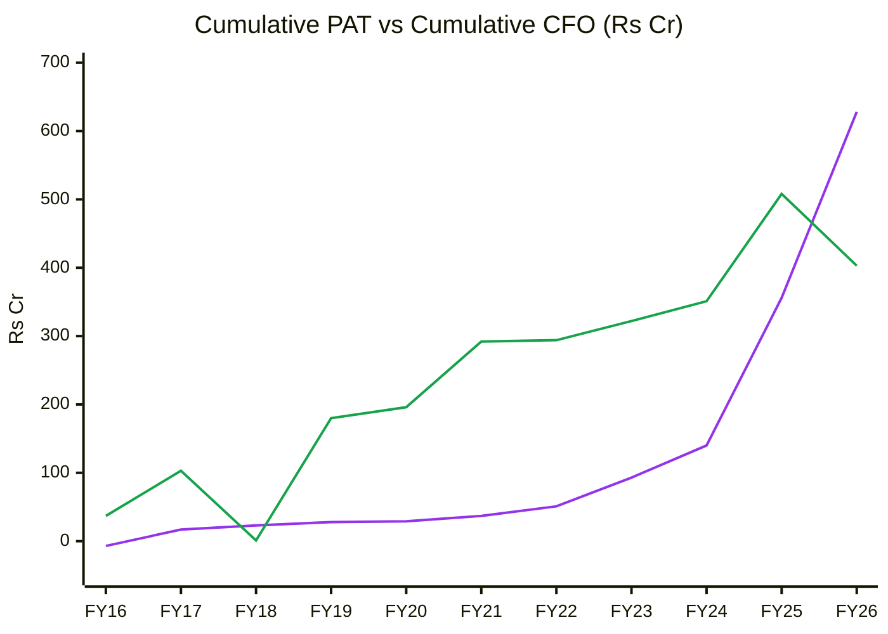
🟪 Cumulative PAT · 🟩 Cumulative CFO

**Read:** The lines **crossed in FY26**. 11-yr cumulative CFO/PAT is 0.64. Since FY21 it is 0.35, and **FY23–26 it is 0.19** (₹109 Cr CFO against ₹577 Cr PAT). H1 FY27 is ~0.3.

**Business inference:** In the low-profit years (FY16–22), CFO exceeded PAT because WC was being released. In the boom, profit is being reinvested into receivables (+₹500 Cr in two years) and inventory (pre-buying CRGO and copper to Dec-2026). Reported earnings overstate distributable earnings. Each ₹1 of revenue growth needs ~₹0.40–0.47 of working capital, which is why the DCF value (Module 9) sits far below the P/E-based value.

### C8 — Working-capital days

| Days | FY17 | FY18 | FY19 | FY20 | FY21 | FY22 | FY23 | FY24 | FY25 | FY26 |
|---|---|---|---|---|---|---|---|---|---|---|
| Debtor | 166 | 256 | 161 | 218 | 205 | 164 | 166 | 174 | 85 | 129 |
| Inventory | 120 | 182 | 109 | 153 | 147 | 104 | 93 | 109 | 118 | 133 |
| Payable | 149 | 203 | 114 | 161 | 179 | 129 | 118 | 95 | 109 | 62 |
| Cash conversion cycle | 138 | 235 | 156 | 210 | 173 | 139 | 141 | 188 | 94 | 200 |

*Source: Screener.in ratios (consolidated). Management's NWC measure: 170 days (Q1 FY27), target 120–130.*

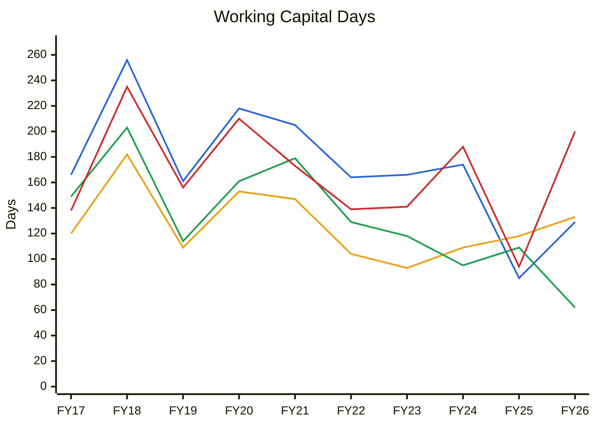
🟦 Debtor days · 🟧 Inventory days · 🟩 Payable days · 🟥 Cash conversion cycle

**Read:** FY25's 94-day CCC was the outlier. FY26 is back to 200 days, near the 10-yr median (~156), with payable days at a decade low of 62.

**Business inference:** The structural CCC for this business with PSU buyers is 140–200 days, and FY25 was a one-off. Supplier credit has tightened (pre-buying scarce material, paying faster). The "120–130 days" target would need both shorter receivables and longer payables against powerful buyers and suppliers. Model 150+ days, not the target.

**Forensic red-flag count (O'Glove 15): 5 / 15.** (1) NI rising while CFO is negative, (2) DSO +44 days, (4) inventory days rising three years running, (9) Sloan 15.8%, (10) Beneish ≈ −1.2. Watch items: other income 14.7% of EBIT; disclosure inconsistencies on capacity and exports.
**Overall forensic verdict: SIGNIFICANT CONCERNS. ≥ 3 flags unresolved → hard stop.** No evidence of fabrication. The flags describe cash-poor growth and weak controls, not proven manipulation. The resolving evidence would be FY27 CFO ≥ 0.6× PAT and debtor days back below 110.

---

## Module 6 — Earnings Quality & Financial Statements

**WACC:** Rf 7.0% + β 1.15 × ERP 6% → Ke 13.9%; post-tax Kd ~7%; D/V ~6% → **WACC ≈ 13.5%**.
**ROCE (current):** 23.3% (Screener TTM), 23.6% FY26 · **10-yr avg (FY17–26):** 14.0% · **Spread:** +10pp now; −4 to −6pp in FY18–FY22.
**ROCE trend (3-yr):** FY24 15 → FY25 28 → FY26 23, so declining from peak. **Driver:** margin-led. Capital turnover on total assets fell from 1.18× to 0.94× as receivables and QIP cash grew.
**Economic profit:** positive from FY25 (≈ IC ₹1,970 Cr × 10pp ≈ +₹200 Cr in FY26). Negative FY16–FY22.
**ROCE < WACC for 5+ years?** FY18–FY22 were five consecutive years below WACC. FY23–FY26 (four years) were at or above. **The hard stop is not triggered** because the turnaround is documented. The 10-yr average (14%) is only ~WACC.

### C5 — ROCE vs WACC

| % | FY16 | FY17 | FY18 | FY19 | FY20 | FY21 | FY22 | FY23 | FY24 | FY25 | FY26 |
|---|---|---|---|---|---|---|---|---|---|---|---|
| ROCE (Screener) | 6 | 15 | 9 | 8 | 8 | 9 | 10 | 15 | 15 | 28 | 23 |
| WACC | 13.5 | 13.5 | 13.5 | 13.5 | 13.5 | 13.5 | 13.5 | 13.5 | 13.5 | 13.5 | 13.5 |

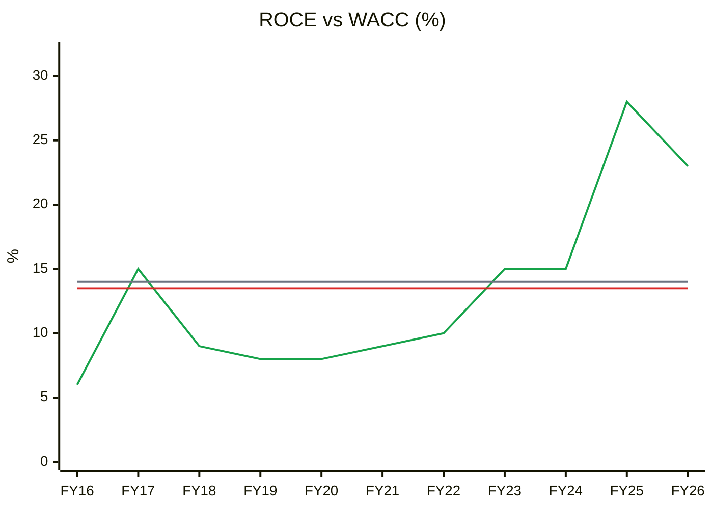
🟩 ROCE · 🟥 WACC 13.5% · ⬜ 10-yr average ROCE 14.0%

**Read:** ROCE was below WACC in 7 of 11 years (FY16, FY18–FY22). It was above WACC only in FY17, FY23–24 (marginal) and FY25–26 (strong). The 10-yr average (14%) almost equals WACC.

**Business inference:** Across a full cycle TARIL has earned about its cost of capital, so it has created little value. The current +10pp spread is the cyclical peak, not a proven moat (no barrier from Module 3 protects it). A buyer at 5.5× book is paying for the peak spread to persist.

### Asset turnover (Revenue / net fixed assets)
| FY | FY16 | FY17 | FY18 | FY19 | FY20 | FY21 | FY22 | FY23 | FY24 | FY25 | FY26 |
|---|---|---|---|---|---|---|---|---|---|---|---|
| AT (×) | 3.6 | 4.4 | 3.7 | 4.3 | 3.6 | 4.1 | 6.9 | 9.1 | 9.0 | 8.0 | 10.0 |
5-yr avg (FY22–26) 8.6×. *Not charted.* Net block is old and heavily depreciated, so AT on net block overstates efficiency, and the binding constraint is MVA capacity, not rupees of plant. Module 11 uses the capacity × realisation model instead. Tangible gross block FY26 ₹404 Cr → AT 6.2×. Incremental capex (₹1,150 Cr) will roughly **quadruple** the gross block, so forward AT on gross block falls to ~2.5–3× by FY29 (a key ROCE headwind).

### DuPont Decomposition (5-factor, consolidated)

| Year | EBIT margin | Asset turnover | Equity multiplier | Interest burden | Tax burden | ROE (on closing equity) |
|---|---|---|---|---|---|---|
| FY22 | 5.8% | 1.04 | 3.12 | 0.34 | 0.61 | 3.9% |
| FY23 | 7.5% | 1.18 | 3.01 | 0.54 | 0.74 | 10.7% |
| FY24 | 8.9% | 1.10 | 2.11 | 0.56 | 0.73 | 8.5% |
| FY25 | 16.7% | 0.92 | 1.75 | 0.85 | 0.76 | 17.3% |
| FY26 | 16.5% | 0.94 | 1.76 | 0.88 | 0.75 | 18.0% |
| **Change FY22→26** | +10.7pp | −0.10 | −1.36 | +0.54 | +0.14 | **+14.1pp** |

**Operating contribution (EBIT margin × AT):** improving, 6.0% → 15.5% (margin-led).
**Financing contribution:** the equity multiplier fell (QIP) and the interest burden improved. **Leverage is not masking anything.**
**DuPont verdict:** the ROE gain is operational (margin), with AT drifting down as receivables and QIP cash build. Peer DuPont: Voltamp, Shilchar and Indo Tech earn higher ROE with zero debt and higher margins, so their ROE is higher quality.
**AT trend → Module 11:** declining on total assets. Use capacity utilisation rather than AT.
**Ind AS 116:** ROU assets ₹7.3 Cr, so negligible today. The planned ~₹500 Cr finance-lease funding of backward-integration machinery will be debt-like from FY27–28 and is included in forward net debt.
**OCF/NI (5-yr FY22–26):** 111 ÷ 591 = **0.19 → LOW quality.**
**O'Glove red flags: 5/15** (see Module 5). **Key accounting concern:** working-capital absorption and cash conversion. No accounting irregularity has been found.

---

## Module 7 — Industry KPIs & Peer Analysis

**Sector:** Electrical Equipment & Turnkey Electrical Solutions (order-driven capital goods): transformers.

| KPI (ref. block line 2256) | TARIL | Peer avg / healthy range | Assessment |
|---|---|---|---|
| Order book / revenue | 2.6× TTM (firm, no framework) | > 1.5× | Above ✅ |
| Net working-capital days | 170 (mgmt), CCC 200 | < 100 | **Below ❌** (Voltamp WC days 87, Indo Tech 75, Shilchar 91, Hitachi −46, GE T&D 6) |
| EBITDA margin | 16.4% TTM | 11–18% (product-led); peers 16–28% | In line (peak) |
| Execution velocity (revenue ÷ opening OB) | FY25 0.78 → FY26 0.49 → FY27E ~0.6 | > 0.6× | Borderline ⚠️ |
| Net debt / EBITDA · ICR | ~0.8× · 8× | < 2× · > 3× | OK ✅ |
| ROCE | 23% (10-yr avg 14%) | > 18% | Above now; below over the cycle |
| CFO / PAT (5-yr) | **0.19** | > 0.7× | **Red flag ❌** |

### Peer comparison (Screener.in, 13-Oct-2026; peers' TTM may not include Sep-2026 quarters)

| Metric | TARIL | Hitachi Energy India | GE Vernova T&D India | Siemens Energy India | Voltamp | Indo Tech | Shilchar | BHEL |
|---|---|---|---|---|---|---|---|---|
| Revenue FY26 (₹ Cr) | 2,507 | 8,148 | 6,206 | 7,827 (FY Sep-25) | 2,154 | 782 | 652 | 33,782 |
| Revenue 3-yr CAGR | 22% | 22% | 31% | n.a. | 16% | 28% | 33% | 13% |
| EBITDA margin (FY26) | 15% | 16% | 28% | 20% | 16% | 17% | 29% | 8% |
| ROCE (latest) | 23% | 29% | 77% | 68% | 24% | 40% | 51% | 9% |
| Borrowings (₹ Cr) | 457 (574 Sep-26) | 86 | 24 | 216 | 1 | 5 | 0 | — |
| WC days | 80 (Screener) | −46 | 6 | 35 | 87 | 75 | 91 | — |
| P/E (TTM) | **30.0** (incl. Q2 FY27) | 113 | 79 | 73 | 33 | 34 | 33 | 63 |
| Market cap (₹ Cr) | 9,125 | 1,34,682 | 1,06,829 | 1,11,074 | 10,451 | 3,407 | 4,515 | 1,54,152 |

*BHEL transformer segment revenue is not separately disclosed (data gap); BHEL shown as a group.*

### C12 — ROCE vs peers (%)

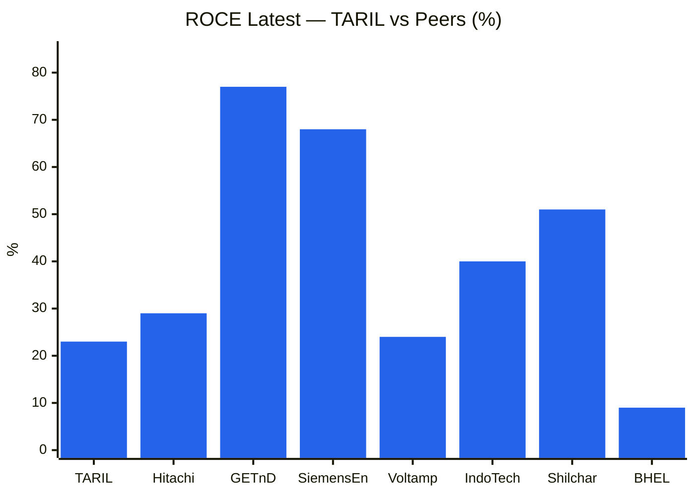
🟦 ROCE (Screener, latest year)

**Read:** TARIL's 23% ROCE is in the bottom half: below the MNCs (29–77%) and the asset-light domestic peers Indo Tech and Shilchar (40–51%), level with Voltamp, and above BHEL.

**Business inference:** At similar P/E (~30–34×), Voltamp, Indo Tech and Shilchar offer higher ROCE, net cash and better cash conversion. TARIL has larger EHV capacity and order visibility but weaker capital efficiency (WC-heavy, debt-funded). A discount to those peers is justified, not a premium. The MNC multiples (73–113×) are for HVDC/technology franchises with negative WC, which TARIL does not have.

**Peer positioning:** In line on P/E with the small/mid domestic transformer peers. Justified? **No.** A 15–25% discount is warranted for WC intensity, governance and credibility.

### Order Book Tracker (42 BSE Reg 30 filings since Apr-2023; ledger and snapshots in sections 5–6 below)
*Generated 2026-10-13 by scripts/order_book_tracker.py from 42 order announcements (1 follow-up excluded) and 14 period snapshots. Ledger coverage starts 2023-04-01; earlier periods show '—' for announced inflow (unknown, not zero). Revenue = consolidated; order_linked_share 0.95 (subsidiaries' third-party component sales ~5%). Since Jun-2026 filings disclose only value bands: PGCIL ≥₹1,000 Cr and "Large" ₹100–500 Cr orders are entered at the band's lower bound.*

#### 1. Disclosed vs tracked order book (reconciliation)

| Period | Revenue (₹ Cr) | Order book (₹ Cr) | Announced inflow | of which Framework | Implied inflow | Announced coverage | OB cover (× TTM rev) | Source |
|---|---|---|---|---|---|---|---|---|
| FY21 | 742 | 1,008 | — | — | — | — | 1.4 | Screener consolidated; OB FY24 investor presentation |
| FY22 | 1,158 | 1,148 | — | — | 1,240 | — | 1.0 | Screener; OB Q1FY27 presentation |
| FY23 | 1,396 | 1,499 | — | — | 1,677 | — | 1.1 | Screener; OB Q1FY27 presentation |
| FY24 | 1,291 | 2,582 | 1,263 | — | 2,309 | 55% | 2.0 | Screener; OB Q1FY27 presentation |
| Q1FY25 | 322 | 2,926 | 359 | — | 650 | 55% | 2.0 | Screener; OB Q1FY25 presentation |
| Q2FY25 | 462 | 3,500 | 655 | — | 1,013 | 65% | 2.1 | Screener; OB Q2FY25 presentation |
| Q3FY25 | 559 | 3,686 | 835 | — | 717 | 116% | 2.0 | Screener; OB Q3FY25 presentation |
| Q4FY25 | 676 | 5,132 | 1,604 | — | 2,088 | 77% | 2.5 | Screener; OB FY25 presentation |
| Q1FY26 | 529 | 5,246 | 143 | — | 617 | 23% | 2.4 | Screener; OB Q1FY26 presentation |
| Q2FY26 | 460 | 5,478 | 0 | — | 669 | 0% | 2.5 | Screener; OB Q2FY26 presentation |
| Q3FY26 | 737 | 5,450 | 547 | — | 672 | 81% | 2.3 | Screener; OB Q3FY26 presentation |
| Q4FY26 | 783 | 5,005 | 0 | — | 299 | 0% | 2.0 | Q1FY27 PPT; OB FY26 presentation |
| Q1FY27 | 572 | 6,630 | 1,553 | — | 2,168 | 72% | 2.6 | Q1FY27 results; OB Q1FY27 presentation |
| Q2FY27 | 739 | 7,237 | 200 | — | 1,309 | 15% | 2.6 | Q2FY27 results 13-Oct-2026; OB Q2FY27 press release |

*Implied inflow = OB(t) − OB(t−1) + order-linked revenue(t). Announced coverage = announced ÷ implied.*

**Company-disclosed inflow (cross-check):** Q1FY25 ₹698 Cr · Q2FY25 ₹1,031 · Q3FY25 ₹631 · Q4FY25 ₹2,144 (FY25 ₹4,504) · Q1FY26 ₹665 · Q2FY26 ₹592 · Q3FY26 ₹873 (derived: FY26 ₹2,374 − 665 − 592 − 244; the Q3 FY26 slide is mislabeled) · Q4FY26 ₹244 · Q1FY27 ₹2,114 · Q2FY27 ₹1,169 (presentations/press releases). Implied and disclosed inflow agree within ±15% in most quarters, so the disclosed book is internally consistent. **Coverage extremes explained:** Q2FY26 and Q4FY26 at 0% are quarters with no Reg 30 filing (inflows of ₹592 Cr and ₹244 Cr were all small orders). Q2FY27 at 15% reflects the switch to value bands (two "Large" orders entered at ₹100 Cr each against a disclosed ₹1,169 Cr inflow). Q3FY25 at 116% is the ₹565 Cr PGCIL order being booked as the Q3 book consumed revenue. No framework or "potential value" agreements exist; the whole book is firm (PO/LoA/NOA), apart from one LoI (APTRANSCO, Aug-2026).

#### 2. Announced orders aggregated by quarter

| Quarter | # orders | Total (₹ Cr) | Firm | Framework | Largest single | Export | Govt/PSU/Defence | Private domestic |
|---|---|---|---|---|---|---|---|---|
| Q1FY24 | 2 | 323 | 323 | 0 | 192 | 0 | 323 | 0 |
| Q2FY24 | 1 | 134 | 134 | 0 | 134 | 0 | 134 | 0 |
| Q3FY24 | 3 | 574 | 574 | 0 | 237 | 0 | 574 | 0 |
| Q4FY24 | 1 | 232 | 232 | 0 | 232 | 0 | 232 | 0 |
| Q1FY25 | 3 | 359 | 359 | 0 | 179 | 161 | 0 | 198 |
| Q2FY25 | 9 | 655 | 655 | 0 | 117 | 140 | 170 | 345 |
| Q3FY25 | 5 | 835 | 835 | 0 | 565 | 0 | 565 | 270 |
| Q4FY25 | 5 | 1,604 | 1,604 | 0 | 726 | 78 | 726 | 800 |
| Q1FY26 | 1 | 143 | 143 | 0 | 143 | 143 | 0 | 0 |
| Q3FY26 | 3 | 547 | 547 | 0 | 390 | 0 | 547 | 0 |
| Q1FY27 | 4 | 1,553 | 1,553 | 0 | 1,000 | 150 | 1,228 | 175 |
| Q2FY27 | 2 | 200 | 200 | 0 | 100 | 0 | 100 | 100 |
| Q3FY27 | 2 | 200 | 200 | 0 | 100 | 0 | 200 | 0 |

*Q4FY25 "Private domestic" includes the ₹362 Cr mixed bundle (PGCIL/MEIL/KEC/Avaada/Torrent/RRVPNL, split undisclosed) tagged Unspecified.*

#### 3. Macro picture

| Metric | Value |
|---|---|
| Latest disclosed order book | ₹7,237 Cr (Q2FY27) |
| Orders announced since that disclosure | ≥₹200 Cr (2 orders: GETCO, DVC; band lower bounds) |
| Tracked order book today (before execution since Q2FY27) | ≥₹7,437 Cr |
| Order book cover (latest) | 2.6 × TTM revenue |
| Framework / 'potential value' agreements in ledger | ₹0 Cr (0% of latest disclosed OB) |
| Orders announced, last 12 months | ≥₹2,500 Cr (11 orders; avg ₹227 Cr) |
| Top-3 orders (last 12 m) as % of disclosed OB | 22% (PGCIL ≥₹1,000 Cr, GETCO ₹390 Cr, GETCO ₹228 Cr) |
| Book-to-bill (TTM, implied inflow ÷ revenue) | 4,448 ÷ 2,831 = **1.57** (disclosed inflow ₹4,400 Cr ÷ ₹2,831 Cr = 1.55) |
| Execution rate (FY revenue ÷ opening OB) | FY25 0.78 · FY26 0.49 |

**Geography mix, last 12 months:** Domestic 94% · Export 6%
**Customer-type mix, last 12 months (announced):** PSU (PGCIL, DVC) 46% · State utilities (GETCO, APTRANSCO) 37% · Private/EPC 11% · Export 6%
**Company-disclosed order-book split (Q3 FY26 PPT, 31-Dec-2025):** Utilities 44% · EPC 30% · Industrial/Private 26%; Export 9% / Domestic 91%. *(Q3 FY25 PPT: Central utilities 47% · State utilities 43% · Industrial 10%.)* **Renewables:** not separately disclosed. Renewable developers (Adani Green/AESL, Avaada, Torrent, ReNew) sit in "Industrial/Private" and "EPC"; we estimate ~10–15% of the book (data gap).
**Product mix of the book:** Power transformers 80% (Q1 FY27), up from 66% (FY24); reactors, distribution, furnace and rectifier make up the rest.
**Firmness mix, last 12 months:** Firm 96% · LoI 4%

#### 4. Charts

**OB-1 — Order book vs revenue (TTM), index = 100 at FY21**

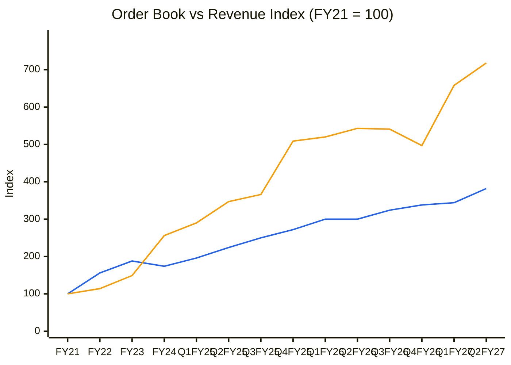
🟦 Revenue (TTM) · 🟧 Order book (disclosed points only; the x-axis mixes FY and quarter-ends where history is annual)

**Read:** Since FY21 the order book has grown 7.2× and TTM revenue 3.8×. The gap opened in FY24–FY25, paused through FY26 (book flat at ~₹5,000–5,500 Cr) and widened again in Q1–Q2 FY27.

**Business inference:** Demand has outrun TARIL's ability to execute. The binding constraint is plant (Changodar shut for expansion, Moraiya at ~60%) and raw-material availability, not orders. Revenue visibility is good, but the FY26 pause in the book (low Q4 FY26 inflow) shows order momentum can stall when the company is capacity-constrained, so FY28 growth depends on the delayed capacity actually arriving.

**OB-2 — Order book cover (years of TTM revenue)**

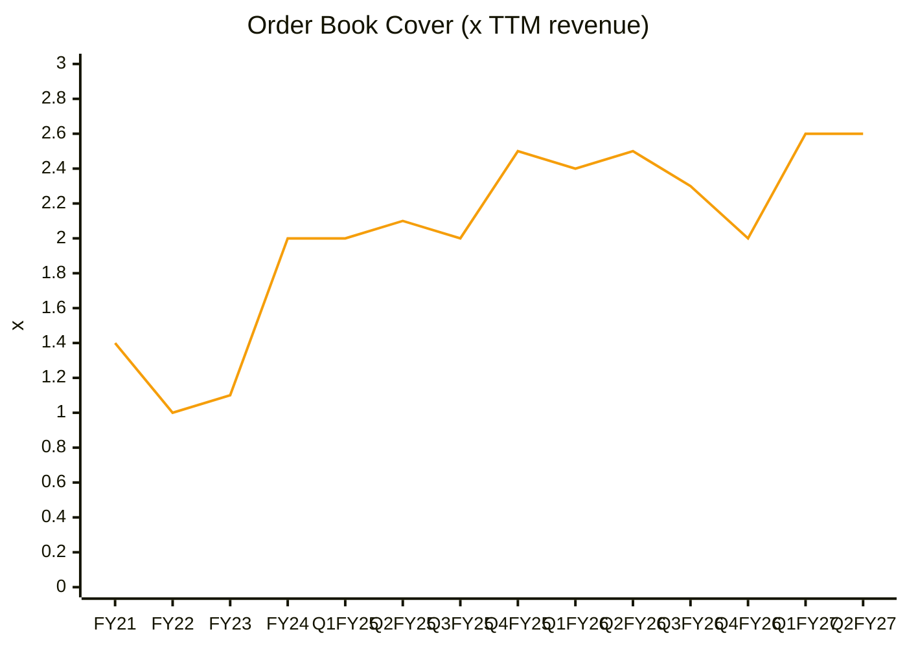
🟧 Order book / TTM revenue

**Read:** Cover doubled from ~1.0–1.4× (FY21–23) to 2.0–2.6× (FY24 onward), and is now at a high of 2.6×.

**Business inference:** 2.6× cover with an 18–24-month execution window (30 months for the PGCIL order) means the book can only be delivered if run-rate revenue rises to ~₹3,600–4,800 Cr a year, i.e. Changodar and Moraiya must ramp. Long-dated, fixed-price utility orders also carry commodity and LD risk if execution slips again. Cover above 2.5× is a WC and execution test as much as a visibility comfort.

**OB-3 — Aggregated announced orders vs revenue, by quarter (₹ Cr)**

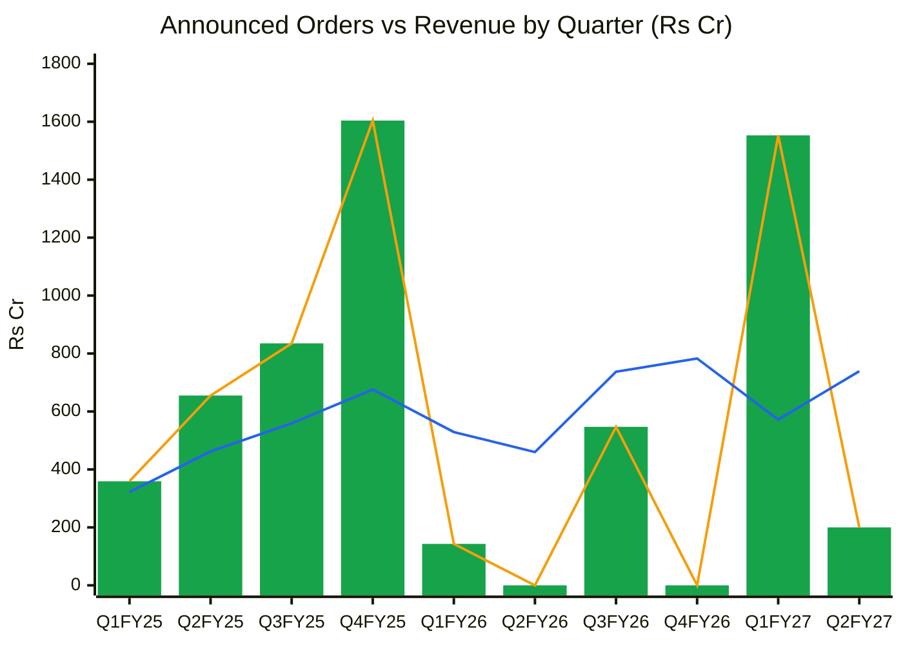
🟩 All announced orders (bars) · 🟧 Firm orders only (identical: no framework value) · 🟦 Revenue

**Read:** Announced orders are lumpy: four quarters above revenue (Q2–Q4 FY25, Q1 FY27) and four near zero. Q2 FY27's 200 is a lower bound after the switch to value bands. The book is 100% firm.

**Business inference:** Wins come in large utility tranches (PGCIL, GETCO), so the headline depends on a few awards. The PGCIL ≥₹1,000 Cr order alone was ~65% of Q1 FY27 announced value. The absence of framework value is a quality positive. The move to band-only disclosure in Jun-2026 *reduces* investor ability to track the book, which is a negative for a management already low on credibility.

**OB-4 — Implied order inflow (from disclosed order book) vs revenue (₹ Cr)**

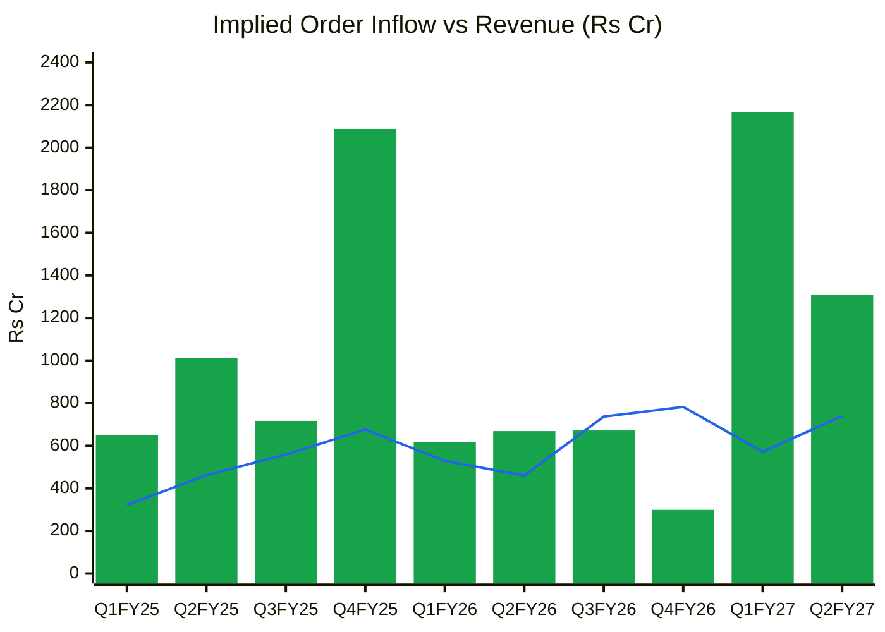
🟩 Implied inflow = ΔOB + order-linked revenue · 🟦 Revenue

**Read:** Implied quarterly book-to-bill: FY25 ~2.2× → FY26 ~0.9× (Q4 FY26 0.4×) → H1 FY27 ~2.6×. TTM book-to-bill is 1.57.

**Business inference:** Order momentum fell sharply in FY26 (inflow −47% YoY to ₹2,374 Cr). Management called this "strategically delaying new orders" while capacity was constrained. It recovered strongly in H1 FY27. The pattern says TARIL's intake is gated by what it can deliver, so the next 4–8 quarters of revenue depend more on capacity commissioning than on the inquiry pipeline (₹21,000 Cr, 10–15% historical win rate ≈ ₹2,100–3,150 Cr a year of wins, enough to keep book-to-bill above 1).

#### 5. Order Ledger — every announced order (source of truth; the next run appends here)

| order_id | date | customer | customer_type | segment | geography | value_cr | currency | value_fc | firmness | tenor_months | linked_to | source | notes |
|---|---|---|---|---|---|---|---|---|---|---|---|---|---|
| TAR-2304-01 | 2023-04-13 | Central utility (unnamed) | PSU | Power transformers | Domestic | 192 | INR |  | Firm |  |  | [BSE](https://www.bseindia.com/xml-data/corpfiling/AttachHis/c6287390-0321-4fce-a3e1-ed71be46f784.pdf) | OB as on date Rs1691 Cr |
| TAR-2304-02 | 2023-04-17 | Central utility (unnamed) | PSU | Power transformers | Domestic | 131 | INR |  | Firm |  |  | [BSE](https://www.bseindia.com/xml-data/corpfiling/AttachHis/60b7383d-9d47-42ee-a7f3-8b0b32b3d38a.pdf) | OB as on date Rs1822 Cr |
| TAR-2307-01 | 2023-07-26 | PGCIL | PSU | Power transformers | Domestic | 134 | INR |  | Firm |  |  | [BSE](https://www.bseindia.com/xml-data/corpfiling/AttachHis/2d663e4b-9f75-40e4-84a7-7979be4df8be.pdf) | 6x500 MVA 400/220/33kV; OB Rs1955 Cr |
| TAR-2312-01 | 2023-12-19 | UPPTCL | Govt | Power transformers | Domestic | 118 | INR |  | Firm |  |  | [BSE](https://www.bseindia.com/xml-data/corpfiling/AttachHis/f283f4bd-fba9-4a78-ba94-0ef37ca2ba73.pdf) | 5x500 MVA 400/220/33kV |
| TAR-2312-02 | 2023-12-19 | PGCIL | PSU | Reactors | Domestic | 237 | INR |  | Firm |  |  | [BSE](https://www.bseindia.com/xml-data/corpfiling/AttachHis/12aac137-74d0-4ad4-adbd-9c2d40a1f073.pdf) | 765kV 1-ph reactors |
| TAR-2312-03 | 2023-12-20 | PGCIL | PSU | Reactors | Domestic | 219 | INR |  | Firm |  |  | [BSE](https://www.bseindia.com/xml-data/corpfiling/AttachHis/5db2f83a-b787-4f65-9059-e072e954eb1d.pdf) | 765kV/420kV reactors |
| TAR-2402-01 | 2024-02-24 | PGCIL | PSU | Power transformers | Domestic | 232 | INR |  | Firm |  |  | [BSE](https://www.bseindia.com/xml-data/corpfiling/AttachHis/40416549-32c5-4d1c-a416-d9757f5bbadb.pdf) | 500 MVA 400/220/33kV ICTs |
| TAR-2405-01 | 2024-05-23 | AL Anwaar International | Export | Power transformers | Export | 161 | INR |  | Firm | 9 |  | [BSE](https://www.bseindia.com/xml-data/corpfiling/AttachHis/9a98bd68-ebc5-4bf5-b0c9-9792a4605629.pdf) | complete by Feb-2025 |
| TAR-2405-02 | 2024-05-23 | Adani Group | Private | Power transformers | Domestic | 179 | INR |  | Firm |  |  | [BSE](https://www.bseindia.com/xml-data/corpfiling/AttachHis/9a98bd68-ebc5-4bf5-b0c9-9792a4605629.pdf) |  |
| TAR-2405-03 | 2024-05-23 | L&T Group | Private | Power transformers | Domestic | 19 | INR |  | Firm |  |  | [BSE](https://www.bseindia.com/xml-data/corpfiling/AttachHis/9a98bd68-ebc5-4bf5-b0c9-9792a4605629.pdf) |  |
| TAR-2407-01 | 2024-07-01 | NCC Limited | Private | Power transformers | Domestic | 72.5 | INR |  | Firm | 18 |  | [BSE](https://www.bseindia.com/xml-data/corpfiling/AttachHis/a6bb4c5e-8454-4bbe-9116-ed5643fdd36b.pdf) | EPC; complete by Jan-2026 |
| TAR-2407-02 | 2024-07-01 | PGCIL | PSU | Power transformers | Domestic | 55.91 | INR |  | Firm | 21 |  | [BSE](https://www.bseindia.com/xml-data/corpfiling/AttachHis/a6bb4c5e-8454-4bbe-9116-ed5643fdd36b.pdf) |  |
| TAR-2407-03 | 2024-07-01 | Adani Energy Solutions (RTM Rajasthan) | Private | Power transformers | Domestic | 20.14 | INR |  | Firm |  |  | [BSE](https://www.bseindia.com/xml-data/corpfiling/AttachHis/a6bb4c5e-8454-4bbe-9116-ed5643fdd36b.pdf) |  |
| TAR-2408-01 | 2024-08-22 | Linxon Global Sweden | Export | Traction transformers | Export | 117 | USD | 14.0 | Firm |  |  | [BSE](https://www.bseindia.com/xml-data/corpfiling/AttachHis/4d0c3054-6f39-4719-bc1b-0708d996ec20.pdf) | INR not stated: converted at ~83.9 (estimate); amended 28-Aug-2024 |
| TAR-2408-02 | 2024-08-22 | ArcelorMittal Mexico | Export | Furnace transformers | Export | 23 | USD | 2.8 | Firm |  |  | [BSE](https://www.bseindia.com/xml-data/corpfiling/AttachHis/4d0c3054-6f39-4719-bc1b-0708d996ec20.pdf) | INR not stated: converted at ~83.9 (estimate) |
| TAR-2408-03 | 2024-08-28 | Linxon Global Sweden (amendment) | Export | Traction transformers | Export | 117 | USD | 14.0 | Firm |  | TAR-2408-01 | [BSE](https://www.bseindia.com/xml-data/corpfiling/AttachHis/c9f98e26-e049-4246-9f71-ad058fef3847.pdf) | amendment of same order: not new inflow |
| TAR-2408-04 | 2024-08-30 | SPIL | Private | Power transformers | Domestic | 91 | INR |  | Firm | 12 |  | [BSE](https://www.bseindia.com/xml-data/corpfiling/AttachHis/5125b5ce-5740-46bf-9b5c-2bf712ab5598.pdf) |  |
| TAR-2408-05 | 2024-08-30 | KEPIPL | Private | Power transformers & reactors | Domestic | 70 | INR |  | Firm |  |  | [BSE](https://www.bseindia.com/xml-data/corpfiling/AttachHis/5125b5ce-5740-46bf-9b5c-2bf712ab5598.pdf) | EPC |
| TAR-2408-06 | 2024-08-30 | JSPL | Private | Power transformers | Domestic | 91 | INR |  | Firm | 12 |  | [BSE](https://www.bseindia.com/xml-data/corpfiling/AttachHis/5125b5ce-5740-46bf-9b5c-2bf712ab5598.pdf) |  |
| TAR-2409-01 | 2024-09-13 | RRVPNL | Govt | Power transformers | Domestic | 114 | INR |  | Firm | 12 |  | [BSE](https://www.bseindia.com/xml-data/corpfiling/AttachHis/93eb118c-6906-46fa-a8e4-0ba35a9be4a7.pdf) | 50 MVA 132/33kV |
| TAR-2410-01 | 2024-10-03 | PGCIL | PSU | Power transformers & reactors | Domestic | 565 | INR |  | Firm |  |  | [BSE](https://www.bseindia.com/xml-data/corpfiling/AttachHis/97a4d3ba-3b3d-4627-91be-52930fbb0e65.pdf) | 420-765kV |
| TAR-2410-02 | 2024-10-29 | Siemens Ltd | Private | Power transformers | Domestic | 117.03 | INR |  | Firm | 12 |  | [BSE](https://www.bseindia.com/xml-data/corpfiling/AttachHis/ca2eda00-ae72-4973-a4ea-efa32d5b2e7f.pdf) |  |
| TAR-2410-03 | 2024-10-29 | Adani Energy Solutions | Private | Reactors | Domestic | 102.78 | INR |  | Firm | 12 |  | [BSE](https://www.bseindia.com/xml-data/corpfiling/AttachHis/ca2eda00-ae72-4973-a4ea-efa32d5b2e7f.pdf) |  |
| TAR-2410-04 | 2024-10-29 | AMNS India | Private | Power transformers | Domestic | 6 | INR |  | Firm | 12 |  | [BSE](https://www.bseindia.com/xml-data/corpfiling/AttachHis/ca2eda00-ae72-4973-a4ea-efa32d5b2e7f.pdf) |  |
| TAR-2410-05 | 2024-10-29 | Jindal Group | Private | Power transformers | Domestic | 44.4 | INR |  | Firm | 12 |  | [BSE](https://www.bseindia.com/xml-data/corpfiling/AttachHis/ca2eda00-ae72-4973-a4ea-efa32d5b2e7f.pdf) |  |
| TAR-2501-01 | 2025-01-28 | PGCIL/MEIL/KEC/Avaada/Torrent/RRVPNL (bundle) | Unspecified | Power transformers | Domestic | 362 | INR |  | Firm | 12 |  | [BSE](https://www.bseindia.com/xml-data/corpfiling/AttachHis/f07c33d1-c902-4854-ae51-338fb92b64a8.pdf) | mixed PSU+state+private; split not disclosed |
| TAR-2502-01 | 2025-02-18 | Hyosung T&D India | Private | Coupling transformers | Domestic | 166.45 | INR |  | Firm | 12 |  | [BSE](https://www.bseindia.com/xml-data/corpfiling/AttachHis/85bdc2c8-ad79-4b46-8ded-93179c14cfdc.pdf) |  |
| TAR-2503-01 | 2025-03-03 | Adani Group | Private | Power transformers | Domestic | 272 | INR |  | Firm |  |  | [BSE](https://www.bseindia.com/xml-data/corpfiling/AttachHis/fe13129f-d05d-482f-9c8e-acd18c08b9fd.pdf) | inclusive of GST |
| TAR-2503-02 | 2025-03-03 | Al Sabha Group Iraq & Powerlink | Export | Power transformers | Export | 78 | INR |  | Firm |  |  | [BSE](https://www.bseindia.com/xml-data/corpfiling/AttachHis/fe13129f-d05d-482f-9c8e-acd18c08b9fd.pdf) |  |
| TAR-2503-03 | 2025-03-17 | GETCO | Govt | Auto transformers & bus reactors | Domestic | 726 | INR |  | Firm |  |  | [BSE](https://www.bseindia.com/xml-data/corpfiling/AttachHis/9ce2e653-2099-48ca-97de-47bc3d4f66e3.pdf) | inclusive of GST |
| TAR-2506-01 | 2025-06-20 | Jindal Energy Botswana | Export | Power transformers | Export | 143 | USD | 16.65 | Firm | 12 |  | [BSE](https://www.bseindia.com/xml-data/corpfiling/AttachHis/51fa20b8-8e8e-4cbc-bb8f-951cdd68ea8d.pdf) | INR not stated: converted at ~85.9 (estimate) |
| TAR-2511-01 | 2025-11-10 | GETCO | Govt | Power transformers | Domestic | 103.45 | INR |  | Firm | 12 |  | [BSE](https://www.bseindia.com/xml-data/corpfiling/AttachHis/cd3e8834-f3f9-47e2-80fd-7ff0b3286a85.pdf) | 54 transformers |
| TAR-2511-02 | 2025-11-25 | GETCO | Govt | Power transformers | Domestic | 389.97 | INR |  | Firm | 12 |  | [BSE](https://www.bseindia.com/xml-data/corpfiling/AttachHis/ae7abdc8-2a88-4ebe-9685-1f9209f4c70d.pdf) | 53 transformers |
| TAR-2512-01 | 2025-12-04 | PGCIL | PSU | HVDC repair | Domestic | 53.33 | INR |  | Firm |  |  | [BSE](https://www.bseindia.com/xml-data/corpfiling/AttachHis/dffeca72-86b6-4d96-8b2c-53f60fe6948f.pdf) | repair of 397 MVA HVDC converter transformer |
| TAR-2604-01 | 2026-04-27 | PDC AK LPIV LLC (USA) | Export | Power transformers | Export | 150 | USD | 16.26 | Firm | 14 |  | [BSE](https://www.bseindia.com/xml-data/corpfiling/AttachHis/325fe8ca-af41-4bd8-8d57-6d947c1a1bae.pdf) | filing: approx Rs150 Cr; delivery mid-2027 |
| TAR-2605-01 | 2026-05-19 | Bhanwariya Infra (RRVPNL GSS) | Private | Transformers & reactors | Domestic | 175 | INR |  | Firm |  |  | [BSE](https://www.bseindia.com/xml-data/corpfiling/AttachHis/4831aa9a-387c-44ae-8efa-64a235946c69.pdf) | EPC for state utility |
| TAR-2605-02 | 2026-05-22 | GETCO | Govt | Transformers & reactors | Domestic | 228.26 | INR |  | Firm | 27 |  | [BSE](https://www.bseindia.com/xml-data/corpfiling/AttachHis/79392d75-b360-4f2e-9889-ac64e3b13abf.pdf) | delivery by Aug-2028 |
| TAR-2606-01 | 2026-06-30 | PGCIL | PSU | Power transformers | Domestic | 1000 | INR |  | Firm | 30 |  | [BSE](https://www.bseindia.com/xml-data/corpfiling/AttachHis/c843ec5d-d9a5-449e-854d-2b7b25363088.pdf) | Ultra-Mega band (>=Rs1000 Cr); exact value not disclosed: lower bound used |
| TAR-2608-01 | 2026-08-14 | APTRANSCO | Govt | Power transformers | Domestic | 100 | INR |  | LoI | 13 |  | [BSE](https://www.bseindia.com/xml-data/corpfiling/AttachHis/a2c714d0-f9e0-452f-b672-1283f85f4b7e.pdf) | Large band Rs100-500 Cr: lower bound used |
| TAR-2608-02 | 2026-08-29 | MEIL | Private | Power transformers | Domestic | 100 | INR |  | Firm | 35 |  | [BSE](https://www.bseindia.com/xml-data/corpfiling/AttachHis/55f39e11-909e-443f-80d4-192a3cc05ee0.pdf) | Large band Rs100-500 Cr: lower bound used |
| TAR-2610-01 | 2026-10-02 | GETCO | Govt | Reactors & auto transformers | Domestic | 100 | INR |  | Firm | 30 |  | [BSE](https://www.bseindia.com/xml-data/corpfiling/AttachHis/8aeb5ca4-e97c-4064-84b7-a43ce7ce47eb.pdf) | Large band Rs100-500 Cr (LoA): lower bound used |
| TAR-2610-02 | 2026-10-02 | Damodar Valley Corporation | PSU | Auto transformers | Domestic | 100 | INR |  | Firm | 28 |  | [BSE](https://www.bseindia.com/xml-data/corpfiling/AttachHis/88cd1f97-a270-4839-bf8b-748bf66f1609.pdf) | Large band Rs100-500 Cr (PO): lower bound used |

#### 6. Order Book Snapshots — revenue and disclosed order book per period

| period | revenue_cr | revenue_ttm_cr | order_book_cr | order_linked_share | as_of_date | source |
|---|---|---|---|---|---|---|
| FY21 | 742 | 742 | 1008 | 0.95 |  | Screener consolidated; OB FY24 investor presentation |
| FY22 | 1158 | 1158 | 1148 | 0.95 |  | Screener; OB Q1FY27 presentation |
| FY23 | 1396 | 1396 | 1499 | 0.95 |  | Screener; OB Q1FY27 presentation |
| FY24 | 1291 | 1291 | 2582 | 0.95 |  | Screener; OB Q1FY27 presentation |
| Q1FY25 | 322 | 1457 | 2926 | 0.95 |  | Screener; OB Q1FY25 presentation |
| Q2FY25 | 462 | 1662 | 3500 | 0.95 |  | Screener; OB Q2FY25 presentation |
| Q3FY25 | 559 | 1852 | 3686 | 0.95 |  | Screener; OB Q3FY25 presentation |
| Q4FY25 | 676 | 2019 | 5132 | 0.95 |  | Screener; OB FY25 presentation |
| Q1FY26 | 529 | 2226 | 5246 | 0.95 |  | Screener; OB Q1FY26 presentation |
| Q2FY26 | 460 | 2224 | 5478 | 0.95 |  | Screener; OB Q2FY26 presentation |
| Q3FY26 | 737 | 2402 | 5450 | 0.95 |  | Screener; OB Q3FY26 presentation |
| Q4FY26 | 783 | 2509 | 5005 | 0.95 |  | Q1FY27 PPT; OB FY26 presentation |
| Q1FY27 | 572 | 2552 | 6630 | 0.95 |  | Q1FY27 results; OB Q1FY27 presentation |
| Q2FY27 | 739 | 2831 | 7237 | 0.95 |  | Q2FY27 results 13-Oct-2026; OB Q2FY27 press release |

*Every number above traces to the ledger / snapshot rows (source column).*

**Order-book verdict:** Firm visibility ~2.6 years at TTM revenue (100% firm, no framework value) · Book-to-bill (TTM) 1.57 · Framework share 0% · Top-3 concentration 22% · Execution rate: **Falling** (FY25 0.78 → FY26 0.49; should recover to ~0.6 in FY27 as Changodar returns). Book-to-bill is above peers' typical 1.1–1.3, but the conversion rate is the weakest link.
**Forward link (Module 11):** Revenue FY28E ≈ opening OB ~₹6,900 Cr × 0.50 + in-year inflow ~₹5,000 Cr × ~6% burn ≈ ₹3,750 Cr → base ₹3,700 Cr (capacity-checked: ~50,000 MVA × ₹7.3 lakh + subsidiaries).

---

## Module 8 — Market Size & Market Share

**TAM (estimate):** India transformer demand ~4.5 lakh MVA/yr (TARIL MD's estimate, [T&D India](https://www.tndindia.com/?p=39722); not independently verified) × ~₹7 lakh/MVA (TARIL's own realisation as a proxy) ≈ **₹30,000–32,000 Cr/yr**, growing ~8.3% CAGR (IMARC, cited in the Q1 FY27 presentation). Exports (US/EU shortage) are additive and outside this TAM.
**Company penetration:** standalone FY26 revenue ₹2,395 Cr ÷ ~₹31,000 Cr ≈ **7.7%**. By volume, 33,763 MVA ÷ 4.5 lakh MVA ≈ 7.5%.
**Market share trend:** proxy share of CEA 220 kV+ additions: FY24 23% → FY25 34% → FY26 30%. Production growth (+106% FY24–26) vs grid additions (+60%) means **gaining**, but FY26 shows share slipping as competitors' capacity arrives and TARIL's plants were down for expansion.
**Share gain driver:** **Temporary/cyclical.** Restart of idle capacity into a shortage, plus 765 kV qualification. It is not a cost or technology edge (Module 3).
**Revenue growth vs market:** TARIL FY24–26 revenue CAGR 39% vs grid additions CAGR 26% (CEA, FY24–26) and industry value ~8–10% → share gain in a growing market. **Verdict: taking share in the upcycle; sustainability unproven.**

---

## Module 9 — Valuation: PIE First, Then DCF

**Inputs:** CMP ₹304 · Market cap ₹9,125 Cr · Borrowings ₹574 Cr (Sep-2026) − cash, bank balances and current investments ₹225 Cr → net debt ~₹349 Cr · NCI ₹33 Cr · **EV ≈ ₹9,500 Cr** · TTM revenue ₹2,831 Cr · TTM EBITDA (ex-OI) ₹465 Cr · TTM EBIT (incl. OI) ₹481 Cr · NOPAT ₹358 Cr · TTM EPS ₹10.14 (owners' PAT ₹304.4 Cr) · BVPS ₹55.1 (Sep-2026).
**Multiples:** P/E 30.0× TTM · EV/EBITDA 20.4× · P/B 5.5× · EV/sales 3.4×.

### 9A. Price-Implied Expectations (Mauboussin)

Quick approximation: g = (EV × WACC − NOPAT)/(EV + NOPAT) = (9,500 × 0.135 − 358)/(9,500 + 358) = **9.4% perpetual NOPAT growth**, with no fade, for a business whose 10-yr average ROCE equals its cost of capital.

Two-stage reverse DCF (7-yr explicit, terminal growth 6%, NWC 30–35% of incremental revenue, capex 3% of revenue, D&A 2%):

| PIE value driver | Market-implied | My base case | Expectations gap |
|---|---|---|---|
| Revenue CAGR FY26-TTM → FY33 | **31% @ WACC 13.5%** (23% @ 12%), i.e. FY33 revenue ~₹12,000–19,000 Cr | 12.5% (₹2,831 → ₹6,250 Cr FY33) | **Optimistic gap: −10 to −18pp** |
| EBITDA margin (steady state) | 16.5% held | 15% normalised (16.5% FY28–29, fading) | −1.5pp |
| Investment rate (capex + ΔWC) / Δrevenue | ~45% | ~50% (WC 36% + capex) | Higher reinvestment than priced |

**Gap classification: OPTIMISTIC.** The market is pricing more than the physical plant can produce.
**Expectations treadmill:** to beat the PIE, TARIL must reach ₹8,000 Cr revenue (management's FY29 target) by ~FY30 *and* keep 16%+ margins *and* cut NWC to ~120 days. That would need a third expansion beyond the ~77,000 MVA now planned.
**Positive triggers:** (1) Changodar commissioned on time (Nov-2026) with Q4 FY27 revenue ≥ ₹950 Cr; (2) FY27 CFO ≥ ₹250 Cr; (3) HVDC empanelment by PGCIL (~15–16 months, Q1 FY27 call).
**Negative triggers:** (1) another commissioning slip or FY27 guidance cut; (2) FY27 inflow growth stalling as tender waves pause (CEA FY27 target running at 23% after 4 months); (3) unfavourable World Bank decision or CRGO anti-dumping duty without pass-through.
**SVAR:** bear value ₹150 → (304 − 150)/304 = **51% (> 40%: unfavourable asymmetry)**.
**Physical plausibility:** PIE CAGR (23–31%) > capacity-model CAGR (~16% FY26–FY29, then ceiling) → **"Unannounced expansion pricing."** Of the three explanations, (b) "management announces new capex" is the most likely. Management says "our immediate priority is not adding further transformer manufacturing capacity" (Q1 FY27 call), so the market is not pricing what management currently plans.

### 9B. Intrinsic value — own models

**DCF (3-stage, revenue anchored to order book and capacity, normalised margins, WC 30% of Δrevenue, WACC 12% / 13.5%):**
| Scenario | Revenue path FY27→FY33 (₹ Cr) | EBITDA margin path | Value/share @12% | @13.5% |
|---|---|---|---|---|
| Bear | 3,000 → 4,500 | 15% → 12% | ₹86 | ₹62 |
| Base | 3,150 → 6,250 | 16–16.5% → 15% | **₹158** | ₹115 |
| Bull | 3,250 → 7,700 | 17–18.5% → 17% | ₹229 | ₹167 |
*Calculation in scratchpad (pie.py). Even the bull DCF (₹229) is below CMP. The stock is held up by a P/E multiple, not by discounted cash flows, because working-capital absorption consumes most NOPAT during growth.*

**Relative (FY29E EPS × target P/E; the scenario valuation used for C13 and the verdict):**
| Scenario | FY29E revenue | EBITDA margin | FY29E EPS | P/E | Target (~FY28-end) | Probability |
|---|---|---|---|---|---|---|
| Bear | ₹3,700 Cr | 13.0% | ₹8.3 | 18× (cycle-down multiple; TARIL FY23 18.5×) | **₹150** | 25% |
| Base | ₹4,400 Cr | 16.5% | ₹15.0 | 27× (~15–20% discount to Voltamp/Indo Tech/Shilchar 33–34×) | **₹404** | 50% |
| Bull | ₹5,300 Cr | 18.5% | ₹21.2 | 32× (peer parity) | **₹678** | 25% |
| **Expected value** | | | | | **₹409 (+35%)** | |

**Residual income / EPV cross-check (Klarman):** normalised EBIT (13.5% margin × ₹2,831 Cr + OI ₹40 Cr = ₹422 Cr) × (1 − 25.5%) = ₹314 Cr NOPAT ÷ 13.5% = EPV ₹2,330 Cr − net debt ₹349 Cr → **₹66/share**. CMP is 4.6× no-growth value: ~78% of the price is a growth premium, and growth at ~11% incremental ROIC (Module 11) is roughly value-neutral.
**Graham Number:** √(22.5 × 5-yr avg EPS ₹3.94 × BVPS ₹55.1) = **₹70**. Graham screen 2/7 (revenue > ₹2,000 Cr ✅, P/B ≤ 3 ❌, P/E ≤ 20 ❌, current ratio ≥ 2 ❌, 7 years of positive EPS ❌ (FY15–16 losses), dividend record ❌, EPS growth ✅).

| Method | Bear | Base | Bull |
|---|---|---|---|
| DCF (12%) | ₹86 | ₹158 | ₹229 |
| Relative (FY29E × P/E, ~2.5 yrs out) | ₹150 | ₹404 | ₹678 |
| Relative, discounted to today @ Ke 14% (÷1.39) | ₹108 | ₹291 | ₹488 |
| EPV (Klarman) | ₹66 | — | — |
| **Consensus range (today's value)** | **₹90–110** | **₹160–290** | **₹230–490** |

**Current market price:** ₹304.
**Margin of safety (base, today's value ₹160–290):** **−5% to −90% → INADEQUATE** (required 30–40% for a mid-cap with governance and credibility issues, +5pp late cycle).
**Upside/downside (bull vs bear, FY29 targets):** (678 − 304) ÷ (304 − 150) = **2.4:1 → passes the 1.5:1 hard stop**, but the base-case return is only ~12%/yr before discounting.
**Reverse DCF implied growth:** 23–31% for 7 years → **AGGRESSIVE.**
**Misprice reason:** none in our favour. If anything the stock is priced for management's aspirational path. The −51% fall from the Jan-2025 peak (₹620) has reset the multiple from bubble (127× FY24 P/E) to sector-normal, not to cheap.
**Catalysts:** Changodar commissioning (Nov-2026), Q3–Q4 FY27 execution and cash flow, FY28 guidance (Q4 FY27 call), HVDC empanelment (~CY2027).

### CY1 — P/E band (March year-end price ÷ FY EPS)

| | FY17 | FY18 | FY19 | FY20 | FY21 | FY22 | FY23 | FY24 | FY25 | FY26 | Now |
|---|---|---|---|---|---|---|---|---|---|---|---|
| Price (₹, adj.) | 20.3 | 13.4 | 6.6 | 2.7 | 8.3 | 16.5 | 28.5 | 197.8 | 536.2 | 272.2 | 304 |
| EPS (₹) | 0.88 | 0.20 | 0.17 | 0.02 | 0.27 | 0.53 | 1.54 | 1.56 | 7.14 | 8.81 | 10.14 TTM |
| P/E (×) | 23.1 | 67.1 | 39.0 | 132.5 | 30.7 | 31.1 | 18.5 | 126.8 | 75.1 | 30.9 | **30.0** |

*Prices: Screener.in weekly chart data (bonus-adjusted); EPS: Screener.in consolidated. Bands are log-based (the arithmetic SD of 40× is meaningless on a series with near-zero EPS years): median 34.8×, +1SD 88.7×, −1SD 23.8×.*

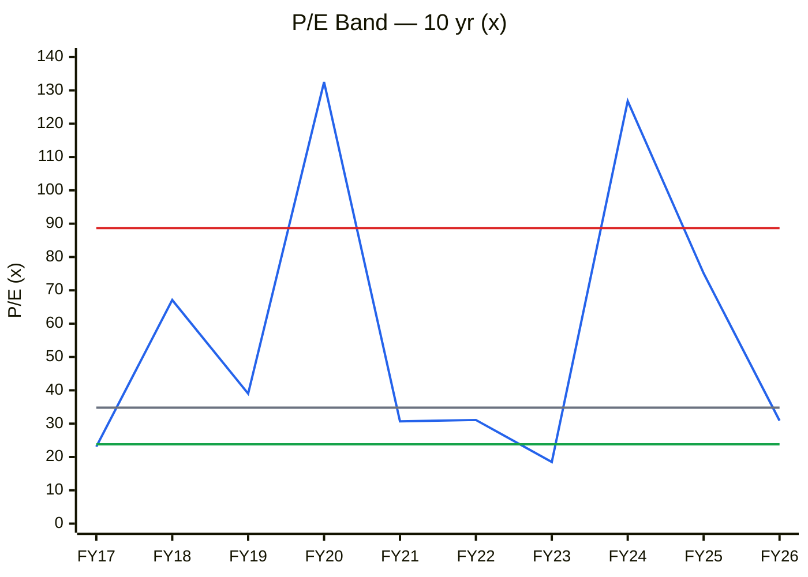
🟦 P/E · ⬜ Median 34.8× · 🟥 +1SD 88.7× · 🟩 −1SD 23.8×

**Read:** Current P/E is 30.0× TTM (30.9× FY26), at the **20th percentile** of its 10-yr range and below the 34.8× median.

**Business inference:** This is the cyclical-P/E trap. A below-median P/E sits on **peak** earnings (margin +2.0 SD, Module 1c). The old high P/Es were on near-zero trough EPS. On normalised (13%) margins, EPS would be ~₹7, making the "real" P/E ~43×. The low P/E is not a bargain signal for a capital-goods cyclical.

### CY2 — P/B band, with ROE beneath

| | FY17 | FY18 | FY19 | FY20 | FY21 | FY22 | FY23 | FY24 | FY25 | FY26 | Now |
|---|---|---|---|---|---|---|---|---|---|---|---|
| BVPS (₹, adj.) | 12.3 | 12.4 | 12.6 | 12.7 | 12.9 | 13.4 | 14.9 | 19.4 | 41.7 | 50.5 | 55.1 |
| P/B (×) | 1.66 | 1.08 | 0.52 | 0.21 | 0.64 | 1.23 | 1.91 | 10.18 | 12.86 | 5.39 | **5.52** |
| ROE % | 7.4 | 1.8 | 1.5 | 0.3 | 2.4 | 4.0 | 11.2 | 9.9 | 23.9 | 19.7 | ~19 |

*BVPS = (equity + reserves) ÷ adjusted shares (26.5 Cr pre-FY24, 28.5 Cr FY24, 30.02 Cr from FY25). Log bands: median 1.43×, +1SD 5.97×, −1SD 0.49×.*

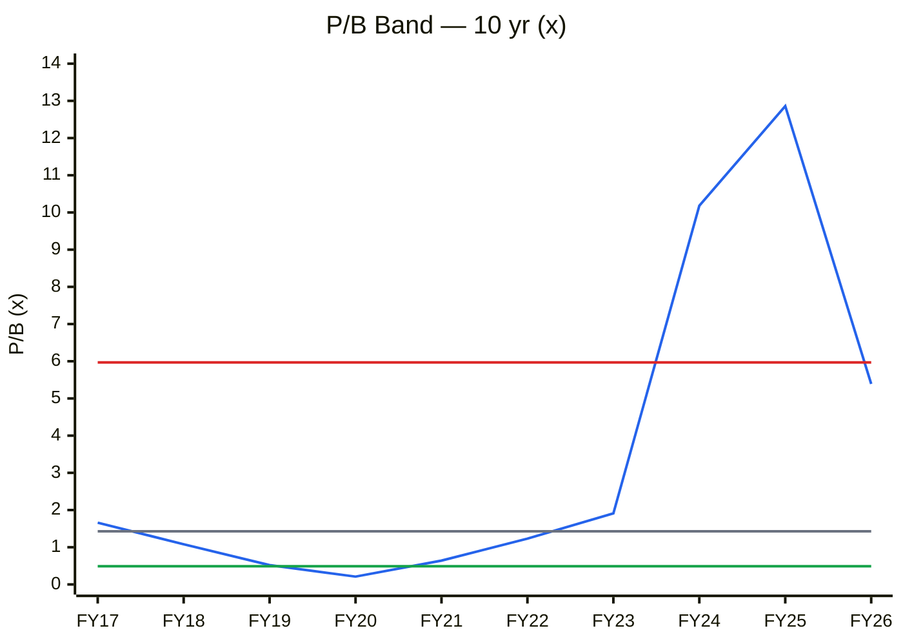
🟦 P/B · ⬜ Median 1.43× · 🟥 +1SD 5.97× · 🟩 −1SD 0.49×

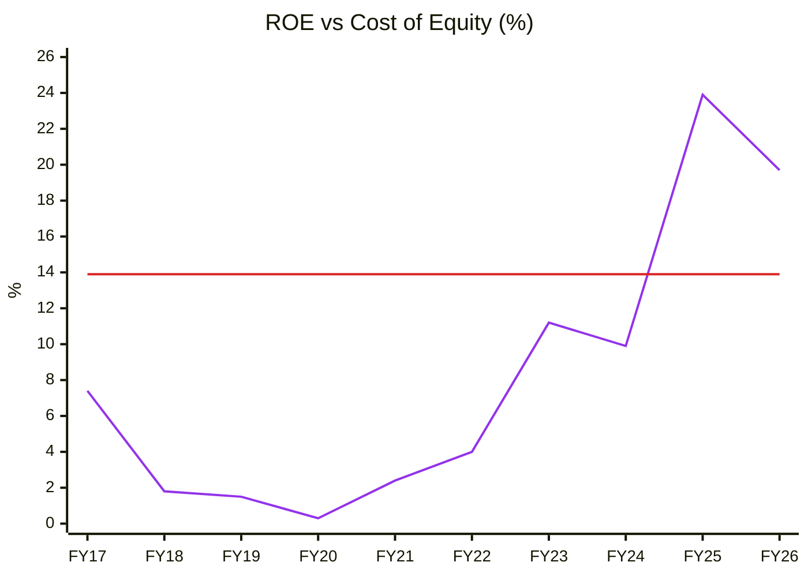
🟪 ROE · 🟥 Cost of equity 13.9%

**Read:** P/B is 5.5×, at the **80th percentile**, just under +1SD. ROE has exceeded the 13.9% cost of equity in only two of ten years (FY25–26). The 10-yr average ROE is ~8%.

**Business inference:** Justified P/B = (ROE − g)/(Ke − g). At a through-cycle ROE of 15% and g 8%, that is (15−8)/(13.9−8) ≈ 1.2×. At today's 19.7% it is ~2.0×. Even at peak ROE, 5.5× book requires ROE to stay ~30%+ for years. Book value is the honest cycle gauge here, and it says **expensive**.

### CY4 — Price vs EPS index (FY17 = 100)

| | FY17 | FY18 | FY19 | FY20 | FY21 | FY22 | FY23 | FY24 | FY25 | FY26 |
|---|---|---|---|---|---|---|---|---|---|---|
| Price index | 100 | 66 | 33 | 13 | 41 | 81 | 140 | 974 | 2,639 | 1,339 |
| EPS index | 100 | 23 | 19 | 2 | 31 | 60 | 175 | 177 | 811 | 1,001 |

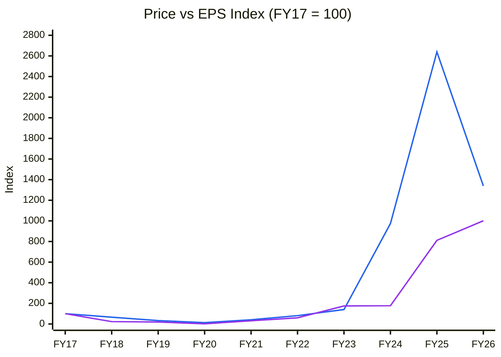
🟦 Price index · 🟪 EPS index (now: price 1,496 vs TTM EPS 1,152)

**Read:** In FY24–25 the price ran 3–5× ahead of earnings (a re-rating bubble). The FY26 crash brought the lines close again (price 1,339 vs EPS 1,001). Today they are 1,496 vs 1,152.

**Business inference:** The re-rating excess has largely unwound, so from here returns must come from EPS growth. EPS growth is cyclical and capacity-gated. The stock is no longer a bubble, but it is not discounting a downturn either: price and EPS are both at peak-cycle levels.

### C13 — Scenario targets vs CMP

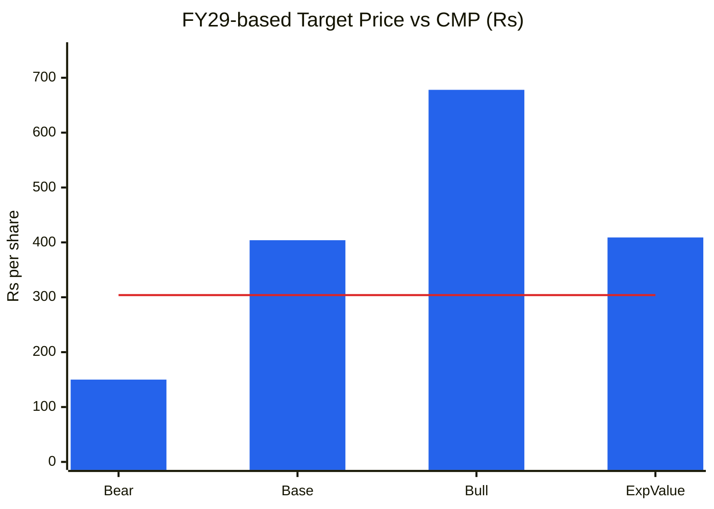
🟦 Scenario price (~FY28-end, FY29E EPS × P/E) · 🟥 CMP ₹304

**Read:** Bear −51%, base +33%, bull +123%. Expected value ₹409 (+35% over ~2.5 years, ~13% a year). U/D 2.4:1. Discounted to today, the base is ₹291 (below CMP).

**Business inference:** The payoff is positive only if the capacity ramp and margins both deliver on schedule, which is exactly what this management has repeatedly failed to do. ~13% a year expected return is below the ~14% cost of equity, so there is no margin of safety at ₹304.

### Cycle Position Dashboard

| Dimension | Current | 10-yr median | Percentile | Signal |
|---|---|---|---|---|
| P/E | 30.0× | 34.8× | 20% | Fair-looking, but on peak EPS (trap) |
| P/B | 5.5× | 1.4× | 80% | **Expensive** |
| EBITDA margin | 16.4% | 9.2% | 100% | **Peak** (+2.0 SD) |
| ROCE | 23% | 12.5% | 90% | **Peak** (+1.4 SD) |
| Industry utilisation | Shortage (lead times 18–30 months; Rystad: easing within 12 months) | — | — | Tight → easing |
| Spread / realisation | ₹7.1 lakh/MVA (−9% vs FY24) | — | — | Mixed; data gap |
| Industry capex/depreciation | TARIL ~4–11×; peers expanding | — | — | **Flooding** |
| **Overall cycle position** | | | | **LATE** |

Consistent with Module 1b (tailwind, late on supply) and Module 1c (late-cycle margins). ✅

---

## Module 10 — Technical Stage (Weinstein + CANSLIM)

**Nifty 50: Stage 4 / late Stage 4.** 22,520, below a falling 30-week MA (~23,700) and the 200-DMA, −14.5% from the high (Module 1 sources).
**Sector (capital goods / power T&D):** mixed. The MNC T&D names hold near highs (GE T&D ₹4,180 vs ₹5,650 high; Hitachi ₹30,216 vs ₹38,800), while small transformer names have de-rated (Shilchar −13% over 1 yr). Classified **Stage 3** (topping) on secondary evidence. No sector-index chart was pulled (data gap).
**Stock (weekly, Screener price data):**

| Item | Value |
|---|---|
| Weekly close (13-Oct-2026) | ₹304 |
| All-time high (weekly close) | ₹619.6 (3-Jan-2025), −51% |
| 52-wk high / low (weekly closes) | ₹481 (24-Oct-2025) / ₹232.5 (23-Jan-2026) |
| 30-week SMA now / 4 wks ago / 10 / 20 wks ago | 307.2 / 307.7 / 300.8 / 292.9 |
| Base | ₹270–360 since Feb-2026 (~36 weeks); highest weekly close ₹357.6 (19-Jun-2026) |
| RS vs Nifty (1 yr) | Stock −40% vs Nifty ~−12% → **negative**, improving off the Jan-2026 low |

**Stage: STAGE 1 (basing).** After a Stage-4 decline (₹620 → ₹232), price has moved sideways for ~8 months. The 30-week MA has gone **flat** (−0.2% over 4 weeks after rising from 293), and price sits at the MA. This is not Stage 4 (MA not declining) and not Stage 2 (no breakout above ₹358–360 on volume).
**Stop-loss (if held):** weekly close below ₹270 (base floor), hard stop below ₹232 (52-wk low).
**Pivot for Stage 2:** weekly close > **₹360** on volume ≥ 1.5–2× the 20-week average (~1.34 cr shares/week; data from Screener chart API, verify).

**CANSLIM: 2 / 7**
| C | A | N | S | L | I | M |
|---|---|---|---|---|---|---|
| 1 (Q2 EPS +135% YoY) | 1 (3-yr EPS 1.54 → 8.81; ROE 19.7%) | 0 (new capacity, but not near a high) | 0 (float 35.6%; no up-volume dominance verified) | 0 (RS negative) | 0 (FII + DII 18.8% → 8.2%) | 0 (Nifty Stage 4) |

**Stage + fundamental alignment:** Misaligned for buying. A Stage-1 base in a Stage-4 market with institutions exiting means **wait**. Q2 FY27 could be the catalyst for a pivot test, and a breakout above ₹360 would improve timing, but the valuation gate (Module 9) and forensic gate (Module 5) still fail.

---

## Module 11 — Forward View: 2–3 Year Thesis

### Capex classification (₹ Cr, consolidated; estimates from management disclosures)
| Capex type | FY27E | FY28E | FY29E | In model? |
|---|---|---|---|---|
| Tangible growth capex: Changodar +15,000 MVA (~₹150 Cr total, mostly spent) | 40 | — | — | ✅ |
| Tangible growth capex: backward integration (CTC, pressboard, RIP bushings, fabrication, CRGO), ₹900–1,000 Cr total | 280 cash + ~250 lease | 180 cash + ~250 lease | 50 | ✅ (captive: margin, not AT) |
| Moraiya +22,000 MVA EHV (not separately costed; data gap) | in above | in above | — | ✅ |
| Maintenance (≈ depreciation) | 32 | 55 | 80 | ❌ sustains |
| Intangibles (design/know-how; ₹15 Cr) | small | small | small | ❌ |
| UK subsidiary (51%, ≤ GBP 10 mn) | 30 | 40 | 40 | ❌ (investment) |
| **Total cash capex (excl. leases)** | **~350** | **~250** | **~120** | |

**CWIP:** ₹267 Cr (Sep-2026), up from ₹138 Cr (Mar-2026) and ₹62 Cr (Mar-2025). That is spent but not commissioned. Commissioning schedule (WTT-adjusted +2 quarters): Changodar Q3→Q4 FY27; CTC Q2→Q4 FY27; pressboard Q3 FY27→Q1 FY28; RIP bushings Q4 FY27→Q2 FY28; fabrication Q1→Q3 FY28; Moraiya +22,000 MVA mid-FY28→Q4 FY28.

### Capacity → revenue bridge (replaces gross-block AT for this business)
| | FY26A | FY27E | FY28E | FY29E |
|---|---|---|---|---|
| Effective capacity (MVA) | ~40,000 | ~49,000 | ~65,000 | ~77,000 |
| Utilisation | ~84% of effective (33,763 MVA) | ~76% | ~72% | ~75% |
| Production (MVA) | 33,763 | ~37,000 | ~47,000 | ~57,500 |
| Realisation (₹ lakh/MVA) | 7.09 | 7.4 | 7.4 | 7.4 |
| Standalone revenue (₹ Cr) | 2,395 | ~2,750 | ~3,480 | ~4,250 |
| Subsidiaries / third-party components | 114 | ~350 | ~220 | ~150 |
| **Consolidated revenue (₹ Cr)** | **2,509** | **3,100** | **3,700** | **4,400** |

*FY27E subsidiaries line includes inter-company eliminations reversing as captive supply grows; treat the split as indicative. Standalone FY27E ~₹2,750–3,000 Cr vs management's 25% (~₹2,995 Cr) → our base sits 0–8% below guidance (WTT haircut).*
**Capex-model implied revenue CAGR (FY26→FY29): 20.6%** vs PIE 23–31% (7-yr) → the market is pricing beyond announced capacity after FY29.
**Incremental ROIC:** Δrevenue FY26→FY29 ₹1,890 Cr × steady EBIT margin 14.5% × (1 − 0.255) = ₹204 Cr NOPAT ÷ (growth capex ₹1,150 Cr + ΔWC ~₹680 Cr) = **11.2% vs WACC 13.5% → value-NEUTRAL to slightly DESTROYING** at current WC intensity. On fixed capex alone it is 17.7%. **Working capital, not plant, decides whether the growth creates value.**

### Capex-to-earnings model (consolidated, base)
| Metric | FY27E | FY28E | FY29E |
|---|---|---|---|
| Revenue (₹ Cr) | 3,100 | 3,700 | 4,400 |
| EBITDA margin (ex-OI) | 16.3% | 16.5% | 16.5% |
| EBITDA | 505 | 611 | 726 |
| D&A | 32 | 55 | 80 |
| Other income | 40 | 40 | 40 |
| EBIT (incl. OI) | 513 | 596 | 686 |
| Interest (incl. lease interest) | 62 | 68 | 70 |
| ICR (×) | 8.3 | 8.8 | 9.8 |
| PBT | 451 | 528 | 616 |
| PAT (after 25.5% tax, after NCI ~₹9–10 Cr) | 327 | 383 | 449 |
| EPS (₹, 30.02 Cr shares, no dilution) | 10.9 | 12.8 | 15.0 |
| ΔWorking capital (40% → 38% → 36% of Δrevenue) | 236 | 228 | 252 |
| CFO (PAT + D&A − ΔWC) | ~132 | ~210 | ~277 |
| Cash capex | ~350 | ~250 | ~120 |
| **FCF** | **≈ −218** | **≈ −40** | **≈ +157** |
| Net debt incl. leases (year-end) | ~₹800 Cr | ~₹1,050 Cr (peak) | ~₹900 Cr |
| Net debt / EBITDA | 1.6× | 1.7× | 1.2× |

**FCF inflection year: FY29E.** **Debt ceiling verdict:** peak leverage ~1.7× EBITDA in FY28 → within the safe zone. The ₹750 Cr QIP enabling resolution (Jan-2025) is a dilution option if WC days stay at 170 (bear case: equity raise risk).

### Key catalysts
1. Changodar +15,000 MVA commercial production (guided "around Diwali", Nov-2026): first visible in Q4 FY27 revenue.
2. H2 FY27 execution plus cash conversion: Q3/Q4 FY27 results (Jan/Apr-2027), FY27 CFO and NWC days.
3. FY28 guidance at the Q4 FY27 call (Apr-2027), first "only what we are confident of" guidance set.
4. Backward-integration commissioning (CTC/pressboard/bushings, FY27–Q1 FY28) → 200–300 bp margin claim from FY28.
5. HVDC qualification after the PGCIL repair job (~CY2027) and nuclear (NPCIL Kaiga) entry → mix upgrade.

### Key risks
1. **Capital-cycle turn:** competitors' capacity (Siemens Energy, Hitachi, GE T&D, CG, Voltamp, new IPOs) arrives in 2026–28 as lead times ease → L1 price compression. Probability: **Medium-High.**
2. **Execution/credibility:** further commissioning slips; FY27 guidance cut again. Probability: **Medium-High** (WTT 0.25).
3. **Working-capital lock-up:** NWC stays at 170+ days → negative FCF through FY28, dilution. Probability: **Medium.**
4. **Commodity and trade policy:** copper spike, CRGO anti-dumping duty on fixed-price orders beyond PVC protection. Probability: **Medium.**
5. **Governance:** World Bank final decision, management churn, controls (bank-statement mismatches). Probability: **Low-Medium**, high impact on the multiple.

### Scenario analysis (capacity-utilisation driven; replaces AT anchors)
| Scenario | Utilisation / capacity assumption | Revenue FY29E | EBITDA margin | EPS FY29E | Multiple | Target | Probability |
|---|---|---|---|---|---|---|---|
| Bull | Both expansions on schedule; ~85% of 77,000 MVA; backward integration +200 bp | ₹5,300 Cr | 18.5% | ₹21.2 | 32× | ₹678 | 25% |
| Base | +2-quarter slips; ~75% of 77,000 MVA | ₹4,400 Cr | 16.5% | ₹15.0 | 27× | ₹404 | 50% |
| Bear | Utilisation stuck ~55–60% (FY26–Q1 FY27 reality); price competition | ₹3,700 Cr | 13.0% | ₹8.3 | 18× | ₹150 | 25% |
| **Expected value** | | | | | | **₹409** | |

**Return from current price (EV):** +35% over ~2.5 years (≈ 13% a year), below the ~14% cost of equity.
**Thesis (3 sentences):** TARIL has real EHV engineering capability and a record, all-firm order book in a genuine grid-capex upcycle. But it earns only its cost of capital through a cycle, turns little of its profit into cash, and its management has missed nearly every capacity timeline while reframing targets. At ₹304 the price embeds growth beyond the capacity that is even planned, at peak margins, so the risk/reward only works much lower (~₹220) or after hard evidence on cash and commissioning.
**Monitoring metrics:** (a) quarterly CFO ÷ PAT (target ≥ 0.6 for FY27); (b) NWC days (< 140 by Mar-2027); (c) Changodar/Moraiya utilisation disclosed each quarter; (d) EBITDA margin ≥ 15.5% through the competitor capacity wave; (e) order inflow ≥ revenue (book-to-bill ≥ 1).

---

## Checklist Summary

### Checklist A (master-analysis-checklist / execution verification)
**Section 0 (Existing Report Protocol):** 3/3. Library searched by ticker and name; none found; "Initial report" logged; single file.
**Section A (Business Quality):** 16/18. Customer and competitor scuttlebutt is limited to concall Q&A and trade press (no channel checks); Form C insider trades not exhaustively checked.
**Section B (Forensics):** 9/9. Beneish is an approximation (component data incomplete), flagged as such.
**Section C (Financial Statements):** 11/12. 10-yr ROCE from Screener (not reformulated ROIC by year).
**Section D (KPIs & Peers):** 7/7.
**Section E (Market Size & Share):** 5/7. TAM rests on a management estimate; no independent 5-yr market-share series.
**Section F (Valuation):** 10/10.
**Section G (Technical):** 7/8. Sector index stage from secondary evidence only.
**Section H (Forward View):** 24/27. Gross-block AT replaced by the capacity model (justified); project-wise CWIP split not disclosed; Moraiya capex not separately costed.
**Section I (Charts):** 5/5. C1, C2, C4, C5, C7, C8, C9, C12, C13, CY1, CY2 (+ROE), CY4, CY5 (demand only), CY7, OB-1…OB-4. CY6/CY8 not charted (insufficient sourced points, noted). Pre-save check passed: every charted number is in a table above it; x-axis counts match series lengths; index bases are positive (FY17 base used because FY16 PAT < 0); bars only for all-positive series; one bar series per chart.
**Order Book Tracker:** Run (42 filings, 14 snapshots; ledger and snapshots inside this report).

### Checklist B (pre-buy final check)
1. **Falsifiability:** downgrade further if (a) Changodar slips beyond Q4 FY27, (b) FY27 CFO < 0.3× PAT, (c) EBITDA margin < 14% for two quarters. Upgrade if FY27 CFO ≥ 0.6× PAT, NWC < 140 days, and Stage-2 breakout > ₹360. ✅
2. **Inversion:** fails via capital-cycle price war, WC trap, execution slips, commodity squeeze on fixed-price orders, governance event, or market de-rating of capital goods. At ₹304, only the first is *partly* discounted. ✅ (flaw surfaced)
3. **Circle of competence:** business model clear; capacity data unreliable (company-side). ⚠️
4. **Asymmetry:** U/D 2.4:1 ✅, but **SVAR 51% > 40% ❌**. Asymmetry is not favourable on the downside.
5. **Buffett 5-year test:** moat durable? ❌ · balance sheet survives a 2-yr downturn? ✅ (net debt/EBITDA < 2×) · capital allocation trustworthy? ❌ → trading-type position at best.
6. **Narrative vs numbers:** "$1 bn" and "75,000 MVA" narratives run ahead of 10-yr ROCE (≈ WACC) and CFO. ❌ Numbers weighted more.
7. **Recency bias:** base margin normalises to 15% long-run and the bear to 13%. The DCF fades growth to 6%. The FY25–27 tailwind is not embedded. ✅
8. **Confirmation bias:** concall pushback read (capacity utilisation, guidance misses, debt). Short-seller or independent bear reports were not found (not searched exhaustively; data gap). ⚠️
9. **Crowd test:** sell-side consensus not retrieved (data gap). The institutional exodus (FII+DII 18.8% → 8.2%) suggests the crowd has already left. Our view differs from management's ₹8,000 Cr path. ⚠️
10. **Promoter/governance:** pledge 21.8% (stable, company-collateral) ⚠️ · no SEBI/SFIO/ED action found ✅ · no auditor qualification ✅ · one independent director resignation (Nov-2025, "professional commitments") plus CEO exit after 4 months and a CFO change ⚠️ · RPTs small ✅ · World Bank sanctions case outcome pending ⚠️.

**Hard stops triggered:** **(1) Forensic red flags ≥ 3 unresolved** (CFO/PAT 0.19 FY23–26 with FY26 CFO negative; DSO +44 days; Sloan 15.8%; Beneish ≈ −1.2; inventory days rising three years).
**Not triggered:** Weinstein Stage 4 (stock is Stage 1, MA flat) · ROCE < WACC for 5+ years without turnaround (FY18–22 below, FY23–26 above) · U/D < 1.5:1 (2.4:1) · pledge > 60% · ICD > 30% · auditor resignation · Fisher integrity veto (scored 2).

---

## Investment Decision
**Verdict (five-category): AVOID** (hard stop: forensic red flags ≥ 3 unresolved). Business quality is moderate and earnings are cash-poor. The MoS gate also fails (base value ₹160–290 today vs ₹304). Without the forensic hard stop, it would be "Quality at Wrong Price" at best.
**Recommendation:** AVOID at CMP → WATCHLIST
**Conviction score: 3.8 / 10**
| Component | Max | Score |
|---|---|---|
| Market + sector + stock cycle | 1 | 0.4 (cautious market; sector tailwind but late; stock late-cycle margins) |
| Industry structure | 1 | 0.5 |
| Business quality and moat | 2 | 0.7 |
| Management quality | 1 | 0.2 (WTT 0.25) |
| Financial and earnings quality | 2 | 0.5 (cash conversion) |
| Valuation and PIE asymmetry | 2 | 0.9 (U/D 2.4 but MoS negative, PIE optimistic, SVAR 51%) |
| Technical + CANSLIM | 1 | 0.6 (Stage 1, CANSLIM 2/7) |
| **Total** | **10** | **3.8** |

**Suggested position size:** 0% now (< 4 = do not invest). On upgrade: small (1–2%), × 0.5 for the late-cycle modifier.
**Entry price range (watchlist):** **≤ ₹220** (≈ 30% MoS to the PV of the base value ₹291 and ~1.4× the DCF base; ≈ 15× FY29E base EPS; near the Jan-2026 low of ₹232). At ₹220, U/D vs bear = (678 − 220) ÷ (220 − 150) = 6.5:1.
**Or, earlier, on evidence:** FY27 CFO ≥ 0.6× PAT + Changodar commissioned with Q4 FY27 revenue ≥ ₹950 Cr + weekly close > ₹360 on volume → re-run at "Wait for Confirmation".
**Stop-loss (if held):** weekly close < ₹270; hard < ₹232.
**Target price (base, FY29E-based, ~FY28-end):** ₹404 (EV ₹409).
**Review trigger:** Q3 FY27 results (Jan-2027); World Bank decision; any new capacity announcement (would change the PIE plausibility verdict); CRGO anti-dumping ruling.

---

## Data Gaps (unresolved; to close on the next run)
1. **Industry supply series** (India transformer manufacturing capacity by year; CY5 supply line) and **CRGO/copper price history** (CY6). Only a management estimate (4.5 vs 3.8 lakh MVA) was found.
2. **Capacity reconciliation:** company figures conflict (37,200 / 40,000 / 75,000 / 77,000 MVA; plant allocation reversed between AR and PPT). Effective capacity in this report is our estimate.
3. **World Bank Sanctions Case 788** final outcome (response due 12-Jan-2026; nothing filed since 14-Nov-2025).
4. **Order values since Jun-2026** are disclosed only as bands. Ledger values for 5 orders are band lower bounds (true inflow is higher). NPCIL Kaiga order (Q2 FY27 PR) has no Reg 30 value filing.
5. **Customer split of the current ₹7,237 Cr book** (PGCIL / state / renewables / exports / private): latest company split is Dec-2025 (Utilities 44 / EPC 30 / Industrial-Private 26; export 9%). The renewables share is an estimate.
6. **Consolidated H1 FY27 cash flow:** the PDF table is garbled in text extraction. Consolidated CFO ≈ ₹48 Cr is a best parse; standalone ₹43.8 Cr is clean.
7. **Beneish components** (GMI, AQI, SGAI, LVGI) not cleanly computed; M-score is approximate.
8. **Insider trades** (Form C) and the cause of the Dec-2024 promoter holding drop (−1.8pp).
9. **Sell-side consensus** estimates and target prices; independent bear/short reports.
10. **BHEL transformer-segment** revenue/margins (not disclosed); sector-index stage chart.
11. **Status of the ₹750 Cr QIP enabling resolution** (Jan-2025); whether it has lapsed.
12. **Moraiya +22,000 MVA capex** amount and project-wise CWIP split.

---

## Data Sources & Citations
- **BSE corporate filings, scrip 532928** (harvested via BSE API, 13-Oct-2026): Q2 FY27 results and press release (13-Oct-2026); Q1 FY27 results, investor presentation, press release, earnings-call transcript (20–25 Jul-2026); FY26 results, presentation, press release, transcript (21–27 Apr-2026); Q3 FY26 presentation and transcript (8–16 Jan-2026); Q2 FY26 presentation, results and transcript (8–17 Nov-2025); Q1 FY26 presentation and transcript (Aug-2025); FY25/Q3/Q2/Q1 FY25/FY24 presentations and transcripts; **FY26 Annual Report** (29-Aug-2026: auditor's report and KAMs, Notes 5, 22, 27, 45, 52, remuneration annexure, MD&A capacity section); FY25 Annual Report; World Bank disclosures (10 and 14-Nov-2025); TGV clarification (27-Oct-2025); CEO resignation (8-Jan-2026); CFO change (5-Mar-2026); independent director resignation (18-Nov-2025); price/volume clarifications (17-Dec-2025, 10-Feb-2026); India Ratings credit rating IND A+/Stable (13-Jul-2026); Board outcome on QIP variation and UK subsidiary (27-Aug-2026), postal ballot notice (29-Aug-2026); AGM extension (4-Aug-2026); 42 Reg 30 order filings (links in the ledger).
- **Screener.in** (13-Oct-2026): TARIL consolidated P&L, balance sheet, cash flow, ratios, shareholding, quarterly results; weekly price series (chart API); peers POWERINDIA, GVT&D, ENRIN, VOLTAMP, INDOTECH, SHILCTECH, BHEL.
- **Industry:** [Outlook Business / CEA FY26 transformation additions](https://www.outlookbusiness.com/spotlight/news-wire/india-adds-113013-mva-grid-transformation-capacity-in-fy26-meets-90-of-cea-target); CEA monthly transformation reports (FY23–FY25 totals, via search); [Powerline May-2026](https://powerline.net.in/2026/05/05/demand-surge-key-trends-growth-drivers-and-outlook-for-the-transformer-industry/); [Wood Mackenzie on lead times](https://woodmac.com/news/opinion/supply-shortages-and-an-inflexible-market-give-rise-to-high-power-transformer-lead-times); [Rystad via Power Peak Digest](https://powerpeakdigest.com/global-transformer-supply-constraints-ease-rystad/); [Mercom: Siemens Energy 30,000 MVA plant](https://www.mercomindia.com/siemens-energy-to-set-up-30000-mva-power-transformer-factory); [T&D India articles on TARIL](https://www.tndindia.com/taril-achieves-highest-ever-annual-production-in-fy26/), [Q1 FY27](https://www.tndindia.com/taril-order-inflow-more-than-trebles-in-q1fy27/), [demand/supply quote](https://www.tndindia.com/?p=39722); [Business Standard on QIP](https://www.business-standard.com/amp/markets/capital-market-news/transformers-rectifiers-india-allots-75-18-lakh-equity-shares-under-qip-issue-124061400460_1.html) and [bonus](https://www.business-standard.com/amp/markets/capital-market-news/transformers-rectifiers-hits-life-high-as-q3-pat-zooms-to-rs-55-cr-board-oks-1-1-bonus-issue-125010800706_1.html); [Trendlyne shareholding/pledge](https://trendlyne.com/equity/share-holding/1417/TARIL/30-06-2024/transformers-rectifiers-india-ltd/); [Sahi](https://www.sahi.com/news/transformers-rectifiers-aims-for-30-order-growth-and-plans-to-cut-working-capital-days-3720-PE1_COR), [Electrical Mirror](https://electricalmirror.net/transformers-rectifiers-q1-fy27-results-record-order-book/), [Quartr summary](https://quartr.com/events/transformers-and-rectifiers-india-limited-532928-q1-26-27_F4tXpaeU) (secondary, cross-checked against filings).
- **Market:** [JM Financial](https://www.jmfinancialservices.in/market-news-and-insights/1735991), [Stockpil](https://stockpil.com/india-markets-today-2026-10-05/) (Nifty, VIX, 9-Oct-2026).
- **Estimates (labelled in text):** FX conversion of USD orders where the filing gave no INR; TAM; effective capacity; contribution margin/DOL; forward model, DCF and scenario values (scratchpad `pie.py`, `calc.py`); Beneish approximation; renewables share of the order book.

---
*Report generated by Stock Fundamental Analysis Skill v3.3 | Indian Markets Context*
*Save path: C:\Users\anubh\Documents\Anubhav\Stock Analysis\Stock Analysis\*
