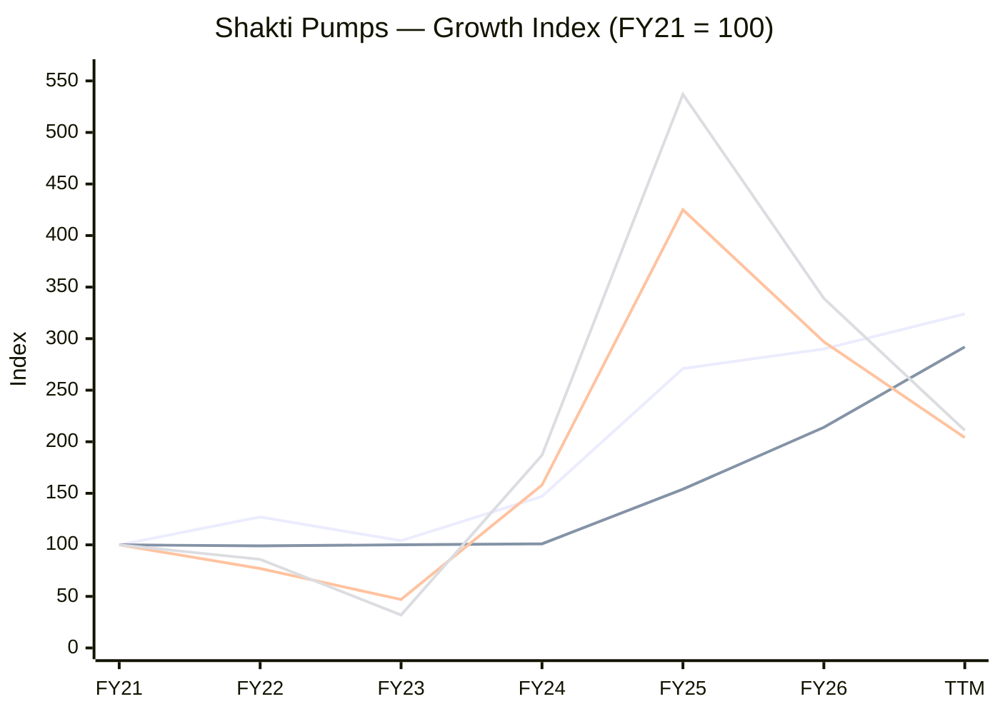
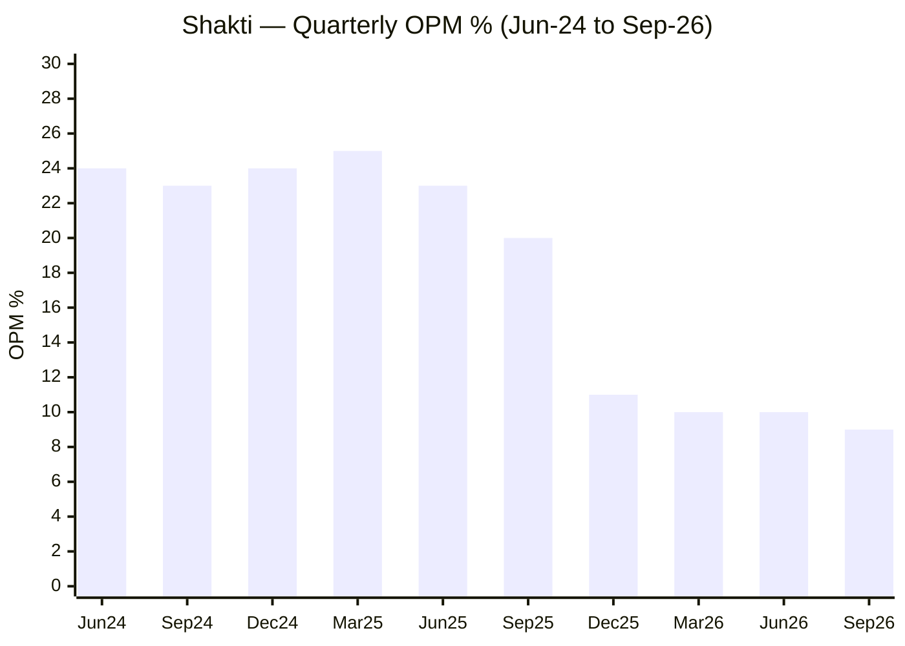
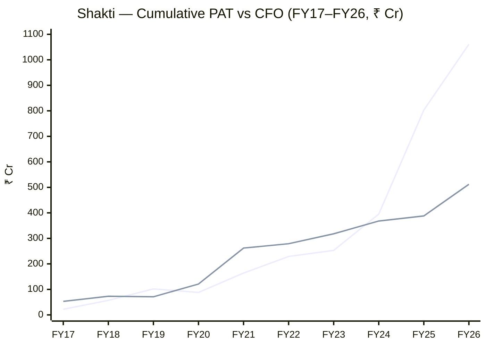
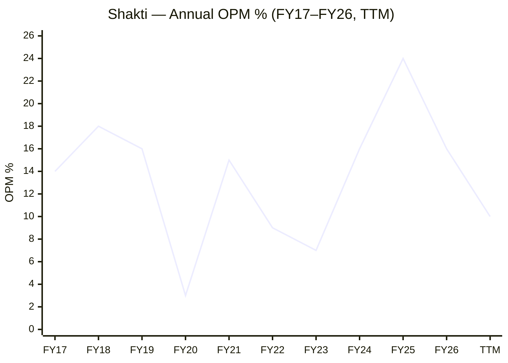
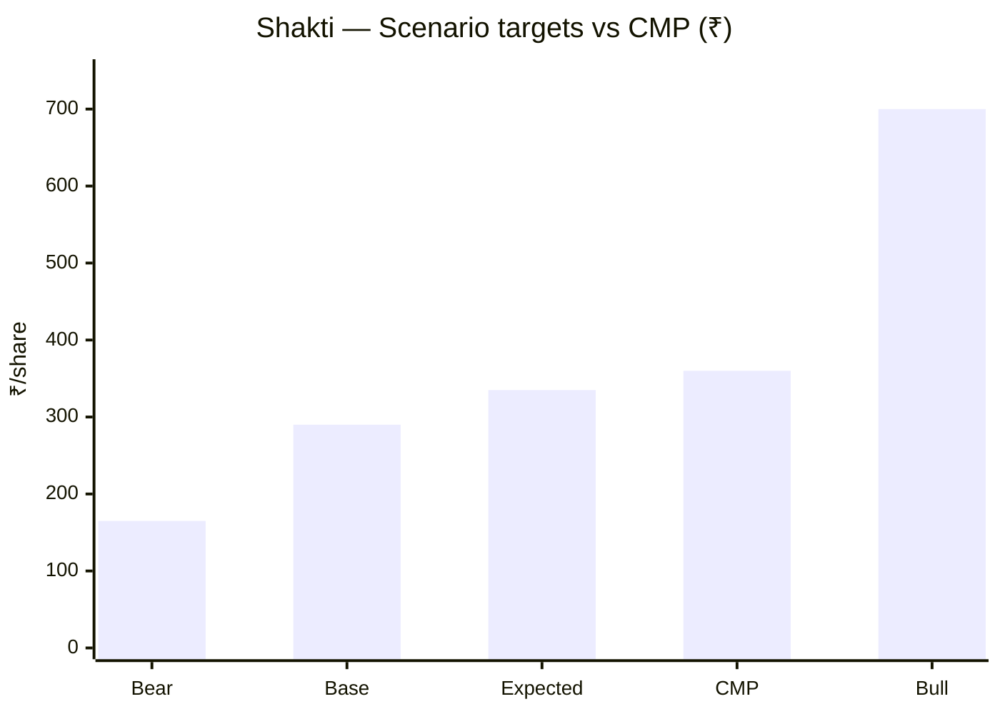

# Stock Analysis Report — Shakti Pumps (India) Ltd (NSE: SHAKTIPUMP)
**Date:** 2026-10-29
**Analyst:** Claude (Stock Fundamental Analysis Skill v3.3)
**Investment Horizon:** 2–3 Years
**Recommendation:** AVOID (re-entry watchlist)
**Conviction Score:** 3 / 10
**CMP:** ₹360 (29-Oct-2026) | **Market Cap:** ₹4,442 Cr | **Shares:** ~12.3 Cr (FV ₹10) | **TTM P/E:** 27.7× | **P/B:** 2.5×
**Filed under:** Capital-Goods / Pumps-Valves-and-Flow-Control · Themes: Renewables & energy transition

## Revision Log
| Version | Date | Recommendation | Conviction | Price | Key change |
|---|---|---|---|---|---|
| Current | 2026-10-29 | AVOID (re-entry watchlist) | 3/10 | ₹360 | Margin collapse (24%→8.6%) is now five quarters old, not a blip; ₹1,700 Cr cell/module capex + ₹561 Cr H1 WC build pushed debt to ₹941 Cr; order book ₹751 Cr (~3 months' cover); PM-KUSUM-B window shut 30-Sep-2026, KUSUM 2.0 not Cabinet-approved; Weinstein Stage 4 hard stop |
| Previous | 2026-06-20 | WAIT FOR CONFIRMATION | 6/10 | "₹900" (actual close ~₹551) | Initial report (full text in git history) |

**Validation of previous report:**
| Item | Previous | Now | Status |
|---|---|---|---|
| CMP / market cap | ₹900 / ₹2,900 Cr | 19-Jun-2026 weekly close was **₹551** (Screener price series); 12.3 Cr shares → mcap was ~₹6,800 Cr. Today ₹360 / ₹4,442 Cr | ❌ Corrected (price and mcap were both wrong and mutually inconsistent) |
| Revenue FY22–FY26 | 850 / 1,100 / 1,470 / 1,620 / 1,745 | **1,179 / 968 / 1,371 / 2,516 / 2,698** (Screener consolidated) | ❌ Corrected — FY25 was a +84% boom year, not +10% |
| FY26 EBITDA margin | 15.1% | 15.6% (422/2,698); but quarterly run-rate already 10–11% by Q3–Q4 FY26 | 🔄 Updated — annual figure masked the collapse |
| Export share | ~33% | **15% of FY26; 11% of H1 FY27** (company H1 FY27 release via Multibagg) | ❌ Corrected |
| Promoter holding | 52–54% | **50.40%** (Sep-26) | ❌ Corrected |
| Promoter pledge | 0% | Not re-sourced this run | ⚠️ Unverifiable |
| Auditor (B S R & Co) | stated | Not re-sourced | ⚠️ Unverifiable |
| KUSUM market share 25–30% | stated | No primary source found | ⚠️ Unverifiable — dropped from thesis |
| Net debt/EBITDA | ~2.1× | Gross debt ₹941 Cr / TTM EBITDA ₹289 Cr = **3.3×** | 🔄 Updated |
| PIE gap | Pessimistic (opportunity) | Market now prices margin recovery on schedule → **optimistic gap** | 🔄 Reversed |
| DCF IV ₹1,633 / EV ₹1,835 | stated | Built on wrong revenue/price base; superseded | ❌ Corrected |
| Weinstein stage | Stage 3/4 | **Stage 4** — price ₹360 below declining 30-wk MA ₹507 | 🔄 Updated |
| Previous data gaps | — | KUSUM status, order book trend, H1 CFO now closed | ✅ Closed |

---

## Executive Summary
Shakti is a solar-pump maker that rode PM-KUSUM Component B to a FY25 peak (₹2,516 Cr revenue, 24% OPM, ₹408 Cr PAT). Since then the scheme's sanctioned backlog has run down, L1 bidding has crushed realisations, and EBITDA margin has fallen to 8.6% in Q2 FY27 — while management is simultaneously committing ~₹1,700 Cr to a 2.2 GW solar cell/module plant funded mostly with debt. Revenue is still growing (+24.5% H1) but profit is down 52% and operating cash flow was **−₹448 Cr** in H1. **Thesis:** none yet — this is a capex-heavy pivot into an oversupplied module industry at the exact moment the demand engine stalls. **Key risk:** a KUSUM 2.0 delay into FY28 with debt heading to ~₹1,900 Cr (≈6× EBITDA) forces a dilutive equity raise near the lows.

### C1 — Growth Index (FY21 = 100)
| Year | Revenue | Net Fixed Assets | EBITDA | PAT |
|---|---|---|---|---|
| FY21 | 100 | 100 | 100 | 100 |
| FY22 | 127 | 99 | 77 | 86 |
| FY23 | 104 | 100 | 47 | 32 |
| FY24 | 147 | 101 | 158 | 187 |
| FY25 | 271 | 154 | 425 | 537 |
| FY26 | 290 | 214 | 297 | 339 |
| TTM Sep-26 | 324 | 292 | 204 | 211 |
*Source: Screener.in consolidated; fixed assets = net block (gross block not available in source).*

*Colour key: line 1 = Revenue, line 2 = Net fixed assets, line 3 = EBITDA, line 4 = PAT (series order).*
**Read:** Revenue keeps compounding but EBITDA and PAT have round-tripped half the FY25 spike, while fixed assets are now growing faster than revenue.
**Business inference:** FY25 profit was a scheme-scarcity windfall, not a new base; the company is now adding capital (cell/module) just as returns per rupee of revenue fall — the classic late-capital-cycle signature.

---

## Business Primer

Shakti Pumps (Pithampur, MP) makes submersible pumps, motors, VFD controllers and complete solar-pump systems. About three-quarters of revenue is "Solar EPC" — supplying and installing solar pump sets for farmers through state agencies under PM-KUSUM Component B and state schemes such as Maharashtra's Magel Tyala (₹1,229 Cr of ₹1,605 Cr in H1 FY27); exports are 11%, retail/dealer sales and a small rooftop business make up the rest. FY26 customer mix was 77% government projects. Revenue is tender volume × realisation per pump set; the farmer pays a small share and the state/central subsidy pays the rest, which is why receivables (₹1,750 Cr on 23-Oct-2026) dominate the balance sheet. The business depends on two things: continuous government tender flow, and the spread between the L1 tender price and the cost of DCR (domestic-content) solar modules, which are 40–50% of a pump set's cost.

This is a government-procurement-driven assembler that is trying to become a vertically integrated solar manufacturer. The value driver is the realisation-minus-module-cost spread, and the key risk is the scheme cycle: Component B was designed to end 31-Mar-2026, its commissioning deadline was extended only to 30-Sep-2026, and the successor (KUSUM 2.0) is still awaiting Cabinet approval. Two structural features colour everything below: (1) working capital — the company funds farmers' subsidies until states pay, so growth consumes cash; and (2) the ₹1,700 Cr capex programme (2.2 GW cells + modules, doubled motor/pump capacity, EV subsidiary) which changes Shakti from an asset-light business (revenue/net block 8–11×) into a capital-heavy one.

**Segment check:** Pumps / solar-pump systems — no dedicated KPI block in `05-industry-kpis-india.md`; nearest matches are *Solar EPC* (line 947) and *Infrastructure / EPC / Capital Goods* (line 294). The June report proceeded on this basis; the same near-match is reused here (order book, WC days, realisation/margin, govt receivables).

---

## Module 1 — Broad Market Cycle
**Assessment: CAUTIOUS.** Nifty 50 at 22,753 (26-Oct-2026) — down from the ~24,500–25,000 zone in June; India VIX 17.2 (up from 13–15). Small/mid-cap renewables have de-rated hard (Shakti −58%, GK Energy −51%, Oswal −65% from 52-week highs). **Sizing: below normal.** *Source: JM Financial market feed (Capital Market).*

## Module 1b — Sector Cycle: Solar Agricultural Pumps
**Verdict: HEADWIND (scheme-cycle trough; duration 2–4 quarters minimum).**

| Signal | Evidence | Read |
|---|---|---|
| Demand window | KUSUM-B target 14 lakh pumps; **9.30 lakh sanctioned, 8.40 lakh installed** (31-Aug-2026) → only ~90,000 sanctioned pumps left nationally | Residual central-scheme demand < one year of Shakti + GK + Oswal combined capacity |
| Deadline | KUSUM-B commissioning deadline 30-Sep-2026; hard stop for all components 31-Mar-2027 (MNRE OM, 31-Mar-2026) | Central pipeline closing |
| Successor | KUSUM 2.0: EFC stage / being aligned with farm schemes; **not Cabinet-approved** as of mid-Oct 2026 | Gap of 2–4 quarters likely before new tenders |
| Pricing | Oswal cites ~9% lower realisations from competitive bidding; Shakti cites "softer realisations" | Price war for the last tranches |
| Capacity | Shakti doubling pump/motor capacity + 2.2 GW cells/modules; Oswal and others integrating into modules | Supply rising into a demand gap |

**Secular vs cyclical:** Solar irrigation replacing diesel/grid pumps is secular, but the FY24–FY26 revenue surge was ~70% cyclical (a time-bound subsidy scheme hitting its execution peak). The durable baseline is state schemes (Magel Tyala) + exports + retail, roughly ₹1,500–2,000 Cr/yr for Shakti. Do **not** embed the FY25–H1 FY27 run-rate in long-term growth.

## Module 1c — Stock Cycle: Company Positioning

### C2 — Quarterly revenue and margin (₹ Cr)
| Qtr | Jun-24 | Sep-24 | Dec-24 | Mar-25 | Jun-25 | Sep-25 | Dec-25 | Mar-26 | Jun-26 | Sep-26 |
|---|---|---|---|---|---|---|---|---|---|---|
| Revenue | 568 | 635 | 649 | 665 | 622 | 666 | 551 | 858 | 859 | 746 |
| OPM % | 24 | 23 | 24 | 25 | 23 | 20 | 11 | 10 | 10 | 9 |
| PAT | 93 | 101 | 104 | 110 | 97 | 91 | 32 | 38 | 52 | 39 |

**Read:** Margin fell off a cliff in Dec-25 and has not recovered for four quarters, despite revenue hitting record levels.
**Business inference:** Volume is being bought with price — Shakti is winning tenders at realisations that no longer cover the old cost structure. This is a pricing-power failure, not a one-quarter cost blip.

- **Revenue driver:** Volume (H1 installations +29.3% to 51,543) with falling price — the least durable combination.
- **Operating leverage:** DOL is working in reverse; revenue +12% YoY in Q2 with EBITDA −53%.
- **FCF inflection:** Not before FY29 in the base case (capex + WC build); FY27 FCF likely −₹600 to −₹700 Cr.
- **Stock cycle classification:** **Late cycle / rolling into trough**, with a capex-heavy pivot layered on top. MoS +10pp; position size ×0.5.

---

## Module 2 — Industry Structure (Porter) & Capital Cycle
| Force | Signal | Verdict |
|---|---|---|
| New entrants | MNRE empanelment + BIS achievable; dozens of empanelled vendors | Unfavourable |
| Supplier power | DCR cells/modules 40–50% of system cost; DCR supply tight, cost sticky | Unfavourable |
| Buyer power | State nodal agencies, L1 tenders, slow payment | Highly unfavourable |
| Substitutes | Diesel/grid pumps (policy-disfavoured) | Favourable |
| Rivalry | Shakti, GK Energy, Oswal, Tata Power, regional players; price war on last KUSUM tranches | Unfavourable |

**Industry verdict: UNATTRACTIVE in the current phase.** **Capital cycle: LATE** — sector-wide capacity additions (Shakti 2.2 GW cell/module, Oswal module integration), three IPOs/QIPs in 2025 (GK Energy IPO ₹464 Cr, Oswal IPO, Shakti QIP ₹293 Cr at ₹918), and ROCE falling from a peak (55% FY25 → 24% FY26 → ~11% TTM).

## Module 3 — Business Quality & Moat
**Moat verdict: NONE (in domestic solar EPC); NARROW at best in exports/brand.**
- **Supply/cost advantage:** Was real (in-house motors, VFDs, scale) — but the margin collapse to below GK Energy (an asset-light EPC with no factory) shows it does not survive a price war. Cell/module integration *may* rebuild a cost edge from FY28, but modules are oversupplied nationally.
- **Customer captivity:** None — L1 tenders re-bid each phase.
- **Local scale:** Strong presence in MP/Maharashtra/Karnataka, but no >50% local share.
- **Buffett 10% price test:** **Fail** — realisations are falling, not rising.
- **Fisher 15-point:** **27 / 45** (cut from 35: points 5, 6, 12, 13 and 14 downgraded on margin collapse, capex dilution risk and guidance credibility). **Point 15 (Integrity): PASS** — no enforcement or audit qualification found.

## Module 4 — Management & Capital Allocation
**Promoters 50.40%** (down from 51.61% after the Jul-2025 QIP) · Pledge: ⚠️ not re-verified · **DIIs 6.71% → 1.76%** in a year (Sep-25 → Sep-26) while retail shareholders rose from 2.40 to 2.57 lakh — institutions exited and retail absorbed.

**Capital allocation: POOR (current cycle).** The QIP at ₹918 (Jul-2025) was well-timed, but the money and new debt are going into a ₹1,700 Cr programme — 2.2 GW cells/modules, doubled pump capacity, ₹92 Cr already into an EV subsidiary still in vehicle trials — at the peak of the scheme cycle. Incremental ROIC on this capex is estimated at **2–6% vs WACC 13.5%** (see Module 10) → value-destroying unless KUSUM 2.0 is large and quick.

### Walk-the-Talk Scorecard
| When guided | Statement | Guided | Actual | Verdict |
|---|---|---|---|---|
| Nov-2025 | FY26 revenue growth | 20–25% | +7.2% | ❌ Miss |
| Nov-2025 | FY26 EBITDA margin | ~24% | 15.6% | ❌ Miss |
| Q1 FY27 call (Jul-26) | Margins improve from Q2 FY27 | > Q1 9.7% | 8.6% | ❌ Miss |
| FY26 | ₹5,000 Cr revenue ambition | near term | Pushed to 3-year horizon | 🔴 Reversal |
| FY26 | Margin target | 24% | Reset to 12–13% in 2–3 yrs | 🔴 Reversal |
| Q1 FY27 | Installations growth | strong | H1 +29.3% | ✅ Hit |
| Capex | 0.5 GW DCR modules | FY27 | Commissioned Sep-26, trial from Oct-26 | ✅ Hit |
*Sources: Saur Energy Q2 FY27 coverage (management quotes), company H1 FY27 release.*

**WTT Score: 0.29 / 1.00 — UNRELIABLE** (2 hits / 7). **Pattern:** one-way optimism on margins; volume promises kept, profit promises missed. Management still calls the squeeze "external and cyclical … not structural" after five quarters of decline. **Insider action:** no promoter open-market buying found during a 58% fall. **DCF impact:** treat the 12–13% margin target as aspirational; base case reaches 12% only in FY29. **Credibility: LOW.**

---

## Module 5 — Financial Forensics
| Check | Result | Verdict |
|---|---|---|
| Debtor days | 92 (FY23) → 178 → 152 → **173** (FY26); receivables ₹1,750 Cr (23-Oct-26) | 🔴 |
| Receivable ageing | ~50% not due, ~22% overdue <180d → **~28% (~₹490 Cr) overdue >180 days** (derived) | 🔴 |
| 5-yr cumulative CFO / PAT (FY22–FY26) | ₹250 Cr / ₹897 Cr = **0.28** | 🔴 |
| H1 FY27 CFO | **−₹448 Cr** (WC change −₹561 Cr) | 🔴 |
| Sloan accrual ratio FY26 | (258 − 124 + 286) / avg TA 2,510 = **16.7%** | 🔴 (>10%) |
| Beneish M-Score FY26 (approx.) | **≈ −1.89** — grey zone; driven by GMI (genuine margin fall) and DSRI 1.14 | ⚠️ |
| Altman Z'' (Sep-26, approx.) | ≈ 6.0 | ✅ Safe (equity base still large) |
| Piotroski F-Score FY26 | **2 / 9** (only ROA>0, CFO>0) | 🔴 Weak |
| Other income / EBIT | 40 / 298 = 13% TTM | ⚠️ Near threshold |
| WC loans | ₹446 Cr (Mar-26) → **₹831 Cr** (Sep-26) | 🔴 |

**Forensic red flags: 5 / 15.** None points to fabrication — they trace to a real problem: Shakti is financing the state's subsidy receivables with bank debt, and a growing slice is old. **Forensic verdict: SIGNIFICANT CONCERNS (cash conversion), not manipulation.** Note the ≥3-flag rule requires deep investigation; the unresolved item is the >180-day receivable bucket — provisioning policy should be checked in the FY26 annual report KAMs.

### C7 — Cumulative PAT vs CFO (₹ Cr)
| FY | 17 | 18 | 19 | 20 | 21 | 22 | 23 | 24 | 25 | 26 |
|---|---|---|---|---|---|---|---|---|---|---|
| Cum PAT | 22 | 57 | 102 | 88 | 164 | 229 | 253 | 395 | 803 | 1,061 |
| Cum CFO | 53 | 73 | 71 | 121 | 262 | 279 | 318 | 368 | 388 | 512 |

*Colour key: line 1 = cumulative PAT, line 2 = cumulative CFO.*
**Read:** Cash tracked profit until FY23; since then ₹550 Cr of reported profit has not turned into cash (and H1 FY27 adds another −₹448 Cr CFO).
**Business inference:** The boom's profits are sitting in state receivables. Until they convert, "earnings" overstate distributable cash — and debt is filling the gap.

## Module 6 — Earnings Quality & Financial Statements
**ROCE:** 55% (FY25) → 24% (FY26) → **~11% TTM** (EBIT ₹298 Cr / CE ₹2,728 Cr) vs **WACC ~13.5%** → now **below WACC**. 10-yr median ROCE ~19%.

### DuPont (5-factor, year-end balances)
| Year | EBIT margin | Asset turnover | Equity multiplier | Interest burden | Tax burden | ROE |
|---|---|---|---|---|---|---|
| FY22 | 8.3% | 1.36× | 2.20× | 0.84 | 0.79 | 16.5% |
| FY23 | 5.3% | 1.34× | 1.73× | 0.63 | 0.75 | 5.8% |
| FY24 | 15.2% | 0.95× | 1.92× | 0.91 | 0.75 | 18.8% |
| FY25 | 23.8% | 1.28× | 1.70× | 0.93 | 0.73 | 35.1% |
| FY26 | 15.5% | 0.89× | 1.79× | 0.86 | 0.72 | 15.1% |
| TTM Sep-26 | 9.9% | 0.87× | 1.93× | 0.77 | 0.70 | 9.0% |

**Operating contribution (margin × AT):** collapsing (0.30 → 0.086). **Financing contribution:** equity multiplier rising and interest burden worsening — leverage is now *propping up* ROE while operations deteriorate. **DuPont verdict:** operational decline partly masked by debt; AT is falling structurally because the asset base is about to triple.

### C4 — 10-year OPM %

**Read:** The 10-year median OPM is ~15%; FY25's 24% was a >1SD outlier and TTM 10% is near the bottom of the range.
**Business inference:** Shakti's "normal" is a mid-teens-margin cyclical, not the 24% compounder the 2025 price assumed; management's 12–13% target is in fact *below* the long-run median — a sign they expect competitive pricing to persist.

**OCF/Net income (5-yr):** 0.28 → **Low quality.** **O'Glove flags: 6 / 15** (NI vs OCF, DSO, AR/revenue, other income near threshold, Sloan, Piotroski).

---

## Module 7 — Industry KPIs & Peer Analysis
| KPI | Shakti | Assessment |
|---|---|---|
| Order book / TTM revenue | ₹751 Cr / ₹3,013 Cr = **0.25×** (~3 months) | 🔴 Below any healthy range (>1×) |
| EBITDA margin | 8.6% (Q2), 9.2% (H1) | 🔴 Below GK (16–17%) and Oswal (17.4% Q1) |
| Working capital / debtor days | 173 debtor days; WC loans ₹831 Cr | 🔴 |

### Peer comparison (latest available)
| Metric | Shakti | GK Energy | Oswal Pumps |
|---|---|---|---|
| FY26 revenue (₹ Cr) | 2,698 | 1,715 | ~2,064* |
| Latest qtr YoY revenue | +12% (Q2) | +1% (Q2) | −7.9% (Q1) |
| Latest EBITDA margin | 8.6% | ~16–17% (Q1) | 17.4% (Q1) |
| Model | Integrated manufacturer → cells/modules | Asset-light EPC (OEM partners) | Manufacturer + modules |
| Balance sheet | Gross debt ₹941 Cr | Net cash ~₹240 Cr (Mar-26) | n/a |
| TTM P/E | 27.7× | 8.8× | n/a |
| Fall from 52-wk high | −59% | −55% | −65% (Sep-24) |
*Oswal per Saur Energy (24-Sep-2026); to be checked against its own filings (see OSWALPUMPS report).*

**Peer positioning:** Shakti trades at **3× GK Energy's P/E with half its margin and a levered balance sheet**. The premium is not justified by current numbers; it rests on the integration story.

[C12 — omitted: fewer than 4 comparable peers with verified data.]

### Order Book Tracker
*Ledger (Reg 30 order filings) not harvested this run — order inflow is disclosed as period snapshots only. Snapshot series:*
| Date | Order book (₹ Cr) | Source |
|---|---|---|
| Feb-2026 | ~2,100 | Saur Energy (management) |
| 22-Jul-2026 | ~1,000 | Q1 FY27 release (via Sahi) |
| 23-Oct-2026 | 751 (incl. GST): Maharashtra 344, KREDL 202, MPUVNL 95 | H1 FY27 release |

**Reconciliation (approx.):** Implied inflow Feb→Oct ≈ 751 − 2,100 + ~2,180 revenue ≈ **₹830 Cr** → **book-to-bill ≈ 0.38**. Cover fell from ~0.8 yr to **~0.25 yr**. Top-3 concentration ~85% of the book.
**Order-book verdict:** Firm visibility ~3 months · book-to-bill well below 1 · H2 FY27 revenue at risk unless new state orders land.

## Module 8 — Market Size & Share
- **TAM (central KUSUM-B residual):** ~90,000 sanctioned-but-uninstalled pumps × ~₹2.5–3 lakh ≈ **₹2,300–2,700 Cr** — i.e. less than one year of Shakti's revenue alone.
- **Ongoing TAM:** state schemes (Magel Tyala) + KUSUM 2.0 (size unverified; ₹50,000 Cr figures in circulation are from blogs, not MNRE) + exports + rooftop (PM Surya Ghar).
- **Share:** Shakti installed 51,543 pumps in H1 FY27, likely the largest single vendor; but share gains came with falling price → **growing share in a shrinking pool, at lower margin**.

---

## Module 9 — Valuation: PIE First, Then DCF
**EV:** ₹4,442 Cr mcap + ~₹890 Cr net debt (gross ₹941 Cr; cash not disclosed in sources reviewed) ≈ **₹5,330 Cr**. EV/TTM EBITDA **18.4×**.

### PIE (reverse DCF)
NOPAT₀ = TTM EBIT ₹298 Cr × 0.73 ≈ ₹218 Cr; WACC 13.5%.
g ≈ (5,330 × 0.135 − 218) / (5,330 + 218) ≈ **9.0% perpetual NOPAT growth.**

| Driver | Market-implied | My base | Gap |
|---|---|---|---|
| Revenue CAGR (3-yr) | ~10–12% | ~6% (₹3,013 → ₹3,600 Cr FY29) | Optimistic |
| Steady EBITDA margin | ~12–13% reached by FY28 | 12% only by FY29 | Optimistic |
| Investment rate | Not priced — EV assumes cash generation | ₹1,500 Cr capex + WC over 3 yrs | Optimistic |

**PIE classification: OPTIMISTIC GAP.** The price already assumes management's 12–13% margin recovery on time *and* ignores the capex drag on depreciation and interest. **Treadmill:** Shakti must deliver ≥12% EBITDA margin by FY28 **and** positive OCF just to earn its cost of capital from here.
**Triggers:** (+) KUSUM 2.0 Cabinet approval with ≥10 lakh pumps; cell plant cost savings visible in margin; receivables < ₹1,200 Cr. (−) Q3 FY27 margin < 9%; equity raise; order book < ₹500 Cr.

### Forward model (base case)
| ₹ Cr | FY26A | FY27E | FY28E | FY29E |
|---|---|---|---|---|
| Revenue | 2,698 | 3,000 | 3,000 | 3,600 |
| EBITDA margin | 15.6% | 9.5% | 10.5% | 12.0% |
| EBITDA | 422 | 285 | 315 | 432 |
| D&A | 28 | 40 | 75 | 95 |
| Interest | 59 | 85 | 125 | 135 |
| PAT | 258 | 140 | 97 | 162 |
| EPS (₹) | 20.9 | 11.4 | 7.9 | 13.2 |
| Capex | (286 CFI) | 600 | 600 | 300 |
| ΔWC | — | +250 | −100 | +90 |
| **FCF** | negative | **≈ −670** | **≈ −330** | **≈ −135** |
| Gross debt (end) | 505 | ~1,600 | ~1,900 | ~2,000 |
| Debt / EBITDA | 1.2× | 5.6× | **6.0×** | 4.6× |
| ICR (EBIT/interest) | 7.1× | 3.2× | **2.0×** | 2.6× |

**Debt ceiling verdict: DISTRESS ZONE** — peak leverage ~6× EBITDA in FY28 and ICR < 2.5× → equity dilution risk; MoS +10pp.

### Scenarios (3-year, FY29)
| Scenario | Assumption | FY29 revenue | EBITDA % | EPS | Multiple | Target | Prob. |
|---|---|---|---|---|---|---|---|
| Bull | KUSUM 2.0 large from H2 FY28; cell plant lifts margin | 4,500 | 15% | ₹28 | 25× | **₹700** | 20% |
| Base | KUSUM 2.0 from FY29; margin 12% | 3,600 | 12% | ₹13.2 | 22× | **₹290** | 50% |
| Bear | KUSUM 2.0 slips; price war persists; equity raise | 2,400 | 9% | ~₹3 | 1.1× P/B (BV ~₹150) | **₹165** | 30% |
| **Expected value** | | | | | | **₹335** | |

**Read:** Expected value (₹335) sits *below* the current price; only the bull case pays.
**Business inference:** At ₹360 the market is still paying for a recovery that management has repeatedly failed to deliver, with leverage rising underneath.

- **Expected return:** −7% over 3 years. **Upside/downside:** (700−360)/(360−165) = **1.7:1** (< 2:1). **SVAR:** (360−165)/360 = **54%** (> 40% → unfavourable).
- **Graham number:** √(22.5 × 5-yr avg EPS ₹14.9 × BV ₹145) ≈ **₹220**.
- **P/E band (Screener 10-yr):** median 27.3×, p10 15×, p90 46× — current 27.7× TTM is *at the median on trough earnings*, i.e. not cheap.
- **Misprice reason:** none identified — the stock is falling *toward* value, not away from it.

### Cycle Position Dashboard
| Dimension | Current | 10-yr median | Signal |
|---|---|---|---|
| P/E (TTM) | 27.7× | 27.3× | Fair (on trough EPS) |
| P/B | 2.5× | ~2.5–3× | Fair |
| EBITDA margin | 9–10% | ~15% | Trough |
| ROCE | ~11% | ~19% | Trough |
| Order cover | 0.25 yr | — | Very thin |
| **Overall** | | | **Trough earnings + late capital cycle + no valuation discount** |

---

## Module 10 — Technical Stage (Weinstein + CANSLIM)
| Level | Stage | Evidence |
|---|---|---|
| Nifty 50 | Stage 3/4 risk | 22,753 vs ~25,000 in June; VIX 17 |
| Sector (renewables small/mid) | Stage 4 | Shakti, GK, Oswal all −50–65% from highs |
| SHAKTIPUMP | **Stage 4** | ₹360 vs 30-week MA **₹507, declining** (₹520 four weeks ago, ₹540 ten weeks ago); new 52-wk low ₹354 |

- **RS vs Nifty:** deeply negative (stock −58% over 52 weeks vs Nifty roughly −8%).
- **Volume (weekly, Screener):** last-50-week average ~86 lakh shares/week; the last five weeks ran 16–34 lakh, including the post-results week. The decline is grinding lower on fading volume, with no capitulation spike yet.
- **CANSLIM: 0 / 7** (C: EPS −58%; A: FY26 EPS −39%; N: none; S: QIP-enlarged float; L: laggard; I: DIIs exiting; M: market weak).
- **Hard stop triggered:** Stage 4 with declining 30-week MA.
- **Re-entry condition:** ≥12 weeks of sideways base, 30-week MA flattening, then weekly close above the base on ≥1.5× volume.

---

## Module 11 — Forward View: 2–3 Year Thesis

### Capex classification
| Type | FY27E | FY28E | FY29E | In AT model? |
|---|---|---|---|---|
| Growth: 2.2 GW cells + modules | ~450 | ~500 | ~200 | ✅ (ramp from FY28) |
| Growth: pump/motor/VFD capacity doubling | ~100 | ~50 | ~50 | ✅ |
| EV subsidiary (₹92 of ₹114 Cr spent) | ~20 | — | — | ❌ (pre-revenue) |
| Maintenance (≈ D&A) | ~40 | ~75 | ~95 | sustains only |
| **Total** | **~600** | **~600** | **~300** | ≈ ₹1,500 Cr remaining of ₹1,700 Cr |
*Phasing is an estimate; the company has disclosed the total (~₹1,700 Cr) and milestones (0.5 GW modules Sep-26; 2.2 GW by Sep-27 / cells FY28), not year-wise spend.*

### Asset turnover (Revenue / net fixed assets)
| FY21 | FY22 | FY23 | FY24 | FY25 | FY26 | TTM | FY29E |
|---|---|---|---|---|---|---|---|
| 6.3× | 8.1× | 6.6× | 9.2× | 11.1× | 8.6× | 7.0× | **~1.9×** |

**AT trend: structurally declining** — the business model is changing from assembler to capital-heavy manufacturer.

**Incremental ROIC:** If captive DCR cells/modules save 5–8% of system cost on ~₹3,000 Cr of pump revenue → ₹150–240 Cr EBITDA, less ~₹100 Cr extra D&A → EBIT ₹50–140 Cr → NOPAT ₹37–105 Cr on ₹1,500 Cr = **2–7% vs WACC 13.5% → VALUE-DESTROYING** unless third-party module sales earn well (unlikely in an oversupplied module market) or KUSUM 2.0 volume is large.

**Capex-model CAGR vs PIE:** capacity is not the constraint — *demand* is. PIE prices ~10–12% growth plus margin recovery; demand evidence (order book 0.25×, B2B 0.38) supports neither near term.

### Catalysts
1. KUSUM 2.0 Cabinet approval and first tenders — H2 FY27 / H1 FY28 (timing uncertain)
2. Receivable collection: receivables back below ₹1,200 Cr — watch Q3/Q4 FY27
3. 2.2 GW cell line commissioning and margin uplift — FY28
4. Export recovery (US/Middle East) — ongoing

### Risks
1. KUSUM 2.0 delayed beyond FY27 — **High**
2. Equity dilution at low prices to fund capex — **Medium-High**
3. Old receivables written off or provisioned (>180-day bucket ~₹490 Cr) — **Medium**
4. Module/cell oversupply erodes the integration payoff — **High**
5. Raw-material and logistics cost spikes (geopolitics) — **Medium**

---

## Checklist Summary
**Section 0 (Existing report protocol):** complete — base report read, 13 items validated (6 ❌ corrected), renamed via `git mv`.
**Section A (Business quality):** 14/18 — scuttlebutt beyond press not done; pledge not re-verified.
**Section B (Forensics):** 8/9 — Beneish approximated (no gross-margin detail).
**Section C (Financial statements):** 9/12 — Ind AS 116 adjustment not material/not done.
**Section D (KPIs & peers):** 5/7.
**Section E (Market size):** 5/7 — national share data unavailable.
**Section F (Valuation):** 9/10.
**Section G (Technical):** 7/8 — sector index stage inferred from peers.
**Section H (Forward view):** core items done; capex phasing estimated.
**Section I (Charts):** C1, C2, C4, C7, C13 included; CY1 summarised as table (P/E band stats).
**Order Book Tracker:** snapshots + reconciliation run; Reg 30 ledger not harvested.
**Hard stops triggered:** **Weinstein Stage 4 with declining 30-week MA**; upside/downside 1.7:1 (borderline, above 1.5:1).

---

## Investment Decision
**Recommendation: AVOID (re-entry watchlist)** | **Conviction: 3 / 10** | **Position size: 0%**

**Why AVOID:** A hard stop is triggered (Stage 4), the expected value (₹335) is below the price, SVAR is 54%, management credibility is unreliable on margins, and the balance sheet is about to carry ~6× EBITDA of debt for a capex programme whose incremental ROIC looks below WACC. The stock has fallen 58%, but it is not yet cheap relative to trough earnings.

**What would change the view (review triggers):**
| Trigger | Threshold |
|---|---|
| Margin | Two consecutive quarters ≥ 12% EBITDA |
| Cash | Positive quarterly CFO and receivables < ₹1,200 Cr |
| Demand | KUSUM 2.0 Cabinet approval + order book > ₹2,000 Cr |
| Price | Stage 1 base ≥ 12 weeks, then breakout on volume |
| Value | Price ≤ ₹220 (Graham number / ~1.4× BV) with the above improving |

**Base target (3-yr):** ₹290 · **Bull:** ₹700 · **Bear:** ₹165

---
*Sources: Screener.in consolidated financials, shareholding and price series (29-Oct-2026); Shakti H1 FY27 release via [Multibagg](https://www.multibagg.ai/market-pulse/articles/shakti-q2-fy27-757605eb-1f17-43ef-9e98-b6d9141d1f26) and [SolarQuarter](https://solarquarter.com/2026/10/26/shakti-pumps-reports-24-5-h1-fy27-revenue-growth-as-solar-pump-installations-rise-29-3/); [Saur Energy Q2 FY27](https://www.saurenergy.com/solar-energy-news/q2-fy27-shakti-pumps-is-shipping-more-pumps-and-making-less-profits-12751719); [Saur Energy sector piece](https://www.saurenergy.com/solar-energy-news/the-solar-pump-hangover-what-broke-indias-former-renewable-stock-darlings-12573939); [BusinessToday](https://www.businesstoday.in/markets/stocks/story/shakti-pumps-shares-fall-9-after-q2-profit-drops-58-yoy-check-details-563566-2026-10-26); [Renewable Watch — MNRE KUSUM extension](https://renewablewatch.in/2026/03/31/mnre-extends-timelines-for-projects-under-pm-kusum-scheme/); [Down To Earth — KUSUM 2.0](https://www.downtoearth.org.in/energy/centre-readies-pm-kusum-20-as-focus-shifts-to-feeder-level-solarisation). Concall transcript for Q2 FY27 not reviewed (not found).*
*Report generated by Stock Fundamental Analysis Skill v3.3 | Indian Markets Context*
