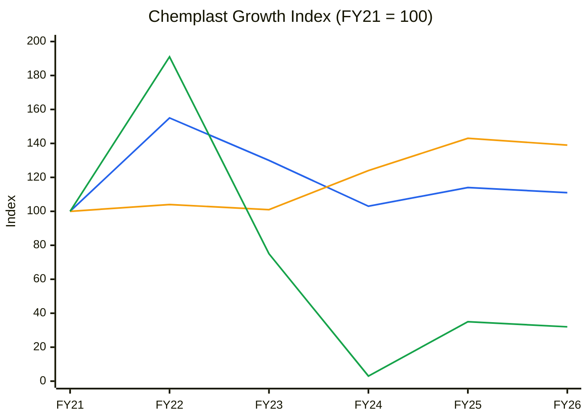
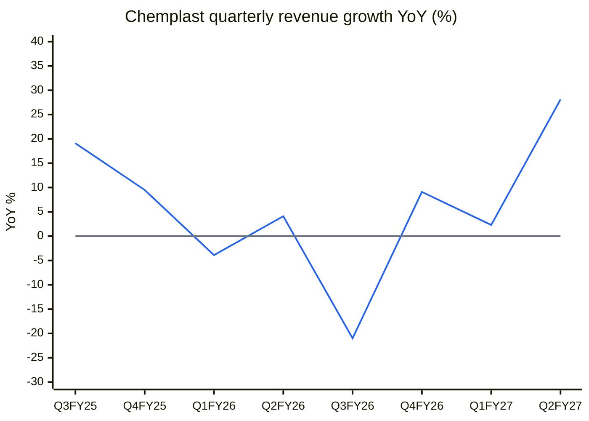
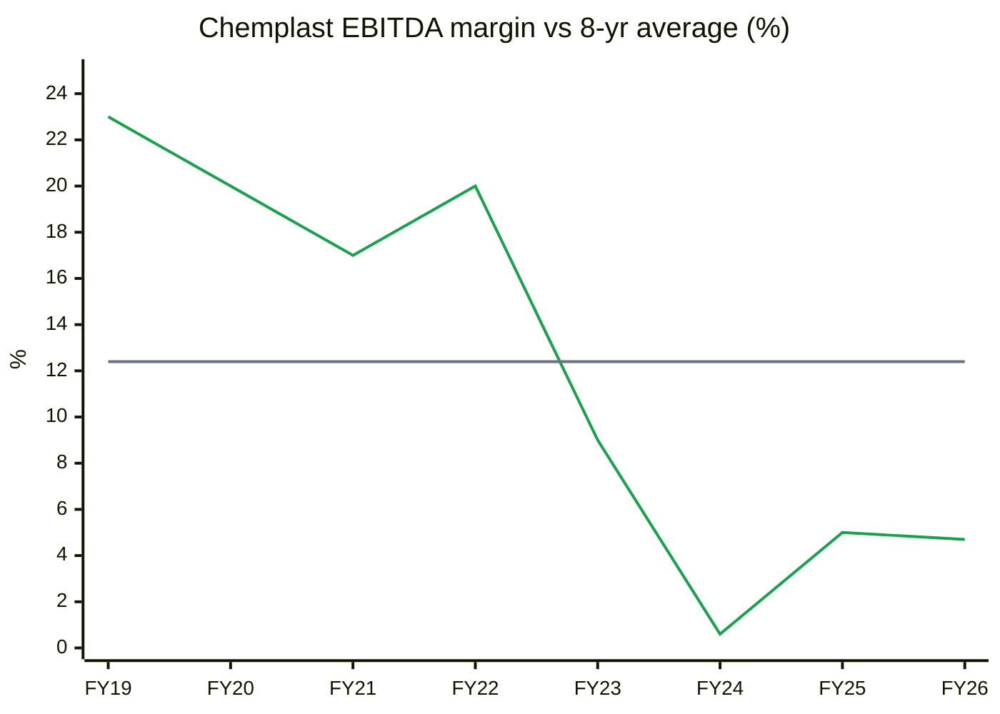
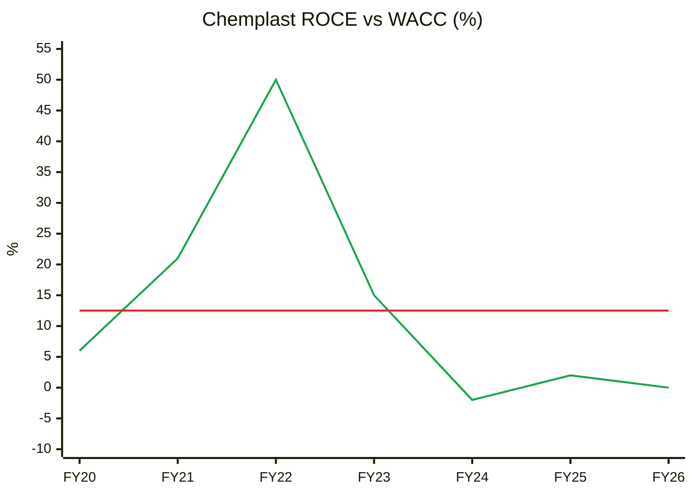
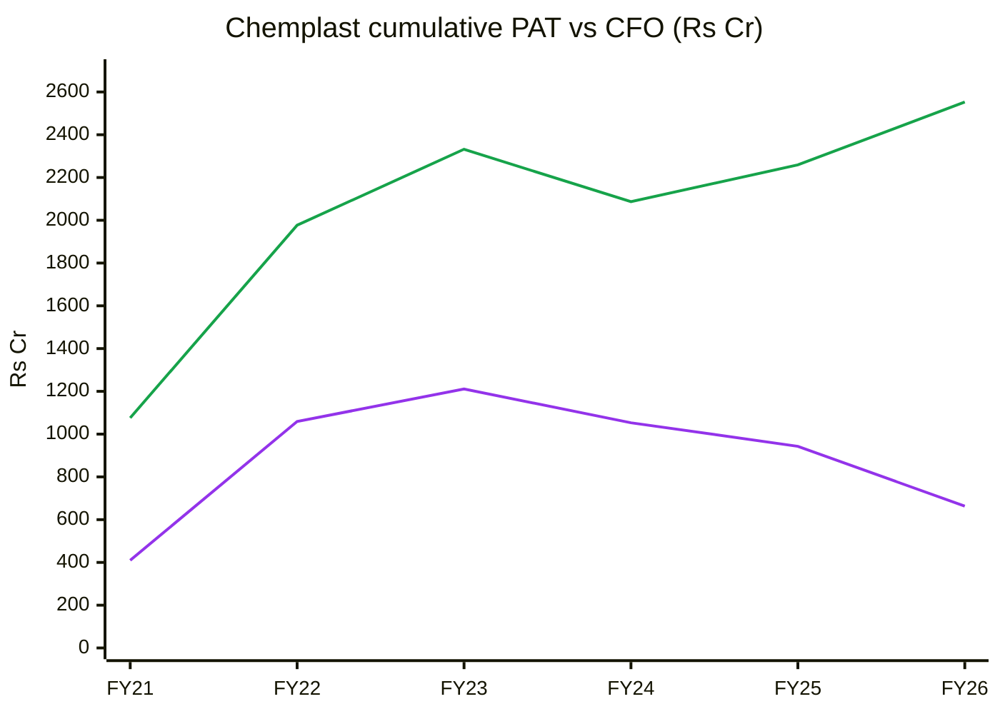
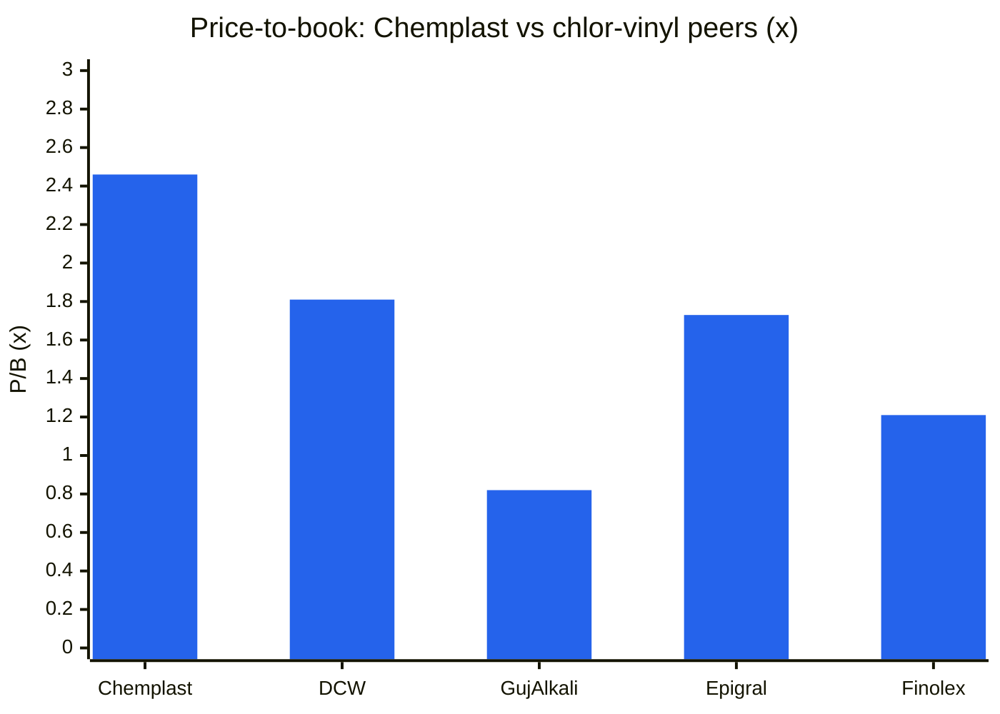
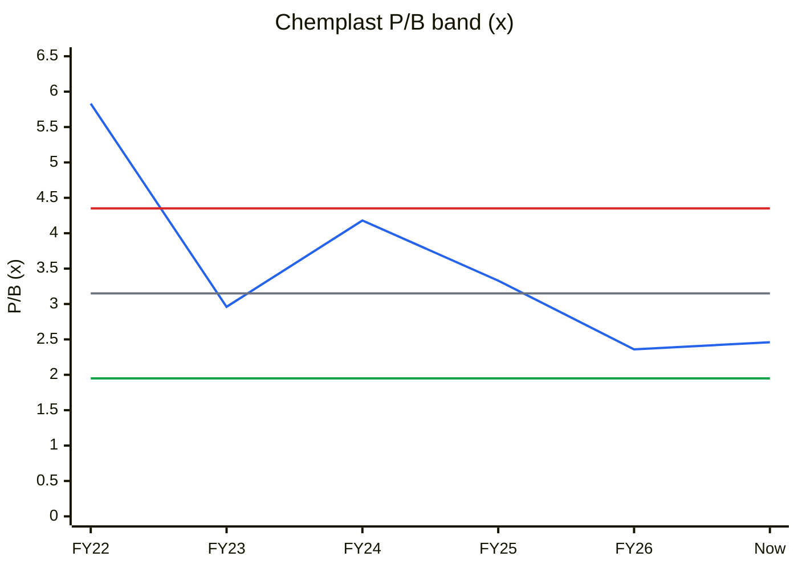
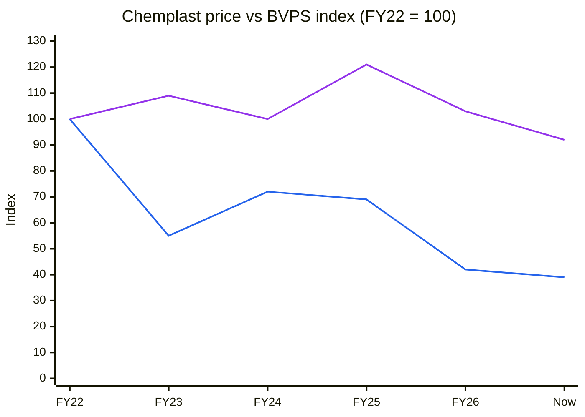
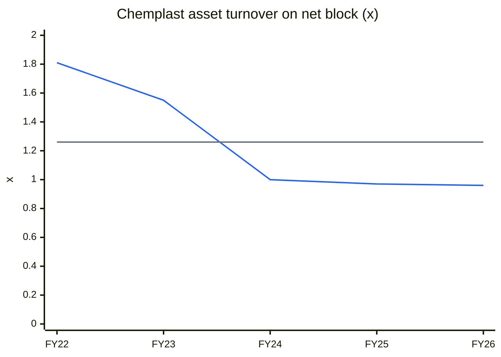
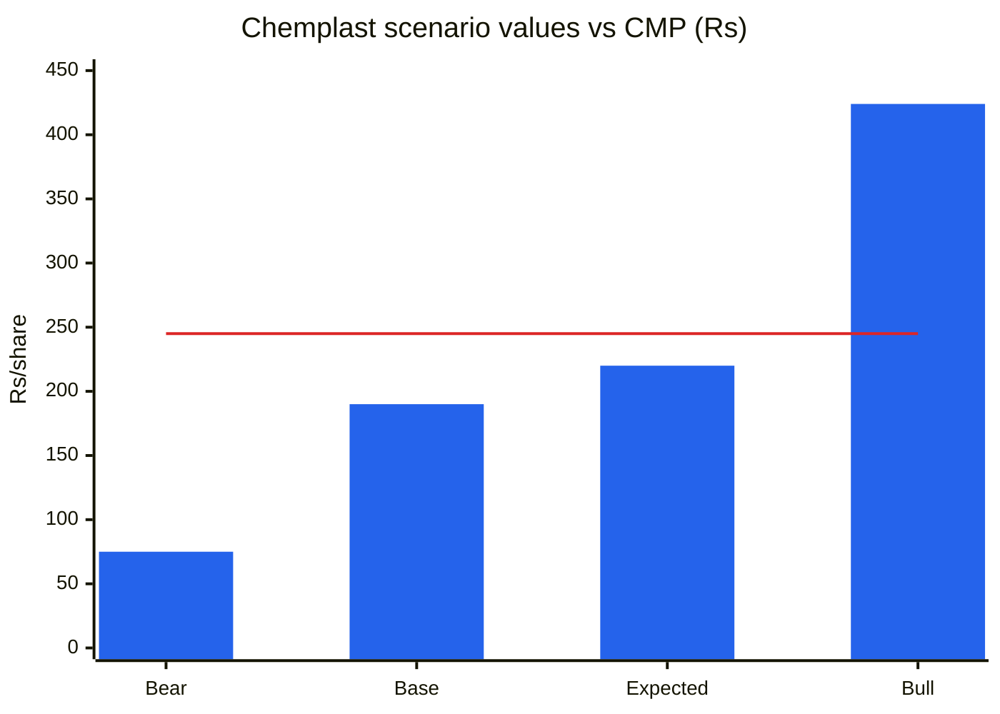

# Stock Analysis Report — Chemplast Sanmar Ltd (CHEMPLASTS)
**Date:** 2026-11-17
**Analyst:** Claude (Stock Fundamental Analysis Skill v3.3)
**Investment Horizon:** 2–3 Years
**Recommendation:** AVOID (Watchlist: re-test below ₹165, or after trade remedies are notified and two quarters of positive EBITDA)
**Conviction Score:** 3.5 / 10
**CMP:** ₹245 (NSE close 16-Nov-2026) · Market cap ₹3,878 Cr · 15.81 Cr shares · BVPS ₹99.5 · 52-wk ₹161–339
**Filed under:** Chemicals / Commodity-and-Petrochemicals · Themes: Specialty chemicals China+1

## Revision Log
| Version | Date | Recommendation | Conviction | Price | Key change |
|---|---|---|---|---|---|
| Current | 2026-11-17 | AVOID / Watchlist | 3.5/10 | ₹245 | Initial report |

Initial report. No earlier report existed in the library. This report also added the new **PVC / Chlor-Alkali & Chloromethanes** KPI block to the skill reference (approved by the user on 2026-11-17).

**Sourcing note.** Financials come from Screener.in consolidated statements (FY15–FY26, Q2 FY27). Quarterly commentary comes from secondary summaries of the Q1/Q2 FY27 calls and presentations (multibagg.ai, Arihant, Sahi, Whalesbook). The primary transcripts and the FY26 annual report were **not** read directly. Every figure that rests only on a secondary source is marked *(sec.)*.

---

## Business Primer

Chemplast Sanmar is a Tamil Nadu-based chlorine-chain chemical maker. Its plants are at Mettur, Berigai, Vedaranyam (salt) and Karaikal, and its subsidiary Chemplast Cuddalore Vinyls (CCVL) operates at Cuddalore. Revenue comes from three buckets. **Suspension PVC (S-PVC)** contributes 54% of Q2 FY27 sales (₹715 Cr) from 331 ktpa at Cuddalore, the second-largest S-PVC capacity in India, sold to pipe, profile and film makers. **Specialty chemicals** contribute 37% (₹488 Cr). This bucket covers specialty paste PVC (107 ktpa; India's largest maker, used in leathercloth, footwear, auto interiors and gloves), custom-manufactured agrochemical and pharma intermediates (CMCD, 5,410 mtpa at Berigai) and refrigerant gas. **Value-added chemicals** contribute 9% (₹120 Cr): caustic soda (119 ktpa), chloromethanes and hydrogen peroxide *(sec.)*. Almost all sales are B2B and priced as volume × realisation at import parity. The business depends on two things: the **PVC–VCM conversion spread**, because CCVL buys imported VCM, and **trade protection against Chinese, Korean, Japanese and EU dumping**.

This is a **commodity, asset-heavy, highly cyclical** business with a small specialty kernel (paste PVC and CMCD) attached. The value driver is **margin (spread)**, not volume. India is structurally short of PVC: demand is about 4.2 MT against about 1.5 MT of domestic capacity *(sec.)*, so plants run full but prices are set by the Asian capital cycle. The key risks are the **Chinese oversupply cycle, the timing and withdrawal of trade remedies, and leverage**. Gross debt is ₹1,748 Cr, interest is about ₹243 Cr a year against TTM EBITDA of ₹134 Cr, and 224 payable days of VCM supplier credit sit outside "borrowings". One structural feature colours the whole analysis: the board formed a **Strategic Committee** in mid-2026 to evaluate "reorganisation or M&A" *(sec.)*. That makes a specialty/commodity separation possible, but it was not announced.

**Segment check:** PVC / Chlor-Alkali & Chloromethanes — **new KPI block added** to `references/05-industry-kpis-india.md` (end of file) ✓

---

## Executive Summary
Chemplast is India's paste-PVC leader, with a growing custom-manufacturing (CMCD) arm, tied to a large suspension-PVC business that has been stuck at **break-even spreads for three years** because of Chinese dumping. Consolidated ROCE has been below 2% since FY24, the company has posted 11 loss-making quarters out of 13, and interest exceeds EBITDA. The thesis is a **cyclical-plus-trade-remedy recovery**, and the price already discounts one. At ₹245 the market implies a sustainable EBITDA of roughly ₹700 Cr+ against TTM ₹134 Cr and an FY21–25 average of ₹507 Cr. A mid-cycle SOTP gives about ₹207. The probability-weighted value is about ₹220. **Upside/downside of about 1.05:1 fails the hard stop.** AVOID for now. The stock becomes interesting below ₹165, or if anti-dumping duty and the BIS QCO are notified and two consecutive positive-EBITDA quarters follow.

**C1 — Growth Index (FY21 = 100; FY21 is the first year with CCVL consolidated)**

| | FY21 | FY22 | FY23 | FY24 | FY25 | FY26 |
|---|---|---|---|---|---|---|
| Revenue (₹ Cr) | 3,799 | 5,892 | 4,941 | 3,923 | 4,346 | 4,224 |
| Net fixed assets (₹ Cr) | 3,148 | 3,259 | 3,186 | 3,907 | 4,499 | 4,386 |
| EBITDA (₹ Cr) | 628 | 1,197 | 468 | 21 | 219 | 198 |
| PAT (₹ Cr) | 410 | 649 | 152 | −158 | −110 | −280 |

🟦 Revenue · 🟧 Net fixed assets (gross block not available on Screener; net block used) · 🟩 EBITDA. PAT is not indexed because it turned negative.
**Read:** Fixed assets grew 39% while revenue grew 11% and EBITDA fell 68% over FY21–26. Capital is outrunning both sales and profit.
**Business inference:** New capacity (CMCD phases, CCVL/paste debottlenecks) went in during a spread collapse, so asset turnover fell from 1.8× to 0.96×. Returns will recover only when spreads normalise; volume cannot fix this.

---

## Module 1 — Market, Sector & Stock Cycle

**1. Broad market (Marks):** Nifty was about 25,045 on 9-Nov-2026 *(sec.)*, below its roughly 26,000 level of Nov-2025, so it is broadly flat-to-down over 12 months. India VIX is about 17.4–17.6 (elevated, not panicky). A heavy 2025–26 IPO calendar ran alongside it. **Assessment: Neutral-to-Cautious → normal sizing.** *(Not verified on a weekly chart.)*

**1b. Sector cycle: HEADWIND (multi-year, structural-cyclical).**
- **Secular vs cyclical:** PVC demand in India is secular, tracking GDP-plus via pipes, irrigation, Jal Jeevan Mission (JJM) and housing (about 4.2 MT, growing ~6–8%). **Margins are cyclical** and set by Chinese carbide-PVC exports. Revenue growth is volume-secular, but EBITDA growth is almost entirely cyclical spread. The DCF must not embed a spread recovery as a permanent condition.
- **Input cost cycle:** VCM rose 12–14% in the month before the 5-Nov call *(sec.)*. S-PVC prices improved QoQ, but VCM is catching up, so spreads have not clearly widened. Q1 FY27 carried high-cost VCM inventory: an EBITDA loss of ₹115 Cr, with the inventory "largely consumed by August 2026" *(sec.)*.
- **Competitive capacity pipeline:** Reliance, Adani (Mundra) and others are adding several MTPA of domestic PVC over FY27–FY30. That narrows India's deficit and weakens import-parity pricing. **This is a capital-cycle headwind for the S-PVC segment specifically.**
- **Trade remedies (swing factor):** DGTR has recommended anti-dumping duty (ADD) on paste PVC from the EU and Japan, and an earlier finding recommended $89–707/t on paste PVC from six countries including China. Implementation status could not be confirmed *(sec.)*. A Minimum Import Price helped S-PVC "to some extent" *(sec.)*. Never embed ADD in steady-state margins.
- **Geopolitics:** Middle-East conflict and Red Sea/Hormuz routing raised VCM freight and logistics costs in H1 FY27 *(sec.)*. This is **transient** (re-routable), but VCM sourcing is import-dependent (structural).
- **FX:** Net short USD, because VCM imports exceed exports. INR depreciation raises VCM cost, though it is partly passed through through import-parity PVC pricing. The net effect is roughly neutral with a lag.
- **CY5 / CY6 charts:** a sourced multi-year series for industry capacity, demand or the PVC–VCM spread was not available, so they are **not drawn** (no fabricated data). Current data points: demand 4.2 MT against capacity 1.5 MT; spreads described as "break-even" for S-PVC in FY26 *(sec.)*.

**1c. Stock cycle: Trough / attempted recovery.**

**C2 — Quarterly YoY revenue growth (consolidated)**

| Qtr | Q3FY25 | Q4FY25 | Q1FY26 | Q2FY26 | Q3FY26 | Q4FY26 | Q1FY27 | Q2FY27 |
|---|---|---|---|---|---|---|---|---|
| Revenue (₹ Cr) | 1,058 | 1,151 | 1,100 | 1,033 | 835 | 1,256 | 1,125 | 1,323 |
| YoY % | +19.1 | +9.5 | −3.9 | +4.1 | −21.0 | +9.1 | +2.3 | +28.1 |
| EBITDA (₹ Cr) | 32 | 37 | 17 | 43 | −57 | 194 | −115 | 111 |

🟦 Revenue YoY · ⬜ zero line
**Read:** Growth is erratic. The +28% in Q2 FY27 is off a weak base (Q2 FY26 ₹1,033 Cr) and comes from price and volume recovery, not a trend.
**Business inference:** Quarterly EBITDA swung between −₹115 Cr and +₹194 Cr within three quarters. That volatility comes from inventory and spread effects, not from operating improvement, so any single quarter is a poor guide to earnings power.

- **Volume / price / mix:** Volume is near capacity and bounded. Price (spread) is the dominant and most fragile driver. Mix improvement (paste PVC grades, CMCD) is the only durable driver, but it is about 37% of revenue.
- **Physical capacity:** S-PVC 331 kt · paste PVC 107 kt (+7 kt debottleneck "on track") · caustic 119 kt · CMCD 5,410 mtpa (Phase 3 +910 mtpa commissioned May 2026; next block's civil works due Q3 FY27) · R32 refrigerant: "20 kt by FY27-end" per the call summary vs 2,000 mtpa existing per the presentation (a unit discrepancy; unverified) *(sec.)*. Utilisation is **not disclosed** (data gap).
- **Operating leverage:** TTM EBITDA ₹134 Cr, D&A ₹224 Cr, interest ₹243 Cr, so EBIT is negative. **ICR = (EBITDA ÷ interest) 0.55×; EBIT/interest < 0.** DFL is undefined and DTL extreme: every ₹100/t of spread on ~440 kt of PVC is worth ~₹38 Cr of EBITDA at ₹86/$.
- **FCF inflection year:** depends on spreads, not capex. Capex is moderating (CFI −₹232 Cr in FY26 vs −₹524 Cr in FY24).

---

## Module 2 — Industry Structure & Capital Cycle
| Force | Assessment |
|---|---|
| New entrants | Medium-high barriers (₹ thousands of Cr, technology, environmental clearances), but large conglomerates (Reliance, Adani) are entering S-PVC |
| Supplier power | **High**: VCM/EDC are globally traded and Chemplast is non-integrated in S-PVC. Power is the key cost in chlor-alkali |
| Buyer power | Medium: fragmented pipe makers, but they buy at import parity and switch freely |
| Substitutes | Low for S-PVC in pipes; medium for paste PVC (PU leather, TPE) |
| Rivalry | **High** in S-PVC (Chinese dumping, Reliance price-setting); moderate in paste PVC (few domestic makers, import competition) |

**Industry verdict: Unattractive (S-PVC) / Neutral (paste PVC, CMCD).**
**Capital cycle position:** **Early-to-mid trough with new capacity still coming**. Industry capex far exceeds depreciation (Reliance and Adani PVC projects), and ROIC is well below its 10-year average. A classic Chancellor setup would want capacity *exits*; instead India is *adding* capacity. Returns recover only if Chinese exports or capacity rationalise, or if Indian trade protection holds.

---

## Module 3 — Business Quality & Moat
- **Greenwald barriers:** (1) **Supply/cost:** none in S-PVC (non-integrated VCM buyer). In paste PVC, scale leadership and Mettur integration (own chlorine → VCM → paste PVC) give a modest cost edge. (2) **Customer captivity:** paste PVC grades are specified by customers, which gives mild switching costs. CMCD runs on a one-product-one-customer model with process qualification, which gives real switching costs per molecule. (3) **Local scale:** S-PVC is a "market leader in South India" with freight advantage, but that advantage is small against import parity.
- **Buffett 10% price test:** **Fail** for S-PVC (price-taker). Partial for paste PVC (only behind ADD).
- **Margin stability:** consolidated OPM ranged from 23% (FY19) to 0.6% (FY24). **No pricing power through the cycle.**
- **Moat verdict: Narrow (paste PVC + CMCD only); None at the consolidated level.**

**Fisher 15-point (1–3 each):** market potential 2 · new products 2 (CMCD, paste grades) · R&D effectiveness 2 · sales org 2 · profit margin 1 · margin improvement 1 · labour relations 2 · executive relations 2 · management depth 2 · cost controls 2 · unique advantages 2 · long-range orientation 2 · dilution 3 (no equity issue since IPO) · candour in adversity 2 (frank about VCM inventory loss and spreads) · **integrity 2 (no veto)** → **29/45**.

---

## Module 4 — Management & Capital Allocation
- **Promoter:** Sanmar Holdings 54.99%, unchanged for 12 quarters. **Pledge: nil or insignificant** per data providers *(sec.; latest Reg-31 filing not read)* → **Normal**.
- **Institutions:** FIIs fell from 13.4% to 10.7% and DIIs from 28.4% to 22.4% (Sep-24 → Sep-26). Retail rose from 5.4% to 11.9%. **Institutions are distributing to retail** (bearish flow).
- **Capital allocation:** No dividends since listing (Aug 2021). Capex went into CMCD (three phases), paste PVC debottlenecks and the Karaikal plant. Incremental ROIC on that capex is negative so far, because spreads collapsed. The FY26 net loss includes a ₹898 Cr impairment (reported as non-cash; likely standalone carrying value) and a ₹150 Cr onerous-contract charge *(sec.; to be checked against the FY26 annual report)*.
- **RPT / group:** Sanmar group history includes heavy group leverage (the 2021 IPO was largely an OFS by Sanmar Holdings). ICDs to group: **not verified** (data gap; read the FY26 annual report Ind AS 24 note).
- **Three C's:** Candour: moderate-good · Competence: unproven through this cycle · Caring: no dividend, no buyback, no insider buying.

### Walk-the-Talk Scorecard *(from secondary call summaries; small sample)*
| Guided | Statement | Outcome | Verdict |
|---|---|---|---|
| FY25–26 calls | S-PVC spread recovery expected | Spreads stayed at break-even through FY26 | ❌ |
| Q1 FY27 | VCM high-cost inventory consumed by Aug 2026, EBITDA to normalise | Q2 FY27 EBITDA +₹111 Cr | ✅ |
| FY26 | CMCD Phase 3 commissioning | Commercial production May 2026 | ✅ |
| Q4 FY26 | ₹1,000 Cr CDMO revenue target "maintained despite tactical delays" | No date; launches delayed | ⚠️ |
| Q1 FY27 | 7 kt paste PVC debottleneck "on track" | Pending | — |
| Q2 FY27 | R32 full capacity by FY27-end | Pending | — |

**WTT Score: 0.63 / 1.00 — MODERATE** (4 scorable points: 2 hits, 1 near miss, 1 miss).
**Key pattern:** project timelines are delivered; the market-dependent commentary (spreads, CDMO launch timing) has been optimistic.
**Insider action:** none found → NEUTRAL.
**DCF impact:** the CDMO target is treated as aspirational; base case haircut of 30% on CMCD revenue ramp.
**Overall management credibility:** MODERATE.

---

## Module 5 — Financial Forensics
| Model | Value | Verdict |
|---|---|---|
| Altman Z'' (FY26) | ≈ 0.2 (X1 −0.14, X2 0.27, X3 −0.02, X4 0.39) | **Distress zone** (< 1.10) |
| Piotroski F (FY26) | 4/9 (CFO > 0, CFO > NI, no dilution, AT stable) | Average-weak |
| Sloan accrual (FY26) | (−280 − 294 + 232) / 6,409 = **−5.3%** | Clean (cash > earnings) |
| Beneish M | Not computed in full; DSRI benign (debtor days 8), no receivable build | Unlikely manipulator (qualitative) |

**Indian-specific flags**
1. **Hidden leverage via supplier credit:** payables of 224 days (₹2,600 Cr of other liabilities) are mostly VCM buyer's credit / LC acceptances. Lease-like, debt-like funding means **economic net debt is closer to ₹3,000 Cr+ than ₹1,419 Cr** (estimate). Negative working capital (−172 days) is the reason CFO looks strong.
2. **ICR < 1** on EBITDA for TTM.
3. **Large one-offs in FY26:** ₹898 Cr impairment and ₹150 Cr onerous contract (Q4 "other income" −₹143 Cr) *(sec.)*.
4. **Reserve movement FY25 (+₹367 Cr despite a loss):** source not identified (possibly OCI or a scheme reserve). ⚠️ To check in the FY25 annual report.

**Forensic red-flag count: 3 / 15** (Z'' distress, ICR < 1, one-off charges in two consecutive years). No evidence of earnings *inflation*. The risks are **solvency and leverage**, not accounting.
**Overall forensic verdict: Significant concerns (balance-sheet stress), not manipulation.**

---

## Module 6 — Earnings Quality & Financial Statements

**C4 / CY7 — Margin through the cycle**

| FY | 19 | 20 | 21 | 22 | 23 | 24 | 25 | 26 |
|---|---|---|---|---|---|---|---|---|
| OPM % | 23 | 20 | 17 | 20 | 9 | 0.6 | 5 | 4.7 |

🟩 EBITDA margin · ⬜ 8-year average (12.4%). FY19–20 are pre-CCVL consolidation.
**Read:** Margins have sat 7–12 pp below the 8-year average for three years, about the 10th percentile. TTM is 3.0%.
**Business inference:** This is a trough, not a peak, which is the only bullish point. But the trough is extended by new domestic and Chinese capacity, so mean reversion may take longer than one cycle.

**C5 — ROCE vs WACC (12.5%)**

| FY | 20 | 21 | 22 | 23 | 24 | 25 | 26 |
|---|---|---|---|---|---|---|---|
| ROCE % | 6 | 21 | 50 | 15 | −2 | 2 | 0 |

🟩 ROCE · 🟥 WACC 12.5%
**Read:** ROCE was above WACC in only three of seven years, and only once (FY22) by a wide margin.
**Business inference:** The business earns its cost of capital only at the top of the PVC cycle. Through the cycle it destroys value, so it deserves a below-book or about-book multiple outside upcycles.

**C7 — Cumulative PAT vs CFO (₹ Cr)**

| FY | 21 | 22 | 23 | 24 | 25 | 26 |
|---|---|---|---|---|---|---|
| Cum PAT | 410 | 1,059 | 1,211 | 1,053 | 943 | 663 |
| Cum CFO | 1,076 | 1,977 | 2,332 | 2,087 | 2,259 | 2,553 |

🟪 Cumulative PAT · 🟩 Cumulative CFO
**Read:** CFO is 3.9× PAT over six years. Cash conversion looks excellent on paper.
**Business inference:** Most of the gap is D&A plus supplier-credit (payables) funding, not superior earnings quality. If VCM suppliers shorten terms, CFO reverses sharply, so treat CFO as partly borrowed.

### DuPont (5-factor, closing equity)
| FY | EBIT margin | Asset turnover | Equity multiplier | Interest burden | Tax burden | ROE |
|---|---|---|---|---|---|---|
| FY22 | 19.0% | 1.05 | 3.29 | 0.71 | 0.82 | 38% |
| FY23 | 6.6% | 0.85 | 3.14 | 0.53 | 0.88 | 8.2% |
| FY24 | −1.1% | 0.65 | 3.55 | n/m | n/m | −9.3% |
| FY25 | 1.5% | 0.67 | 3.14 | n/m | n/m | −5.3% |
| FY26 | −3.2% | 0.67 | 3.60 | n/m | n/m | −16% |

**Operating contribution:** collapsed (EBIT margin and AT both down). **Financing contribution:** equity multiplier of 3.1–3.6×, high and rising in FY26.
**DuPont verdict:** the ROE collapse is operational. Leverage is amplifying it, not masking it. AT has fallen from 1.05 to 0.67 and has been flat for three years, so the base-case AT is 0.67× rising to about 0.8× on a spread recovery.
**ROIC:** current ≈ 0%; 10-year average ≈ 13% (skewed by FY22). Economic profit is negative since FY24.
**Ind AS 116:** immaterial (no large leases).
**O'Glove red flags: 4/15** (Z'' < 1.1; non-recurring charges in FY25 and FY26; DPO rising and structurally extreme; other income volatile).

---

## Module 7 — Industry KPIs & Peers

*KPI block: PVC / Chlor-Alkali & Chloromethanes (new).*
| KPI | Chemplast | Benchmark | Assessment |
|---|---|---|---|
| PVC–VCM delta | "break-even" (FY26), improving but volatile (Q2 FY27) *(sec.)* | > $300/t healthy | **Below** |
| Paste-PVC premium + ADD | ADD recommended, notification unconfirmed | ADD in force | **Pending** |
| Utilisation | not disclosed | > 85% | Data gap |
| Captive chlorine | Mettur chlorine → VCM/paste/chloromethanes; Karaikal shutdown forced chlorine disposal *(sec.)* | > 60% | In line (est.) |
| EBITDA/t (blended, TTM) | ₹134 Cr / ~560 kt ≈ **₹2,400/t** | Mid-cycle ₹8–15k/t | **Trough** |
| CMCD revenue/pipeline | Target ₹1,000 Cr (no date); dispatches Q4-weighted | Multi-year contracts | Unverified |

**Peers (Screener, FY26 / TTM)**
| Metric | Chemplast | DCW | Gujarat Alkalies | Epigral | Finolex Ind. |
|---|---|---|---|---|---|
| Mkt cap (₹ Cr) | 3,878 | 1,401 | 4,340 | 4,094 | 9,161 |
| OPM (TTM) | 3.0% | 5% | 13% | 21% | 16% |
| ROCE | 0.3% | 1.2% | 1.4% | 15.5% | 11.8% |
| P/E | n/m (loss) | n/m | 32.7× | 14.4× | 15.1× |
| P/B | 2.46× | 1.81× | 0.82× | 1.73× | 1.21× |

🟦 P/B
**Read:** Chemplast trades at the highest P/B in the group despite the lowest ROCE.
**Business inference:** The premium is the market paying for paste-PVC/CMCD optionality and a possible restructuring. Epigral, the integrated, profitable peer, is cheaper on book with ~15% ROCE. **Peer positioning: premium, not justified on current returns.**

---

## Module 8 — Market Size & Share
- **TAM:** Indian S-PVC demand about 4.2 MT (≈ ₹30,000–35,000 Cr at current prices), growing ~6–8%. Paste PVC demand is roughly 0.25–0.3 MT (estimate).
- **Share:** S-PVC capacity 331 kt ≈ 8% of demand (second-largest domestic producer). Paste PVC is the domestic leader, with an estimated majority of domestic capacity; the remaining demand is imported.
- **Trend:** stable (capacity-bound). Share falls as Reliance and Adani add capacity.
- **Verdict:** growing with the market, but being diluted by new domestic entrants.

---

## Module 9 — Valuation (PIE first)
**EV ≈ ₹3,878 Cr market cap + ₹1,400 Cr net debt (Mar-26, sec.) ≈ ₹5,280 Cr** (excludes ~₹2,600 Cr of supplier credit).

**PIE (reverse DCF):** WACC 12.5%, terminal growth 5% → required steady-state NOPAT = 5,280 × 0.075 / 1.05 ≈ ₹377 Cr → EBIT ≈ ₹500 Cr → **EBITDA ≈ ₹730 Cr sustained** (D&A ~₹225 Cr).

| PIE driver | Market-implied | My base case | Gap |
|---|---|---|---|
| Steady-state EBITDA | ~₹730 Cr | ₹600 Cr (FY29) | Market more optimistic |
| EBITDA margin | ~15% on ₹4.8k Cr | ~12% | +3 pp |
| Investment rate | Low (capex moderating) | Moderate (CMCD blocks, R32) | — |

**Gap: optimistic.** The price needs margins back near the 10-year average *and* held there. The FY21–25 average EBITDA (₹507 Cr) includes the FY22 super-cycle.
**Expectations treadmill:** to beat PIE, S-PVC spreads must normalise *and* ADD must stick *and* CMCD must reach ₹700–1,000 Cr revenue by FY29.
**Positive triggers:** ADD notification on paste PVC and S-PVC; BIS QCO enforcement; a Strategic Committee announcement of a specialty demerger; Chinese capacity closures.
**Negative triggers:** ADD lapses; Reliance or Adani PVC start-up; VCM spike; refinancing stress or a rating downgrade.

**SOTP (mid-cycle, estimate)**
| Segment | Revenue run-rate | Mid-cycle EBITDA | Multiple | EV (₹ Cr) |
|---|---|---|---|---|
| Specialty (paste + CMCD + refrigerant) | ~₹1,950 Cr | ~₹300 Cr (15%) | 10× | 3,000 |
| S-PVC | ~₹2,860 Cr | ~₹230 Cr (8%) | 6× | 1,380 |
| Value-added chem | ~₹480 Cr | ~₹48 Cr | 6× | 290 |
| **Total EV** | | | | **4,670** |
| − net debt | | | | 1,400 |
| **Equity / share** | | | | **₹3,270 Cr → ₹207** |

**Graham number:** n/m (negative normalised EPS on a 3-year basis).
**SVAR:** downside to bear ₹75 → **SVAR ≈ 69%** (very unfavourable).

**CY1 (P/E band): not drawable.** EPS was negative in FY24–26, and only two positive-EPS year-ends exist since listing (FY22 15.3×, FY23 36.1×). The P/B band is used instead.

**CY2 — P/B band**

| | FY22 | FY23 | FY24 | FY25 | FY26 | Now |
|---|---|---|---|---|---|---|
| Price (₹, Mar-end) | 629 | 348 | 450 | 435 | 262 | 245 |
| BVPS (₹) | 107.8 | 117.5 | 107.6 | 130.8 | 111.0 | 99.5 |
| P/B (×) | 5.83 | 2.96 | 4.18 | 3.33 | 2.36 | 2.46 |

🟦 P/B · ⬜ median 3.15× · 🟥 +1SD 4.35× · 🟩 −1SD 1.95×
**Read:** At 2.46× the stock sits near the bottom of its short listed history (~20th percentile) but above −1SD.
**Business inference:** History is short and starts at an IPO-era peak, so the band overstates "normal". Against peers (0.8–1.8×) and a 0% ROE, 2.46× is not cheap. A 1.6–1.7× P/B (≈ ₹165) would price the trough.

**CY4 — Price vs book value per share (FY22 = 100; EPS negative, so BVPS is used)**

| | FY22 | FY23 | FY24 | FY25 | FY26 | Now |
|---|---|---|---|---|---|---|
| Price index | 100 | 55 | 72 | 69 | 42 | 39 |
| BVPS index | 100 | 109 | 100 | 121 | 103 | 92 |

🟦 Price · 🟪 BVPS
**Read:** Price fell 61% while book value fell 8%. The de-rating did the damage.
**Business inference:** The market has already marked down the IPO-era optimism. Book value is now shrinking with losses (−₹181 Cr in H1 FY27), so every further loss quarter lowers the floor.

### Cycle Position Dashboard
| Dimension | Current | Median / avg | Percentile | Signal |
|---|---|---|---|---|
| P/E | n/m | — | — | Loss |
| P/B | 2.46× | 3.15× | ~20th | Fair-to-cheap vs own history, expensive vs peers |
| EBITDA margin | 3.0% (TTM) | 12.4% | ~10th | **Trough** |
| ROCE | 0.3% | ~13% | ~10th | **Trough** |
| PVC spread | break-even | — | low | **Oversupplied** |
| **Overall** | | | | **Trough, with new supply still coming** |

---

## Module 10 — Technical Stage
- **Nifty:** range-bound, ~25,000 (below Nov-25 levels) → Stage 3/1 range (not verified on a weekly chart).
- **Stock:** ₹245, above the 50-DMA (₹205) and the 200-DMA (₹229). The 200-DMA is still declining (₹435 → ₹229 over 13 months) but flattening. Q2 results triggered a +3.6% day on 1.2 M shares (≈ 8× the recent average) on 16-Nov.
- **Stage:** **late Stage 1 with a Stage 2 attempt, unconfirmed.** It needs a weekly close above ~₹260–290 resistance with the 30-week MA turning up.
- **RS vs Nifty:** −28% 1-year, deeply negative (improving last month).
- **CANSLIM: 1/7** (N: new CMCD block and a possible restructuring). Fails C, A, S, L, I (institutions selling), M.
- **Stop-loss (if traded):** weekly close below ₹195.

---

## Module 11 — Forward View
### Capex classification & capacity
| Item | Status |
|---|---|
| CWIP | ₹301 Cr (Sep-26): next CMCD block (civil by Q3 FY27), paste PVC 7 kt debottleneck, R32 *(sec.)* |
| Maintenance capex | ≈ D&A ₹220 Cr/yr |
| Growth capex | FY26 CFI −₹232 Cr ≈ maintenance; little true growth capex |

| FY | Net FA (₹ Cr) | Revenue (₹ Cr) | AT (×) |
|---|---|---|---|
| FY22 | 3,259 | 5,892 | 1.81 |
| FY23 | 3,186 | 4,941 | 1.55 |
| FY24 | 3,907 | 3,923 | 1.00 |
| FY25 | 4,499 | 4,346 | 0.97 |
| FY26 | 4,386 | 4,224 | 0.96 |
| 5-yr avg | | | 1.26 |

🟦 AT · ⬜ 5-year average
**Read:** AT has stabilised near 0.96×, well below the 5-year average.
**Business inference:** Volumes are capacity-bound, so AT moves with price. A return to 1.2× needs PVC prices about 25% higher. That is the bull case, not the base.

### Forward model (base case)
| ₹ Cr | FY27E | FY28E | FY29E |
|---|---|---|---|
| Revenue | 4,800 | 5,000 | 5,300 |
| EBITDA (margin) | 250 (5.2%) | 450 (9%) | 600 (11.3%) |
| D&A | 225 | 235 | 245 |
| Interest | 245 | 240 | 225 |
| PBT | −220 | −25 | 130 |
| PAT | −165 | −20 | 97 |
| EPS (₹) | −10.4 | −1.3 | 6.1 |
| ICR (EBIT/interest) | 0.1× | 0.9× | 1.6× |
| Net debt / EBITDA | 5.8× | 3.3× | 2.5× |

**Debt ceiling:** net debt/EBITDA stays above 3× until FY28 and ICR stays below 2.5× through FY29, so **refinancing and equity-dilution risk stays elevated**. Promoter-group leverage makes a rights issue or asset sale plausible.
**Incremental ROIC on recent capex: below WACC** (value-destroying so far).

### Catalysts
1. ADD notification on paste PVC (EU/Japan, plus China/others) — FY27
2. Strategic Committee outcome (demerger or partner for specialty/CMCD) — FY27–28
3. CMCD dispatch ramp in Q4 FY27 and new-block commissioning — FY28
4. R32 refrigerant plant at full capacity — FY27-end
5. Chinese PVC capacity rationalisation — uncertain timing

### Risks
1. S-PVC spreads stay at break-even as Reliance/Adani capacity starts — **High**
2. ADD not notified or lapses — **Medium**
3. Refinancing / covenant stress → dilutive equity raise — **Medium**
4. CMCD customer concentration in agrochem (a global agro destocking cycle) — **Medium**
5. VCM supply/freight shocks (Middle East) — **Medium**

### Scenarios (FY29)
| Scenario | Key assumption | EBITDA | EV/EBITDA | Net debt | Target | Prob. |
|---|---|---|---|---|---|---|
| Bull | Spreads normalise + ADD + CMCD ₹800 Cr; AT → 1.2× | ₹1,000 Cr | 8× | ₹1,300 Cr | **₹424** | 25% |
| Base | Partial spread recovery, ADD on paste only; AT 0.8× | ₹600 Cr | 7.5× | ₹1,500 Cr | **₹190** | 50% |
| Bear | Spreads stay low, CMCD delayed | ₹400 Cr | 7× | ₹1,600 Cr | **₹75** | 25% |
| **Expected value** | | | | | **₹220 (−10%)** | |

🟦 Scenario value · 🟥 CMP ₹245
**Read:** Only the bull case clears CMP. The expected value is 10% below it.
**Business inference:** At ₹245 the investor is paying for the recovery up front and bearing equity risk on a levered trough. The asymmetry (+73% / −69%) is roughly symmetric, which is not enough for a small-cap cyclical.

---

## Checklist Summary
**Section A (Business quality):** 15/18 (scuttlebutt and RPT schedule not completed) · **B (Forensics):** 8/9 (full Beneish not computed) · **C (Financial statements):** 10/12 · **D (KPIs & peers):** 6/7 (utilisation undisclosed) · **E (Market):** 5/7 · **F (Valuation):** 9/10 · **G (Technical):** 7/8 · **H (Forward):** 22/34 (CWIP project-wise split, utilisation and spreads not disclosed) · **I (Charts):** 4/5 (CY5/CY6 omitted for lack of a sourced series) · **Order book tracker:** N/A (CMCD order book not disclosed).
**Hard stops triggered:** **Upside/downside < 1.5:1 (≈ 1.05:1).** Near-hard-stop: ROIC < WACC for 3 years (5-year rule not yet met).

## Investment Decision
**Recommendation:** AVOID (Watchlist)
**Conviction:** 3.5/10 (cycle 0.5 · industry 0.3 · moat 0.8 · management 0.5 · financial 0.4 · valuation 0.3 · technical 0.7)
**Position size:** 0%
**Buy-below / re-entry:** ≤ ₹165 (≈ 1.65× P/B, the trough multiple), **or** at any price after ADD is notified *and* two consecutive quarters of EBITDA above ₹120 Cr.
**Target (base, FY29):** ₹190
**Review triggers:** DGTR/MoF notification; Strategic Committee announcement; quarterly EBITDA/t above ₹5,000; any rating action; a change in VCM supplier credit terms.

**Data gaps to close next run:** read the Q2 FY27 transcript and the FY26 annual report directly (ADD status, utilisation, segment EBITDA, impairment note, ICDs and RPTs, the FY25 reserve jump, the R32 capacity unit).

---
*Report generated by Stock Fundamental Analysis Skill v3.3 | Indian Markets Context*
*Sources: Screener.in (CHEMPLASTS consolidated, accessed 2026-11-17); multibagg.ai Q2 FY27 call/presentation summaries (5–12 Nov 2026); Arihant Q1 FY27 result update (Aug 2026); Sahi and Whalesbook Q4 FY26 coverage (May–Jun 2026); Deccan Herald DGTR reports; Screener price/DMA API.*
