# Stock Analysis Report — DMCC Speciality Chemicals Ltd (DMCC)
*(formerly The Dharamsi Morarji Chemical Company Ltd · NSE: DMCC · BSE: 506405)*
**Date:** 2026-10-16
**Analyst:** Claude (Stock Fundamental Analysis Skill v3.3)
**Investment Horizon:** 2–3 Years
**Recommendation:** AVOID at ₹318 / WATCHLIST below ₹210. Cheap but flawed: peak-cycle earnings from the sulphur shock, priced as if they were durable.
**Conviction Score:** 3 / 10

## Revision Log
| Version | Date | Recommendation | Conviction | Price | Key change |
|---|---|---|---|---|---|
| **Current** | 2026-10-16 | AVOID / WATCHLIST < ₹210 | 3/10 | ₹318 | Q1FY27 revenue +99% YoY and PAT +163% came from the Strait of Hormuz sulphur shock and inventory gains. The MD himself says profits will normalise. The price (+10% since the last report) now capitalises a windfall. PIE implies ~24% NOPAT CAGR on normalised earnings. Gross margin has collapsed from 55% (FY21) to 30% (FY26). |
| Previous | 2026-08-20 | WATCHLIST / AVOID | 4/10 | ₹289 | Cyclical, price-led FY26 growth, negative OCF, no MoS (full text in git history) |

**What changed in the thesis:** The previous report rested on FY26 data alone and missed the Q1FY27 result. That result was published 10–12 Aug 2026, before the report date. It does not overturn the "cyclical, commodity-driven" verdict. It sharpens it: the up-cycle is now an acute supply shock (~50% of world sulphur trade transits Hormuz, per the MD on the Q4FY26 call), and management has explicitly warned that the inventory gains will reverse. The stock has rallied into a Stage-2 breakout attempt on 13× normal volume in a Stage-4 market. Fundamentally it is more expensive than in August, not less. Conviction is cut from 4 to 3.

**Validation of previous report (2026-08-20):**
| Item | Previous | Now (re-sourced) | Status |
|---|---|---|---|
| FY26 revenue / PAT | ₹581.58 Cr (+34.8%) / ₹27.33 Cr | ₹581.58 Cr / ₹27.33 Cr (AR FY26, Q1FY27 press-release base) | ✅ Validated |
| FY26 EBITDA margin | 11.04% vs 13.49% | 11.04% vs 13.49% incl. OI (company); 10.8% vs 13.2% ex-OI (Screener) | ✅ Validated |
| FY26 OCF / FCF | −₹18 Cr / −₹24 Cr | −₹18 Cr / −₹24 Cr (Screener cash flow) | ✅ Validated |
| Latest quarter | Not covered (FY26 only) | **Q1FY27: revenue ₹253.0 Cr (+99% YoY), EBITDA ₹34.4 Cr (13.6%), PAT ₹20.4 Cr (+163%)** (press release 12-Aug-2026) | ❌ Corrected: omission. Q1 was public before the report date |
| Borrowings / D/E | ₹87 Cr, D/E ~0.35 | **₹110 Cr** (LT ₹36.9 + ST ₹49.6 + public FDs/other ₹23.7), D/E 0.44 | ❌ Corrected: the ₹87 Cr figure excluded FDs and part of ST debt |
| "Capex/investment phase (Dahej expansion)" | Ongoing capex across sulphur/boron/ethanol | The capex phase **ended FY23**. FY25 capex ₹7.0 Cr, FY26 ₹6.0 Cr (0.4× D&A). CWIP is only ₹4.9 Cr. The AR says niche products come "without significant incremental capital expenditure" | ❌ Corrected |
| ROCE / ROE | 15.3% / 11.5% | 14.8% / 11.5% (Screener, Oct-26) | ✅ Validated (rounding) |
| 5-yr PAT CAGR | ~−3% | FY21 ₹33 Cr → FY26 ₹27 Cr = −3.9% | ✅ Validated |
| Promoter holding | 53.84% | 53.84% (Sep-26 SHP; flat for 12 quarters) | ✅ Validated |
| FII / DII | 0.15% / 1.5% | 0.53% / 1.26% (Sep-26) | 🔄 Updated |
| Dividend | ₹2.50/sh | ₹2.50/sh, record date 21-Aug-26, approved at AGM 11-Sep-26 | ✅ Validated |
| Debtor days / WC days | 60 / 34 | 60 / 34 (FY26) | ✅ Validated |
| Price / P/E / P/B | ₹289 / 18× / 2.9× | ₹318 / 19.9× TTM / 3.2× | 🔄 Updated |
| 52-week high | ₹349.85 | ₹357.25 intraday (12-Oct-26); 52-wk low ₹197.6 | 🔄 Updated |
| Nifty stage | "Stage 2, near highs" | **Stage 4**: Nifty 22,997, below a falling 30-wk MA (23,740), −10.8% YoY | ❌ Corrected (stale) |
| Market sentiment | "Neutral-to-Optimistic" | Cautious (Stage-4 index, VIX ~14) | 🔄 Updated |
| Pledge | "No pledge flag surfaced" | Not re-verified in the Sep-26 SHP pledge annexure. No pledge disclosure appeared among BSE filings May–Oct 2026 | ⚠️ Unverifiable (carried, marked) |
| Business mix | "Large slice still bulk" | Speciality 31% / commodity 69% of FY26 revenue (AR FY26 p.2) | 🔄 Updated (now quantified) |
| Export share | "modest" | Exports FOB ₹62.2 Cr FY26 (10.7% of revenue) vs ₹74.0 Cr FY25 (17.2%) | 🔄 Updated: export share fell |
| Scenario EV | ₹287 | ₹257 (see Module 10) | 🔄 Updated |
| Old data gaps: capacity, PPE schedule, RPT, KAMs | Not covered | Now covered: capacity (2 × ~350 MTPD H₂SO₄; 18,000 + 10,000 MTPM), 10-yr PPE analysis, remuneration, KAMs (litigation, revenue recognition) | 🔄 Closed |

---

## Executive Summary
DMCC is a 107-year-old Mumbai chemical company with two plants (Roha 1978, Dahej 2013). It turns sulphur into sulphuric acid, oleum and sulphonated intermediates, and runs a smaller boron-chemicals line. Speciality products are 31% of revenue and commodity 69% (AR FY26). The stock has rallied 54% off its March low to ₹318 on Q1FY27 numbers: revenue +99% and PAT ₹20.4 Cr in one quarter, against ₹27 Cr for all of FY26. But the MD's own press release says the jump was "driven principally by a significant escalation in sulphur and sulfuric acid prices", that a meaningful part was inventory gains, and that profits "will normalise". **Our view: the market is capitalising a Hormuz-driven windfall.** On normalised earnings (~₹31 Cr PAT), the price implies ~24% NOPAT growth for a decade from a business whose gross margin fell from 55% to 30% in five years and whose speciality share is not rising. The key risk to this bearish view is a long sulphur deficit (Indonesian nickel-smelter demand plus Gulf disruption) that keeps spreads high for several years.

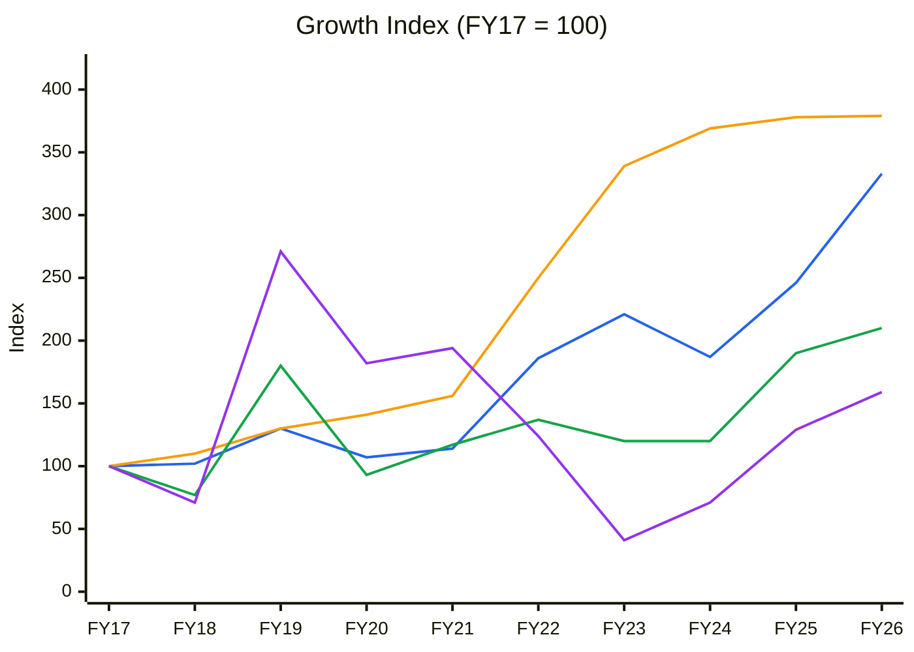
🟦 Revenue (CAGR 14.3%) · 🟧 Tangible PPE gross block (15.9%) · 🟩 EBITDA (8.6%) · 🟪 PAT (5.3%)

**Read:** Since FY17 the gross block grew 3.8× and revenue 3.3×, while EBITDA grew only 2.1× and PAT 1.6×. Revenue caught up with the asset base only in FY26, and only through price.

**Business inference:** The FY21–23 Dahej expansion (₹168 Cr of capex) bought revenue but not margin. Each rupee of sales now carries less profit than in FY17–21. That is the signature of a commodity converter whose input (sulphur) captures the value, not of a speciality compounder. The FY26 revenue jump is price, so the gap between 🟦 and 🟩/🟪 is the real story.

---

## BUSINESS PRIMER

DMCC makes chemicals from two raw materials: **sulphur and boron ore**. At Roha (Maharashtra, ~350 MTPD sulphuric acid, ~10,000 MTPM installed capacity) and Dahej (Gujarat, ~350 MTPD, ~18,000 MTPM), it burns sulphur into sulphuric acid and oleum. It sells most of that as bulk acid to fertiliser, detergent and industrial users. It also sulphonates part of it into higher-value intermediates such as benzene/toluene sulphonic acids, ethyl- and methyl-sulphates, and chlorosulphonic derivatives for pharma, dyes and agrochemicals. Dahej also converts imported Turkish boron ore into boric acid and borates for glass, ceramics and frits (Q4FY26 call; AR FY26 pp. 2–9). Revenue is volume × realisation. Realisation is set by the sulphur price because bulk acid is passed through at a roughly fixed rupee spread, and speciality contracts reprice quarterly with a lag (MD, Q4FY26 call). The business depends on two things: **(1) access to sulphur at a spread it can pass on**, and **(2) building a speciality share large enough that the margin stops depending on (1).**

This is a **semi-commodity, asset-heavy chemical converter**, not yet a speciality chemicals company, whatever its name. The MD himself said the label will be fair only when speciality reaches "at least 50%" of revenue; it is 31%. The key value driver is the **sulphur → acid spread and volume**. Mix is the long-term hope. The key risk is the **commodity cycle**, which in 2026 became an acute supply shock: about half of seaborne sulphur moves through the Strait of Hormuz, and Indonesian nickel smelters had already absorbed ~3 Mt of supply before the war (MD, Q4FY26 call). Two structural features colour everything below. First, **reported growth is mostly price**: revenue grew 99% in Q1FY27 while plants were already at capacity, so it cannot be volume. Second, **working capital and inventory gains swing earnings both ways**: the same price spike that inflates profit also drained ₹77 Cr of working capital in FY26 and turned OCF negative.

**Segment: Specialty Chemicals — KPI reference available ✓** (`references/05-industry-kpis-india.md` line 449). DMCC reports a single segment, and management refuses to split speciality from bulk (Q4FY26 call).

---

## Module 1 — Broad Market Cycle (Marks)
- **Nifty 50:** 22,997, −10.8% YoY, below a falling 30-week MA (23,740 vs 23,895 five weeks ago). Weinstein **Stage 4**. India VIX ~14 (low fear despite the downtrend, which suggests complacency rather than capitulation).
- **Pendulum:** **Cautious.** The market is not euphoric, but it is not at a fear extreme either. Small-cap chemicals have rallied on "sulphur/acid shortage" momentum: Aarti, Deepak and Navin all posted Q1 profit growth of +100–250% (Screener peer table, Oct-26). That is a classic sign of a cyclical sub-sector being chased.
- **Sizing implication:** Defensive. A Stage-4 market plus a commodity-windfall stock means half-size at most, even if fundamentals were clean.

---

## Module 1b — Sector Cycle: Tailwinds & Headwinds

**Secular vs cyclical decomposition (Q1FY27 revenue +99% YoY):**
| Component | Estimate | Evidence |
|---|---|---|
| Volume | ~0–5% | Plants were "operating at capacity" already in May-26 (Q4FY26 call). Both plants ran without interruption in Q1 (press release). There is no new capacity: CWIP is ₹4.9 Cr |
| Price / pass-through (cyclical) | **~90%+** | "Driven principally by a significant escalation in sulphur and sulfuric acid prices" (MD, 12-Aug-26). Sulphur is at all-time highs |
| Inventory gain (one-off) | Meaningful share of Q1 PAT | "A meaningful portion of the reported profitability reflects inventory gains. These gains will reverse" (MD) |
| Mix / speciality (secular) | Small | Speciality 31% of revenue. Exports fell 16% in FY26. LatAm/China/Japan gains only "compensating" for Europe |

**The durable baseline is ~6–9% revenue growth** (India industrial chemicals plus slow mix gains). Nearly all of the FY26–Q1FY27 surge is cyclical and must not be embedded in any DCF.

- **Input cycle:** Sulphur is at all-time highs because of the Hormuz closure and the Indonesian HPAL nickel pull. Chinese sulphuric-acid export curbs protect China's own fertiliser sector (Q4FY26 call). Management expects normalisation to take "a few months" even after the straits reopen. The margin percentage compresses (pass-through at a fixed spread) while the absolute rupee margin is held or inflated by inventory gains.
- **Inventory cycle:** Customers are pre-buying on supply fear. When availability returns, the reversal will show up as destocking, falling realisations and inventory losses at DMCC.
- **Competitive capacity:** Copper smelters (Kutch Copper/Adani: >1 Mt acid ambition by 2030; Hindalco, Vedanta) produce by-product sulphuric acid that structurally caps acid prices once running. They are currently running below capacity (MD), so this is a deferred headwind, not a vanished one.
- **Geopolitical map:** (1) Raw-material route risk: Hormuz, **structural for the duration of the conflict**; Roha depends on imports, Dahej on domestic refinery sulphur. (2) Boron ore comes from a single country (Turkey/Eti Maden). The FY26 H1 supply disruption left boron "close to non-operational" (AR FY26 MD&A). (3) Europe, a former speciality-export market, is in structural decline because of Chinese displacement.
- **Net FX:** FY26 exports FOB ₹62.2 Cr vs raw-material imports CIF ₹62.1 Cr (AR FY26 Annexure). This is a **natural hedge**, so FX is not a material driver.

**CY5 / CY6 (industry sulphur demand vs supply, and the sulphur–acid spread):** we found no primary-sourced 10-year Indian series (CRISIL/FAI data was not accessible). We do not chart estimates. DMCC's own gross margin (C4 below) serves as the spread proxy: 55% (FY21) → 30% (FY26).

**Sector cycle verdict: TAILWIND (cyclical, transient) on revenue and absolute profit; HEADWIND on margin quality. The duration is unknown and tied to the Gulf conflict.** Downstream effects: no tailwind in the DCF, and MoS widened by 10pp.

---

## Module 1c — Stock Cycle: Company-Specific Positioning

**Quarterly trajectory (Screener consolidated, ₹ Cr):**
| Qtr | Q2FY25 | Q3FY25 | Q4FY25 | Q1FY26 | Q2FY26 | Q3FY26 | Q4FY26 | Q1FY27 |
|---|---|---|---|---|---|---|---|---|
| Revenue | 103 | 118 | 125 | 127 | 126 | 151 | 178 | 253 |
| Revenue YoY % | 34 | 46 | 49 | 49 | 22 | 28 | 42 | 99 |
| EBITDA | 15 | 18 | 15 | 17 | 14 | 15 | 18 | 34 |
| EBITDA YoY % | 67 | 157 | 114 | 89 | −7 | −17 | 20 | 100 |
| OPM % | 15 | 15 | 12 | 13 | 11 | 10 | 10 | 13 |
| PAT | 6 | 8 | 6 | 8 | 6 | 6 | 8 | 20 |

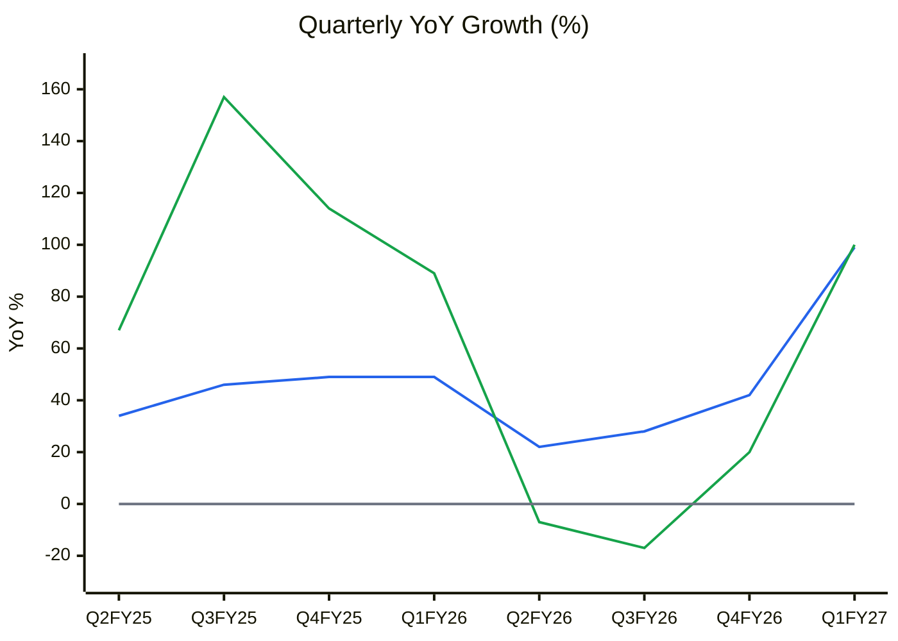
🟦 Revenue YoY % · 🟩 EBITDA YoY % · ⬜ zero line

**Read:** Revenue growth re-accelerated from 22% to 99% over four quarters. EBITDA growth swung from −17% to +100%, but OPM stayed in a 10–15% band throughout.

**Business inference:** This is an acceleration in price, not in the business. EBITDA growth tracks revenue only when inventory gains are present (Q1FY27), and margins have not expanded structurally. The quarter to watch is the first one after sulphur stabilises. If EBITDA then falls back to ~₹15–18 Cr/quarter, the market has paid for a one-off.

- **Volume / price / mix:** Price-dominated (see 1b). Volume is capped at capacity. The MD says the speciality limit is "market, not production", so mix is demand-constrained.
- **Physical capacity:** 2 × ~350 MTPD sulphuric acid (~230k TPA at 330 days) and 28,000 MTPM total installed product capacity (AR FY26 p.2). Both plants ran at capacity in Q4FY26/Q1FY27. **There is no announced expansion and CWIP is ₹4.9 Cr, so the capacity ceiling year is now.** Any growth beyond price must come from mix.
- **Operating leverage (FY26):** Contribution margin ≈ gross margin 30% → DOL ≈ 30%/8.4% EBIT margin ≈ 3.6×. DFL = EBIT 49 / (49 − 10) = 1.26×. **DTL ≈ 4.5×**: a 10% revenue fall at a constant gross margin cuts EPS by ~45%. ICR = 4.9× (FY26), ~8× (Q1FY27). Safe today. In the bear case (EBITDA ₹45 Cr) ICR falls to ~3×.
- **FCF inflection:** Capex is already maintenance-only (0.4× D&A). FCF now depends only on working capital: positive when sulphur falls (WC releases), negative when it rises. The FY27 path is ambiguous: the Q1 WC build will release only after the sulphur price breaks.
- **Guidance accuracy:** The MD gives no forward guidance by stated policy ("it's really my style not to give futuristic projections", Q4FY26 call). The WTT in Module 3 is built from operational statements.

**Stock-cycle classification: LATE CYCLE / PEAK (commodity windfall).** The absolute EBITDA run-rate (Q1 annualised ₹138 Cr) is >2× the 10-yr median, while margin % is mid-range. That is the classic peak in a pass-through business. MoS +10pp; position ×0.5.

---

## Module 2 — Industry Structure (Porter) & Capital Cycle

| Force | Assessment | Signal |
|---|---|---|
| New entrants | Moderate. Hazardous-chemical permits and integration are a barrier, but by-product acid from copper and zinc smelters enters without any "entry" decision | Negative |
| Supplier power | **Very high.** Sulphur is a refinery/gas by-product, globally priced, and now physically scarce. Boron ore is near-monopoly Turkish (Eti Maden) | Strongly negative |
| Buyer power | Bulk acid buyers (fertiliser, detergents) are price-sensitive. Speciality customers are long-term but on quarterly contracts | Negative |
| Substitutes | Smelter acid substitutes directly for sulphur-burnt acid. Alternative sulphonation routes exist | Negative |
| Rivalry | Fragmented regional market, constrained by freight (acid "can't be transported very far", MD) | Neutral |

**Industry verdict: UNATTRACTIVE at the bulk layer, NEUTRAL in speciality sulphonation/boron.** Freight-limited local markets give some regional protection (a local-scale feature) but no pricing power over the input.

**Capital cycle:** DMCC's own capex/D&A fell from 12.3× (FY22) to 0.4× (FY26), so the company is not adding supply. The industry signal is mixed. Smelter by-product acid capacity is coming (Kutch Copper ramp), while sulphur-burner capacity is disciplined. Peers also carry large post-FY22 asset bases with depressed returns: Aarti ROCE 6.9% and Bodal 5.6% (Screener). **CY8 was not built** because peer capex series beyond Screener headline data were not collected.

---

## Module 3 — Business Quality & Moat

**Greenwald barriers:**
1. **Cost advantage — Weak.** Integration (acid → sulphonation, utilities shared) helps, but feedstock is a pass-through commodity and gross margin has fallen 25pp in five years.
2. **Customer captivity — Weak to moderate.** Qualified speciality grades for pharma customers are sticky (long-term contracts per the MD), but they are only 31% of revenue.
3. **Local economies of scale — Partial.** Sulphuric acid is freight-limited, so Roha and Dahej each have a regional catchment.

**Buffett price test:** Fail. DMCC passes on cost but cannot raise the spread. "Sulfuric acid by itself is a low margin. Although the price goes up doesn't mean we make a higher margin" (MD).

**Market share stability:** Not disclosed. There is no segment reporting and no industry share data.

**Moat verdict: NONE to NARROW (regional freight moat on bulk acid only).**

**Fisher 15-point (1–3 each):** Market potential 2 · New products 2 (the EOR-polymer intermediate and boron specialities started commercial sales, per the Q4FY26 call) · R&D effectiveness 1 (~₹2 Cr/yr per analyst on the Q4 call; the MD admitted R&D is mostly process work) · Sales organisation 2 · Profit margin 1 · Margin improvement 1 · Labour relations 2 · Executive relations 2 · Management depth 2 (ED Operations, CFO) · Cost/accounting controls 2 (clean audit opinion, KAMs routine) · Industry advantages 2 · Long-range orientation 2 · Dilution 3 (no equity issued in 10 yrs) · Candor in adversity **3** (the MD pre-emptively warned shareholders that Q1 profits are inflated) · Integrity 3 → **30 / 45. Point 15: PASS.**

---

## Module 4 — Management & Capital Allocation
- **Promoter (Goculdas family):** 53.84%, flat for 12 quarters (Dec-23 → Sep-26, Screener SHP). **Pledge: not re-verified** (⚠️; no pledge-creation filing seen on BSE May–Oct 2026). FII 0.53%, DII 1.26%, ~18,500 shareholders. Institutional interest is negligible.
- **Remuneration:** MD & CEO Bimal Goculdas (promoter) ₹2.49 Cr in FY26 (+21%, incl. ₹0.34 Cr PLI for FY25). That is **9.1% of FY26 PAT** and 52× the median employee. It sits just under the skill's 10% extraction threshold, and it was 11.3% of FY25 PAT. Non-executive commissions rose 217%. **Watch-flag.**
- **RPTs:** "No materially significant related party transactions" (AR FY26 Board's report). All RPTs are on an arm's-length basis via AOC-2. One wholly owned subsidiary (Germany, immaterial). No ICDs to the group were identified.
- **Capital allocation (10 yrs):** Cumulative capex ₹246 Cr vs D&A ₹101 Cr. The FY21–22 Dahej spend (₹146 Cr) was funded by debt, which rose from ₹25 Cr to ₹93 Cr. Payback since then: ROCE has run at 7–15% vs 18–43% before. **Incremental ROIC on the expansion**: ΔEBIT FY21→FY26 ≈ ₹49 − ₹36 = ₹13 Cr pre-tax (~₹9.5 Cr post-tax) on ~₹170 Cr of growth capex ≈ **5.6% < WACC 12.5%**, so the expansion **destroyed value** to date. Dividend payout is 22–29%. No buybacks.
- **FCF/share vs EPS (5-yr):** FCF per share FY21 −₹4 → FY26 −₹9.6 (both negative). EPS ₹13.1 → ₹11.0 (−3.4% CAGR). Share count is constant at 2.49 Cr.
- **Buffett's three C's:** Candor **High**: an unusually honest Q1 press release and blunt Q&A answers. Competence **Moderate**: ran both plants through the Hormuz shock, but the 10-yr return record is poor. Caring **Moderate**: a stable dividend, but the MD's pay is rising faster than profit.

### Walk the Talk Scorecard
| Source | Statement | Guided | Actual | Verdict |
|---|---|---|---|---|
| Q4FY26 call (May-26) | Roha disruption limited; plants back at capacity | Normal operations | Q1FY27: Dahej & Roha "operated without interruption" (press release) | ✅ |
| Q4FY26 call | Full pass-through; absolute margin maintained | Absolute EBITDA held | FY26 EBITDA ₹63 Cr vs ₹57 Cr; Q1FY27 ₹34 Cr | ✅ |
| Q4FY26 call | Boron at full capacity, adequate stock | Boron normal | Q1FY27: boron "met its quarterly targets" | ✅ |
| Q4FY26 call | WC < 2 months of sales | < 60 days | FY26 WC days 34 | ✅ |
| Q2FY26 call (per Q4 Q&A) | LatAm traction replacing lost European business | Exports stable | FY26 exports FOB ₹62.2 Cr vs ₹74.0 Cr (−16%) | ❌ |
| Name change (2023) / Q4 call | Shift to ~60% speciality | Speciality ≥ 50–60% | 31% speciality in FY26 | ❌ |
| Q4FY26 call | Raise R&D intensity "in coming quarters" | Higher R&D | Not yet visible (pending FY27 AR) | ⚠️ pending (not scored) |

**WTT Score:** 4 / 6 = **0.67 — MODERATE**
**Guidance points assessed:** 6 | Hits: 4 | Near misses: 0 | Misses: 2 | Reversals: 0
**Key pattern:** Delivers on operations and plant reliability, but misses on strategy (speciality mix, exports). There is no numeric financial guidance by policy.
**Insider action:** No promoter open-market buys or sells (holding flat at 53.84% for 12 quarters) → **NEUTRAL**.
**DCF impact:** Speciality-mix uplift is haircut 30% in the base case. Mix gains count only in the bull case.
**Overall management credibility: MODERATE.** Honest operators of a commodity asset, but not proven allocators.

---

## Module 4b — Financial Forensics

**Beneish M-Score (FY26 vs FY25):** DSRI 0.96 · GMI 1.27 · AQI ~1.0 · SGI 1.35 · DEPI 1.00 · SGAI 0.73 · LVGI 1.10 · TATA 0.10 → **M = −1.58, in the "likely manipulator" zone (> −1.78).**
**Explanation:** The score is mechanical, not manipulation. TATA (accruals = PAT ₹27 Cr vs OCF −₹18 Cr), GMI (gross margin 38% → 30%) and SGI (+35%) are all direct products of sulphur pass-through and the working-capital build: inventory rose ₹43 Cr → ₹92 Cr and receivables ₹74 Cr → ₹96 Cr. DSRI < 1 (receivables grew more slowly than sales) argues against revenue inflation. **Explained flag, not a hard stop.** It must normalise in FY27.

**Altman Z'' (FY26):** X1 0.19 · X2 0.50 · X3 0.11 · X4 1.25 → **4.93, Safe.**
**Piotroski F (FY26):** ROA>0 ✓ · CFO>0 ✗ · ΔROA ✓ · CFO>NI ✗ · lower LT debt ✓ · current ratio ✗ (1.60 vs 1.64) · no dilution ✓ · gross margin ✗ · asset turnover ✓ → **5/9, Average.**
**Sloan accrual (FY26):** (27 + 18 + 7) / avg TA 413 = **12.6%, Warning (> 10%).**

**Indian-specific flags:** Pledge ⚠️ not verified · RPT ✓ clean · Auditor (Rahul Gautam Divan & Associates, Tier-3) has issued a **clean opinion, no EOM**. KAMs cover litigation (incl. a Shipping Corporation of India claim of ₹2.48 Cr plus interest) and revenue recognition, both routine · Tax: FY19 2% and FY20 −22% effective rates (deferred-tax recognition), normal since FY22.

**Schilit screen:** Other income/EBIT < 3% in FY25–26 ✓ (FY24 ₹10 Cr OI was 32% of EBIT, a one-off fair-value gain) · Capex/D&A 0.4× (no capitalisation of costs) ✓ · DPO fell from 119 to 60 days (payables are *not* being stretched, which hurts OCF) ✓ · Inventory days rose from 58 to 82 ⚠️ (price-driven).

**Forensic red-flag count:** 3 / 15 (Beneish zone, Sloan > 10%, NI-up/OCF-down). **All 3 trace to one explained cause, the sulphur price shock.**
**Overall forensic verdict: Minor concerns.** There is no manipulation, but earnings quality is low until working capital releases.

---

## Module 5 — Earnings Quality & Financial Statements

**10-year core table (Screener consolidated; AR FY26 for FY25–26 PPE):**
| FY | Revenue | EBITDA | OPM % | Gross margin %* | PAT | CFO | Capex | ROCE % | ROE % |
|---|---|---|---|---|---|---|---|---|---|
| FY17 | 175 | 30 | 17.1 | 43 | 17 | 29 | 7.1 | — | 28.3 |
| FY18 | 178 | 23 | 12.9 | 42 | 12 | 18 | 8.5 | 21 | 16.4 |
| FY19 | 228 | 54 | 23.7 | 50 | 46 | 21 | 13.8 | 43 | 39.7 |
| FY20 | 188 | 28 | 14.9 | 52 | 31 | 27 | 17.0 | 18 | 21.4 |
| FY21 | 200 | 35 | 17.5 | 55 | 33 | 32 | 47.3 | 19 | 19.1 |
| FY22 | 326 | 41 | 12.6 | 40 | 21 | 51 | 98.6 | 15 | 10.8 |
| FY23 | 387 | 36 | 9.3 | 36 | 7 | 30 | 21.9 | 7 | 3.5 |
| FY24 | 328 | 36 | 11.0 | 39 | 12 | 38 | 18.9 | 8 | 5.7 |
| FY25 | 431 | 57 | 13.2 | 38 | 22 | 38 | 7.0 | 14 | 9.6 |
| FY26 | 582 | 63 | 10.8 | 30 | 27 | −18 | 6.0 | 15 | 10.9 |
| TTM (Jun-26) | 708 | 81 | 11.4 | — | 40 | — | — | — | — |
*Gross margin = 100 − material cost % (Screener expense schedule). ROE = PAT ÷ year-end equity.

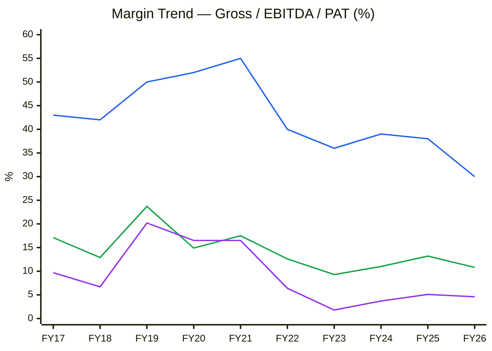
🟦 Gross margin · 🟩 EBITDA margin · 🟪 PAT margin

**Read:** Gross margin peaked at 55% in FY21 and fell to 30% in FY26, the lowest in a decade. EBITDA margin halved from its FY19 peak (23.7%) to 10.8%.

**Business inference:** This is the decisive anti-speciality evidence. A genuine speciality mix shift would raise gross margin, but DMCC's has fallen 25pp as sulphur inflation and the bulk-heavy Dahej volumes diluted it. The spread per tonne is roughly fixed, so margin % will keep falling as long as sulphur rises. Valuation must be anchored to absolute normalised EBITDA (₹60–70 Cr), not to percentages.

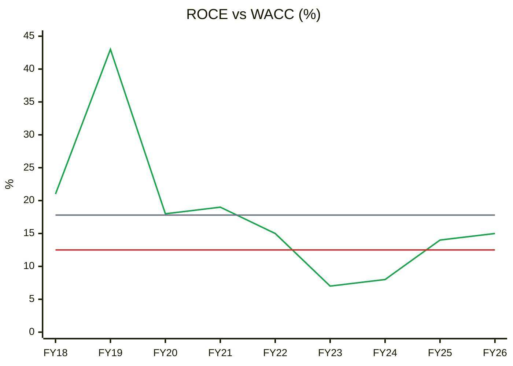
🟩 ROCE · 🟥 WACC 12.5% · ⬜ 9-yr average 17.8%

**Read:** ROCE was above WACC in FY18–22, fell below it in FY23–24 (7–8%), and has recovered to only ~15%, below its 9-yr average of 17.8%, even at peak revenue.

**Business inference:** The post-expansion asset base earns ~2–3pp over the cost of capital in a good year and below it in a bad one. There is no durable economic profit, and the business sits at roughly fair book value through the cycle. The Q1FY27 windfall will lift FY27 ROCE above 20%, but that is a cyclical, not a structural, change (→ CY7).

**DuPont (5-factor; average balances):**
| FY | EBIT margin | Asset turnover | Equity multiplier | Interest burden | Tax burden | ROE |
|---|---|---|---|---|---|---|
| FY22 | 12.0% | 1.01× | 1.77× | 0.87 | 0.62 | 11.4% |
| FY23 | 5.7% | 0.99× | 2.00× | 0.50 | 0.64 | 3.6% |
| FY24 | 9.5% | 0.84× | 1.91× | 0.55 | 0.71 | 5.9% |
| FY25 | 9.5% | 1.14× | 1.73× | 0.76 | 0.71 | 10.0% |
| FY26 | 8.4% | 1.41× | 1.74× | 0.80 | 0.69 | 11.3% |
| **Change** | −3.6pp | +0.40× | −0.03× | −0.07 | +0.07 | −0.1pp |

**Operating contribution (EBIT margin × AT):** 12.1% (FY22) → 11.8% (FY26). Stable, but the mix shifted from margin to turnover, i.e. price-inflated sales over the same assets.
**Financing contribution:** Stable. Leverage is *not* propping up ROE.
**DuPont verdict:** ROE recovered from 3.6% to 11.3% purely through asset turnover. Turnover rose because of the sulphur price, not volume, while EBIT margin fell. This ROE is borrowed from the commodity price.
**AT trend → Module 10 base AT:** 1.50× gross-block (5-yr average), not the FY26 1.92× (price-inflated).

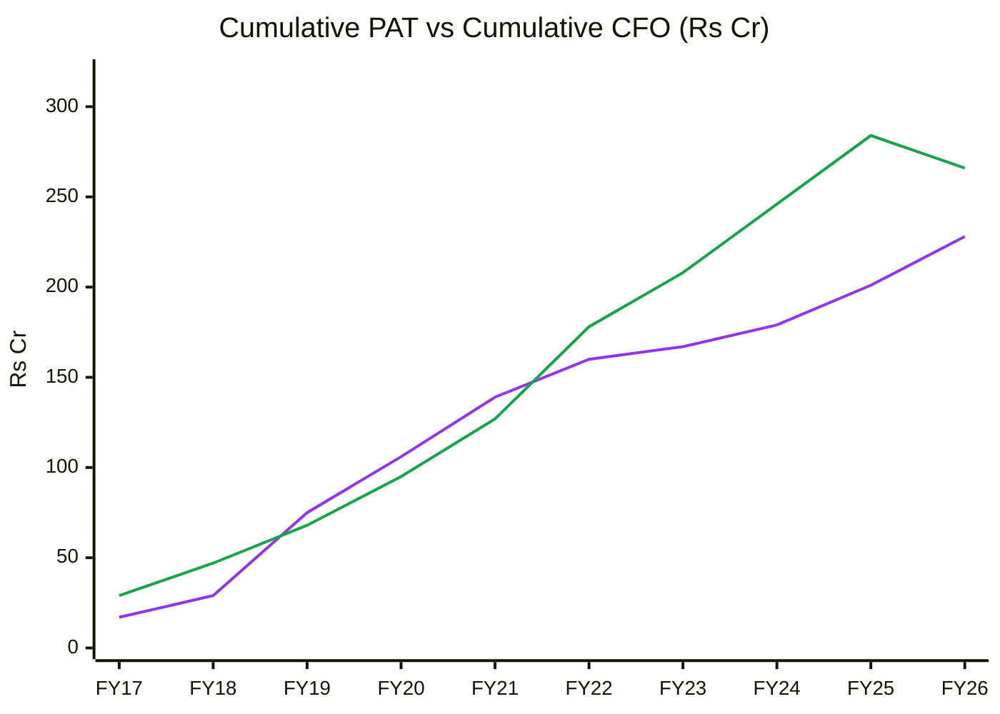
🟪 Cumulative PAT · 🟩 Cumulative CFO

**Read:** Ten-year cumulative CFO of ₹266 Cr vs PAT of ₹228 Cr gives a ratio of 1.17. The lines converged sharply in FY26, when CFO was −₹18 Cr.

**Business inference:** Over a full cycle DMCC's profits are real cash, helped by D&A > capex since FY24. The FY26 dip is working capital absorbing the sulphur price, not aggressive accounting. The FY27 test is whether that ₹77 Cr returns; it will only come back when sulphur prices fall, the same event that will shrink profits.

**OCF/NI (5-yr, FY22–26):** 1.56 → quality **High through-cycle, Low in FY26.** **O'Glove flags:** 3/15 (NI vs OCF, inventory days, Sloan). **Ind AS 116:** lease liabilities ₹0.04 Cr, immaterial.

---

## Module 5b — Fixed Assets: Full-Decade Long-Life Analysis

**PPE schedule (₹ Cr; Screener schedule FY17–24, AR FY26 Note 3 for FY25–26):**
| FY | Gross block (total) | of which intangibles* | Tangible gross block | Acc. depreciation | Net block | CWIP | Land | Buildings | Plant & Machinery | Capex | D&A | Capex/D&A | Acc dep ÷ gross | AT (gross, tangible) | AT (net) |
|---|---|---|---|---|---|---|---|---|---|---|---|---|---|---|---|
| FY17 | 95 | 15 | 80 | 12 | 83 | 3 | 22 | 18 | 38 | 7.1 | 4 | 1.8× | 13% | 2.19× | 2.11× |
| FY18 | 103 | 15 | 88 | 16 | 88 | 3 | 21 | 20 | 44 | 8.5 | 4 | 2.1× | 16% | 2.02× | 2.02× |
| FY19 | 119 | 15 | 104 | 20 | 99 | 1 | 21 | 21 | 58 | 13.8 | 5 | 2.8× | 17% | 2.19× | 2.30× |
| FY20 | 128 | 15 | 113 | 26 | 102 | 9 | 21 | 21 | 66 | 17.0 | 6 | 2.8× | 20% | 1.66× | 1.84× |
| FY21 | 140 | 15 | 125 | 31 | 108 | 38 | 21 | 21 | 78 | 47.3 | 7 | 6.8× | 22% | 1.60× | 1.85× |
| FY22 | 215 | 15 | 200 | 41 | 174 | 63 | 21 | 25 | 148 | 98.6 | 8 | 12.3× | 19% | 1.63× | 1.87× |
| FY23 | 286 | 15 | 271 | 56 | 230 | 11 | 21 | 50 | 193 | 21.9 | 18 | 1.2× | 20% | 1.43× | 1.68× |
| FY24 | 310 | 15 | 295 | 72 | 238 | 6 | 21 | 50 | 217 | 18.9 | 16 | 1.2× | 23% | 1.11× | 1.38× |
| FY25 | 321 | 19 | 302 | 87 | 234 | 0.1 | 21 | 53 | 221 | 7.0 | 17 | 0.4× | 27% | 1.43× | 1.84× |
| FY26 | 322 | 19 | 303 | 103 | 220 | 4.9 | 21 | 53 | 222 | 6.0 | 16 | 0.4× | 32% | 1.92× | 2.65× |
*Intangibles: goodwill ₹14.65 Cr (from the historical merger) plus a ₹4.4 Cr licence added in FY25 and ~₹1.4 Cr of software. AR FY26 tangible gross block = ₹301.2 Cr; accumulated depreciation ₹101.1 Cr; net ₹200.1 Cr. Net block in the table includes intangibles (Screener). **Deemed-cost caveat:** under Ind AS transition (1-Apr-2016) PPE was reset to deemed cost, so accumulated depreciation restarts near zero in FY17. "Acc dep ÷ gross" therefore *understates* the true age of the pre-2016 Roha assets (plant since 1978).

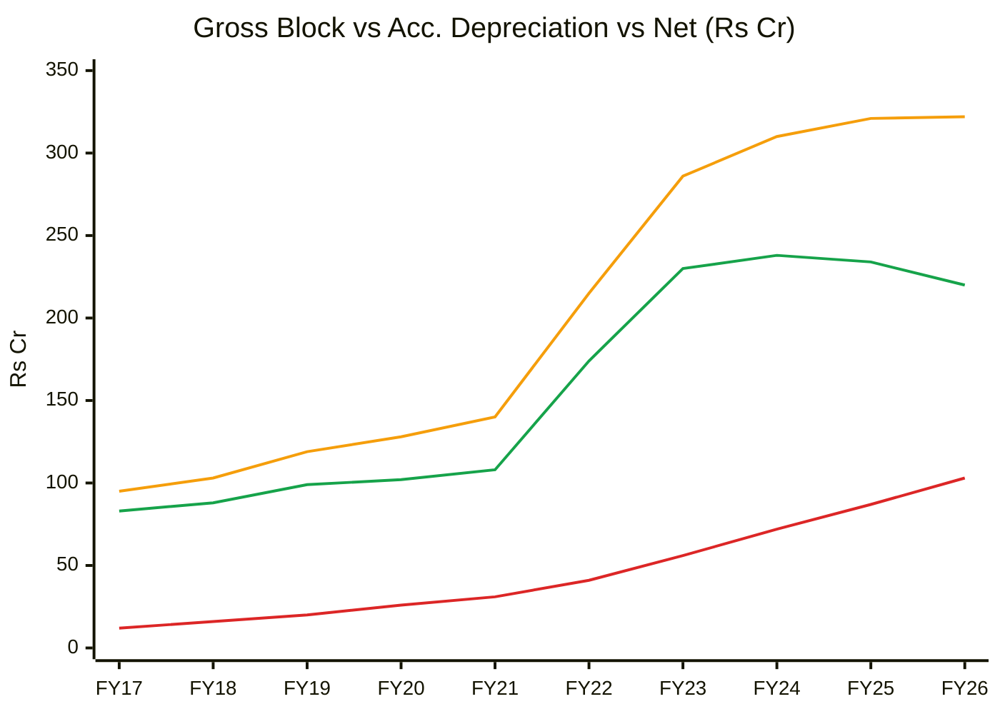
🟧 Gross block · 🟥 Accumulated depreciation · 🟩 Net block

**Read:** Gross block tripled from ₹95 Cr to ₹322 Cr, all of it in FY20–24. It has been flat since FY24 while accumulated depreciation climbs ~₹16 Cr/yr. Net block peaked at ₹238 Cr in FY24 and is now shrinking.

**Business inference:** DMCC is in **harvest mode**. The Dahej expansion is complete and being depreciated, and no new block is being added. That flatters FCF (capex is far below D&A) and lifts net-block turnover. It also means there is no volume growth engine beyond FY26 capacity, and the asset base is ageing towards a future replacement cycle.

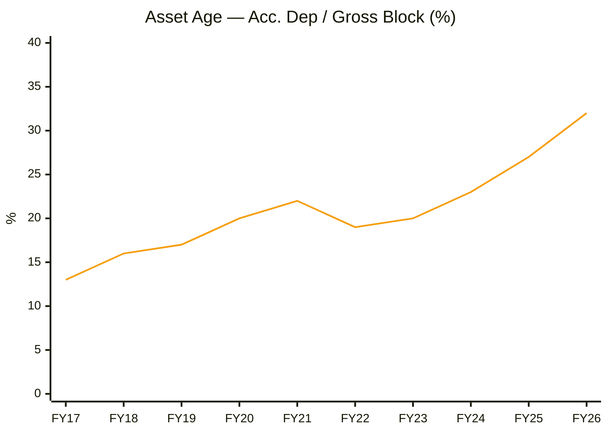
🟧 Accumulated depreciation as % of gross block

**Read:** The book "age" ratio rose from 13% to 32%. It dipped in FY22–23 when the new Dahej block was capitalised and has risen 3–5pp a year since.

**Business inference:** On book, ~one-third of the asset life is consumed. Because of the deemed-cost reset the real figure for the Roha site is higher. FY26 D&A of ₹16 Cr on ₹222 Cr of P&M implies a ~14-year remaining life. Maintenance capex will have to rise towards ₹15–20 Cr/yr within 3–5 years, so FY25–26 FCF overstates sustainable FCF by ~₹10 Cr.

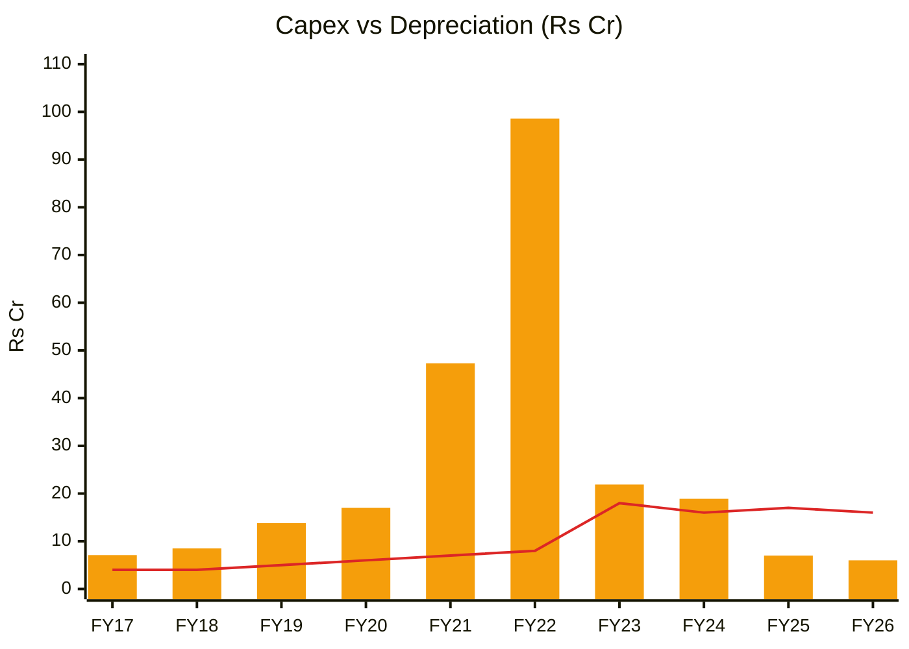
🟧 Capex (bars) · 🟥 Depreciation

**Read:** Capex peaked at 12× D&A in FY22 (₹98.6 Cr). For two years it has run at 0.4× D&A (₹6–7 Cr vs ₹16–17 Cr).

**Business inference:** One capex burst in a decade, funded by debt, earned an incremental ROIC of ~6%. Management has since starved capex rather than chase the cycle. That is disciplined given the poor return on the last project, but it confirms there is no growth pipeline. The PIE-implied growth in Module 8 has no physical capacity behind it.

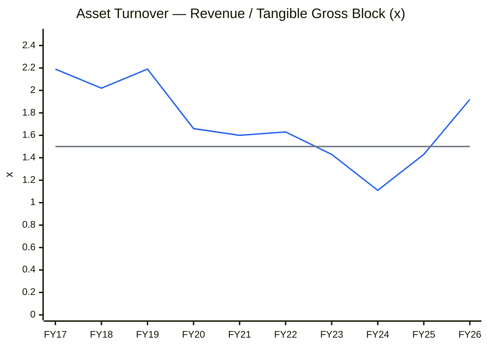
🟦 Asset turnover · ⬜ 5-yr average (FY22–26) 1.50×

**Read:** AT fell from 2.2× (FY17–19) to a 1.11× trough (FY24), then rebounded to 1.92× in FY26 (TTM ~2.3×) on price alone. The 10-yr average is 1.72× and the 5-yr average 1.50×.

**Business inference:** The FY26 rebound is a price effect on fixed capacity: tonnes are flat, rupees per tonne are up. When sulphur normalises AT reverts towards 1.4–1.5×. The 1.50× 5-yr average is the base-case anchor and FY24's 1.11× the bear anchor.

**Capacity register and utilisation:**
| Site | Opened | Chemistry | Sulphuric acid | Installed product capacity | Status FY26–Q1FY27 |
|---|---|---|---|---|---|
| Roha, Maharashtra (88,356 m²) | 1978 | Sulphur chemistry + R&D centre | ~350 MTPD | 10,000 MTPM | ~60% for ~15 days in Mar-26 (import sulphur shortage), then at capacity |
| Dahej, Gujarat (103,327 m²) | 2013 (expanded FY21–23) | Boron + sulphur + downstream | ~350 MTPD | 18,000 MTPM | ~95% (Q4FY26 call), uninterrupted |
| Ambernath/Nalimbi land | — | Non-operating (former forest-land dispute) | — | — | The Supreme Court ruled in DMCC's favour, but Maharashtra has not re-transferred title (Q4FY26 call). It is a possible monetisation, but its value is unknown and off-book |

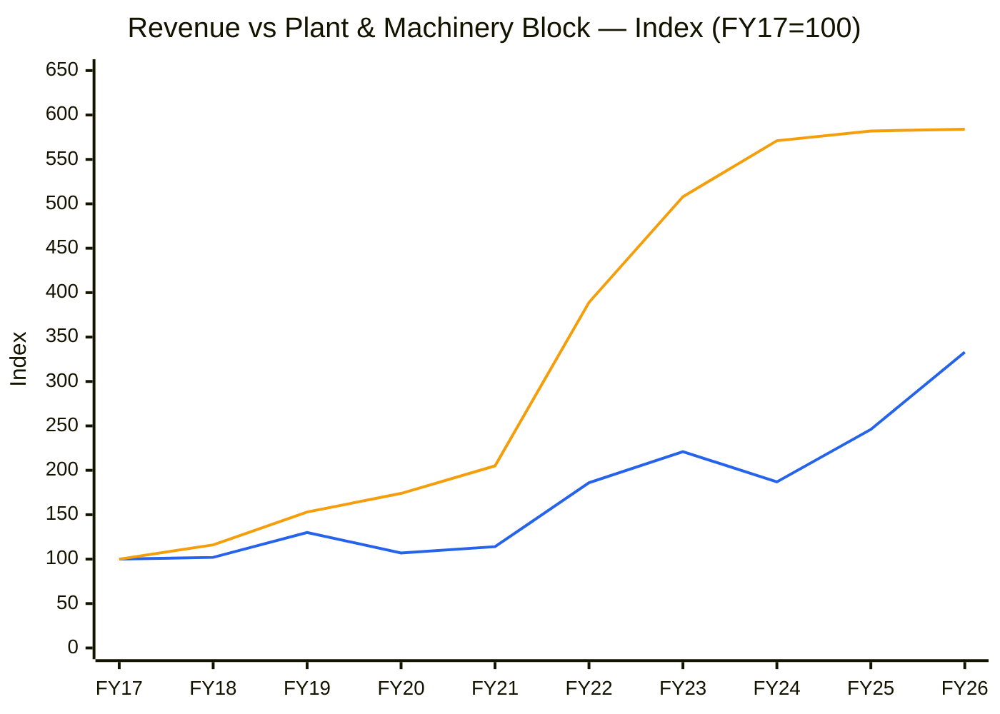
🟦 Revenue · 🟧 Plant & machinery gross block (capacity proxy)

**Read:** The capacity proxy (P&M block) grew 5.8× vs revenue 3.3× over the decade. It has been flat since FY24, and both plants are at capacity.

**Business inference:** **The capacity ceiling year is FY26/FY27.** Beyond the price cycle, volume growth needs new capex that is neither announced nor in CWIP. Any market-implied growth above ~8% a year is pricing an unannounced expansion or a permanent sulphur windfall.

**Land / bear-case floor:** Freehold land ₹2.8 Cr plus leasehold ₹18.5 Cr at deemed cost (AR FY26 Note 3); buildings at net ₹41.8 Cr. Roha's 22 acres and Dahej's 25 acres of industrial land probably have market value well above book, but there are no sale proof points, so we assign no floor value. Nalimbi is option value only.

---

## Module 6 — Industry KPIs & Peer Analysis
**Sector:** Specialty Chemicals (sulphur & boron chemistry sub-segment)

| KPI | DMCC | Healthy range (KPI ref) | Assessment |
|---|---|---|---|
| EBITDA margin | 10.8% FY26 / 13.6% Q1FY27 | 20–30% | **Below**: < 15% = commoditisation |
| Export revenue % | 10.7% (FY26), down from 17.2% | > 50% for quality intermediates | **Below and falling** |
| R&D / revenue | ~0.3% (~₹2 Cr per Q4 call analyst; not contested by the MD) | > 3% | **Red flag** (< 1%) |
| Capacity utilisation | ~95–100% | > 75% | Above, but no headroom |
| Order book / revenue | Not applicable: quarterly contracts and spot sales; no order book disclosed | > 1.5× | n/a |
| Capex % revenue | 1.0% | 8–15% during expansion | Below: no expansion |

**Peer comparison (Screener consolidated, Oct-2026):**
| Metric | DMCC | Bodal Chemicals | Aarti Industries | Atul | Akshar Chem |
|---|---|---|---|---|---|
| Revenue 3-yr CAGR | 14.6% | 9% | 8% | 5% | — |
| EBITDA margin (FY26) | 11% | 8% | 15% | 18% | 21% |
| ROCE (latest) | 14.8% | 5.6% | 6.9% | 14.9% | 26.9% |
| Net D/E | 0.44 | 0.70 | 0.84 | 0.03 | 0.37 |
| P/E (TTM) | 19.9× | 30.5× | 35.1× | 22.9× | 14.4× |
| P/B | 3.2× | 1.8× | 3.1× | 2.9× | 3.5× |
| Q1 profit growth YoY | +163% | — | +256% | +92% | — |

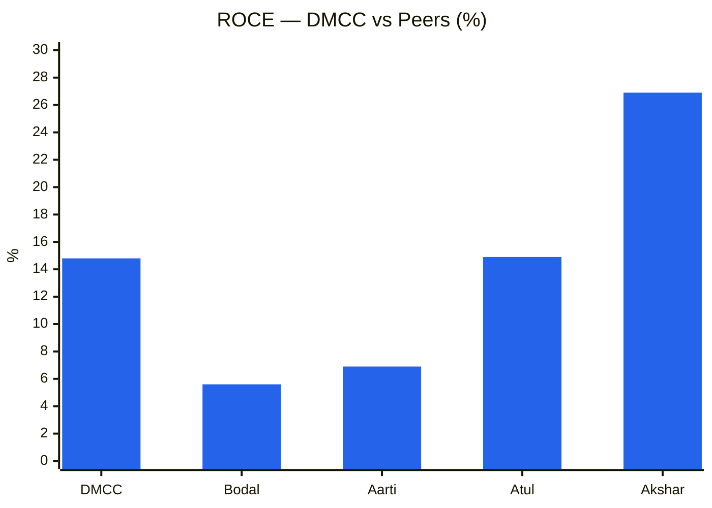
🟦 ROCE (latest, Screener)

**Read:** DMCC's 14.8% ROCE is in line with Atul's and well above Bodal's and Aarti's, which are stuck in post-capex troughs. Only Akshar earns genuinely high returns.

**Business inference:** DMCC is not a laggard among sulphur-linked Indian chemical makers. The whole cohort earns near cost of capital, which says the industry, not the company, is the problem. DMCC's P/B of 3.2× is the same as Aarti's on a smaller, less diversified, single-segment base. Its relative discount to peers is P/E-only and disappears on normalised earnings.

**Peer DuPont note:** Atul's ROE (11.5%) comes from margin (18%) with almost no leverage, which is higher-quality ROE. DMCC matches it only through price-inflated asset turnover.

**Order Book Tracker:** *Not applicable.* DMCC sells on quarterly contracts and spot, discloses no order book and filed no Reg 30 order announcements (BSE filings May–Oct 2026 reviewed).

---

## Module 7 — Market Size & Market Share
- **TAM:** India sulphuric-acid consumption is roughly 15–20 Mt/yr (dominated by captive fertiliser and smelter acid). DMCC's ~0.23 Mt of acid capacity is ~1–1.5% of national volume. *Source quality: estimate from public industry commentary; no primary CRISIL/FAI series was accessed, so treat it as indicative.* Speciality sulphonation and boron niches are much smaller (low-₹ thousands of crore).
- **Penetration / share:** ~1% of bulk acid nationally, but meaningful in western-India merchant acid (freight-limited regional market). It is one of a handful of domestic borate producers.
- **5-yr share trend:** Not measurable (no segment or volume disclosure). **Data gap.**
- **Revenue vs market:** FY26 revenue +35% and Q1FY27 +99% with plants at capacity means the growth is price and the share is stable. **Verdict: growing with the price of the market, not taking share.**

---

## Module 8 — Valuation: PIE First, Then DCF

**Inputs:** CMP ₹318 · Shares 2.494 Cr · MCap ₹794 Cr · Net debt ~₹106 Cr (FY26; probably higher at Jun-26 given the Q1 WC build) · EV ~₹900 Cr · TTM EBITDA ₹81 Cr (EV/EBITDA 11.1×) · TTM PAT ₹40 Cr · **Normalised** EBITDA ₹68 Cr (FY25–26 absolute run-rate, ex inventory gains), normalised NOPAT ≈ ₹40 Cr · WACC 12.5% (Rf 7%, β ~1.1, ERP 6%; small-cap, BBB+ rated) · terminal g 6%.

### 8A. Price-Implied Expectations
| PIE value driver | Market-implied | My base case | Expectations gap |
|---|---|---|---|
| NOPAT CAGR (10-yr, ROIC 18%) on normalised ₹40 Cr base | **~24%** | ~9% | **−15pp: Optimistic** |
| Same, on TTM (windfall) NOPAT ₹48 Cr | ~20% | — | Still optimistic |
| Steady-state EBITDA margin | ≥ 14–15% (speciality-grade) | 11–12% | −3pp |
| Investment rate | Implies ~1.3× reinvestment of NOPAT (needs new capacity) | ~0.5× (maintenance + WC) | Physically implausible |

**Physical plausibility check:** Plants are at capacity, CWIP is ₹4.9 Cr and no expansion is announced. A ~20%+ decade-long NOPAT CAGR therefore requires either (a) an unannounced capex programme or (b) the sulphur windfall becoming permanent. **We think the market is wrong** (option c: it is extrapolating Q1FY27).

**Expectations treadmill:** To outperform, DMCC must hold quarterly EBITDA ≥ ₹30 Cr *after* sulphur stabilises, i.e. prove that Q1 was not inventory-driven. The MD has already said it was.

**Triggers.** Positive: (1) the Gulf conflict prolongs sulphur scarcity into FY28; (2) announcement of a speciality capex with an ROIC disclosure; (3) Nalimbi land title transfer and monetisation. Negative: (1) Hormuz reopens and sulphur falls, bringing inventory losses and a WC release with a profit drop; (2) Q2FY27 EBITDA reverts to ₹15–20 Cr; (3) smelter acid (Kutch Copper) ramps.

**SVAR:** Downside scenario at ₹165 → SVAR = (318 − 165)/318 = **48% (> 40%: asymmetry unfavourable).**

### 8B. Intrinsic value
| Method | Bear | Base | Bull |
|---|---|---|---|
| DCF (FCFF; WACC 12.5%; 5-yr explicit) | ₹54 (NOPAT ₹30 Cr, g 4%, ROIC 12%) | ₹141 (₹40 Cr, g 9%, ROIC 18%) | ₹266 (₹52 Cr, g 13%, ROIC 22%) |
| Relative: P/E on FY28E EPS (₹6.8 / ₹12.8 / ₹21.3) | ₹150 (22×) | ₹245 (19×) | ₹425 (20×) |
| P/B floor (FY28E book ~₹115) | ₹172 (1.5×) | ₹290 (2.5×) | ₹400 (3.5×) |
| **Scenario value used** | **₹165** | **₹245** | **₹425** |

The DCF sits far below the market multiples. Indian small-cap chemicals trade on P/E norms, not on cash returns. A business earning ROCE 2–3pp above WACC has a **justified P/B of ~1.2×** ((ROE 14% − g 8%)/(Ke 13% − g 8%)) against the 3.2× it trades at. We use the relative/P/B blend for scenario prices, which is generous to the stock, and the gap remains.

**Graham screen:** Revenue > ₹2,000 Cr ✗ · current ratio ≥ 2 ✗ (1.6) · positive EPS for 7 yrs ✓ · no dividend cut for 5 yrs ✗ (no FY23 dividend) · EPS growth ≥ 30% over 7 yrs ✗ (FY19 ₹18.5 → FY26 ₹11.0) · P/E ≤ 20 ✓ (19.9) · P/B ≤ 3 ✗ → **2/7.** Graham number = √(22.5 × 5-yr avg EPS ₹7.1 × BVPS ₹99.5) = **₹126.**

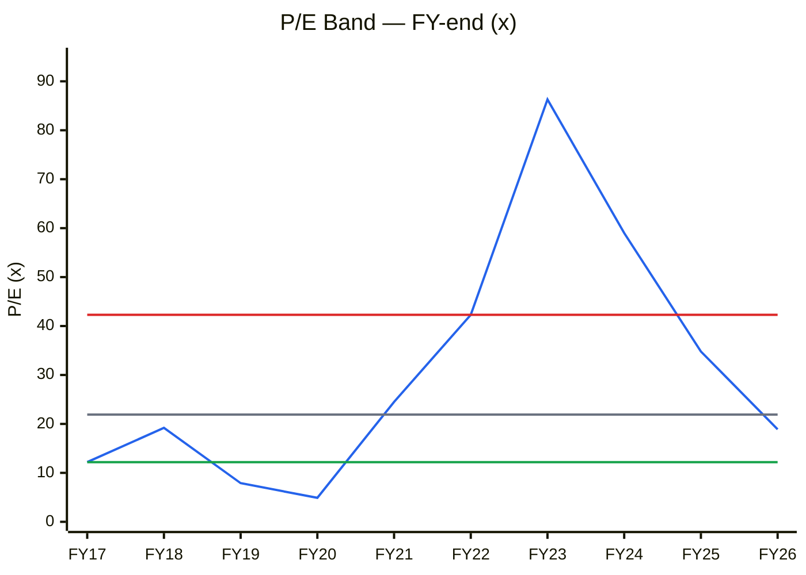
🟦 P/E (March price ÷ FY EPS) · ⬜ Median 21.9× · 🟥 75th percentile 42.3× · 🟩 25th percentile 12.2×. *Quartiles are used instead of ±1SD because the FY23 trough-EPS outlier (86×) makes SD (24×) meaningless.*

**Read:** The current TTM P/E is 19.9×, the ~40th percentile, slightly below the 21.9× median. FY23–24 P/Es of 59–86× were trough-earnings artefacts.

**Business inference:** **The cyclical P/E rule applies.** A below-median P/E on peak-windfall TTM EPS (₹16.0, the highest since FY19) is a warning, not a bargain. On normalised EPS (~₹12.5) the stock is on ~25×, *above* median, so the double-peak risk is real.

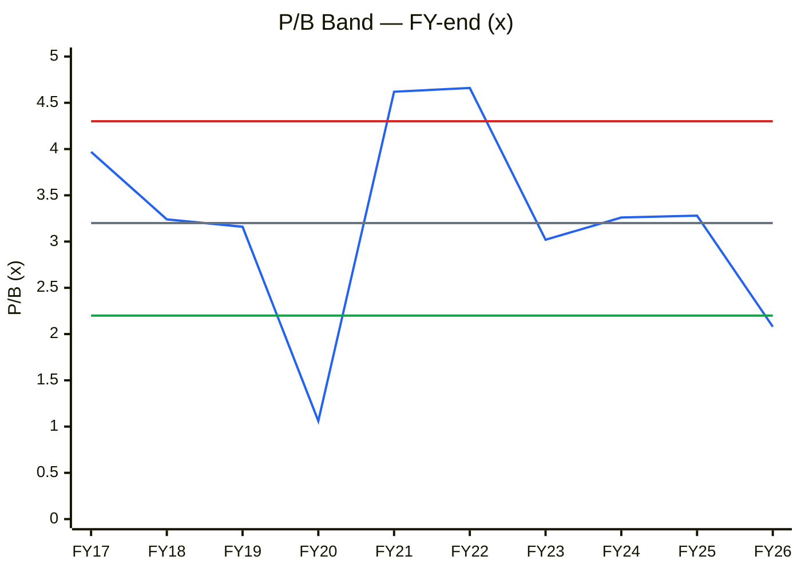
🟦 P/B · ⬜ Median 3.2× · 🟥 +1SD 4.3× · 🟩 −1SD 2.2×

**Read:** P/B is 3.2× today (₹318 / BVPS ₹99.5), exactly the 10-yr median and up from 2.1× (11th percentile) in March 2026. The current ROE is 11.5% vs a 10-yr median of 13.7%.

**Business inference:** At a median P/B the market prices DMCC as an average-cycle business, but ROE is below average and the cash ROE is lower still (negative OCF). P/B was "cheap" in March (2.1×), before the windfall. It is fair-to-full now. Book value grows only ~8–10% a year, which caps compounding.

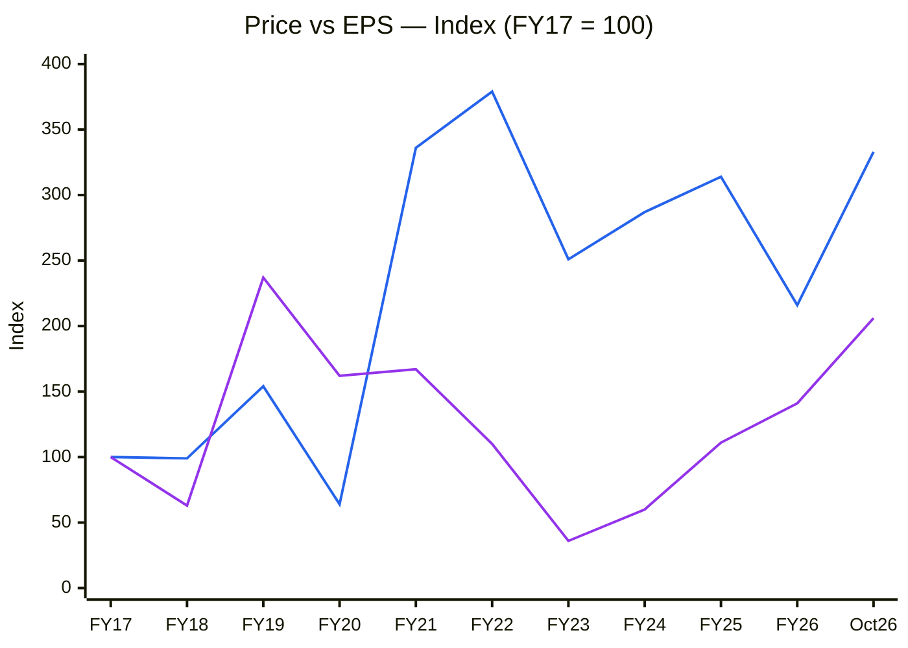
🟦 Share price (March-end; Oct-26 = ₹318) · 🟪 EPS (FY; Oct-26 = TTM ₹16.03)

**Read:** Since FY17 the price is up 3.3× (14% CAGR) and EPS up 2.1× (TTM). Price ran ahead of EPS in FY21–25 (re-rating) and is again above EPS after the Q1 rally.

**Business inference:** Much of the decade's shareholder return came from re-rating the "speciality" story (renamed in 2023), not from earnings. The latest leg is again ahead of TTM EPS that is itself windfall-inflated. Returns from here need the speciality story to finally show up in margins, which the data says it has not.

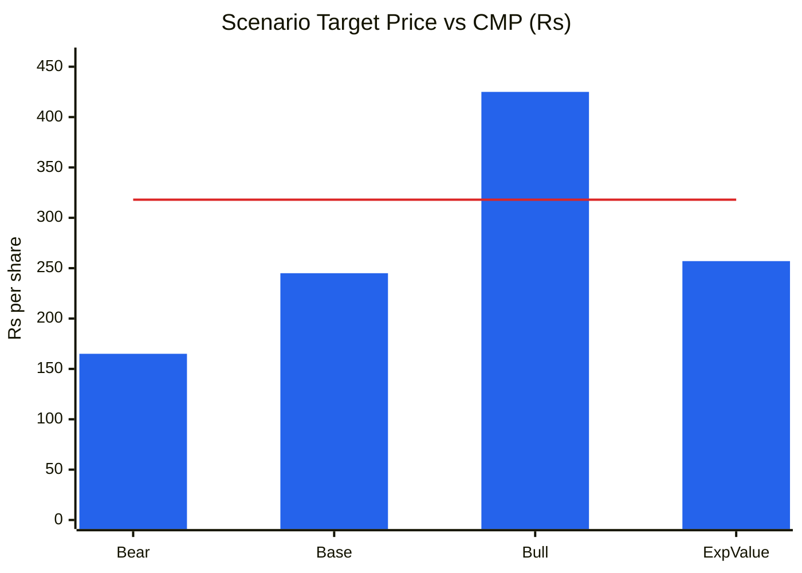
🟦 Scenario price · 🟥 CMP ₹318

**Read:** Bear −48%, base −23%, bull +34%. The expected value of ₹257 is 19% below CMP, giving an upside/downside ratio of 0.7:1.

**Business inference:** Only the bull case clears the current price, and it needs the sulphur windfall to persist *and* a mix shift. The stock is priced for the best case of a commodity cycle. For a business with no moat and a WTT of 0.67, that is not an asymmetric bet.

### Cycle Position Dashboard
| Dimension | Current | 10-yr median | Percentile | Signal |
|---|---|---|---|---|
| P/E (TTM) | 19.9× | 21.9× | ~40% | Fair, **on peak EPS** → Expensive on normalised |
| P/B | 3.2× | 3.2× | ~50% | Fair |
| EBITDA margin % | 11.4% TTM / 13.6% Q1 | 13.1% | ~20–55% | Mid (margin %) |
| Absolute EBITDA (annualised) | ₹138 Cr (Q1×4) / ₹81 Cr TTM | ₹36 Cr | 100% | **Peak** |
| ROCE | 14.8% (rising to >20% in FY27E) | 15% (avg 17.8%) | ~50% → peak | Mid → Peak |
| Gross margin (spread proxy) | 30% | 41% | 0% | Spread at a decade low in % terms (pass-through) |
| Industry utilisation | Sulphur-constrained supply | n/a | n/a | Tight (supply shock) |
| **Overall cycle position** | | | | **LATE / PEAK (commodity windfall)**, consistent with Module 1b (transient tailwind) and 1c (late cycle) |

---

## Module 9 — Technical Stage (Weinstein + CANSLIM)
- **Nifty 50:** **Stage 4.** 22,997 is below a declining 30-wk MA of 23,740, and the index is −10.8% YoY (Yahoo weekly).
- **Sector:** Small-cap chemicals are in a sharp Q1-driven rally (Aarti, Deepak and Navin are all up on acid-shortage earnings). There is no clean sector-index Stage-2 base; the move is momentum within a Stage-4 market.
- **Stock:** **Stage 2 (early), breakout attempt.** Weekly close ₹318 is above a rising 30-wk MA (₹276, up from ₹249 in July; Screener daily → weekly). It is +3.4% YoY vs Nifty −10.8%, an **RS differential of +14pp**. The week of 5-Oct-26 traded 4.09 mn shares (~13× the ~300k weekly average) and spiked to ₹357 intraday. Both exchanges asked for a volume clarification, and the company replied that there was "no undisclosed/price sensitive information" (7-Oct-26). The stock then closed back at ₹318, near the May-26 pivot (~₹320).
- **Breakout checklist:** weekly close above resistance ⚠️ (marginal: ₹332.7 on 9-Oct, ₹318.3 on 15-Oct) · volume ✓ (13×) · 30-wk MA rising ✓ · RS positive ✓ · base width ✓ (~26 weeks, Apr–Sep) · entry within 10–15% of pivot ✓. **But** the volume spike came with no news and was followed by a full give-back to the pivot. That pattern is closer to a blow-off than to institutional accumulation (FII 0.53%, DII 1.26%).
- **CANSLIM:** C ✓ (Q1 EPS +163%) · A ✗ (3-yr EPS ₹2.78 → ₹10.96 but 5-yr negative; ROE 11.5% < 17%) · N ✗ (no new product/management; the high is price-driven) · S ✓ (small float ~1.15 Cr shares, up-volume dominant) · L ✗ (not a sector leader; RS strong but sector-wide) · I ✗ (institutions ~1.8%) · M ✗ (Nifty Stage 4) → **2/7.**
- **Stop-loss (for existing holders):** weekly close below ₹276 (30-wk MA). Hard exit below ₹260.
- **Stage + fundamental alignment: MISALIGNED.** Technicals are constructive on momentum, but fundamentals say windfall, and the market filter (M) is negative.

---

## Module 10 — Forward View: 2–3 Year Thesis

### Capex Classification
| Capex type | FY27E (₹ Cr) | FY28E | FY29E | In AT model? |
|---|---|---|---|---|
| Tangible growth capex | 0–5 | 0–10 | 0–10 | ✅ (none announced) |
| Maintenance capex (≈ D&A) | 10 | 14 | 16 | ❌ sustains only |
| Intangibles (licence, software) | <1 | <1 | <1 | ❌ |
| CWIP (₹4.9 Cr at Mar-26) | Transfers in FY27 | — | — | ❌ until capitalised |
| ROU assets | ~0 | ~0 | ~0 | ⚠️ immaterial |
| **Total capex** | **~12–15** | **~15–24** | **~16–26** | |

**Current CWIP:** ₹4.9 Cr, all < 1 year old (AR FY26 Note 3b). No project-wise disclosure; likely debottlenecking and maintenance.

### Tangible gross block and AT (base-case anchor)
| Year | Tangible gross block (₹ Cr) | Revenue (₹ Cr) | AT (×) |
|---|---|---|---|
| FY22 | 200 | 326 | 1.63 |
| FY23 | 271 | 387 | 1.43 |
| FY24 | 295 | 328 | 1.11 |
| FY25 | 302 | 431 | 1.43 |
| FY26 | 303 | 582 | 1.92 |
| **5-yr avg AT** | | | **1.50** |
| **AT trend** | | | Declining FY17–24, price-led rebound FY25–26 |

**Incremental ROIC (FY21–26 expansion):** (ΔEBIT ≈ ₹13 Cr × (1 − 27%)) / ~₹170 Cr growth capex ≈ **5.6% vs WACC 12.5% → value-destroying to date.**
**Capex-model implied revenue CAGR (FY26 → FY29):** gross block ~₹310 Cr × AT 1.5–1.9× = ₹465–590 Cr, i.e. **−7% to +0.5% a year from the price-inflated FY26 base** (or ~6–8% a year from a normalised ~₹470 Cr base). **PIE-implied: ~20%+ → the market is pricing an unannounced expansion or a permanent windfall.**

### Capex-to-Earnings Model (base case)
| Metric | FY27E | FY28E | FY29E |
|---|---|---|---|
| Opening tangible gross block (₹ Cr) | 303 | 315 | 330 |
| Growth capex commissioned (₹ Cr) | 2 | 5 | 8 |
| Closing tangible gross block (₹ Cr) | 315 | 330 | 346 |
| AT applied (×) | 2.2 (H1 windfall) | 1.65 | 1.6 |
| **Total revenue (₹ Cr)** | 680 | 545 | 555 |
| EBITDA margin (%) | 12.5 | 12.8 | 12.8 |
| EBITDA (₹ Cr) | 85 | 70 | 71 |
| D&A (₹ Cr) | 16 | 17 | 18 |
| EBIT (₹ Cr) | 69 | 53 | 53 |
| Interest (₹ Cr) | 13 | 10 | 9 |
| ICR (×) | 5.3 | 5.3 | 5.9 |
| Net debt / EBITDA (×) | 1.5 (peak, WC) | 1.2 | 1.0 |
| PAT (₹ Cr) | 41 | 32 | 32 |
| EPS (₹) | 16.4 | 12.8 | 12.8 |
| ΔWorking capital (₹ Cr) | −15 (build in H1, part release in H2) | +25 release | 0 |
| **FCF (₹ Cr)** | ~30 | ~50 | ~30 |

**FCF inflection:** FY28E, when sulphur normalises and WC releases. Note the irony: peak FCF coincides with falling profits.
**Debt ceiling:** Peak ~1.5× EBITDA in FY27E. **Within the safe zone.**

### Key Catalysts
1. Q2FY27 results (early Nov-26): first read on whether EBITDA holds above ₹25 Cr without inventory gains.
2. Strait of Hormuz reopening, then sulphur price normalisation (timing unknown; the MD expects months of lag): **negative**.
3. Speciality product launches (EOR-polymer intermediate, boron specialities) moving to disclosed volumes: FY27–28.
4. Nalimbi land title transfer and monetisation (out of management's control).

### Key Risks to the bearish view (what would prove us wrong)
1. A multi-year structural sulphur deficit (Indonesian HPAL demand plus a long Gulf disruption) keeps spreads and inventory gains elevated. **Probability: Medium.**
2. Management announces a speciality capex with high disclosed returns and the speciality share rises above 40%. **Low-Medium.**
3. Small-cap chemical momentum persists regardless of earnings. **Medium.**

### Key risks to holders
1. Sulphur rollover causes inventory losses: Q4FY24-type EBITDA (₹7 Cr/quarter) is possible. **Medium-High.**
2. Boron ore single-source disruption recurs (as in H1FY26). **Medium.**
3. Smelter by-product acid oversupply (FY28+). **Medium.**
4. Promoter remuneration creep (> 10% of PAT in a down-year). **Medium.**

### Scenario Analysis (AT-driven, FY28E)
| Scenario | AT assumption | Revenue FY28E | EBITDA margin | EPS FY28E | Multiple | Target price | Probability |
|---|---|---|---|---|---|---|---|
| Bull | AT 2.0× (windfall persists + mix) | ₹660 Cr | 15% | ₹21.3 | 20× | ₹425 | 20% |
| Base | 5-yr avg 1.5–1.65× | ₹545 Cr | 12.8% | ₹12.8 | 19× | ₹245 | 50% |
| Bear | AT 1.3× (FY24-like, sulphur collapse) | ₹400 Cr | 11% (₹45 Cr EBITDA) | ₹6.8 | 22× / 1.5× book | ₹165 | 30% |
| **Expected value** | | | | | | **₹257** | |

**Return from current price (expected value): −19%.**

---

## Checklist Summary
**Section 0 (Existing Report Protocol):** 3/3: report found and read in full, Revision Log + validation table written (4 ❌ items), file `git mv`'d to 2026-10-16 (one file remains)
**Section A (Business Quality):** 15/18. Scuttlebutt is limited to concall analyst Q&A. Pledge not re-verified. Market share not measurable
**Section B (Forensics):** 9/9
**Section C (Financial Statements):** 11/12. Peer DuPont is qualitative only
**Section D (KPIs & Peers):** 7/7
**Section E (Market Size & Share):** 4/7. TAM is indicative and share trend data is unavailable
**Section F (Valuation):** 10/10
**Section G (Technical Stage):** 8/8
**Section H (Forward View):** 30/36. Asset-light items N/A, order book N/A, CWIP not project-wise
**Section I (Charts):** 4/5. CY5/CY6 not charted (no primary industry series). Gross margin used as spread proxy
**Order Book Tracker:** Not applicable (non-order-driven; no Reg 30 order filings)
**Hard stops triggered:** None. The Beneish > −1.78 flag is explained by commodity pass-through and working capital. Upside/downside of 0.7:1 is below the 1.5:1 threshold, **which is a hard stop for new buying.**

**Pre-buy final check:** Am I buying a story or a business? The "speciality" story is contradicted by gross margin and mix data. Am I anchored to the Q1 print? The MD told shareholders not to be. Would I buy if the stock had fallen 30%? Only at ≤ ₹210 *and* with evidence of normalised EBITDA ≥ ₹70 Cr. → **Fail at current price.**

---

## Investment Decision
**Recommendation: AVOID at ₹318; WATCHLIST with a buy-below of ₹210.**
DMCC is an honestly run, freight-protected regional sulphuric-acid and sulphonation business that the Strait of Hormuz has turned, temporarily, into a windfall earner. The MD has said so in writing. The price has rallied on that windfall into a technically interesting but fundamentally unsupported breakout. Gross margin is at a decade low, speciality is stuck at 31%, exports are falling, the last expansion earned ~6% on capital, and no new capacity exists to grow volumes. Expected value is ₹257 (−19%) with a 48% SVAR.

- **Conviction score: 3 / 10.** Cycle 0 · Industry 0 · Moat 0.5 · Management 0.5 · Financial/earnings quality 1 · Valuation/PIE 0 · Technical 1
- **Suggested position size:** 0%
- **Entry price range:** ₹190–210, only after a quarter of normalised (non-windfall) EBITDA ≥ ₹17 Cr
- **Stop-loss (existing holders):** weekly close < ₹276; hard stop ₹260
- **Target price (base, 2-yr):** ₹245
- **Review trigger:** (a) Q2FY27 EBITDA ≥ ₹30 Cr *with* management confirming no inventory gain, which would upgrade us to Wait-for-Confirmation; (b) any speciality capex announcement with disclosed returns; (c) the speciality share crossing 40% in the FY27 AR. Downgrade trigger: sulphur rollover plus Q-o-Q EBITDA below ₹15 Cr.

---
*Report generated by Stock Fundamental Analysis Skill v3.3 | Indian Markets Context*
*Sources: Screener.in consolidated (10-yr P&L, BS, CF, schedules, quarterly, shareholding, price/PE chart API; fetched 16-Oct-2026); BSE filings 506405: Q1FY27 press release (12/13-Aug-26), Q1FY27 outcome (10-Aug-26), Annual Report FY26 (18-Aug-26: PPE Note 3, CWIP ageing, remuneration Annexure, FX earnings, KAMs, MD&A), Q4FY26 concall transcript (19-May-26), CRISIL rating letter (4-May-26: BBB+/Stable, ₹139.5 Cr facilities), AGM proceedings (11-Sep-26), volume-clarification replies (7-Oct-26); Yahoo Finance weekly (^NSEI, DMCC.NS). Save path: C:\Users\anubh\Documents\Anubhav\Stock Analysis\Stock Analysis\*
