# Stock Analysis Report — I G Petrochemicals Ltd (NSE: IGPL | BSE: 500199)
**Date:** 2026-10-12
**Analyst:** Claude (Stock Fundamental Analysis Skill v3.3)
**Investment Horizon:** 2–3 Years (targets set on FY29E)
**Recommendation:** AVOID at ₹582 (hard stop: upside/downside 0.7:1). Back to WATCHLIST below ₹500.
**Conviction Score:** 4.0 / 10
**CMP:** ₹581.5 (NSE close, 12-Oct-2026; Yahoo Finance weekly series) · MCap ≈ ₹1,790 Cr · 3.08 Cr shares

---

## Revision Log

| Version | Date | Recommendation | Conviction | Price | Key change |
|---|---|---|---|---|---|
| **Current** | 2026-10-12 | **AVOID at ₹582** (watchlist again below ₹500) | **4.0/10** | ₹582 | The stock is up 14% since August and 85% off its low. Asymmetry has flipped to 0.7:1, which is a hard stop. New findings: a ₹230 Cr London property sits in a UAE subsidiary; the plasticizer plant is still not confirmed as commercial; WTT is 0.25 (UNRELIABLE). Positives: ADD extended 5 years, and Q1 spreads were $250–300. |
| Previous | 2026-08-06 | WATCHLIST ("quality-ish cyclical at the wrong price") | 4.5/10 | ₹510 | Initial report (Skill v2.0). Full text in git history. |

**What changed in the thesis**
1. **Price ran ahead of the evidence.** The stock moved from ₹510 to ₹582 (52-wk high ₹610 in September). In the same period the market fell 8.5%. The Nifty is at 22,481, down 14.8% from its January high and now in Stage 4. The rally priced in the Q1 spread spike before a second quarter confirmed it.
2. **Capital allocation is weaker than the August report said.** The FY26 annual report shows a **₹230.19 Cr commercial property in London**. It is held through the UAE subsidiary IGPL International. It was originally bought for a maleic anhydride JV with ADNOC that never happened, and it was capitalised in FY26 as investment property. The auditors flagged it as a Key Audit Matter. It caused a **₹20.9 Cr subsidiary loss in FY26**: consolidated PAT was ₹2 Cr against standalone ₹23 Cr. Management says it is "up for sale" and expects ₹100–150 Cr net of debt (Q2 FY26 call, Nov-2025). No sale had been disclosed as of 12-Oct-2026.
3. **Execution credibility has dropped.** The plasticizer plant was guided for "December 2025" (May and Aug 2025 calls). It then became "100% confident before March 2026" (Nov 2025). It reached mechanical completion in Mar 2026. Commercial production was then guided for "end-Aug/early-Sep 2026" (Aug 2026 call). No Reg 30 commercial-production notice appears in the company's announcement index (last entry 9-Oct-2026). Separately, the **President of New Business Initiatives resigned on 6-Oct-2026**. WTT is 0.25 (UNRELIABLE), against the earlier estimate of 0.65–0.75.
4. **Spread and policy are positive.** Management put the Q1 FY27 market PA–OX spread at $250–300/t, with IGPL earning about $100–120/t more from yields and by-products. It was about $250 in July and "$200–250" on the Aug-7 call. Management's 10-yr average is $200–220. Anti-dumping duty on PA from China ($40/t) and Korea ($140/t) was **extended 5 years from 1-Aug-2026**. The main domestic rival, Thirumalai, is financially stressed (₹2,175 Cr borrowings, losses for 4 years running), which helps the supply side.

**Validation of previous report (all ❌ listed)**

| # | Item | Previous (06-Aug) | Now (12-Oct) | Status |
|---|---|---|---|---|
| 1 | Price / MCap | ₹510 / ₹1,570 Cr | ₹582 / ₹1,790 Cr | 🔄 Updated |
| 2 | 52-wk range | ₹315–522 | ₹315–610 | 🔄 Updated |
| 3 | P/B | 1.18× | 1.34× (BVPS ₹433, FY26 consolidated) | 🔄 Updated |
| 4 | BVPS | ₹433 | ₹433 (Screener consolidated) | ✅ Validated |
| 5 | Net debt | ~₹275 Cr | ~₹270 Cr (borrowings ₹362 Cr less ~₹90 Cr liquid investments/cash; estimate) | ✅ Validated |
| 6 | PA capacity / plants | 275 kt, 5 plants | 275,110 MTPA, 5 PAN + 4 MAN plants (Q1 FY27 presentation) | ✅ Validated |
| 7 | Domestic share | ~50% | ~50% (company claim) | ✅ Validated |
| 8 | "~90% sold domestically" | ~90% | Exports are typically **15–20%** of sales (15–30% per CFO). Q1 FY27 was only 7–10% because of container and Hormuz disruption. | ❌ Corrected: Q1 was abnormal, not the norm |
| 9 | FY26 consolidated PAT / FY22 PAT | ₹2 Cr / ₹264 Cr | Same (Screener; FY26 AR) | ✅ Validated |
| 10 | Q1 FY27 standalone PAT / margin | ₹71 Cr, 18% | ₹71.0 Cr; EBITDA ₹120.0 Cr (19.2% incl. OI; 18.25% operating) | ✅ Validated |
| 11 | Q1 volume and reason | ~45 kt vs 50 kt "(Q1 had a planned shutdown)" | 40–45 kt. Only 3–3.5 plants ran because of **demand moderation in Apr–May and export logistics**, not a planned shutdown (Q1 FY27 call) | ❌ Corrected |
| 12 | Plasticizer economics | "~₹1,000 Cr peak revenue, 10–12% gross margin" | ₹1,000 Cr is **gross** revenue and includes ₹350–400 Cr of captive PA. **Net revenue is ₹500–600 Cr.** 10–12% is the **EBITDA** margin; gross margin is 15–18%. 75 kt capacity; capex ₹180–200 Cr | ❌ Corrected |
| 13 | Plasticizer slippage | "~2–3 months (approvals)" | Guided Dec-2025, then Mar-2026, then Aug/Sep-2026; commercial production still unconfirmed. **≥9 months late** | ❌ Corrected |
| 14 | Pyrolysis-oil unit | "CY2026" | Construction had not started in Feb-2026 ("basic engineering just completed"). It is absent from the Aug-2026 presentation. The Raichur CBG pilot (5 TPD) is the live project, with start-up in Q3 FY27 | ❌ Corrected |
| 15 | WTT score | MODERATE, 0.65–0.75 | **0.25, UNRELIABLE** (10 scored points; see Module 3) | ❌ Corrected |
| 16 | Use of new debt | "Debt rose ₹269→₹362 Cr to fund it [plasticizer]" | Standalone debt rose only ₹238→₹284 Cr. About ₹78 Cr of consolidated borrowings sits in subsidiaries, mainly against the London property | ❌ Corrected |
| 17 | Capital allocation narrative | "Investing through the trough into downstream integration" | That is incomplete. It left out the **₹230 Cr London investment property** (KAM; FY26 loss ₹20.9 Cr in the subsidiary), held since the 2016-era ADNOC JV plan | ❌ Corrected |
| 18 | ROCE path | "45% (FY17) → 3% (FY25)" | 45% was **FY18** (FY17 was 34%). 3% is **FY26** (FY25 was 11%) | ❌ Corrected |
| 19 | Through-cycle ROCE | "~15%" | 10-yr average pre-tax ROCE (FY17–26) is **21.5%**; median 25%; post-tax about 16% | ❌ Corrected |
| 20 | Broad market | "Nifty near record highs mid-2026" | The Nifty was ~24,570 on 6-Aug-2026, already ~7% below its Jan-2026 high of 26,373. Today it is 22,481 (Stage 4) | ❌ Corrected |
| 21 | Promoter pledge | "Not surfaced — verify" | **0%**: SHP Jun-2026 says "No" to pledge or encumbrance | ✅ Validated (gap closed) |
| 22 | Promoter / FII / DII | 68.74% / 2.7% / 1.6% | 68.74% / 2.67% / 1.61% (Jun-2026); promoter flat for 12 quarters | ✅ Validated |
| 23 | FY26 dividend | ₹5/share | ₹5 (payout 694% of consolidated EPS ₹0.72) | ✅ Validated |
| 24 | FX debt plan | "Convert 60–70% of EUR debt" | Done. All but €5 m converted to INR (Nov-2025 call) | 🔄 Updated |
| 25 | FY26 OCF | ₹102 Cr on ₹2 Cr PAT | ₹102.2 Cr (FY26 AR consolidated cash-flow statement) | ✅ Validated |
| 26 | 11-yr average PAT / mid-cycle EPS | ₹113 Cr / ₹37 | ₹113.5 Cr / ₹36.9 | ✅ Validated |
| 27 | Forensics | Altman safe, Beneish no signal, clean | Z'' 4.6 (safe), M-score −2.33 (borderline-unlikely), Sloan −0.5% (clean) | ✅ Validated |
| 28 | Peer Thirumalai | "Same spread dynamics" | Same dynamics, but now **distressed**: borrowings ₹2,175 Cr, consolidated PAT −₹152 Cr TTM, Dahej raw-material shortage from working-capital constraints | 🔄 Updated |
| 29 | Weinstein stage | Stage 2, extended | Still Stage 2 (30-wk SMA ₹470, rising). Now 28% above the Jun–Jul base pivot (~₹455) | 🔄 Updated |
| 30 | Scenario targets / EV | Bull ₹720–760, Base ₹540–580, Bear ₹400–440; EV ₹550 | FY29E: Bull ₹1,005, Base ₹724, Bear ₹400; **EV ₹713** | 🔄 Updated (new capacity-based model) |
| 31 | Asymmetry | "~1.5–2:1" | **0.72:1** (EV vs bear) at ₹582 | 🔄 Updated, now a hard stop |
| 32 | Screener cash-flow check (data-integrity note) | n/a | Screener consolidated **FY22 CFO ₹109 Cr does not match the FY22 AR (₹156.8 Cr)**. FY21, FY24, FY25 and FY26 match the ARs. The AR figure is used in this report | ⚠️ Source error noted (Screener) |

**Old data gaps retried:** promoter pledge is **closed (0%)**. The quantified spread is partly closed, using management's quarterly $/t statements; a full 10-yr ICIS series is still paywalled.

---

## Executive Summary
IGPL is India's largest phthalic anhydride (PA) maker. It runs 275 kt at a single Taloja site with about 50% domestic share, and it is the only Indian producer of maleic anhydride. It is a cost-advantaged **commodity spread business**. A simple unit model reconciles its earnings with management's stated spreads: **EBITDA/t ≈ (market PA–OX spread − ~$45) × ₹/$**. That model reproduces FY25 (~$173 → ₹221 Cr), FY26 (~$111 → ₹101 Cr) and Q1 FY27 (~$275 plus inventory gain → ₹112 Cr). Spreads recovered from the Q3 FY26 trough ($50–100) to $250–300 in Q1 FY27, and ADD was extended for 5 years. The 75 kt plasticizer plant (net ₹500–600 Cr revenue at full load) should take PA utilisation from about 73% to about 88% by FY29, which is the practical **capacity ceiling year**. **At ₹582, the market prices roughly a $175–180/t through-cycle spread with the plasticizer ramped.** That is close to my base case. The bear case (spreads back to FY25–26 levels of ~$130, P/B 0.8×) is about ₹400, so the payoff from here is **0.7:1, which is a hard stop**. Key risks: spread mean-reversion once the Gulf disruption fades, more slippage on the plasticizer ramp, and capital tied up in the non-core London property.

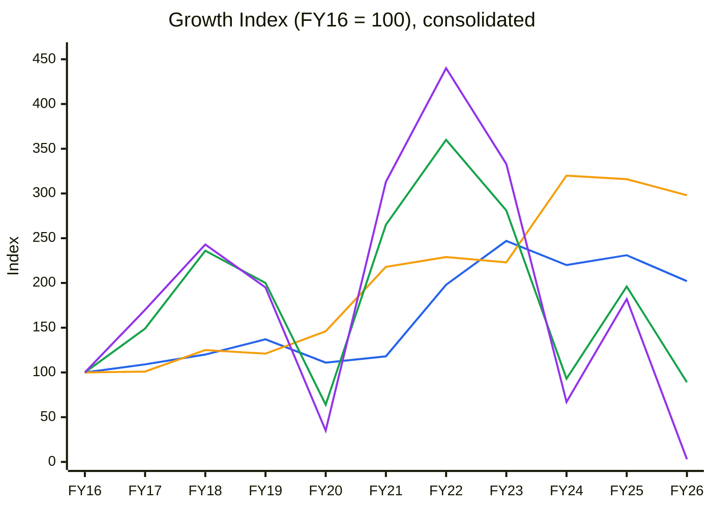
🟦 Revenue (CAGR 7.3%) · 🟧 Net fixed assets ex-London property (11.5%) · 🟩 EBITDA (−1.1%) · 🟪 PAT (−29%; FY26 is a trough). Source: Screener consolidated; FY26 net block uses standalone ₹959 Cr to exclude the London investment property.

**Read:** Fixed assets have outgrown revenue since FY21 (index 298 vs 202). EBITDA and PAT swing from 64 to 360 and from 3 to 440 with the spread, with no trend.

**Business inference:** IGPL added capacity (PA-4 in Dec-2020, PA-5 in Feb-2024) ahead of demand at the worst point of the global PA cycle. Capital efficiency fell, and earnings power now depends on spread recovery plus filling the idle ~27% of capacity. Growth has been bought with capital and has not compounded. The plasticizer plant is the tool for filling the plant (→ Module 10).

*Not order-driven: the Order Book Tracker is not applicable (no Reg 30 order filings; sales are spot or annual contracts).*

---

## BUSINESS PRIMER

I G Petrochemicals makes phthalic anhydride (PAN/PA), a bulk intermediate made by oxidising ortho-xylene (OX), a crude-oil aromatic. It sells PA to makers of plasticizers (PVC cables, film, leather-cloth), alkyd resins (paints; 20–25% of its PA volume), unsaturated polyester resins and pigments. Most customers are within 150–200 km of its single 275,110-MTPA complex at Taloja, Maharashtra, and exports are usually 15–20% of sales. Revenue is volume × realisation, but profit is set by the **PA–OX spread** (the "delta"), plus an extra $100–120/t that IGPL earns from superior yields and by-products. Those by-products are maleic anhydride (IGPL is India's only producer), benzoic acid and diethyl phthalate (DEP). The two things the business depends on are a global PA spread above ~$150/t (management says most producers lose money below that) and enough domestic demand to run the five plants. It currently sells about 200 kt a year, roughly 73% of capacity.

This is a **commodity, asset-heavy cyclical, not a specialty chemical business**. The value driver is the spread, the secondary driver is utilisation, and the dominant risk is global supply (China has over 3 mt of PA capacity) and crude-linked OX swings. Its edge is relative: lowest cost, single-site scale, freight protection and anti-dumping duty against China and Korea. That edge decides who survives the trough, but it does not create the spread. Two structural features colour the analysis. First, a **75-kt advanced plasticizer plant** (mechanically complete Mar-2026; commercial start guided Aug/Sep-2026) moves IGPL one step downstream and will consume 30–35 kt of its own PA. Second, the consolidated accounts carry a **₹230 Cr London commercial property** in a UAE subsidiary, a legacy of an abandoned ADNOC JV plan. It earns nothing, adds about ₹7.5 Cr a year of depreciation, and makes consolidated profits look worse than standalone.

**Segment:** Commodity Petrochemicals. There is no dedicated block, so the near-match "Specialty Chemicals" block (`references/05-industry-kpis-india.md`, line 449) is used, adjusted for spread KPIs: PA–OX spread, utilisation, by-product realisation, EBITDA/t. KPI reference available ✓. This keeps the August report's treatment, and the skill files are not modified.

---

## Module 1 — Market, Sector & Stock Cycle

### 1. Broad market (Marks): **CAUTIOUS**
- The Nifty 50 is at **22,481** (12-Oct-2026). That is −14.8% from the Jan-2026 high of 26,373 and next to the 52-wk low of 22,180. It is below a **declining** 30-week SMA (23,717, down from 25,138 in April), which makes it **Stage 4** (Yahoo weekly).
- India VIX is up from 10.7 to 15.1 over 8 weeks. The macro backdrop is the Strait of Hormuz closure and reopening (US–Iran ceasefire framework on 17-Jun), Brent above $110 in April, and INR at an all-time low of ~96.8/$ in May (Thirumalai Q1 FY27 presentation).
- **Sizing:** fear is building but not capitulation. Normal-to-smaller size; no market tailwind.

### 1b. Sector cycle: **NEUTRAL, turning TAILWIND (geopolitics-driven, partly transient)**
**Secular vs cyclical decomposition.** Indian PA demand is about 4.5–5.0 lakh t and grows **5–6% a year**, which is the secular part (Q4 FY26 and Q1 FY27 calls; paints growing 8–10%). The Q1 FY27 earnings surge was **almost entirely cyclical and transient**: PA and OX prices rose 30–40% on the Hormuz shock, and there was a ₹10–15 Cr inventory gain. Volumes actually fell 10–15% QoQ. **Do not embed the $250–300 spread.** Management itself expects normalisation "in 3–6 months" after a US–Iran settlement, and guides 15–16% EBITDA margin at $200–250.

**Input cost cycle:** OX tracks crude. Higher prices help IGPL, because its extra yield and by-products are sold at higher prices ("higher prices are always better for us", CFO). Falling crude therefore compresses both price and spread.

**Inventory cycle:** OX inventory is 5–10 kt (15–20 days). Low-cost inventory flattered Q1; management says it now runs minimum inventory.

**Competitive capacity pipeline (most important supply signal):**
- *Domestic:* management says India is "slightly oversupplied because two or three capacities started at a similar time in the last one year" (Q4 FY26 call, May-2026). Imports fell from 1–1.2 lakh t to 30–40 kt a year. Thirumalai's Dahej PA plant (94 KTPA per its Aug-2026 presentation) ran at 95% in Q1 FY27. Thirumalai itself is cash-constrained (raw-material shortages at Dahej from lack of working capital), so phase 2 of its old 180-kt Dahej plan is unlikely soon.
- *China:* PA capacity is over 3.0 mt with structural overcapacity (Thirumalai). About 510 kt of Chinese OX capacity is under planned shutdown, which supports prices near term. Maleic anhydride is oversupplied (China ~2 mt+), so MA trades **20–25% below PA versus its historical 20% premium**. That is a lasting drag on by-product credits.
- *Policy:* ADD on PA from China ($40/t) and Korea ($140/t) has been **extended 5 years from 1-Aug-2026** (Customs Notification 20/2026-ADD). It lifts landed import cost about 10–15%, after freight, insurance and port costs.

**Geopolitical risk map:** (1) Exports to GCC, Europe and Africa are hit by container shortages and +30–50% freight. Transient. (2) 40–50% of OX is imported, and lead times have stretched from 10–20 to 40–50 days. Transient, but it needs more working capital. (3) Red Sea and Hormuz routing adds about $80–120/t of cost. Transient, unless the conflict re-escalates.

**Net FX exposure:** OX imports (40–50% of a ₹1,500 Cr raw-material bill) roughly offset exports (15–20% of sales) and dollar-linked domestic pricing (import parity). The net effect is that INR depreciation **raises** rupee EBITDA, because the spread is dollar-denominated. Estimate: +₹3.7 Cr EBITDA per ₹1/$ move at 225 kt and $165/t net margin.

**Sector verdict:** NEUTRAL→TAILWIND. Policy (ADD) and a weaker Thirumalai are durable positives. The Q1 spread spike is transient. The verdict agrees with CY5 (demand catching up with flat listed capacity) and CY6 (spread well off the trough but only modestly above the 10-yr average).

#### CY5 — Industry demand vs listed domestic capacity (estimate)

| | FY22 | FY23 | FY24 | FY25 | FY26 | FY27E | FY28E |
|---|---|---|---|---|---|---|---|
| IGPL PA capacity (kt, year-end) | 219 | 219 | 275 | 275 | 275 | 275 | 275 |
| Thirumalai India PA (kt; Aug-2026 presentation, Ranipet 165 + Dahej 94) | 259 | 259 | 259 | 259 | 259 | 259 | 259 |
| **Listed domestic capacity (kt)** | 478 | 478 | 534 | 534 | 534 | 534 | 534 |
| **Indian PA demand (kt, estimate)**: back-cast at 5.5%/yr from ~475 kt in FY26 (midpoint of mgmt's "4.5–5.0 lakh t") | 383 | 405 | 427 | 450 | 475 | 501 | 529 |
| Demand / listed capacity | 80% | 85% | 80% | 84% | 89% | 94% | 99% |

*Caveats (data gaps): (a) the Thirumalai capacity labels in its presentation are ambiguous, and its Dahej start-up dates are unverified (assumed in place from FY22, when the plant launched in 2021). (b) Management cites 2–3 **unnamed** new domestic capacities from FY26, which are not in this table. True utilisation is therefore lower than shown. (c) Exports (IGPL 15–20%) and imports (30–40 kt) are excluded.*

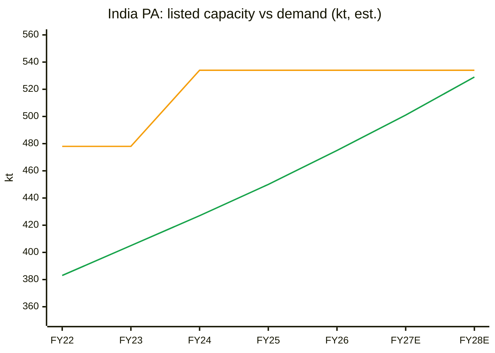
🟧 Listed domestic capacity (IGPL + Thirumalai) · 🟩 Indian PA demand (estimate)

**Read:** Listed capacity stepped up 12% in FY24 (IGPL PA-5) and has been flat since. Demand compounding at 5.5% closes most of the gap by FY28E, and no new listed capacity is announced.

**Business inference:** This is the classic capital-cycle set-up. Capacity was added in FY21–FY24, returns collapsed in FY24–FY26, and listed supply is now flat while the main rival is stressed. That supports utilisation-led recovery. The unnamed new entrants are the swing factor, and their size is a data gap. Watch DGTR and industry filings.

### 1c. Stock cycle: **EARLY RECOVERY (trough FY26 → upswing)**

| Quarter | Q2FY25 | Q3FY25 | Q4FY25 | Q1FY26 | Q2FY26 | Q3FY26 | Q4FY26 | Q1FY27 |
|---|---|---|---|---|---|---|---|---|
| Revenue (₹ Cr, consolidated) | 583 | 558 | 480 | 470 | 465 | 465 | 524 | 618 |
| Revenue YoY % | +16 | +14 | −13 | −20 | −20 | −17 | +9 | +32 |
| OPM % | 11 | 8 | 10 | −0.1 | 4 | 2 | 13 | 18 |
| PAT (₹ Cr, consolidated) | 26 | 29 | 19 | −13 | −2 | −11 | 28 | 66 |

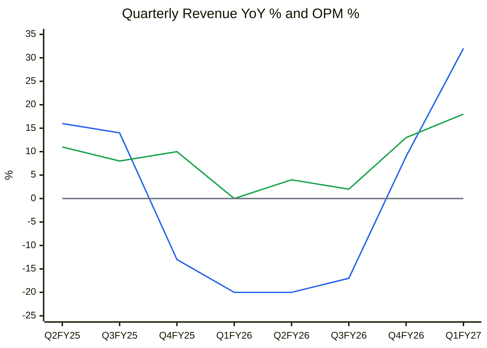
🟦 Revenue YoY % · 🟩 OPM % · ⬜ zero line. EBITDA YoY is not plotted because the bases are negative or near zero (rule 10).

**Read:** Revenue growth went from −20% (Q2 FY26) to +32% (Q1 FY27), and OPM from −0.1% to 18%, over four quarters. This is accelerating.

**Business inference:** The turn is real but **price-led**. Q1 volumes were 10–15% lower QoQ, so revenue growth reflects 30–40% higher realisations, not share or volume. A price-led recovery can unwind as fast as it came. Q2 FY27 (due early Nov) is the test of whether ~$225–250 spreads hold on normal volumes.

**Volume / price / mix:** 10-yr revenue CAGR is 7.3%. Volume added roughly 4–5% a year (capacity 166 → 275 kt), and price and spread did the rest. Volume has been **flat at ~200 kt for 2 years** (FY25 ≈ FY26 ±1–2%, FY27 guidance 2 lakh t ±2–3% plus captive). Mix shifts toward plasticizer from FY27–28.

**Physical capacity model (C10):**

| | FY25 | FY26 | FY27E | FY28E | FY29E |
|---|---|---|---|---|---|
| PA capacity (kt) | 275 | 275 | 275 | 275 | 275 |
| Merchant PA sales (kt) | ~200 (mgmt) | ~200 (mgmt) | 200 (guidance) | 208 | 216 |
| Captive PA into plasticizer (kt, ~0.42 t PA per t plasticizer) | 0 | 0 | 4 | 17 | 26 |
| Plasticizer output (kt; WTT-haircut vs guidance) | 0 | 0 | 10 (guided 15–20) | 40 (guided 50–65) | 60 |
| **Total PA (kt)** | 200 | 200 | 204 | 225 | 242 |
| **PA utilisation** | 73% | 73% | 74% | 82% | 88% |

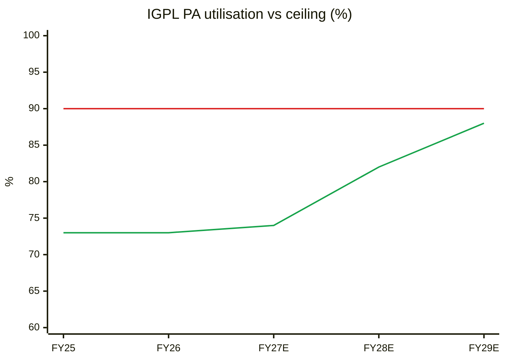
🟩 IGPL PA utilisation (FY27–29 estimates) · 🟥 ~90% practical ceiling

**Read:** Utilisation sits at 73% and reaches about 88% by FY29E as the plasticizer absorbs 26 kt and merchant demand grows about 4% a year.

**Business inference:** **The capacity-ceiling year is FY29–FY30.** After that, volume growth needs a sixth PA plant, which is unannounced; management cites roughly ₹3,000 Cr replacement cost for 275 kt. This caps the volume upside in any FY29 bull case at ~250 kt (91%). Upside beyond that has to come from spread, not tonnes (→ PIE plausibility check, Module 8).

**Operating leverage:** each **$10/t change in the spread ≈ ₹21 Cr EBITDA ≈ ₹5.1 EPS** at 225 kt and ₹94/$. FY26→Q1 FY27 shows the DTL in action: a +32% revenue change produced EBITDA up 9× YoY.

**Guidance accuracy:** see Module 3 (WTT 0.25). Haircut all timelines.

**FCF inflection year:** FY27E. Plasticizer capex (₹180–200 Cr) is complete, and FY27–29 capex falls to about ₹70 Cr a year (CBG plus maintenance).

**Stock cycle classification: Trough → Early Recovery** (FY26 OPM 5%, ROCE 3%, both more than 1SD below their 10-yr averages; TTM OPM 10% is still below the 14.6% average). The framework calls for the widest MoS and a small initial size, adding after the cycle turn is confirmed.

---

## Module 2 — Industry Structure & Capital Cycle

**Porter Five Forces: NEUTRAL-to-UNATTRACTIVE (commodity)**

| Force | Assessment | Signal |
|---|---|---|
| New entrants | Capital-heavy (~₹3,000 Cr for 275 kt) but entry happened anyway: 2–3 new domestic capacities in FY26, China above 3 mt | Moderate |
| Supplier power | OX is crude-linked; 40–50% imported, the rest domestic (refiners) | High |
| Buyer power | 120+ fragmented customers; product undifferentiated; import parity caps price | Moderate |
| Substitutes | Non-phthalate plasticizers (slow, regulatory); naphthalene-route PA only in China | Low–Moderate |
| Rivalry | Spread set globally; domestic duopoly-plus with ADD protection | High (eased by ADD) |

**Verdict:** a structurally spread-driven industry, so it needs a wide margin of safety.

**Capital cycle (Chancellor):** IGPL's capex/depreciation ran at about 2.4× in FY24–FY26 (FY26 capex ₹163 Cr vs D&A ₹69 Cr, consolidated AR). That is the tail of its own capex wave. FY27–29 capex/D&A falls to about 0.9×. Thirumalai levered up from ₹183 Cr to ₹2,175 Cr of borrowings (FY21→FY26) for Dahej, the USA and Malaysia, and is now loss-making. No sector IPOs. **Position: post-glut, supply-discipline phase.** Returns should recover if no new wave starts. *CY8 (industry capex/depreciation for 3–5 peers) is not charted: peer capex series not compiled (data gap).*

---

## Module 3 (Skill: Business Quality & Moat)

**Greenwald's barriers**
1. **Cost advantage: YES (relative).** IGPL earns the market spread plus $100–120/t from yield, energy recovery and by-products (MA, BA, DEP), and is the lowest-cost Indian producer at the second-largest single PA site in the world. This is real, but it shifts IGPL's position *within* the cycle and does not remove the cycle.
2. **Customer captivity: NO.** Commodity product; customers buy at import parity.
3. **Local scale: YES (bounded).** About 50% domestic share, customers within 150–200 km, plus a just-in-time edge over 30–40-day import lead times (worth 3–5% on price per the CFO).

**Buffett pricing-power test: FAIL.** PA is import-benchmarked.
**Market-share stability:** about 50% for 5+ years (company claim; no independent series). Stable.
**Moat verdict: NARROW.** It is cost- and freight-based. It survived the FY24–26 trough with positive OCF, but returns fell below WACC for 3 years.

**Fisher 15-point (score 1–3):** market potential 2 · new products 2 (plasticizer, DEP, CBG) · R&D 1 · sales org 2 · margin 1 · margin improvement 2 · labour 2 · executive relations 2 · management depth 2 (new CFO-led IR; President of New Business resigned Oct-2026) · cost controls 2 · industry advantage 2 · long-range orientation 2 · dilution 3 (none) · candour 1 (the London property was described as "office/MA project" before the AR showed it as a London investment property; timelines repeatedly restated) · **integrity 2 (PASS: no veto)** → **28/45**.

---

## Module 4 (Skill: Management & Capital Allocation)

**Promoter holding:** 68.74%, flat for 12 quarters · **Pledge: 0%** (SHP Jun-2026) → Normal · No promoter open-market buys or sells.

**Capital deployment, FY22–FY26 (consolidated AR / Screener):** cumulative CFO ₹790 Cr; capex about ₹700 Cr (PA-5, plasticizer, CBG; plus the London property, which appears through CWIP in the subsidiary); dividends about ₹120 Cr; net debt up about ₹150 Cr. **FCF/share is far below EPS growth.** 10-yr EPS CAGR is −28% (trough year), and 5-yr cumulative FCF is about ₹0, with the AR-corrected FY22 FCF of ₹58 Cr.

**Capital allocation rating: AVERAGE-to-POOR**
- (+) PA-4 and PA-5 built cheaply on one site; plasticizer and DEP are logical forward integration. Plasticizer incremental ROIC is about 21% in the base case (Module 10).
- (−) **₹230 Cr London commercial property** through UAE subsidiary IGPL International: investment ₹107.9 Cr plus loan ₹50.1 Cr from the parent, at 7%, with repayment terms extended in FY26. That is about 15% of net worth in a non-core, non-earning asset. KAM in both standalone and consolidated audit reports. FY26 subsidiary loss ₹20.9 Cr. Management's ₹100–150 Cr net realisation implies a sizable write-down against the ₹230 Cr carrying value, or significant debt within the subsidiary.
- (−) Diversification into CBG (₹100 Cr board-approved investment into IG Biofuels; 5-TPD pilot) and pyrolysis while the core trades near book value. An analyst asked on the Q3 FY26 call: "why are we wasting money on CBG… when our core business is trading below book value."
- (−) Debt rose while the presentation claims "zero net debt", even though its own chart shows net debt/equity of 0.17.

**RPT and remuneration (FY26 AR; H2 FY26 RPT filing):** sales of goods to promoter-group **Mysore Petro Chemicals** of ₹36 Cr in H2 FY26 (approved limit ₹50 Cr; MPCL is also a licensor/landlord). Not material to revenue (~2%), but monitor. **Director remuneration FY26 ₹8.29 Cr** (CMD ₹2.78 Cr, ED&CEO ₹3.70 Cr), plus relatives in the business (Umang Dhanuka, CMO, ~₹3.2 Cr annualised from H2 ₹1.59 Cr; estimate). Promoter-family pay of about ₹10 Cr equals ~43% of FY26 standalone PAT (₹23 Cr) and ~9% of 11-yr average PAT. **Flag: above 10% of PAT in trough years.**

**Buffett's three C's:** Candor LOW–MODERATE · Competence MODERATE (strong operator, weak allocator) · Caring MODERATE (dividend maintained in the trough; no buybacks despite trading below book in FY26).

### Walk the Talk scorecard

| Quarter guided | Statement | Guided | Actual (as of 12-Oct-2026) | Verdict |
|---|---|---|---|---|
| Q4 FY25 call (May-2025) | Plasticizer commissioning | "December" 2025 | Mechanical completion Mar-2026; commercial production not confirmed | ❌ |
| Q1 FY26 call (Aug-2025) | Plasticizer commissioning (after approval delay) | By Dec-2025 | Same as above | ❌ |
| Q2 FY26 call (Nov-2025) | "100% confident to commission before March" | Mar-2026 | Mechanical only; board itself extended the timeline to Mar-2026 (Reg 30, 3-Nov-2025) | ❌ |
| Q3 FY26 call (Feb-2026) | Commercial start after mechanical completion | "Generally 1 month" | 6+ months | ❌ |
| Q2 FY26 call (Nov-2025) | FY26 PA volume | 2 lakh t ±5% | ~2 lakh t (FY26 ≈ FY25 ±1–2%) | ✅ |
| Q1 FY26 call (Aug-2025) | CBG completion | Apr-2026 | Mechanical Q2 FY27, start-up Q3 FY27 | ❌ |
| Q3 FY26 call (Feb-2026) | Pyrolysis plant live | "Before September" 2026 | Construction not started in Feb; dropped from Aug-2026 deck | ❌ |
| Q2 FY26 call (Nov-2025) | FY26 interest cost | ₹30–35 Cr | ₹37.5 Cr standalone (+7% vs top end) | ⚠️ |
| Q2 FY26 call (Nov-2025) | "Intend to remain net debt zero" | ~0 | Net debt ~₹270 Cr consolidated; ND/E 0.17 standalone | ❌ |
| Q3 FY26 call (Feb-2026) | DEP debottleneck to ~10 ktpa | Q4 FY26 | Done; record ₹28–29 Cr DEP sales in Q1 FY27 | ✅ |
| Q2 FY26 call (Nov-2025) | Sell London property, realise ₹100–150 Cr | Not dated | No sale disclosed | ⚠️ pending (not scored) |
| Q1 FY27 call (Aug-2026) | Plasticizer commercial production | End-Aug/early-Sep 2026 | No Reg 30 notice in IR index to 9-Oct | ⚠️ pending; verify in Q2 results |

**WTT Score: 0.25 / 1.00, UNRELIABLE**
**Guidance points assessed:** 10 (scored) | Hits: 2 | Near misses: 1 | Misses: 7 | Reversals: 0
**Key pattern:** one-way misses on **project timelines** (plasticizer about 9+ months late and counting; CBG about 6 months; pyrolysis silently dropped). Operational guidance (volume, DEP) is delivered.
**Insider action:** none (promoter flat; no Form C buys). Senior Management Personnel resignation: **Sanjay Gupta, President – New Business Initiatives, 6-Oct-2026**, during the plasticizer start-up. NEUTRAL-to-BEARISH.
**DCF impact:** plasticizer ramp cut to 10 kt in FY27 (guided 15–20) and 40 kt in FY28 (guided 50–65); 2-quarter delay assumed; MoS widened 10pp.
**Overall management credibility: LOW** on projects, **MODERATE** on operations.

---

## Module 5 (Skill: Financial Forensics)

**Indian-specific checks**
- **Pledge:** 0% → Normal.
- **ICD / loans to group:** parent's investment plus loan to IGPL International is **₹158 Cr = 12% of standalone equity** (below the 20% threshold; KAM). Interest at 7%, with repayment terms extended in FY26. That is a softness flag, not extraction: it is a wholly-owned subsidiary.
- **RPT:** sales to Mysore Petro Chemicals ~₹36 Cr per half-year; licence fees to relatives (small). No above-market evidence found.
- **Audit:** joint auditors MSKA & Associates (BDO network) and SMMP & Co. **No qualification and no EOM** (FY26 AR). KAMs: (1) investment in and loan to subsidiary, (2) revenue cut-off, and (consolidated) (3) London investment property ₹230.19 Cr. No auditor resignation.
- **Contingent liabilities:** about ₹40 Cr (indirect-tax appeals and show-cause notices, income tax, electricity duty stayed by the Bombay HC). About 3% of equity; immaterial.

**Quantitative models (FY26, consolidated unless stated)**

| Model | Value | Reading |
|---|---|---|
| Beneish M-score | **−2.33** (DSRI 1.40, GMI 1.06, AQI 1.26, SGI 0.87, DEPI 1.09, SGAI 1.15, LVGI 1.07, TATA −0.043) | Unlikely manipulator, near the grey line. DSRI is high because Mar-2026 sales came at spiking prices (debtor days 66 vs 47). AQI is high because of the London property reclassified to investment property. Both explained. |
| Altman Z'' (standalone) | **4.58** (FY25: 5.19) | Safe; declining with the trough |
| Piotroski F | **4/9** (ROA+, CFO+, CFO>NI, no dilution; fails ΔROA, leverage, current ratio, gross margin, asset turnover) | Average (trough year); improves in FY27 |
| Sloan accrual ratio | **−0.5%** (FY25: −2.8%) | Clean: earnings fully cash-backed |
| Cumulative CFO/PAT, FY16–26 | **1.25×** | High quality |

**Schilit screen:** DSO jump explained by price (not stuffing); other income/EBIT about 40% in FY26, a trough artefact (₹20 Cr OI on ₹51 Cr EBIT), normally 5–10%; capex/depreciation 2.4× during a genuine growth phase (plasticizer); **London property moved from CWIP to investment property**, so depreciation now flows through the P&L (correct). DPO 94 days vs 98 last year, stable. **Forensic red flags: 1 / 15** (other-income share in the trough year, explained).
**Overall forensic verdict: CLEAN, with a capital-allocation (not accounting) concern.**

---

## Module 6 (Skill: Earnings Quality & Financial Statements)

### 10-year financials (consolidated, ₹ Cr; Screener + ARs)

| | FY16 | FY17 | FY18 | FY19 | FY20 | FY21 | FY22 | FY23 | FY24 | FY25 | FY26 | TTM |
|---|---|---|---|---|---|---|---|---|---|---|---|---|
| Revenue | 953 | 1,037 | 1,144 | 1,304 | 1,059 | 1,124 | 1,883 | 2,352 | 2,099 | 2,206 | 1,925 | 2,073 |
| EBITDA | 113 | 168 | 267 | 226 | 72 | 299 | 407 | 318 | 105 | 221 | 101 | 207 |
| OPM % | 12 | 16 | 23 | 17 | 7 | 27 | 22 | 14 | 5 | 10 | 5 | 10 |
| PAT | 60 | 102 | 146 | 117 | 21 | 188 | 264 | 200 | 40 | 109 | 2 | 82 |
| PAT margin % | 6.3 | 9.8 | 12.8 | 9.0 | 2.0 | 16.7 | 14.0 | 8.5 | 1.9 | 4.9 | 0.1 | 4.0 |
| EPS (₹) | 19.55 | 32.98 | 47.42 | 37.94 | 6.78 | 61.08 | 85.89 | 64.95 | 12.83 | 35.30 | 0.72 | 26.52 |
| Net worth | 292 | 392 | 528 | 629 | 633 | 822 | 1,062 | 1,235 | 1,247 | 1,339 | 1,333 | — |
| Borrowings | 116 | 82 | 87 | 194 | 230 | 165 | 173 | 254 | 368 | 269 | 362 | — |
| CFO (AR-checked) | 69 | 94 | 201 | 139 | 84 | 183 | **157*** | 233 | 37 | 261 | 102 | — |
| Pre-tax ROCE % | — | 34 | 45 | 29 | 5 | 29 | 33 | 21 | 5 | 11 | 3 | ~9 |
| ROE % | 20.5 | 26.0 | 27.7 | 18.6 | 3.3 | 22.9 | 24.9 | 16.2 | 3.2 | 8.1 | 0.2 | ~6 |

*\*FY22 CFO is taken from the FY22 AR (₹156.8 Cr). Screener's consolidated column shows ₹109 Cr, which does not match. FY21 (₹183.3 Cr), FY24 (₹37.2 Cr), FY25 (₹261.0 Cr) and FY26 (₹102.2 Cr) match the ARs. The Screener standalone columns match throughout.*

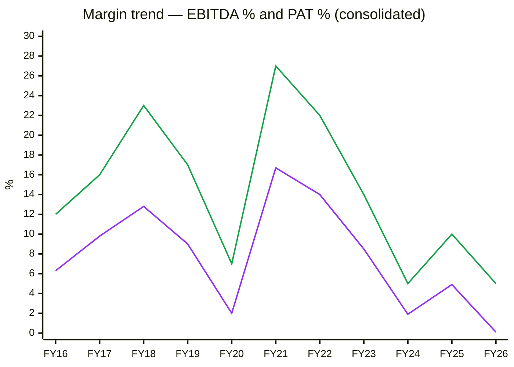
🟩 EBITDA margin · 🟪 PAT margin

**Read:** EBITDA margin has swung between 5% and 27% with three troughs (FY20, FY24, FY26) and two peaks (FY18, FY21–22). PAT margin swings from 0.1% to 16.7%.

**Business inference:** A margin series with no trend and wide amplitude is the signature of a price-taker. Valuation must use **through-cycle** margins (10-yr average EBITDA margin 14.6%), never the 18% of Q1 FY27 or the 5% of FY26.

#### CY7 — Margin through the cycle

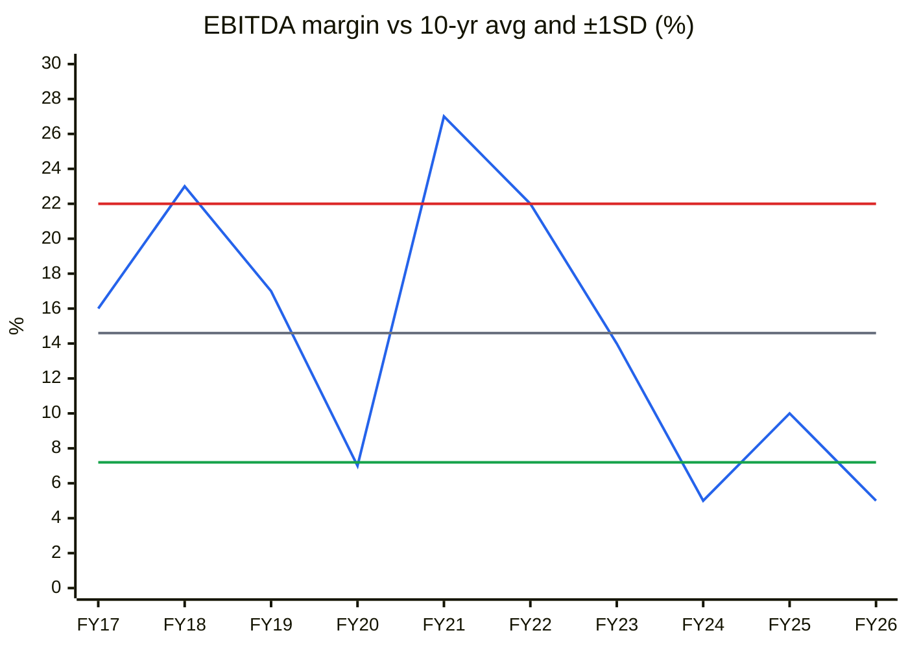
🟦 EBITDA margin · ⬜ 10-yr average 14.6% · 🟥 +1SD 22.0% · 🟩 −1SD 7.2%

**Read:** FY26 at 5% is more than 1SD below the average (trough, 10th–20th percentile). TTM is 10% (30th percentile). Q1 FY27 at 18% would sit between the average and +1SD.

**Business inference:** IGPL is coming out of a trough, not at a peak. Normalised earnings are well above FY26 but below a Q1-annualised run-rate. The stock-cycle classification "early recovery" is confirmed by the data.

#### C5 — ROCE vs WACC

| | FY17 | FY18 | FY19 | FY20 | FY21 | FY22 | FY23 | FY24 | FY25 | FY26 |
|---|---|---|---|---|---|---|---|---|---|---|
| Post-tax ROCE % (pre-tax × 0.75) | 25.5 | 33.8 | 21.8 | 3.8 | 21.8 | 24.8 | 15.8 | 3.8 | 8.3 | 2.3 |

**WACC 12%** = Ke 13.6% (Rf 7.0% + β ~1.1 est. × ERP 6%) × 83% + Kd 8% × (1 − 25%) × 17%.

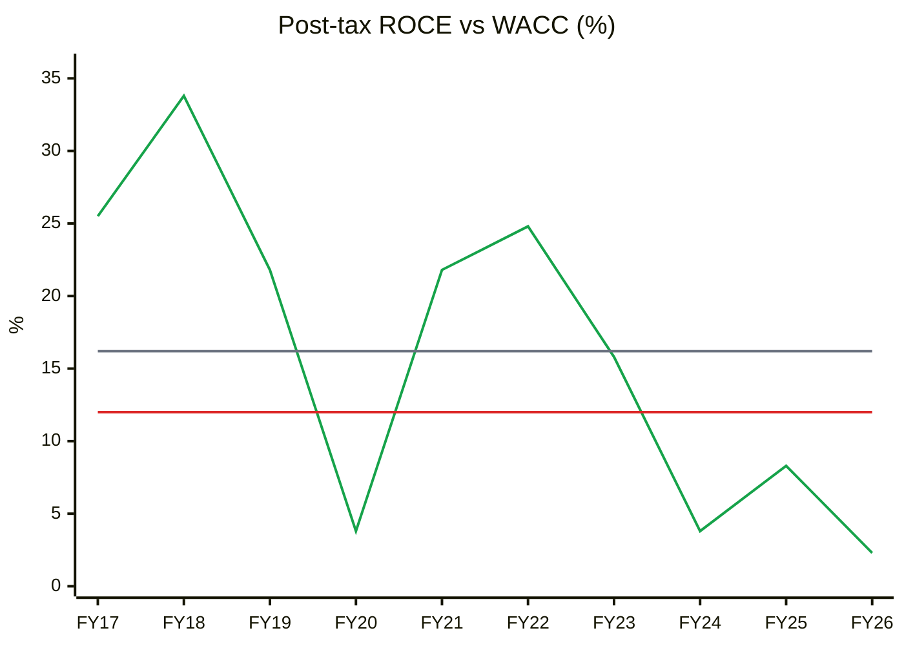
🟩 Post-tax ROCE · 🟥 WACC 12% · ⬜ 10-yr average 16.2%

**Read:** The 10-yr average post-tax ROCE of 16.2% beats WACC by about 4pp. But ROCE has been **below WACC for 3 straight years (FY24–FY26)** and in 4 of 10 years.

**Business inference:** IGPL creates value through the cycle, but only modestly, and only when spreads cooperate. **Hard stop (ROCE < WACC for 5+ years): NOT triggered** (3 consecutive years). FY27 is pivotal. TTM post-tax ROCE is about 7%, and the FY27E base about 13% (EBIT ₹297 Cr / capital employed ~₹1,700 Cr × 0.75). Another sub-WACC year would make 4.

**ROIC drivers:** margin-led. Asset turnover is roughly stable at 2.0–2.2× on net block (C6), and margin explains almost all of the ROCE variance.
**Economic profit:** negative FY24–26; positive in the FY27E base.

### DuPont (5-factor, consolidated)

| Year | EBIT margin | Asset turnover | Equity multiplier | Interest burden | Tax burden | ROE |
|---|---|---|---|---|---|---|
| FY22 | 19.6% | 1.14 | 1.55 | 0.96 | 0.74 | 24.9% |
| FY23 | 12.4% | 1.18 | 1.61 | 0.92 | 0.75 | 16.2% |
| FY24 | 4.0% | 0.98 | 1.71 | 0.64 | 0.76 | 3.2% |
| FY25 | 8.2% | 1.00 | 1.65 | 0.78 | 0.77 | 8.1% |
| FY26 | 2.6% | 0.84 | 1.73 | 0.20 | 0.20 | 0.2% |
| **Change** | −17.0pp | −0.30× | +0.18× | −0.76 | −0.54 | **−24.7pp** |

**Operating contribution (EBIT margin × AT):** declining sharply. This is cyclical (spread) plus total-asset dilution: AT on total assets fell partly because of the ₹230 Cr London property and CWIP.
**Financing contribution:** equity multiplier up modestly (1.55 → 1.73). Leverage is **not** masking operations. ROE fell for operating reasons.
**DuPont verdict:** the ROE collapse is purely operational and cyclical; there is no financial engineering. FY26 tax burden is distorted by subsidiary losses that get no tax shield.
**Peer DuPont:** Thirumalai's ROE (−11.8%) has an equity multiplier of about 2.4× rising on debt, so leverage there amplifies operating losses. IGPL's lower-leverage, positive-ROE profile is higher quality.
**AT trend → Module 10 base AT:** stable around 2.0–2.4× net block. 5-yr average 2.41×.

#### C6 — Asset turnover (Revenue / net fixed assets)

| FY16 | FY17 | FY18 | FY19 | FY20 | FY21 | FY22 | FY23 | FY24 | FY25 | FY26 |
|---|---|---|---|---|---|---|---|---|---|---|
| 2.96 | 3.20 | 2.84 | 3.35 | 2.25 | 1.60 | 2.56 | 3.28 | 2.04 | 2.17 | 2.01 |

*Gross-block AT (standalone PPE note, FY21/22/24/25/26 ARs): 0.94 / 1.50 / n.a. (FY23 data gap) / 1.34 / 1.38 / 1.21. Gross block ₹1,200 → ₹1,255 → ₹1,570 → ₹1,603 → ₹1,588 Cr.*

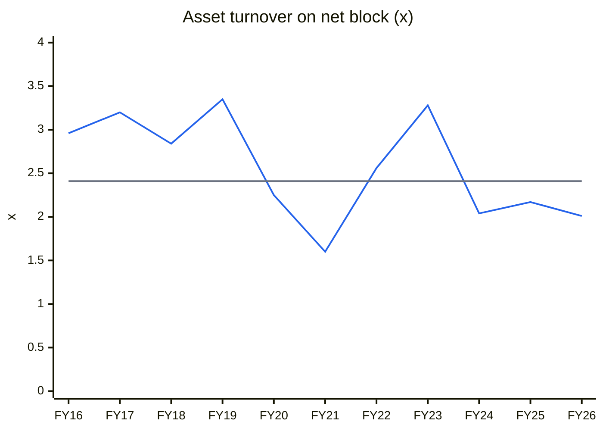
🟦 Revenue / net fixed assets (FY26 excludes London property) · ⬜ 5-yr average 2.41×

**Read:** AT dips each time a PA plant is added (FY21 1.60× after PA-4; FY24 2.04× after PA-5) and recovers as the plant fills and prices rise (FY23 3.28×).

**Business inference:** This is a normal capex-then-ramp pattern, not structural erosion. AT should recover toward 2.4–2.6× as utilisation goes from 73% to 88%, which is the volume half of the recovery thesis.

#### C7 — Earnings quality

| | FY16 | FY17 | FY18 | FY19 | FY20 | FY21 | FY22 | FY23 | FY24 | FY25 | FY26 |
|---|---|---|---|---|---|---|---|---|---|---|---|
| Cumulative PAT | 60 | 162 | 308 | 425 | 446 | 634 | 898 | 1,098 | 1,138 | 1,247 | 1,249 |
| Cumulative CFO | 69 | 163 | 364 | 503 | 587 | 770 | 927 | 1,160 | 1,197 | 1,458 | 1,560 |

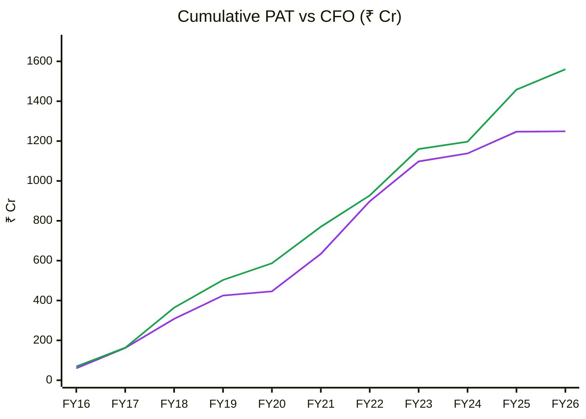
🟪 Cumulative PAT · 🟩 Cumulative CFO

**Read:** Cumulative CFO of ₹1,560 Cr is 1.25× cumulative PAT of ₹1,249 Cr. CFO has stayed above PAT throughout.

**Business inference:** Profits are real cash. Working capital releases in downturns (FY25: inventory and receivables fell), which cushions troughs. The issue with IGPL is the cycle, not accounting. **OCF/NI (5-yr) = 1.42 → High quality. O'Glove flags: 2/15** (#7 other income share in the trough year; #1 n/a).

**Ind AS 116:** lease liabilities are about ₹6 Cr. Immaterial; no adjustment.

---

## Module 7 (Skill: Industry KPIs & Peer Analysis)

**Sector:** Commodity Petrochemicals (near-match: Specialty Chemicals block, line 449, adjusted to spread KPIs).

| KPI | IGPL | Benchmark / peer | Assessment |
|---|---|---|---|
| **PA–OX spread (market, $/t)** | $250–300 (Q1 FY27); ~$200–250 now | Mgmt 10-yr average $200–220; industry cash breakeven ~$150 | Above average (mid–upper cycle) |
| IGPL premium over market | +$100–120/t (yield + by-products) | Thirumalai: no comparable disclosure | Above (cost leader) |
| **Capacity utilisation** | ~73% (200/275 kt) | Specialty block ">75% healthy, <60% red"; Thirumalai Dahej 95% (Q1 FY27) | Below |
| **EBITDA/t (₹)** | FY25 ~11,050 · FY26 ~5,050 · Q1 FY27 ~26,350 (₹112 Cr / 42.5 kt; incl. ₹10–15 Cr inventory gain) | — | Swing metric |
| EBITDA margin | TTM 10%; Q1 18%; 10-yr average 14.6% | Specialty block 20–30% (n/a for commodity) | Commodity-normal |
| Export share | 15–20% typical; 7–10% in Q1 | — | Low |
| By-product (MA) realisation | MA 20–25% **below** PA (historically 20% above) | China MA ~2 mt overcapacity | Structural drag |
| Client concentration | 120+ clients, 20+ industries | <40% top-3 healthy | Healthy |

*EBITDA/unit is shown in the table only. It has fewer than 4 sourced annual points, so it is not charted (rule 1).*

**Peer comparison (Screener consolidated, 12-Oct-2026)**

| Metric | **IGPL** | Thirumalai Chemicals (PA peer) | Manali Petrochemicals (commodity petchem) | Deepak Nitrite | Aarti Industries |
|---|---|---|---|---|---|
| Revenue 3-yr CAGR (FY23–26) | −6.5% | −6.6% | −4.7% | −0.4% | +7.8% |
| EBITDA margin FY26 / TTM | 5% / 10% | −2.0% / 1.1% | 8% / 13% | 13% / 16% | 14% / 15% |
| ROCE FY26 | 3% | −3% | 7% | 11% | 7% |
| 10-yr average ROCE (FY17–26) | 21.5% | 17.8% | 21.4% | 23.6% | 13.3% |
| Gross D/E | 0.27 | 1.39 | 0.11 | 0.28 | 0.83 |
| P/B | 1.34 | 1.12 | 1.12 | 3.82 | 2.87 |
| P/E (TTM) | 21.9 | n.m. (loss) | 12.1 | 28.2 | 32.7 |

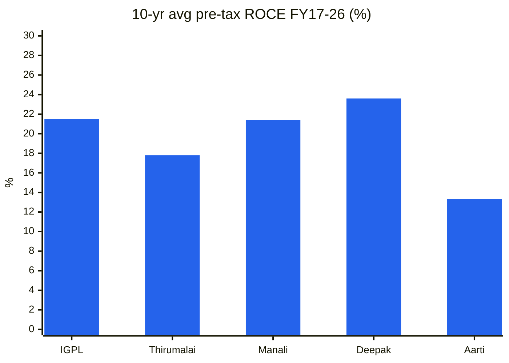
**Read:** IGPL's through-cycle ROCE of 21.5% is in line with Manali and Deepak, about 4pp above its direct PA rival Thirumalai, and about 8pp above Aarti.

**Business inference:** On P/B, IGPL trades at a ~20% premium to the commodity peers (Thirumalai, Manali at 1.1×) and a deep discount to specialty names (2.9–3.8×). The premium over Thirumalai is earned: lower cost, stronger balance sheet, and positive through-cycle value creation. The discount to specialty is deserved: no pricing power. **Peer positioning: in-line-to-modest premium. Justified.**

**Promoter capital-structure adjustment:** Adjusted ROCE excludes the ₹230 Cr non-operating London property from capital employed. FY26 operating ROCE is about 3.5% versus 3% reported; through-cycle about +1–2pp.

---

## Module 8 (Skill: Market Size & Market Share)

**TAM:** Indian PA demand of about 4.5–5.0 lakh t (mgmt, Q1 FY27 call). At ~₹1.05 lakh/t normalised realisation, that is about **₹5,000 Cr**, growing **5–6% a year** (paints 8–10%, plasticizers and PVC, UPR). India plasticizer market: mgmt says domestic demand is healthy with limited import dependence. A ₹600 Cr net plasticizer business would add about 10% to IGPL's SAM.
**Penetration:** IGPL PA sales of about ₹1,700 Cr against a ~₹5,000 Cr TAM is about 35% by value, or about 40–45% by volume after exports. The company claims ~50% of capacity share.
**Market share (5-yr):** stable at about 50% (company claim; no independent series, data gap). Imports were squeezed from 1–1.2 lakh t to 30–40 kt as new domestic capacity came on, so share of **domestic production** has fallen while share of **consumption** is stable.
**Revenue vs market:** FY23–26 revenue CAGR is −6.5% against volume demand growth of +5.5%. The gap is **price, not share**: PA prices fell through the global glut.
**Verdict:** growing with the market. Incremental growth comes from captive plasticizer and utilisation, not share gains.

---

## Module 9 (Skill: Valuation — PIE first, then own model)

**Inputs:** CMP ₹581.5 · shares 3.08 Cr · MCap ₹1,790 Cr · net debt ~₹270 Cr (estimate) · **EV ≈ ₹2,060 Cr**. Less the London property at ₹244 Cr fair value (FY26 AR; carrying ₹223 Cr), which is non-operating and offsets the subsidiary debt within net debt: **operating EV ≈ ₹1,820 Cr.**

### 9A. Price-Implied Expectations (Mauboussin)
- Quick formula on TTM NOPAT (EBIT ₹159 Cr × 0.75 = ₹119 Cr): g = (1,820 × 12% − 119)/(1,820 + 119) = **5.1%** perpetual growth from trough-ish TTM earnings.
- On FY27E NOPAT (₹223 Cr), implied g is about **−0.2%**. **The market treats FY27E as roughly a no-growth peak.**
- Steady-state reverse DCF (WACC 12%, g 5%, ROIC 15%, value = NOPAT × 0.667/0.07): implied **normalised NOPAT ≈ ₹191 Cr → EBIT ≈ ₹255 Cr → EBITDA ≈ ₹335 Cr**. Less ~₹50 Cr plasticizer EBITDA (mid-ramp), that leaves PA EBITDA of ~₹285 Cr at ~230 kt = ₹12,400/t → **market-implied through-cycle spread ≈ $177/t** at ₹94/$.

| PIE value driver | Market-implied | My base | Gap |
|---|---|---|---|
| Through-cycle market PA–OX spread | ~$177/t | $190/t (FY28–29) | +$13/t (+~₹27 Cr EBITDA) |
| PA volume (steady state) | ~230 kt (84% util.) | 242 kt by FY29 (88%) | +12 kt |
| Plasticizer EBITDA (steady) | ~₹50 Cr | ₹64 Cr (FY29E, 60 kt × 8%) | +₹14 Cr |
| Investment rate | ~33% of NOPAT | ~30% (capex ~₹70 Cr/yr, ≈ maintenance) | ≈ |

**Gap classification: FAIRLY PRICED, slightly pessimistic.** My base is about 15% above the PIE, which is not enough margin of safety for a WTT-unreliable, small-cap commodity.

**Physical plausibility check:** the PIE needs about 230 kt (84%), which fits inside 275 kt. ✓ The bull case (250 kt, 91%) is at the ceiling. **Anything above that would require an unannounced 6th PA plant.** So the market is **not** pricing an unannounced expansion. The disagreement is purely about the spread.

**Expectations treadmill:** to outperform, the market spread must average **≥ $200/t through FY29** (versus FY25–26 actual ~$140) **and** the plasticizer must reach ≥ 50 kt in FY28.
**Positive triggers:** plasticizer commercial production plus a Reg 30 notice; London property sale (₹100–150 Cr, i.e. ₹32–49/share); Q2/Q3 FY27 spreads holding above $200 with normal 50 kt quarters.
**Negative triggers:** Hormuz normalisation pulling OX/PA back (management: "3–6 months" after settlement); more plasticizer slippage; new domestic PA capacity; Chinese PA restarts.

**SVAR:** bear value ₹400 → SVAR = (582 − 400)/582 = **31%** (> 30% → halve position size).

### 9B. Own models

**DCF (3-stage, capacity-constrained; base):** FCFF FY27E ₹187 Cr (½ year remaining), FY28E ₹224 Cr, FY29E ₹248 Cr. Terminal value at FY29 is ₹2,361 Cr (FY30 NOPAT ₹248 Cr, g 5%, ROIC 15%). PV at 12% gives **EV ≈ ₹2,335 Cr → equity ≈ ₹2,190 Cr (after net debt plus ~₹125 Cr net London value) → ≈ ₹710/share** (estimate). Bear DCF (spread $130): about ₹260–300/share. Bull: about ₹1,000+.
**EPV (Klarman/Greenwald):** normalised EBIT on base-FY28 economics (₹271 Cr) gives ≈ ₹500/share. On the 10-yr average EBITDA (₹218 Cr, old capacity) it gives ≈ ₹255/share. **EPV range ₹255–500.**
**Relative:** commodity-peer P/B of 1.1–1.3× on FY27E BVPS ~₹495 gives **₹545–645**.
**Graham number** (5-yr average EPS ₹39.9; BVPS ₹433): √(22.5 × 39.9 × 433) = **₹624**.
**Graham defensive screen:** revenue below ₹2,000 Cr ✗ (FY26 ₹1,925 Cr) · current ratio 1.54 ✗ · positive EPS 7 yrs ✓ · no dividend cut 5 yrs ✓ · EPS growth ≥30% over 7 yrs ✗ · P/E ≤ 20 ✗ (TTM 21.9) · P/B ≤ 3 ✓ → **3/7**.

| Method | Bear | Base | Bull |
|---|---|---|---|
| DCF (today) | ₹280 | ₹710 | ₹1,000 |
| Relative (P/B on FY27E BV) | ₹400 (0.8×) | ₹595 (1.2×) | ₹790 (1.6×) |
| EPV | ₹255 | ₹500 | — |
| **Consensus range (today)** | **₹300–400** | **₹600–710** | **₹900–1,000** |

**Margin of safety (base ~₹650 midpoint): ~11%.** Required for a small-cap commodity with UNRELIABLE WTT is 40%+. **Inadequate.**
**Misprice reason:** none today. The August-2026 mispricing (cycle trough, P/B 0.8×) has been arbitraged away.

#### CY1 — P/E band (FY-end price / consolidated EPS)

| FY16 | FY17 | FY18 | FY19 | FY20 | FY21 | FY22 | FY23 | FY24 | FY25 | FY26 | Now |
|---|---|---|---|---|---|---|---|---|---|---|---|
| 5.5 | 10.9 | 15.4 | 8.0 | 15.8 | 7.0 | 8.3 | 7.1 | 39.0 | 12.6 | n.m. (EPS ₹0.72) | 21.9 (TTM) / 8.7 (FY27E) |

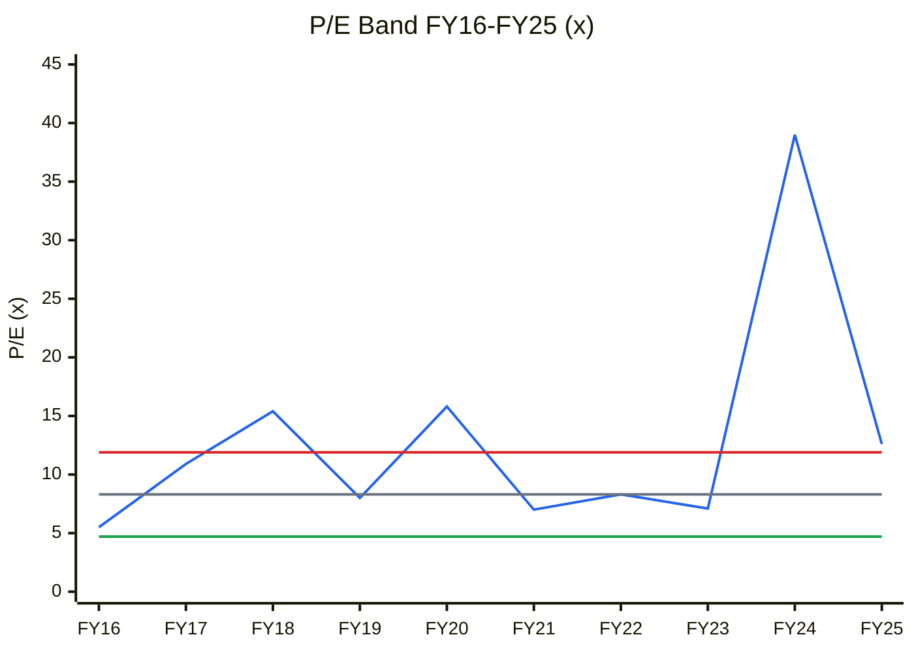
🟦 P/E (FY-end price ÷ EPS; FY24 trough outlier) · ⬜ median 8.3× · 🟥 +1SD 11.9× · 🟩 −1SD 4.7× (statistics exclude the FY24 trough-EPS outlier)

**Read:** TTM P/E of 21.9× is at the **90th–100th percentile**. On FY27E EPS (₹66.6) it is 8.7×, at the median. Peaks in P/E (FY18 15×, FY20 16×, FY24 39×) all came on depressed or falling EPS.

**Business inference:** Cyclical P/E rule: the high TTM P/E reflects trough earnings, which historically was the *buy* signal. But the forward P/E is already at the median on an above-average spread year. The market has moved from trough pricing to mid-cycle pricing, and the low-P/E-on-peak-earnings trap starts if FY27E proves to be the spread peak.

#### CY2 — P/B band and ROE

| FY16 | FY17 | FY18 | FY19 | FY20 | FY21 | FY22 | FY23 | FY24 | FY25 | FY26 | Now |
|---|---|---|---|---|---|---|---|---|---|---|---|
| 1.14 | 2.83 | 4.28 | 1.49 | 0.52 | 1.61 | 2.08 | 1.15 | 1.24 | 1.02 | 0.81 | 1.34 |

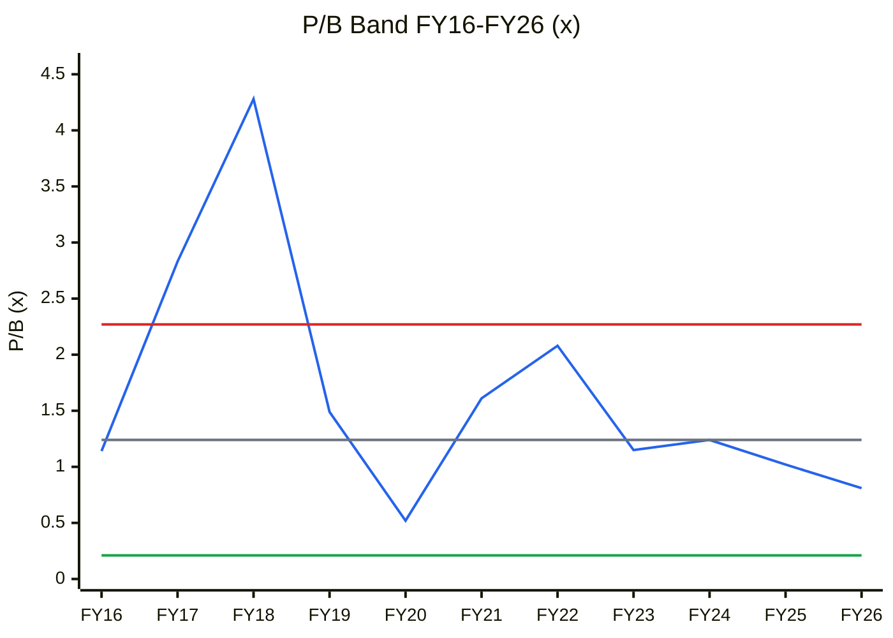
🟦 P/B · ⬜ median 1.24× · 🟥 +1SD 2.27× · 🟩 −1SD 0.21×

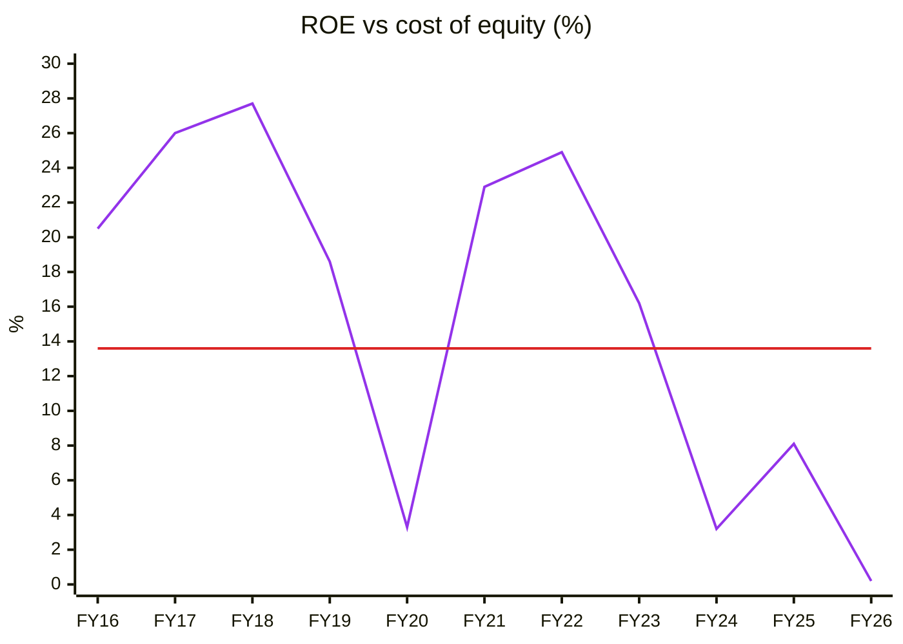
🟪 ROE · 🟥 cost of equity 13.6%

**Read:** P/B of 1.34× is at the **55th percentile**, just above the 1.24× median. Current ROE (~6% TTM; FY27E ~13–14%) is below the 15.6% 10-yr average.

**Business inference:** Justified P/B = (ROE − g)/(Ke − g). At through-cycle ROE ~15.6%, g 5% and Ke 13.6%, that is **1.23×**, which is where the stock sits. That is fair value for an average-cycle franchise. The March-2026 P/B of 0.81× was the bargain. Today pays fair value for book.

#### CY4 — Price vs EPS index (FY16 = 100)

| | FY16 | FY17 | FY18 | FY19 | FY20 | FY21 | FY22 | FY23 | FY24 | FY25 | FY26 |
|---|---|---|---|---|---|---|---|---|---|---|---|
| FY-end price (₹) | 108 | 360 | 732 | 304 | 107 | 429 | 717 | 460 | 501 | 443 | 351 |
| Price index | 100 | 333 | 678 | 281 | 99 | 397 | 664 | 426 | 464 | 410 | 325 |
| EPS index | 100 | 169 | 243 | 194 | 35 | 312 | 439 | 332 | 66 | 181 | 4 |

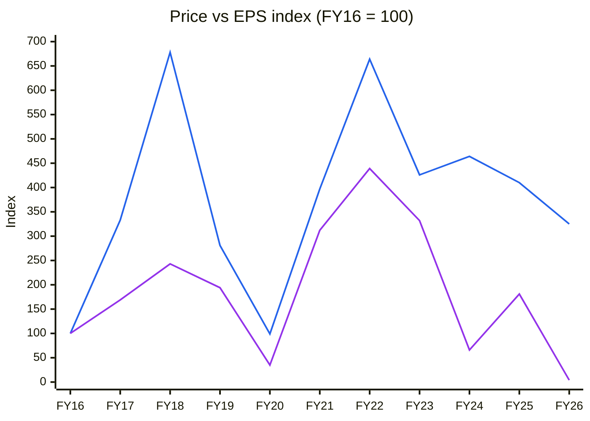
🟦 Price index (today ₹582 = 539) · 🟪 EPS index

**Read:** Price has compounded faster than EPS since FY16 (325 vs 4 in FY26; 539 today vs FY27E EPS index ~340). The FY16 base was a deep-value P/E of 5.5×.

**Business inference:** Most of the 10-yr return came from rerating off a depressed FY16 base and from anticipating recoveries. The price leads EPS by 2–3 quarters. Today's price has already discounted most of the FY27 earnings rebound (FY27E EPS index ~340 vs price 539), so further returns need earnings *above* FY27E, i.e. FY28–29 delivery.

### Cycle Position Dashboard

| Dimension | Current | 10-yr median | Percentile | Signal |
|---|---|---|---|---|
| P/E | 21.9× TTM / 8.7× FY27E | 8.3× | 90–100% (TTM) / ~50% (fwd) | Expensive on TTM / fair forward |
| P/B | 1.34× | 1.24× | 55% | Fair |
| EBITDA margin | 10% TTM (Q1 18%) | 15% | 30% | Mid-to-trough, recovering |
| ROCE (pre-tax) | ~9% TTM (FY26 3%) | 25% | 30% | Trough → recovery |
| Utilisation (IGPL) | 73% | — (FY23 near-full on 219 kt) | Low | Slack: room to fill |
| Industry demand/listed capacity (est.) | ~89% FY26 → 94% FY27E | — | — | Tightening (unlisted entrants not counted) |
| Market PA–OX spread | ~$200–250 (Q1 $250–300) | ~$210 (mgmt 10-yr average) | ~60–75% (est.) | Mid-to-upper |
| Industry capex/dep | IGPL 2.4× → 0.9×; Thirumalai deleveraging forced | — | — | Disciplining |
| **Overall cycle position** | | | | **Early–Mid recovery** (agrees with Module 1b "Neutral→Tailwind" and 1c "Early recovery") |

#### CY6 — PA–OX spread cycle (market, $/t; midpoint of management's stated range)

| Period | Q4FY25 | Q1FY26 | Q2FY26 | Q3FY26 | Q4FY26 | Q1FY27 | Q2FY27 (Jul–Aug indication) |
|---|---|---|---|---|---|---|---|
| Mgmt-stated range | $150–200 | $100–120 | $120–150 | $50–100 | $100–150 | $250–300 | ~$250 (Jul); $200–250 (7-Aug) |
| Midpoint used | 175 | 110 | 135 | 75 | 125 | 275 | 235 |
| Source | Q4FY25 call | Q1FY26 call | Q2FY26 call | Q3FY26 call | Q4FY26 call | Q1FY27 call | Q1FY27 call |

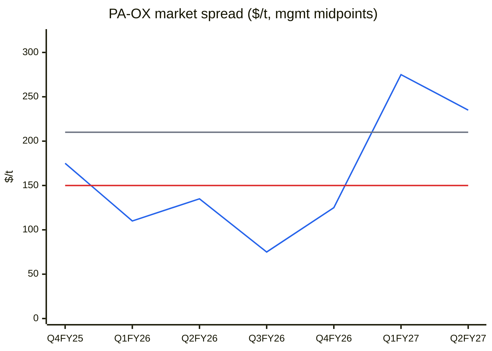
🟦 Market PA–OX spread (midpoint; Q2 FY27 an early indication) · ⬜ mgmt 10-yr average ~$210 · 🟥 ~$150 industry cash breakeven (mgmt)

**Read:** The spread spent four quarters (Q1–Q4 FY26) **below** the ~$150 breakeven, bottoming at ~$75 in Q3 FY26. It then jumped to ~$275 in Q1 FY27 and is now about $235, roughly 12% above the 10-yr average. There is no full 10-yr series (ICIS paywalled), so the percentile is an estimate of about 60–75%.

**Business inference:** Today's spread is partly **borrowed** (Hormuz-driven aromatics tightness, Chinese OX shutdowns, low-cost inventory) and partly **earned** (the ADD extension removes the bottom of import parity). Per the skill rule, the peak-quarter spread is not capitalised. The DCF base uses $225 for FY27 and $190 for FY28–29, slightly *below* management's own long-run average.

---

## Module 10 (Skill: Technical Stage — Weinstein + CANSLIM)

| Item | Reading (Yahoo weekly, to 12-Oct-2026) |
|---|---|
| Nifty 50 stage | **Stage 4.** 22,481 vs 30-wk SMA 23,717, which is declining (25,138 in Apr) |
| Sector index stage | Data gap (Nifty Commodities / Chemicals history unavailable). Proxy: peers mixed (Deepak/Aarti near highs; Thirumalai at 52-wk low ₹141) |
| **Stock stage** | **Stage 2 (advancing).** ₹581.5 vs 30-wk SMA ₹470, rising (385 in Apr → 414 Aug → 470) |
| Breakout | Weekly closes above the ₹430–455 Jun–Jul base in Aug. Volume 0.84 m (3-Aug wk) and 1.12 m (24-Aug wk) vs a 30-wk average of 0.31 m (**2.7–3.6×**) ✓ |
| Extension | **~28% above the ₹455 pivot.** Late entry; skill says wait for the next base |
| RS vs Nifty | 52-wk: IGPL +40.4% vs Nifty −12.6% (+53pp). 26-wk: +36.9% vs −7.7%. **Strong, positive** |
| 52-wk range | ₹315 – ₹610 (high in the 21-Sep week) |
| Stop-loss | Weekly close below **₹500** (just under the Sep reaction lows of ₹547–567 minus a buffer; and above the 30-wk SMA). Hard exit on a weekly close below the 30-wk MA if it turns down |

**CANSLIM 4/7:** C ✓ (Q1 EPS from loss to ₹21.6) · A ✗ (3-yr EPS falling) · N ✓ (52-wk high, plasticizer) · S ✓ (float ~0.96 Cr shares; up-volume dominant) · L ✓ (RS +53pp) · I ✗ (FII 3.12→2.67% over 4 quarters; DII up 0.96→1.61%; mixed) · M ✗ (Nifty Stage 4).
**Combined:** a Stage 2 stock that is extended, in a Stage 4 market. That is not a buy point. Stage and fundamentals are **partly misaligned**: the stock has moved ahead of confirmation of the second-quarter spread.

---

## Module 11 (Skill: Forward View — 2–3 Year Thesis)

### Capex classification (₹ Cr; estimates from mgmt commentary)

| Capex type | FY27E | FY28E | FY29E | In AT model? |
|---|---|---|---|---|
| Tangible growth (plasticizer residual, CBG pilot) | 35 | 10 | 10 | ✅ |
| Maintenance (≈ PA depreciation ~₹62 Cr, part covered by catalyst replacement in opex) | 35 | 60 | 60 | ❌ sustains |
| Intangibles | ~0 | ~0 | ~0 | ❌ |
| CWIP at Mar-26 (₹173 Cr, mainly plasticizer, then capitalised) | → PPE FY27 | — | — | Transfers |
| London investment property (₹223 Cr net) | non-operating | — | — | ❌ excluded |
| **Total capex** | **~70** | **~70** | **~70** | |

**Gross block trajectory (standalone tangible PPE):** FY26 ₹1,588 Cr + plasticizer ~₹180–200 Cr (from CWIP) + CBG ~₹30 Cr (in subsidiary) → **~₹1,800 Cr FY27E**, ~₹1,830 Cr FY29E.
**Incremental ROIC (plasticizer):** base 60 kt × ₹1.33 lakh × 8% EBITDA = ₹64 Cr, less D&A ₹9 Cr, gives NOPAT ₹41 Cr on ₹190 Cr capex = **~21%**, plus freight and flaking savings on captive PA. Versus WACC 12%: **value-creating**. Bear (30 kt, 6%): ~6%, value-destroying.
**Capex-model revenue CAGR (FY26→FY29E):** ₹1,925 → ₹2,922 Cr = **14.9%** (about two-thirds price normalisation off the FY26 trough plus volume/plasticizer). PIE-implied: steady-state ~₹2,700–2,800 Cr. **Market is fair to slightly pessimistic, and is not pricing an unannounced expansion.**

### Capex-to-earnings model (base; consolidated, ₹ Cr)

| Metric | FY26A | FY27E | FY28E | FY29E |
|---|---|---|---|---|
| Market PA–OX spread ($/t) | ~111 | 225 (Q1 275 / Q2 240 / H2 200) | 190 | 190 |
| ₹/$ | ~88 | 94 | 94 | 94 |
| Total PA volume (kt) | ~200 | 204 | 225 | 242 |
| PA EBITDA/t (₹) = (spread − 45) × ₹/$ | ~5,050 | ~17,900 (blended) | 13,630 | 13,630 |
| PA + by-product EBITDA | 101 | 364 | 307 | 330 |
| Plasticizer output (kt) / EBITDA (8%) | — | 10 / 11 | 40 / 43 | 60 / 64 |
| CBG EBITDA | — | 0 | 3 | 5 |
| **EBITDA** | **101** | **375** | **353** | **399** |
| Revenue (net of captive PA) | 1,925 | ~2,620 | ~2,677 | ~2,922 |
| EBITDA margin | 5.2% | 14.3% | 13.2% | 13.7% |
| D&A (incl. ~₹7.5 Cr London property) | 69 | 78 | 82 | 85 |
| Other income | 20 | 22 | 20 | 20 |
| Interest | 41 | 44 | 40 | 35 |
| PBT | 10 | 275 | 251 | 299 |
| PAT (tax 25.5%) | 2 | 205 | 187 | 223 |
| **EPS (₹)** | **0.72** | **66.6** | **60.7** | **72.4** |
| ICR (EBIT/interest) | 0.8× | 6.8× | 6.8× | 9.0× |
| Debt / EBITDA | 3.6× | ~0.9× | ~0.8× | ~0.6× |
| ΔWorking capital (~8% of Δrevenue) | — | −56 | −5 | −20 |
| **FCF (PAT + D&A − capex − ΔWC)** | **−61** | **~157** | **~194** | **~218** |

*Model check: (spread − $45) × ₹/$ × kt reproduces FY25 (~$173 → ₹221 Cr), FY26 (~$111 → ~₹116 Cr vs ₹101 Cr actual) and Q1 FY27 (~$275 → ₹92 Cr + ₹10–15 Cr inventory gain + DEP/MA ≈ ₹112 Cr actual). All forward figures are estimates.*

**FCF inflection year: FY27E.** **Debt ceiling:** peak leverage was 3.6× in FY26 (trough EBITDA), falling below 1× in FY27E. Within the safe zone.

### Catalysts
1. Q2 FY27 results (early Nov-2026): spread around $225–250 on ~50 kt plus plasticizer commercial production confirmed.
2. London property sale (₹100–150 Cr net = ₹32–49/share; deleveraging and an end to the ~₹21 Cr/yr subsidiary drag). Undated.
3. Plasticizer reaching 3–4 kt/month by Q4 FY27–Q1 FY28.
4. ADD (5 years) plus Thirumalai's stress keep domestic supply disciplined.
5. CBG start-up in Q3 FY27 (small; new CBG policy: capital subsidy +40–50%, prices +33%).

### Risks
1. **Spread mean-reversion** once Hormuz/Middle East normalises: management's own "3–6 months" window. **High.**
2. **Plasticizer ramp slippage** or thin margins (commodity DOP/DINP): WTT 0.25, and the head of new business resigned. **Medium–High.**
3. New domestic PA capacity (the unnamed 2–3 entrants) or Chinese restarts. **Medium.**
4. Capital misallocation: London property sold well below book, or more non-core projects (CBG ₹100 Cr). **Medium.**
5. Single-site concentration (Taloja) and OX import logistics. **Low–Medium.**

### Scenario analysis (FY29E; capacity- and spread-driven)

| Scenario | Spread (FY28–29) | PA vol FY29 | Plasticizer FY29 | Revenue FY29 | EBITDA margin | EPS FY29 | Multiple | Target | Prob. |
|---|---|---|---|---|---|---|---|---|---|
| **Bull** | $240 | 250 kt (91%, ceiling) | 72 kt @ 10% | ~₹3,350 Cr | ~16.8% | ₹112 | 9× (peak-earnings multiple) | **₹1,005** | 25% |
| **Base** | $190 | 242 kt (88%) | 60 kt @ 8% | ~₹2,920 Cr | ~13.7% | ₹72.4 | 10× (≈ median P/E, mid-cycle) | **₹724** | 50% |
| **Bear** | $130 (FY25–26 level) | 215 kt (78%) | 30 kt @ 6% | ~₹2,350 Cr | ~8.3% | ₹22.7 | 0.8× FY29 BV ~₹500 (FY26 trough P/B 0.81×) | **₹400** | 25% |
| **Expected value** | | | | | | | | **₹713** | |

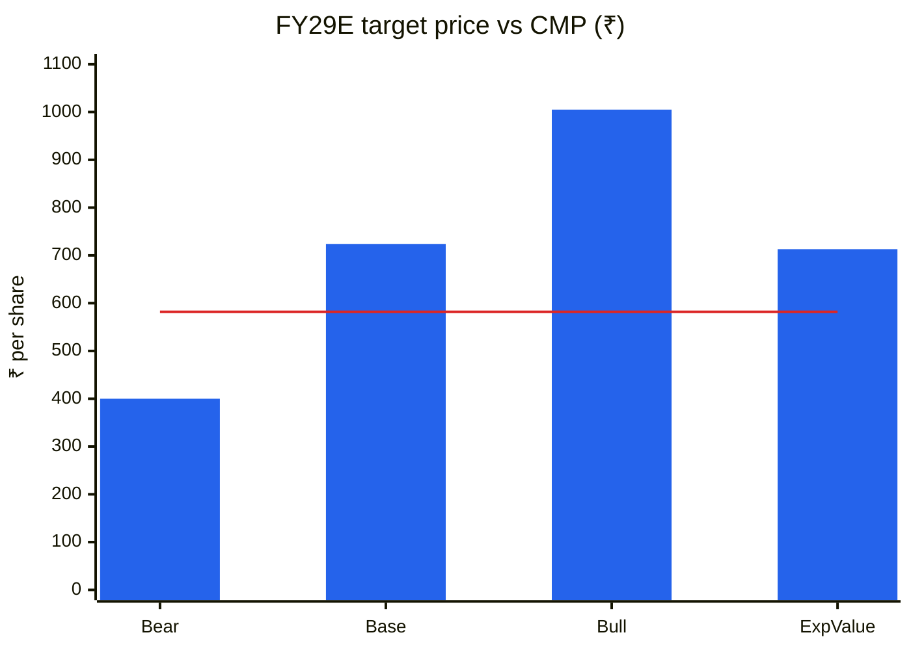
🟦 Scenario target · 🟥 CMP ₹582

**Read:** Downside to the bear case is −31% (₹400) against +24% to the base and +23% to EV. **Upside/downside is 0.72:1 (EV vs bear) and 0.78:1 (base vs bear).** Only the bull case gives 2.3:1.

**Business inference:** At ₹582 the market already pays for the base case: a normal spread plus a successful plasticizer. The payoff is skewed to the downside if the Gulf-driven spread fades before the plasticizer earns. For the asymmetry to work you have to buy nearer the bear value. **EV ₹713 × 2:1 rule → buy-below ≈ ₹505; 1.5:1 → ₹525. Recommended buy zone ₹450–500** (2.0–3.4:1, about a 30–37% discount to EV).

**Return from CMP to EV:** +23% over ~2.5 years (~8.6% a year), below the 12% cost of equity.

---

## Checklist A — Master Analysis Checklist (summary)
- **Section 0 (Existing Report Protocol):** 3/3. Base read in full; 32 items validated (11 ❌ corrected); renamed via `git mv`; one file.
- **Section A (Business quality):** 16/18. Market-share series not independently sourced; scuttlebutt limited to concall Q&A and peer filings.
- **Section B (Forensics):** 9/9.
- **Section C (Financial statements):** 12/12.
- **Section D (KPIs & peers):** 7/7. Commodity adjustment applied.
- **Section E (Market size & share):** 5/7. No independent share or TAM series.
- **Section F (Valuation):** 10/10.
- **Section G (Technical):** 7/8. Sector index stage is a data gap.
- **Section H (Forward view):** 24/27. Order-book items n/a; unit economics n/a; FY23 gross block missing.
- **Section I (Charts):** 5/5. C1, C2, CY5 + C10, CY6, C4, CY7, C5, C6, C7, C12, CY1, CY2 + ROE, CY4, C13 and the Cycle Position Dashboard. CY8 omitted (no peer capex series).
- **Order Book Tracker:** not applicable (non-order-driven).
- **Hard stops triggered:** **Upside/downside < 1.5:1 (0.72:1) → YES.** Stage 4 with declining 30-wk MA: no (the stock is Stage 2; the Nifty is Stage 4, which is not a stock hard stop). ROCE < WACC 5+ years: no (3 years, FY24–26; FY27 is pivotal). Integrity, pledge, auditor, Beneish: none.

## Checklist B — Pre-Buy Final Check (summary)
1. **Falsifiability:** downgrade further if Q2/Q3 FY27 OPM falls below 12% at normal volume, or if the plasticizer does not report commercial production in the Q2 results. Upgrade if the stock is below ₹500 with a confirmed plasticizer and spread ≥ $200.
2. **Inversion (failure modes):** spread collapse; plasticizer failure; new capacity; London write-down; Taloja outage; INR appreciation. The price does not discount these (SVAR 31%).
3. **Circle of competence:** ✓. The spread mechanics are simple and reconcile to reported EBITDA.
4. **Asymmetry:** ✗ (0.72:1). **Stop: do not override with narrative.**
5. **5-year test:** moat ✓ (narrow, cost-based); balance sheet ✓; capital allocation ✗ (London, CBG). This is a cyclical position, not a compounder.
6. **Narrative vs numbers:** "zero net debt" and "1 month to commission" do not match the numbers. Numbers given more weight.
7. **Recency bias:** ✓. FY28–29 spread set below management's 10-yr average; normalised margins used.
8. **Confirmation bias:** ✓. Analyst pushback in the concalls (CBG, interest cost, timelines) read; peer stress cross-checked.
9. **Crowd:** coverage is thin (no large brokers found). Investor-conference attendance (Anand Rathi, 22-Sep-2026) suggests rising sell-side interest. My view differs from the momentum crowd: the good news is priced in.
10. **Governance:** pledge 0% ✓; no SEBI/SFIO/ED matters found ✓; no qualification or EOM ✓; independent director added (Sanjoy Datta, Nov-2025) ✓; SMP resignation (Oct-2026) noted; RPT stable ✓.

---

## Investment Decision

**Verdict: AVOID at ₹582. Hard stop: upside/downside 0.72:1.** Becomes **Watchlist / Cheap-but-Flawed** below ₹500.
The business is cleaner and better placed than its 3-year earnings suggest. It is the lowest-cost PA maker, has positive cash through the trough, has ADD for 5 years, faces a weakened rival, and has a value-creating plasticizer adjacency. But it is a commodity with a narrow moat and project-execution credibility of 0.25. At ₹582 the market already prices a $175–180 through-cycle spread with the plasticizer ramped, which is roughly my base case. The bear case (spreads back to the FY25–26 average) is about ₹400.

| Item | Value |
|---|---|
| **Conviction** | **4.0 / 10** (cycle 0.5/1 · industry 0.3/1 · moat 0.8/2 · management 0.4/1 · financial/earnings quality 1.2/2 · valuation & PIE 0.2/2 · technical 0.6/1) |
| Position size | None at CMP. If bought in the buy zone: 1–2% (× 0.5 for SVAR > 30% and trough/recovery classification) |
| **Buy-below (entry) range** | **₹450–500** (U/D 2.0–3.4:1); or above ₹500 only after Q2 and Q3 FY27 confirm spread ≥ $200 **and** plasticizer commercial production, with targets re-run |
| Stop / thesis break | Weekly close below ₹500 for holders; spread below $150 for two quarters; plasticizer not commercial by Q3 FY27 |
| **Targets (FY29E)** | Bear ₹400 · **Base ₹724** · Bull ₹1,005 · EV ₹713 |
| ROCE vs WACC | Through-cycle post-tax ~16% vs 12% (+4pp). FY24–26 below WACC (3 years); FY27E ~13% |
| Weinstein | Stock Stage 2 (extended ~28% above pivot); Nifty Stage 4 |
| Review triggers | Q2 FY27 results (Nov-2026); Reg 30 plasticizer commercial-production notice; London property sale; DGTR or new-capacity news; crude/OX normalisation |

**Main data gaps:** (1) full 10-yr PA–OX spread series (ICIS, paywalled; management midpoints used); (2) quarterly and annual sales volumes (management gives only ranges); (3) Indian industry capacity, including the 2–3 unnamed new entrants, and Thirumalai's capacity labels and dates; (4) plasticizer commercial-production status (only the company IR mirror of exchange filings was checked; no notice through 9-Oct-2026); (5) London property sale terms and subsidiary debt detail; (6) FY23 gross block; (7) sector index stage; (8) independent market-share data; (9) sell-side consensus.

---
*Report generated by Stock Fundamental Analysis Skill v3.3 | Indian Markets Context*
*Sources: Screener.in (consolidated and standalone 10-yr financials, shareholding, peers; FY22 consolidated CFO overridden by the FY22 AR). IGPL annual reports FY21-22, FY24-25 and FY25-26 (PPE schedules, cash-flow statements, KAMs, AOC-1, contingent liabilities, remuneration). IGPL Q1 FY27 investor presentation and results (5/7-Aug-2026). Concall transcripts: Q4 FY25 (May-2025), Q1 FY26 (14-Aug-2025), Q2 FY26 (6-Nov-2025), Q3 FY26 (13-Feb-2026), Q4 FY26 (21-May-2026), Q1 FY27 (7-Aug-2026). Reg 30 filings: 3-Nov-2025 (plasticizer timeline, IG Biofuels), 30-Mar-2026 (mechanical completion), 6-Oct-2026 (SMP resignation), 15-Oct-2025 (IND AA-/Stable). SHP Jun-2026; RPT disclosure H2 FY26 (igpetro.com mirror of BSE/NSE filings). Thirumalai Chemicals Q1 FY27 investor presentation (NSE, 7-Aug-2026). Yahoo Finance weekly prices (IGPL.NS, ^NSEI, ^INDIAVIX). Figures as of 12-Oct-2026; consolidated unless noted; all forward figures are estimates.*
*Save path: C:\Users\anubh\Documents\Anubhav\Stock Analysis\Stock Analysis\IGPL_IGPetrochemicals_2026-10-12.md*
