# Stock Analysis Report — IOL Chemicals and Pharmaceuticals Limited (IOLCP)
**Date:** 2026-10-11 (prices as of close Fri 9-Oct-2026)
**Analyst:** Claude (Stock Fundamental Analysis Skill v3.3)
**Investment Horizon:** 2–3 Years
**Recommendation:** AVOID at current price → WATCHLIST (buy-below ₹115)
**Conviction Score:** 4.5 / 10
**CMP:** ₹201.15 · **Market cap:** ₹5,904 Cr · **TTM P/E:** 35.1× (standalone TTM EPS ₹5.73; Screener shows 33.4×) · **P/B:** 3.3× · **EV/TTM EBITDA:** ~18.8×

## Revision Log
| Version | Date | Recommendation | Conviction | Price | Key change |
|---|---|---|---|---|---|
| Current | 2026-10-11 | Avoid at CMP → Watchlist (buy-below ₹115) | 4.5/10 | ₹201.15 | **Initial report.** The recovery is real (Q1 FY27 revenue +37%, PAT +90%), but the stock is up 2.7× since March. It now trades at the 98th percentile of its own P/E history and the 99th of its P/B history, while ROIC is still at or below WACC. Upside/downside is below 1.5:1, which is a hard stop. |
| Previous | — | — | — | — | No earlier report exists. The library was searched for `IOLCP_*`, "IOL", "IOLChem" and "IOL Chem" in file names and contents. |

**Validation of previous report:** Initial report, so there is nothing to validate. All numbers below come from primary or aggregated sources and are cited inline. The source list is at the end.

---

## Executive Summary

IOL is a backward-integrated Punjab manufacturer with two businesses. The first is bulk APIs (60% of FY26 revenue). It is one of the world's largest ibuprofen makers, with a 12,000 MTPA plant running at about 95%, and it is growing a non-ibuprofen basket of paracetamol, metformin, clopidogrel, pantoprazole and fenofibrate. The second is acetyl chemicals (40%): 1.2 lakh MTPA of ethyl acetate and 32,000 MTPA of acetic anhydride. After four flat years (FY22–FY25 revenue of ₹2.1–2.2k Cr, OPM 10–12%), the business turned. Q1 FY27 revenue rose **37%** to ₹756 Cr, EBITDA rose **61%** to ₹112 Cr (14.6% margin) and PAT rose **90%** to ₹64.5 Cr. Non-ibuprofen APIs grew 67%. Management has also launched a **₹495 Cr expansion**: ibuprofen up to 18,000 MTPA by Dec 2027, a ₹110 Cr EU-GMP tablet CDMO, and a ₹35 Cr tolling plant. It is also planning a ₹1,200–1,400 Cr greenfield site.

**The thesis problem is price, not the business.** The stock went from ₹74 (Mar-2026) to ₹201, driven both by results and by promoters creeping up from 52.6% to 62.3% (a shrinking float). At ₹201 the market is paying 35× TTM EPS and 3.3× book for a business whose **10-year median OPM is 12% and whose FY26 ROIC was about 8%, below a 12–13% WACC**. Reverse DCF shows the price needs either a **~24% EBITDA margin** sustained with 12% growth (a return to the FY19–21 ibuprofen supercycle) or **~25% revenue CAGR for 10 years at 16% margin**. **Key risk:** ibuprofen is a commodity growing about 3% a year globally. IOL's +6,000 MTPA, Granules' +2,500 MTPA and BASF's +40% Ludwigshafen expansion land in the same 2026–28 window, and that sets up the capital-cycle trap that crushed FY22–25 margins.

**What changed in the latest data:** Q1 FY27 beat (+) · FY27 guidance raised to +15–20% revenue at 14–15% margin, with FY28 guided at +15–20% and 15–17% (+) · ₹495 Cr capex announced 9-Sep-2026 (+ growth, − FCF) · Fenofibrate CEP (25-Sep) and Triacetin EU-REACH (23-Sep) (+) · promoters bought about 9.7% of equity in two quarters (+ signal, but see governance) · Q4 FY26 gross margin was flattered by a war-driven inventory gain (management admitted 10–15 days of benefit) (−) · export target cut from "40–45% in 2 years" to "25–30%" (−).

### C1 — Growth Index: Revenue vs Fixed Assets vs Profit (FY19 = 100)

| ₹ Cr | FY19 | FY20 | FY21 | FY22 | FY23 | FY24 | FY25 | FY26 | CAGR FY19–26 |
|---|---|---|---|---|---|---|---|---|---|
| Revenue | 1,685 | 1,894 | 1,967 | 2,184 | 2,217 | 2,133 | 2,079 | 2,319 | 4.7% |
| Gross block (tangible PPE)* | 495 | 588 | 670 | 762 | 995 | 1,236 | 1,544 | 1,632 | 18.6% |
| EBITDA (excl. OI) | 410 | 574 | 592 | 257 | 227 | 232 | 202 | 270 | −5.8% |
| PAT | 237 | 361 | 445 | 166 | 140 | 135 | 101 | 138 | −7.5% |
| Index: Revenue | 100 | 112 | 117 | 130 | 132 | 127 | 123 | 138 | |
| Index: Gross block | 100 | 119 | 135 | 154 | 201 | 250 | 312 | 330 | |
| Index: EBITDA | 100 | 140 | 144 | 63 | 55 | 57 | 49 | 66 | |
| Index: PAT | 100 | 152 | 188 | 70 | 59 | 57 | 43 | 58 | |

*Source: Screener.in standalone P&L/BS (consolidated ≈ standalone; the UK subsidiary is immaterial). Gross block FY22–26 is from the Screener fixed-asset schedule. FY19–21 is **derived**: net block plus rolled-back accumulated depreciation, which ignores disposals, so it is approximate (⚠️). FY19 is used as the base because FY17–18 PAT was near zero.*

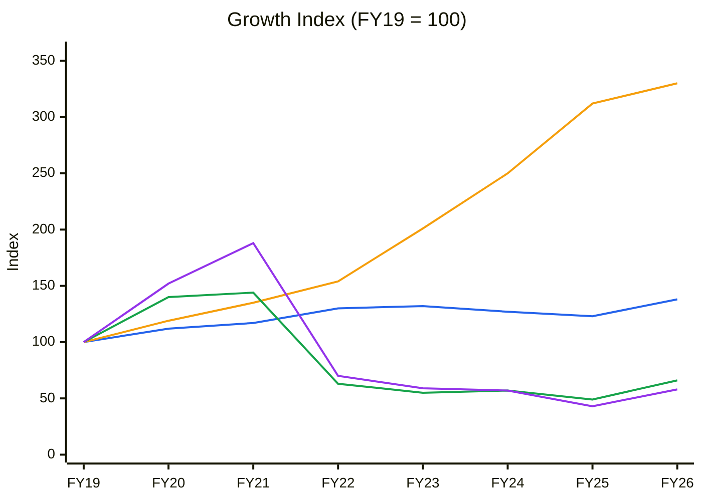
🟦 Revenue (CAGR 4.7%) · 🟧 Gross block (18.6%) · 🟩 EBITDA (−5.8%) · 🟪 PAT (−7.5%)

**Read:** Since FY19 gross block has grown 3.3× while revenue grew only 1.38×, and EBITDA and PAT are still about 35–42% below FY19. Asset turnover (on gross block) fell from 3.4× to 1.4×.

**Business inference:** FY19–21 profits came from an ibuprofen price supercycle (BASF outage, then COVID), not from the asset base. The ₹1,000+ Cr spent since FY22 on paracetamol, acetic anhydride, the cogeneration plant, the ETP and land earned almost nothing until FY27. The FY27 ramp is the first real test of whether that capital earns its cost. Until utilisation lifts asset turnover back above about 1.9×, ROIC stays near WACC (→ Module 11 base AT anchor).

---

## Business Primer

IOL Chemicals and Pharmaceuticals makes two linked sets of products at one 180-acre integrated complex in Barnala, Punjab. In **pharmaceuticals** (₹1,396 Cr, 60% of FY26 revenue) it sells bulk active ingredients (APIs) to formulators in India and about 80 countries. Revenue is volume × realisation per kg. Ibuprofen was about 34% of total company sales in FY26 and is about 57% of pharma revenue; IOL is among the world's largest producers. The rest of pharma is a growing "non-ibu" basket: paracetamol from a new 10,800 MTPA plant, metformin, clopidogrel, pantoprazole, fenofibrate, levetiracetam and minoxidil. In **chemicals** (₹923 Cr net of inter-segment, 40%) it sells ethyl acetate (1.2 lakh MTPA, about 34% of company sales) to packaging-ink, paint and pharma solvent users, plus acetic anhydride. It also makes iso-butyl benzene, mono-chloro acetic acid and acetyl chloride, which are the key starting materials for its own ibuprofen and paracetamol (CARE, Jul-2026; Q1 FY27 investor presentation). The economics rest on two things: (1) **backward integration**, which lets IOL make ibuprofen and paracetamol from basic petro- and agro-chemicals more cheaply than buyers of intermediates, and (2) **the commodity price cycle of ibuprofen and ethyl acetate**, which together are about 68% of sales.

This is a **commodity / cyclical bulk-chemicals business** with a slow move towards differentiated, regulated-market APIs. The main value driver is **spread × utilisation**: realisation minus feedstock (acetic acid, ethanol/SDS, propylene/benzene, imported DCDA for metformin), times how full the plants run. Price moves dominate margins. FY21's 30% OPM fell to 10% by FY25 when ibuprofen prices normalised and Chinese supply returned. The key risks are the **capital cycle** (global ibuprofen demand grows only about 3% a year, while IOL and competitors are adding capacity at the same time), feedstock volatility (the Mar-2026 US–Iran conflict spiked acetyls), and regulatory approvals for exports. Two structural features colour the analysis: a **net-cash balance sheet** (CARE A+/A1+, cash ₹231 Cr vs debt of about ₹135 Cr at FY26), and a **promoter group that has bought about 14% of the company since Sep-2024**, while the same promoter entities also sell IOL about ₹132 Cr a year of goods.

**Segment check (New Segment Protocol):** Bulk APIs are covered by *Pharmaceuticals* (`references/05-industry-kpis-india.md` line 201) ✓. Acetyl chemicals are a near-match to *Specialty Chemicals* (line 449) ✓. Both blocks are used in Module 7. *Caveat:* the Pharma block is built for formulation companies (US ANDA, Para IV), and the Specialty block for custom synthesis (order book). Neither captures commodity-API metrics such as realisation per kg, KSM integration, or the acetyl spread. These are covered ad hoc below.

---

## Module 1 — Broad Market Cycle (Marks)

| Input | Value | Source |
|---|---|---|
| Nifty 50 (9-Oct-2026) | 22,520 | Close 9-Oct-2026 (given in brief) |
| Drawdown from record | −14.6% (record 26,373 on 5-Jan-2026) | Computed |
| India VIX | 14.35 | 9-Oct-2026 (given in brief) |
| Macro shock | US–Iran conflict (Mar-2026), Strait of Hormuz shipping disruption, crude volatility | IOLCP Q1 FY27 concall; Alchempro (acetic acid) |
| Nifty Pharma | ~25,962 (9-Oct-2026), close to its highs | Univest market blog (single source ⚠️) |

**Assessment: Cautious.** The broad market is in a ~15% correction, but VIX at 14 is not panic, so this is a grinding de-rating rather than capitulation. Pharma has been a defensive outperformer. **Sizing implication:** normal sizing for names that pass; no reason to stretch.

---

## Module 1b — Sector Cycle: Tailwinds & Headwinds

**Sector verdict: Tailwind now (volume recovery after destocking), turning toward Neutral/Headwind for ibuprofen in FY28–29 as new supply arrives.**

| Driver | Evidence | Read |
|---|---|---|
| Ibuprofen demand | Management: "we were expecting demand of especially ibuprofen from October 2025 onwards, and that has happened" (Q4 FY26 call, 22-May-2026). Plant utilisation 90–95% since Q3 FY26. | Post-destocking restock; partly cyclical |
| Ibuprofen price | India ~USD 14.9/kg in Q2-2026, +5.7% QoQ; China USD 9.4–10.8; Germany USD 19.8–21.2 (market-research estimate, single source ⚠️) | Firm but not spiking. Management: "we don't think there is a sharp increase in pricing" (11-Sep-2026) |
| Ibuprofen supply pipeline | IOL +6,000 MTPA (Dec-2027, NSE filing 9-Sep-2026); Granules 2,500 MTPA Hyderabad (2024); BASF +~40% Ludwigshafen by 2026; Solara reported #2 by capacity (undated) | **Simultaneous capacity additions are a classic capital-cycle warning** |
| Global ibuprofen demand | ~45,000 MT (2022, +~2%/yr); management says 3–4%/yr | IOL's +6,000 MT equals ~4 years of global demand growth |
| Acetyls (ethyl acetate, acetic anhydride) | Acetic acid in India +78% from March lows to mid-April 2026, then corrected; EA ₹108/kg (early Apr) → ₹89/kg (early May) on inventory overhang | War spike already reversed; IOL said EA spread "will remain constant" (13-Aug-2026) |
| Paracetamol | Prices "softened down from peak during the last six months" (11-Sep-2026) | Neutral |
| Geopolitics | DCDA (metformin KSM) sourced from China; acetic acid import-linked; Red Sea/Hormuz freight | Transient margin risk; manageable |
| FX | FY26 forex earned ₹470 Cr vs used ₹780 Cr (AR FY26, Annexure on forex; column order read as Used/Earned ⚠️) | Net **importer** of FX, so a weaker INR is a mild cost headwind; exports are 24–28% of sales |

**Secular vs cyclical decomposition of Q1 FY27's +37%:**
- Pharma +42.6% (₹329 → ₹470 Cr): driven by volume and utilisation (management), with paracetamol 55% → ramping and non-ibu +67%. Part of the ibuprofen recovery is restocking after FY24–25 destocking (cyclical).
- Chemicals +29% (₹222 → ₹287 Cr): EA and AA capacity additions, plus **war-elevated acetyl realisations** (cyclical, now reversing).
- **Estimate:** about 10–12pp of the 37% is cyclical (acetyl prices, ibu restock, Q1 pass-through of higher input costs). The durable baseline is **~8–10% revenue growth**: ibuprofen volume 3–4%, non-ibu API share gains, new capacity. That baseline anchors the DCF mid-period growth, not the 37%.

**Downstream:** Module 9 does not embed FY27's +20% as permanent. MoS is widened by 5pp for the FY28–29 ibuprofen supply wave.

### CY5 — Industry Demand vs Supply: *not charted (data gap)*
No sourced 7–10-year series for global ibuprofen capacity or demand exists in the public domain. Only point estimates are available: demand ~45k MT (2022) and the scattered capacity additions listed above. Charting would mean inventing numbers. **Read:** announced additions (IOL 6k + Granules 2.5k + BASF ~+40% + Solara 3.6k) far exceed demand growth of about 1.5k MT a year. **Business inference:** this is a "capacity steepening while utilisation peaks" setup, i.e. late cycle for ibuprofen pricing in FY28–29. IOL's cost position (integration) is its defence, but realisations are unlikely to rise.

### CY6 — Spread Cycle (proxy: gross margin = 1 − material cost / sales, quarterly)

| Quarter | Q1FY25 | Q2FY25 | Q3FY25 | Q4FY25 | Q1FY26 | Q2FY26 | Q3FY26 | Q4FY26 | Q1FY27 |
|---|---|---|---|---|---|---|---|---|---|
| Material cost % | 67% | 68% | 68% | 66% | 66% | 65% | 66% | 60% | 63% |
| Gross margin % | 33 | 32 | 32 | 34 | 34 | 35 | 34 | 40 | 37 |

*Source: Screener quarterly expense schedule (standalone). Annual gross margin: FY22 28% · FY23 30% · FY24 34% · FY25 33% · FY26 36%.*

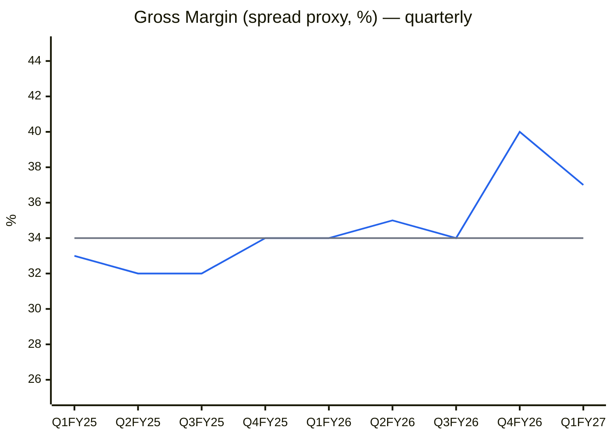
🟦 Gross margin % · ⬜ 9-quarter median (34%)

**Read:** The spread was flat at 32–35% for 7 quarters, jumped to 40% in Q4 FY26 (war inventory gain, which management admitted), and fell back to 37% in Q1 FY27. Q1 sits at about the 90th percentile of the 9-quarter range.

**Business inference:** Part of the current margin is borrowed from a favourable input/price lag rather than earned through structural cost gains. Management said the pricing mismatch "has been already exhausted". A 34–35% gross margin is the honest run-rate, which caps sustainable EBITDA near 13–14%, not the 15–17% implied for FY28.

---

## Module 1c — Stock Cycle: Company Positioning

### C2 — Quarterly YoY Growth Trajectory

| Quarter | Q2FY25 | Q3FY25 | Q4FY25 | Q1FY26 | Q2FY26 | Q3FY26 | Q4FY26 | Q1FY27 |
|---|---|---|---|---|---|---|---|---|
| Revenue (₹ Cr) | 526 | 523 | 528 | 552 | 568 | 580 | 619 | 756 |
| Revenue YoY % | −3.5 | 0.6 | 4.8 | 10.0 | 8.0 | 10.9 | 17.2 | 37.0 |
| EBITDA excl. OI (₹ Cr) | 42 | 47 | 63 | 62 | 57 | 57 | 93 | 104 |
| EBITDA YoY % | −34.4 | 6.8 | 26.0 | 21.6 | 35.7 | 21.3 | 47.6 | 67.7 |

*Source: Screener quarterly standalone; YoY vs year-ago quarters (Q2FY24 545/64, Q3FY24 520/44, Q4FY24 504/50, Q1FY25 502/51).*

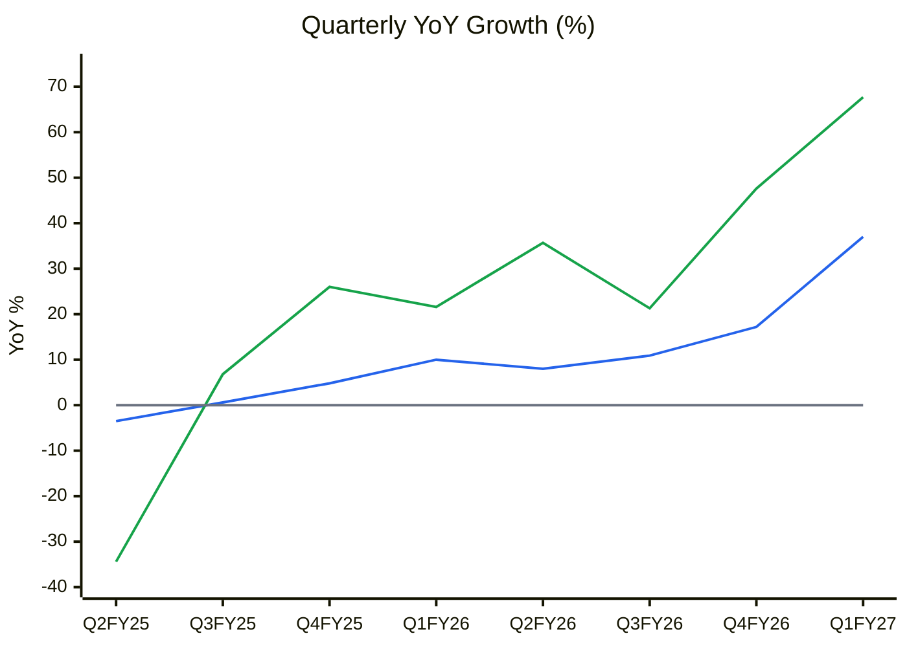
🟦 Revenue YoY % · 🟩 EBITDA YoY % · ⬜ zero line

**Read:** Growth is **accelerating**: revenue went from −3.5% to +37% over 8 quarters, and EBITDA growth has outrun revenue for 7 straight quarters (+68% in Q1 FY27).

**Business inference:** This is classic early-upcycle operating leverage. Fixed costs are being absorbed as utilisation rose from 63% to 75%+ in pharma (CARE) and paracetamol ramps. The comparison base gets much tougher from Q4 FY27, and the war-related price support is fading, so YoY growth should peak in H1 FY27.

### Volume / Price / Mix
| Driver | Evidence | Durability |
|---|---|---|
| Volume | Pharma utilisation 63% (FY25) → 75% (FY26) (CARE); paracetamol 55% of 10,800 MTPA, targeted 70% by FY27-end; ibu 95% | Capacity-bounded. Ibu has no headroom until Dec-2027. |
| Price | Q4/Q1 helped by war pass-through and inventory gain; "majority" of pharma growth is volume (Q1 call) | Fragile; already reversing in acetyls and paracetamol |
| Mix | Non-ibu 18% (FY21) → 37% (FY26) → 43% (Q1 FY27) of pharma; exports 24.4% → 28.5% | Most durable lever, but non-ibu margins are "equivalent to" ibu, not higher (management) |

### C10 — Capacity & Utilisation (table only: fewer than 4 sourced points)
| Product | Capacity (MTPA) | Utilisation | Source |
|---|---|---|---|
| Ibuprofen | 12,000 → 18,000 (Dec-2027) | 95% | NSE filing 9-Sep-2026 |
| Paracetamol | 10,800 | ~55% (Q1 FY27), target ~70% by Mar-2027 | Q1 FY27 call |
| Metformin / Clopidogrel / Pantoprazole / Fenofibrate | 7,200 / 240 / 276 / multi-product | 80–95% | Q4 FY26 & Q1 FY27 calls; PPT |
| Total API | 30,726 | 63% (FY25) → 75% (FY26) | PPT; CARE |
| Ethyl acetate / Acetic anhydride | 1,20,000 / 32,000 | 98–100% | Q4 FY26 call |
| Triacetin (new, May-2026) | 6,000 | ramping; ~₹120 Cr revenue potential | Q1 FY27 call |
| Total chemicals | 1,82,400 | 96% (FY25) → 91% (FY26) | PPT; CARE |

**Capacity ceiling:** Ibu and acetyls are both full, so volume growth in FY27–H1 FY28 can come only from paracetamol (about 1,700 MT of headroom at 70% utilisation), the triacetin ramp, CDMO (Q3 FY27) and tolling (Q3 FY27). The next real step-up is the ibu block in Q4 FY28.

### Operating leverage (Q1 FY27 vs Q1 FY26)
Implied DOL on EBIT ≈ 2.6× (EBIT excl. OI ₹42 Cr → ₹83 Cr, +98%, on +37% revenue). DFL ≈ 1.05× (interest ₹4 Cr a quarter). DTL ≈ 2.8×. **The same leverage works in reverse:** a 10% realisation drop with flat volume would cut EBIT by about 25–30%. ICR is above 18× (CARE), so there is no lender risk.

### FCF inflection
FY22–26 cumulative FCF was **−₹118 Cr** (Screener: −60, −86, +18, −34, +44) on ₹1,026 Cr of capex. With ₹495 Cr of announced capex (30% already spent) and greenfield plans of ₹200–250 Cr a year, **FCF stays near zero or negative through FY28**. FY29 is the earliest inflection year, and only if the greenfield is deferred.

### CY7 — Margin & ROCE vs their own cycle

| | FY17 | FY18 | FY19 | FY20 | FY21 | FY22 | FY23 | FY24 | FY25 | FY26 | 10-yr mean | SD |
|---|---|---|---|---|---|---|---|---|---|---|---|---|
| EBITDA margin % (excl. OI) | 14.3 | 12.2 | 24.3 | 30.3 | 30.1 | 11.8 | 10.2 | 10.9 | 9.7 | 11.6 | 16.6 | 7.9 |
| ROCE % | 12 | 15 | 56 | 68 | 54 | 18 | 14 | 12 | 9 | 11 | 26.9 | 21.6 |

*Source: Screener standalone (OP/Sales; ROCE row).*

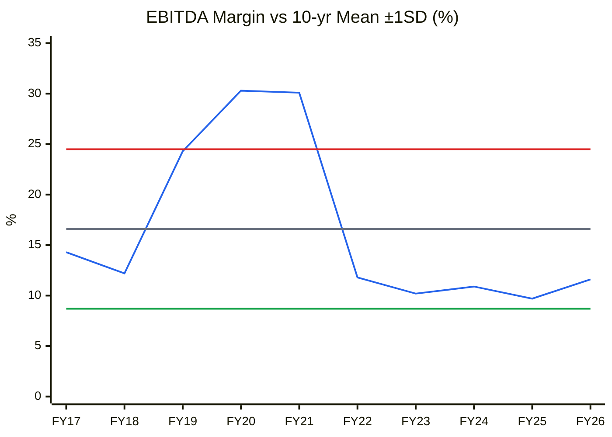
🟦 EBITDA margin · ⬜ 10-yr mean 16.6% · 🟥 +1SD 24.5% · 🟩 −1SD 8.7%

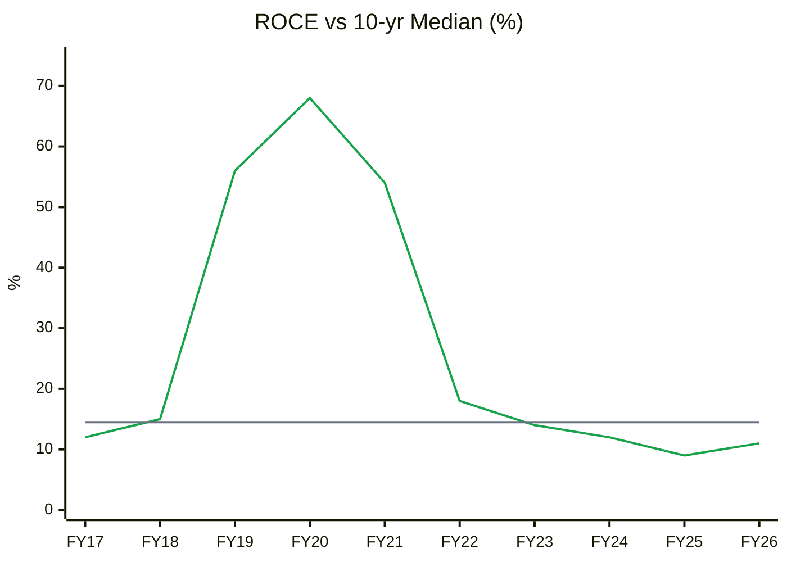
🟩 ROCE · ⬜ 10-yr median 14.5%

**Read:** FY26 OPM of 11.6% sits at the 40th percentile and FY26 ROCE of 11% at about the 20th percentile of the 10-year range. Q1 FY27's 13.8% (excl. OI) is near the median. The mean is distorted upward by the FY19–21 supercycle (median OPM is 12%).

**Business inference:** On normalised economics IOL is a **12%-margin, 12–15%-ROCE business**. The supercycle years were an anomaly, not the norm. Today's earnings recovery is a move from trough to mid-cycle, not to peak. **Stock cycle classification: Early cycle / Ramp-up (operations), but the price has already discounted a peak-cycle outcome.**

---

## Module 2 — Industry Structure & Capital Cycle

### Porter Five Forces
| Force | Assessment | Signal |
|---|---|---|
| New entrants | API plants need EU-GMP, USFDA and CEP approvals (2–3 yrs) and backward integration for cost parity. Capital needs are modest (₹350 Cr buys 6,000 MTPA of ibu). Chinese capacity can re-enter. | Medium barrier |
| Supplier power | Commodity feedstocks: acetic acid, SDS/ethanol, propylene, benzene, sodium metal, DCDA (China) (CARE). Integration reduces exposure for ibu and paracetamol, not for metformin or acetyls. | Medium |
| Buyer power | Generic formulators and distributors run competitive tenders. Contracts are 3–5 years with **two-way price-adjustment clauses** (11-Sep-2026 call). Top-10 customers are only 19% of sales (CARE). | High on price, low on concentration |
| Substitutes | Ibuprofen and paracetamol are global OTC staples. Therapeutic substitution among NSAIDs is limited. | Low |
| Rivalry | China (low-cost ibuprofen at USD 9–11/kg), BASF, Granules, Solara, SMS Pharma; acetyls compete with Jubilant Ingrevia, Laxmi Organic, GNFC and imports | High |

**Industry verdict: Neutral-to-Unattractive.** It is a commodity with high rivalry and buyer price power; only the low-cost integrated producer earns its cost of capital through the cycle.

### Capital cycle (Chancellor)
| Signal | Reading | Direction |
|---|---|---|
| IOL capex / depreciation | FY23 4.6× · FY24 4.3× · FY25 3.0× · FY26 2.2× (Screener capex ÷ D&A) | Heavy investment while returns were trough-level |
| Peer capacity adds | Granules, BASF, Solara and IOL all expanding ibuprofen | **Deteriorating** |
| ROIC vs 10-yr avg | Below average and turning up | Improving near term |
| Sector IPOs / equity issuance | No specific ibuprofen IPOs found (⚠️ not exhaustively checked) | Neutral |

**Capital-cycle position: Mid-cycle for returns (recovering), but late-cycle for supply.** The next 18–24 months of capacity additions are the main risk to FY29 pricing. CY8 is not charted because there is no 10-year capex data for peers.

---

## Module 3 — Business Quality & Moat

**Moat Verdict:** Narrow (ibuprofen only); none in acetyls
**Moat Source (Greenwald):** Supply/cost advantage from backward integration (IBB, MCA, acetyl chloride, acetic anhydride captive) plus scale (12,000 MTPA, roughly a quarter to a third of global ibuprofen). Customer captivity is mild: a formulator must file a DMF/CEP variation to switch API source. No local-scale moat.
**Buffett Moat Type:** Low-cost producer (partial)
**Pricing Power Test (raise prices 10%?):** **Fail.** OPM fell from 30% (FY21) to 10% (FY25) as ibuprofen normalised. Contracts carry downward price clauses.
**Market Share Stability (5yr):** Stable. Ibuprofen has been 30–36% of IOL sales FY22–26 (CARE 2022–2026) at near-full utilisation.
**Fisher 15-Point Score:** 31 / 45 *(Point 15 Integrity: Pass, with RPT and remuneration flags noted)*

| # | Fisher point | Score | Evidence |
|---|---|---|---|
| 1 | Market potential | 2 | Ibu grows 3–4%; non-ibu + CDMO add runway |
| 2 | New products | 3 | Paracetamol, minoxidil, triacetin, CDMO, tolling; 21 CEPs |
| 3 | R&D effectiveness | 2 | ₹26 Cr R&D (1.1% of sales); converts to CEPs/DMFs, not IP |
| 4 | Sales organisation | 2 | 80 countries; export share stuck at 24–29% |
| 5 | Profit margin | 1 | 12% OPM, 6% PAT margin (FY26) |
| 6 | Margin improvement | 2 | Utilisation and mix push; credible but slow |
| 7 | Labour relations | 2 | SA8000; no disputes found |
| 8 | Executive relations | 2 | Stable team (CFO, CS, Director-Works on calls) |
| 9 | Management depth | 2 | Promoter family (3 Guptas) plus long-tenured professionals |
| 10 | Cost controls | 2 | Integration and cogeneration; fuel-cost miss in Q2–Q3 FY26 |
| 11 | Unique advantages | 2 | Backward integration in ibu and paracetamol |
| 12 | Long-range orientation | 2 | Capacity built through the trough |
| 13 | Dilution | 3 | No equity issuance; promoters buying |
| 14 | Candour in adversity | 2 | Admitted fuel-cost misses; but repeated optimistic margin and export guidance |
| 15 | Integrity | 2 | No SEBI/ED actions found. RPT purchases ₹132 Cr from promoter firms; remuneration 15.8% of PAT. |

### C4 — Margin Trend (10 yr)
| % | FY17 | FY18 | FY19 | FY20 | FY21 | FY22 | FY23 | FY24 | FY25 | FY26 |
|---|---|---|---|---|---|---|---|---|---|---|
| EBITDA margin (excl. OI) | 14.3 | 12.2 | 24.3 | 30.3 | 30.1 | 11.8 | 10.2 | 10.9 | 9.7 | 11.6 |
| PAT margin | 0.7 | 2.8 | 14.1 | 19.1 | 22.6 | 7.6 | 6.3 | 6.3 | 4.9 | 6.0 |

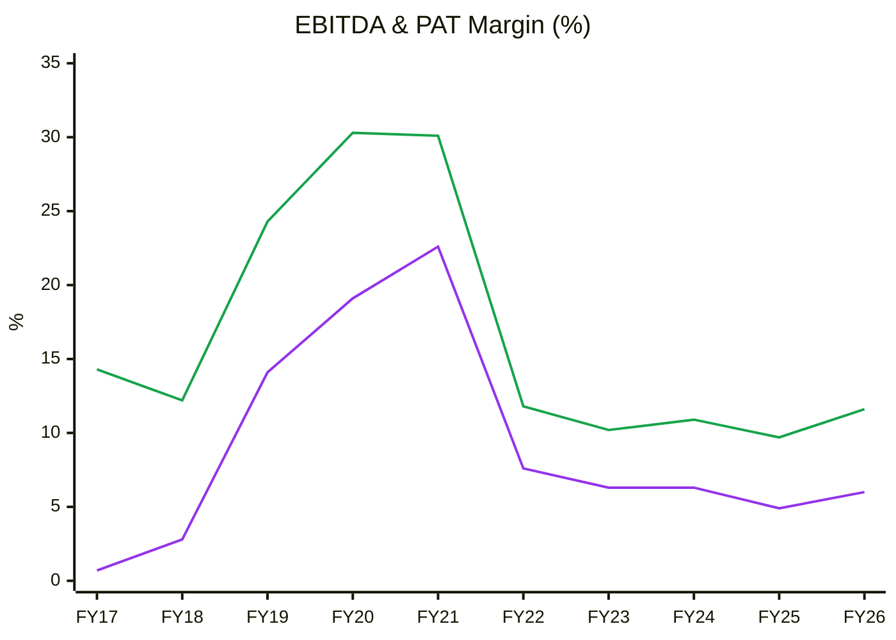
🟩 EBITDA margin · 🟪 PAT margin

**Read:** Margins tripled in FY19–21 and collapsed by two-thirds in FY22. They have sat at 10–12% for 5 years. The PAT margin is also squeezed by depreciation, which nearly doubled from ₹43 Cr to ₹80 Cr.

**Business inference:** A commodity margin profile. Mix improvements have only offset rising depreciation and employee costs (employee cost went from 6% to 11% of sales, FY22 → FY26). The moat protects survival, not price.

---

## Module 4 — Management & Capital Allocation

**Promoter Holding:** 62.28% (Jun-2026) | **Pledge:** 0% (promoter no-encumbrance declaration for FY26; Scanx) → Risk: Normal
**Promoter trend:** Rising sharply. 48.19% (Sep-24) → 52.62% (Dec-24) → 57.48% (Mar-26) → 62.28% (Jun-26), via open-market buying by NCVI Enterprises, Mayadevi Polycot and NM Merchantiles. Each fiscal-year step (+4.86pp FY26, +4.80pp FY27) sits just under the 5%-per-year SAST creeping-acquisition limit.
**FCF/share vs EPS CAGR (FY21–26, 5yr):** FCF/share ₹9.2 → ₹1.5 (≈ −30% CAGR) | EPS ₹15.15 → ₹4.69 (−21% CAGR). Both are distorted by the FY21 peak.
**Share Count Trend:** Stable (29.36 Cr shares, FV ₹2)
**Capital Allocation Rating:** Average. Capex was funded without debt, but incremental ROIC on FY22–26 capex was roughly zero (see Module 6).
**Key RPT concerns:** Purchases of goods from promoter-controlled NCVI (₹40.0 Cr), Mayadevi Polycot (₹69.4 Cr) and NM Merchantiles (₹22.5 Cr) total **₹131.9 Cr in FY26 vs ₹100.7 Cr in FY25 (+31%)** (AR FY26 Note 40). The AR asserts arm's-length pricing, but the goods are not disclosed. Managerial remuneration was **₹21.75 Cr = 15.8% of FY26 PAT** (21.9% of FY25), above the 10% extraction threshold.
**Buffett Three C's:** Candour: Moderate (admits misses, keeps re-guiding upward) | Competence: Moderate (strong operator, weak capital-cycle timing) | Caring: Moderate (dividend payout 21%; promoters buying their own stock)

### C9 — Promoter Holding (last 8 quarters)
| Qtr | Dec-24 | Mar-25 | Jun-25 | Sep-25 | Dec-25 | Mar-26 | Jun-26 |
|---|---|---|---|---|---|---|---|
| Promoter % | 52.62 | 52.62 | 52.62 | 52.62 | 52.62 | 57.48 | 62.28 |
| FII % | 1.49 | 1.47 | 2.59 | 2.25 | 2.08 | 1.72 | 4.87 |
| Public % | 45.81 | 45.84 | 44.76 | 45.10 | 45.26 | 40.78 | 32.41 |

*Sep-24 promoter holding was 48.19%. Source: Screener shareholding (BSE SHP).*

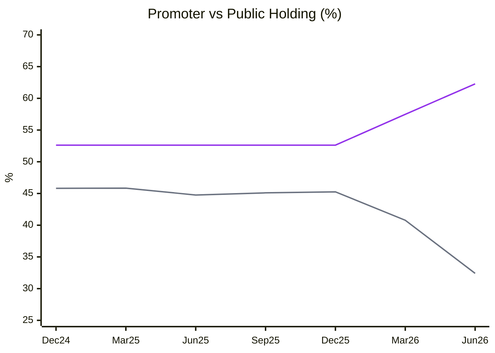
🟪 Promoter % · ⬜ Public %

**Read:** Promoters added 9.66pp in two quarters, and public float fell from 45% to 32%. Public shareholder count dropped from 1.32 lakh to 1.19 lakh.

**Business inference:** Insiders buying ~₹250–300 Cr of stock (estimate: ~2.8 Cr shares at ₹75–135) is the strongest available bullish signal on intrinsic value. It also explains part of the price move: a shrinking float met rising FII demand. Two cautions apply. First, the buyers are the same entities that sell IOL ₹132 Cr a year of goods. Second, the creeping limit lets promoters add at most about 5pp more in FY28 (to ~67%). The float-squeeze tailwind is finite.

### Walk the Talk Scorecard
| Quarter Guided | Statement | Guided | Actual | Verdict |
|---|---|---|---|---|
| Q3 FY25 call (Feb-25) | Ibu utilisation back to ~90% in 2–3 quarters | ~90% by ~Q3 FY26 | 90–95% (Q3 FY26 call) | ✅ |
| Q3 FY25 / Q4 FY25 calls | FY26 revenue growth | 10–12% / 10–15% | +11.5% (₹2,319 Cr) | ✅ |
| Q3 FY25 → Q1 FY26 calls | Exports to 40–45% of sales in ~2 years | 40–45% by FY27 | FY26 24.3% (AR segment note), down from 26.7%; FY27 target cut to 25–30% | 🔴 Reversal |
| Q4 FY25 (May-25) & Q1 FY26 (Aug-25) | FY26 EBITDA margin | ">15%" / "15% incl. OI" | 12.4% incl. OI (PPT) | ❌ |
| Q1 FY26 (Aug-25) | Paracetamol new-plant utilisation FY26 | 55–60% | ~55% | ✅ (low end) |
| Q2 FY26 (Nov-25) | Paracetamol utilisation by Mar-26 | 65% | ~55% (Q4 FY26 call) | ❌ |
| Q1 FY26 (Aug-25) | Minoxidil Unit 9B commissioning | Q3 FY26 (Dec-25) | Launched in Q4 FY26 (May-26 call) | ⚠️ ~1 qtr late |
| Q2 FY26 (Nov-25) | Power cost normalises, Q3 margin improves | Q3 > Q2 | Q3 OPM 9.8% vs Q2 10.0% (Screener) | ❌ |
| Q2 FY26 (Nov-25) | H2 FY26 EBITDA margin | 13–14% | ~12.1% incl. OI (Q3 ~8.8%, Q4 15.2%) | ⚠️ |
| Q3 FY26 (Feb-26) | Q4 FY26 revenue | ~₹600 Cr | ₹619 Cr | ✅ |
| Q2 FY26 (Nov-25) | FY26 capex | ₹150–200 Cr | ~₹160 Cr | ✅ |
| *Open* | FY27 revenue ₹2,600–2,700 Cr (Nov-25) → +15–20%, 14–15% margin (Aug-26); FY28 +15–20%, 15–17%; paracetamol 70% by Mar-27; ibu block Dec-2027; CDMO & tolling Q3 FY27; 50:50 ibu/non-ibu | | Q1 FY27 tracks ahead (₹756 Cr, 14.6%) | Pending |

**WTT Score: 0.55 / 1.00 — LOW** ((5 hits + 2 × 0.5) / 11)
**Guidance points assessed:** 11 | Hits: 5 | Near Misses: 2 | Misses: 3 | Reversals: 1
**Key pattern:** **Optimism bias on margins and exports. Reliable on volumes, revenue and capex quantum.** Margin targets were missed in 3 of 3 FY26 checkpoints, with fuel costs and floods cited each time. The export target was silently reset.
**Insider action:** Promoter open-market buying of ~9.7pp of equity (Mar-26 and Jun-26 quarters, e.g. NCVI +7 lakh shares on 16-Mar-2026, Mayadevi Polycot +6.54 lakh on 17-Mar-2026) → **BULLISH**
**DCF impact:** Revenue guidance used with a 10% haircut. Margin guidance (15–17% for FY28) is **not** used; base case 14%.
**Overall management credibility:** MODERATE on operations, LOW on forward margin guidance.

---

## Module 5 — Financial Forensics

**Forensic Red Flag Count (O'Glove):** 2 / 15
**Beneish M-Score (FY26):** **−2.57** → Unlikely manipulator (DSRI 1.05, GMI 0.92, AQI 0.92, SGI 1.12, DEPI 0.92, SGAI 1.00, LVGI 1.05, TATA −0.029)
**Altman Z''-Score:** FY24 7.2 → FY25 6.5 → FY26 **6.4** → Safe (mild decline from rising payables and short-term debt)
**Piotroski F-Score (FY26):** **7 / 9** → Strong. Pass: ROA>0, CFO>0, ΔROA+, CFO>NI, no dilution, gross margin up, asset turnover up. Fail: leverage up slightly, current ratio flat at 1.82×.
**Sloan Accrual Ratio (FY26):** (138 − 214 + 198) / 2,485 = **4.9%** → Acceptable
**Indian-Specific Flags:**
- RPT purchases from promoter firms ₹132 Cr (+31% YoY), goods not itemised ⚠️
- Managerial remuneration 15.8% of PAT ⚠️
- Auditor M/s Ashwani & Associates is a small firm, with total audit fees of ₹0.30 Cr for a ₹2,300 Cr company. Unqualified opinion; KAMs are standard (revenue cut-off; inventory valuation ₹371 Cr). No EOM. ⚠️ tier risk
- Pledge 0% ✓; contingent liabilities small (claims ₹3.3 Cr; customs FTA demand ₹2.06 Cr) ✓; no ICDs to group ✓
**Schilit screen:** DSO 79 → 95 days over FY22–26 (receivables/sales 22% → 26%), consistent with a rising export and regulated-market mix, but watch it. Other income/EBIT was 17–18% in FY24–25 (treasury income) but 4.7% in FY26 ✓. Capex/D&A above 2.5× during flat revenue (FY23–25) ⚠️. The FY26 exceptional item of ₹11.2 Cr (new Labour Codes) is genuinely one-off ✓.
**Overall Forensic Verdict:** **Clean, with minor governance concerns.** Cash conversion is strong and none of the models flag accounting risk. The concerns are RPT and remuneration (value leakage), not reported-earnings quality.

### C7 — Earnings Quality: Cumulative PAT vs Cumulative CFO (₹ Cr)
| | FY17 | FY18 | FY19 | FY20 | FY21 | FY22 | FY23 | FY24 | FY25 | FY26 |
|---|---|---|---|---|---|---|---|---|---|---|
| PAT | 5 | 28 | 237 | 361 | 445 | 166 | 140 | 135 | 101 | 138 |
| CFO | 83 | 120 | 273 | 471 | 380 | 91 | 123 | 290 | 179 | 214 |
| Cum PAT | 5 | 33 | 270 | 631 | 1,076 | 1,242 | 1,382 | 1,517 | 1,618 | 1,756 |
| Cum CFO | 83 | 203 | 476 | 947 | 1,327 | 1,418 | 1,541 | 1,831 | 2,010 | 2,224 |

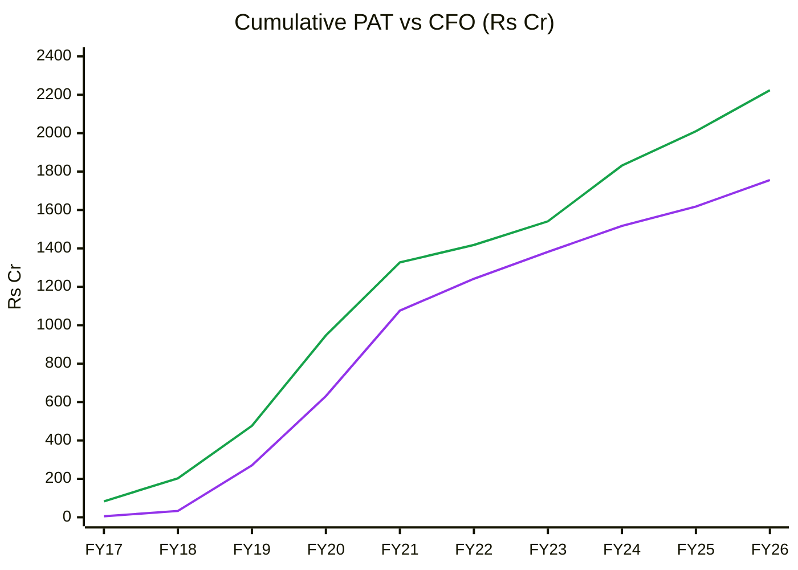
🟪 Cumulative PAT · 🟩 Cumulative CFO

**Read:** 10-year CFO/PAT = **1.27×** (5-year FY22–26: 1.32×). CFO has stayed above PAT throughout.

**Business inference:** Reported profits are real cash. The problem is **reinvestment**, not accruals: almost all CFO since FY22 went into capex that has not yet earned its cost. Earnings quality supports a fair multiple, but low FCF limits it.

---

## Module 6 — Earnings Quality & Financial Statements

**ROIC (FY26):** ~8.2% (NOPAT ₹142 Cr = (OP 270 − D&A 80) × 0.75 ÷ invested capital ₹1,736 Cr = equity 1,799 + debt 135 − cash 198) | **TTM:** ~9.9% | **Q1 FY27 annualised:** ~14%
**ROCE (10yr median):** 14.5% | **WACC:** 12% (Rf 7%, β ~1.0, ERP 5–6%; tested at 13%)
**ROIC vs WACC Spread:** −3.8pp (FY26), about −2pp (TTM) → **Value-destroying until FY27's run-rate holds**
**ROIC Trend (3yr):** Improving off the FY25 trough
**ROIC Driver:** Margin-led recovery; asset turnover still depressed
**Economic Profit:** FY26 −₹66 Cr; Q1 FY27 annualised ~+₹35 Cr

### C5 — ROCE vs WACC
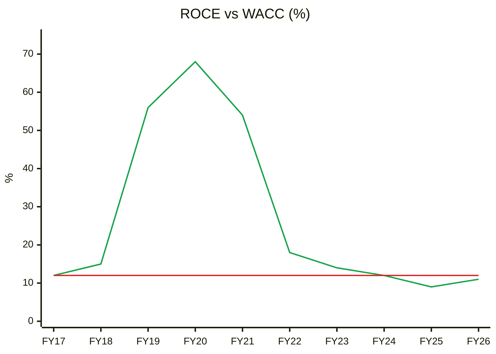
🟩 ROCE (Screener, pre-tax) · 🟥 WACC 12%

**Read:** Pre-tax ROCE was at or below a 12% WACC in 5 of 10 years (FY17, FY23, FY24, FY25, FY26 roughly at parity). On a post-tax basis the FY24–26 spread was negative.

**Business inference:** Outside the FY19–22 boom, IOL has earned roughly its cost of capital. That is the signature of a commodity producer with a cost edge but no pricing power. A premium P/B is only justified if Q1's ~14% ROIC proves durable.

### C6 — Asset Turnover (Revenue / Gross Block)
| | FY17 | FY18 | FY19 | FY20 | FY21 | FY22 | FY23 | FY24 | FY25 | FY26 |
|---|---|---|---|---|---|---|---|---|---|---|
| Gross block (₹ Cr)* | 395 | 457 | 495 | 588 | 670 | 762 | 995 | 1,236 | 1,544 | 1,632 |
| AT (×) | 1.80 | 2.15 | 3.40 | 3.22 | 2.94 | 2.87 | 2.23 | 1.73 | 1.35 | 1.42 |

*FY17–21 derived (⚠️ approximate); FY22–26 from the Screener schedule. 5-yr (FY22–26) average AT = 1.92×; Q1 FY27 annualised ≈ 1.85× (₹3,025 Cr ÷ ~₹1,630 Cr).*

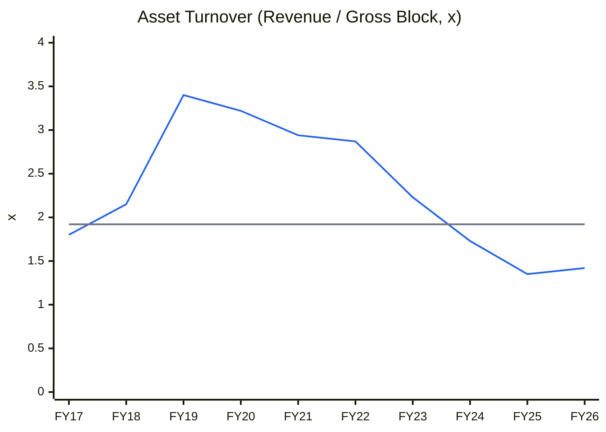
🟦 Asset turnover · ⬜ 5-yr average 1.92×

**Read:** AT halved from 2.87× (FY22) to 1.35× (FY25) and turned up in FY26 (1.42×) and Q1 FY27 (~1.85×).

**Business inference:** The FY22–25 decline is a capex-ahead-of-utilisation cycle (paracetamol plant, AA plant, land), not permanent erosion. However, ₹1,000+ Cr of new gross block added only ₹135 Cr of revenue by FY26. **Base case forward AT for existing assets: 1.75×** (Q1 run-rate less the price element). Management's 1.75–2× guide for new pharma blocks is plausible only at full utilisation.

### DuPont Decomposition (5-factor, year-end equity)
| Year | EBIT Margin | Asset Turnover | Equity Multiplier | Interest Burden | Tax Burden | ROE |
|---|---|---|---|---|---|---|
| FY22 | 10.6% | 1.11 | 1.41 | 0.965 | 0.744 | 11.9% |
| FY23 | 9.2% | 1.10 | 1.34 | 0.922 | 0.741 | 9.3% |
| FY24 | 9.3% | 0.95 | 1.39 | 0.920 | 0.738 | 8.4% |
| FY25 | 7.4% | 0.87 | 1.41 | 0.902 | 0.732 | 6.0% |
| FY26 | 8.6%* | 0.90 | 1.44 | 0.925 | 0.750 | 7.7% |
| **Change** | −2.0pp | −0.21× | +0.03× | −0.04 | +0.01 | **−4.2pp** |

*EBIT = PBT + interest (incl. other income); FY26 is after the ₹11.2 Cr exceptional item (9.1% pre-exceptional). Total assets = Screener total liabilities. Source: Screener.*

**Operating contribution (EBIT margin × AT):** Declining FY22→FY25, turning in FY26
**Financing contribution:** Flat (equity multiplier 1.34–1.44; net cash)
**DuPont verdict:** The ROE fall from 11.9% to 6–8% is **purely operational**: margin and asset turnover both fell, and leverage did not mask it. The recovery has to come from asset turnover, and Q1 FY27 shows it starting.
**AT trend → Module 11 base case AT:** 1.75× on existing assets (rising from the trough)

**Peer DuPont (FY26, approx.):** Granules ROE ~12% on 22% OPM with moderate leverage (gross D/E 0.30). Aarti Drugs ~13% on 12% OPM with D/E 0.37. IOL's lower ROE reflects low asset turnover, not leverage. Its ROE is the "cleanest" (unlevered) in the group.

**OCF / Net Income (5yr):** 1.32× → Quality: High
**O'Glove Red Flags:** 2 / 15 (AR/revenue rising for 2 consecutive years; capex/D&A above 2.5× during flat revenue)
**Key accounting concern:** None material. Note that company-reported "EBITDA" **includes other income** (Q1 FY27 ₹111.7 Cr / 14.6%); excluding OI it is ₹103.5 Cr / 13.7%.

---

## Module 7 — Industry KPIs & Peer Analysis

**Sectors:** Pharmaceuticals (API), ref. line 201 · Specialty Chemicals (acetyls, near-match), ref. line 449

| KPI (reference block) | IOL | Healthy range | Assessment |
|---|---|---|---|
| EBITDA margin (Pharma) | Pharma EBIT 12.3% FY26, 14.7% Q1 FY27; company EBITDA 14.6% | 22–30% (large caps) | **Below** |
| API vs formulation mix (Pharma) | ~100% API; CDMO tablets start Q3 FY27 | Formulations > 60% | Below (by design) |
| US revenue % / ANDA pipeline (Pharma) | 14 USDMFs, 5 US-approved products; US sales small | 30–55% | Not applicable / Below |
| FDA status (Pharma) | USFDA-approved ibu site (FY20); EU-GMP; NMPA China (ibu Apr-25, clopidogrel 2026); no import alert found | None | ✅ |
| EBITDA margin (Specialty Chem) | Chem EBIT 3.3% FY26, 6.0% Q1 FY27 | 20–30%; <15% = commoditisation | **Red flag (commodity)** |
| Export revenue % | 24.3% FY26; 28.5% Q1 FY27 | > 50% | Below |
| Capacity utilisation | Chem 91%, Pharma 75% (FY26) | > 75% | ✅ |
| Client concentration | Top-10 = 19% | Top-3 < 40% | ✅ |
| R&D / revenue | 1.1% (₹26 Cr) | > 3% custom synthesis | Below |
| Capex / revenue | 6.9% FY26 → ~11–12% FY27–28E | 8–15% in expansion | In range |

### Peer comparison (Screener, consolidated, 9-Oct-2026)
| Metric | IOLCP | Granules | Aarti Drugs | SMS Pharma | Laxmi Organic | Jubilant Ingrevia |
|---|---|---|---|---|---|---|
| Business overlap | Ibu, paracetamol, metformin + acetyls | Paracetamol, metformin, ibu + formulations | Metformin, ibu, APIs | Ibu, APIs | Ethyl acetate / acetyls | Acetyls + specialty |
| Revenue 3yr CAGR (FY23–26) | 1.5% | 5.9% | −1.9% | 19.3% | 0.6% | −2.8% |
| EBITDA margin FY26 | 12% | 22% | 12% | 19% | 6% | 13% |
| ROCE FY26 | 11% | 16% | 12% | 13% | 5% | 11% |
| Gross D/E (FY26) | 0.08 (net cash) | 0.30 | 0.37 | 0.46 | 0.27 | 0.25 |
| P/E (TTM) | 35.1× | 34.2× | 19.6× | 40.7× | 39.9× | 31.4× |
| EV/EBITDA (TTM, approx.) | ~18.8× | ~18× | ~13.5× | ~26× | ~22× | ~18× |
| Price vs 52-wk range | Near high (₹224 hi) | ₹815 (hi 924) | ₹413 (hi 534) | ₹445 (hi 494) | ₹180 (hi 209) | ₹626 (hi 795) |

*EV/EBITDA uses Screener TTM sales × OPM and FY26 gross borrowings, without netting peer cash. It is indicative only.*

### C12 — ROCE vs Peers (FY26)
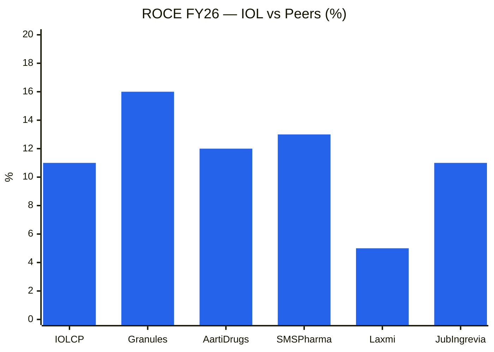
**Read:** IOL's 11% ROCE is mid-pack. It is below Granules (16%) and SMS (13%), level with Jubilant Ingrevia (11%), and above Laxmi (5%).

**Business inference:** IOL trades at Granules' multiple (35× vs 34×) despite 10pp lower margins and 5pp lower ROCE. Granules has formulations, a US franchise and higher-value CDMO. **IOL's valuation premium versus its own history and versus Aarti Drugs is not justified by returns.** It is being priced as a re-rated API platform before the evidence (CDMO, regulated exports, ROIC above 15%) is in.

**Peer positioning:** At a premium to the commodity-API peer (Aarti Drugs 19.6×) and in line with the higher-quality peer (Granules). **Justified? No.**

*Order Book Tracker: not applicable. IOL is not order-driven. Its 3–5-year supply contracts are not disclosed as an order book, and the CDMO/tolling deals have no disclosed values.*

---

## Module 8 — Market Size & Market Share

**TAM (ibuprofen API):** ~USD 280 Mn in 2026 (market-research estimate, ~2.8% CAGR to 2034; ⚠️ single source) ≈ ₹2,400 Cr at ~₹86/USD. Volume ~45,000 MT (2022), growing 2–4% a year.
**IOL ibuprofen revenue FY26:** ~₹790 Cr (34% × ₹2,319 Cr, CARE) → **~30–33% value share**. Volume ~11,000 MT (12,000 × ~92%) vs ~48–50k MT demand → **~22–25% volume share**. A third-party claim of "35% global share" is not verified.
**Ethyl acetate:** IOL has 1.2 lakh MTPA vs domestic producers GACL, Jubilant Ingrevia, Laxmi and imports. Indian demand data was not sourced (⚠️ gap).
**Paracetamol:** 10,800 MTPA at ~55%. Share not estimable (⚠️ gap).
**Market share trend (ibu, 5yr):** Stable (ibu ₹655–790 Cr in FY22–26; utilisation 75% → 95%)
**Share gain driver:** Structural cost advantage plus Chinese environmental tightening (historical)
**Revenue vs market growth:** Company FY23–26 CAGR 1.5% vs ibu market ~3%. FY27 run-rate +20–37% is well above market, i.e. share gain from restocking and non-ibu.
**Verdict:** Growing with the market in ibuprofen. Taking share in non-ibu from a small base. The +50% ibu capacity **requires** share gains of about 5–6pp of global volume to fill. That is plausible against higher-cost Chinese and European capacity, but it will be won on price.

---

## Module 9 — Valuation: PIE First, Then DCF

### Price-Implied Expectations (two-stage reverse DCF)
Setup: FY26 revenue ₹2,319 Cr; D&A 3.5% of sales; tax 25.5%; sales-to-capital 1.8× on new investment; 10-year explicit period; terminal growth 5% with terminal RONIC 15%; WACC 12%; net cash ₹63 Cr; 29.36 Cr shares. Target: ₹201.15.

| PIE value driver | Market-implied | My base case | Expectations gap |
|---|---|---|---|
| Revenue CAGR (10-yr) at 16% EBITDA margin | **~25%** | ~9% (FY26→FY36) | −16pp |
| Steady-state EBITDA margin at 12% CAGR | **~24%** (≈27% at 13% WACC) | 14% | −10pp |
| Investment rate | 1.8× sales/capital (better than FY22–26's ~0.15× incremental) | 1.8× | Already generous |

**Gap classification: Optimistic gap. The PIE requires FY19–21-style supercycle margins or hyper-growth.**
**Expectations treadmill:** To outperform from ₹201, IOL needs **EBITDA margins sustainably above 18–20% with 12%+ growth**. That has happened only in the 3-year ibuprofen shortage window of the last decade. Matching guidance (15–17%) earns well below the cost of capital from this price.
**Positive triggers:** (1) CDMO tablets scale to ₹100+ Cr with 20%+ margins; (2) another global ibuprofen outage or China supply shock; (3) Q2–Q3 FY27 margins at 15%+ without inventory gains.
**Negative triggers:** (1) ibuprofen price cuts as the BASF/Granules/IOL capacity arrives in FY28; (2) acetyl spreads normalise after the war spike (Q2 FY27 onward); (3) greenfield ₹1,200–1,400 Cr capex announcement pushing FCF negative for 3 more years.
**SVAR:** (₹201 − ₹65 bear) / ₹201 = **68%** → Asymmetry unfavourable
**Physical plausibility:** Announced capacity (ibu +6k MT, CDMO, tolling, triacetin, paracetamol to 70%) supports about ₹3.4–3.9k Cr of FY29 revenue (Module 11), i.e. 14–19% CAGR from FY26. The PIE's 25% CAGR needs **unannounced expansion** (the greenfield) on top. The market is pricing the 101-acre site as if it were already built.

### Own DCF (3-stage, WACC 12%, terminal g 5%)
| Scenario | Path | Per-share value |
|---|---|---|
| Bear | FY27 +12%, then 3–5%; 11% EBITDA margin; sales/capital 1.4× | ₹37 |
| Base | FY27 +21%, FY28 +9%, FY29 +16%, fading to 6%; 14% margin | ₹75 (₹85 at 15% margin) |
| Bull | FY27 +22%, FY28 +12%, FY29 +20%, fading to 7%; 16.5% margin | ₹113 |

*At 13% WACC the base falls to ~₹50. A business earning ROIC ≈ WACC is worth about book value (₹61) on a DCF basis, whatever its growth.*

### Relative valuation (2–3 yr, FY29E EPS × multiple)
| | Bear | Base | Bull |
|---|---|---|---|
| FY29E EPS (₹) | 4.3 | 9.2 | 13.3 |
| Multiple | 15× (FY18–26 median 14×) | 18.6× (10-yr weekly median P/E) | 24× (API-platform re-rating) |
| Value (₹) | 65 | 171 | 319 |

### EPV (Klarman — earnings power, no growth)
Normalised OPM 12% (10-yr median) × FY27E revenue ₹2,800 Cr = ₹336 Cr EBITDA − ₹88 Cr D&A = ₹248 Cr EBIT × 0.745 = ₹185 Cr NOPAT ÷ 12% = ₹1,540 Cr + ₹63 Cr net cash → **₹55/share** (₹45 at 10% OPM; ₹75 at 14%).

**Intrinsic Value Range:**
| Method | Bear | Base | Bull |
|---|---|---|---|
| DCF | ₹37 | ₹75 | ₹113 |
| Relative (FY29E EPS × multiple) | ₹65 | ₹171 | ₹319 |
| EPV (Klarman) | ₹45 | ₹55 | ₹75 |
| **Consensus Range (simple average)** | **₹49** | **₹100** | **₹169** |

**Current Market Price:** ₹201.15
**Margin of Safety (base case):** −101% vs consensus base; −18% vs relative base → **Inadequate**
**Upside/Downside Ratio:** Bull +59% / Bear −68% → **0.87:1 → Unacceptable (hard stop below 1.5:1)**
**Reverse DCF Implied Growth:** ~25% CAGR at 16% margin → **Aggressive**
**Graham Number:** √(22.5 × ₹4.63 normalised 5-yr EPS × ₹61.27 BVPS) = **₹80**
**Graham defensive screen:** 2–3 / 7. Pass: revenue > ₹2,000 Cr; positive EPS for 7 years. Fail: current ratio 1.82 (< 2); 7-yr EPS growth negative (₹8.32 → ₹4.69); P/E 35 (> 20); P/B 3.3 (> 3). Dividend record unclear (⚠️ DPS history not verified).
**Misprice reason:** None that favours a buyer. The stock is **over-priced** on a combination of an earnings upturn, a promoter-driven float squeeze, FII entry (1.7% → 4.9%) and a narrative re-rating ("API platform + CDMO").
**Catalyst:** Q2 FY27 results (Nov-2026) will be the first quarter without war-price support; CDMO commercialisation in Q3 FY27.

### CY1 — P/E Band
| | FY18 | FY19 | FY20 | FY21 | FY22 | FY23 | FY24 | FY25 | FY26 | Oct-26 |
|---|---|---|---|---|---|---|---|---|---|---|
| FY-end price (₹) | 15.92 | 38.14 | 33.97 | 113.89 | 79.86 | 56.57 | 72.29 | 61.15 | 77.95 | 201.15 |
| EPS (₹) | 0.99 | 8.32 | 12.70 | 15.15 | 5.64 | 4.77 | 4.61 | 3.44 | 4.69 | 5.73 (TTM) |
| P/E (×) | 16.1 | 4.6 | 2.7 | 7.5 | 14.2 | 11.9 | 15.7 | 17.8 | 16.6 | 35.1 |

*Prices: Screener weekly price API (last week of March). FY17 P/E 74× omitted because EPS was ₹0.17. Annual FY18–26 median 14.2×, SD 5.3. Screener 10-yr weekly median P/E 18.6×; current value = **98th percentile** of the weekly series.*

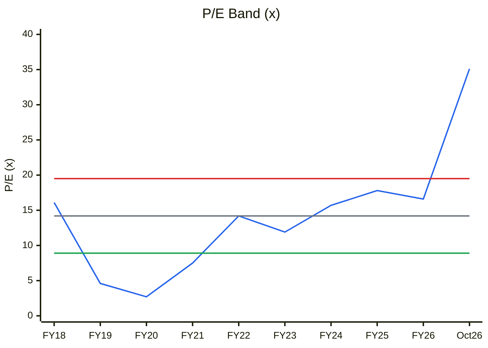
🟦 P/E · ⬜ Median 14.2× · 🟥 +1SD 19.5× · 🟩 −1SD 8.9×

**Read:** P/E of 35× is the highest in the decade, 3.9 SD above the annual median and at the 98th percentile of the weekly series.

**Business inference:** Cyclical P/E rule. In FY19–21, at peak margins, the market paid only 3–8× and was right to. Today it pays 35× on mid-cycle earnings, which implies the market believes the earnings base itself is structurally higher. If margins merely hold at 14%, the multiple has to compress toward 18–20× even as EPS grows.

### CY2 — P/B Band (with ROE)
| | FY17 | FY18 | FY19 | FY20 | FY21 | FY22 | FY23 | FY24 | FY25 | FY26 | Oct-26 |
|---|---|---|---|---|---|---|---|---|---|---|---|
| BVPS (₹) | 6.7 | 7.7 | 16.6 | 28.6 | 42.7 | 47.2 | 51.1 | 54.6 | 57.2 | 61.0 | 61.3 |
| P/B (×) | 1.88 | 2.06 | 2.29 | 1.19 | 2.66 | 1.69 | 1.11 | 1.32 | 1.07 | 1.28 | 3.28 |
| ROE (avg equity) % | — | 13.9 | 68.7 | 56.1 | 42.9 | 12.5 | 9.7 | 8.7 | 6.1 | 7.9 | 9.3 (TTM) |

*Median P/B FY17–26 1.51×, SD 0.52. Current value = **99.6th percentile** of the Screener 10-yr weekly P/B series (median 1.5×).*

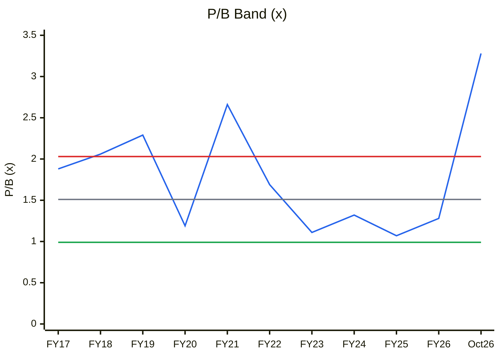
🟦 P/B · ⬜ Median 1.51× · 🟥 +1SD 2.03× · 🟩 −1SD 0.99×

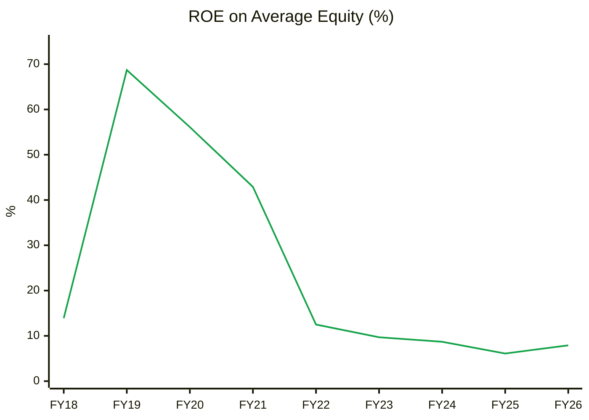
🟩 ROE

**Read:** P/B of 3.28× is the decade high (99.6th percentile), while ROE is 8–9%. In FY21, P/B was 2.66× on 43% ROE.

**Business inference:** Justified P/B = (ROE − g)/(Ke − g). With ROE 14% (Q1 annualised), g 6% and Ke 12.5%, that gives about 1.2×. **Even giving full credit to the Q1 FY27 run-rate, book-value math caps fair value near 1.2–1.8× book (₹75–110).**

### CY4 — Price vs EPS Index (FY19 = 100)
| | FY19 | FY20 | FY21 | FY22 | FY23 | FY24 | FY25 | FY26 | Oct-26 |
|---|---|---|---|---|---|---|---|---|---|
| Price index | 100 | 89 | 299 | 209 | 148 | 190 | 160 | 204 | 527 |
| EPS index | 100 | 153 | 182 | 68 | 57 | 55 | 41 | 56 | 69 |

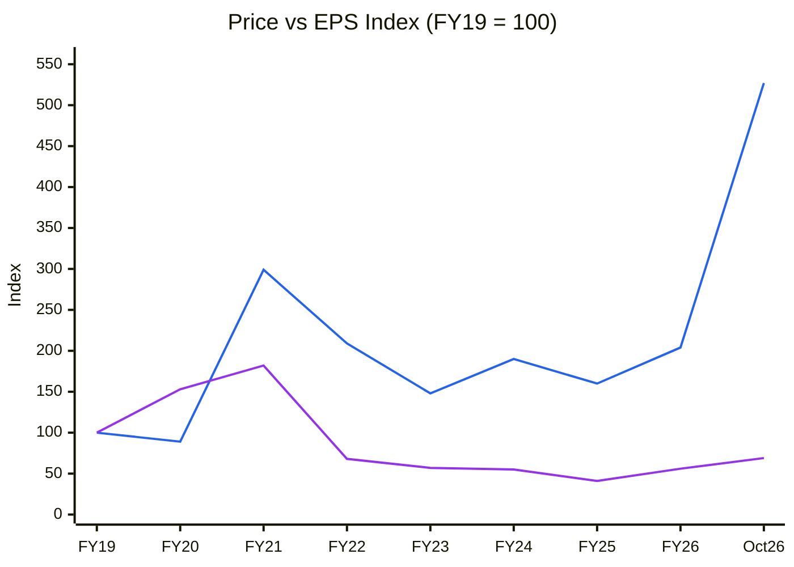
🟦 Price index · 🟪 EPS index (TTM for Oct-26)

**Read:** Since FY19 the price is up 5.3×, while EPS is down 31%. The whole return is multiple expansion, 2.6× of it in the last 6 months.

**Business inference:** Returns have been borrowed from the future. The stock now has to grow EPS about 2.5× just to stand still at a normalised 14–18× multiple, so mean-reversion risk is high.

### C13 — Scenario Target Prices vs CMP (FY29E, 2–3 yr)
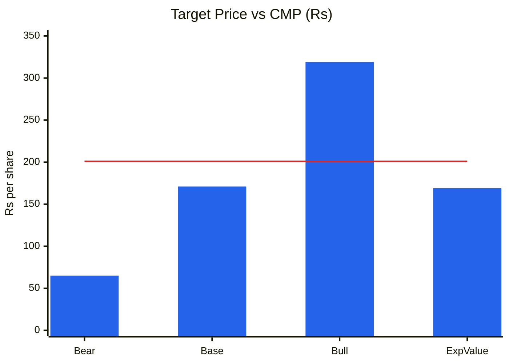
🟦 Scenario price · 🟥 CMP ₹201

**Read:** Bear −68%, base −15%, bull +59%. Probability-weighted value ₹169 (−16%).

**Business inference:** The market is already pricing something close to the bull case. Even if IOL executes its whole ₹495 Cr plan on time, the base case does not reach today's price. The payoff depends on a re-rating that the return profile (ROIC ≈ WACC) does not yet support.

### Cycle Position Dashboard
| Dimension | Current | 10-yr Median | Percentile | Signal |
|---|---|---|---|---|
| P/E | 35.1× | 18.6× (weekly) / 14.2× (annual) | 98% | **Expensive** |
| P/B | 3.28× | 1.5× | 99.6% | **Expensive** |
| EBITDA margin | 11.6% FY26 / 13.7% Q1 FY27 (excl. OI) | 12.0% | 40% / ~60% | Mid (recovering) |
| ROCE | 11% FY26 | 14.5% | ~20% | Trough → recovering |
| Industry utilisation (IOL proxy) | Ibu 95%, chem ~100%, API 75% | n/a | n/a | Tight now; supply wave FY28 |
| Spread (gross margin proxy) | 37% Q1 FY27 | 34% (9-qtr) | ~90% | Elevated (war pass-through) |
| Industry capex/dep | IOL 2.2–4.6× (FY23–26); peers expanding | n/a | n/a | **Flooding** |
| **Overall cycle position** | | | | **Operations: early-to-mid cycle · Valuation: peak-cycle** |

*Consistency: Module 1b (tailwind now, supply headwind FY28–29) and Module 1c (early cycle, price already discounted a peak) agree with this dashboard.*

---

## Module 10 — Technical Stage (Weinstein + CANSLIM)

**Nifty 50 Market Stage:** **4 (inferred).** It is −14.6% from the 5-Jan-2026 record at 22,520. No weekly chart was pulled for the index (⚠️).
**Sector Index Stage:** Nifty Pharma ~25,962, near highs, likely Stage 2 (single-source level ⚠️)
**Stock Stage:** **Stage 2, advanced/extended**
**30-Week MA:** Rising (₹102 → ₹124 → ₹141 over the last 10 weeks) | Price is above it by **+42%**
**RS vs Nifty:** Strongly positive. Stock +97% over 1 year (Screener) vs Nifty about −10% → RS differential ~+105pp
**Breakout:** The 2020 high of ₹168.48 (week of 28-Aug-2020) was cleared in the week of 28-Aug-2026 (close ₹194.95). Volume was 40.6 M vs a 52-week average of 14.9 M (**2.7×**) → **confirmed**. The earlier base ran ₹61.65–₹119.93 from Apr-2025 to Apr-2026. Price is now **+19% above the pivot** (₹168.5) and 2.7× the March-2026 low (₹74).
**Stop-Loss Level:** ₹165 (weekly close below the breakout pivot / 14-Aug-2026 higher low ₹165.6); hard exit on a weekly close below the 30-wk MA (~₹141)
**Stage + Fundamental Alignment:** **Misaligned.** Technicals are strong but fundamentals do not support the price. Combined verdict: *"Stage 2 but 20%+ above base → late entry, wait for next base."*

| CANSLIM | Requirement | IOL | Score |
|---|---|---|---|
| C | Current EPS ≥ 25%, accelerating | Q1 FY27 EPS +90% (Q4 +68%) | 1 |
| A | Annual EPS ≥ 25% × 3 yrs; ROE ≥ 17% | FY24 −3%, FY25 −25%, FY26 +36%; ROE 8% | 0 |
| N | New high / product | All-time high; CDMO, ibu expansion | 1 |
| S | Supply/demand | Float shrinking (public 45% → 32%); heavy up-volume | 1 |
| L | Leader | Top RS among Indian API peers | 1 |
| I | Institutional rising | FII 1.72% → 4.87%, DII 0.02% → 0.43% (Jun-26 qtr) | 1 |
| M | Market Stage 2 | Nifty in correction | 0 |
| **Total** | | | **5 / 7** |

---

## Module 11 — Forward View: 2–3 Year Thesis

### Capex classification
| Capex type | FY27E (₹ Cr) | FY28E | FY29E | In AT model? |
|---|---|---|---|---|
| Tangible growth: ibu 6,000 MTPA (₹350 Cr; ~30% of the ₹495 Cr package already spent) | ~140 | ~180 | — | ✅ (commissioned Dec-2027 → FY28 Q4) |
| Tangible growth: CDMO tablets (₹110 Cr) + tolling plant (₹35 Cr) | ~45 (balance) | — | — | ✅ (Q3 FY27) |
| Greenfield 101-acre site (₹1,200–1,400 Cr "broad mindset", ₹200–250 Cr/yr) | — | ~70 | ~200 | Bull case only (not approved / no timeline) |
| Maintenance / infra / automation (≈ 40% of routine ₹150–200 Cr) | ~85 | ~90 | ~90 | ❌ sustains |
| Software / intangibles | <5 | <5 | <5 | ❌ |
| CWIP opening FY27 | ₹96 Cr (Screener, Mar-26) | | | ❌ until capitalised |
| **Total capex (base)** | **~300** | **~350** | **~300** | |

*Sources: NSE filing 9-Sep-2026; business-update call 11-Sep-2026; Q4 FY26 call (greenfield ₹1,200–1,400 Cr); Q2 FY26 call (60/40 growth/maintenance split).*

### C14 — Gross Block → Revenue bridge
| | FY24 | FY25 | FY26 | FY27E | FY28E | FY29E |
|---|---|---|---|---|---|---|
| Gross block (₹ Cr) | 1,236 | 1,544 | 1,632 | 1,880 | 2,330 | 2,530 |
| Revenue (₹ Cr) | 2,133 | 2,079 | 2,319 | 2,800 | 3,050 | 3,450 |
| AT (×) | 1.73 | 1.35 | 1.42 | 1.49 | 1.31 | 1.36 |

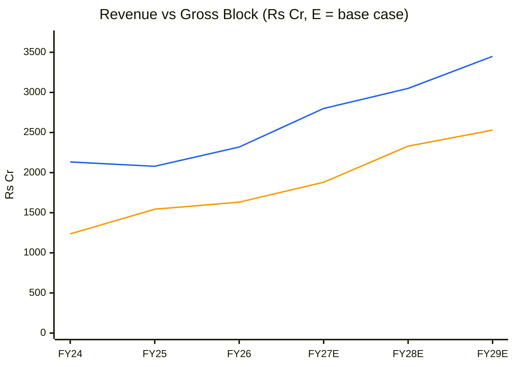
🟦 Revenue · 🟧 Gross block

**Read:** Base-case revenue rises 49% (FY26 → FY29E) on 55% more gross block. Year-end AT stays at 1.3–1.5× because new blocks commission late in the year and ramp.

**Business inference:** Even the base case is a **capital-hungry growth path**. Revenue per rupee of new capital is about 1.6×, in line with management's 1.75× guide only at full utilisation. ROIC can rise to the mid-teens only if margins hold at 14%+ through the ibu supply wave.

**Revenue build (base FY29E ₹3,450 Cr):** existing assets ~₹1,730 Cr gross block × 1.75× = ₹3,030 Cr + ibu block ₹350 Cr × 1.75 × ~0.45 ramp = ₹275 Cr + CDMO ₹110 Cr × 1.1 × 0.62 ramp = ₹75 Cr + tolling ~₹40 Cr + triacetin/paracetamol inside existing. **Capex-model revenue CAGR FY26–29: 14.2%** (vs PIE ~25%) → **the market is pricing unannounced expansion** (the greenfield) on top of everything announced.

**Incremental ROIC:** History FY22→FY26: +₹870 Cr gross block for −₹24 Cr of operating EBIT, **≈ 0% (value-destroying in that window)**. Forward, ibu block: ₹612 Cr revenue × 13% EBIT × 0.745 / ₹350 Cr = **~17% vs WACC 12% → value-creating at today's prices**. At a 10% lower ibu realisation, EBIT margin drops to ~5% and ROIC to ~6% (destroying).

### Capex-to-earnings model (base)
| ₹ Cr | FY27E | FY28E | FY29E |
|---|---|---|---|
| Opening gross block | 1,632 | 1,880 | 2,330 |
| Growth capex commissioned | ~150 (CDMO, tolling, routine) | ~350 (ibu block) | ~100 |
| Closing gross block | 1,880 | 2,330 | 2,530 |
| AT applied (existing / new ramp) | 1.75× existing (partial yr) | 1.75× / ramp | 1.75× / 0.45–0.62 ramp |
| **Revenue** | **2,800** (+21%) | **3,050** (+9%) | **3,450** (+13%) |
| EBITDA margin (excl. OI) | 13.8% | 14.0% | 14.0% |
| EBITDA | 386 | 427 | 483 |
| D&A (~4.9% of avg gross block) | 88 | 105 | 120 |
| EBIT | 298 | 322 | 363 |
| Other income | 25 | 15 | 15 |
| Interest | 15 | 18 | 15 |
| ICR (×) | 20 | 18 | 24 |
| PAT (tax 25.5%) | 229 | 238 | 270 |
| **EPS (₹)** | **7.81** | **8.10** | **9.21** |
| ΔWorking capital (NWC ~68 days ≈ 18.6% of Δrevenue) | 90 | 46 | 74 |
| Total capex | 300 | 350 | 300 |
| **FCF (PAT + D&A − capex − ΔWC)** | **−73** | **−53** | **+16** |
| Net debt (after ~₹35 Cr dividend a year) | ~45 | ~135 | ~155 |
| Peak debt / EBITDA | 0.1× | 0.3× | 0.3× |

**FCF inflection year:** FY29 (base), and only if the greenfield does not start. If the ₹1,200–1,400 Cr greenfield proceeds at ₹200–250 Cr a year, FCF stays negative into FY31.
**Debt ceiling verdict:** Peak leverage of about 0.3× EBITDA, well inside the safe zone (CARE negative trigger: gearing above 0.5×).

### Key Catalysts
1. Q2 FY27 results (~mid-Nov 2026): the first quarter without war-price support. Confirms or refutes 14–15% margins.
2. CDMO tablet commercialisation (Q3 FY27) and the first European customer volumes; tolling plant start (Q3 FY27).
3. Paracetamol utilisation from 55% → 70% (by Mar-2027) and non-ibu reaching 50% of pharma.
4. New CEPs/NMPA approvals (Fenofibrate-II CEP 25-Sep-2026; Triacetin REACH 23-Sep-2026) driving regulated-market exports above 30%.
5. Ibuprofen block commissioning (Dec-2027).

### Key Risks
1. **Ibuprofen price down-cycle** as IOL, Granules and BASF capacity lands in FY28–29 — Probability **Medium-High**. This is the FY22–25 replay risk.
2. **Acetyl spread normalisation** after the Mar–Apr 2026 war spike. EA was already ₹108 → ₹89/kg by May-2026 — Probability **High** (near term).
3. **Capital allocation:** the greenfield (₹1.2–1.4k Cr ≈ 70–80% of net worth) committed before the existing ₹1k Cr of FY22–26 capex earns its cost — Probability **Medium**.
4. **Governance leakage:** RPT purchases from promoter firms growing 31% a year; remuneration at 16–22% of PAT — Probability **Medium**, impact moderate.
5. **Regulatory/quality:** no USFDA re-inspection since 2019 (Q3 FY25 call); any observation would hurt regulated-market plans — Probability **Low-Medium**.
6. **Valuation de-rating:** a fall from 35× toward the 18× median, even with EPS growth — Probability **High**.

### Scenario Analysis (AT-driven, FY29E, 2–3 yr)
| Scenario | AT assumption | Revenue FY29E | EBITDA margin | EPS FY29E | Target multiple | Target price | Probability |
|---|---|---|---|---|---|---|---|
| Bull | Existing AT 1.95× (Q1 peak incl. price) + ibu ramp 0.62 | ₹3,870 Cr | 16.5% | ₹13.3 | 24× | ₹319 | 20% |
| Base | Existing AT 1.75× + ibu ramp 0.45, CDMO 0.62 | ₹3,450 Cr | 14.0% | ₹9.2 | 18.6× | ₹171 | 50% |
| Bear | AT stays at FY26 1.42× + slow ramp (ibu 0.25) | ₹2,680 Cr | 11.0% | ₹4.3 | 15× | ₹65 | 30% |
| **Expected Value** | | | | | | **₹169** | |

**Return from current price (Expected Value):** **−16%**

**Thesis in 3 sentences:** IOL is a well-run, net-cash, low-cost commodity-API and acetyls producer whose earnings are recovering from a 4-year trough on better utilisation and mix. At ₹201 the market already capitalises supercycle-type returns (24% margin or 25% CAGR) on a business with a 12% median margin that is adding commodity capacity into a crowded ibuprofen market. Re-engage below ₹115, or if two consecutive quarters show 15%+ EBITDA with ROIC above 15% after the acetyl spike fades.

**Monitoring metrics:** quarterly gross margin (is ≤34% the run-rate?); pharma EBIT margin (≥14%?); ibuprofen realisation commentary; paracetamol utilisation; export %; RPT purchases (H1 FY27 vs ₹66 Cr half-year run-rate); greenfield capex approval.

---

## Checklist Summary

**Checklist A — Master analysis (execution verification)**
**Section 0 (Existing Report Protocol):** 3 / 3. Library searched (none found), initial report, one file.
**Section A (Business Quality):** 16 / 18. Scuttlebutt is limited to concall Q&A and competitor references (no channel checks). Market share is estimated, not sourced from an industry body.
**Section B (Forensics):** 9 / 9
**Section C (Financial Statements):** 11 / 12. Ind AS 116 adjustment immaterial (lease liabilities ₹3 Cr).
**Section D (KPIs & Peers):** 7 / 7
**Section E (Market Size & Share):** 5 / 7. EA and paracetamol market data are gaps.
**Section F (Valuation):** 10 / 10
**Section G (Technical Stage):** 7 / 8. Nifty stage is inferred, not charted.
**Section H (Forward View):** 26 / 30. Segment-level gross block is not disclosed. Unit-economics build N/A. Order Book Tracker N/A.
**Section I (Charts):** 4 / 5. CY5 and CY8 are not charted (no sourced industry series). All other mandatory cyclical charts are present, with Read and Business inference lines.
**Order Book Tracker:** Not applicable (non-order-driven)

**Checklist B — Pre-buy final check**
| Check | Result |
|---|---|
| 1 Falsifiability | ✅ Downgrade further if Q2/Q3 FY27 gross margin is ≤ 33% or the greenfield is approved before ROIC > 15%. Upgrade if 2 quarters of ≥ 15% EBITDA (excl. OI) and the price is ≤ ₹115. |
| 2 Inversion | ✅ Six failure modes listed (Key Risks). The price discounts none of them. |
| 3 Circle of competence | ✅ Commodity API + acetyls economics are clear. CDMO economics are opaque (no margins disclosed). |
| 4 Asymmetry | ❌ U/D 0.87:1; SVAR 68% → **stop** |
| 5 Buffett 5-year test | ⚠️ The balance sheet survives a 2-year downturn ✓. The moat is too narrow to ignore ✗. Capital allocation is unproven ✗. |
| 6 Narrative vs numbers | ❌ The narrative ("diversified API platform, 15% ROCE") is ahead of the numbers (10-yr median 12% OPM; FY26 ROIC 8%) |
| 7 Recency bias | ✅ Base uses 14% (not Q1's 14.6% incl. OI or the FY28 15–17% guide); fades growth to 6% |
| 8 Confirmation bias | ✅ Bear evidence sought: supply pipeline, acetyl correction, WTT misses |
| 9 Crowd | ⚠️ No sell-side consensus found (small-cap, thin coverage). The FII stake tripled in one quarter. |
| 10 Promoter / governance | ✅ Pledge 0%; no SEBI/ED actions found; clean audit opinion. ⚠️ RPT growth and remuneration. |

**Hard Stops Triggered:** **Upside/downside ratio below 1.5:1 (0.87:1).** No integrity, forensic, pledge or Stage-4 hard stops.

---

## Investment Decision

**Verdict (five-category):** **AVOID.** A valuation/asymmetry hard stop, not a business-quality one. With a narrow moat and ROIC ≈ WACC, it does not qualify as "Quality at Wrong Price". Once the price falls, it would fall into **Cheap but Flawed / Wait for Confirmation**.
**Recommendation:** AVOID at ₹201 → **WATCHLIST**

| Conviction component | Max | Score | Note |
|---|---|---|---|
| Market + Sector + Stock cycle | 1 | 0.5 | Cautious market; sector tailwind now; stock extended |
| Industry structure | 1 | 0.5 | Commodity rivalry; supply wave |
| Business quality & moat | 2 | 1.0 | Narrow cost moat in ibu only |
| Management quality | 1 | 0.5 | Promoter buying (+) vs WTT 0.55, RPT/remuneration (−) |
| Financial + earnings quality | 2 | 1.5 | Clean, net cash, CFO > PAT; ROIC ≤ WACC |
| Valuation & PIE asymmetry | 2 | 0.0 | 98–99th percentile multiples; U/D 0.87 |
| Technical + CANSLIM | 1 | 0.5 | Stage 2 confirmed but extended; CANSLIM 5/7 |
| **Total** | **10** | **4.5** | |

**Suggested Position Size:** 0% new money. Existing holders: trim or protect with the stop below.
**Entry Price Range (watchlist):** ₹100–115 (~1.6–1.9× book; ~12–14× FY28E EPS; about 33–40% below the base-case value of ₹171)
**Stop-Loss (for holders):** ₹165 weekly close; hard exit below the 30-wk MA (~₹141)
**Target Price (Base, 2–3 yr):** ₹171
**Review Trigger:** (a) Q2 FY27 results (Nov-2026): gross margin, pharma EBIT, acetyl commentary; (b) any greenfield board approval; (c) price ≤ ₹115 or a new 12+-week base formed with the 30-wk MA catching up; (d) RPT purchases in H1 FY27 > ₹75 Cr.

---

## Data Sources & Citations
- Screener.in — IOLCP standalone & consolidated financials (FY15–FY26, quarters to Jun-2026), shareholding, ratios: https://www.screener.in/company/IOLCP/ ; chart APIs (company id 1537): price/DMA/volume (weekly, 10 yr), P/E & median P/E, P/B & median P/B; schedules API (fixed assets, borrowings, other assets/liabilities, expenses, cash flow).
- Q1 FY27 earnings call transcript, 13-Aug-2026 (filed 20-Aug-2026, BSE): https://www.bseindia.com/stockinfo/AnnPdfOpen.aspx?Pname=0e84e303-d463-4a3c-8566-e518e3065d25.pdf
- Q1 FY27 investor presentation, 12-Aug-2026: https://www.bseindia.com/stockinfo/AnnPdfOpen.aspx?Pname=aad7ef47-c15e-442e-9055-c4d770a40f07.pdf
- Business update call transcript, 11-Sep-2026: https://www.bseindia.com/stockinfo/AnnPdfOpen.aspx?Pname=7912f1a3-c48a-4865-b87e-9fb39f63bbfc.pdf
- Reg 30 intimation, ibuprofen expansion / CDMO / tolling, 9-Sep-2026 (NSE): https://nsearchives.nseindia.com/corporate/IOLCP_09092026143621_Intimation09092026.pdf
- Concall transcripts Feb-2025, May-2025, Aug-2025, Nov-2025, Feb-2026, May-2026 (BSE links via Screener documents section), used for the WTT ledger.
- Annual Report FY2025-26 (BSE): https://www.bseindia.com/xml-data/corpfiling/AttachHis/5aadd5a2-8771-4549-8927-fed4d1523fe9.pdf — auditor's report & KAMs, Note 35 (contingent liabilities), Note 40 (related parties), segment note, R&D and forex annexure, remuneration ratios.
- CARE Ratings rationale 6-Jul-2026: https://www.careratings.com/upload/CompanyFiles/PR/202607140715_IOL_Chemicals_and_Pharmaceuticals_Limited.pdf ; earlier rationales Jul-2022, Jun-2023, Jun-2024, Jul-2025 (product mix, exports history).
- BSE announcements: Fenofibrate Process-II CEP (25-Sep-2026), Triacetin EU-REACH (23-Sep-2026), trading-window closure (25-Sep-2026).
- Promoter purchases: Whalesbook (NCVI to 16.58%), Scanx (Mayadevi Polycot to 21.78%), Equitypandit (upper circuit on stake rise); Scanx (no encumbrance FY26).
- Q1 FY27 press coverage cross-check: Equitybulls, Scanx, Indian Pharma Post, Multibagg.
- Ibuprofen market/price: businessanalytiq price index; market-research reports (Expert Market Research, Intel Market Research, Data Bridge) — ⚠️ secondary.
- Acetyls: Alchempro ("acetic acid rally reverses as India faces inventory glut"); Procurement Resource / Expert Market Research ethyl acetate price notes — ⚠️ secondary.
- Peers: Screener.in consolidated pages for GRANULES, AARTIDRUGS, SMSPHARMA, LXCHEM, JUBLINGREA, SOLARA (9-Oct-2026).
- Market: Nifty 50 22,520 / India VIX 14.35 (9-Oct-2026, given in brief); Nifty Pharma ~25,962 (Univest, ⚠️ single source).

**Data gaps:** global ibuprofen capacity and demand time series (CY5 not charted); peer capex/depreciation series (CY8); Indian ethyl acetate and paracetamol demand and market share; segment-level gross block; DPS history; CDMO and tolling margins and contract values (confidential); exact average price of promoter purchases (estimated); Nifty weekly stage chart; sell-side consensus.

---
*Report generated by Stock Fundamental Analysis Skill v3.3 | Indian Markets Context*
*Save path: C:\Users\anubh\Documents\Anubhav\Stock Analysis\Stock Analysis\IOLCP_IOLChemicals_2026-10-11.md*
