# Stock Analysis Report — Manali Petrochemicals Ltd (MANALIPETC)
**Date:** 2026-10-12
**Analyst:** Claude (Stock Fundamental Analysis Skill v3.3)
**Investment Horizon:** 2–3 Years
**Recommendation:** AVOID (hard stop: upside/downside < 1.5:1). Watchlist re-entry zone ₹55–65
**Conviction Score:** 3.5 / 10
**CMP:** ₹84.12 (NSE, 12-Oct-2026 intraday, Yahoo Finance chart API; Screener showed ₹83.8) · Mcap ≈ ₹1,447 Cr · 17.21 Cr shares (FV ₹5)

## Revision Log
| Version | Date | Recommendation | Conviction | Price | Key change |
|---|---|---|---|---|---|
| Current | 2026-10-12 | AVOID (watchlist ₹55–65) | 3.5/10 | ₹84.12 | Initial report |

**Validation of previous report:** Initial report. The report folder was searched by ticker (`MANALIPETC_*`) and by the name fragment "Manali"; no earlier file exists.

---

## Executive Summary
Manali Petrochemicals (MPL) is India's only propylene glycol (PG) maker and its only integrated propylene → propylene oxide (PO) → PG / polyols producer, with two plants at Manali, Chennai, plus a UK specialty-additives subsidiary (PennWhite) held through AMCHEM Singapore. **The stock has doubled off its ₹39 March-2026 low (force-majeure shutdown) to ₹84 because Q1 FY27 (Jun-2026) produced a windfall quarter:** consolidated EBITDA ₹83 Cr at a 30% margin (standalone 32%) against a 13-quarter standalone median of 2.9%. That margin came from a supply shock, not from a change in the business. India's MoPNG LPG-priority order (9-Mar-2026, West Asia war) cut propylene to petchem users and choked imports, and MPL then received a government propylene allocation "for pharma requirements" (20-Apr-2026). Inventory gains helped too: changes in inventories gave a ₹47 Cr credit in Q1. At ₹84 the market is capitalising TTM (windfall-inflated) earnings as if they were permanent. Through-cycle EBITDA margins are ~9% and import parity re-asserts itself whenever the supply shock eases. **About ₹32/share is cash, three-quarters of it offshore in AMCHEM Singapore. The bear case (₹42) still sits ~50% below CMP, against ~31% upside to the bull case (₹110). Upside/downside is 0.6:1, which triggers the hard stop: AVOID.**

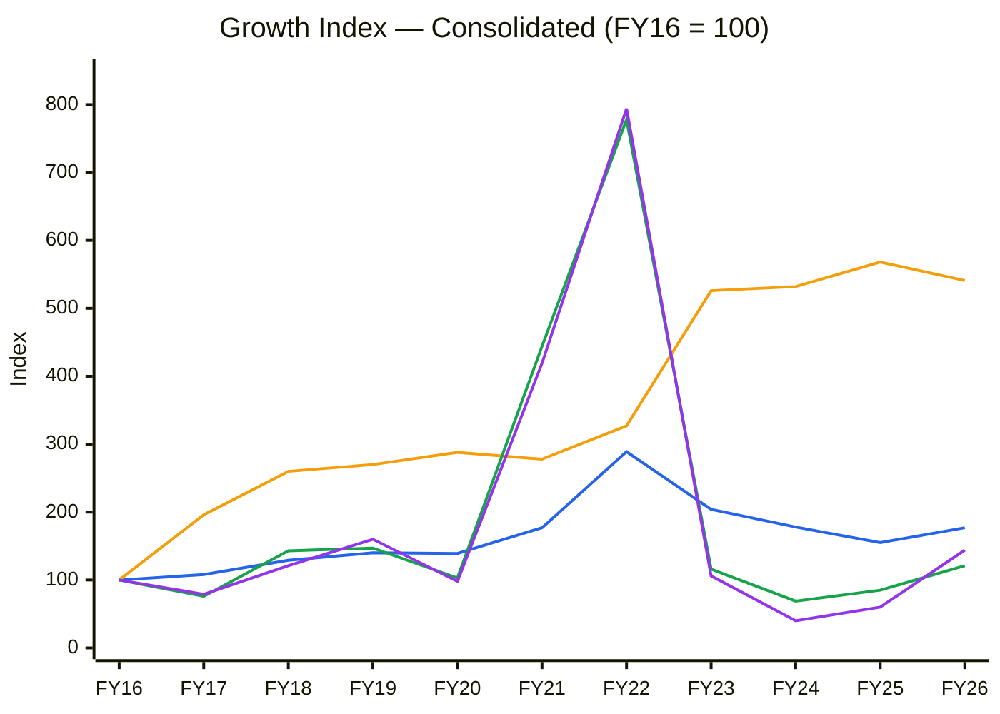
🟦 Revenue (CAGR 5.8%) · 🟧 Net fixed assets incl. goodwill/ROU (Screener; gross block not available for 10 yrs; CAGR 18.4%) · 🟩 EBITDA (1.9%) · 🟪 PAT, FY26 shown ex-exceptional at ~₹69 Cr (3.7%; reported ₹130 Cr = index 271)

**Read:** Over FY16–26 the asset base grew 5.4× and revenue 1.8×, while EBITDA is only 1.2× its FY16 level. The two spikes (FY21–22) were COVID-era import blockades, not trend.

**Business inference:** MPL has kept adding capital (PennWhite goodwill in FY23, the PG expansion in FY26) without lifting through-cycle earnings. Outside supply-shock years the business earns close to nothing above import parity, so the FY27 windfall should be valued like the FY21–22 windfall: as a one-off cash bonus, not a new earnings base (→ Module 10A bear AT anchor).

Data sources used throughout: Screener.in (consolidated and standalone, 10-yr, fetched 12-Oct-2026); BSE/company filings (Q1 FY27 results dated 13-Aug-2026; Force Majeure intimations dated 11-Mar-2026 and 20-Apr-2026; AGM outcome and Chairman's speech dated 28-Sep-2026); Annual Report FY26 (AR26); CARE Ratings press release dated 4-Mar-2026; Investor Meet transcript and presentation dated 27-Sep-2024; Penn Globe acquisition call transcript dated 7-Dec-2022; Shareholding Pattern for 30-Jun-2026; Yahoo Finance weekly prices. **Cash-flow cross-check:** Screener's FY25 and FY26 CFO (−19 / +116) and CFI (−155 / +75) match the AR26 consolidated cash-flow statement exactly (−18.99 / +116.33; −154.76 / +75.13). The FY23 CFI of −261 is consistent with the ₹288 Cr AMCHEM/PennWhite deployment in Nov-2022. No year-shift was found.

---

## BUSINESS PRIMER

Manali Petrochemicals buys propylene by pipeline from Chennai Petroleum (CPCL), its sole propylene source. It oxidises the propylene into propylene oxide (PO) at Plant-1 and converts PO into two families of products. The first is propylene glycol (PG): pharma, food and fragrance grades only, sold to drug, food, flavour and personal-care makers, where MPL is the only domestic producer. The second is polyether and polyester polyols and formulated "system" polyols, sold to foam, mattress, footwear, insulation and auto-seating makers (AR26 MD&A). Revenue is volume × realisation, and realisation is set by the landed price of imports from Dow, BASF, Chinese and Thai producers rather than by MPL (CARE Mar-2026: "MPL prices its finished products based on the respective landed costs of imports"). Profit is therefore a spread between import parity and the propylene/PO cost fixed monthly by state-owned refiners. Roughly 65% of revenue is PG and polyols (CARE). About 23% of consolidated revenue (₹233 Cr in FY26) came from the EU/UK through the specialty subsidiaries Notedome (sold Nov-2025) and PennWhite (still owned; foam-control agents, FY26 revenue £13.6m, profit £2.2m). The business depends on two things: an uninterrupted propylene supply from CPCL and the gap between import parity and its own conversion cost.

This is a **commodity, import-parity-priced, capacity-driven chemical business with an unusual balance sheet.** It has no pricing power and no customer captivity. Its one structural edge is being the domestic, BIS-certified, pharma-licensed PG source with a five-year product guarantee, which customers value when imports are disrupted (COVID FY21–22, West Asia war 2026) and largely ignore otherwise. The key value driver is the spread (price), with volume second, now that PG capacity has tripled to 72 ktpa. The key risks are import dumping and the propylene feedstock, which a single government order cut to zero in March 2026. Three structural features colour the whole analysis. First, a large cash pile (₹605 Cr consolidated cash and bank at Mar-2026, ~₹32/share), of which only ₹156 Cr sits in the Indian parent and the rest in AMCHEM Singapore. Second, a Singapore-resident promoter (Ashwin C. Muthiah, AM International group) controlling 38.3% through SIDD Life Sciences, with Tamil Nadu's TIDCO holding a further 6.5% as co-promoter. Third, Plant-2 runs on government leasehold land whose lease expired in June 2017 and is still pending renewal, an auditor Emphasis of Matter.

**Segment check (New Segment Protocol):** Commodity petrochemicals (PO/PG/polyols) are not a stand-alone block in `references/05-industry-kpis-india.md`. The nearest match is **"Specialty Chemicals" (line 449)**, which is reused here with commodity-spread adjustments, the same approach as the IGPL report. The KPI reference is available as a near-match ✓. Adjusted KPIs: (1) spread proxy (PG/polyol realisation minus propylene/PO cost; quarterly standalone OPM used as proxy), (2) plant utilisation, (3) import parity and anti-dumping-duty status, (4) EBITDA margin vs the 20–30% specialty benchmark, (5) export %, (6) client concentration, (7) capex/revenue.

---

## Module 1 — Market, Sector & Stock Cycle

### 1. Broad market (Marks)
| Input | Value | Source |
|---|---|---|
| Nifty 50 | 22,485 (12-Oct-2026) vs 52-wk high 26,329 / low 22,422 | Yahoo weekly |
| Nifty vs 30-wk MA | Below; 30-wk MA 23,717 and falling (23,969 five weeks ago; 24,190 ten weeks ago) | computed |
| Nifty 52-wk return | −12.5% | computed |
| India VIX / credit spreads | Not retrieved (data gap) | — |
| Macro | West Asia war since ~Mar-2026; LPG-priority orders; plastics/petchem prices at multi-year highs (Argaam/ICIS, Argus) | press |

**Assessment: Cautious → Fearful.** The Nifty is in Weinstein **Stage 4** (below a declining 30-wk MA, 14.6% off its high). The framework would allow larger positions in fear, but a Stage-4 market fails CANSLIM "M" and argues against new longs until the index base-builds.

### 1b. Sector cycle — Headwind masked by a transient supply shock
**Secular vs cyclical decomposition:**
- *Secular:* India PU market USD 5.5–6.0 bn in FY26, growing 7–8% a year to USD 8–9 bn by FY31 (AR26 MD&A). India PG demand was "about 1 lakh TPA … growing 5% annually" (Investor Meet, Sep-2024). These form the durable baseline: **~5–8% volume growth.**
- *Cyclical (transient):* (i) the FY27 supply shock: imports disrupted, propylene rationed and domestic prices spiking (India PG ~$965/t in Jan-2026 → ~$1,162/t in Mar-2026 per procurementresource.com, a secondary source); (ii) the recovery from the FY24–25 trough, when standalone OPM was 0.4–0.7%. **Close to 100% of the Q1 FY27 margin expansion is cyclical/transient** and should mean-revert within 2–4 quarters of normal propylene supply and import flows.
- *Structural headwind:* global PO/polyol/PG oversupply led by Chinese capacity, multinationals' port storage in India, and patchy trade protection (AR26: "In the absence of adequate trade protection measures such as anti-dumping or safeguard duties…").

**Input-cost cycle:** propylene is priced monthly by PSU refiners against crude. Since 9-Mar-2026 supply is allocation-based (MoPNG order "until further orders"; DoP allocation 17-Apr-2026). The direction is rising and availability-constrained. **Inventory cycle:** customers destocked in Q4 FY26 when prices spiked (AR26: "downstream manufacturers … moderate purchases"), and MPL built inventory in Q1 FY27 (₹47 Cr inventory-change credit). **Competitive capacity pipeline:** Chinese PO/polyol additions continue. AR26 warns that MNC tie-ups with Indian refiners could create domestic polyol capacity. MPL itself tripled domestic PG capacity, so it is now the main source of domestic supply growth.

**Geopolitical risk map:** (1) export market risk is low (PennWhite UK/EU; standalone is domestic). (2) Raw-material risk is **structural**: a single propylene source (CPCL) plus a sovereign override, shown by the 12-Mar → 20-Apr-2026 shutdown. (3) Logistics: the Strait of Hormuz/Red Sea disruptions cut both ways. They raise competitors' landed cost (a temporary tailwind) and restrict feedstock (a headwind). Classification: **structural** sourcing risk → +5–10pp margin of safety.

**Net FX exposure:** EU/UK revenue ₹233 Cr (23%) is naturally hedged inside PennWhite (GBP costs). Standalone sells domestically at import-parity prices, so a weaker INR raises realisations with a lag. Net P&L sensitivity is small and indirect; no hedge book is disclosed (data gap).

#### CY5 — India PG: domestic capacity vs demand
| | FY22 | FY23 | FY24 | FY25 | FY26 | FY27E | FY28E | FY29E |
|---|---|---|---|---|---|---|---|---|
| India PG demand (kt, **estimate**: ~100 kt anchor in Sep-2024 call, ±5%/yr) | 86 | 91 | 95 | 100 | 105 | 110 | 116 | 122 |
| Domestic PG capacity, MPL only (kt, year-end) | 22 | 22 | 22 | 22 | 72 | 72 | 72 | 72 |
| Domestic capacity / demand (%) | 26 | 24 | 23 | 22 | 69 | 65 | 62 | 59 |
| MPL plant utilisation | Plant-1 82% → 72% and Plant-2 55% → 45% (FY22 → FY24, Sep-2024 meet); new PG-B line 65% average (AR26) | | | | | | | |

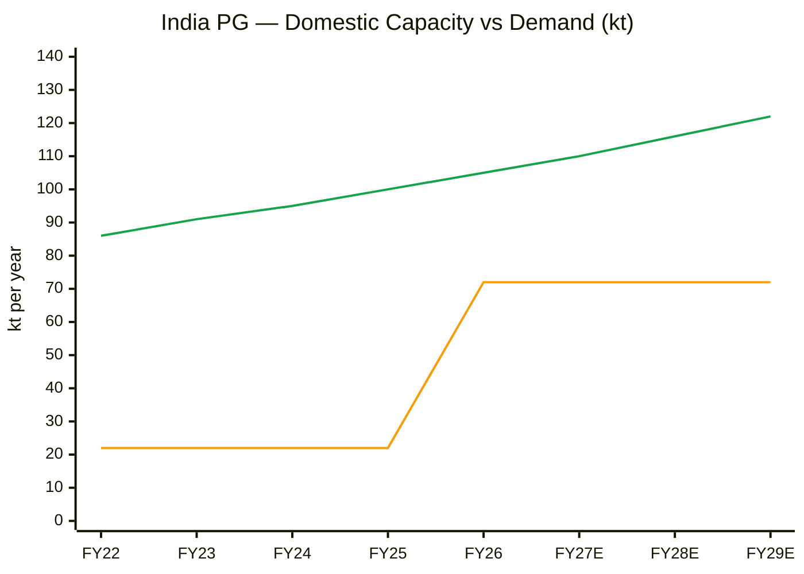
🟧 Domestic PG capacity (MPL) · 🟩 India PG demand (estimate)

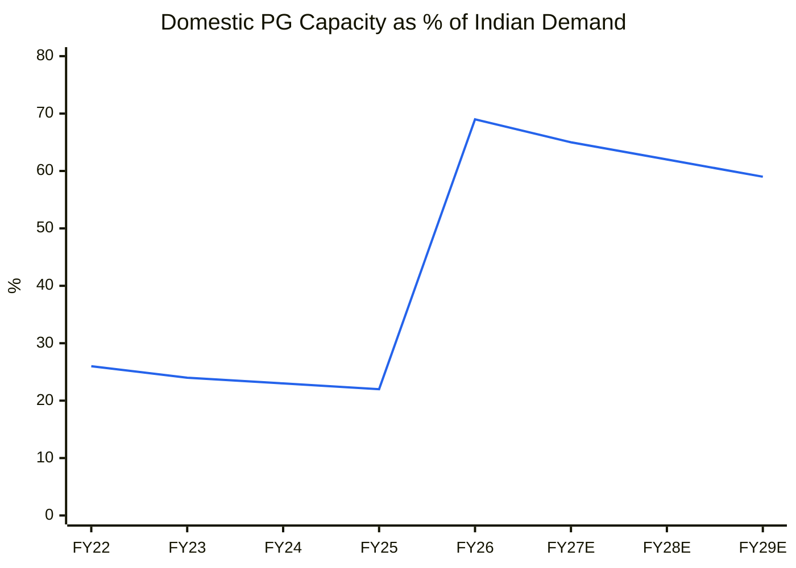
🟦 Domestic capacity ÷ demand

**Read:** With the October-2025 expansion, domestic PG capacity rose from ~22% to ~69% of estimated Indian demand. MPL's actual market share is ~20% (CARE, Mar-2026) and the new line runs at ~65% utilisation.

**Business inference:** The constraint is not capacity, it is price. To fill 72 kt, MPL must displace imports that set the price, which caps realisations at import parity. Volume can grow, but the spread cannot rise structurally unless a QCO or anti-dumping duty on PG arrives, and none exists today. Global PO/PG supply is long, so this market is oversupplied rather than tight.

#### CY6 — Spread proxy: standalone quarterly EBITDA margin
*A PG/polyol–propylene spread time series is not published by MPL (data gap). Standalone OPM is the cleanest available proxy because the standalone entity is almost purely PO/PG/polyols.*

| Q1FY24 | Q2FY24 | Q3FY24 | Q4FY24 | Q1FY25 | Q2FY25 | Q3FY25 | Q4FY25 | Q1FY26 | Q2FY26 | Q3FY26 | Q4FY26 | Q1FY27 |
|---|---|---|---|---|---|---|---|---|---|---|---|---|
| −2.6% | 2.7% | −2.2% | 3.5% | 3.3% | −6.0% | 0.9% | 4.4% | 3.8% | 0.9% | 2.9% | 7.0% | **32.0%** |

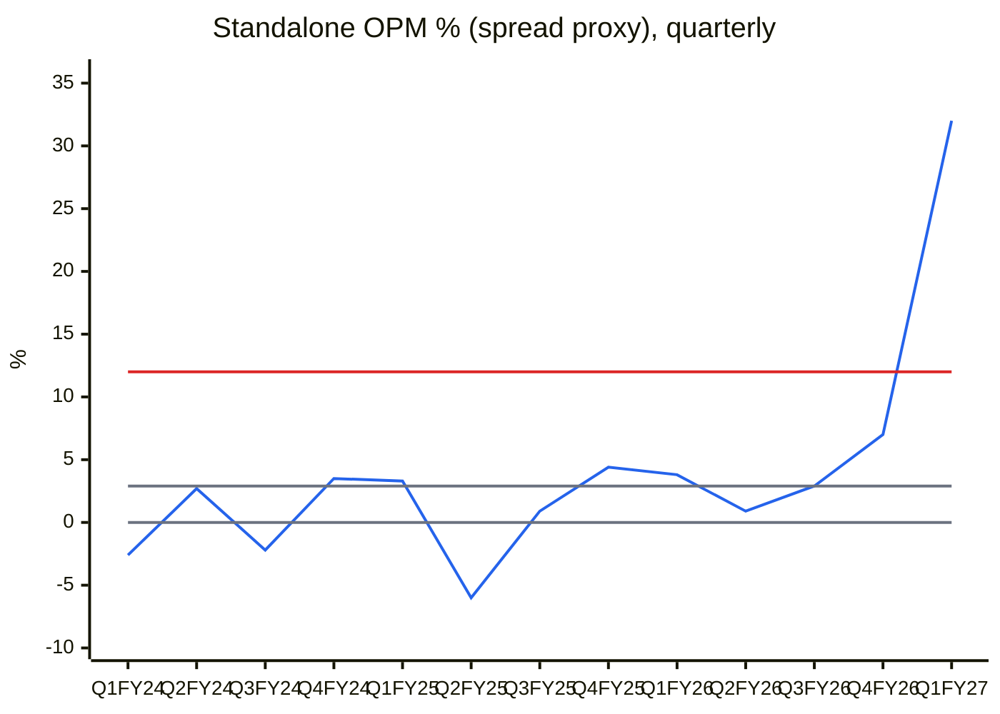
🟦 Standalone OPM · ⬜ 13-qtr median 2.9% · 🟥 +1SD 12.0% · ⬜ zero line (Source: Screener standalone quarterly)

**Read:** Q1 FY27 standalone OPM of 32% is the 100th percentile of the 13-quarter series, ~3.2 SD above the median. Twelve consecutive quarters before it averaged ~1.6%.

**Business inference:** This margin was borrowed from the supply shock, not earned through cost advantage. Q1 FY27 combined scarcity pricing (imports disrupted, propylene rationed to pharma-PG use) with low-cost inventory, and material cost fell to ~46% of revenue against ~67% in FY26. Do not capitalise it in the DCF. The pre-shock 0–4% band is the real import-parity spread, with ~10% achievable in an orderly market.

**Sector cycle verdict: HEADWIND (structural import parity), temporarily masked by a transient tailwind** (war-related supply disruption, expected to last quarters rather than years). DCF uses through-cycle margins; the margin of safety is widened by 10pp.

### 1c. Stock cycle — Late cycle / peak earnings quarter

#### C2 — Quarterly YoY revenue growth (standalone, %)
| Q2FY25 | Q3FY25 | Q4FY25 | Q1FY26 | Q2FY26 | Q3FY26 | Q4FY26 | Q1FY27 |
|---|---|---|---|---|---|---|---|
| −23.1 | −9.0 | −14.2 | −8.4 | 8.4 | 38.3 | 52.1 | 40.5 |
*Consolidated YoY: −14.8, −4.4, −10.2, −2.1, 7.8, 26.0, 27.4, 17.0. Consolidated is distorted by the Notedome exit from 17-Nov-2025, so standalone is charted.*

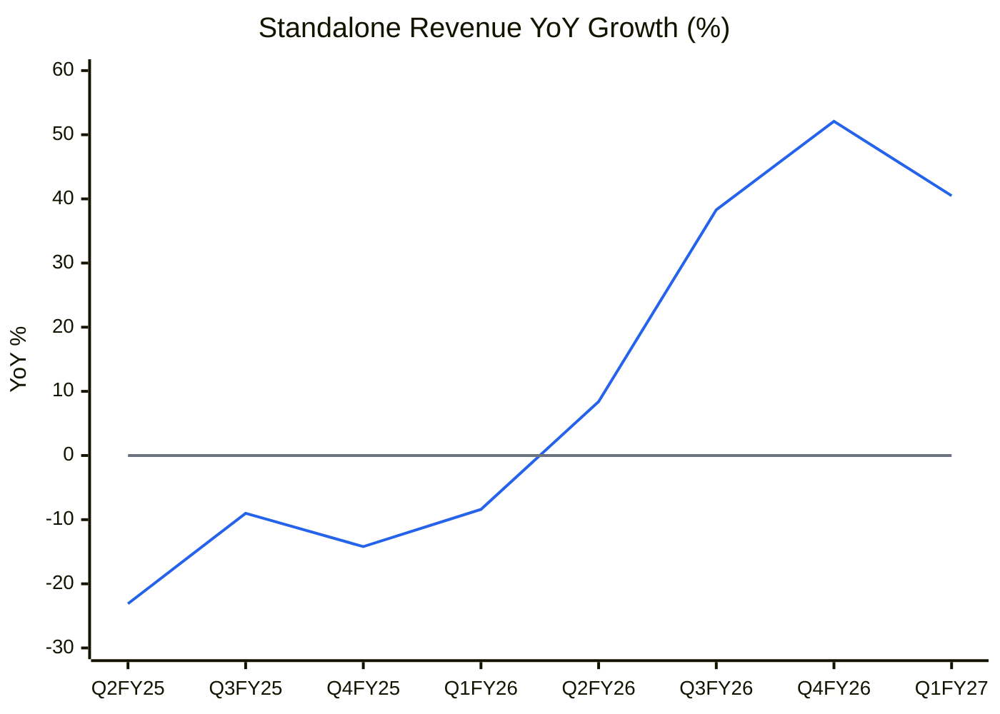
🟦 Standalone revenue YoY · ⬜ zero line

**Read:** Growth swung from −23% to +52% within five quarters and eased to +40% in Q1 FY27.

**Business inference:** Two separate things drove this. Volume from the new PG line (commissioned 3-Oct-2025) lifted Q3–Q4 FY26, and price from the supply shock lifted Q4 FY26–Q1 FY27. The volume part is durable; the price part is not. Q1 FY27 was already decelerating from Q4, which is a warning that the peak is behind or close.

**Revenue decomposition:** FY26 PG volumes were "broadly in line" with FY25 while slabstock polyol volume and value fell (AR26). Polyol volume had collapsed ~60% in FY25 (CARE) and recovered in 9MFY26. FY26 growth was therefore mix/volume (systems polyols, PG-B) in H2. Q1 FY27 growth was **price**, the most fragile driver.

**Physical capacity model:**
| Product | Installed | Utilisation | Notes |
|---|---|---|---|
| Propylene oxide (Plant-1) | Not disclosed in AR26 (**data gap**) | 72% (FY24) | Feedstock-bound: CPCL propylene, now allocation-based; balance PO from TPL (₹21 Cr purchased FY26) and imports |
| Propylene glycol | 72 ktpa (22 old + 50 new, Oct-2025) | New line ~65% | ~₹100 Cr capex, ₹33 Cr term debt (CARE) |
| Polyether polyols | ~46 ktpa | Plant-2 45% (FY24) | Slabstock is "selective" participation |
| Polyester polyols | 2.4–2.6 ktpa capability (AR26) | — | Sep-2024 plan was 2 × 4,150 MTPA trains |
| System polyols, Gujarat (planned) | 30 ktpa, ~₹130 Cr, internal accruals (CARE) | — | ToR Aug-2025; EC expected "end Sep-2026" (AR26), not yet confirmed. Commissioning estimated H2 FY29 after WTT delay |

**Capacity ceiling:** not binding. PG can grow ~40% more in volume and polyols ~2× before the ceiling. The real ceiling is propylene allocation and the import-parity price.

**Operating leverage:** fixed-ish costs (employees ₹72 Cr, power/fuel ₹93 Cr, other ₹90 Cr in FY26, consolidated) are large against FY26 EBITDA of ₹82 Cr. DOL is estimated at **~3×**, DFL ~1.1× (finance cost ₹13.6 Cr incl. ₹7 Cr lease interest), so DTL is ~3.3×. A 10% realisation move swings EBITDA by ~30–50%. Forward ICR stays above 5× in all scenarios (net-cash company).

**Guidance accuracy:** see the WTT ledger in Module 3 (0.38, UNRELIABLE). **FCF inflection:** FY27 should be FCF-strong on the windfall. FY28–29 are FCF-light because of Gujarat (₹130 Cr) and phased ZLD capex (amount undisclosed). Sustainable FCF ≈ PAT once capex returns to maintenance (~₹35–40 Cr) in FY30.

#### CY7 — Margin & ROCE through the cycle
| | FY15 | FY16 | FY17 | FY18 | FY19 | FY20 | FY21 | FY22 | FY23 | FY24 | FY25 | FY26 |
|---|---|---|---|---|---|---|---|---|---|---|---|---|
| Standalone OPM % | 10 | 12 | 11 | 14 | 13 | 9 | 31 | 36 | 7 | 0.4 | 0.7 | 3.8 |

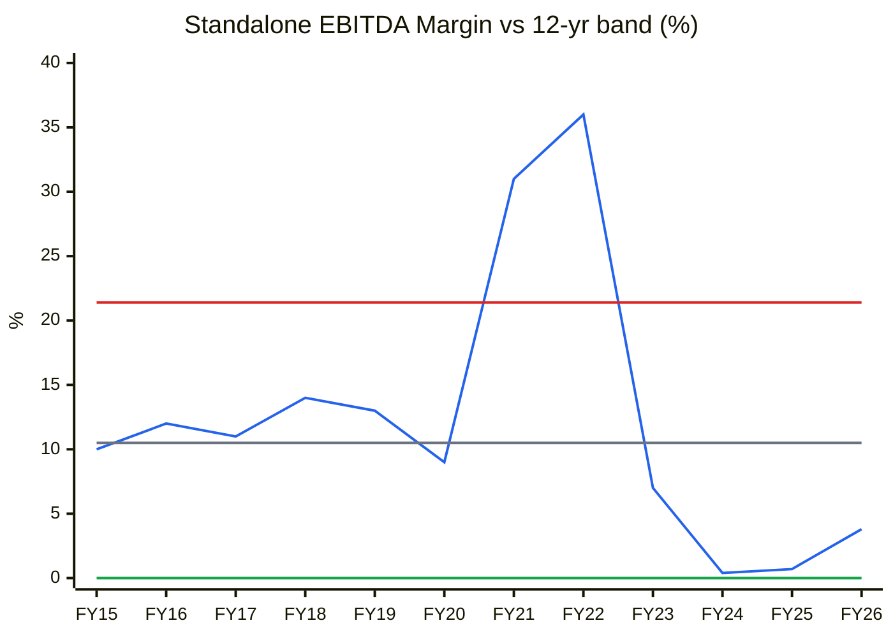
🟦 Standalone OPM · ⬜ median 10.5% · 🟥 +1SD 21.4% · 🟩 −1SD floor (median − SD = −0.4%, shown at 0)

**Read:** FY26 standalone OPM of 3.8% is at the 25th percentile. TTM is 11% (Screener) and Q1 FY27 alone is 32%, above +1SD, matched only by the FY21–22 COVID years.

**Business inference:** Every time margins exceeded ~15%, the cause was an import blockade (COVID, war). The orderly-market ceiling is ~12–14% (FY16–19). TTM earnings are therefore entering the "peak" zone, and the stock must be valued on the ~9–10% normalised margin.

**Stock cycle classification: LATE CYCLE / PEAK-EARNINGS QUARTER inside a structural import-parity trough.** Margin of safety +10pp; position size ×0.5.

---

## Module 2 — Industry Structure & Capital Cycle

### Porter Five Forces — UNATTRACTIVE
| Force | Assessment | Evidence |
|---|---|---|
| New entrants | Medium | Capital-intensive PO route, but MNC–refiner JVs are flagged as a risk (AR26); global supply is long |
| Supplier power | **High** | Single propylene source (CPCL, PSU), prices fixed monthly; sovereign cut-off in Mar-2026 |
| Buyer power | Medium-High | Fragmented buyers, but price discovery is set by import offers; MNC port tanks give buyers alternatives (AR26) |
| Substitutes | Low-Medium | Imports are the substitute; CO2-based/bio polyols (Econic tie-up) are long-dated |
| Rivalry | **High** | Dow, BASF, Wanhua and Thai producers dump into India; PG has no ADD |
**Verdict: Unattractive. MPL is a price-taker sandwiched between a PSU feedstock monopoly and global oversupply.**

### Capital cycle (Chancellor)
Global PO/polyol capacity is still being added, led by China (S&P Global: "oversupply expected to maintain pressure on propylene prices" in 2026). Domestically, MPL itself added +227% PG capacity in FY26 and plans Gujarat. Capex/depreciation: MPL FY26 additions ₹101 Cr vs D&A ₹34 Cr = 3.0×. Peers: IGPL is building plasticizers, Tirumalai's debt has risen to ₹2,175 Cr on US/expansion capex, and TNPETRO's borrowings went ₹135 → 465 Cr. **This is late in the capital cycle (capex ≫ depreciation across Indian commodity chemicals).** The FY27 shock is a supply outage, not supply discipline. CY8 is not charted for lack of consistent peer capex data.

---

## Module 3 — Business Quality & Moat
**Moat Verdict:** None-to-Narrow
**Moat Source (Greenwald):** Local scale (partial). Sole domestic PG producer and integrated PO, with freight and security-of-supply value to pharma customers
**Buffett Moat Type:** None (no low-cost advantage: feedstock is bought at PSU prices, and the plants are smaller than global crackers' integrated PO units)
**Pricing Power Test:** FAIL. Management: "we can't be in a position to pass on the increase of raw materials directly to customer" (Sep-2024 meet)
**Market Share Stability (5yr):** Unstable. Polyol volumes −60% in FY25 then recovered; PG share quoted as "45%" (Sep-2024 meet) vs "~20%" (CARE 2026), an unreconciled discrepancy
**Fisher 15-Point Score:** 23 / 45 *(Point 15 Integrity: Pass, with governance flags)*

Greenwald tests: (1) supply/cost advantage: **no**. FY23–26 standalone OPM of 0.4–7% vs global players shows no cost edge. (2) Customer captivity: **weak**. The pharma-PG licence, BIS certification and five-year guarantee give modest stickiness, visible only in shortages. (3) Local economies of scale: **partial**, as the only domestic PG plant with BIS/drug licences. The moat protects survival and shortage-period pricing, not normal-period returns. Activity system: PO → PG/polyols → systems integration is real but replicable by importers holding port tanks.

| # | Fisher point | Score | Note |
|---|---|---|---|
| 1 | Market potential | 2 | PU +7–8%/yr; PG import substitution |
| 2 | New products | 2 | Systems polyols, PIR grades, DMC polyols, PGMME |
| 3 | R&D effectiveness | 1 | No R&D capex disclosed ("Addition … R&D NIL", AR26 PPE note) |
| 4 | Sales organisation | 2 | Systems volumes "strong growth" (AR26) |
| 5 | Profit margin | 1 | 0.4–7% standalone OPM FY23–26 |
| 6 | Margin improvement effort | 2 | R-LNG, 58% renewable power, Econic |
| 7 | Labour relations | 1 | Wage dispute award ₹1.1 Cr against company (AR26 contingent liabilities) |
| 8 | Executive relations | 1 | High KMP churn: MD, CFO (twice), CS changes 2024–25 |
| 9 | Management depth | 1 | Group-level "MPL Group" CEO/CFO; thin disclosure |
| 10 | Cost/accounting controls | 2 | Clean audit; two EoMs (lease, insurance claim) |
| 11 | Industry advantages | 2 | Sole domestic PG; pharma licence |
| 12 | Long-range orientation | 2 | Gujarat, ZLD, Econic |
| 13 | Dilution risk | 3 | No equity issuance in 10 yrs |
| 14 | Candor in adversity | 1 | One investor meet in 2 years; no quarterly concalls |
| 15 | Integrity | 2 | No fraud evidence; offshore cash/RPT structure warrants a discount (Module 3B) |

---

## Module 4 (skill Module 3) — Management & Capital Allocation
**Promoter Holding:** 44.87% (SIDD Life Sciences 38.28%, TIDCO 6.52%, Ranford Investments [Marshall Islands] 0.05%, A.C. Muthiah 0.01%, SPIC 0.01%) — **flat for 12 quarters** (Screener; SHP 30-Jun-2026). Pledge: **0%** (SHP: "No") → Risk: Normal
**Pledge Trend:** None
**Significant beneficial owner:** Ashwin C. Muthiah, Singapore (SHP SBO table, 38.33%)
**FCF/Share vs EPS CAGR (FY21–26, 5 yr):** FCF/share 194 → 49 Cr (−24%/yr) | EPS 11.70 → 7.56 (−8%/yr; core ≈ 4.0)
**Share Count Trend:** Stable (17.21 Cr, unchanged 10+ yrs)
**Capital Allocation Rating:** Average-to-Poor
**Key RPT concerns:** see table below. Volumes are modest, but the structure is opaque.
**Buffett Three C's:** Candor: Low · Competence: Average · Caring: Low-Average

**Capital allocation history (consolidated, ₹ Cr):**
| Use | Amount | Return delivered |
|---|---|---|
| AMCHEM Singapore total investment | US$51.4m ≈ ₹398 Cr (2016 + Nov-2022) | Notedome (₹110 Cr in 2016) sold for ~₹247 Cr in Nov-2025 (CARE): good. PennWhite (£20.6m EV at ~7× EBITDA, Dec-2022): FY26 sales £13.6m vs £16m pitched, profit £2.2m, ~9% on ₹288 Cr: mediocre |
| PG expansion | ~₹100 Cr (FY24–26) | 65% utilised; spread-dependent. Modelled IRR 20.7% (Sep-2024 PPT) not yet evidenced |
| Dividends | ₹8.6–12.9 Cr/yr; FY26 ₹0.50/sh (10%) | Payout 7% of FY26 PAT despite ₹605 Cr cash: cash not reaching minorities |
| Cash hoard | ₹605 Cr (Mar-26) vs ₹324 Cr (Mar-25) | ~₹449 Cr is outside the Indian parent (standalone cash+bank ₹156 Cr), parked in AMCHEM Singapore, whose mandate includes "trading, transaction facilitations, business and project consultancy" (AR26) |

**Related-party transactions (standalone, FY26, AR26 Note 44):**
| Party | Relationship | FY26 | FY25 |
|---|---|---|---|
| Tamilnadu Petroproducts (TPL) | JV of associates SPIC/TIDCO | Purchases ₹20.8 Cr; sales ₹2.7 Cr; services ₹10.5 Cr | Purchases ₹117.5 Cr; sales ₹60.5 Cr |
| Wilson International Trading Pte (Singapore) | Related party of subsidiary | Purchases ₹31.5 Cr | ₹33.5 Cr |
| AMCHEM Singapore | WOS | Purchase of services ₹4.2 Cr | ₹4.0 Cr |
| AM Foundation | Promoter-linked CSR entity | ₹0.2 Cr | ₹0.1 Cr |
| Directors & KMP remuneration | — | ₹3.07 Cr (≈9% of standalone PAT ₹34.8 Cr) + sitting fees ₹0.65 Cr; a further ₹65 L NED commission approved by special resolution at the 2026 AGM | ₹3.27 Cr |
AGM 28-Sep-2026 approved TPL transactions up to ₹150 Cr (previous approval ₹300 Cr). No ICDs to group and no corporate guarantees disclosed. Total RPT ≈ 6–7% of standalone revenue. **Verdict: no extraction evidence, but the Singapore cash, the Singapore trading-house purchases and the Marshall Islands vehicle form a structure that minorities cannot monitor.** This justifies a 20% discount on offshore cash in the SOTP.

### Walk the Talk Scorecard
| Quarter Guided | Statement | Guided | Actual | Verdict |
|---|---|---|---|---|
| Dec-2022 call | PG expansion complete "within 24 months" after state clearance | ~Dec-2024 | Commissioned 3-Oct-2025 | ❌ (~10 months late) |
| Sep-2024 meet | PG project completion | Q2 FY25 | Q3 FY26 | ❌ (4 quarters late; capacity upsized to 50 kt from 32 kt) |
| Sep-2024 meet | PG capex | ₹94–100 Cr | ~₹100 Cr (CARE) | ✅ |
| Dec-2022 call | PennWhite run-rate ~£16m sales / £2.96m EBITDA "going forward" | £16m / £2.96m | FY24 EBITDA ₹33.9 Cr (~£3.2m); FY26 sales £13.6m, profit £2.2m | ⚠️ |
| Sep-2024 meet | "We have reached the bottom of the cycle… stable platform" | Recovery FY25 | FY25 standalone loss ₹8.7 Cr; FY26 PAT ₹34.8 Cr | ⚠️ |
| Sep-2024 meet | PennWhite manufacturing site in India | Undated | Oragadam plant inaugurated Apr-2026 | ✅ |
| Sep-2024 meet | Polyester polyol 2nd 4,150 MTPA train "ongoing" | 8,300 MTPA total | AR26 cites 2,400–2,600 MTPA capability | ❌ |
| Annual reports since 2017 | Plant-2 lease renewal "early resolution" | Renewal | Still pending 9 yrs after expiry (EoM) | ❌ |
| AR26 | Gujarat EC/CTE "by end of September 2026" | Sep-2026 | No filing found (unverifiable; excluded) | — |

**WTT Score:** 0.38 / 1.00 — **UNRELIABLE**
**Guidance points assessed:** 8 | Hits: 2 | Near Misses: 2 | Misses: 4 | Reversals: 0
**Key pattern:** One-way misses on project timelines (PG ~1 yr late; polyester train; Gujarat still in approvals 2+ years after being pitched). Selective disclosure: no quarterly concalls; only one investor meet (Sep-2024) since Dec-2022.
**Insider action:** No promoter open-market buys or sells found; holding flat at 44.87% for 12 quarters → NEUTRAL (Form C not exhaustively searched; data gap).
**DCF impact:** Gujarat commissioning pushed 2–3 quarters past any implied plan (H2 FY29 in base); margin of safety +10pp.
**Overall management credibility:** LOW-MODERATE

---

## Module 5 (skill Module 4) — Financial Forensics
**Forensic Red Flag Count:** 2 / 15 (benign) — see O'Glove table
**Beneish M-Score (FY26 vs FY25, consolidated):** −2.15 → Grey zone (just above −2.22). Drivers: DSRI 1.26 (Q4 FY26 sales +27% YoY lifted year-end receivables to ₹168 Cr from ₹117 Cr); SGI 1.14; GMI 1.08; AQI 0.64; DEPI 1.01; LVGI 0.90; TATA 0.009. Explainable by Q4 price/volume surge; not manipulation-pattern.
**Altman Z''-Score (FY26):** ≈ 10.2 → Safe (X1 0.47; X2 0.75; X3 0.06 core; X4 4.1)
**Piotroski F-Score (FY26):** 6 / 9 → Average (fails: CFO < reported NI because of the exceptional gain; LT debt up; gross margin down)
**Sloan Accrual Ratio (FY26):** (130 − 116 − 75) / 1,500 = −4.1% → Acceptable
**Indian-Specific Flags:** Pledge nil ✅ · ICDs nil ✅ · RPTs modest but offshore-structured ⚠️ · Auditor Brahmayya & Co. (long-standing Chennai firm), unmodified opinion with **two Emphasis of Matter**: (i) Plant-2 lease expired 30-Jun-2017, Ind AS 116 premised on a 30-yr renewal; (ii) Cyclone Michaung PPE claim ₹11.8 Cr carried as receivable. KAMs: revenue discounts, contingent liabilities. Contingent liabilities are small (TNPCB ₹2 Cr; wage claim ₹1.1 Cr).
**Overall Forensic Verdict:** Clean, with minor structural concerns

Schilit screen: revenue too soon: DSO 60 days FY26 vs 48 (Q4 surge) ⚠️. Other income/EBIT: FY26 core other income ₹47.5 Cr vs operating EBIT ₹48 Cr, because treasury income on the cash pile is structural (flag #7, benign). One-time items: exceptional items in FY24–FY26 (flood write-downs, insurance, the FY26 Notedome gain of ₹52.2 Cr plus provision write-backs of ₹18.5 Cr) → reported FY26 PAT ₹130 Cr vs **core ≈ ₹69 Cr**. Capex/depreciation 3.0× in FY26 (an expansion year, so justified). No factoring disclosed; DPO 60 days vs 62, stable.

---

## Module 6 (skill Module 5) — Earnings Quality & Financial Statements
**ROCE (FY26, Screener):** 7% | **TTM core ≈ 11%** (TTM PBT ₹215 Cr less ₹68 Cr exceptional, plus interest, over ~₹1,418 Cr capital employed) | **10-yr median:** 17% (mean 21%, inflated by FY21–22) | **WACC:** ~13% (Rf 7%, β ~1.1 est., ERP 6% → Ke 13.6%; negligible debt)
**Operating ROIC ex-cash (FY26):** operating EBIT ₹48 Cr × 0.75 ≈ ₹36 Cr NOPAT on ~₹810 Cr invested capital (equity + debt + lease − cash − investments) ≈ **4.5%** (≈6% ex-₹202 Cr goodwill)
**ROIC vs WACC Spread:** −6 to −8pp → Value Destroying in FY23–26 (4 consecutive years; the 5-yr hard stop is not triggered because FY22 was 60%)
**ROIC Trend (3yr):** Improving off trough (5 → 5 → 7; TTM ~11)
**ROIC Driver:** Margin-led (AT structurally falling)
**Economic Profit:** Negative FY23–26; positive FY27E likely (windfall)

#### C4 — Consolidated margins
| | FY16 | FY17 | FY18 | FY19 | FY20 | FY21 | FY22 | FY23 | FY24 | FY25 | FY26 |
|---|---|---|---|---|---|---|---|---|---|---|---|
| Revenue ₹Cr | 579 | 626 | 748 | 810 | 803 | 1,024 | 1,672 | 1,181 | 1,032 | 897 | 1,022 |
| EBITDA ₹Cr | 68 | 52 | 97 | 100 | 70 | 302 | 529 | 79 | 47 | 58 | 82 |
| EBITDA % | 11.7 | 8.3 | 13.0 | 12.3 | 8.7 | 29.5 | 31.6 | 6.7 | 4.6 | 6.5 | 8.0 |
| PAT ₹Cr | 48 | 38 | 58 | 77 | 47 | 201 | 381 | 51 | 19 | 29 | 130* |
| PAT % | 8.3 | 6.1 | 7.8 | 9.5 | 5.9 | 19.6 | 22.8 | 4.3 | 1.8 | 3.2 | 12.7* |
| CFO ₹Cr | −6 | 87 | 58 | 13 | 87 | 219 | 373 | 92 | 75 | −19 | 116 |
*FY26 includes ₹68.3 Cr exceptional items (AR26 Note 40); core PAT ≈ ₹69 Cr (6.8%).

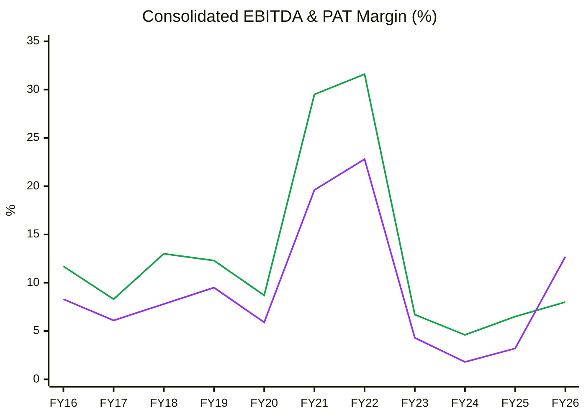
🟩 EBITDA margin · 🟪 PAT margin (FY26 incl. exceptional gain)

**Read:** The EBITDA margin median is 8.7% (mean 12.8%, SD 9.2pp). FY26 at 8.0% sits at the median; TTM is 13.4%.

**Business inference:** Pricing power appears only when imports vanish. Inflation periods (FY23–24) compressed margins, so input costs are not passed through. Normalised consolidated EBITDA margin for valuation is ~9–10%, including the higher-margin PennWhite.

#### C5 / CY7 — ROCE vs WACC
| | FY17 | FY18 | FY19 | FY20 | FY21 | FY22 | FY23 | FY24 | FY25 | FY26 |
|---|---|---|---|---|---|---|---|---|---|---|
| ROCE % (Screener) | 20 | 24 | 22 | 14 | 49 | 60 | 8 | 5 | 5 | 7 |

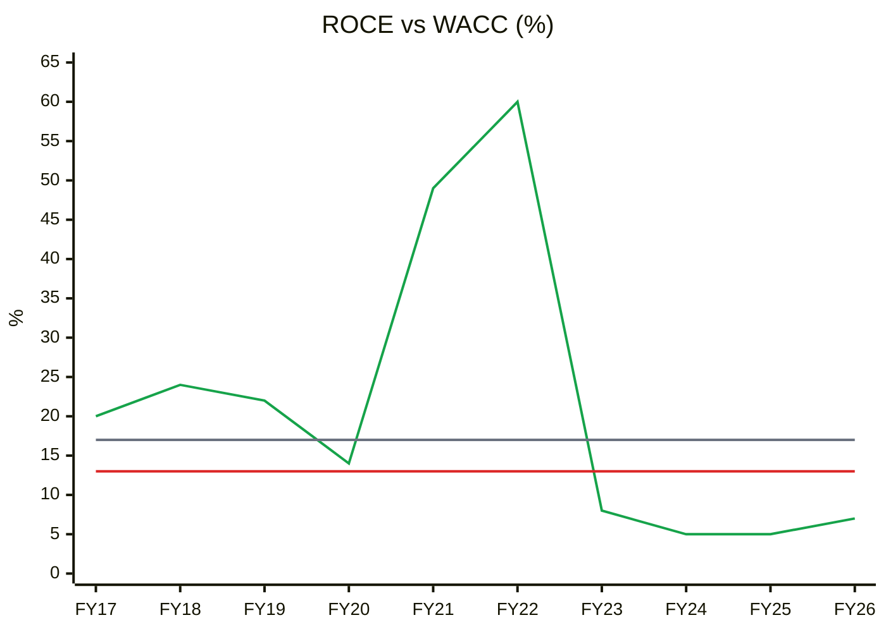
🟩 ROCE · 🟥 WACC ~13% · ⬜ 10-yr median 17%

**Read:** ROCE has been below WACC for four straight years (FY23–26), against a 10-yr median of 17% that the two COVID years inflate. Ex-COVID, the FY17–20 range was 14–24%.

**Business inference:** The pre-COVID 14–24% ROCE came from a smaller, debt-free asset base before ₹398 Cr went offshore and ₹100 Cr into PG. Today's larger capital base (cash plus goodwill plus new PG) needs ~₹180 Cr EBIT to earn WACC, which is achievable only in a windfall year. This is structural dilution of returns rather than a cyclical blip.

#### C7 — Earnings quality (cumulative)
| | FY16 | FY17 | FY18 | FY19 | FY20 | FY21 | FY22 | FY23 | FY24 | FY25 | FY26 |
|---|---|---|---|---|---|---|---|---|---|---|---|
| Cum. PAT | 48 | 86 | 144 | 221 | 268 | 469 | 850 | 901 | 920 | 949 | 1,079 |
| Cum. CFO | −6 | 81 | 139 | 152 | 239 | 458 | 831 | 923 | 998 | 979 | 1,095 |

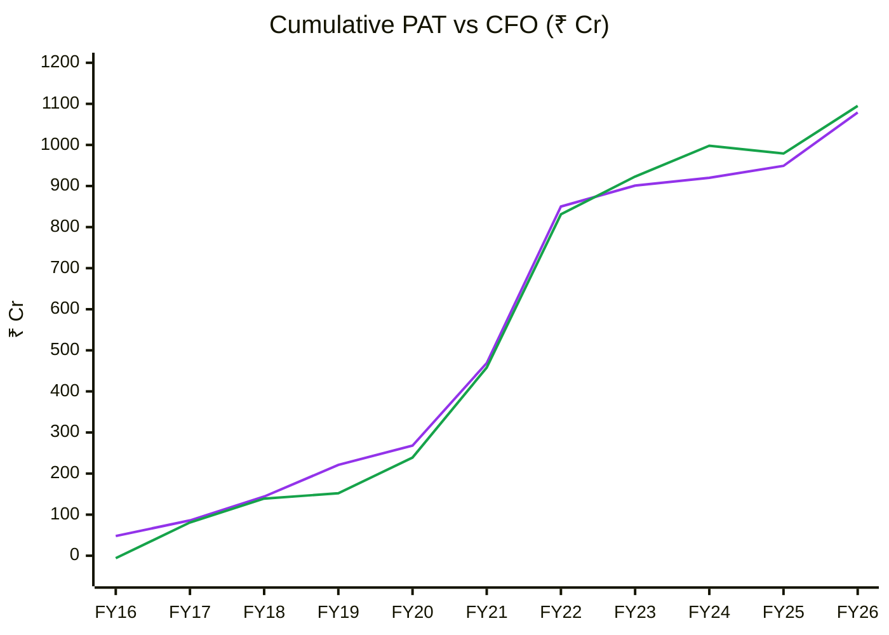
🟪 Cumulative PAT · 🟩 Cumulative CFO

**Read:** Cumulative CFO/PAT over 11 years is 1.01 (5-yr FY22–26: 1.04).

**Business inference:** Reported profits convert fully to cash, and the earnings problem is level, not quality. That is also why cash has piled up: it is generated, but neither reinvested at good returns nor distributed. The FY25 CFO dip (−₹19 Cr) was an inventory build of ₹90 Cr, reversed in FY26.

**OCF / Net Income (5yr avg):** 1.04 → Quality: High
**O'Glove Red Flags:** 2 / 15 (#7 other income/EBIT, structural treasury income; #8 exceptional items in 3 consecutive years, flood/divestment). #10 Beneish grey but not > −1.78.
**Key accounting concern:** FY26 headline PAT (₹130 Cr, EPS ₹7.56) is ~47% non-recurring; FY26 P/E optics are misleading.

### DuPont Decomposition (5-Factor, consolidated)
| Year | EBIT Margin | Asset Turnover | Equity Multiplier | Interest Burden | Tax Burden | ROE |
|---|---|---|---|---|---|---|
| FY22 | 31.1% | 1.30× | 1.25× | 0.98 | 0.75 | 37.1% |
| FY23 | 6.7% | 0.93× | 1.22× | 0.89 | 0.73 | 4.9% |
| FY24 | 4.2% | 0.79× | 1.23× | 0.77 | 0.58 | 1.8% |
| FY25 | 5.8% | 0.64× | 1.28× | 0.81 | 0.69 | 2.7% |
| FY26 | 16.0% (core 9.4%) | 0.64× | 1.25× | 0.92 | 0.87 | 10.0% (core ~5.4%) |
| **Change FY22→26** | −15pp | −0.66× | 0.00× | −0.06 | +0.12 | −27pp |
*EBIT = PBT + interest (includes other income). Total assets as denominator.*

**Operating Contribution (EBIT Margin × AT):** Declining (40% → 10%; core 6%)
**Financing Contribution:** Stable (no leverage; equity multiplier flat at ~1.25)
**DuPont Verdict:** The ROE collapse is purely operational: margin plus a structurally falling asset turnover (total assets swollen by cash and goodwill). Leverage is not masking anything, but the cash drag means ROE cannot recover to the teens without either windfall spreads or a payout.
**Peer DuPont:** IGPL (FY26 ROE ~0%, OPM 5%, D/E 0.25) and Tirumalai (negative ROE, D/E ~1.3) are worse; TNPETRO (~10% ROE with rising leverage) is similar on operations. No peer earns premium ROE structurally.
**AT Trend → Module 10A base case AT:** Declining. Revenue/gross PPE 3.33× (FY24) → 2.73× (FY25) → 2.62× (FY26) on consolidated gross PPE of ₹310 / 329 / 390 Cr (AR26 PPE note, deemed cost).

#### C6 — Asset turnover (Revenue / net fixed assets, Screener proxy)
| FY16 | FY17 | FY18 | FY19 | FY20 | FY21 | FY22 | FY23 | FY24 | FY25 | FY26 |
|---|---|---|---|---|---|---|---|---|---|---|
| 5.51 | 3.04 | 2.74 | 2.86 | 2.66 | 3.51 | 4.87 | 2.14 | 1.85 | 1.51 | 1.80 |

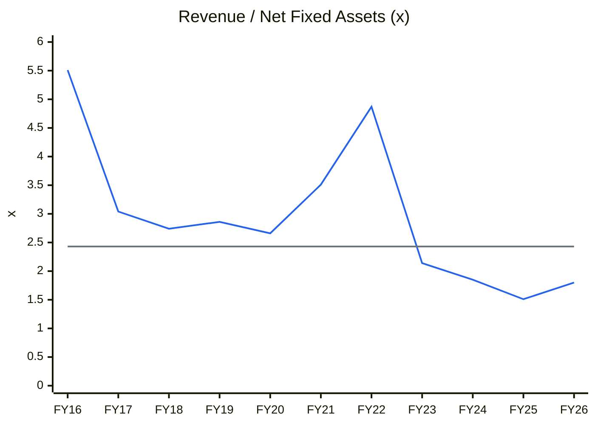
🟦 AT (net FA incl. goodwill & ROU) · ⬜ 5-yr avg 2.43×

**Read:** AT fell from ~2.7–2.9× (FY18–20) to 1.5–1.8× (FY24–26), partly because ₹202 Cr goodwill and ₹74 Cr ROU assets entered the base.

**Business inference:** Each new rupee of capital (acquisitions, PG line) produces less revenue than the old plant. The bear case uses the current ~1.8× (gross ~2.6×), not a return to the FY18–20 level.

---

## Module 7 (skill Module 6) — Industry KPIs & Peer Analysis
**Sector:** Commodity petrochemicals (PO/PG/polyols), using the Specialty Chemicals block (line 449) with spread adjustments

**Top KPIs:**
| KPI | Company | Benchmark / Peer | Assessment |
|---|---|---|---|
| Spread proxy (standalone OPM) | FY26 3.8%; TTM 11%; Q1 FY27 32% | 12-yr median 10.5% | Below through-cycle (FY26); far above in Q1 FY27 (windfall) |
| Capacity utilisation | PG-B 65%; Plant-1 72%, Plant-2 45% (FY24) | Healthy > 75% | Below |
| Import parity / ADD status | PG: no ADD (QCO lobbying). Flexible slabstock polyol: ADD on Saudi/UAE continued to 17-Jun-2026 (Notif. 01/2026-Cus ADD), status after that unknown; China/Thailand ADD recommended by DGTR 28-Mar-2024, imposition not confirmed (AR26 implies inadequate protection); copolymer polyol (China) ADD Sep-2025, new probe AD/OI/067/2026 started 23-Sep-2026 | — | Weak protection |
| EBITDA margin | 8.0% (FY26) | Specialty 20–30%; red flag < 15% | Commoditised |
| Export % | 23% (EU/UK, PennWhite) | > 50% for specialty | Below |
| Client concentration | Top-10 < 51% of TOI (CARE) | < 40% top-3 | OK |
| Capex/revenue | 9.9% (FY26) | 8–15% in expansion | OK |

**Peer Comparison (Screener consolidated, 12-Oct-2026):**
| Metric | Manali | IG Petrochemicals | Thirumalai Chem | Tamilnadu Petroproducts |
|---|---|---|---|---|
| Mcap ₹Cr | 1,441 | 1,779 | 1,749 | 1,051 |
| Revenue 3-yr CAGR (FY23–26) | −4.6% | −6.6% | −4.6% | −6.6% |
| EBITDA margin FY26 / latest qtr | 8% / 30% | 5% / 18% | −2% / 6% | 9% / 15% |
| ROCE FY26 | 7% | 3% | −3% | 11% |
| Net debt | Net cash ~₹550 Cr | Debt ₹362 Cr | Debt ₹2,175 Cr | Debt ₹465 Cr |
| P/B | 1.13× | 1.33× | 1.12× | 1.04× |
| P/E (TTM) | 12.1× (Screener ≈ core TTM EPS ₹6.9; reported TTM EPS ₹10.47 → 8.0×) | 21.8× | n.m. (loss) | 7.7× |

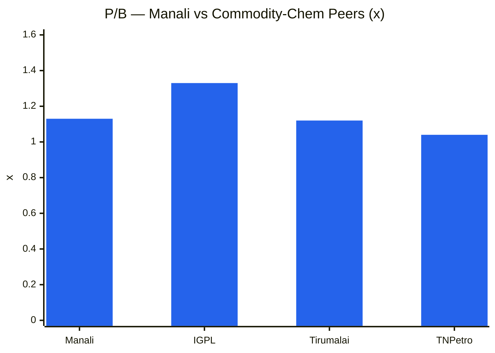
🟦 Price / book value

**Read:** All four Indian commodity-chemical names trade at 1.0–1.3× book; Manali is mid-pack at 1.13×.

**Business inference:** Manali's book is ~43% cash plus ₹202 Cr goodwill, so on operating assets alone it is the most expensive of the group (EV/operating capital ≈ 1.2× for a ~5% ROIC business). No peer premium is justified. The market is treating Manali like IGPL (a cyclical recovery) when its windfall is shorter-lived than a spread cycle.

**Peer positioning:** In line on P/B, expensive on operating assets → not justified.
**Promoter capital-structure adjustment:** no ICDs or guarantees, so Adjusted ROCE = reported. Offshore cash is discounted 20% in valuation instead.
**Order Book Tracker:** Not applicable (non-order-driven commodity producer; no Reg 30 order filings).

---

## Module 8 (skill Module 7) — Market Size & Market Share
**TAM:** India PU market USD 5.5–6.0 bn (~₹47,000–51,000 Cr) in FY26 (AR26). PG ~1 lakh tpa (~₹1,000 Cr at ~₹1 lakh/t, estimate). Polyol pools: slabstock ~250 KTA, HR ~70 KTA, footwear ~150 KTPA, PPG diols 120–150 KTPA (AR26).
**TAM Growth Rate:** PU 7–8% a year (AR26); PG ~5% a year (Sep-2024 meet)
**Company Penetration:** Standalone revenue ₹786 Cr ÷ PU market ≈ 1.6%. Polyether capacity 46 kt ≈ 8% of a ~600 KTA polyol pool.
**Market Share (current):** PG ~20% (CARE 2026; management claimed "45%" in Sep-2024, unreconciled) | **5-Year Trend:** Losing in polyols (FY25 volume −60%), stable in PG until the FY26 expansion
**Share Gain Driver:** Temporary (import disruption in FY27); structural only if PG-B fills at import parity
**Revenue Growth vs Market Growth Check:** Standalone revenue FY21–26 CAGR −3.0% (₹922 → ₹786 Cr) vs PU market ~+7%
**Verdict:** Losing share over five years; a transient share gain in FY27

---

## Module 9 (skill Module 8) — Valuation: PIE First, Then Own Model

**Capital structure (12-Oct-2026):** Mcap ₹1,447 Cr · cash and bank ₹605 Cr + investments ₹6 Cr (31-Mar-2026; the Jun-2026 balance sheet was not published, a data gap) · borrowings ₹58 Cr · lease liabilities ₹78.5 Cr → **EV ≈ ₹972 Cr** (incl. leases). Book value ₹1,281 Cr (₹74.5/sh) incl. goodwill ₹202 Cr (₹11.7/sh).

### 8A. Price-Implied Expectations
- Quick PIE on **FY26 core, ex-Notedome** NOPAT (EBITDA ~₹60 Cr est. − D&A ₹32 Cr = ~₹28 Cr EBIT; × 0.75 ≈ ₹21 Cr): g = (972×0.13 − 21)/(972+21) ≈ **10.6% perpetual growth**.
- On **TTM** NOPAT (TTM EBITDA ₹142 Cr − D&A ₹35 Cr = ₹107 Cr; × 0.75 ≈ ₹80 Cr): g ≈ **4.4%**, i.e. the price treats the windfall-inflated TTM as a permanent base growing at nominal-GDP-minus.
- Steady-state equivalent at WACC 13%, g 5%: EV ₹972 Cr ⇒ NOPAT ≈ ₹74 Cr ⇒ EBIT ≈ ₹99 Cr ⇒ **EBITDA ≈ ₹135 Cr forever (~13% margin on ~₹1,050 Cr revenue).**

| PIE value driver | Market-implied | My base case | Expectations gap |
|---|---|---|---|
| Revenue CAGR FY26–29 (ex-Notedome base ₹950 Cr) | ~5–6% | ~5.6% (₹950 → ₹1,120 Cr) | ≈ 0 |
| Steady-state EBITDA margin | ~13% | ~10.7% (FY29E) | **−2 to −3pp (optimistic gap)** |
| Investment rate | Maintenance + Gujarat | ₹130 Cr Gujarat + ZLD + maintenance | Similar |

**Gap classification: OPTIMISTIC.** The market prices the bull-case margin as permanent. **Expectations treadmill:** to outperform, MPL must hold ≥13% consolidated EBITDA margin after imports normalise, which it has done only in the FY21–22 blockade years. **Positive triggers:** ADD/QCO on PG; the propylene allocation regime persisting with imports constrained into FY28; Gujarat commissioning early; a special dividend or buyback from the Singapore cash. **Negative triggers:** normalisation of Strait of Hormuz flows and Chinese PG/polyol offers; Q2/Q3 FY27 margin reverting below 12%; another propylene cut; an adverse Plant-2 lease decision. **SVAR** (bear ₹42): (84.12 − 42)/84.12 = **50%** → unfavourable. **Physical plausibility:** the PIE revenue path fits within installed capacity (PG ~65% utilised), so the disagreement is about **price/margin, not volume.**

### 8B. Own model — SOTP on FY29E (capex-anchored, see Module 10)
| Component | Bear | Base | Bull |
|---|---|---|---|
| Standalone EBITDA FY29E (₹Cr) | 25 (3% on ~₹830 Cr; FY24–25 replay) | 85 (8.5% on ~₹1,000 Cr) | 150 (13% on ~₹1,150 Cr) |
| × EV/EBITDA | 7× | 7× | 7× |
| PennWhite EBITDA (₹Cr) × multiple | 28 × 8 | 35 × 10 | 40 × 10 |
| Net cash FY29E (₹Cr), offshore part discounted 20% | 480 → ₹22/sh | 560 → ₹26/sh | 700 → ₹33/sh |
| Less lease liabilities | −₹4.6/sh | −₹4.6/sh | −₹4.6/sh |
| **Value per share** | **₹42** | **₹77** | **₹110** |
| Implied P/E on FY29E EPS | ~19× on EPS ~₹1.3 (trough) | ~19× on ₹4.1 (ex-cash ~15×) | ~15× on ₹7.2 |

**Relative cross-checks:** P/B: the 10-yr median is 0.97×; at ~1.0× FY29E BVPS (~₹89) the value is ~₹89. P/B is generous here because book is inflated by cash and goodwill and the ROE is ~5%. Justified P/B = (ROE − g)/(Ke − g) = (5.5 − 5)/(13.6 − 5) ≈ 0.1× on operating equity, so cash is the only support. **EPV (Klarman):** normalised NOPAT ~₹55 Cr / 13% ≈ ₹420 Cr + net cash ₹550 Cr ≈ ₹970 Cr ≈ **₹56/sh**. **Graham Number:** √(22.5 × 5.70 [11-yr avg EPS] × 74.5) ≈ ₹98, unreliable because it is inflated by COVID-year EPS of ₹11.7/₹22.2.

| Method | Bear | Base | Bull |
|---|---|---|---|
| SOTP (EV/EBITDA + cash) | ₹42 | ₹77 | ₹110 |
| Relative (P/B 0.6× / 0.97× / 1.3× on FY29E BV ~₹80–95) | ₹48 | ₹86 | ₹124 |
| EPV (Klarman) | ₹45 | ₹56 | ₹75 |
| **Consensus Range** | **₹45** | **₹73** | **₹103** |

**Current Market Price:** ₹84.12
**Margin of Safety (base case ₹77):** −9% → Inadequate (required ~50%: small-cap 40% + WTT UNRELIABLE +10pp; sector headwind would add more)
**Upside/Downside Ratio:** (110 − 84)/(84 − 42) = **0.62 : 1 → Unacceptable (hard stop < 1.5:1)**
**Reverse DCF Implied Growth:** 4–11% perpetual depending on base; implies ~13% steady margin → Aggressive
**Graham Number:** ₹98 (distorted)
**Misprice Reason:** Recency: a windfall quarter, plus +351% EPS headlines and a high-volume breakout driven by retail (FII 0.38%, DII 0.01%). The price is not cheap.
**Catalyst (for downside):** Q2 FY27 results (due ~mid-Nov-2026) and any normalisation of propylene/imports

#### CY1 — P/E band (year-end price ÷ reported EPS)
| FY17 | FY18 | FY19 | FY20 | FY21 | FY22 | FY23 | FY24 | FY25 | FY26 |
|---|---|---|---|---|---|---|---|---|---|
| 18.1 | 10.0 | 5.7 | 3.8 | 5.6 | 5.2 | 20.4 | 50.2 | 32.5 | 5.7 |
*Prices are weekly closes for the last week of March (Yahoo). FY26 EPS ₹7.56 includes exceptional items (core EPS ~₹4.0 → P/E 10.7×).*

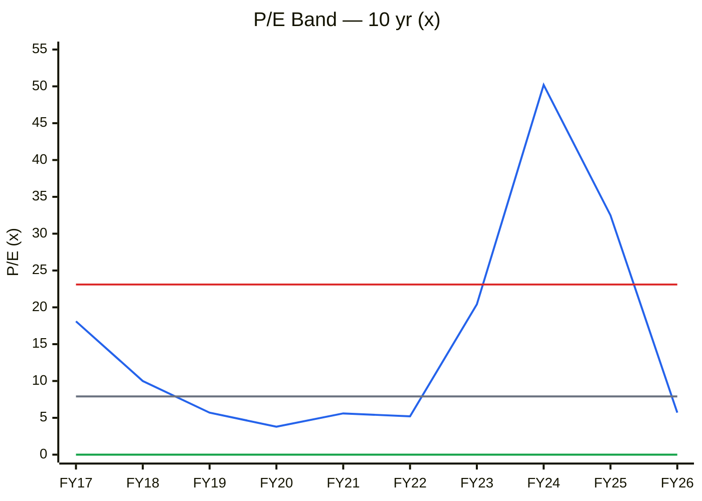
🟦 P/E · ⬜ median 7.9× · 🟥 +1SD 23.1× · 🟩 −1SD (negative; shown at 0)

**Read:** Current TTM P/E is ~12× on core TTM EPS ~₹6.9 (8.0× on reported ₹10.47 incl. the Notedome gain), the ~60th–70th percentile. The lowest P/Es (3.8–5.7×) coincided with peak earnings in FY21–22.

**Business inference:** This is the classic cyclical trap. Single-digit P/Es came at peak earnings, so a "reasonable" 12× on windfall-inflated TTM earnings is expensive on normalised EPS (~₹4 → ~21×). Read alongside C4: margins are at a peak quarter.

#### CY2 — P/B band, with ROE
| | FY17 | FY18 | FY19 | FY20 | FY21 | FY22 | FY23 | FY24 | FY25 | FY26 |
|---|---|---|---|---|---|---|---|---|---|---|
| BVPS ₹ | 18.1 | 22.8 | 26.5 | 28.0 | 39.5 | 59.9 | 60.7 | 61.7 | 63.6 | 74.5 |
| P/B × | 2.20 | 1.47 | 0.95 | 0.37 | 1.65 | 1.92 | 0.99 | 0.91 | 0.87 | 0.58 |
| ROE % | 12.8 | 16.5 | 18.2 | 10.0 | 34.6 | 44.6 | 4.9 | 1.8 | 2.7 | 10.9 |

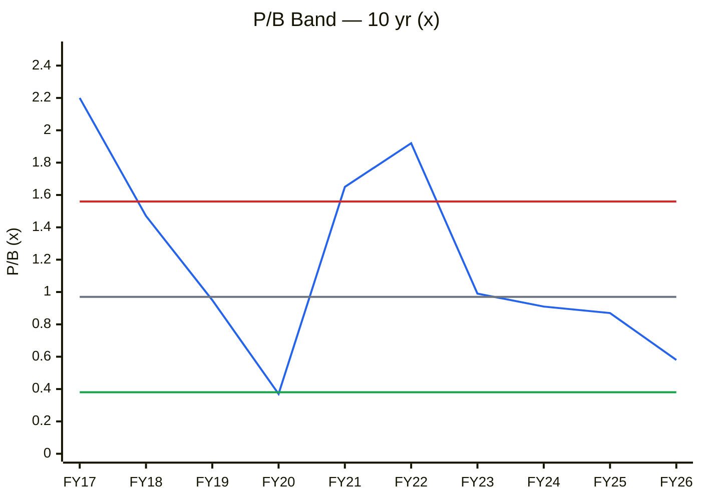
🟦 P/B · ⬜ median 0.97× · 🟥 +1SD 1.56× · 🟩 −1SD 0.38×

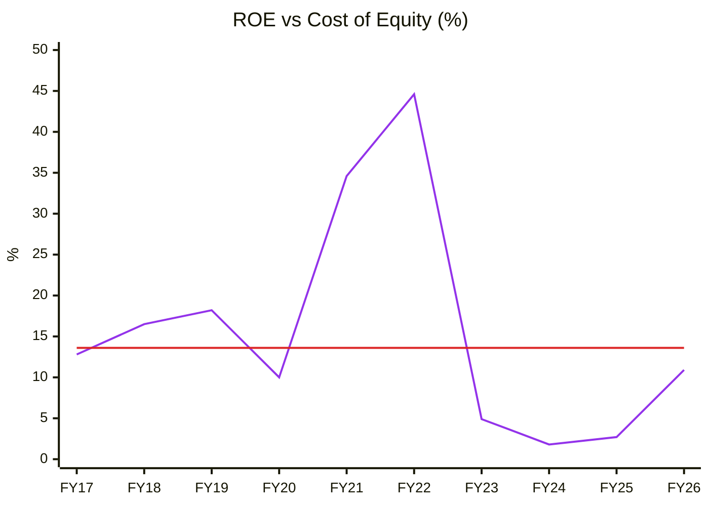
🟪 ROE (FY26 incl. exceptional; core ~5.4%) · 🟥 Ke 13.6%

**Read:** Current P/B is 1.13× (60th percentile), up from 0.58× at Mar-2026. ROE has been below Ke for four years (core FY26 ~5.4% vs 10-yr avg 15.7%).

**Business inference:** Above-median P/B on a sub-Ke ROE balance sheet is only defensible if the windfall ROE persists. With ~43% of book in cash earning ~6% pre-tax, the steady-state ROE ceiling is ~8–10% even at mid-cycle spreads, so fair P/B is below 1×.

#### CY4 — Price vs EPS index (FY17 = 100)
| | FY17 | FY18 | FY19 | FY20 | FY21 | FY22 | FY23 | FY24 | FY25 | FY26 | Now |
|---|---|---|---|---|---|---|---|---|---|---|---|
| Price idx | 100 | 84 | 63 | 26 | 163 | 288 | 151 | 141 | 138 | 107 | 211 |
| EPS idx | 100 | 153 | 202 | 123 | 532 | 1007 | 134 | 51 | 77 | 344 | — |

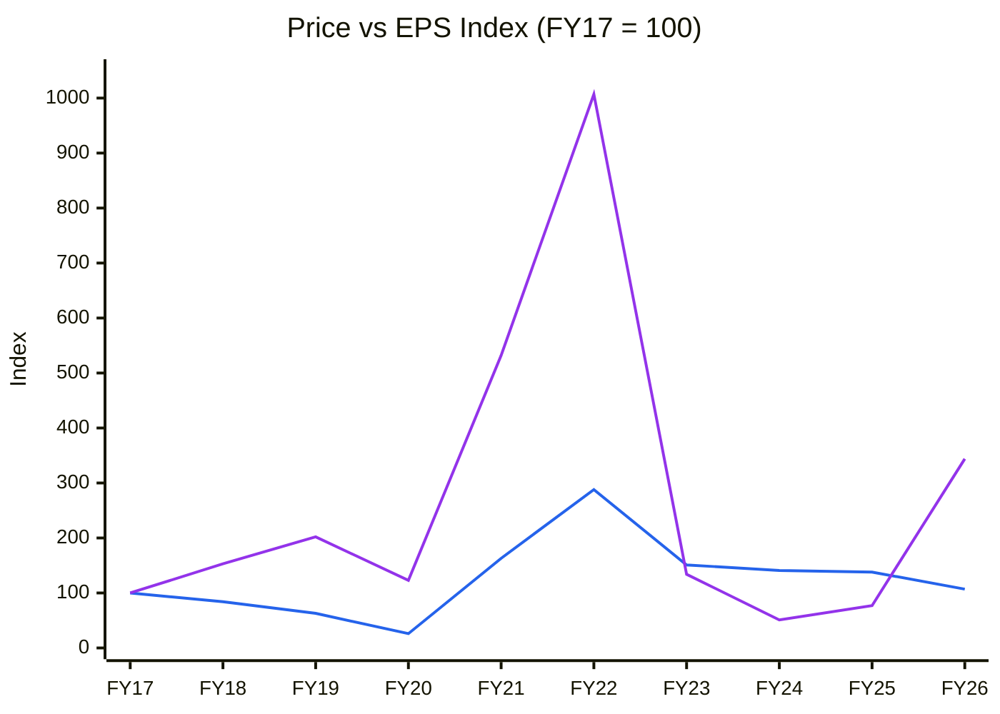
🟦 Price index · 🟪 EPS index (FY26 incl. exceptional; core ≈ 182)

**Read:** Over the decade the price never tracked peak EPS (FY22: EPS 10×, price 2.9×). The price is now at index ~211, while core FY26 EPS index is ~182.

**Business inference:** The market has historically refused to capitalise windfall earnings, and correctly so: the FY22 EPS collapsed 87% the next year. The current re-rating breaks that discipline, which makes the stock vulnerable to the same mean reversion.

#### C13 — Scenario values vs CMP
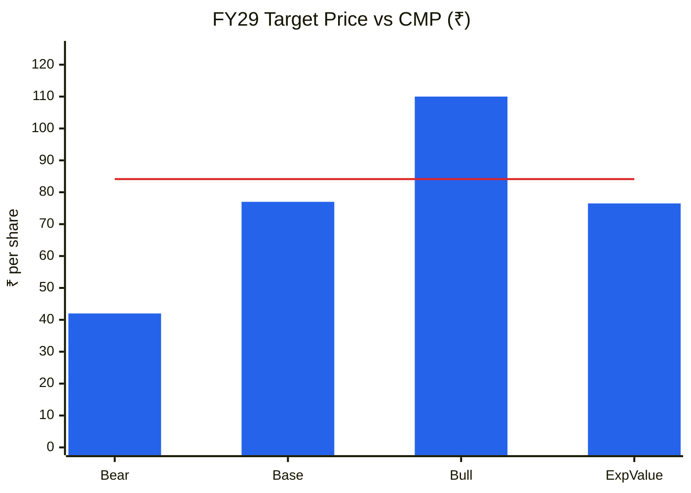
🟦 Scenario value · 🟥 CMP ₹84.12

**Read:** Bear −50%, base −8%, bull +31%; expected value ₹76.5 (−9%). U/D 0.62:1.

**Business inference:** The price already sits above the base case. The market is paying for the windfall to last, so even good execution only earns back the cost of capital, while a normal import cycle halves the stock. The asymmetry runs the wrong way.

### Cycle Position Dashboard
| Dimension | Current | 10-yr Median | Percentile | Signal |
|---|---|---|---|---|
| P/E (TTM) | ~12× core (8.0× reported; ~21× on normalised EPS ₹4) | 7.9× | ~65% | Expensive (on normalised EPS) |
| P/B | 1.13× | 0.97× | 60% | Fair-to-expensive given ROE < Ke |
| EBITDA margin (consol.) | TTM 13.4%; Q1 FY27 30% | 8.7% | ~75% (TTM); 100% (Q1) | Peak |
| ROCE | TTM ~11% (FY26 7%) | 17% | ~40% | Mid / improving |
| Industry utilisation (domestic PG cap/demand) | ~65–69% domestic capacity; global PO/PG long | — | — | Oversupplied (global) |
| Spread (standalone OPM proxy) | 32% (Q1 FY27) | 2.9% (13-qtr) / 10.5% (12-yr) | 100% | Peak / windfall |
| Industry capex/dep | MPL 3.0×; peers debt-funded expansions | — | — | Flooding |
| **Overall cycle position** | | | | **Late / peak-earnings (transient) within a structural headwind** |
Consistent with Module 1b (Headwind masked by a transient tailwind) and Module 1c (Late cycle / peak quarter).

---

## Module 10 (skill Module 9) — Technical Stage (Weinstein)
**Nifty 50 Market Stage:** 4 (22,485, below a falling 30-wk MA of 23,717)
**Sector Index Stage:** Not retrieved (data gap). Peer read: IGPL near its high (Stage 2), Tirumalai near its low (Stage 4), so mixed
**Stock Stage:** 2, late (extended)
**30-Week MA:** Rising (₹57.4 → ₹60.7 → ₹66.1 over 10 weeks) | Price is: Above (+27%)
**RS vs Nifty:** Strongly positive: 52-wk +15.9% vs Nifty −12.5%; 26-wk +52.5% vs −7.7%
**Volume at Breakout:** Week of 31-Aug-2026: 182.9m shares vs a 52-wk average of 7.7m (≈ 24×), price ₹74 → ₹86.8. Confirmed, but a climax-style spike; the trigger is not identified in filings (data gap)
**Base:** ~6-month base ₹41–67 (Mar–Jul 2026); pivot ~₹67–69; current price ~22–25% above the pivot → "Stage 2 but 20%+ above base: late entry"
**Stop-Loss Level:** Weekly close < ₹66 (30-wk MA / pivot)
**CANSLIM:** C 1 (Q1 EPS +351%) · A 0 (ROE 4–11%; 3-yr EPS erratic) · N 1 (52-wk high, new PG capacity) · S 1 (heavy up-volume) · L 1 (RS leader) · I 0 (FII 0.38% falling from 1.32%, DII 0.01%) · M 0 (Nifty Stage 4) = **4/7**
**Stage + Fundamental Alignment:** Misaligned. The technical strength is pricing a windfall that the fundamentals say is transient.

---

## Module 11 (skill Module 10) — Forward View: 2–3 Year Thesis

### Capex Classification (₹ Cr, estimates)
| Capex Type | FY27E | FY28E | FY29E | In AT Model? |
|---|---|---|---|---|
| Tangible growth: Gujarat 30 ktpa system polyols (~₹130 Cr, CARE) | 30 | 70 | 30 | ✅ Yes |
| Tangible growth: phased ZLD (HPRO), amount undisclosed (**estimate** ₹30 Cr) | 5 | 15 | 10 | ❌ Compliance, no revenue |
| Maintenance (≈ D&A) | 36 | 38 | 42 | ❌ Sustains only |
| Intangibles | ~0 | ~0 | ~0 | ❌ |
| CWIP (₹38.9 Cr at Mar-26; ₹10.2 Cr "temporarily suspended") | — | — | — | ❌ Until capitalised |
| ROU (Plant-2 leasehold, ₹74 Cr) | — | — | — | ⚠️ Productive land but lease expired, so excluded |
| **Total capex** | **~71** | **~123** | **~82** | |

### Capex Pipeline & Tangible PPE Gross Block Trajectory
**Current CWIP Balance:** ₹38.9 Cr (consolidated; ageing: ₹28.9 Cr in progress, ₹10.2 Cr suspended). Cost-overrun schedule includes "New plant for one of the products" ₹15.3 Cr (AR26).

| Project | Segment | Type | CWIP (₹Cr) | Remaining Spend | Commissioning | PPE Transfer FY |
|---|---|---|---|---|---|---|
| Gujarat system polyols 30 ktpa | Polyols/systems | Greenfield | small (site development) | ~₹125 Cr | H2 FY29 (WTT-adjusted from management's implied FY28) | FY29 |
| ZLD / HPRO | Compliance | Brownfield | — | est. ₹30 Cr | Phased FY28–29 | FY28–29 |
| Misc. (storage, utilities, N2 plant) | Standalone | Debottleneck | ~₹24 Cr | — | FY27 | FY27 |

| Year | Tangible PPE Gross Block (₹cr, consol.) | Revenue (₹cr) | Asset Turnover (×) |
|---|---|---|---|
| FY24 | 310 | 1,032 | 3.33 |
| FY25 | 329 | 897 | 2.73 |
| FY26 | 390 | 1,022 | 2.62 |
| **3-yr Avg AT** | | | **2.89** |
| **AT Trend (DuPont)** | | | **Declining** |
*Gross block before FY24 is not in hand (AR26 shows FY24–26 only); the 10-yr proxy is in chart C6.*

**Incremental ROIC (PG expansion):** ΔRevenue ~₹180 Cr at full ramp (≈18–20 kt incremental sales × ~₹1 lakh/t, estimate) × through-cycle EBIT margin ~6% × 0.75 ≈ ₹8 Cr on ~₹100 Cr = **~8% vs WACC 13% → value-destroying at normal spreads** (value-creating only in windfall years). Gujarat at the 30% modelled IRR (Sep-2024 PPT) is unproven, and the 2,400–2,600 MTPA polyester capability vs the planned 8,300 tempers confidence.
**Capex-Model Implied Revenue CAGR (FY26 ex-Notedome ₹950 Cr → FY29E ₹1,120 Cr):** ~5.6% (vs PIE ~5–6%) → volume path is fair; **the gap is margin.**

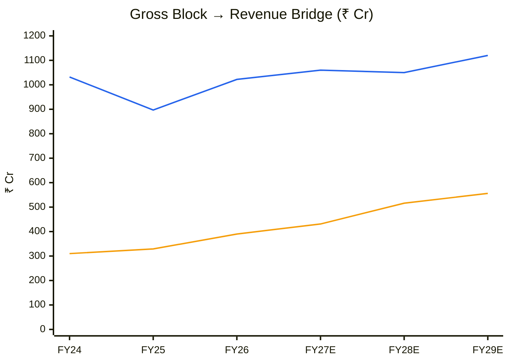
🟦 Revenue (FY26 includes ~₹73 Cr Notedome; FY27E+ ex-Notedome) · 🟧 Tangible PPE gross block (FY27E+ = prior + growth capex incl. ZLD; estimates)

**Read:** The gross block rises ~43% FY26–29E while revenue rises ~10% (vs ex-Notedome FY26), so AT drops toward ~2.0×.

**Business inference:** The next three years are a capital-absorbing phase (Gujarat + ZLD) layered on a still-filling PG line. Returns stay sub-WACC at normal spreads unless systems polyols carry structurally higher margins, which is the one thing worth monitoring.

### Capex-to-Earnings Model (Base, consolidated, ₹ Cr, estimates)
| Metric | FY27E | FY28E | FY29E |
|---|---|---|---|
| Opening Tangible PPE Gross Block | 390 | 431 | 516 |
| Growth capex commissioned | 41 | 85 | 40 |
| Closing Tangible PPE Gross Block | 431 | 516 | 556 |
| AT applied (×, existing assets) | 2.6 | 2.2 | 2.05 |
| Revenue — existing assets | 1,060 | 1,050 | 1,060 |
| Revenue — new assets (Gujarat, greenfield ramp 30%) | 0 | 0 | 60 |
| **Total revenue** | **1,060** | **1,050** | **1,120** |
| EBITDA margin | 14.5% (Q1 ₹83 Cr + ~₹23 Cr/qtr as windfall fades) | 10.0% | 10.7% |
| EBITDA | 153 | 105 | 120 |
| D&A | 36 | 38 | 42 |
| Other income (treasury) | 32 | 30 | 28 |
| EBIT (incl. OI) | 149 | 97 | 106 |
| Interest (incl. lease) | 13 | 12 | 12 |
| ICR (×) | 11.5 | 8.1 | 8.8 |
| Peak debt / normalised EBITDA (×) | 0.5 | 0.6 | 0.5 |
| PAT (25% tax) | 102 | 64 | 71 |
| EPS (₹) | 5.9 | 3.7 | 4.1 |
| ΔWorking capital | +25 (inventory build) | −10 | +10 |
| **FCF** | **~45** | **~−15** | **~20** |

**FCF Inflection Year:** FY30 (post-Gujarat, capex back to maintenance)
**Debt Ceiling Verdict:** Net cash throughout; peak gross debt / EBITDA ≈ 0.6× → within safe zone

### Key Catalysts (3–5)
1. Q2 FY27 results (~mid-Nov-2026): tests whether >20% margins persisted into Jul–Sep (propylene allocation; import flows). **Most likely a negative catalyst.**
2. PG Quality Control Order / anti-dumping action: would raise the import-parity floor (FY27–28; low probability).
3. Gujarat EC/CTE receipt and construction start (FY27).
4. Plant-2 lease renewal by GoTN: removes the EoM overhang (timing unknowable).
5. Use of Singapore cash (special dividend or buyback = positive; overseas acquisition = negative).

### Key Risks (3–5)
1. Windfall unwinds as Hormuz/import flows normalise and Chinese PG/polyol offers return. Probability: **High**.
2. Propylene supply: single source, sovereign override (Mar-2026 precedent). Probability: Medium.
3. Plant-2 lease non-renewal or punitive renewal terms (9 years pending). Probability: Low-Medium; impact High.
4. Capital misallocation of offshore cash (AMCHEM mandate includes "trading, transaction facilitations"). Probability: Medium.
5. ZLD mandate capex (CSIR-NEERI study, Aug-2026) larger than expected. Probability: Medium.

### Scenario Analysis (AT-Driven)
| Scenario | AT Assumption | Revenue FY29E | EBITDA Margin | EPS FY29E | Target Multiple | Target Price | Probability |
|---|---|---|---|---|---|---|---|
| Bull | AT holds ~2.6× (10-yr-type recovery); windfall partly persists; Gujarat on time | ₹1,300 Cr | 14.5% | ₹7.2 | 7× EV/EBITDA + cash | ₹110 | 25% |
| Base | 3-yr avg AT trending to ~2.05×; Gujarat H2 FY29 | ₹1,120 Cr | 10.7% | ₹4.1 | 7×/10× + cash (20% offshore discount) | ₹77 | 50% |
| Bear | Current AT, imports dump (FY24–25 replay); Gujarat deferred | ₹980 Cr | 5.4% | ₹1.3 | 7×/8× + cash | ₹42 | 25% |
| **Expected Value** | | | | | | **₹76.5** | |

**Return from current price (Expected Value):** −9%

**Thesis (one sentence):** A cash-rich, structurally sub-WACC import-substitute producer is enjoying a war-driven windfall that the market is capitalising as permanent. Wait for the windfall to fade and the price to return toward cash plus tangible book (₹55–65) before considering it.
**Monitoring metrics:** quarterly standalone OPM (re-test above/below 12%), propylene allocation status, PG-B utilisation (> 80%?), import-parity data on PG, any ADD/QCO, Singapore cash movements, Plant-2 lease.

---

## Checklist Summary
**Section 0 (Existing Report Protocol):** 3 / 3. Folder searched by ticker and "Manali"; none found; initial report created
**Section A (Business Quality):** 16 / 18. Scuttlebutt beyond IR limited to the CARE rating and trade press ⚠️; Form C search not exhaustive ⚠️
**Section B (Forensics):** 9 / 9
**Section C (Financial Statements):** 12 / 12 (Ind AS 116: lease ₹78.5 Cr added to EV ✅)
**Section D (KPIs & Peers):** 7 / 7 (near-match KPI block, adjusted)
**Section E (Market Size & Share):** 6 / 7. Share history is inconsistent between sources ⚠️
**Section F (Valuation):** 10 / 10
**Section G (Technical Stage):** 7 / 8. Sector index stage not retrieved ⚠️
**Section H (Forward View):** 26 / 31. PO capacity, product-wise volumes and ZLD capex not disclosed; estimates used and labelled ⚠️
**Section I (Charts):** 5 / 5 (C1, C2, C4, C5, C6, C7, C12, C13, C14, CY1, CY2 + ROE, CY4, CY5 ×2, CY6, CY7, Dashboard; pre-save check done: every series length equals its x-axis count, index bases = 100, palettes in order)
**Order Book Tracker:** Not applicable (non-order-driven)
**Hard Stops Triggered:** **Upside/downside 0.62:1 < 1.5:1 → AVOID.** Not triggered: Stage 4 (stock is Stage 2); ROCE < WACC 5+ yrs (4 yrs: FY23–26); pledge (nil); Beneish (−2.15 < −1.78); forensic flags (2); auditor (no resignation).

**Master checklist highlights:** cycle, industry, moat, 10-yr financials, forensics, PIE, DCF/SOTP, technicals and forward view are complete. Sensitivity: ±1pp WACC moves base value by ~₹5. The 10-yr summary sentence: *the decade shows that MPL earns its cost of capital only when imports are blocked (FY21–22, FY27); in every orderly year since FY23 it has accumulated cash and capital without earning returns on it.*

**Pre-buy final check:**
1. *Falsifiability:* the AVOID view is wrong if (a) Q2–Q3 FY27 standalone OPM stays ≥ 15% with imports normalised, (b) a PG ADD/QCO is notified, or (c) a special dividend/buyback returns ≥ ₹200 Cr of Singapore cash.
2. *Inversion (why it could work):* a long West Asia disruption; ADD/QCO; cash return; the Gujarat systems plant at high margins; a strategic sale of the company. Each is low-to-medium probability, and only the cash return is partly priced in.
3. *Circle of competence:* simple spread business ✅.
4. *Asymmetry:* fails (0.62:1; SVAR 50%).
5. *5-year test:* fails. Sub-WACC returns, feedstock sovereign risk, and an expired land lease.
6. *Narrative vs numbers:* "commodity to specialty" narrative vs a specialty share that shrank after the Notedome sale (CARE) → numbers win.
7. *Recency:* normalised margins used ✅.
8. *Confirmation bias:* bull case tested above; no sell-side coverage found.
9. *Crowd:* no analyst consensus; a retail-driven, high-volume breakout. My view (windfall is transient) differs from the price.
10. *Governance:* pledge nil; no SEBI/ED action found; two EoMs; IDs refreshed in 2024–25 (several exits); no new RPT concerns in the Q1 filing.

---

## Investment Decision
**Verdict category:** **AVOID** (hard stop: upside/downside < 1.5:1). Absent the hard stop, it would be "Cheap but Flawed" only below ~₹60.
**Recommendation:** AVOID now; add to watchlist
**Conviction Score:** 3.5 / 10 (Cycle 0.2 · Industry 0.3 · Moat 0.6 · Management 0.5 · Financial/Earnings 1.3 · Valuation/PIE 0.3 · Technical 0.6 · ×0.5 sizing modifier applies: late cycle, sector headwind, SVAR > 30%)
**Suggested Position Size:** 0%
**Buy-below range:** **₹55–65.** At ≤ ₹65 the bull/bear U/D reaches 2:1; at ~₹57 it is ~3:1. That is roughly cash (~₹30) plus PennWhite plus a trough multiple on the Indian plants. A full 50% MoS to base would be ~₹38–45.
**Stop-Loss (for existing holders):** weekly close < ₹66 (30-wk MA / breakout pivot)
**Target Price (FY29 Base):** ₹77 (Bull ₹110 / Bear ₹42)
**Review Trigger:** Q2 FY27 results; PG ADD/QCO notification; propylene allocation change; Plant-2 lease order; any Singapore cash distribution or acquisition.

### Data gaps (attempt again next revision)
- PO installed capacity and product-wise volumes and realisations (not disclosed in AR26 or filings)
- PG/polyol–propylene spread time series (proxy used); India PG import volumes and prices after Apr-2026
- Status of the MoPNG LPG-priority order and the CPCL propylene allocation after Apr-2026; Plant-2 feedstock status after the 20-Apr-2026 "status quo"
- Jun-2026 balance sheet and cash (only Mar-2026 is audited)
- India VIX; Nifty sector index stage
- Trigger for the 31-Aug-2026 breakout week (182.9m shares)
- Anti-dumping status of Saudi/UAE slabstock polyol after 17-Jun-2026 and the China/Thailand outcome
- Gujarat EC/CTE receipt (guided "end Sep-2026"); ZLD capex quantum
- Exhaustive BSE Form C insider-trade search (the BSE API returned Access Denied)
- Cash-flow cross-check against the AR was done for FY25–26; earlier years were checked only for consistency (FY23 acquisition outflow)

---
*Report generated by Stock Fundamental Analysis Skill v3.3 | Indian Markets Context*
*Save path: C:\Users\anubh\Documents\Anubhav\Stock Analysis\Stock Analysis\*
*Sources: Screener.in (MANALIPETC consolidated/standalone; IGPL, TIRUMALCHM, TNPETRO), fetched 12-Oct-2026 · MPL Annual Report 2025-26 (BSE) · Q1 FY27 results dated 13-Aug-2026 (manalipetro.com) · Force Majeure intimations dated 11-Mar-2026 and 20-Apr-2026 · AGM outcome and Chairman's speech dated 28-Sep-2026 · SHP 30-Jun-2026 · CARE Ratings PR dated 04-Mar-2026 · Investor Meet transcript and PPT dated 27-Sep-2024 · Penn Globe acquisition call dated 07-Dec-2022 · Indian Chemical News (14-Aug-2026) · Argaam/ICIS, Argus, S&P Global (2026 petchem disruption) · procurementresource.com (PG price, secondary) · Yahoo Finance weekly prices (MANALIPETC.NS, ^NSEI). All FY27–29 figures are estimates.*
