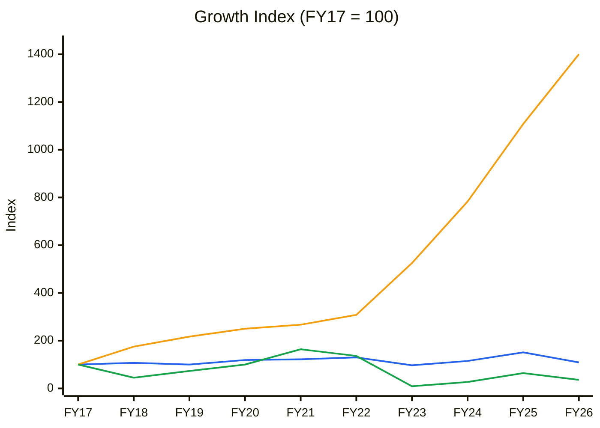
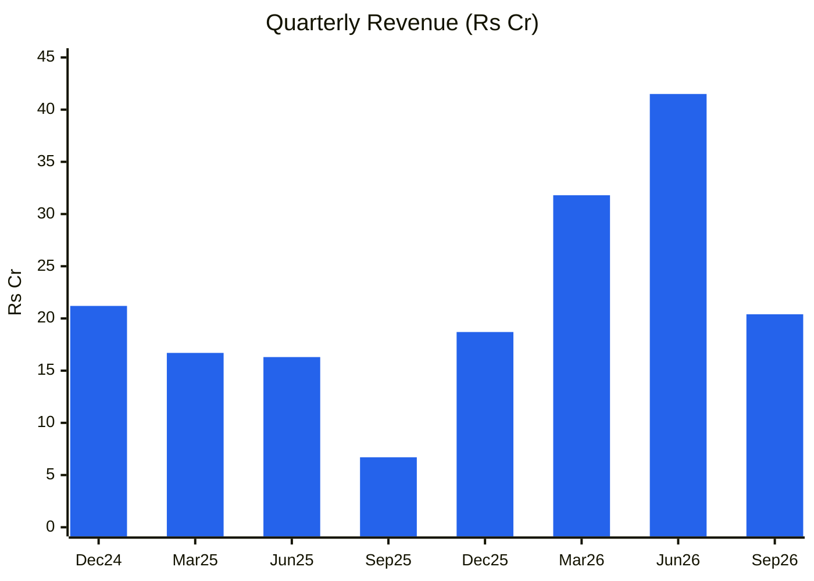

# Stock Analysis Report — Ishan Dyes and Chemicals Ltd (NSE: ISHANCH · BSE: 531109)
**Date:** 2026-10-27
**Analyst:** Claude (Stock Fundamental Analysis Skill v3.3)
**Investment Horizon:** 2–3 Years
**Recommendation:** AVOID (multiple hard stops: repeated auditor qualifications not corrected, integrity veto, Stage 4, upside/downside < 1.5:1)
**Conviction Score:** 1.2 / 10
**CMP:** ₹48.5 (NSE, 27-Oct-2026, Screener.in) · Market cap ₹132 Cr (~2.72 Cr shares, FV ₹10) · 52-wk range ₹41.7–76.5
**Filed under:** Chemicals / Specialty Chemicals · Themes: Specialty chemicals China+1

## Revision Log
| Version | Date | Recommendation | Conviction | Price | Key change |
|---|---|---|---|---|---|
| Current | 2026-10-27 | AVOID | 1.2/10 | ₹48.5 | **Initial report.** Q2 FY27 "profit" of ₹6.2 Cr is largely an accounting artefact: the auditors qualified for the third consecutive period on finished-goods inventory valued above cost (₹8.99 Cr overstatement; PBT ₹6.15 Cr lower if corrected). FY26 was also qualified on an unimpaired ₹14.6 Cr loan to a related party with negative net worth. Stock in Stage 4 |

**Validation of previous report:** Initial report. No earlier report exists (`--find ISHANCH`; name search "Ishan" on 27-Oct-2026).

---

## Executive Summary

Ishan Dyes (Ahmedabad/Vatva, Gujarat; incorporated 1993) makes **copper phthalocyanine (CPC) crude blue and blue pigments** (alpha/beta blue) for inks, paints and plastics, mostly for export, and since Jan-2026 a **450 TPD continuous sulphuric acid plant (Unit 2)** with planned sulphur-based derivatives. It is a ₹132 Cr micro-cap. Revenue has gone nowhere in a decade (₹61 Cr FY16 → ₹73 Cr FY26; peak ₹101 Cr FY25). FY26 net loss ₹7.1 Cr. TTM revenue ₹112 Cr, TTM reported PAT ₹3 Cr.

**Why AVOID (no ambiguity):**
1. **The auditor has refused to sign clean accounts three periods running.** Statutory auditor A R Sulakhe & Co qualified FY26 (31-Mar-2026), the Q1 FY27 limited review and the Q2 FY27 limited review. The reason is finished-goods inventory valued **above cost, contrary to Ind AS 2**. The Q2 FY27 overstatement is **₹8.99 Cr**; correcting it cuts Q2 PBT by **₹6.15 Cr**, turning the reported ₹6.5 Cr PBT into ~₹0.4 Cr. The company has **not adjusted its books** ([Whalesbook, Oct-2026](https://www.whalesbook.com/corporate-news/English/chemicals/Ishan-Dyes-and-Chemicals-Reports-Profit-but-Faces-Auditor-Qualification-on-Inventory/6adf647ac6c6dccbb90797d2)).
2. **Related-party loan:** FY26 was also qualified for a **₹14.60 Cr loan to Cluster Enviro Pvt Ltd**, a related party with **negative net worth and no active business**, carried without impairment ([Whalesbook, FY26](https://www.whalesbook.com/corporate-news/English/bankingfinance/Ishan-Dyes-posts-FY26-net-loss-of-indian-rupee711-crore-auditor-flags-loan-inventory-issues/6a38ea6ae7013304b3d7f9b3)). That is ~10% of reported equity.
3. **Weak economics and leverage:** ROCE 0–4% for four years (FY23–FY26); debt rose to ₹96 Cr (Sep-2026) for the sulphuric-acid capex. Interest of ₹9 Cr TTM exceeds adjusted EBIT, so **adjusted ICR is <1×**. Inventory days are **242**.
4. **Technicals:** Stage 4 (price below a falling 30-week MA); −30% over 52 weeks vs Nifty −11%.

"Cheap" metrics (P/B 0.86×) are illusory. Adjusted for the two qualifications, book value is ~₹46/share (P/adj-BV ~1.05×), and that book still includes ₹27.6 Cr of finished goods whose valuation the auditor disputes.

### C1 — Growth Index: Revenue vs Fixed Assets vs EBITDA (FY17 = 100, standalone)
| ₹ Cr | FY17 | FY18 | FY19 | FY20 | FY21 | FY22 | FY23 | FY24 | FY25 | FY26 | TTM |
|---|---|---|---|---|---|---|---|---|---|---|---|
| Revenue | 67 | 72 | 67 | 80 | 82 | 87 | 65 | 77 | 101 | 73 | 112 |
| Fixed assets + CWIP | 12 | 21 | 26 | 30 | 32 | 37 | 63 | 94 | 133 | 168 | 165 (Sep) |
| EBITDA | 11 | 5 | 8 | 11 | 18 | 15 | 1 | 3 | 7 | 4 | 17 (reported) |
| PAT | 6 | 3 | 4 | 8 | 13 | 10 | −1 | 0 | 1 | −7 | 3 (reported) |

*Source: Screener.in (standalone; rounded ₹ Cr). TTM EBITDA/PAT include the Q2 FY27 inventory overstatement (≈ ₹6 Cr).*

🟦 Revenue · 🟧 Fixed assets + CWIP (×14) · 🟩 EBITDA

**Read:** Fixed assets rose 14× while revenue is roughly where it was in FY17, and EBITDA is a third of FY17's.

**Business inference:** A decade of debt-funded capex has produced no growth and no returns. The sulphuric-acid plant (FY26) must transform the business for any of this capital to earn its cost, and the first quarters of it come with qualified accounts.

---

## Business Primer
Ishan Dyes makes CPC crude blue (from phthalic anhydride, urea and copper salts), converts it into alpha and beta blue pigments, and sells them to ink, paint, plastics and textile customers, largely in export markets (Europe, Asia). Revenue is volume × realisation in a commodity-like pigment market dominated by Chinese and Indian (Vapi/Ahmedabad) producers. Since Jan-2026 it also sells sulphuric acid from a new 450 TPD continuous plant (Unit 2), a bulk commodity with thin, sulphur-price-driven spreads, and plans four sulphur-based derivatives. The business depends on two things: the spread between pigment prices and phthalic/copper/energy costs, and the new acid plant running at high utilisation.

This is a **commodity micro-cap chemical producer** with **governance and accounting red flags**. The value drivers are utilisation and spread; the key risks are Chinese pigment pricing, energy costs, leverage and, above all, **reported numbers that the auditor does not accept**. The promoter stake fell from 47.2% (Mar-2024) to 37.5% (Sep-2025), then rose to 40.15% (Mar-2026, warrant conversion, ~₹28.9 Cr warrant raise).

**New Segment Protocol:** segment covered → "Specialty Chemicals" (pigments are a commoditised specialty sub-segment) ✓; sulphuric acid → commodity chemicals lens.

---

## Modules 1–1c — Cycles
- **Market:** Nifty Stage 4; CAUTIOUS.
- **Sector:** pigments are in a downcycle (Chinese overcapacity, weak European demand). The phthalocyanine blue price cycle is a data gap. Sulphuric acid prices track sulphur (volatile). **Verdict: HEADWIND.**
- **Stock cycle:** revenue erratic (Sep-25 quarter ₹6.7 Cr; Jun-26 ₹41.5 Cr), so no trend can be read. **Classification: Trough / distressed**, with no evidenced reversal (the Q2 FY27 "profit" is not reliable).

### C2 — Quarterly revenue and reported vs adjusted PBT (₹ Cr)
| | Dec-24 | Mar-25 | Jun-25 | Sep-25 | Dec-25 | Mar-26 | Jun-26 | Sep-26 |
|---|---|---|---|---|---|---|---|---|
| Revenue | 21.2 | 16.7 | 16.3 | 6.7 | 18.7 | 31.8 | 41.5 | 20.4 |
| YoY | 46% | −37% | −51% | −78% | −12% | 90% | 155% | 202% |
| Reported PBT | 0.67 | −0.82 | 0.40 | −3.71 | −4.01 | 2.36 | 0.18 | 6.51 |
| PBT adj. for Q2 FY27 qualification | | | | | | | | **0.36** |

🟦 Revenue (Screener quarterly)

**Read:** Revenue swings from ₹7 Cr to ₹42 Cr a quarter; the YoY "growth" of 90–200% comes off a collapsed FY26 base plus new acid sales.

**Business inference:** The volatility is consistent with lumpy export orders and a new commodity product. Q2 FY27 shows 51.5% OPM on expenses of ₹9.9 Cr against ₹20.4 Cr revenue, which is implausible for a pigment/acid producer and consistent with the auditor's inventory finding (inventory build credited through cost of goods sold).

---

## Module 2 — Industry Structure
Pigments: low entry barriers, powerful buyers (global ink/paint majors), Chinese price leadership → **Unattractive**. Sulphuric acid: pure commodity, local markets, freight-limited → **Unattractive**. **Capital cycle:** Chinese pigment capacity oversupplied; Indian producers expanding into acid/derivatives.

## Module 3 — Business Quality & Moat
No moat (Greenwald: none of the three barriers). Buffett test: fail. ROCE 0–4% for four years.
**Fisher score: 15/45.** **Point 15 (Integrity) = 1 → VETO.** Keeping inventory above cost across three audit periods after repeated auditor objections, and carrying an unimpaired related-party loan to a shell-like entity, is a deliberate accounting choice, not an error.

## Module 4 — Management & Capital Allocation
| Check | Finding | Flag |
|---|---|---|
| Promoter stake | 47.2% (Mar-24) → 37.5% (Sep-25) → 40.15% (Mar-26) | ⚠️ Volatile |
| Pledge | Not shown on Screener (verify on BSE; data gap) | ⚠️ |
| **RPT loan** | ₹14.60 Cr to Cluster Enviro Pvt Ltd (related party, negative net worth, no business); no impairment | 🔴 |
| Capital allocation | FA ×14 in a decade; FCF negative 6 of the last 7 years (FY20–FY26: −3, −6, −16, −9, −43, −31, −31) | 🔴 Poor |
| Equity raise | ~₹28.9 Cr warrants (2025) | ⚠️ Dilution |

**WTT:** guidance is sparse. The acid plant was commissioned (Oct-2025 commissioning, Jan-2026 commercial sales) ✅; "four sulphur-based products within three months" pending; FY26 results fell 28% ❌. **WTT ~0.5 (LOW), small sample.** **Three C's: Candour Low (no correction of books), Competence Low, Caring Low.**

## Module 5 — Financial Forensics
| Check | Finding | Flag |
|---|---|---|
| **Auditor qualification (FY26 annual)** | Inventory above cost (FY26 effect ₹2.85 Cr on loss) + unimpaired ₹14.6 Cr RPT loan | 🔴 |
| **Auditor qualification (Q1 FY27 limited review)** | Inventory valuation (repeat) | 🔴 |
| **Auditor qualification (Q2 FY27 limited review)** | ₹8.99 Cr overstatement; PBT −₹6.15 Cr if corrected | 🔴 |
| Inventory days | 187 → 211 → 194 → 206 → **242** (FY22–FY26) | 🔴 |
| Capitalised interest | Screener flags possible interest capitalisation (CWIP ₹71 Cr in FY25) | ⚠️ |
| ICR | Adjusted TTM EBIT ~₹7 Cr vs interest ₹9 Cr → **<1×** | 🔴 |
| CFO vs PAT | CFO/op. profit erratic (−285% to +1,797%) | ⚠️ |
**Beneish/Altman/Piotroski:** not computed. The inputs (inventory, profit) are themselves qualified, so model outputs would be meaningless. **Piotroski on reported FY26 numbers ~2/9 (ROA <0, ΔROA <0, leverage up, dilution, margin down).**
**Forensic red-flag count: ≥5 unresolved.** **Verdict: AVOID (earnings quality "Concerning").**

## Module 5 (cont.) — Adjusted Balance Sheet (Sep-2026)
| ₹ Cr | Reported | Adjustment | Adjusted |
|---|---|---|---|
| Net worth | 148 | −8.99 (inventory) −14.60 (RPT loan, full provision) | **~124.5** |
| Book value/share | ₹54.4 | | **~₹45.8** |
| Borrowings | 96 | | 96 |
| Net D/E | 0.65 | | **~0.77** |

**DuPont:** ROE −5.8% (FY26), ~2% TTM reported (negative adjusted). Driven by margin collapse plus rising leverage. **The financial-engineering pattern applies:** leverage rose while operations deteriorated.

## Module 6 — KPIs & Peers (Specialty Chemicals block, pigment sub-set)
| KPI | Ishan | Healthy | Assessment |
|---|---|---|---|
| EBITDA margin | 5% (FY26); TTM 16% reported, ~10% adjusted | 15–25% | 🔴 |
| Capacity utilisation (pigments/acid) | Not disclosed (data gap) | >75% | ⚠️ |
| Export share | Majority (not quantified) | — | ⚠️ |
| Working-capital days | Inventory 242 days | <120 | 🔴 |
Pigment peers (Sudarshan Chemical, Bodal Chemicals in the library, Asahi Songwon, Vidhi Specialty) trade at higher multiples with clean audits. **No peer comparison changes the verdict**: an audit qualification is disqualifying regardless of relative value.

## Module 7 — Market Size & Share
Global phthalocyanine blue pigment market ~US$1–1.5 bn (estimate; data gap). Ishan's share is negligible (<1%) and has not grown in a decade.

## Module 8 — Valuation
- **PIE:** not meaningful (reported NOPAT ≈ 0 to negative on an adjusted basis). EV ≈ ₹132 Cr + ₹96 Cr debt ≈ ₹228 Cr for ~₹11 Cr adjusted TTM EBITDA (≈ **21× EV/EBITDA**): **expensive**, not cheap.
- **Scenarios (FY29):**

| Scenario | Basis | Value/share | Probability |
|---|---|---|---|
| Bull | Acid + derivatives work; revenue ₹190 Cr, EBITDA 14%, EPS ₹3.5 × 15× | **₹52** | 20% |
| Base | Stagnation; 0.8× adjusted BV (~₹46) | **₹37** | 50% |
| Bear | Further write-downs / dilution; 0.5× adjusted BV | **₹23** | 30% |
| **Expected value** | | **₹36 (−26%)** | |

- **Upside/downside:** (52 − 48.5) ÷ (48.5 − 23) = **0.14:1** → **hard stop (<1.5:1).**
- **Graham Number:** not applicable (negative normalised EPS).

### Cycle Position Dashboard
| Dimension | Current | History | Signal |
|---|---|---|---|
| P/B (reported / adjusted) | 0.86× / ~1.05× | — | Not cheap after adjustments |
| EBITDA margin | ~10% adj. TTM | 1.8–22% (10 yrs) | Trough-to-mid |
| ROCE | ~1% | 0–33% (10 yrs) | Trough |
| **Overall** | | | **Trough with broken accounting** |

## Module 9 — Technical Stage
**Stage 4.** Price ₹48.9 vs 30-week MA ₹53.8, MA falling (₹60.9 → ₹57.2 → ₹54.9 → ₹53.8). 52-wk −29.5% vs Nifty −11%; 26-wk −21.5%. Volume dried up (20–90k shares a week; illiquid). **CANSLIM 0/7.**

## Module 10 — Forward View
Unit 2 (sulphuric acid, 450 TPD, ~₹100 Cr capex) is the only growth lever. At full utilisation, 450 TPD × 330 days ≈ 1.5 lakh tonnes a year; at ₹6,000–10,000 per tonne (sulphur-cycle dependent) that is ₹90–150 Cr of revenue at thin spreads. It cannot repair the balance sheet quickly, and its numbers will be reported inside accounts the auditor disputes.
**Catalysts that would change the view:** an unqualified audit (restated inventory, provision on the RPT loan), new independent directors / auditor-committee action, and two clean quarters of acid-plant profits.
**Risks:** further qualifications or auditor resignation (**Medium-High**), lender stress (ICR <1×) (**Medium**), dilution (**High**), SEBI/exchange action on financial-statement accuracy (**Low-Medium**).

## Checklist Summary
**Hard stops triggered:** (1) Fisher Point 15 integrity veto; (2) earnings quality "Concerning" (repeated qualified opinions); (3) forensic red flags ≥3 unresolved; (4) Stage 4 with a declining 30-week MA; (5) upside/downside 0.14:1 (<1.5:1); (6) ROIC < WACC for 4+ years with no credible turnaround evidence.
Section 0 5/5 · A 12/18 · B 6/9 (models not meaningful on qualified data) · C 6/12 · D 4/7 · E 3/7 · F 6/10 · G 7/8 · I 4/5 (CY1/CY4 not meaningful: negative/qualified EPS).

## Investment Decision
**Recommendation:** **AVOID**
**Conviction Score:** 1.2 / 10 (Cycle 0.1 · Industry 0.1 · Moat 0.1 · Management 0.0 · Financial quality 0.1 · Valuation 0.3 · Technical 0.5; the technical score reflects only that the stock is already well off its highs)
**Position size:** 0%. Existing holders: exit (Stage 4 hard exit plus integrity veto).
**Review trigger:** only an **unqualified** audit opinion plus a resolution of the Cluster Enviro loan would justify re-analysis.

### Sources
- Screener.in [ISHANCH standalone](https://www.screener.in/company/ISHANCH/) (10-yr financials, quarterly results, ratios, shareholding; 27-Oct-2026).
- Auditor qualifications: [Whalesbook Q2 FY27](https://www.whalesbook.com/corporate-news/English/chemicals/Ishan-Dyes-and-Chemicals-Reports-Profit-but-Faces-Auditor-Qualification-on-Inventory/6adf647ac6c6dccbb90797d2) · [Whalesbook FY26 (loan + inventory)](https://www.whalesbook.com/corporate-news/English/bankingfinance/Ishan-Dyes-posts-FY26-net-loss-of-indian-rupee711-crore-auditor-flags-loan-inventory-issues/6a38ea6ae7013304b3d7f9b3) · [Whalesbook FY26 qualified opinion](https://www.whalesbook.com/corporate-news/English/bankingfinance/Ishan-Dyes-Posts-FY26-Net-Loss-of-indian-rupee711-Cr-Faces-Qualified-Audit-Opinion/6a18518e0c0232fe81aa3254). *Primary BSE filings were not retrieved; verify the exact qualification wording on BSE (531109).*
- Acid plant: [HDFC Sky](https://hdfcsky.com/news/ishan-dyes-and-chemicals-begins-commissioning-for-new-csa-plant) · [Investment Guru India](https://investmentguruindia.com/newsdetail/ishan-dyes-zooms-on-starting-activities-for-production-of-four-additional-sulphur-based-products590335).
- Prices: Yahoo Finance weekly API (ISHANCH.NS, ^NSEI), 27-Oct-2026.

---
*Report generated by Stock Fundamental Analysis Skill v3.3 | Indian Markets Context*
*Save path: C:\Users\anubh\Documents\Anubhav\Stock Analysis\Stock Analysis\Chemicals\Specialty-Chemicals\*
