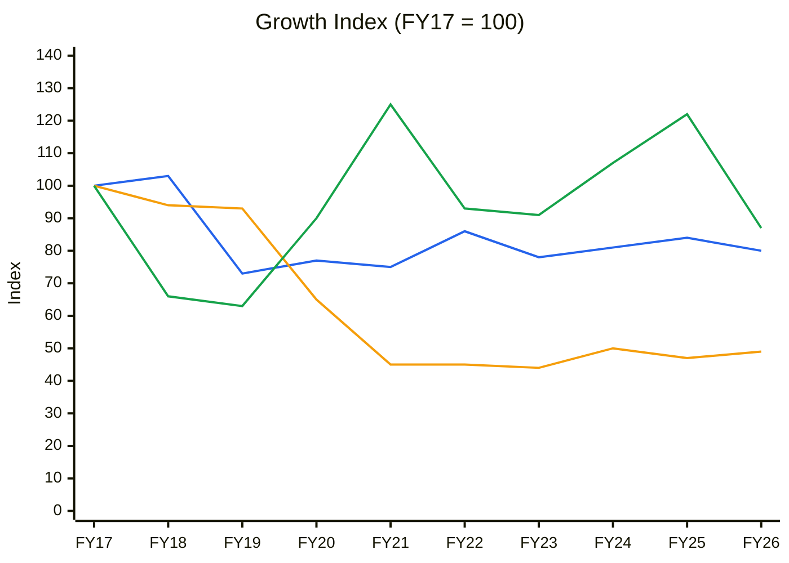
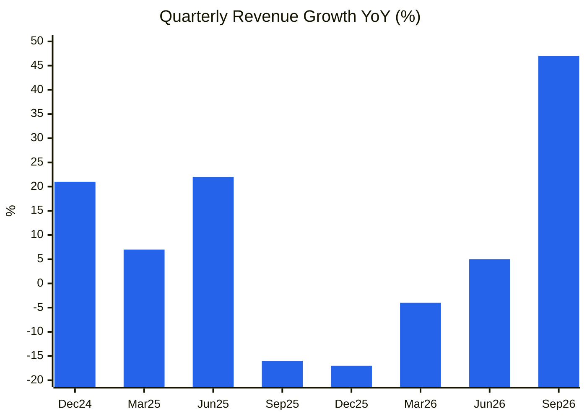
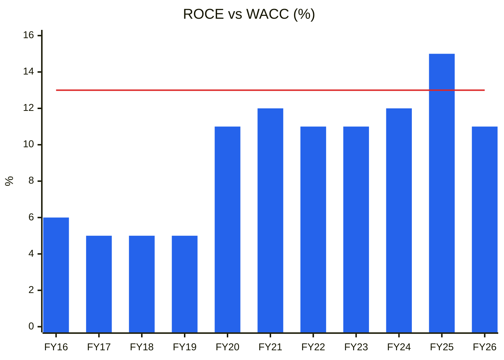
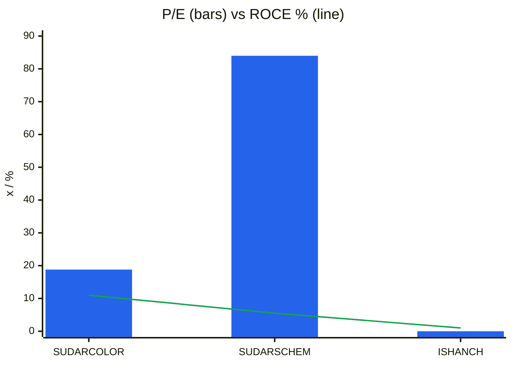
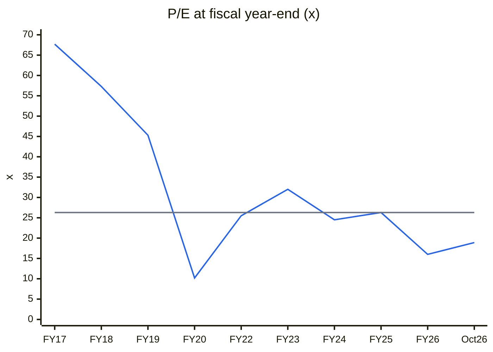
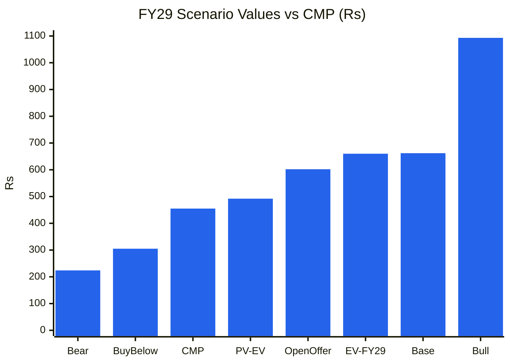

# Stock Analysis Report — Sudarshan Colorants India Ltd (formerly Heubach Colorants India / Clariant Chemicals India; NSE: SUDARCOLOR · BSE: 506390)
**Date:** 2026-10-29
**Analyst:** Claude (Stock Fundamental Analysis Skill v3.3)
**Investment Horizon:** 2–3 Years
**Recommendation:** WATCHLIST: Quality at Wrong Price, moderate quality (buy-below ~₹305). The Q2 FY27 step-up needs one more quarter of proof
**Conviction Score:** 5.3 / 10
**CMP:** ₹455 (NSE, 29-Oct-2026 morning, Screener.in; ~₹458 on Yahoo) · Market cap ₹1,050 Cr (2.31 Cr shares, FV ₹10) · 52-wk range ₹268–504 · Parent's open-offer price (Oct-2025): **₹602.03**
**Filed under:** Chemicals / Specialty Chemicals · Themes: Specialty chemicals China+1

## Revision Log
| Version | Date | Recommendation | Conviction | Price | Key change |
|---|---|---|---|---|---|
| Current | 2026-10-29 | Watchlist: Quality at Wrong Price (buy-below ~₹305) | 5.3/10 | ₹455 | **Initial report.** Clean, net-cash, ex-MNC pigment maker, now 70% owned by Sudarshan Chemical after the Heubach acquisition. Q2 FY27 revenue jumped 47% (₹270 Cr) and PAT 48% (₹24 Cr). If sustained, the stock trades at ~12× FY27E. But ten years of flat-to-declining revenue, single-digit-to-low-teens margins, no management guidance or concalls, and fresh related-party dependence on the parent make the step-up unproven. PV of expected value ₹492 vs CMP ₹455 → MoS ~8% |

**Validation of previous report:** Initial report. No earlier report in the library (`--find SUDARCOLOR` / HEUBACHIND; name search "Sudarshan"; Sudarshan appears only as a peer in the BODALCHEM and ISHANCH reports).

> **Identity note:** this is **not** Sudarshan Chemical Industries (NSE: SUDARSCHEM, the ₹8,500 Cr parent). It is the listed Indian subsidiary: Colour-Chem (1956) → Clariant Chemicals (India) → Heubach Colorants India (2022) → **Sudarshan Colorants India** (name effective Dec-2025; NSE symbol HEUBACHIND → SUDARCOLOR, Jan-2026).

---

## Executive Summary

Sudarshan Colorants India makes **organic and inorganic high-performance pigments and pigment preparations** for paints, coatings, plastics and inks: the former Clariant India pigments business. Clariant sold its global pigments unit to Heubach/SK Capital in 2022. Heubach went insolvent in 2024, and **Sudarshan Chemical Industries bought Heubach's global pigment business (₹1,180 Cr, closed Mar-2025)**, which triggered a mandatory open offer for this Indian entity. Sudarshan Europe B.V. bought 15.89% at **₹602.03/share** (Oct-2025), lifting promoter holding to **70.26%**.

**Q2 FY27 (Sep-2026, standalone):** revenue **₹270 Cr (+47% YoY; +22% QoQ)**, EBITDA ₹34 Cr (12.6%), PAT **₹24.1 Cr (+48%)**. H1 FY27 revenue ₹492 Cr (+25%), PAT ₹44 Cr. TTM PAT ₹56 Cr (EPS ₹24.1). The balance sheet is effectively debt-free (₹22 Cr borrowings) with ~₹127 Cr of investments (Sep-2026) plus cash.

**What's attractive:**
- **Valuation if Q2 is the new run-rate:** ₹270 Cr/quarter at ~12% EBITDA implies FY27E EPS ~₹37, about **12× P/E**, at a 24% discount to the price the parent paid a year ago.
- **Strategic role:** inside Sudarshan + Heubach (now the world's #3 pigment maker), the Indian plants could become a low-cost manufacturing hub for the group's global customers (China+1 for pigments).
- **Clean history of capital returns:** large special dividends after earlier divestments (FY16 and FY21 financing outflows of ₹799 Cr and ₹474 Cr).

**What holds it back:**
1. **Ten-year record is poor:** revenue fell from ₹1,140 Cr (FY16) to ₹781 Cr (FY26), partly through divestments. EBITDA margin was 4–12%; ROCE 5–15%; 10-yr ROE ~7%.
2. **The Q2 jump is unexplained.** No concall or presentation exists. Possible drivers are group sourcing (related-party sales to the Sudarshan/Heubach network), a fire-related catch-up (a plant fire with pending insurance claims, per Whalesbook), or genuine demand. **One quarter is not a trend.**
3. **Minority-shareholder position:** a 70%-owned subsidiary of a parent that is itself highly leveraged (parent ROCE ~5%, borrowings ₹2,473 Cr). Transfer pricing, product allocation and any future merger swap ratio are decided by the parent. A director resigned on 28-Oct-2026 (reason not retrieved).
4. **MoS:** the PV of the probability-weighted value (₹492) is only ~8% above CMP. Upside/downside 2.8:1 is good, but the MoS gate fails.

**Technicals:** a Stage 1 → 2 breakout this week (₹362 → ₹458 on ~7× volume) through a 7-month base (₹268–400), with the 30-week MA turning up. Positive, but on thin liquidity (~45k shares a week).

### C1 — Growth Index: Revenue vs Fixed Assets vs EBITDA (FY17 = 100, standalone)
| ₹ Cr | FY17 | FY18 | FY19 | FY20 | FY21 | FY22 | FY23 | FY24 | FY25 | FY26 | TTM |
|---|---|---|---|---|---|---|---|---|---|---|---|
| Revenue | 981 | 1,014 | 719 | 757 | 731 | 840 | 766 | 791 | 825 | 781 | 879 |
| Fixed assets + CWIP | 353 | 333 | 330 | 230 | 159 | 158 | 154 | 176 | 165 | 173 | 172 (Sep) |
| EBITDA | 67 | 44 | 42 | 60 | 84 | 62 | 61 | 72 | 82 | 58 | 76 |
| PAT | 24 | 22 | 19 | 51 | 220* | 43 | 19 | 41 | 51 | 45 | 56 |

*Source: Screener.in standalone. \*FY21 PAT includes a large divestment gain (masterbatch/business sale), followed by a ₹474 Cr payout. FY19 and FY20 revenue declines reflect business divestments under Clariant.*

🟦 Revenue · 🟧 Fixed assets + CWIP · 🟩 EBITDA

**Read:** Revenue is 20% below FY17 and fixed assets have halved (divestments), while EBITDA has oscillated around the FY17 level.

**Business inference:** Under Clariant and then Heubach, this entity was managed for cash, not growth: businesses were sold, cash returned, and capacity not added. That makes the Q2 FY27 step-up (TTM revenue +13% vs FY26) the first sign of a different strategy under Sudarshan. It needs confirmation because the asset base has not grown to support a permanently higher run-rate (capacity utilisation is not disclosed).

---

## Business Primer
The company makes coloured pigments (organic azo and high-performance pigments, inorganic pigments) and ready-to-use pigment preparations (dispersions for paints and coatings, plastics, inks and textiles), mostly at its Roha (Maharashtra) and other Indian sites, selling to paint majors (Asian Paints, Berger, Kansai-type customers), plastics and masterbatch makers, ink makers and, increasingly, the parent's global network for export. Revenue is volume × realisation per kg; realisation follows product mix (high-performance pigments earn far more than classical azo) and raw-material pass-through. It depends on two things: **technical approvals with paint/plastic customers** (colour matching, regulatory compliance such as REACH, heavy-metal-free), which create stickiness, and **access to the parent's global customers and technology**, which now decides its growth.

This is a **mid-tier specialty-chemicals (pigments) manufacturer inside a multinational group**. The value drivers are volume (now likely group-driven) and mix (high-performance pigments). The key risks are Chinese pigment price competition, raw-material swings (crude-derived intermediates), and **parent-subsidiary conflicts**. Two structural features colour everything. First, the history mixes divestments and special payouts, so the earnings series is noisy and EPS spikes (FY21) are one-offs. Second, a parent that paid ₹602/share for control and that may one day merge or delist this entity: a potential (unanalysed) special-situation angle.

**New Segment Protocol:** segment covered → "Specialty Chemicals" block (pigments as a sub-segment) ✓. The detailed pigment benchmark (Sudarshan, Heubach) is the parent group itself.

---

## Module 1 — Market Cycle
Nifty 50 ~22,750, Stage 4 (below a falling 30-week MA); 1-yr −11%. **CAUTIOUS.** The stock is −8% over 52 weeks (+21% over 26 weeks).

## Module 1b — Sector Cycle
**Secular:** India paint/coatings demand (~10–12% a year), plastics, and China+1 pigment sourcing (EU/US buyers diversifying from China); REACH-compliant, heavy-metal-free pigments favour MNC-heritage producers.
**Cyclical / headwinds:** Chinese overcapacity has kept classical pigment prices weak since 2023; European demand (Heubach's legacy market) is soft; crude-linked intermediates are volatile.
**Group integration (company-specific, structural if real):** Sudarshan is consolidating Heubach's global portfolio and can move production of selected pigments to Indian plants (lower cost). That would show up as higher related-party export sales.
**Verdict: NEUTRAL** (sector headwind offset by a group-integration tailwind). MoS +5pp.

## Module 1c — Stock Cycle
### C2 — Quarterly YoY revenue growth (standalone)
| | Dec-24 | Mar-25 | Jun-25 | Sep-25 | Dec-25 | Mar-26 | Jun-26 | Sep-26 |
|---|---|---|---|---|---|---|---|---|
| Revenue (₹ Cr) | 213 | 220 | 211 | 183 | 176 | 211 | 222 | 270 |
| YoY | 21% | 7% | 22% | −16% | −17% | −4% | 5% | 47% |
| OPM | 12% | 8% | 12% | 10% | 6% | 2.1% | 12% | 13% |

🟦 YoY revenue growth (Screener quarterly)

**Read:** Three quarters of decline (Sep-25 to Mar-26, including a 2.1% OPM quarter, possibly the plant fire) were followed by +5% and then **+47%**.

**Business inference:** Part of the +47% is base effect (Sep-25 was −16%). Against the two-year-ago quarter (Sep-24: ₹218 Cr) growth is +24%, still a clear step-up. Whether it holds depends on undisclosed drivers. **Accelerating, but from a depressed base.**

### Operating leverage
Fixed-cost-heavy plants: OPM swings from 2% to 13% on ±20% revenue moves. **DOL ≈ 3–4×.** If revenue holds at ₹1,000 Cr+, OPM could sustain 12–14%.

### FCF / capital
FY26 CFO ₹34 Cr, FCF ₹6 Cr (working capital rose: inventory days 100 → 120). FY24–25 FCF ₹78 Cr and ₹100 Cr. Capex is modest (~₹20–40 Cr a year). **No dividend since FY22** (payout 0%), despite net cash: cash is accumulating (investments ₹4 Cr → ₹127 Cr by Sep-2026).

### CY7 — ROCE vs history
| | FY16 | FY17 | FY18 | FY19 | FY20 | FY21 | FY22 | FY23 | FY24 | FY25 | FY26 |
|---|---|---|---|---|---|---|---|---|---|---|---|
| ROCE | 6% | 5% | 5% | 5% | 11% | 12% | 11% | 11% | 12% | 15% | 11% |

🟦 ROCE (Screener standalone) · 🟥 WACC ~13%

**Read:** ROCE improved from ~5% (FY16–19) to 11–15% (FY20–26) after divestments shrank the capital base, but it has only once exceeded the cost of capital.

**Business inference:** This is a business earning roughly its cost of capital. A sustained Q2-level run-rate (TTM-to-FY27E EBITDA ~₹115 Cr on ~₹600 Cr capital employed) would lift ROCE to ~18%, the first genuine value creation in a decade. **The thesis hinges on that.**

**Cycle classification: Trough → early recovery.** Margins are recovering from a 2% trough quarter; the evidence is one quarter old. MoS widest band.

## Module 2 — Industry Structure
| Force | Pigments | Signal |
|---|---|---|
| New entrants | Medium (Indian/Chinese capacity is easy to build; HPP technology and approvals are harder) | ⚠️ |
| Supplier power | Medium (crude-derived intermediates; some China-sourced) | ⚠️ |
| Buyer power | **High** (paint majors concentrated; global ink/plastics buyers) | 🔴 |
| Substitutes | Low | ✅ |
| Rivalry | High (China; Sudarshan, Heubach, DIC/Sun Chemical, BASF Colors (now DIC), Clariant legacy) | 🔴 |
**Verdict: NEUTRAL-to-UNATTRACTIVE**, better in high-performance pigments. **Capital cycle:** consolidation phase (Sudarshan–Heubach, DIC–BASF colors), which is typically good for survivors.

## Module 3 — Business Quality & Moat
- **Greenwald:** **customer captivity (approvals/colour matching)** is moderate; **scale** now via the group (#3 globally with Heubach). No standalone cost advantage evident.
- **Buffett 10% test:** fail (margins collapsed in 2025–26).
- **Moat: NARROW** (product approvals plus group technology).

| Fisher # | Score | | Fisher # | Score |
|---|---|---|---|---|
| 1 Market potential | 2 | | 9 Mgmt depth | 2 |
| 2 New products | 2 (group pipeline) | | 10 Controls | 3 (MNC heritage) |
| 3 R&D | 2 | | 11 Industry advantage | 2 |
| 4 Sales | 2 | | 12 Long-range | 2 |
| 5 Margin | 1 | | 13 Dilution | 3 (none) |
| 6 Margin actions | 2 | | 14 Candour | 1 (no calls, no guidance) |
| 7 Labour | 2 | | 15 **Integrity** | **2** (Pass; parent-control conflict risk) |
| 8 Exec relations | 2 | | **Total** | **30 / 45** |

## Module 4 — Management & Capital Allocation
**Promoter:** Sudarshan Europe B.V. and Sudarshan Chemical Industries (PACs) **70.26%** (up from 54.37% after the Oct-2025 open offer; an internal 15.89% transfer between group entities in Oct-2026). **Pledge: none reported** (verify; data gap). Public 29.1%; FIIs/DIIs <1%.

| Check | Finding | Flag |
|---|---|---|
| Parent leverage | Sudarshan Chemical (parent): borrowings ₹2,473 Cr, ROCE ~5%, P/E ~84× (Screener) | ⚠️ Incentive to extract cash/upstream |
| RPT | Expected to rise (sales to/purchases from Sudarshan/Heubach entities). The FY26 RPT note was not retrieved | ⚠️ Data gap; the critical diligence item |
| Dividends | Nil FY22–FY26 despite net cash | ⚠️ Cash trapped at the subsidiary |
| Open offer | ₹602.03/share (Oct-2025) | Reference value for minorities |
| Governance events | Director resignation 28-Oct-2026 (reason not retrieved); pending fire insurance claims | ⚠️ |
| Disclosure | No concalls, no investor presentations | 🔴 Low transparency |

**Capital allocation (10-yr):** good at *returning* cash (special dividends FY16 and FY21), poor at *growing* the business. **Rating: Average.**
**WTT:** **not assessable**: the company gives no guidance (selective disclosure pattern). **Credibility: MODERATE by default (no track record).**

## Module 5 — Financial Forensics
| Check | Finding | Flag |
|---|---|---|
| Pledge / ICDs | None found | ✅ |
| Revenue quality | Debtor days 68 → 84 (FY25 → FY26); inventory days 100 → 120 | ⚠️ |
| Other income | Interest on surplus cash (~₹15–25 Cr estimated, data gap); a material share of PBT | ⚠️ |
| One-offs | FY21 divestment gain; fire-related costs and insurance claims (timing distorts quarters) | ⚠️ |
| Audit | Auditor/KAMs not retrieved | ⚠️ |
| Debt | ₹22 Cr; net cash | ✅ |
**Quant (FY26 vs FY25):** Altman Z'' **~4.5 (Safe)**; Piotroski **5/9**; Sloan CF accrual (45 − 34 + 73)/avg TA 782 = **10.7%** (borderline, driven by investments into FDs/securities). Beneish not computed (no gross-margin data).
**Unresolved red flags: 1** (RPT exposure to the parent, data gap). **Verdict: Clean to minor concerns.**

## Module 5 (cont.) — Earnings Quality
- **Cumulative FY17–FY26:** PAT ₹535 Cr (₹315 Cr ex-FY21 one-off) vs CFO ₹557 Cr → **CFO/PAT ~1.8× ex one-offs.** Earnings are cash-backed.
### DuPont (3-factor, standalone, year-end equity)
| Year | Net margin | Asset turnover | Equity multiplier | ROE |
|---|---|---|---|---|
| FY22 | 5.1% | 1.32 | 1.54 | 10.4% |
| FY23 | 2.5% | 1.16 | 1.53 | 4.4% |
| FY24 | 5.2% | 1.09 | 1.54 | 8.7% |
| FY25 | 6.2% | 1.09 | 1.45 | 9.8% |
| FY26 | 5.8% | 0.97 | 1.41 | 7.9% |
**Verdict:** ROE is constrained by **low margins and falling asset turnover** (the cash build depresses AT). No leverage. Operating ROE excluding surplus cash is ~10–12%.

## Module 6 — KPIs & Peers
| KPI (Specialty Chemicals) | SCIL India | Healthy | Assessment |
|---|---|---|---|
| EBITDA margin | 7% FY26; 12.6% Q2 FY27 | 15–25% | 🔴 Below (improving) |
| Revenue growth | 1% (5-yr CAGR); +47% Q2 | >15% | ⚠️ |
| ROCE | 11% | >18% | 🔴 Below |
| Working capital days | 70 | <90 | ✅ |
| Net debt/EBITDA | Net cash | <1.5× | ✅ |
| Export share | Not disclosed (data gap) | Rising | ⚠️ |

| Metric | Sudarshan Colorants India | Sudarshan Chemical (parent) | Ishan Dyes |
|---|---|---|---|
| Market cap (₹ Cr) | 1,050 | 8,513 | 132 |
| TTM revenue (₹ Cr) | 879 | 9,922 | 112 |
| OPM | 9% (12.6% Q2) | 7% | 16% reported (qualified) |
| ROCE | 11% | 5.5% | ~1% |
| Net debt | Net cash | ₹2,473 Cr borrowings | ₹96 Cr |
| P/E (TTM) | **18.8** | 84 | n.m. |
| P/B | 1.7 | 2.4 | 0.86 |
*Screener.in, 27–29-Oct-2026. Other listed pigment peers (Asahi Songwon, Vidhi Specialty, Bodal's pigment arm) not refreshed (data gap).*

🟦 P/E TTM (Ishan n.m., shown as 0) · 🟩 ROCE (%). *Only three comparable points; shown for scale.*

**Read:** the Indian subsidiary trades at under a quarter of its parent's P/E, with double the ROCE and no debt.

**Business inference:** the market values the parent on the Heubach integration story and the subsidiary as a stagnant ex-MNC unit. If the group routes growth through the subsidiary (Q2 hints at this), the valuation gap is an opportunity. If growth is booked in the parent and the subsidiary stays a cost-plus supplier, the gap persists.

## Module 7 — Market Size & Share
India pigments ~₹15,000–20,000 Cr (estimate; data gap); global pigments ~US$25–30 bn. Company share in India ~5% (estimate). The 5-yr trend is losing share (revenue CAGR 1% vs market ~8–10%); Q2 FY27 may mark a reversal.

## Module 8 — Valuation
### 8A. PIE
EV ≈ ₹1,050 Cr − ~₹150 Cr net cash (investments ₹127 Cr + cash, estimate) ≈ **₹900 Cr**. EV/EBITDA TTM **11.8×**; P/E TTM 18.8×; P/B 1.7×.
NOPAT TTM ≈ (76 − 20 D&A) × 0.75 ≈ ₹42 Cr → EV/NOPAT ~21×. At WACC 13%, a no-growth value is ~₹325 Cr EV. **The price implies ~8–10% growth for a decade with margins at 10–12%**, below what Q2 shows but well above the 10-year record. **Roughly fairly priced on the improved run-rate; optimistic on history.**
**Triggers (+):** Q3 FY27 revenue ≥ ₹250 Cr at ≥12% OPM; disclosed group-sourcing contracts; dividend resumption; parent merger/delisting proposal at a premium (the ₹602 open-offer price is a reference). **Triggers (−):** revenue back to ~₹200 Cr/quarter; adverse RPT pricing; further director exits.
**SVAR:** bear ₹224 → **51%** (unfavourable on its own).

### 8B. Scenarios (FY29E; 2.31 Cr shares)
| Scenario | Revenue FY29 | EBITDA % | EPS FY29 | P/E | Target | Prob. |
|---|---|---|---|---|---|---|
| Bull | ₹1,400 Cr (group hub; HPP mix) | 13.5% | ₹60.7 | 18× | **₹1,093** | 25% |
| Base | ₹1,200 Cr (Q2 run-rate holds, +9%/yr) | 11.5% | ₹44.2 | 15× | **₹662** | 50% |
| Bear | ₹850 Cr (Q2 one-off; reverts to FY26 level) | 7% | ₹18.7 | 12× | **₹224** | 25% |
| **Expected value** | | | | | **₹660 (+45%)** | |
*D&A ~₹20 Cr, other income ~₹20 Cr, interest ~₹2 Cr, tax 25%. Net cash (~₹65/share) is not added separately: its income is in EPS.*
- **PV** (2.4 yrs @ 13%) = **₹492** (+8%); base PV ₹494.
- **Upside/downside:** (1,093 − 455) ÷ (455 − 224) = **2.8:1** ✅.
- **Required MoS:** small-cap, parent-controlled, low disclosure → 40% → **buy-below ≈ ₹492 × 0.62 ≈ ₹305** (≈8× FY27E EPS if Q2 holds; ≈1.1× book).
- **DCF cross-check** (base revenue path, 11% EBITDA, WACC 13%, g 5%): ~₹450–520. **Graham Number:** √(22.5 × 24.1 × 266) = **₹379**.

### CY1 — P/E at fiscal year-end (standalone EPS)
| | FY17 | FY18 | FY19 | FY20 | FY22 | FY23 | FY24 | FY25 | FY26 | Oct-26 |
|---|---|---|---|---|---|---|---|---|---|---|
| Price (₹) | 718 | 536 | 364 | 225 | 478 | 266 | 436 | 586 | 309 | 455 |
| EPS (₹) | 10.6 | 9.4 | 8.0 | 22.0 | 18.8 | 8.3 | 17.8 | 22.3 | 19.3 | 24.1 (TTM) |
| P/E (×) | 67.7 | 57.3 | 45.3 | 10.2 | 25.5 | 32.0 | 24.5 | 26.3 | 16.0 | 18.9 |
*FY21 excluded (one-off divestment EPS). Prices: Yahoo Finance weekly closes (FY17–FY19 prices predate the FY21 special payout).*

🟦 P/E · ⬜ median (26.3×)

**Read:** today's 18.9× is below the 9-point median (26.3×) and near the FY26 low (16×).

**Business inference:** the multiple has de-rated as the market stopped paying a "Clariant MNC" premium. If Q2-level earnings hold, the forward P/E (~12×) would be at the cheapest end of its history. That is the core of the opportunity, and it depends entirely on sustainability.

### C13 — Scenario values vs CMP

🟦 ₹ per share

**Read:** CMP sits below the discounted expected value (₹492) and well below the parent's ₹602 open-offer price.

**Business inference:** the skew is favourable (2.8:1), but the margin of safety is thin. This is a "pay fair value for an unproven step-up" situation, not a deep-value one.

### Cycle Position Dashboard
| Dimension | Current | History | Signal |
|---|---|---|---|
| P/E | 18.9× (TTM); ~12× FY27E if Q2 holds | 10–68× | Cheap-to-fair |
| P/B | 1.7× | — | Fair (ROE ~9%) |
| EBITDA margin | 12.6% (Q2) / 9% TTM | 2–13% | Mid (recovering) |
| ROCE | 11% | 5–15% | Mid |
| **Overall** | | | **Early recovery** |

## Module 9 — Technical Stage
**Nifty: Stage 4.** **Stock: Stage 1 → 2 breakout (this week).**
| Check | Evidence |
|---|---|
| Base | ₹268–400 (Mar–Oct 2026), ~30 weeks |
| Breakout | ₹362 → ₹458 (week of 26-Oct; results 28-Oct) |
| Volume | ~102k shares this week vs ~45k average (**~2.3× and rising; thin absolute liquidity**) |
| 30-week MA | ₹373, turning up (₹377 20 weeks ago → ₹359 10 weeks ago → ₹364 → ₹373) |
| RS | 26-wk +21% vs Nifty −6%; 52-wk −8% vs −11% |
| Resistance | ₹504 (52-week high, Oct-2025 post-offer), then ₹602 (offer price) |
**Stop:** weekly close below ₹400. **CANSLIM:** C 1 (EPS +48%) · A 0 · N 1 (new owner; breakout) · S 1 (small float ~68 lakh public shares) · L 0 · I 0 · M 0 → **3/7**.
**Verdict:** an emerging Stage 2 on a single result. **Wait for a weekly close above ₹504 or a retest-and-hold of ₹400–420.**

## Module 10 — Forward View
| ₹ Cr | FY27E | FY28E | FY29E |
|---|---|---|---|
| Revenue | 1,010 | 1,100 | 1,200 |
| EBITDA (11.5–12%) | 116 | 128 | 138 |
| PAT | 85 | 94 | 102 |
| EPS (₹) | 36.8 | 40.7 | 44.2 |
| P/E at CMP | 12.4× | 11.2× | 10.3× |
| FCF (capex ~₹30 Cr; WC ~10% of Δrevenue) | ~55 | ~70 | ~80 |
**Catalysts:** Q3 FY27 confirming the run-rate (Jan/Feb-2027); disclosure of group sourcing/hub strategy; insurance claim receipt; dividend resumption; any parent restructuring (merger/delisting; Module SS available on request).
**Risks:** Q2 was a one-off (**Medium**); RPT pricing favouring the parent (**Medium**); Chinese pigment price pressure (**Medium-High**); parent stress forcing cash extraction (**Low-Medium**); thin liquidity (**High**, for exit).

## Checklist Summary
Section 0 5/5 · A 14/18 (no concalls/WTT) · B 7/9 · C 10/12 · D 5/7 (peer set thin) · E 4/7 · F 10/10 · G 8/8 · H asset-light-ish manufacturing track run · I 5/5.
**Hard stops:** none (forensic flags 1; no pledge; Stage 1→2; up/down 2.8:1; ROIC ≈ WACC, not persistently below).

## Investment Decision
**Recommendation:** **WATCHLIST: Quality at Wrong Price** (moderate quality; MoS fails, everything else passes)
**Conviction:** 5.3 / 10 (Cycle 0.5 · Industry 0.4 · Moat 0.9 · Management 0.6 · Financial quality 1.4 · Valuation 0.9 · Technical 0.6)
**Position size:** 0% at CMP. If Q3 FY27 confirms the run-rate (≥₹250 Cr revenue, ≥12% OPM), consider 1–2% even at ₹450–480; the forward P/E would then be ~12×.
**Entry range:** ≤ ₹305 on value; or ₹420–480 after Q3 FY27 confirmation.
**Stop (trading):** weekly close below ₹400.
**Review triggers:** Q3 FY27 results; FY26 annual report RPT note; reason for the director resignation; any parent announcement on restructuring the Indian entity.

### Sources
- Screener.in [SUDARCOLOR standalone](https://www.screener.in/company/SUDARCOLOR/) (29-Oct-2026); parent [SUDARSCHEM consolidated](https://www.screener.in/company/SUDARSCHEM/consolidated/).
- Results: [Sahi Q2 FY27](https://www.sahi.com/news/sudarshan-colorants-q2-standalone-net-profit-rises-to-24-1-crore-on-270-crore-revenue) · [Whalesbook Q2 FY27](https://www.whalesbook.com/corporate-news/English/chemicals/Sudarshan-Colorants-Q2-Net-Profit-Jumps-to-Rs-2413-Crore/6ae1baa7c6c6dccbb9097d05) · [Whalesbook FY26](https://www.whalesbook.com/corporate-news/English/chemicals/Sudarshan-Colorants-FY26-Profit-Drops-135percent-on-Lower-Revenue/6a021510e43db892c2582fe8).
- Name change and control: [MarketScreener (name change)](https://www.marketscreener.com/news/heubach-colorants-india-limited-has-changed-its-name-to-sudarshan-colorants-india-limited-ce7e59d3dc8df622) · [Sudarshan Reg 30 (name change)](https://www.sudarshan.com/wp-content/uploads/2025/12/Announcement-under-Reg-30-Change-in-name-of-Company-to-Sudarshan-Colorants-India-Limited.pdf) · [Prysm (symbol change)](https://www.prysm.fi/news/heubach-colorants-india-limited-changes-name-to-sudarshan-colorants-india-limited-effective-jan-20-2026) · [Sudarshan DPS (open offer)](https://www.sudarshan.com/wp-content/uploads/2025/09/Disclosure-as-per-Reg-30-Detailed-Public-Statement-Acquisition-of-Heubach-Colorants-India-Limited.pdf) · [FilingReader (offer completion)](https://filingreader.com/news-wire/mumbai/2025-10-06/sudarshan-europe-increases-stake-in-heubach-colorants-india-to-over-70) · [Sahi (15.89% transfer)](https://www.sahi.com/news/sudarshan-chemical-buys-15-89-stake-in-sudarshan-colorants-from-sudarshan-europe).
- Prices: Yahoo Finance weekly API (SUDARCOLOR.NS, ^NSEI), 29-Oct-2026.

---
*Report generated by Stock Fundamental Analysis Skill v3.3 | Indian Markets Context*
*Save path: C:\Users\anubh\Documents\Anubhav\Stock Analysis\Stock Analysis\Chemicals\Specialty-Chemicals\*
