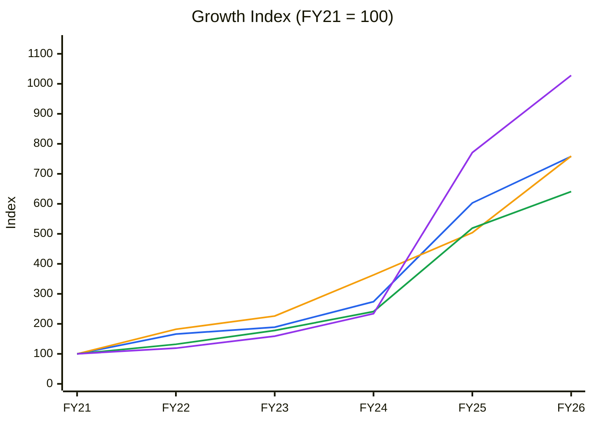
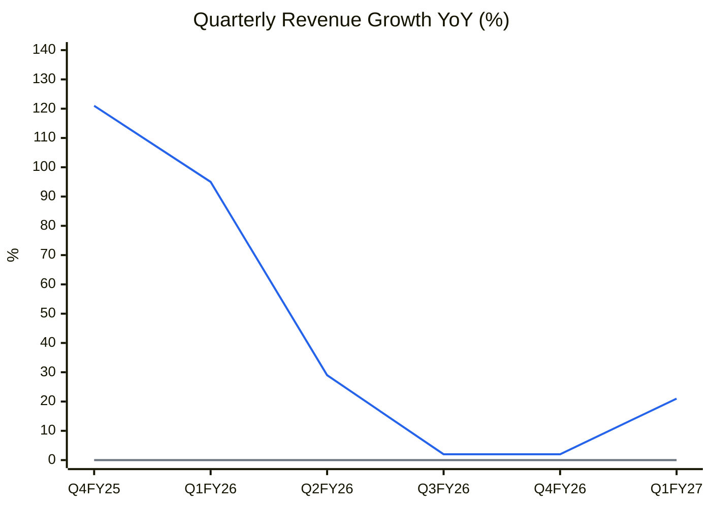
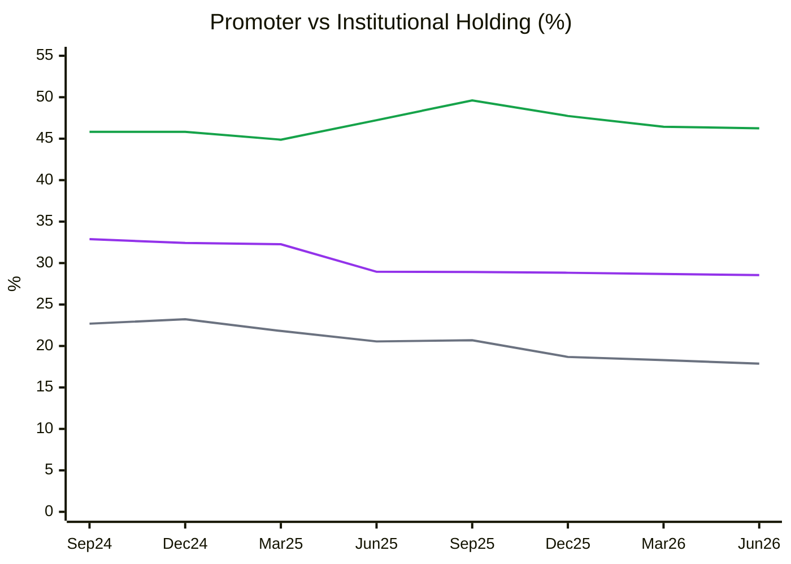
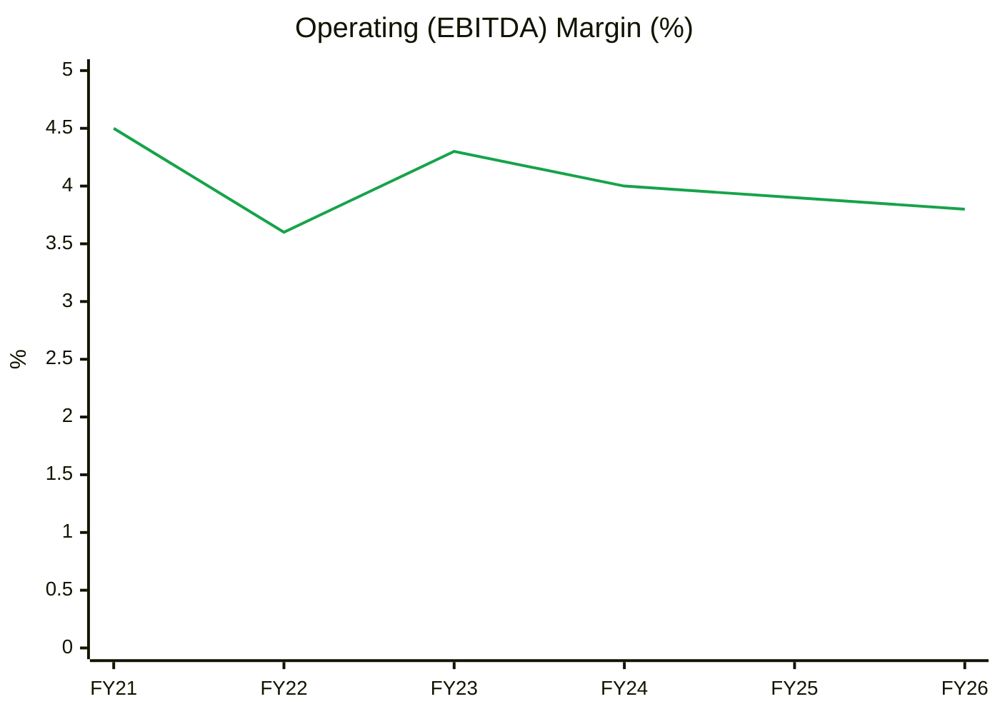
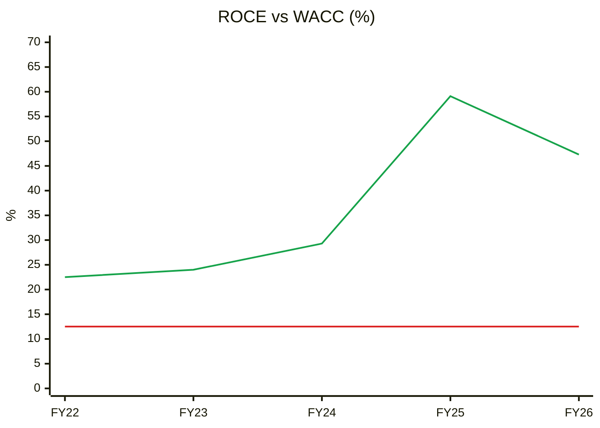
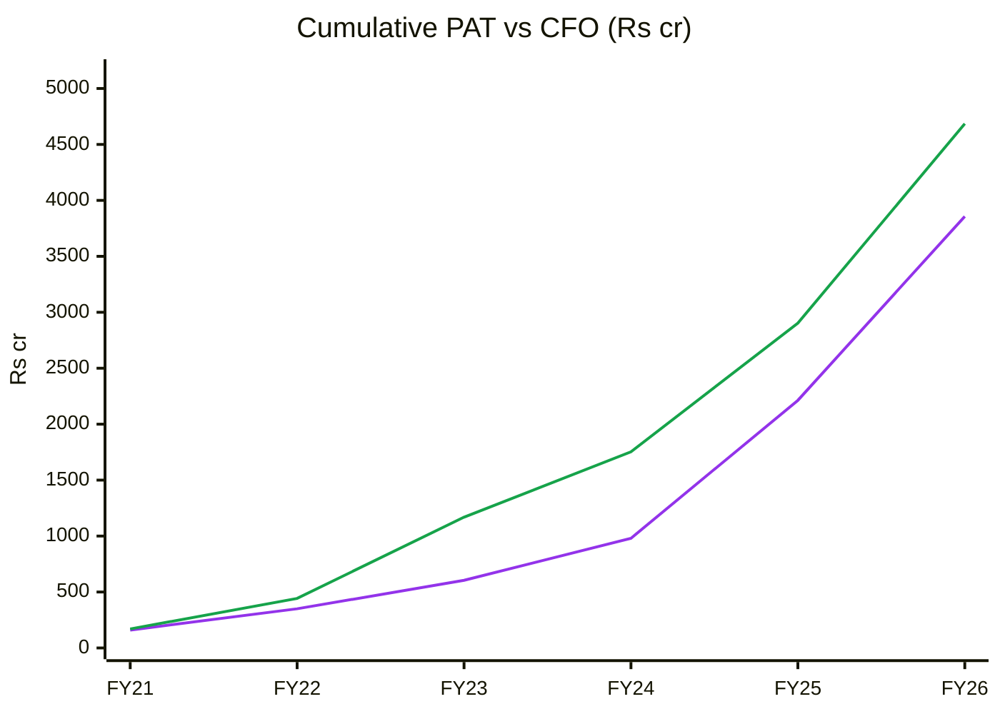
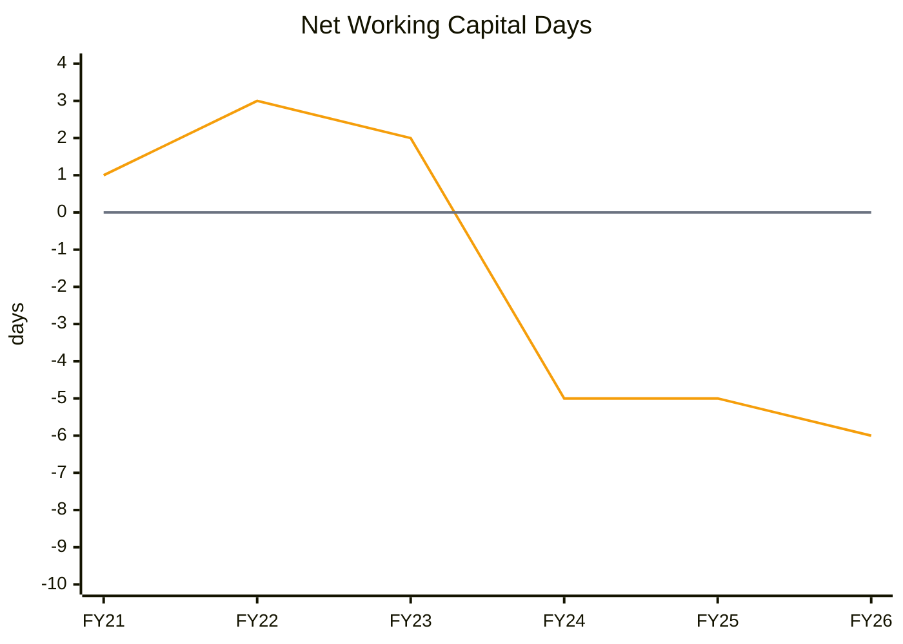
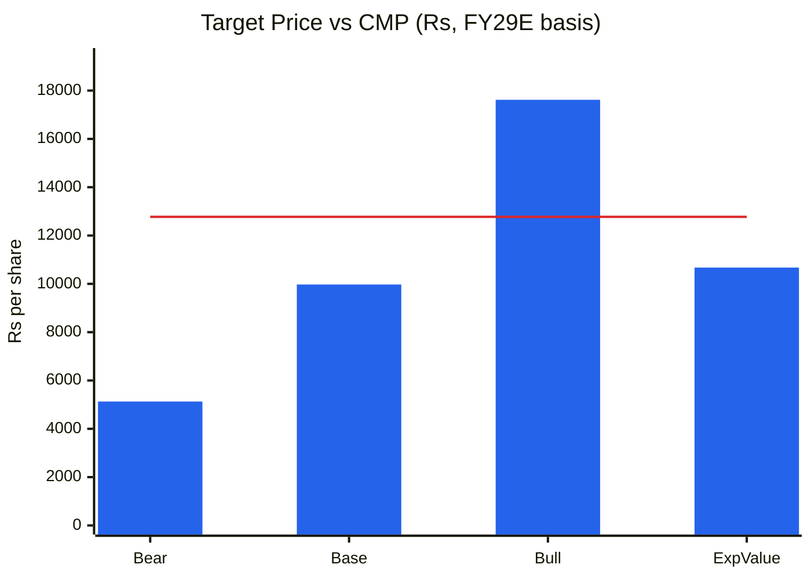

# Stock Analysis Report — Dixon Technologies (India) Ltd (DIXON)
**Date:** 2026-10-12
**Analyst:** Claude (Stock Fundamental Analysis Skill v3.3)
**Investment Horizon:** 2–3 Years
**Recommendation:** WATCHLIST — Quality at Wrong Price (no buy at CMP)
**Conviction Score (as a buy at CMP):** 5 / 10
**CMP:** ₹12,774 (NSE close 09-Oct-2026) · **Market cap:** ₹78,139 cr · **Buy-below:** ₹7,500–8,000

## Revision Log
| Version | Date | Recommendation | Conviction | Price | Key change |
|---|---|---|---|---|---|
| Current | 2026-10-12 | WATCHLIST (Quality at Wrong Price) | 5/10 | ₹12,774 | Initial report. Run as part of a four-way EMS comparison (Amber, Dixon, Syrma, PGEL) |

**Validation of previous report:** Initial report. No earlier Dixon file in the library.

---

## Executive Summary
Dixon is India's largest EMS company (FY26 revenue ₹48,873 cr) and the best business of the four EMS names reviewed: ROCE around 29–33% on core earnings, **negative working capital (−6 days)**, and CFO above PAT across five years. The headline P/E of 41.6× is misleading. TTM profit includes **₹1,263 cr of other income**, most of it fair-value gains on the Aditya Infotech stake (₹519 cr in Q1 FY27 alone). On core, attributable earnings the stock trades at **about 90× (estimate)**, while the operating margin is shrinking (3.0% in Q1 FY27 vs 3.8% a year earlier) as Mobile PLI 1.0 ends and memory-chip costs rise. The business is high quality but the price is wrong. The upside/downside ratio at CMP is about 0.6:1.

🟦 Revenue (CAGR 50%) · 🟧 Net Fixed Assets (50%; net block used — gross block not on Screener) · 🟩 EBITDA (45%) · 🟪 PAT (59%)

**Read:** Since FY21, revenue grew 7.6× and net fixed assets 7.6×, so the asset base kept pace with sales. EBITDA grew only 6.4× (margin drifted from 4.5% to 3.8%). PAT grew 10.3×, but that is inflated by FY25–26 one-off gains.

**Business inference:** The engine is volume on a near-zero working-capital base, not margin. Growth is capital-efficient (fixed-asset turnover ~12×), but the gap between EBITDA and PAT is accounting, not operating leverage. Use the 🟩 EBITDA line, not the 🟪 PAT line, to judge earnings power (→ Module 8 core EPS).

---

## Business Primer
Dixon designs and manufactures electronics for other brands. It is India's largest contract manufacturer of smartphones and also makes LED TVs, washing machines, lighting, telecom equipment (routers, set-top boxes), IT hardware (laptops), CCTV and, increasingly, components (camera modules through its 51% subsidiary Q-Tech, display modules through a JV). Customers are global and Indian brands (Motorola, Xiaomi, the Transsion group through its 51% Ismartu subsidiary, and soon Vivo through a 51:49 JV approved in July 2026). Revenue is volume × bill-of-materials pass-through: Dixon buys most components and earns a thin conversion margin of about 3–4% EBITDA. The mobile & EMS segment is now the large majority of revenue. Returns depend on two things: (1) keeping working capital near zero, because customers and suppliers fund the inventory, and (2) incentive and localisation support (PLI, now ECMS) that lifts a margin that is otherwise razor-thin.

This is a **capital-light, volume-driven contract manufacturer with high customer concentration.** The key value driver is volume. The key risks are (a) margin erosion as Mobile PLI 1.0 ended in FY26 while memory-chip and component costs rose, (b) dependence on a few Chinese-origin smartphone brands whose India strategy and approvals (Press Note 3) can change, and (c) a valuation built on reported EPS that includes large, non-recurring mark-to-market gains on its Aditya Infotech stake, which are also exposed to reversal. Two structural features colour everything. The stake gains distort reported P/E, ROE and ROCE. Rising non-controlling interests (Ismartu, Q-Tech, and the Vivo JV where Vivo holds 49%) mean more consolidated profit goes to minority partners.

**Segment check:** EMS / Consumer Durables Contract Manufacturing. KPI reference available ✓ (`references/05-industry-kpis-india.md` line 2023; top-3: ODM Mix % · EBITDA Margin · ROCE).

---

## Module 1 — Broad Market Cycle (Marks)
- Nifty 50 at **22,520** (09-Oct-2026), **~14.5% below its 52-week high of 26,373**, below a falling 30-week MA (23,718). P/E is about **19.3×**, near its long-run average of ~20× ([JM Financial](https://www.jmfinancialservices.in/market-news-and-insights/1735991), [Stockpil](https://stockpil.com/india-markets-today-2026-10-05/)). India VIX is **14.35** (moderate).
- The pendulum has swung from greed (mid-2025) toward **Cautious**. Index valuations are fair, but the trend is down. EMS momentum names have de-rated (Dixon −24% over 52 weeks vs Nifty −12%).
- **Assessment: Cautious.** Sizing: normal-to-small. No urgency to chase.

## Module 1b — Sector Cycle
- **Secular (embed):** China+1, import substitution, PLI/ECMS component localisation, and domestic smartphone and appliance penetration. India's electronics production is roughly US$130–150 bn and growing in the high teens (MeitY; estimate).
- **Cyclical / temporary (do not embed):** FY25's 120% revenue jump came from new smartphone customers (Ismartu consolidation, ramp of new brands). This was a step-up, not a run-rate. Q3 and Q4 FY26 growth collapsed to +2% YoY each before recovering to +21% in Q1 FY27.
- **Input cost cycle: adverse.** Memory-chip prices are rising sharply (management cited this in Q1 FY27). Mobile PLI 1.0 benefits ended in FY26, so there is a margin headwind of ~50–80 bps on mobiles.
- **Competitive capacity:** Foxconn, Tata Electronics (ex-Wistron/Pegatron), Lava, Padget and brand captives are all expanding. Capacity is not scarce in assembly; it is scarce only in components.
- **Geopolitics:** Chinese-brand dependence. Press Note 3 approvals take a long time (the Vivo JV took ~19 months from term sheet, Dec-2024, to approval, Jul-2026). Rupee: imports are mostly passed through, so net FX exposure is low.
- **Secular vs cyclical split (my estimate):** a durable baseline of **~18–22%** revenue CAGR. Anything above that over FY24–26 was customer-onboarding step-ups.
- **Sector verdict: Tailwind (secular), Headwind (margin, near term).**

## Module 1c — Stock Cycle

🟦 Revenue YoY % · ⬜ zero line

**Read:** YoY growth decelerated from 121% (Q4 FY25) to 2% (Q3–Q4 FY26), then re-accelerated to 21% in Q1 FY27.

**Business inference:** The hyper-growth phase of onboarding customers is over. Growth now depends on Vivo JV consolidation from Q3 FY27 and on components. Growth should settle at 20–25%, not repeat 50%+, so the multiple should compress accordingly.

- **Volume / price / mix:** Volume-dominated (smartphone units). Price is pure BOM pass-through. Mix is improving slowly through camera and display modules and telecom.
- **Capacity:** Mobile assembly is asset-light (leased plants plus SMT lines). Camera-module capacity is going from 70 m to 180–190 m units over 15–18 months. Display-module trial production is in Q3 FY27, mass production late Q3/Q4 FY27 (Q1 FY27 concall).
- **Operating leverage:** Low DOL. Costs are mostly variable BOM, so profits do not swing wildly with volume. DFL is about 1.1× (FY26 EBIT ₹2,212 cr vs interest ₹141 cr).
- **FCF inflection:** Already positive. FY26 FCF was +₹644 cr (CFO ₹1,782 cr − CFI ₹1,138 cr).
- **Classification: Mid-cycle compounder entering a margin-reset phase.** MoS standard for a wide-moat large-cap (20–25%), plus 5 pp for the margin headwind.

---

## Module 2 — Industry Structure & Capital Cycle
| Force | Assessment |
|---|---|
| New entrants | Moderate. Assembly capital is low; scale, customer approvals and component ecosystems are the real barriers |
| Supplier power | High. Memory, SoC and displays come from a handful of global vendors (Samsung, Micron, MediaTek, Qualcomm, BOE) |
| Buyer power | **Very high.** A few brands control volumes and can dual-source |
| Substitutes | Brand captives (Samsung in-house, Apple via Tata/Foxconn) |
| Rivalry | Intense on conversion price. Differentiation is scale, speed and localisation |

**Porter verdict: Neutral.** The category is huge and growing, but the position is structurally squeezed between suppliers and buyers.
**Capital cycle:** Mid-to-late inflow. Many EMS IPOs (Avalon, Kaynes, Cyient DLM, Syrma, Epack and others), many QIPs, and PLI/ECMS pulling in new capacity. Chancellor's lens says returns face competitive pressure over 3–5 years.

## Module 3 — Business Quality & Moat
- **Greenwald:** (1) **Cost / scale advantage: yes.** At ~₹50,000 cr of revenue, Dixon has purchasing scale, line utilisation and a working-capital model new entrants cannot replicate quickly. (2) Customer captivity: moderate. Qualification and ramp take 6–12 months, but brands dual-source. (3) Local scale: largest domestic EMS.
- **Buffett 10% price test: fails.** Conversion margins are set by brands.
- **Market share:** ~10% of Indian smartphone production on FY27 guidance of 32–33 m units ex-Vivo, against ~330 m national output (estimate). Share has been gaining, from small in FY21.
- **Moat verdict: NARROW, trending toward moderate** as component integration (camera and display modules) adds stickiness.

**Fisher 15-point (abridged):** market potential 3 · new products 3 · R&D 2 · sales org 3 · margin worth 1 · margin improvement 2 · labour relations 2 · exec relations 2 · depth 2 · cost controls 3 · industry advantages 2 · long-range orientation 3 · dilution 3 · candour 2 · **integrity 2 (pass)**. **Total 35/45.** Point 15 is a pass, but the promoter's ₹2,221 cr sale (below) is noted.

---

## Module 4 — Management & Capital Allocation
**Promoter holding:** 28.55% (Jun-2026), down from 32.89% (Sep-2024). Pledge: none disclosed. The decline is an **outright sale**, not dilution: chairman Sunil Vachani sold **2.77% for ₹2,221 cr at ₹13,301/share on 23-Jun-2025** ([The Week/PTI](https://www.theweek.in/wire-updates/business/2025/06/23/dcm92-biz-dixon-tech-stake-sale.html)). The equity base has been flat at ₹12 cr, so there has been no QIP dilution.

🟪 Promoter · 🟩 FII + DII · ⬜ FII alone

**Read:** Promoter holding fell 4.3 pp over 8 quarters, almost all in Jun-2025. DIIs absorbed it (23% → 28%) while FIIs trimmed (22.7% → 17.9%).

**Business inference:** Domestic funds are underwriting the story while foreign holders have sold for six straight quarters. The promoter sold near the highs, just after a quarter boosted by an exceptional gain. That is a timing signal, though not a governance breach.

- **Capital allocation:** Strong. FY21–26 cumulative CFO ₹4,685 cr vs PAT ₹3,857 cr. Capex is funded internally; dividend is token (yield 0.08%). Acquisitions (51% of Ismartu, 51% of Q-Tech, JVs) were bought at reasonable multiples and are earnings-accretive, but they shift profit to minorities.
- **RPT / ICD:** No group ICDs of concern on the available data. ⚠️ AR RPT schedule not re-read in this run.
- **Buffett's 3 C's:** Candour: good (flagged the margin "transition year" upfront). Competence: excellent (10-yr ROCE of 23–40%). Caring: mixed (promoter sale, token dividend).

### Walk the Talk Scorecard
| Quarter Guided | Statement | Guided | Actual | Verdict |
|---|---|---|---|---|
| FY26 (start) / Q2 FY26 | FY26 smartphone volumes | Original volume guidance | **Lowered at Q2 FY26** ([Moneycontrol via TradingView](https://tr.tradingview.com/news/moneycontrol:d7ee4944a094b:0-q2-results-impact-dixon-tech-extends-fall-to-third-day-after-lowering-volume-guidance)) | ❌ Miss |
| Q3–Q4 FY26 | Growth momentum | Strong growth | Q3/Q4 FY26 revenue +2% YoY each; "missed volume targets" (coverage) | ❌ Miss |
| Q4 FY26 | FY27 = margin transition year (PLI sunset) | Margin pressure | Q1 FY27 OPM 3.0% vs 3.8% | ✅ Hit (candid) |
| Dec-2024 | Vivo JV | Near-term close | P&A approval Jul-2026; close guided ~2 months, revenue from Q3 FY27 | ⏳ Pending (long delay; no dated earlier guidance found, so not scored) |
| Q1 FY27 | Q2 FY27 smartphone volumes | 9.0–9.2 m | Results due late Oct-2026 | ⏳ Pending |
| Q1 FY27 | FY27 telecom revenue | ₹6,700–7,000 cr | — | ⏳ Pending |

**WTT Score:** 0.33 / 1.00 on n = 3 scored points. **LOW, but the sample is small.** Hits 1 · Near misses 0 · Misses 2 · Reversals 0.
**Key pattern:** Dixon has a long record of delivery (FY20–25), but FY26 volume guidance slipped twice. Optimism bias on volume timing; candid on margins.
**Insider action:** Promoter open-market sale of ₹2,221 cr (Jun-2025). **BEARISH-to-neutral.**
**DCF impact:** Volume guidance haircut 10–15%. FY27 revenue is modelled at +20%, not the top end of 20–25%.
**Overall management credibility:** MODERATE.

---

## Module 5 — Financial Forensics
| Test | Value | Read |
|---|---|---|
| Beneish M-Score | Not fully computed (receivables and SG&A detail not on Screener) | DSRI proxy: debtor days 49 (FY26) vs 65 (FY25), improving → no revenue-inflation signal |
| Altman Z'' (approx.) | **1.88** (FY24 1.77 → FY25 1.55 → FY26 1.88) | "Grey" is an **artefact** of the negative working-capital model (X1 ≈ 0). Not distress: net cash, CFO > PAT |
| Piotroski F (8 of 9 testable) | **6/8** | Strong. Leverage ratio up slightly; margin down |
| Sloan accrual (CF) | **+5.6%** | Acceptable (< 10%) |
| TATA (NI − CFO)/TA | −0.007 | CFO exceeds NI, a good sign |
| CFO / PAT (5-yr) | **1.22** | High quality, even with gains inside PAT |
| Other income / EBIT | **TTM 1,263 / ~2,700 ≈ 47%** | 🚩 **Red flag (> 15%).** Mostly fair-value gains on Aditya Infotech (₹519 cr in Q1 FY27, ₹75 cr in Q4 FY26; FY25 gain from the AIL Dixon sale) |

**Indian flags:** No pledge. Promoter sale is noted. Fair-value gains run through the P&L (Schilit "one-time boosts" #3), and because the stake is marked to market, **future quarters can show losses** if Aditya Infotech's price falls.
**Forensic red-flag count:** 1 hard flag (other income) + 1 soft flag (promoter sale) out of 15 → **Minor concerns** (presentation, not manipulation).

## Module 6 — Earnings Quality & Financial Statements
**Core earnings (my estimate, labelled):** FY26 PBT ₹2,071 cr minus non-recurring gains of ~₹670 cr gives ~₹1,400 cr core PBT. At 25% tax that is ~₹1,050 cr; minus non-controlling interest (~₹180 cr est.) leaves **~₹870 cr core attributable PAT, or core EPS ≈ ₹142** (vs reported ₹236.6). In Q1 FY27, NCI alone was ₹55 cr (₹718 cr consolidated vs ₹663 cr attributable).
**Core P/E ≈ 12,774 / 142 ≈ 90×** (vs headline 41.6×).

🟩 OPM % (Screener operating profit ÷ sales; excludes other income)

**Read:** EBITDA margin has been stuck at 3.8–4.6% for six years. Q1 FY27 fell to 3.0%.

**Business inference:** No operating leverage shows up at 7× the scale. Brands capture the scale benefit, which confirms the narrow moat. The only margin lever is component localisation (camera and display modules), which arrives over FY27–28.

🟩 ROCE (EBIT ÷ avg capital employed, computed) · 🟥 WACC 12.5%

**Read:** Computed ROCE was 22–29% in FY22–24 and jumped to 59% and 47% in FY25–26 because of non-operating gains. Core FY26 ROCE is about **33%** (EBIT ex-gains ~₹1,540 cr on average capital employed ~₹4,680 cr).

**Business inference:** Even stripped of gains, Dixon earns 2.5× its cost of capital, because customers and suppliers fund almost all working capital. This is the real moat: a capital model, not a margin.

🟪 Cumulative PAT · 🟩 Cumulative CFO

**Read:** Cumulative CFO of ₹4,685 cr exceeds cumulative PAT of ₹3,857 cr over FY21–26.

**Business inference:** Reported profits are backed by cash. The negative working-capital cycle (payables 86 days vs debtors 49 + inventory 31) turns growth into cash inflow, which is unique among the four EMS names.

### DuPont Decomposition (5-Factor, computed)
| Year | EBIT Margin | Asset Turnover | Equity Multiplier | Interest Burden | Tax Burden | ROE |
|---|---|---|---|---|---|---|
| FY22 | 2.8% | 3.00 | 4.11 | 0.84 | 0.75 | 21.9% |
| FY23 | 3.4% | 2.72 | 3.92 | 0.84 | 0.74 | 22.3% |
| FY24 | 3.3% | 3.03 | 3.92 | 0.86 | 0.76 | 25.2% |
| FY25 | 4.5% | 3.27 | 5.05 | 0.91 | 0.79 | 52.4% |
| FY26 | 4.5% | 2.72 | 4.67 | 0.94 | 0.79 | 42.8% |

**Operating contribution:** EBIT margin rose only because of other-income gains. Core EBIT margin is ~3.2%, flat. **Financing contribution:** The equity multiplier of 4–5× is **operating payables, not debt** (borrowings ₹994 cr vs other liabilities ₹13,481 cr). **DuPont verdict:** ROE is real at ~22–25% core. The FY25–26 spike to 43–52% is non-recurring. AT trend: stable at ~3×.
**O'Glove flags:** other income/EBIT (#7) and recurring "one-time" gains (#8: FY25, FY26, Q1 FY27) → **2/15**.

---

## Module 7 — Industry KPIs & Peers
| KPI | Dixon | Amber | Syrma | PGEL | Assessment |
|---|---|---|---|---|---|
| EBITDA margin (FY26) | 3.8% | 7.1% | 11.3% | 7.3% | Lowest. Mobile is low-value-add |
| ROCE (Screener) | **29.2%** | 10.3% | 16.8% | 10.3% | **Best by far** |
| Net WC days (FY26) | **−6** | 53 | 48 | 69 | Best |
| CFO / PAT (5-yr) | 1.22 | 2.78* | 0.32 | 0.20 | Best clean figure (*Amber flattered by payables and advances) |
| Revenue 3-yr CAGR | 59% | 21% | 33% | 35% | Fastest |
| ODM mix | Low (mostly OEM in mobiles) | High in RAC | 17% | High in RAC | Weak point |
| P/E (headline / core est.) | 41.6× / ~90× | 110× / ~92× adj. | 89× | 71× | All extreme |

🟧 Debtor + Inventory − Payable days · ⬜ zero line

**Read:** Net working-capital days have been at or below +3 since FY21, and negative (−5 to −6) for three years.

**Business inference:** Dixon grows without consuming cash. That supports a premium multiple versus peers, but not one built on reported EPS that includes stake gains.

**Peer positioning:** A premium is justified (best ROCE, cash conversion and scale). The premium should be applied to core EPS, where Dixon is no cheaper than the others.

## Module 8 — Market Size & Share
- **TAM:** Indian smartphone production ~330 m units (≈ ₹4–5 lakh cr). Plus TVs, appliances, IT hardware, telecom, and the component ecosystem (ECMS). The total is a multi-lakh-crore opportunity growing in the mid-to-high teens (estimate; MeitY/ICEA).
- **Share:** ~10% of smartphone units ex-Vivo, rising with the Vivo JV. India's #1 independent EMS by revenue.
- **Revenue vs market:** FY26 revenue +26% vs market ~15–18%, so Dixon is still gaining share, but the gap is narrowing.
- **Verdict:** Taking share. The share gains depend on Chinese-brand outsourcing decisions (structural, but politically exposed).

---

## Module 9 — Valuation: PIE First, Then Own Model
### PIE (reverse DCF: EV ≈ ₹77,100 cr, WACC 12.5%, terminal growth 6%, tax 25%, sales-to-capital 6×)
| PIE driver | Market-implied | My base | Gap |
|---|---|---|---|
| Revenue CAGR (10-yr) at today's ~3.4% EBIT margin | **~41%** | 18–20% | Optimistic gap |
| EBIT margin needed if revenue grows 20%/yr for 10 yrs | **~6.4%** (ROIC ~29%) | 3.3–3.6% | Optimistic gap |
| EBIT margin needed at 25%/yr | ~5.2% | — | — |

**Treadmill:** To beat the price, Dixon must roughly **double its EBIT margin** (component integration) *and* compound revenue at 20%+ for a decade. At today's margins, the price implies ~41% growth for 10 years, which would make Dixon a ~₹15 lakh cr revenue company by FY36. That is not plausible.
**Positive triggers:** Vivo JV consolidation ahead of plan; display and camera modules lifting margin above 4.5%; ECMS approvals. **Negative triggers:** further margin slippage below 3%; reversal of the Aditya Infotech fair-value gain; loss of a major smartphone brand.
**SVAR:** Bear target ₹5,129 implies **SVAR ≈ 60%**. Unfavourable.

### Own model (FY29E; core, attributable)
| Scenario | Revenue FY29 | EBITDA margin | Attrib. PAT | EPS | Multiple | Target | Prob |
|---|---|---|---|---|---|---|---|
| Bull | ₹1,00,000 cr (Vivo + components) | 3.8% | ₹1,800 cr | ₹294 | 60× | ₹17,618 | 25% |
| Base | ₹85,000 cr | 3.4% | ₹1,223 cr | ₹200 | 50× | ₹9,973 | 50% |
| Bear | ₹70,000 cr (brand loss, chip squeeze) | 3.0% | ₹786 cr | ₹128 | 40× | ₹5,129 | 25% |
| **Expected value** | | | | | | **₹10,673** | |

Assumptions: D&A ₹650–750 cr, interest ~₹200 cr, recurring other income ₹80–150 cr (gains excluded), tax 25%, NCI 20–22% of PAT (Vivo JV 49%, Q-Tech, Ismartu), 6.13 cr shares.

🟦 Scenario price · 🟥 CMP Rs 12,774

**Read:** Expected value is ₹10,673 (−16% vs CMP). Upside to bull is +38%; downside to bear is −60%. **U/D ≈ 0.63:1** (fails the 1.5:1 gate).

**Business inference:** The market is paying the bull-case multiple for base-case earnings. Most of the gap is a misread of reported EPS (stake gains) and minority leakage, not a doubt about the franchise.

- **Graham number:** √(22.5 × 142 × 769) ≈ ₹1,567. Irrelevant for a 25%+ ROCE compounder, and fails.
- **Margin of safety:** Negative (CMP above base fair value). The required MoS for a large-cap with a margin headwind is 25–30%, giving **buy-below ≈ ₹7,500–8,000** (base × 0.75–0.8).
- **Misprice reason:** Headline-P/E optics (stake gains), plus premium-franchise anchoring.

### Cycle Position Dashboard
| Dimension | Current | Reference | Signal |
|---|---|---|---|
| P/E (core est.) | ~90× | Sector 60–90× (KPI ref.) | Expensive |
| P/B | 16.6× | — | Expensive |
| EBITDA margin | 3.0% (Q1 FY27) | 6-yr range 3.6–4.6% | **Trough-ish** (PLI sunset) |
| ROCE (core) | ~33% | 10-yr 23–40% | Mid |
| **Overall** | | | **Mid-cycle business, late-cycle valuation** |

⚠️ CY1/CY2 P/E and P/B 10-yr band charts not built: year-end price history was not retrievable from primary sources in this run. Data gap.

---

## Module 10 — Technical Stage (Weinstein, from Yahoo weekly closes)
- **Nifty 50:** Stage 4 / late Stage 3. Price 22,520 is below a declining 30-week MA (23,718, −1.0% over 5 weeks).
- **Sector (EMS basket):** Weak. Amber and PGEL are below falling MAs; Syrma is the exception.
- **Stock:** ₹12,774 vs 30-week MA ₹12,491, which is **rising** (+3.4% over 5 weeks). A rally from the ~₹9,920 low peaked near ₹14,850 and has given back about 14% in seven weeks. Price is now testing the MA. **Stage 1→2 attempt, unconfirmed.**
- **RS vs Nifty:** Negative (52-wk −24% vs −12%; 13-wk −11% vs −7%).
- **Stop / invalidation:** A weekly close below ~₹12,000 (the MA band) reverts the stock to Stage 1/4 risk.
- **CANSLIM:** C 0 (core EPS down YoY) · A 1 (3-yr EPS CAGR > 25%, ROE > 17%) · N 1 (Vivo JV, modules) · S 0 · L 0 (RS weak) · I 0 (FIIs selling) · M 0 → **2/7**.
- **Alignment:** Fundamentals strong, price too high, technicals unconfirmed. **No entry.**

---

## Module 11 — Forward View: 2–3 Year Thesis
### Capex & asset model (capital-light)
| Item | View |
|---|---|
| Net fixed assets FY26 | ₹4,172 cr + CWIP ₹571 cr |
| Fixed-asset turnover | 11.7× FY26 (5-yr range 8.9–14.0×). Stable |
| FY27–28 growth capex | Camera modules (Q-Tech 70 → 180–190 m), display modules, Vivo JV lines. Est. ₹1,200–1,500 cr/yr, internally funded |
| Incremental ROIC | Revenue ₹+36,000 cr by FY29 at ~3.2% EBIT ≈ ₹1,150 cr EBIT on ~₹3,500 cr incremental capital → **~25% post-tax. Value-creating** |
| Capex-model CAGR vs PIE | Capacity (asset-light) is not the constraint. Margin is. The PIE requires margin Dixon has never earned → **market pricing a step-change in value-add** |
| Debt / ICR | Net cash. ICR > 10×. No ceiling issue |
| FCF inflection | Already positive (FY26 +₹644 cr) |

### Catalysts
1. **Q2 FY27 results (late Oct-2026):** 9.0–9.2 m smartphone volumes and margin trend.
2. **Vivo JV close and consolidation from Q3 FY27:** adds volume, but 49% of its profit goes to minorities.
3. **Display and camera module ramp (Q3 FY27 onward):** the only credible margin lever.
4. **ECMS component approvals and IT-hardware PLI ramp.**

### Risks
1. **Margin erosion** from memory-chip inflation and PLI sunset. Probability: High.
2. **Customer and approval concentration** in Chinese-origin brands. Medium.
3. **Aditya Infotech mark-to-market reversal** hitting reported PAT. Medium.
4. **De-rating** as investors move from reported to core EPS. Medium-High.
5. **Further promoter selling.** Medium.

---

## Checklist Summary
**Section 0:** New report, no duplicates ✓ · **A:** 15/18 (AR RPT schedule and scuttlebutt not re-read) · **B:** 7/9 (Beneish partial; auditor KAMs not read) · **C:** 10/12 (Ind AS 116 adjustment immaterial; 10-yr ROIC uses 5 computed + Screener series) · **D:** 6/7 · **E:** 6/7 (TAM shares are estimates) · **F:** 9/10 · **G:** 7/8 · **H:** asset-light, so the capex-AT model is simplified · **I:** 9 charts. CY1/CY2/CY4 missing (data gap).
**Order Book Tracker:** Not applicable (no Reg 30 order announcements; customer-programme business).
**Hard stops triggered:** **Upside/downside < 1.5:1** (0.63:1).

## Investment Decision
**Recommendation:** **WATCHLIST — Quality at Wrong Price.** The asymmetry hard stop fires on price, not on business quality.
**Conviction (buy at CMP):** 5/10 (cycle 0.5 · industry 0.5 · moat 1.5 · management 0.5 · financial quality 1.5 · valuation 0 · technical 0.5).
**Position size now:** 0%. Starter 1–2% only below ₹8,000.
**Buy-below:** **₹7,500–8,000**, or earlier if core EBITDA margin gets back above 4% with the Vivo JV consolidated.
**Target (base, FY29E basis):** ₹9,973 · Bull ₹17,618 · Bear ₹5,129.
**Review trigger:** Upgrade if two quarters of OPM ≥ 4% with display modules in revenue. Downgrade if OPM < 3% for two quarters, or further promoter sales.

---
*Report generated by Stock Fundamental Analysis Skill v3.3 | Indian Markets Context*
*Sources: Screener.in (DIXON consolidated, fetched 12-Oct-2026); Yahoo Finance weekly prices (technical stage); [Investing.com Q1 FY27 slides](https://www.investing.com/news/company-news/dixon-technologies-q1-fy27-slides-revenue-up-21-margins-contract-93CH-4828133); [Sahi — FY27 volume guidance](https://www.sahi.com/news/dixon-tech-expects-32-33-million-fy27-mobile-sales-and-180-190-million-camera-modules-3872-PE1_COR); [Multibagg — ₹528 cr other income / ₹519 cr Aditya gain](https://www.multibagg.ai/market-pulse/articles/dixon-ebitda-other-income-breakdown-cmugvjb9b000e2mpekcugvkwq); [Business Today — Vivo JV 51:49](https://www.businesstoday.in/markets/stocks/story/dixon-technologies-stock-in-focus-on-jv-update-with-vivo-india-542145-2026-07-10); [PTI — promoter sale](https://www.theweek.in/wire-updates/business/2025/06/23/dcm92-biz-dixon-tech-stake-sale.html). Concall figures are from secondary summaries; the full transcript was not read. Core EPS, NCI share, TAM share and scenario inputs are labelled analyst estimates.*
*Save path: C:\Users\anubh\Documents\Anubhav\Stock Analysis\Stock Analysis\*
