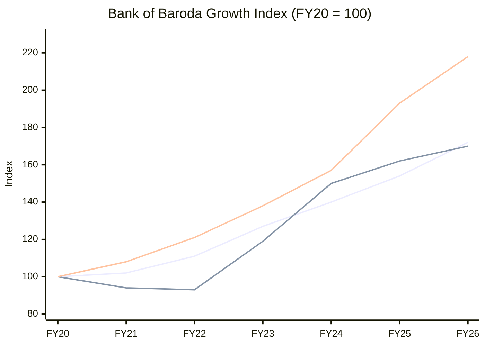
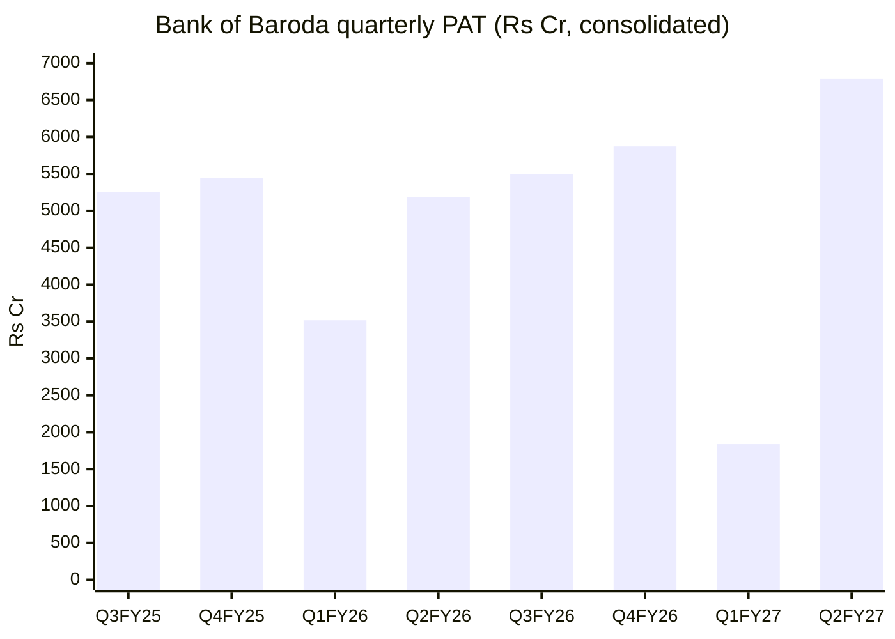
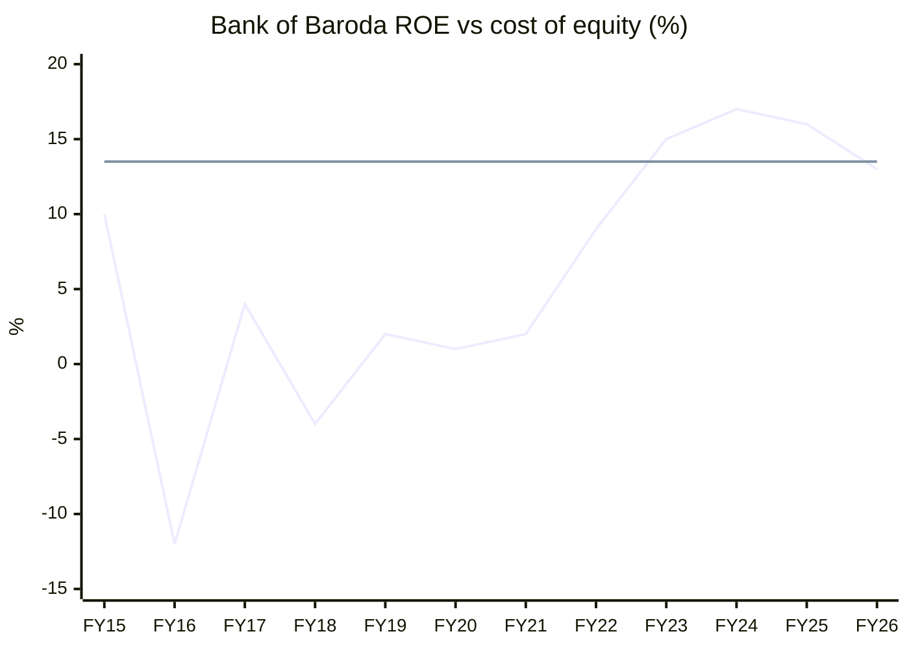
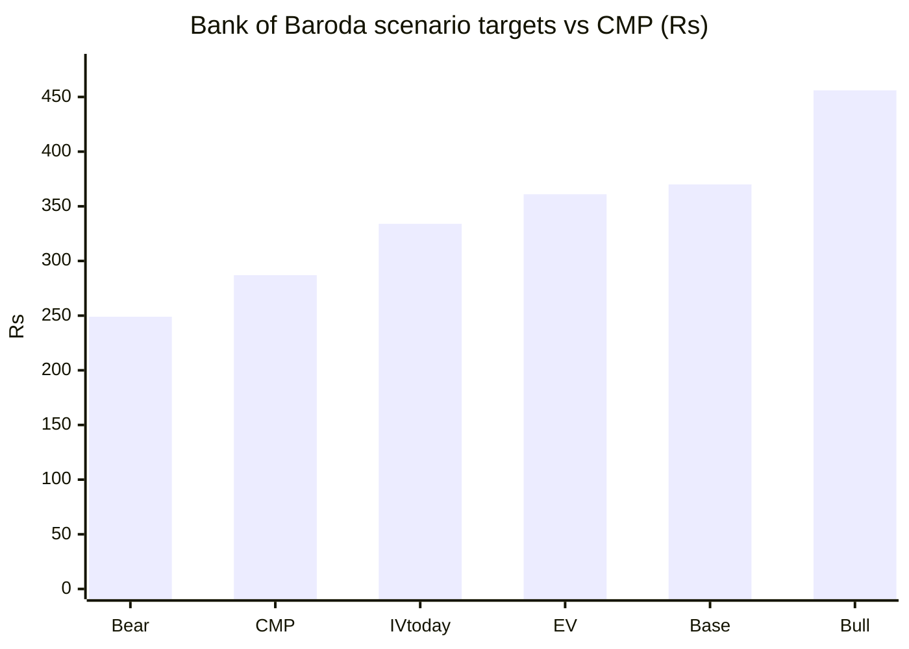

# Stock Analysis Report — Bank of Baroda (BANKBARODA)
**Date:** 2026-11-20
**Analyst:** Claude (Stock Fundamental Analysis Skill v3.3)
**Investment Horizon:** 2–3 Years
**Recommendation:** WATCHLIST / WAIT FOR CONFIRMATION (accumulate ₹255–270, or on a weekly close above ₹326)
**Conviction Score:** 6 / 10
**CMP:** ₹287 (NSE, 20-Nov-2026 12:42 pm) · Market cap ₹1,48,573 Cr · ~518 Cr shares (FV ₹2) · BVPS ₹338 (consolidated, Sep-26) · Adj. BVPS ~₹304 (after NNPA and estimated ECL hit) · 52-wk ₹224–326
**Filed under:** Financials-and-Fintech / Banks · Themes: PSU financials & financialisation

## Revision Log
| Version | Date | Recommendation | Conviction | Price | Key change |
|---|---|---|---|---|---|
| Current | 2026-11-20 | Watchlist / Wait for confirmation | 6/10 | ₹287 | Initial report |

Initial report. No earlier Bank of Baroda report existed in the library. **New folder:** `Financials-and-Fintech/Banks` (no existing sub-sector fits a commercial bank).

**Sourcing note.** Financials: Screener.in consolidated (FY15–Q2 FY27). Q2 FY27 operating metrics, guidance and call commentary: secondary summaries of the 30-Oct-2026 results and call (Compoundingai/Cofacto, Multibagg, Zee Business, Investing.com/GuruFocus). Q1 FY27 NMC settlement: Free Press Journal/IANS, Kotak Neo. Ratings: Screener announcements (Moody's 19-Nov-2026). The NSE results PDF was not fetched; where sources disagree the conservative figure is used and flagged.

---

## Business Primer

Bank of Baroda is India's second-largest public-sector bank by business (₹32.6 lakh Cr global business, Sep-26), majority-owned (63.97%) by the Government of India. It takes deposits (₹17.75 lakh Cr consolidated) from households, corporates and NRIs — 36% of domestic deposits are low-cost CASA — and lends to corporates (still the largest book), retail (home, auto, mortgage, personal), MSME and agriculture, plus a meaningful international book (Gulf, UK, US, Africa; international advances +40% YoY). It earns a **net interest margin (~2.7–2.8%)** on that spread, plus fees and treasury gains, and then loses part of it to operating costs and credit losses. The franchise depends on (1) a cheap, sticky deposit base built over a 9,000+ branch network (merged with Vijaya Bank and Dena Bank in April 2019) and (2) underwriting discipline — the bank lost money in FY16 and FY18 when corporate NPAs exploded.

BoB is a **financial — a leveraged spread business**, so ROA × leverage drives ROE, and asset quality drives everything else. The key value driver now is **ROA sustainability around 1%** after a decade-long clean-up (GNPA 1.78%, NNPA 0.37%, PCR ~95%). The key risks are **NIM compression** (repo-linked loans reprice faster than deposits), the move to **Expected Credit Loss (ECL) provisioning** from FY28 (estimated ~₹12,000–12,500 Cr / ~110–125 bps of CRAR), and one-offs — the ₹5,680 Cr NMC Group settlement in Q1 FY27 and a ~₹3,100–3,600 Cr NSE stake-sale gain in Q2 FY27 — that make reported quarters noisy. Government ownership brings a sovereign-backed deposit franchise but also policy lending and capped valuation multiples.

**Segment check:** Banking & NBFCs — KPI reference available ✓ (line 156).

---

## Executive Summary
Bank of Baroda has completed its turnaround: ROE went from −12% (FY16) to 15–17% (FY23–25), GNPA is 1.78% with ~95% coverage, CRAR 16.6%, and management *raised* FY27 credit growth guidance to 13–15%. The stock at ₹287 trades at 0.85× book and ~7× normalised earnings — a price that implies sustainable ROE of only ~12.8%, below FY23–25 delivery. Against that, NIM (2.74%) has slipped below guidance, FY26 ROA fell to ~1.0%, and ECL will cut ~₹24/share of book. Probability-weighted 2-year value ≈ ₹361 (+26%, ~+32% with dividends), but today's margin of safety (~14% vs intrinsic ~₹334) is short of the 20–25% a large-cap needs. **Verdict: Wait for Confirmation** — accumulate ₹255–270 or on a breakout above ₹326.

**C1 — Growth Index (consolidated, FY20 = 100; FY20 = first year post Vijaya/Dena merger)**

| FY | 20 | 21 | 22 | 23 | 24 | 25 | 26 |
|---|---|---|---|---|---|---|---|
| Deposits (₹ Cr) | 9,73,228 | 9,95,910 | 10,75,804 | 12,34,682 | 13,59,980 | 14,96,688 | 16,75,895 |
| Interest earned (₹ Cr) | 78,895 | 74,314 | 73,385 | 94,139 | 1,18,379 | 1,27,945 | 1,34,298 |
| Net worth (₹ Cr) | 76,104 | 82,390 | 91,869 | 1,05,055 | 1,19,713 | 1,46,503 | 1,65,869 |
| PAT (₹ Cr) | 981 | 1,620 | 7,933 | 15,005 | 18,869 | 20,865 | 20,070 |
| Index: Deposits | 100 | 102 | 111 | 127 | 140 | 154 | 172 |
| Index: Interest earned | 100 | 94 | 93 | 119 | 150 | 162 | 170 |
| Index: Net worth | 100 | 108 | 121 | 138 | 157 | 193 | 218 |

🟦 Deposits · 🟧 Interest earned · 🟩 Net worth. PAT (₹981 Cr → ₹20,070 Cr, 20×) omitted from the chart because its scale swamps the others.
**Read:** Net worth has grown faster (2.2×) than deposits (1.7×) since the merger, almost entirely from retained profits — no equity raised since FY21.
**Business inference:** The bank has de-risked itself — leverage is falling, which is why ROE dipped in FY26 even though profit held. Further ROE gains must now come from ROA, not leverage.

---

## Module 1 — Market, Sector & Stock Cycle
**1. Market:** Nifty about 25,000 (Nov-26), flat-to-down YoY; VIX about 17.5 (library, 17-Nov-26) → **Neutral-to-Cautious.** **RBI raised the repo rate effective 5-Oct-2026** (per BoB Q2 call) — after the FY26 easing cycle.

**1b. Sector: Neutral.**
- **Secular:** credit growth ~1.5–2× nominal GDP; formalisation, retail/MSME credit deepening → embed ~11–13% loan growth.
- **Cyclical:** FY27 credit growth (~18% global, 13.5% domestic ex-FCNR) includes FCNR(B)-funded international growth (US$8 bn raised) and a corporate catch-up — part mean-reverts.
- **Rates:** 38% of BoB's book is repo-linked → the Oct-2026 hike lifts asset yields first (Q3–Q4 NIM upside), deposit costs follow with a lag. NIM troughed at 2.74% in Q2 FY27.
- **Regulatory:** ECL transition (from Apr-2027, spread over five years per RBI dispensation); draft LCR norms; PSU-bank disinvestment talk (government at 63.97%, already compliant with the 25% minimum public float, so no forced sale).
- **FX:** international book ~18–20% of advances (est.); FX translation risk modest.

**1c. Stock cycle: Mid cycle (post-clean-up, margin plateau).**

**C2 — Quarterly consolidated PAT (₹ Cr) and revenue YoY**

| Qtr | Q3FY25 | Q4FY25 | Q1FY26 | Q2FY26 | Q3FY26 | Q4FY26 | Q1FY27 | Q2FY27 |
|---|---|---|---|---|---|---|---|---|
| PAT | 5,250 | 5,447 | 3,517 | 5,181 | 5,501 | 5,872 | 1,839 | 6,792 |
| Interest earned YoY % | 8 | 6 | 6 | 4 | 3 | 5 | 7 | 11 |

**Read:** Underlying profit is a steady ₹5,000–6,000 Cr a quarter; Q1 FY27 (NMC settlement −₹5,680 Cr) and Q2 FY27 (NSE stake-sale gain) are mirror-image one-offs.
**Business inference:** Normalised quarterly PAT is ~₹5,300–5,600 Cr (≈ ₹21–22k Cr a year, EPS ~₹41–43). Interest income growth re-accelerated to 11% in Q2, so the core engine is speeding up, not slowing.

**Operating leverage / rate sensitivity:** cost-to-income 42.6% (Q2, flattered by NSE gain) vs ~48–51% normal. Each 10 bps of NIM ≈ ₹1,600–1,700 Cr of annual NII (on ~₹16–17 lakh Cr earning assets) ≈ 7–8% of PAT.

---

## Module 2 — Industry Structure
| Force | Assessment | Signal |
|---|---|---|
| New entrants | Licences, capital, deposit franchise take decades; small-finance/payment banks marginal | High barrier |
| Supplier power (depositors) | Deposit competition intense; savers shifting to MFs/term deposits | **Rising** |
| Buyer power (borrowers) | Large corporates have bond-market alternatives; retail fragmented | Moderate–high |
| Substitutes | NBFCs, bond markets, fintech lenders | Moderate |
| Rivalry | SBI + 11 PSU + 20 private banks; price competition on corporate loans | High |

**Verdict: Neutral.** **Capital cycle:** PSU banks are in a capital-surplus phase (no government recapitalisation since FY21; CRAR 15–17%); credit growth healthy, no excess-supply signal yet. Corporate-loan pricing is the first place a down-cycle would show.

---

## Module 3 — Business Quality & Moat
**Moat Verdict:** Narrow · **Greenwald:** customer captivity in deposits (switching costs, government trust, salary/pension accounts) + scale (#2 PSU bank) · **Buffett moat type:** low-cost deposits (partial) · **Pricing power test:** Fail (NIM falls with rate cuts; corporate loans price-taking) · **Market share:** ~6% of system assets and deposits (CRISIL via Screener); stable · **Fisher 15-point:** 28 / 45 *(Point 15: Pass — but note RBI's Oct-2023 restriction on the bob World app for onboarding lapses, lifted May-2024)*

| # | Point | Score | | # | Point | Score |
|---|---|---|---|---|---|---|
| 1 | Market potential | 2 | | 9 | Management depth | 2 |
| 2 | New products (bob World 2, cards) | 2 | | 10 | Controls (app lapse, cyber incident) | 1 |
| 3 | Tech/R&D | 2 | | 11 | Unique advantages (Gulf/NRI franchise) | 2 |
| 4 | Sales organisation | 2 | | 12 | Long-range orientation | 2 |
| 5 | Margin (RoA ~1%) | 2 | | 13 | Dilution (none since FY21) | 3 |
| 6 | Margin improvement | 1 | | 14 | Communication | 2 |
| 7 | Labour relations | 1 | | 15 | Integrity | 2 |
| 8 | Executive relations (govt appointees) | 2 | | | | |

---

## Module 4 — Management & Capital Allocation
**Promoter (GoI):** 63.97% (unchanged 12 quarters) | **Pledge:** nil · **FII:** 12.4% (Mar-24) → 8.1% (Jun-25) → 10.3% (Sep-26), recovering · **DII:** 16.0% → 17.8%.
**Share count:** flat since FY21 (no dilution) → good. **Dividend payout:** 19–22% since FY22 (yield ~2.9%). **Capital allocation:** Good — growth funded internally, CRAR built from 15.3% to 16.6% while growing loans 18%.
**MD & CEO:** D. Chand (tenure not verified). **New businesses:** pension-fund subsidiary (₹80 Cr infused 18-Nov-26), planned securities/gilt subsidiary.
**Buffett Three C's:** Candor: Moderate–High (disclosed ex-NSE operating profit ₹7,749 Cr voluntarily) · Competence: Moderate–High · Caring: Moderate.

### Walk-the-Talk Scorecard (FY27 guidance, as set at the Q1 call and checked at H1)
| Guided | Statement | Guided | Actual (H1/Q2 FY27) | Verdict |
|---|---|---|---|---|
| Q1 FY27 call | Credit growth | 12–14% | 18.3% global / 13.5% ex-FCNR; raised to 13–15% | ✅ |
| Q1 FY27 call | Deposit growth | 10–12% | 16.4% global / 11.2% ex-FCNR; raised to 11–13% | ✅ |
| Q1 FY27 call | NIM | 2.75–2.95% | 2.74% Q2, 2.76% H1 | ⚠️ |
| Q1 FY27 call | Credit cost | <0.6% | 0.42% H1 (0.55% Q2 incl. prudential) | ✅ |
| Q1 FY27 call | Slippage | 1.0–1.25% | 0.67% H1 | ✅ (beat) |
| Q1 FY27 call | ROA ~1% for FY27 | ~1% | H1 ~0.75% (NMC hit); Q2 1.26% | ⚠️ |
| FY27 | ROE | 15–16% | Q2 19.3% (NSE-flattered) | ✅ |

**WTT Score:** 0.86 / 1.00 — HIGH (7 points, one year only; FY26 guidance-vs-actual not sourced) · Hits 5 | Near misses 2 | Misses 0
**Key pattern:** conservative on asset quality (sandbagging slippage/credit cost); slightly optimistic on NIM. **Insider action:** n/a (PSU). **DCF impact:** guidance used, with NIM at the low end (2.75%). **Overall management credibility:** HIGH (for a PSU bank).

---

## Module 5 — Financial Forensics
Beneish/Altman/Piotroski are designed for non-financials and are not applied. Bank-specific checks:

| Check | Finding | Flag? |
|---|---|---|
| NMC Group settlement | ₹5,680 Cr one-time charge in Q1 FY27; auditors' **Emphasis of Matter** on the note | 🟠 (one-off, but a legacy-exposure surprise) |
| NSE stake-sale gain | ~₹1,349 Cr cash + ~₹1,800 Cr valuation gain in Q2; ₹1,600 Cr used for prudential provisions | 🟠 (flatters Q2; partly offset) |
| Bond MTM in Q2 | Not disclosed on the call | 🟠 (disclosure gap) |
| Provisioning | PCR incl. TWO 94.65%; floating provision ₹2,500 Cr | ✅ |
| Stress pipeline | SMA-1+2 just 0.06% of standard advances (vs 0.39%) | ✅ |
| Write-off recoveries | ₹729 Cr/qtr; management says run rate is hard to sustain beyond FY27 | 🟠 (earnings tailwind fading) |
| ECL transition | ~₹12,000–12,500 Cr (≈110–125 bps CRAR; sources differ) | 🟠 (known, phased) |
| Contingent liabilities | ₹8.63 lakh Cr (guarantees, FX/derivative contracts — normal scale for a bank of this size) | ✅ |
| Tax rate | 22–29% normal; Q4 FY26 7% (one-off) | ✅ |
| Control lapses | bob World app RBI action (2023); Q1 FY27 cyber incident referenced | 🟠 |

**Forensic red flags: 0 hard / 5 soft (one-offs and disclosure).** **Overall verdict: Clean, with one-off noise.**

---

## Module 6 — Earnings Quality & Financial Statements
**ROE (FY26):** 12.9% · **ROE (10-yr avg):** ~6% (includes the loss years) · **Cost of equity:** ~13.5% · **Spread:** ≈ −0.6 pp in FY26 (positive FY23–25) → **value-neutral now** · **Trend (3yr):** declining from 17% · **Driver:** falling leverage + NIM.

**C5 — ROE (%), 12 years (consolidated)**

| FY | 15 | 16 | 17 | 18 | 19 | 20 | 21 | 22 | 23 | 24 | 25 | 26 |
|---|---|---|---|---|---|---|---|---|---|---|---|---|
| ROE % | 10 | −12 | 4 | −4 | 2 | 1 | 2 | 9 | 15 | 17 | 16 | 13 |

🟦 ROE · 🟧 Cost of equity (13.5%).
**Read:** ROE was below cost of equity for eight straight years (FY15–22), above it for three (FY23–25), and back near it in FY26.
**Business inference:** This is the full NPA cycle in one chart. The bank now earns roughly its cost of capital in a normal year — which is exactly why it trades near (slightly below) book. Re-rating needs ROE to hold above 14–15% *through* ECL and a rate cycle.

### DuPont (bank form; % of average total assets)
| Year | NII | Other income | Opex + provisions | PBT | ROA | Avg assets / equity | ROE |
|---|---|---|---|---|---|---|---|
| FY23 | 3.08 | 1.16 | 2.67 | 1.44 | 1.05 | 14.6× | 15.3% |
| FY24 | 3.05 | 1.47 | 2.79 | 1.62 | 1.19 | 14.2× | 16.8% |
| FY25 | 2.83 | 1.42 | 2.59 | 1.57 | 1.19 | 13.2× | 15.7% |
| FY26 | 2.65 | 1.14 | 2.43 | 1.26 | 1.01 | 12.7× | 12.9% |

*NII = interest earned − interest expended (Screener). Opex + provisions = Screener "Expenses".*
**Operating contribution:** declining (NII/assets −43 bps since FY23; other income down in FY26) · **Financing contribution:** falling (leverage 14.6× → 12.7×, by design) · **DuPont verdict:** ROE fell because margins compressed *and* leverage was reduced — the opposite of financial engineering. Cost and credit cost improved, partly offsetting. **Forward:** ROA ~1.0–1.1% × leverage ~12.5–13× → ROE ~13–14% steady-state (pre-ECL).

**Earnings quality:** Medium–High (core PPOP ₹7,500–8,000 Cr/qtr stable; one-offs disclosed). **O'Glove-type flags:** 2 (one-offs in consecutive quarters; recoveries tailwind).

---

## Module 7 — Industry KPIs & Peers
| KPI | BoB (Q2 FY27) | Healthy range | Assessment |
|---|---|---|---|
| Net NPA | 0.37% | <1.0% | Above (good) |
| Gross NPA | 1.78% | <3% | Above (good) |
| PCR (incl. TWO) | 94.65% | >70% | Above |
| NIM (global) | 2.74% | PSU 2.8–3.5% | **Below** |
| Credit cost | 0.55% Q2 / 0.42% H1 | <0.6% | In line |
| Slippage | 0.69% | <1.5% | Above (good) |
| ROA | 1.26% Q2 (flattered) / ~1.0% FY26 | >1.5% (private) | Below private, good for PSU |
| CRAR | 16.61% | >15% | In line |
| CASA (domestic) | 36.37% (down from 38.42%) | >40% | **Below, falling** |
| CD ratio (domestic) | 80.1% | 70–85% | In line |

| Metric | Bank of Baroda | SBI | Canara Bank | PNB |
|---|---|---|---|---|
| P/B (approx.) | 0.85× | ~1.4–1.6× | ~0.9–1.0× | ~0.8–0.9× |
| ROA FY26 (approx.) | ~1.0% | ~1.0–1.1% | ~1.0% | ~0.9% |
| NNPA (approx.) | 0.37% | ~0.5% | ~0.6–0.7% | ~0.4–0.5% |

*Peer figures are approximate ranges, not re-sourced this run — treat as indicative.* **Positioning:** in line with mid-tier PSU peers, discount to SBI. **Justified:** largely yes (lower CASA and NIM than SBI); BoB's asset quality is at the better end of PSU peers.

---

## Module 8 — Market Size & Share
**TAM:** Indian banking system deposits ~₹240 lakh Cr, credit ~₹190 lakh Cr (approx., FY27), growing ~11–13%. **BoB share:** ~6% of assets/deposits (CRISIL, FY24) — stable since the 2019 merger. **Revenue vs market:** domestic advances +13.5% vs system ~12% → **growing slightly faster than the market** (driven by retail, MSME, agri; corporate lagging at +6%). **Verdict: Growing with market, small share gains in retail/MSME.**

---

## Module 9 — Valuation & Margin of Safety
**PIE (justified P/B).** P/B = (ROE − g)/(CoE − g). With CoE 13.5% and g 9%, the current 0.85× implies **sustainable ROE ≈ 12.8%**.

| PIE driver | Market-implied | My base | Gap |
|---|---|---|---|
| Sustainable ROE | ~12.8% | 13.5–14% (post-ECL) | +1 pp (pessimistic) |
| Book growth | ~9% | 10–11% | +1–2 pp |
| Credit cost (through-cycle) | ~0.8–1.0% | 0.6–0.7% | Pessimistic |

**Gap: Mildly pessimistic → modest opportunity.** **Treadmill:** ROA must hold ≥1.0% through FY28 with ECL absorbed and NIM ≥2.8% for the stock to re-rate to 1.0–1.1× book. **Positive triggers:** NIM back above 2.85% in Q3–Q4 (repo hike); Moody's BCA upgrade (19-Nov-26) → cheaper wholesale funding; clean ECL transition. **Negative triggers:** CASA ratio below 35%; corporate slippage; NIM below 2.65%; another legacy settlement.

**Scenarios (2-year; BVPS Mar-28 ≈ ₹370 after ECL)**
| Scenario | ROE | P/B | BVPS | Target | Prob. |
|---|---|---|---|---|---|
| Bull | 15–16% | 1.2× | ₹380 | ₹456 | 25% |
| Base | 13.5–14% | 1.0× | ₹370 | ₹370 | 50% |
| Bear | 10–11% (NIM 2.6%, credit cost 1%) | 0.7× | ₹355 | ₹249 | 25% |
| **Expected value** | | | | **₹361** | |

**Return (EV):** +26% plus ~6% dividends over 2 years (~15% a year). **Intrinsic value today:** justified P/B 1.1× (ROE 14%) × adj. BV ₹304 ≈ **₹334 → MoS ~14% vs 20–25% required → Inadequate.** **Upside/downside:** (370−287)/(287−249) = **2.2:1** → acceptable. **SVAR:** 13%. **Graham screen:** CRAR 16.6% ✅, P/E ~7× normalised ✅, P/B 0.85× ✅, positive EPS 7 yrs ❌ (losses FY16, FY18), dividend continuity ❌ (none FY18–21). **Misprice reason:** PSU discount, one-off noise in reported quarters, ECL overhang. **Catalyst:** Q3–Q4 FY27 NIM recovery; ECL clarity.

**Read:** A move to 1.0× book in two years gives ~30% with dividends; the bear case is ~13% below CMP.
**Business inference:** Downside is cushioned by clean asset quality and a below-book price; upside needs only ROE to stay where management guides. Asymmetry is decent, but not yet the margin of safety the framework wants.

**Cycle Position Dashboard**
| Dimension | Current | 10-yr range | Signal |
|---|---|---|---|
| P/B | 0.85× | ~0.3–1.2× (approx.) | Mid |
| P/E (normalised) | ~7× | n.m. (loss years) | Cheap |
| NIM | 2.74% | ~2.6–3.3% | Low-mid |
| ROE | 12.9% FY26 | −12% to 17% | Mid-high |
| GNPA | 1.78% | 1.8–12%+ | **Best in a decade** |
| Credit cost | 0.42% H1 | 0.4–3%+ | **Cycle low** |
| **Overall** | | | **Mid-to-late in the asset-quality cycle** |

*Asset quality at a decade-best and credit costs at cycle lows mean the next surprise is more likely negative than positive. CY1/CY2 price-band charts not drawn (no sourced price-history series).*

---

## Module 10 — Technical Stage (Weinstein)
**Nifty 50:** flat YoY (Stage 1/3 range) · **Nifty PSU Bank / Bank:** not checked · **Stock:** ₹224–326 range over 52 weeks, −1% over 1 year, 3-yr CAGR 13%; CMP ₹287 mid-range → **Stage 1 base** (30-week MA not sourced). **RS vs Nifty:** roughly flat. **Pivot:** weekly close > ₹326 on ≥1.5× volume. **Stop (if bought):** weekly close < ₹245. **CANSLIM:** C 1 (Q2 PAT +36%, flattered), A 0, N 1 (Moody's upgrade, raised guidance), S 0, L 0, I 1 (FII 8.1% → 10.3%), M 0 → **3/7**. **Alignment:** Fundamentals supportive, technicals neutral → **Wait for confirmation.**

---

## Module 11 — Forward View
*Capex/asset-turnover model not applicable (bank). Forward engine = loan book × NIM − cost − credit cost.*

| Metric | FY27E | FY28E | FY29E |
|---|---|---|---|
| Advances growth | 15% | 13% | 12% |
| NIM | 2.76% | 2.80% | 2.80% |
| NII (₹ Cr, standalone approx.) | 50,500 | 56,000 | 62,000 |
| Credit cost | 0.5% | 0.6% | 0.65% |
| ROA | 0.85% (NMC) / ~1.05% ex | 1.0% | 1.0% |
| PAT (₹ Cr) | ~19,300 | ~24,000 | ~26,500 |
| EPS (₹) | ~37 | ~46 | ~51 |
| BVPS (₹, after ECL from FY28) | ~355 | ~370 | ~405 |
| CRAR | ~16.5% | ~15.5% (ECL) | ~15.5% |

### Catalysts
1. NIM recovery above 2.85% as repo-linked loans reprice — Q3–Q4 FY27
2. Moody's BCA upgrade → lower overseas funding cost — FY27
3. ECL transition absorbed without equity raise — FY28
4. Subsidiary value (BOBCARD, BOB Capital, IndiaFirst Life stake, new pension/securities units) — FY28+

### Risks
1. NIM squeeze from deposit competition (CASA 36% and falling) — **Medium–High**
2. Credit-cycle turn from cycle-low credit cost (unsecured retail, MSME) — Medium
3. ECL hit larger than ~₹12,500 Cr — Low–Medium
4. Legacy/legal one-offs (NMC-type) or control failures (cyber, app) — Medium
5. Government-directed lending / PSU policy actions — Low–Medium

**Thesis in one line:** A cleaned-up, adequately capitalised PSU bank earning roughly its cost of capital, priced slightly below book — fair-to-cheap, with upside if ROA holds at ~1% through ECL.

---

## Checklist Summary
**A (Business quality):** 13/18 (no scuttlebutt) · **B (Forensics):** bank substitutes applied; non-financial models n/a · **C (Statements):** bank DuPont done, ROE vs CoE done · **D (KPIs & peers):** 6/7 (peer values approximate) · **E (Market):** 5/7 · **F (Valuation):** 9/10 · **G (Technical):** 5/8 · **H (Forward):** bank model (capex n/a) · **I (Charts):** C1, C2, C5, C13 done; CY1/CY2 not possible (no price history) · **Order Book Tracker:** Not applicable.
**Hard stops triggered:** None.

---

## Investment Decision
**Recommendation:** WATCHLIST / WAIT FOR CONFIRMATION
**Conviction Score:** 6 / 10
**Suggested Position Size:** 2–3% when triggered (halve if buying on breakout above ₹326)
**Entry Price Range:** ₹255–270 (≈0.85–0.9× adj. book; MoS ~20%) — or on a weekly close above ₹326 with volume
**Stop-Loss:** weekly close below ₹245
**Target Price (Base, 2yr):** ₹370
**Review Trigger:** Add if Q3 FY27 NIM ≥2.80% and slippage stays <1%. Cut if NIM <2.65%, CASA <35%, or GNPA rises back above 2.5%.

**Data gaps to close next time:** NSE results PDF (exact NSE gain, bond MTM), FY26 guidance-vs-actual, CET1, NMC case details, subsidiary valuations, sourced peer P/B and 10-yr P/B history.

---
*Report generated by Stock Fundamental Analysis Skill v3.3 | Indian Markets Context*
*Sources: [Screener.in BANKBARODA](https://www.screener.in/company/BANKBARODA/consolidated/) · [Compoundingai Q2 call](https://compoundingai.in/market-news/bankbaroda-q2-fy27-earnings-call) · [Compoundingai Q2 analysis](https://compoundingai.in/market-news/bankbaroda-q2-fy27-results-analysis) · [Multibagg guidance](https://www.multibagg.ai/market-pulse/articles/bank-of-baroda-fy27-credit-target-concall-cmw3e1b3b007n2mphywvtghm1) · [Multibagg core profit](https://www.multibagg.ai/market-pulse/articles/bank-of-baroda-core-profit-concall-cmw3e17oo007l2mphxy2ewxue) · [Zee Business Q2](https://www.zeebiz.com/companies/news-bank-of-baroda-q2-results-net-profit-jumps-358-to-rs-6532-crore-nii-rises-9-beat-estimates-404864) · [Investing.com call highlights](https://ca.investing.com/news/company-news/bank-of-baroda-bom532134-q2-2027-earnings-call-highlights-record-profit-robust-asset--4923989) · [Free Press Journal Q1 NMC](https://freepressjournal.in/business/bank-of-baroda-q1-fy27-net-profit-plunges-719-to-1278-crore-on-5680-crore-one-time-loss) · [Kotak Neo Q1](https://www.kotakneo.com/news/stocks/bank-of-baroda-q1-fy27-result/)*
