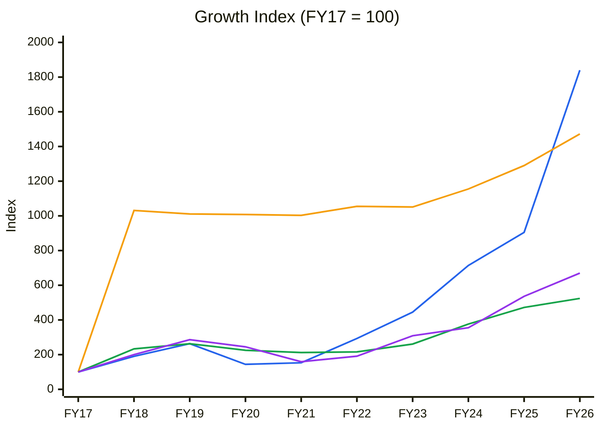
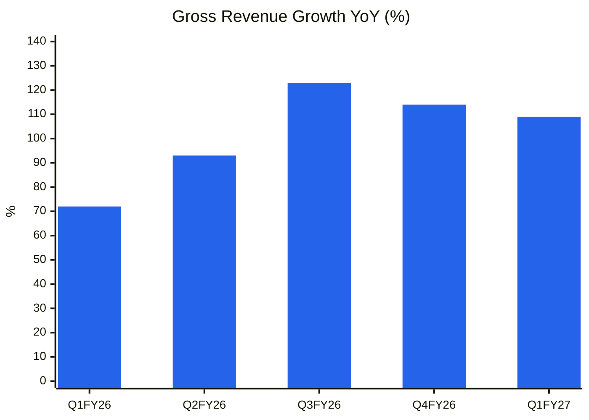
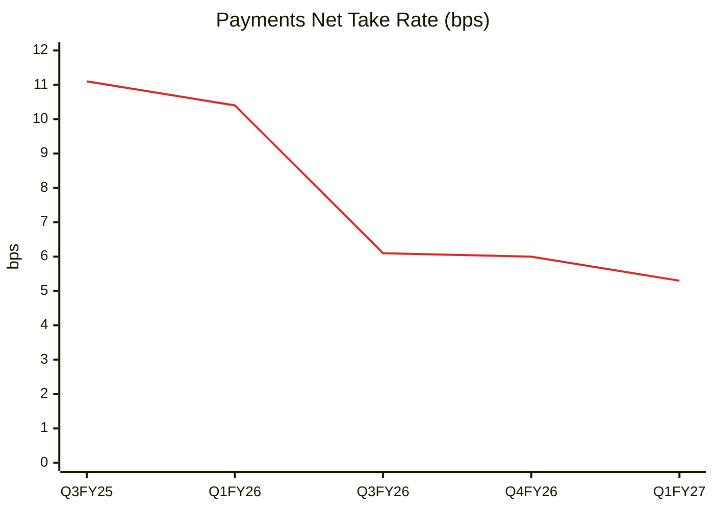
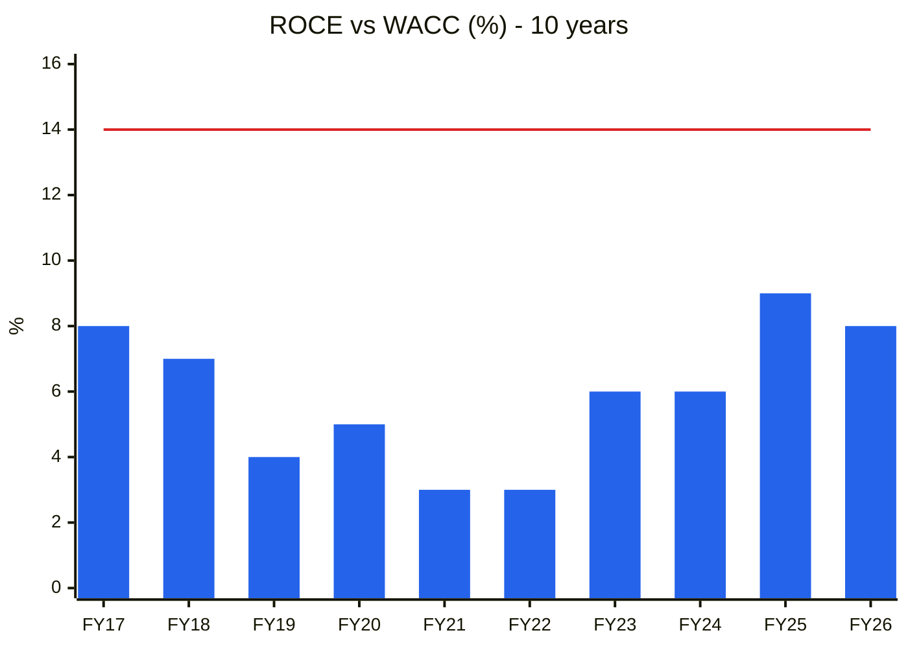
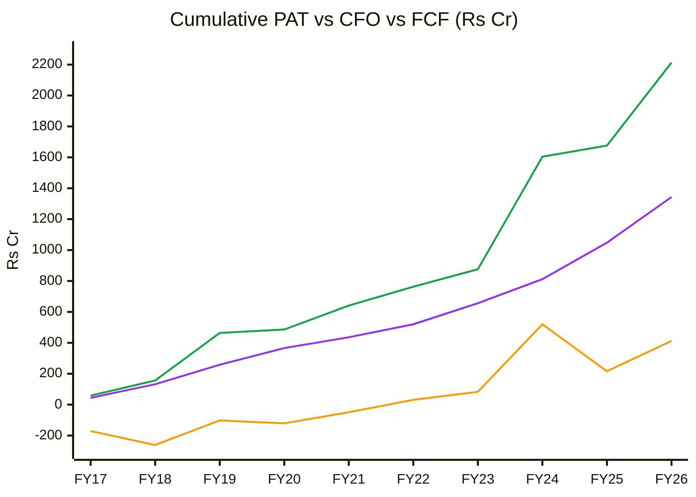
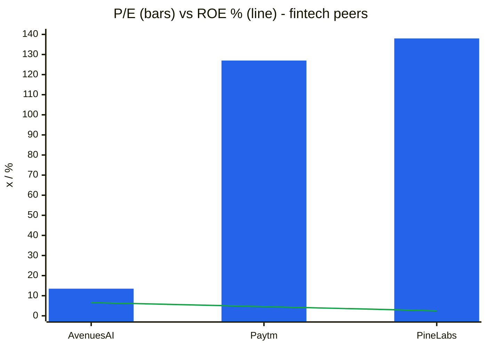
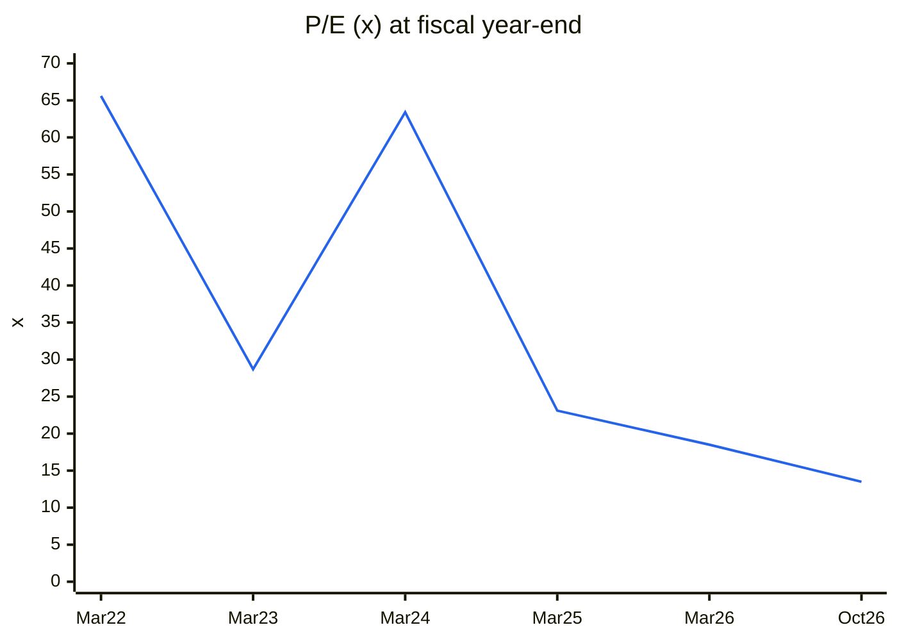
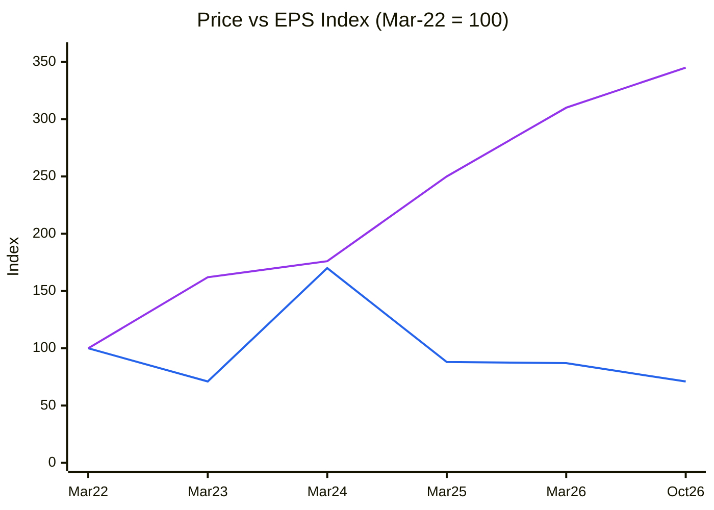
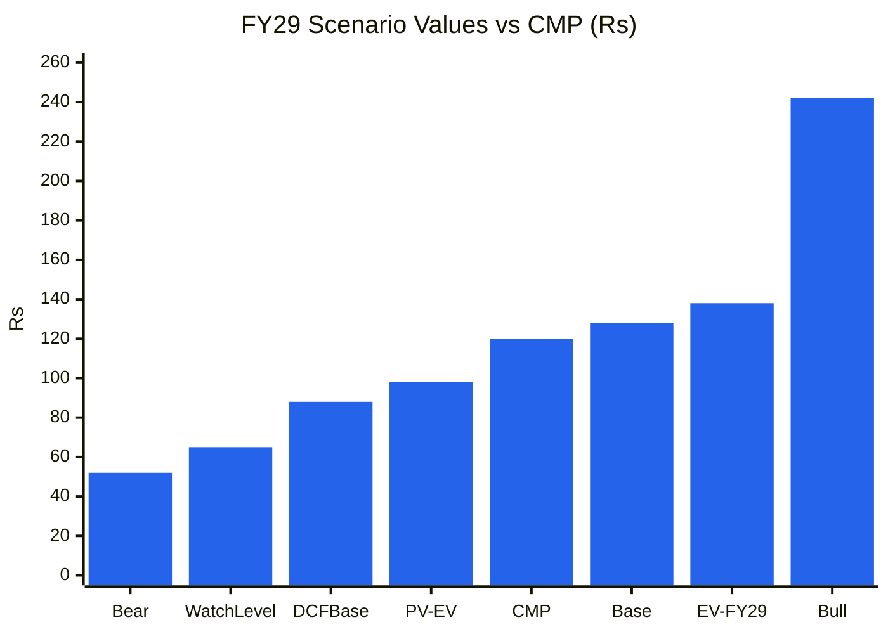

# Stock Analysis Report — AvenuesAI Ltd (formerly Infibeam Avenues; NSE: CCAVENUE · BSE: 539807)
**Date:** 2026-10-27
**Analyst:** Claude (Stock Fundamental Analysis Skill v3.3)
**Investment Horizon:** 2–3 Years
**Recommendation:** AVOID (hard stop: Weinstein Stage 4) → WATCHLIST, revisit only on the conditions in "Review triggers"
**Conviction Score:** 3.1 / 10
**CMP:** ₹120 (NSE close 26-Oct-2026, Screener.in) · Market cap ₹4,181 Cr (~34.8 Cr shares after the 10:1 consolidation, FV ₹10, record date 13-Oct-2026) · 52-wk range ₹114–205 (consolidation-adjusted)
**Filed under:** Financials and Fintech / Digital Payments · Themes: Digital platforms & fintech

> **Per-share data:** all prices and EPS are on the post-consolidation basis (₹10 FV). Screener.in and Yahoo Finance restate history; older press reports quote pre-consolidation prices (e.g. ₹13.90), which are equivalent to ₹139.

> **KPI reference:** the "Digital Payments / Payment Aggregator & Gateway" segment is **not** in `references/05-industry-kpis-india.md`. The 7 KPIs proposed in the session (TPV growth, net take rate, net revenue, EBITDA % of net revenue, merchant concentration, regulatory status, cash conversion ex-float) are used **in this report only**; the reference file was not changed (user approval pending).

## Revision Log
| Version | Date | Recommendation | Conviction | Price | Key change |
|---|---|---|---|---|---|
| Current | 2026-10-27 | AVOID (Stage 4 hard stop) → Watchlist | 3.1/10 | ₹120 | **Initial report.** Headline P/E ~13.5× looks cheap. Underneath: net revenue is shrinking (−3% YoY) because the take rate has halved (10.4 → 5.3 bps); EPS guidance for FY27 is flat; PAT leans on other income and a ~5% tax rate; FCF has been ~0.3× PAT over 10 years; and the stock is in a confirmed Stage 4 downtrend |

**Validation of previous report:** Initial report. No earlier report exists in the library (searched `CCAVENUE*`, `INFIBEAM*`, "Avenues", "CCAvenue" on 27-Oct-2026). New sub-sector folder `Financials-and-Fintech/Digital-Payments` created for this report (no existing sub-sector fits a payment aggregator).

---

## Executive Summary

AvenuesAI (Infibeam Avenues until Jan-2026) owns **CCAvenue**, India's first retail payment gateway (Top-3 among B2B online gateways, 10 mn+ merchants online and offline, ~8% claimed share of Indian digital payments). It also runs BillAvenue (Bharat BillPay operating unit), a UAE payments business (Top-2 non-bank private player), enterprise e-commerce software, an 82%-owned stake in Rediff.com, and new AI units (Phronetic AI, PrivateGPT). Q1 FY27: TPV **₹1.48 lakh Cr (+74% YoY)**, gross revenue **₹2,680 Cr (+109%)**, but **net revenue ₹147.5 Cr (−3%)**, EBITDA ex-OI ₹100 Cr (+41%), PAT ₹84.8 Cr (+45%) (Q1 FY27 earnings presentation, 11-Aug-2026).

**The headline numbers flatter the business:**
1. **Gross revenue is pass-through.** It doubled, but net revenue (after payment-processing charges) has been flat at ~₹147–153 Cr a quarter for five quarters. The **payments net take rate halved, 10.4 → 5.3 bps**, as zero-MDR (UPI/RuPay) and low-margin volumes grew. Volume growth is not monetising.
2. **Management itself guides flat EPS:** FY27 EPS ₹8.75–9.50 against FY26 ₹9.42 (post-consolidation, company basis), despite guiding gross revenue +35–60% to ₹11,000–13,000 Cr.
3. **Earnings quality is middling.** Other income is ~24–26% of EBIT (₹86–92 Cr). The effective tax rate fell to ~14% (FY26) and ~2% (Q1 FY27). Ten-year cumulative FCF (₹412 Cr) is only **0.31× cumulative PAT (₹1,343 Cr)**: cash goes into capitalised technology, acquisitions (Rediff) and strategic stakes (Ratnaafin, OPL).
4. **Returns on capital have never covered the cost of capital.** ROCE was 3–9% for ten years (FY17–FY26) on a book heavy with merger goodwill. Even on tangible capital, ROE is ~14%.
5. **Governance history:** a 2020 SEBI interim order found, on a preliminary basis, that the promoter-MD passed unpublished price-sensitive information to a relative whose group firm traded (₹3.6 Cr impounded; SAT stay; settlement applications filed). Promoter holding is low (27.3%). There has been a stream of intra-group transactions: the e-commerce slump sale to Rediff (₹800 Cr), the Nueromind merger, and a change in use of rights-issue proceeds.
6. **Technical hard stop.** The price (₹120) is ~20% below a **falling 30-week MA (₹150)**: Weinstein Stage 4. 52-week return −39% vs Nifty −11%.

The probability-weighted FY29 value is **₹138 (+15%)**, PV **₹98 (−18%)**. Upside/downside is 1.8:1; SVAR 57%. **AVOID.** A watchlist revival needs: take rate stabilising ≥5 bps with net revenue growth ≥10% YoY for two quarters, FY27 EPS delivered at the top of guidance, and a Stage 1 base followed by a weekly close above the 30-week MA.

### C1 — Growth Index: Gross Revenue vs Fixed Assets (incl. goodwill/intangibles + CWIP) vs EBITDA vs PAT (FY17 = 100, consolidated)

| ₹ Cr | FY17 | FY18 | FY19 | FY20 | FY21 | FY22 | FY23 | FY24 | FY25 | FY26 | TTM |
|---|---|---|---|---|---|---|---|---|---|---|---|
| Gross revenue | 441 | 839 | 1,159 | 633 | 676 | 1,294 | 1,962 | 3,150 | 3,993 | 8,116 | 9,516 |
| Fixed assets + CWIP | 211 | 2,175 | 2,134 | 2,126 | 2,117 | 2,226 | 2,217 | 2,436 | 2,723 | 3,105 | — |
| EBITDA (ex-OI) | 67 | 156 | 176 | 151 | 142 | 145 | 175 | 252 | 316 | 351 | 376 |
| PAT | 44 | 88 | 126 | 108 | 70 | 84 | 136 | 156 | 236 | 295 | 321 |

*Source: Screener.in consolidated (FY15–FY26, TTM to Jun-2026). The FY18 jump in fixed assets is the Infibeam–Avenues merger (goodwill/intangibles); the separate goodwill figure is a data gap (annual report note not retrieved).*

🟦 Gross revenue (9-yr CAGR 38%) · 🟧 Fixed assets + CWIP (35%) · 🟩 EBITDA (20%) · 🟪 PAT (24%)

**Read:** Gross revenue (🟦) grew ×18 in nine years, but EBITDA (🟩) grew only ×5 and PAT (🟪) ×7. Fixed assets (🟧, mostly goodwill and intangibles) jumped ×10 in FY18 and have kept rising since.

**Business inference:** The gap between the blue line and the green line *is* the business model: most of gross revenue is pass-through processing cost. Profit compounding (~20–24%) is respectable but was bought with a ~₹3,100 Cr asset base that has earned 3–9% ROCE. The FY26 doubling of gross revenue added only 11% to EBITDA.

---

## Business Primer

AvenuesAI earns money mainly by processing digital payments for merchants. CCAvenue (online gateway and aggregator, plus offline/POS via Go Payments) collects a merchant discount rate (MDR) on card, net-banking and wallet transactions, keeps a sliver after paying banks and card networks ("net take rate", 5.3 bps in Q1 FY27), and earns nothing on zero-MDR UPI/RuPay volume except where it charges convenience or platform fees. Other revenue lines are BillAvenue (bill-payment aggregation under Bharat BillPay), cross-border and UAE payments (Avenues World, CBUAE in-principle licence), enterprise e-commerce software (now transferred to Rediff.com, 82% owned), and early-stage AI and embedded-lending bets (Phronetic AI, PrivateGPT, small stakes in Ratnaafin Capital and Online PSB Loans). Customers are enterprises, SMEs and government (Indigo, Taj, ITC, MakeMyTrip, Jio, Airtel, Government of India, Emaar). Returns depend on two things: the **mix of MDR-earning volume** within total TPV, and keeping **regulatory licences** (RBI PA authorisation, PPI, BBPOU, CBUAE) in good standing.

This is a **payments infrastructure / fintech platform** whose reported revenue is mostly pass-through, so it must be judged on TPV, take rate and **net revenue**, not gross revenue or P/E alone. The key value driver is net take rate × TPV. The key risks are take-rate compression (UPI zero-MDR, a price war with Razorpay, PayU, Cashfree, Paytm and Pine Labs), regulation (RBI PA rules, MDR policy), and capital allocation. Four structural features colour the analysis. First, a large goodwill-heavy book from the 2017–18 merger that depresses reported ROE. Second, a very low promoter stake (27.3%) and a retail-dominated register (7.1 lakh shareholders, DIIs 0.17%). Third, frequent intra-group restructuring and diversification into new themes (e-commerce → payments → "AI"). Fourth, a 10:1 share consolidation in Oct-2026 that breaks naive per-share comparisons.

**New Segment Protocol:** segment **not covered** in the KPI reference. Proposed KPIs (session, 27-Oct-2026) were not approved for adding to the file, so they are applied in this report only (see Module 6).

---

## Module 1 — Broad Market Cycle (Marks)

Nifty 50 is at **22,753** (26-Oct-2026 weekly bar), ~14% below its 52-week high (26,373) and below a falling 30-week MA (~23,700). 1-year return −10.7%, 26-week −5.9% (Yahoo Finance weekly). India VIX ~14.4 and index P/E ~19.3× in early October (via the 14-Oct-2026 TARIL report). Fintech sentiment is mixed: the 2025–26 listing wave (Pine Labs, Turtlemint and others) is trading at very rich multiples while older small-cap fintechs de-rate. **Assessment: CAUTIOUS (leaning fearful).** Sizing: small.

---

## Module 1b — Sector Cycle: Tailwinds & Headwinds

**Secular (durable):** Indian digital payments keep compounding (UPI ~20 bn transactions a month in 2026; card and net-banking growth in travel, education, government and B2B). Cross-border e-commerce and GCC payments add to the TAM. Value-added services (orchestration, fraud, reconciliation, embedded credit) are where net revenue can grow.

**Structural headwind (not cyclical):** **zero-MDR on UPI and RuPay debit** means the fastest-growing volume earns nothing for an aggregator. Competition for large enterprise merchants is fierce (Razorpay, PayU, Cashfree, Juspay orchestration, bank gateways), and large merchants negotiate MDR down. AvenuesAI's own disclosure attributes the fall in take rate to a "higher share of low-margin and zero-MDR transactions" and "strategic volume expansion" (Q3 FY26 / Q1 FY27 decks).

**Decomposition:** TPV +74% YoY, net revenue −3%. **Net-revenue growth is ~0% today**. Our durable baseline is **8–12% net revenue growth**, *if* the take rate stabilises near 5 bps and value-added services grow. The TPV growth itself is largely low-value volume and should not be capitalised.

**Regulation:** RBI's PA-PG framework (escrow, net-worth, offline PA from 2025) raises the bar for small players, which helps incumbents. The new RBI PPI authorisation (Q1 FY27) and CBUAE in-principle licence are positives. The status of CCAvenue's final PA authorisation (vs in-principle) is not stated in the deck; it is described only as "multi-layer regulated payment licenses" (data gap; verify on the RBI list of authorised PAs).

**FX:** UAE business revenue in AED (pegged to USD), so FX exposure is small relative to group EBITDA.

**Sector cycle verdict: HEADWIND on monetisation (structural), TAILWIND on volume.** Module 8: no take-rate recovery in the base case. MoS: +5pp.

---

## Module 1c — Stock Cycle: Company Positioning

### C2 — Quarterly YoY gross revenue growth vs net revenue growth

| | Q1 FY26 | Q2 FY26 | Q3 FY26 | Q4 FY26 | Q1 FY27 |
|---|---|---|---|---|---|
| Gross revenue (₹ Cr) | 1,280 | 1,965 | 2,381 | 2,490 | 2,680 |
| Gross revenue YoY | 72% | 93% | 123% | 114% | 109% |
| Net revenue (₹ Cr) | 152.0 | 153.1 | n.d. | 149.5 | 147.5 |
| Net revenue YoY | — | +14% | n.d. | n.d. | −3% |

*Source: Screener.in quarterly (gross); Q1 FY27 deck p.15 (Q1 FY26, Q4 FY26, Q1 FY27 net revenue); HDFC Sky on Q2 FY26 (₹1,531 mn, +14%). Q3 FY26 net revenue and earlier YoY bases: data gap.*

🟦 Gross revenue YoY (consolidated)

**Read:** Gross revenue growth accelerated to 100%+, while net revenue went from +14% (Q2 FY26) to −3% (Q1 FY27).

**Business inference:** On a gross basis the growth trajectory looks like an accelerating "buy"; on the metric that pays for costs (net revenue) it is **decelerating to negative**. The skill's warning signal applies to the net line.

### Revenue decomposition: volume / price / mix
- **Volume:** TPV ₹850 bn (Q1 FY26) → ₹1,172 bn (Q2) → ₹1,655 bn (Q4) → ₹1,479 bn (Q1 FY27, −11% QoQ).
- **Price (take rate):** 11.1 bps (Q3 FY25) → 10.4 (Q1 FY26) → 6.1 (Q3 FY26) → 6.0 (Q4 FY26) → **5.3 (Q1 FY27)**.
- **Mix:** shift to zero-MDR and large low-margin merchants. Net revenue growth is therefore ~0: volume growth is fully offset by price/mix.

### KPI-1/2 — Payments net take rate (bps)

| | Q3 FY25 | Q1 FY26 | Q3 FY26 | Q4 FY26 | Q1 FY27 |
|---|---|---|---|---|---|
| Net take rate (bps, MDR-based options only) | 11.1 | 10.4 | 6.1 | 6.0 | 5.3 |
| TPV (₹ bn) | n.d. | 850 | n.d. | 1,655 | 1,479 |

*Sources: Inc42 (Q3 FY25, Q3 FY26); Q1 FY27 deck p.15 (others). Points are not evenly spaced (Q2 FY26 and Q4 FY25 not found).*

🟥 Net take rate (bps)

**Read:** The take rate fell by more than half in five reported quarters and is still falling (−13% QoQ in Q1 FY27).

**Business inference:** This is the single most important number for valuing AvenuesAI. Until it stabilises, every rupee of TPV growth buys less net revenue, and the "TPV +74%" headline has little value. Note the inconsistency: the deck claims a "~₹10 trillion annualised TPV run-rate", whereas Q1 FY27 annualises to ~₹5.9 trillion (definition unclear; data gap).

### Operating leverage
Net revenue ~₹600 Cr TTM. EBITDA ex-OI ~₹378 Cr (63% of net revenue). Fixed costs (people, tech, overhead) are ~₹220 Cr. **DOL on net revenue ≈ 1.6×** (EBIT ex-OI ~₹285 Cr). D&A has risen from ₹62 Cr to ~₹93 Cr TTM as capitalised technology (CWIP ₹448 Cr in FY25) is amortised. Interest is small (₹26 Cr TTM); ICR >10×.

### Guidance accuracy: see WTT (Module 4): **0.50 → LOW** → guidance haircut 20%.

### FCF inflection
None yet. Capex plus investments (₹448 Cr FY24, ₹644 Cr FY25, ₹911 Cr FY26) exceed CFO in most years. FY26 CFO (₹537 Cr) was flattered by merchant-settlement float (other liabilities +₹665 Cr). **FCF inflection: not visible**; it depends on management stopping new strategic investments.

### CY7 — Margin and ROCE vs history

| | FY17 | FY18 | FY19 | FY20 | FY21 | FY22 | FY23 | FY24 | FY25 | FY26 |
|---|---|---|---|---|---|---|---|---|---|---|
| OPM (on gross revenue) | 15% | 19% | 15% | 24% | 21% | 11% | 9% | 8% | 8% | 4.3% |
| ROCE (Screener) | 8% | 7% | 4% | 5% | 3% | 3% | 6% | 6% | 9% | 8% |

*OPM on gross revenue is meaningless as a margin trend (the mix of pass-through changed); shown only to explain why gross OPM keeps falling. ROCE is the relevant series.*

🟦 ROCE (Screener, consolidated) · 🟥 WACC ~14%

**Read:** ROCE never exceeded 9% in ten years, against a ~14% cost of capital.

**Business inference:** On reported capital, AvenuesAI has destroyed economic value every year since the 2017–18 merger. Part of that is the goodwill from merger accounting, but it also reflects persistent reinvestment into low-return assets. The skill's hard stop "ROIC persistently < WACC for 5+ years" is **triggered on reported numbers**. On tangible capital (ex-goodwill ~₹2,700 Cr, an estimate) ROCE is ~14–16%, roughly equal to WACC.

**Stock cycle classification: Maturing / monetisation trough.** Volume is growing but monetisation is falling. There is no identified reversible cause (zero-MDR is policy). **MoS +10pp.**

---

## Module 2 — Industry Structure & Capital Cycle

| Force | Payment aggregation (India + UAE) | Signal |
|---|---|---|
| New entrants | Medium. RBI PA authorisation (net worth ₹15–25 Cr, escrow, compliance) is a hurdle, but dozens of PAs are authorised and bank-led gateways compete | Moderate barrier |
| Supplier power | **High.** Card networks, issuing banks and NPCI set interchange and MDR; zero-MDR is government policy | Price-takers |
| Buyer power | **High.** Large merchants (airlines, telcos, government) run multi-PG routing and push MDR down | Weak pricing power |
| Substitutes | High. Direct UPI collect/intent, bank gateways, payment orchestration (Juspay) that commoditise PGs | Structural pressure |
| Rivalry | **Intense.** Razorpay, PayU, Cashfree, Paytm, PhonePe PG, Pine Labs (Plural), BillDesk; in the UAE, Network International, Checkout, Stripe | Price-driven |

**Industry verdict: UNATTRACTIVE structurally** for the pure-gateway layer; attractive only in value-added services. MoS: +5pp.
**Capital cycle:** capital keeps flooding in: new fintech IPOs (Pine Labs 2025), well-funded private players (Razorpay, Cashfree, Juspay), and incumbents diversifying into lending and AI. **Position: crowded, returns compressed.**

---

## Module 3 — Business Quality & Moat

### Greenwald's three barriers
1. **Supply/cost advantage:** weak. Scale lowers per-transaction cost, but rivals have similar or greater scale (Razorpay, PayU). A 63% EBITDA/net-revenue margin is high, but partly reflects capitalisation of technology spend (D&A rising) and a small headcount.
2. **Customer captivity:** limited. Payment gateways are switchable (multi-PG routing is standard at large merchants). The RediffOne "operating system" and embedded payments aim to raise switching costs: an aspiration, not evidence.
3. **Local scale:** some in UAE (Top-2 non-bank private player) and in government/education verticals in India.

**Buffett 10% price test: Fail.** The take rate fell 49% YoY; the company is buying volume.
**Moat verdict: NONE to NARROW** (licences and integrations are table stakes).

### Fisher 15-point checklist
| # | Point | Score | Note |
|---|---|---|---|
| 1 | Market potential | 3 | Digital payments, GCC, value-added services |
| 2 | New products | 2 | Many launches (PPI, PrivateGPT, RediffOne, lending stakes); unfocused |
| 3 | R&D effectiveness | 1 | Large capitalised tech spend; no net-revenue growth yet |
| 4 | Sales organisation | 2 | Strong enterprise and government logos |
| 5 | Profit margin | 2 | High on net revenue; low on capital |
| 6 | Margin improvement | 1 | Take rate falling; growth reinvested in "AI" |
| 7 | Labour relations | 2 | No issues found |
| 8 | Executive relations | 2 | Family-led (Mehta brothers) |
| 9 | Management depth | 2 | Long-tenured payments team |
| 10 | Cost/accounting controls | 1 | Low tax rate, heavy other income, frequent restructurings, capitalised development |
| 11 | Industry advantages | 1 | None durable |
| 12 | Long-range orientation | 2 | Long-term vision, but the theme keeps changing |
| 13 | Dilution | 1 | ₹700 Cr rights issue (2025); share count rising ~4%/yr long-term |
| 14 | Candour | 2 | Discloses net revenue and take rate (good); explains the decline as "strategic" (spin) |
| 15 | **Integrity** | **2** | **Pass, with a serious flag.** 2020 SEBI interim order on alleged UPSI passing by the promoter-MD (SAT stay; settlement applied). No final adverse finding found |
| | **Total** | **26 / 45** | |

---

## Module 4 — Management & Capital Allocation

**Promoters:** Vishal Mehta (CMD) and family. **Promoter holding 27.34%** (Sep-2026), down from 28.13% (Dec-2023). **Pledge: none shown** on Screener (verify on BSE; data gap). FIIs 5.85% (falling from 7.72%), DIIs 0.17%, public 66.2%, 7.1 lakh shareholders.

| Check | Finding | Flag |
|---|---|---|
| Promoter stake | Low (27%) and drifting down; promoters did subscribe to the rights issue (not verified individually) | ⚠️ |
| Pledge | None reported | ✅ |
| **SEBI insider-trading order (Aug-2020)** | ₹3.6 Cr impounded from 4 entities incl. Infinium Motors (Gujarat), a group firm. SEBI's preliminary finding: the MD passed UPSI on a 2016–17 stock split to his brother. SAT stayed the order (May-2021); settlement applications filed ([Business Standard](https://www.business-standard.com/amp/article/markets/sebi-orders-impounding-rs-3-6-cr-from-4-entities-in-insider-trading-case-120082501212_1.html)). Current status: data gap | 🔴 Governance flag |
| Intra-group transactions | E-commerce platform slump sale to Rediff.com (₹800 Cr: ₹400 Cr cash + ₹400 Cr Rediff shares; FY25 EBITDA ₹137 Cr) moves a profitable business into a subsidiary planning an IPO, where minorities hold ~17–18% ([Entrackr](https://entrackr.com/news/infibeam-to-sell-e-comm-unit-to-rediff-for-rs-800-cr-9639626)); Nueromind merger; RPT disclosures list Infinium group entities | ⚠️ |
| Use of rights proceeds | ₹294 Cr earmarked for AI via Nueromind, now to be spent directly (variation approved Aug-2026) | ⚠️ Purpose drift |
| Partly-paid shares | Rights issue ₹700 Cr at ₹10 (pre-consolidation; ₹5 + ₹5 call). Forfeiture of unpaid partly-paid shares announced (Screener note) | Neutral |
| Dividend vs FCF | No dividend since FY24 (payout 9–15% FY21–FY24) | ⚠️ |

**Capital allocation (Thorndike):** ten-year cumulative CFO ₹2,213 Cr, but FCF only ₹412 Cr. Investing outflows of ~₹3,000 Cr went to capitalised technology, CWIP, acquisitions (Rediff ~₹25–50 Cr for 54%, then the ₹800 Cr intra-group transfer) and strategic stakes (Ratnaafin 2.5%, OPL 7%). Equity issuance funded much of it (rights ₹700 Cr in 2025). EPS CAGR FY18–FY26 ~12% vs PAT CAGR ~16%: dilution ~4% a year. **Capital allocation rating: Poor** (ROCE persistently < WACC; strategy drift).

**Buffett Three C's:** Candour: Moderate (discloses take rate and net revenue). Competence: Moderate (built a profitable gateway; no returns on capital). Caring: Low (no dividend, dilution, governance history).

### Walk the Talk Scorecard
| Period | Statement | Guided | Actual | Verdict |
|---|---|---|---|---|
| FY26 guidance (early FY26) | FY26 gross revenue growth | Strong (number not retrieved) | ₹8,116 Cr, +103% | ✅ Hit (gross) |
| FY26 | Net revenue "key indicator of progress" | Growth | FY26 roughly flat; Q1 FY27 −3% | ❌ Miss |
| FY26 | Take rate | Stable (implied) | 10.4 → 6.0 bps | ❌ Miss |
| FY26 | PAT growth | Growth | +25% (₹295 Cr) | ✅ Hit (helped by other income and low tax) |
| FY27 guidance (Aug-2026) | Gross revenue ₹11,000–13,000 Cr; EPS ₹8.75–9.50 | — | FY26 EPS ₹9.42 → guidance implies flat-to-down EPS | 🔴 Reversal of the earnings-growth narrative |
| Rights issue (2025) | ₹294 Cr AI spend via Nueromind | Investment via subsidiary | Re-routed to direct spend (Aug-2026) | ⚠️ Changed |

**WTT Score: (2 + 0.5) ÷ 5 = 0.50 / 1.00 — LOW.**
**Guidance points assessed:** 5 scored | Hits: 2 | Near misses: 1 (rights use) | Misses: 2 | Reversals: 1
**Key pattern:** **selective emphasis.** Guidance is given on gross revenue (which grows with pass-through volume) and EPS, while the economically meaningful metric (net revenue) is shrinking. Frequent re-framing ("Payments → AI").
**Insider action:** no open-market promoter buys found (BSE Form C check: data gap) → **NEUTRAL-to-BEARISH** given the stake drift.
**DCF impact:** 20% haircut to growth narratives; base case uses net revenue, not gross revenue.
**Overall management credibility: LOW-MODERATE.**

---

## Module 5 — Financial Forensics

### 5A. Indian-specific red flags
| Check | Finding | Flag |
|---|---|---|
| Pledge | None reported | ✅ |
| RPT / group | Infinium group entities in RPT disclosures; Rediff slump sale; Nueromind | ⚠️ |
| Revenue quality | Gross revenue is pass-through; net revenue flat. Debtor days 5 (normal for PA) | ⚠️ (use net revenue) |
| Regulatory / SEBI | 2020 insider-trading interim order (stayed) | 🔴 |
| Audit | Auditor name, KAMs and any EOM not retrieved (data gap) | ⚠️ |
| **Tax rate** | 25% (FY24) → 23% → 14% (FY26) → −5% (Q4 FY26) → 2% (Q1 FY27); reason not disclosed in the sources used | 🔴 Unexplained |
| **Other income** | ₹86 Cr FY26 = 24% of EBIT; ₹92 Cr TTM | 🔴 >15% recurring |
| Capitalised development | CWIP ₹311 Cr (FY24) → ₹448 Cr (FY25) → ₹188 Cr (FY26, capitalised); D&A rising | ⚠️ EBITDA flattered |

### 5B. Quantitative models
| Model | Value | Reading |
|---|---|---|
| **Beneish M-Score** | Not computed: gross-revenue pass-through (SGI 2.03) and goodwill-heavy assets make DSRI/AQI/SGI misleading for a PA | ⚠️ Data unsuitable |
| **Altman Z''** (FY26, approx.) | ~2.4 (X1 low: WC net of merchant float ~0.17; X2 retained earnings small vs merger premium; X3 0.05; X4 1.9) | Grey zone (an artefact of float and goodwill) |
| **Piotroski F** (FY26) | **5 / 9** | Average. ROA+, CFO+, CFO>NI, AT up, gross revenue margin n/a ✓; ΔROA flat, leverage up (borrowings ₹172 → ₹430 Cr), dilution (rights), current ratio ✗ |
| **Sloan CF accrual** | FY25 **+15.4%**, FY26 **+10.6%** | 🔴 Above the 10% flag both years (investing-driven); balance-sheet accrual FY26 −3.8% (float) |
| **Cumulative FCF ÷ PAT (FY17–26)** | **0.31** | 🔴 |

### 5C. Schilit screen
| Shenanigan | Result |
|---|---|
| Revenue too soon / bogus | Gross revenue growth is pass-through, not fake; net revenue disclosed ✅ |
| One-time boosts | Other income 24% of EBIT 🔴 |
| Capitalising expenses | Heavy capitalised tech (CWIP ₹448 Cr) ⚠️ |
| Hiding losses | Goodwill ~₹2,000 Cr+ (est.) never impaired despite ROCE <WACC for a decade ⚠️ |
| Cash-flow shenanigans | CFO swings with merchant settlement float (FY24 ₹728 Cr, FY25 ₹72 Cr, FY26 ₹537 Cr): CFO is not a clean earnings check ⚠️ |

**Forensic red-flag count: 4 unresolved** (unexplained tax rate; other income >15%; Sloan >10% two years; FCF/PAT 0.31), plus governance (SEBI 2020) and the goodwill-impairment question. **≥3 unresolved → deep investigation required; hard-stop condition met.**
**Overall forensic verdict: Significant concerns.**

---

## Module 5 (cont.) — Earnings Quality & Financial Statements

### Reformulated (net revenue basis), TTM to Jun-2026
| Item | ₹ Cr | Note |
|---|---|---|
| Gross revenue | 9,516 | Screener TTM |
| Net revenue | ~600 | Q2 FY26 153 + Q3 FY26 ~150 (est.) + Q4 150 + Q1 148 |
| EBITDA ex-OI | ~378 | 63% of net revenue |
| D&A | 93 | |
| EBIT ex-OI | ~285 | 47% of net revenue |
| Other income | 92 | Treasury, interest on float/cash |
| PBT | 349 | |
| PAT | 321 | Tax ~8% TTM |
| **Normalised PAT** (25% tax on PBT) | **~262** | EPS ~₹7.5 → P/E ~16× |

### DuPont (5-factor, consolidated, year-end balances)
| Year | EBIT margin (gross) | Asset turnover | Equity multiplier | Interest burden | Tax burden | ROE |
|---|---|---|---|---|---|---|
| FY22 | 7.7% | 0.34 | 1.30 | 0.98 | 0.86 | 2.8% |
| FY23 | 9.4% | 0.48 | 1.30 | 0.99 | 0.75 | 4.3% |
| FY24 | 6.7% | 0.61 | 1.52 | 0.99 | 0.75 | 4.6% |
| FY25 | 7.9% | 0.74 | 1.44 | 0.97 | 0.77 | 6.3% |
| FY26 | 4.4% | 1.11 | 1.54 | 0.95 | 0.87 | 6.2% |

**Operating contribution:** EBIT margin × AT rose from 2.6% to 4.9%, but only because gross revenue inflates AT. On net revenue the operating contribution is flat.
**Financing contribution:** the equity multiplier rose 1.30 → 1.54 (float liabilities + borrowings ₹0 → ₹430 Cr). **Tax burden rising (0.75 → 0.87)** helped FY26 ROE.
**DuPont verdict:** ROE has been stuck at ~3–6%. The FY25–26 improvement came from asset-turnover optics (pass-through), a lower tax rate and higher leverage, **not from better unit economics**.

### C7 — Cumulative PAT vs CFO vs FCF (₹ Cr)
| | FY17 | FY18 | FY19 | FY20 | FY21 | FY22 | FY23 | FY24 | FY25 | FY26 |
|---|---|---|---|---|---|---|---|---|---|---|
| Cum. PAT | 44 | 132 | 258 | 366 | 436 | 520 | 656 | 812 | 1,048 | 1,343 |
| Cum. CFO | 59 | 156 | 464 | 486 | 641 | 763 | 876 | 1,604 | 1,676 | 2,213 |
| Cum. FCF | −171 | −261 | −102 | −121 | −49 | 31 | 83 | 520 | 216 | 412 |

🟪 Cumulative PAT · 🟩 Cumulative CFO (includes merchant float) · 🟧 Cumulative FCF

**Read:** CFO runs well above PAT (1.65×), but FCF is only 0.31× PAT over ten years.

**Business inference:** CFO is flattered by merchant settlement balances, which are not shareholder cash. After capex and investments, little cash reaches shareholders. The profits are real in an accounting sense but have been reinvested at sub-WACC returns.

**O'Glove red flags: 5 / 15** (#6 capex/D&A >2.5× outside a growth phase; #7 other income/EBIT >15%; #9 Sloan >10%; #13 tax rate far below statutory; #8 recurring restructuring items). **Key accounting concerns:** tax rate, other income, capitalised development, goodwill never impaired.

---

## Module 6 — Industry KPIs & Peer Analysis

**Sector:** Digital Payments / Payment Aggregator & Gateway (KPIs from this session's proposal; not in the reference file).

| # | KPI | AvenuesAI | Healthy | Assessment |
|---|---|---|---|---|
| 1 | TPV growth | +74% YoY (Q1 FY27); −11% QoQ | >25% | ✅ Above (but mostly zero-MDR) |
| 2 | Net take rate | 5.3 bps, −49% YoY, still falling | Stable 8–15 bps | 🔴 Below and falling |
| 3 | Net revenue growth | −3% YoY | ≥ TPV growth | 🔴 Below |
| 4 | EBITDA % of net revenue | 68% (Q1 FY27); 63% TTM | 35–50% | ✅ Above (check capitalisation) |
| 5 | Merchant base / concentration | 10 mn+ merchants; top-10 share not disclosed | top-10 <30% | ⚠️ Data gap |
| 6 | Regulatory status | RBI PPI authorised (2026); BBPOU; CBUAE in-principle; PA status "multi-layer" | Final licences | ⚠️ Verify final PA authorisation |
| 7 | Cash conversion ex-float | FCF/PAT 0.31 (10-yr) | CFO/PAT >0.8 ex-float | 🔴 Below |

### Peer comparison (Screener.in, 26-Oct-2026)
| Metric | AvenuesAI | Paytm (One97) | Pine Labs |
|---|---|---|---|
| Market cap (₹ Cr) | 4,181 | 1,06,250 | 17,881 |
| TTM revenue (₹ Cr) | 9,516 (gross) / ~600 (net) | 9,554 | 2,832 |
| TTM operating profit (₹ Cr) | 376 | 757 | 409 |
| TTM PAT (₹ Cr) | 321 | 853 | 127 |
| 3-yr revenue CAGR | 61% (gross) | 2% | 19% |
| ROCE | 7.7% | 5.0% | 4.2% |
| ROE | 6.6% | 4.6% | 2.5% |
| P/E (TTM) | **13.5** | 127 | 138 |
| P/B | 0.88 (≈2.0 on tangible BV, est.) | 6.4 | 3.0 |
| EV / net revenue | ~6.7× | n.c. | n.c. |

### C12 — P/E vs ROE (peers)

🟦 P/E TTM · 🟩 ROE (%). *Only three peers: shown for scale, not as a band.*

**Read:** AvenuesAI trades at ~1/10th of its listed fintech peers' P/E, with a slightly higher (still poor) ROE.

**Business inference:** The discount is the market's judgement on earnings quality (tax, other income), take-rate collapse, governance and capital allocation, not an anomaly. All three earn ROE below their cost of equity. Paytm and Pine Labs are priced on scale and optionality. AvenuesAI has neither the growth in net revenue nor the institutional sponsorship (DIIs 0.17%) to re-rate without a visible inflection.

**Peer positioning:** deep discount. **Justified? Largely yes.**

*Order Book Tracker: not applicable (transaction-processing business, no order book).*

---

## Module 7 — Market Size & Market Share

**TAM:** Indian digital payments value is ~₹2,000+ lakh Cr a year (UPI ~₹25 lakh Cr a month in 2026, plus cards and net banking). The monetisable TAM for aggregators is a fraction (MDR-bearing volume). **SAM** (online PA, enterprise/SME + UAE + bill pay): data gap.
**Share:** management claims ~8% of Indian digital payments by value. Q1 FY27 TPV ₹1.48 lakh Cr/quarter (~₹5.9 lakh Cr annualised).
**Share trend:** gaining volume share (TPV +74% vs market ~25–30%), **losing value share** (net revenue −3%).
**Share-gain driver:** *temporary/bought*: price (take rate) concessions and zero-MDR volume.
**Verdict:** **taking volume share by giving up price.** The skill classifies this as low-quality share gain.

---

## Module 8 — Valuation: PIE First, Then DCF

### 8A. Price-Implied Expectations
**EV** ≈ ₹4,181 Cr mcap + ₹430 Cr borrowings − ~₹600 Cr investments/cash (est.; merchant float excluded) ≈ **₹4,000 Cr**. EV/EBITDA (ex-OI) ~10.6×; EV/net revenue ~6.7×; EV/NOPAT ~19×.
Reverse DCF on **net revenue** (base ₹600 Cr, NOPAT margin 36% of net revenue, terminal g 6%, terminal ROIC 15%):

| PIE driver | Market-implied | My base case | Gap |
|---|---|---|---|
| Net revenue CAGR (10 yr) | **16–22%** (WACC 13–14%, S/C 0.6–1.0); 21–26% at WACC 15% | ~8–10% (take rate stabilises ~5 bps) | **−6 to −12pp (optimistic gap)** |
| NOPAT margin on net revenue | 36% | 34–36% | ~0 |
| Investment rate | High (S/C 0.6–1.0, tech + stakes) | Same | 0 |

A no-growth value is only ~₹1,550 Cr EV (NOPAT ₹216 Cr ÷ 14%). **Even at 13.5× P/E, the market prices mid-to-high-teens net revenue growth for a decade**, while net revenue is currently shrinking. The low P/E is a mirage created by other income, a low tax rate and a goodwill-heavy book.

**Expectations treadmill:** to beat the PIE, AvenuesAI must (a) stop the take-rate decline (≥5 bps), (b) grow net revenue ≥15% a year from FY28, *and* (c) stop deploying cash into low-return stakes.

**Triggers:**
- Positive: take rate up QoQ; net revenue +10% YoY; a large MDR-bearing merchant win (cross-border, US); credible Rediff IPO valuing the 82% stake above book; buyback or dividend.
- Negative: take rate <5 bps; FY27 EPS below ₹8.75; another equity raise; adverse SEBI/RBI action; Rediff IPO at a low valuation.

**SVAR:** bear value ₹52 → **57%** → unfavourable.

### 8B. Own DCF / relative / Graham
- Base DCF (net revenue +10% for 5 yrs fading to 6%, NOPAT margin 35%, WACC 14%, S/C 0.8): ~₹2,900 Cr EV → **~₹88/share**.
- Relative: on normalised EPS ₹7.5 × 12–14× (deep-discount fintech/IT-services multiple for low ROE) = **₹90–105**.
- **Graham Number:** √(22.5 × ₹8.91 × ₹136 BV) = **₹165**. Inflated by goodwill in BV; on tangible BV (~₹59) it is ~₹109.
- Graham defensive screen: revenue >₹2,000 Cr ✓ · current ratio ≥2 ✗ · positive EPS 7 yrs ✓ · dividend ✗ (suspended) · EPS growth ≥30% over 7 yrs ✓ · P/E ≤20 ✓ · P/B ≤3 ✓ → **5/7**, a "statistically cheap" profile that the forensic and ROIC tests overrule.

### CY1 — P/E history (consolidation-adjusted price, TTM EPS)
| | Mar-22 | Mar-23 | Mar-24 | Mar-25 | Mar-26 | Oct-26 |
|---|---|---|---|---|---|---|
| Price (₹) | 169 | 120 | 288 | 149 | 148 | 120 |
| EPS (₹, FY) | 2.58 | 4.17 | 4.54 | 6.46 | 8.00 | 8.91 (TTM) |
| P/E (×) | 65.6 | 28.7 | 63.4 | 23.1 | 18.5 | 13.5 |

🟦 P/E (price at year-end ÷ FY EPS; Oct-26 on TTM)

**Read:** The P/E de-rated from 60×+ to 13.5× over four years, even as EPS more than tripled (₹2.58 → ₹8.91).

**Business inference:** This is a classic **de-rating trap in progress**. Each year the market pays less for earnings it does not trust (low-quality, non-cash, non-dividend). Absent a change in capital allocation or monetisation, there is no floor implied by "historical" multiples.

### CY4 — Price vs EPS index (Mar-22 = 100)
| | Mar-22 | Mar-23 | Mar-24 | Mar-25 | Mar-26 | Oct-26 |
|---|---|---|---|---|---|---|
| Price | 100 | 71 | 170 | 88 | 87 | 71 |
| EPS | 100 | 162 | 176 | 250 | 310 | 345 |

🟦 Price · 🟪 EPS

**Read:** EPS ×3.45 since Mar-2022; the price is 29% lower.

**Business inference:** Shareholders earned nothing from 3.5× EPS growth: the multiple fell faster than earnings rose. That is the market's verdict on the conversion of earnings into per-share value.

### 8D. Scenario analysis (FY29E; 34.84 Cr shares; minorities ~5%)
| Scenario | Net revenue FY29 | EBITDA % NR | EPS FY29 | P/E | Target price | Probability |
|---|---|---|---|---|---|---|
| Bull | ₹1,040 Cr (+20% p.a.; VAS, cross-border, take rate recovers) | 65% | ₹13.4 | 18× | **₹242** | 25% |
| Base | ₹800 Cr (+10% p.a.; take rate ~5 bps) | 60% | ₹9.2 | 14× | **₹128** | 50% |
| Bear | ₹600 Cr (flat; take rate keeps falling) | 55% | ₹5.2 | 10× | **₹52** | 25% |
| **Expected value (FY29)** | | | | | **₹138 (+15%)** | |

*D&A ₹110–120 Cr; other income ₹70–90 Cr; interest ₹30–35 Cr; tax 20–25% (normalising from ~5%).*
- **PV of EV** (2.4 yrs @ 15%) = **₹98** (−18% vs CMP). Base PV ₹92.
- **Upside/downside:** (242 − 120) ÷ (120 − 52) = **1.8:1** (below 2:1).
- **Required MoS** (small-cap, complex group, governance flag): 45% + 10pp (headwind/trough) → **watch level ≈ ₹98 × (1 − 0.35) ≈ ₹65** (35% applied to the PV, which already embeds a 15% discount rate).

### C13 — Scenario values vs CMP (₹)

🟦 ₹ per share

**Read:** CMP (₹120) sits above the DCF base (₹88) and the discounted expected value (₹98), and just below the undiscounted base (₹128).

**Business inference:** At ₹120 the base case returns ~3% a year to FY29. Only the bull case (take-rate recovery plus a value-added-services ramp) rewards the risk, and the trend in the data points the other way.

### Cycle Position Dashboard
| Dimension | Current | History | Percentile | Signal |
|---|---|---|---|---|
| P/E | 13.5× | 18–66× (FY22–26) | 0th (lowest) | Cheap, but de-rating trend |
| P/B | 0.88× | — | — | Cheap on reported BV; ~2× tangible |
| Net take rate | 5.3 bps | 10–11 bps (FY25) | Lowest | **Trough (structural)** |
| ROCE | 7.7% | 3–9% (10 yrs) | ~80th | Below WACC throughout |
| Net revenue growth | −3% | +14% (Q2 FY26) | Low | Weakening |
| **Overall** | | | | **Monetisation trough, no identified reversal** |

---

## Module 9 — Technical Stage (Weinstein + CANSLIM)

**Nifty 50: Stage 4** (22,753 vs falling 30-week MA ~23,700).
**Sector (fintech / Nifty Financial Services):** mixed; no sector index pulled (data gap).
**Stock: STAGE 4 (declining).**

| Check | Evidence |
|---|---|
| Price vs 30-week MA | ₹119.8 vs MA **₹150.4**, i.e. 20% below |
| MA slope | **Falling:** ₹156.9 (20 wks ago) → ₹154.6 (10) → ₹151.8 (5) → ₹150.4 |
| Highs/lows | 52-wk high ₹205 → lower highs ₹189 (2026), ₹171.7 (Aug-2026); new 52-week low ₹113.8 (week of 19-Oct) |
| Volume | Breakdown week 19-Oct: 6.9 M vs 20-wk avg 7.8 M (not climactic) |
| RS vs Nifty | 26-wk −12.8% vs −5.9%; 52-wk −38.6% vs −10.7% → **deteriorating** |

**Hard stop triggered:** "Stock in Weinstein Stage 4 with declining 30-week MA."
**What would change it:** a Stage 1 base (≥12–16 weeks of sideways trading with the MA flattening) and a weekly close above the 30-week MA (~₹150 today) on ≥1.5× average volume.

**CANSLIM:** C (Q1 PAT +45%, but EPS growth via low tax) 1 · A (EPS growth ≥25% × 3 yrs: FY24 +9%) 0 · N (new 52-week low) 0 · S (large retail float) 0 · L (laggard) 0 · I (FII falling, DII ~0) 0 · M (Stage 4 market) 0 → **1 / 7**.
**Combined verdict:** Stage 4 → **do not buy; holders exit or hedge.** **Alignment: aligned (both negative).**

---

## Module 10 — Forward View: 2–3 Year Thesis

### Capex classification (estimates; segment capex not disclosed)
| Type | FY27E | FY28E | FY29E | In model? |
|---|---|---|---|---|
| Capitalised technology / AI development | ~₹200 Cr | ~₹180 Cr | ~₹180 Cr | Treated as growth reinvestment (intangible) |
| Maintenance (~D&A) | ~₹100 Cr | ~₹110 Cr | ~₹120 Cr | ❌ |
| Strategic investments (Ratnaafin, OPL, others) | ~₹100–300 Cr | ? | ? | ❌ non-operating |
| CWIP (Mar-2026) | ₹188 Cr | | | ❌ until capitalised |

**Unit-economics track (Module 10A-ii) applies, not the capex-AT model.** The unit is ₹1 lakh of TPV:
- **Contribution per unit:** net take rate 5.3 bps = ₹5.3 per ₹1 lakh TPV (MDR-bearing only; zero-MDR earns ~0).
- **Fixed cost base:** ~₹220 Cr a year (people + tech + overhead, ex-D&A), covered at ~₹415 bn of MDR-bearing TPV per year at 5.3 bps. Comfortably covered today: the business is profitable at the unit level.
- **Marginal vs blended:** the **marginal** cohort (new volume) carries a lower take rate than the blended base. That is the classic "land-grab with falling marginal economics" pattern (red flag #4 in 10A-ii).
- **CAC / retention:** not disclosed (data gap).

### Forward P&L (base)
| ₹ Cr | FY27E | FY28E | FY29E |
|---|---|---|---|
| Gross revenue (guided ₹11,000–13,000 Cr for FY27) | 11,000 | 13,000 | 15,000 |
| Net revenue | 610 | 700 | 800 |
| EBITDA (60–62% of NR) | 375 | 425 | 480 |
| D&A | 100 | 110 | 110 |
| Other income | 85 | 80 | 80 |
| Interest | 28 | 30 | 30 |
| PBT | 332 | 365 | 420 |
| Tax (rising to 20%) | 10% | 15% | 20% |
| PAT (after ~5% minorities) | 284 | 295 | 319 |
| EPS (₹) | 8.1 | 8.5 | 9.2 |
| FCF (after tech capex ₹180–200 Cr, before stakes) | ~150 | ~170 | ~200 |

*FY27E EPS ₹8.1 sits below the guided ₹8.75–9.50 (20% WTT haircut on growth; normal tax drift).*

### Key catalysts
1. Q2 FY27 results (~mid-Nov-2026): take rate, net revenue, tax rate.
2. Rediff.com IPO / fundraise: could crystallise value for the 82% stake (or expose a low valuation).
3. Final RBI PA authorisation / UAE CBUAE final licence: FY27.
4. Any capital-return policy (buyback/dividend) or a halt to new strategic investments.

### Key risks
1. **Take rate keeps falling** (more zero-MDR, enterprise MDR cuts). **High.**
2. **Tax normalisation** (from ~5% to 25%) cuts PAT by ~20%. **Medium-High.**
3. **More equity issuance / diversification** (AI, lending, consumer) at sub-WACC returns. **Medium-High.**
4. **Regulatory / governance event** (SEBI case outcome, RBI action on PA compliance). **Low-Medium.**
5. **Goodwill impairment** if Rediff/e-commerce or the AI bets underperform. **Medium.**

### Scenario summary
Bull ₹242 (25%) · Base ₹128 (50%) · Bear ₹52 (25%) → EV ₹138 (FY29), **PV ₹98**. Return from CMP: +15% nominal over 2.4 years; **−18% on a PV basis**.

---

## Checklist Summary
**Section 0 (Existing Report / Library Filing):** 5/5. Initial report; new sub-sector `Financials-and-Fintech/Digital-Payments`; theme added; index rebuilt.
**Section A (Business Quality):** 15/18. Scuttlebutt, BSE Form C and merchant concentration are data gaps.
**Section B (Forensics):** 7/9. Beneish not meaningful for a pass-through PA; auditor/KAM data gap.
**Section C (Financial Statements):** 10/12. Goodwill split and Ind AS 116 not retrieved.
**Section D (KPIs & Peers):** 6/7. KPI block not in the reference (approval pending).
**Section E (Market Size & Share):** 5/7. SAM and value share are data gaps.
**Section F (Valuation):** 10/10.
**Section G (Technical):** 7/8. Sector index chart is a data gap.
**Section H (Forward View):** unit-economics track run (partial: CAC/retention not disclosed).
**Section I (Charts):** 5/5. C1, C2, take-rate, ROCE vs WACC, C7, CY1, CY4, C12, C13.
**Order Book Tracker:** Not applicable.
**Hard Stops Triggered:** **(1) Weinstein Stage 4 with declining 30-week MA. (2) Forensic red flags ≥3 unresolved (4). (3) ROIC < WACC for 5+ years (reported basis).** Upside/downside 1.8:1 (passes the 1.5 floor).

### Pre-buy final check
- **Falsifiable triggers to revisit:** take rate ≥5.5 bps for two quarters; net revenue YoY ≥ +10%; tax rate explained and normalised; a weekly close above the 30-week MA after a base.
- **Inversion:** take-rate collapse continues; tax normalises; dilution resumes; Rediff/AI capital sinks; governance event. The price discounts some of this (13.5× P/E) but not the per-share value destruction trend.
- **Recency bias:** base case uses net revenue, not the gross-revenue boom.
- **Crowd test:** no institutional sponsorship (DIIs 0.17%); a retail-held stock (7.1 lakh holders). The contrarian case would need evidence of a monetisation turn, which is absent today.

---

## Investment Decision
**Recommendation:** **AVOID** (hard stops: Stage 4; ≥3 forensic flags; ROIC < WACC for 10 years)
**Conviction Score:** 3.1 / 10

| Component | Max | Score | Note |
|---|---|---|---|
| Market + sector + stock cycle | 1 | 0.2 | Stage 4 market; monetisation headwind |
| Industry structure | 1 | 0.3 | Unattractive gateway economics |
| Business quality & moat | 2 | 0.5 | No moat; scale and licences only |
| Management | 1 | 0.3 | WTT 0.50; governance flag; capital allocation poor |
| Financial + earnings quality | 2 | 0.7 | Profitable, low debt; tax/OI/FCF concerns |
| Valuation & PIE asymmetry | 2 | 1.0 | Statistically cheap; PIE still optimistic; 1.8:1 |
| Technical + CANSLIM | 1 | 0.1 | Stage 4; CANSLIM 1/7 |
| **Total** | **10** | **3.1** | |

**Suggested position size:** 0%.
**Entry price range:** none at present. Revisit only if the fundamental triggers below are met; a value-only entry would need ~₹65 (35% MoS on PV).
**Stop-loss (existing holders):** the stock is already below its declining 30-week MA (skill rule: hard exit).
**Target price (base, FY29):** ₹128; PV ₹98; DCF ₹88.
**Review triggers:** Q2 FY27 (Nov-2026) and Q3 FY27 (Feb-2027) results: take rate, net revenue YoY, tax rate, other income; any buyback/dividend; Rediff IPO terms; SEBI/SAT outcome.

---

### Sources
- Screener.in: [CCAVENUE consolidated](https://www.screener.in/company/CCAVENUE/consolidated/) (FY15–FY26 P&L, balance sheet, cash flow, ratios, shareholding; 26-Oct-2026 close; 10:1 consolidation note).
- Company: [Q1 FY27 earnings presentation, 11-Aug-2026](https://www.avenuesai.com/wp-content/uploads/2026/08/IAL_Earnings_Presentation-Q1FY27_11082026.pdf) (TPV, take rate, net revenue, FY27 guidance, licences).
- Results coverage: [Investing.com Q1 FY27 slides](https://www.investing.com/news/company-news/avenuesai-q1-fy27-slides-gross-revenue-doubles-as-net-revenue-slips-93CH-4851553) · [SAHI Q1 FY27](https://www.sahi.com/news/avenuesai-reports-strong-q1-fy27-results-as-consolidated-revenue-surges-109-yoy-4345-PE1_COR) · [Inc42 Q3 FY26 (take rate 6.1 bps)](https://inc42.com/buzz/avenuesai-q3-profit-jumps-24-yoy-to-₹80-cr/) · [Inc42 Q4 FY26](https://inc42.com/buzz/avenuesai-q4-profit-jumps-63-yoy-to-₹89-cr-revenue-zooms-115/) · [HDFC Sky Q2 FY26](https://hdfcsky.com/news/infibeam-avenues-q2-fy26-revenue-jumps-to-rs-19649-million) · [Investywise (guidance, Nueromind, rights variation)](https://www.investywise.com/avenuesai-q1-fy27-earnings-call-transcript/) · [Investywise board approvals](https://www.investywise.com/avenuesai-board-approves-multiple-strategic-initiatives/).
- Corporate actions: [Rights issue ₹700 Cr (Entrepreneur)](https://india.entrepreneur.com/news-and-trends/infibeam-avenues-closes-inr-700-cr-rights-issue/494682) · [Rediff slump sale ₹800 Cr (Entrackr)](https://entrackr.com/news/infibeam-to-sell-e-comm-unit-to-rediff-for-rs-800-cr-9639626) · [Rediff 54% stake (afaqs)](https://www.afaqs.com/news/digital/infibeam-avenues-to-acquire-54-stake-in-rediffcom) · [Name/ticker change (HDFC Sec)](https://www.hdfcsec.com/News/Index/equity-65841%7C131).
- Governance: [SEBI insider-trading order, Aug-2020 (Business Standard)](https://www.business-standard.com/amp/article/markets/sebi-orders-impounding-rs-3-6-cr-from-4-entities-in-insider-trading-case-120082501212_1.html).
- Peers: Screener.in [Paytm](https://www.screener.in/company/PAYTM/consolidated/), [Pine Labs](https://www.screener.in/company/PINELABS/consolidated/) (26-Oct-2026).
- Prices: Yahoo Finance weekly chart API (CCAVENUE.NS, ^NSEI), pulled 27-Oct-2026.

---
*Report generated by Stock Fundamental Analysis Skill v3.3 | Indian Markets Context*
*Save path: C:\Users\anubh\Documents\Anubhav\Stock Analysis\Stock Analysis\Financials-and-Fintech\Digital-Payments\*
