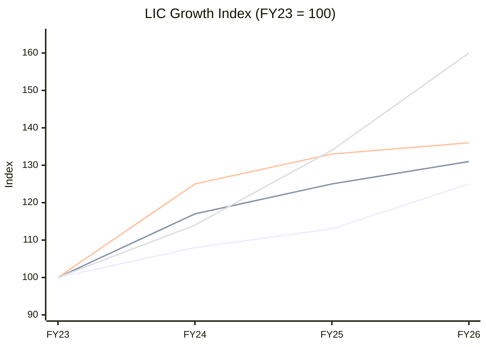
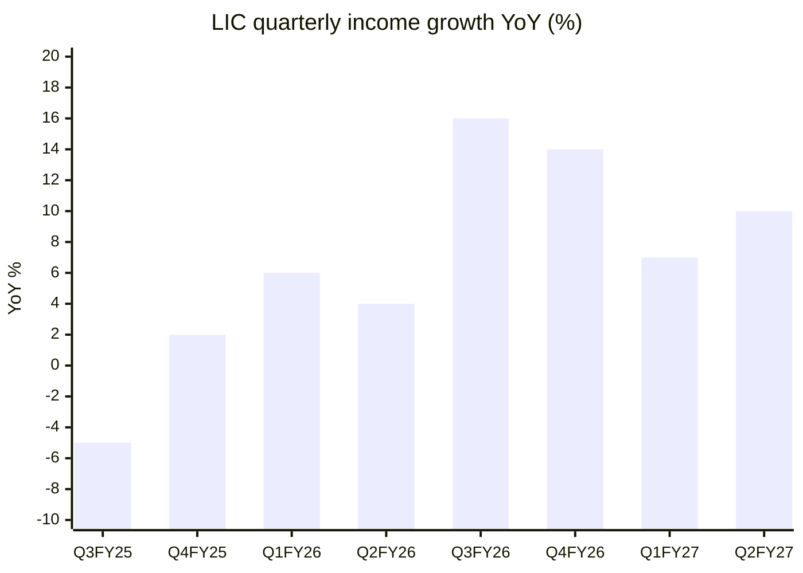
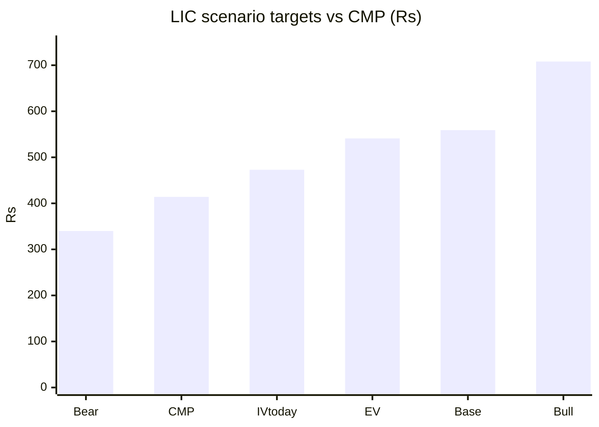

# Stock Analysis Report — Life Insurance Corporation of India (LICI)
**Date:** 2026-11-20
**Analyst:** Claude (Stock Fundamental Analysis Skill v3.3)
**Investment Horizon:** 2–3 Years
**Recommendation:** WATCHLIST / WAIT FOR CONFIRMATION (buy below ₹380, or on a weekly close above ₹455)
**Conviction Score:** 6 / 10
**CMP:** ₹414 (NSE, 20-Nov-2026 12:42 pm) · Market cap ₹5,23,204 Cr · 1,265 Cr shares (post 1:1 bonus, Jun-2026) · Book value ₹150 · IEV/share ₹630 · 52-wk ₹361–455
**Filed under:** Financials-and-Fintech / Life-Insurance · Themes: PSU financials & financialisation

## Revision Log
| Version | Date | Recommendation | Conviction | Price | Key change |
|---|---|---|---|---|---|
| Current | 2026-11-20 | Watchlist / Wait for confirmation | 6/10 | ₹414 | Initial report |

Initial report. No earlier LIC report existed in the library. **New folder:** `Financials-and-Fintech/Life-Insurance` (no existing sub-sector fits a life insurer; Distribution-and-Insurtech is for intermediaries). **New KPI block:** "Life Insurance" added to `references/05-industry-kpis-india.md` (line 2973) with the user's approval.

**Sourcing note.** Financials: Screener.in consolidated (FY17–Q2 FY27). H1 FY27 APE, VNB, IEV, persistency, market share, product mix, agent count: secondary summaries of LIC's BSE filing and 16-Nov-2026 presentation (Investywise, Multibagg). OFS: Upstox/Sahi/Daily Pioneer (Aug-2026). IEV for Mar-23/Mar-24 is from LIC's earlier EV disclosures, recalled and **not re-fetched this run** (marked †). The Business Standard sector article returned HTTP 403. No transcript text was read — management guidance is therefore thin.

---

## Business Primer

LIC is India's state-owned life insurer and, by far, its largest: about 59% of first-year premium (H1 FY27), 37.5% of individual new business and 70% of group business, with ₹55.6 lakh Cr of investments — roughly the size of a third of India's GDP — and 14.5 lakh agents who source ~92% of new business. It sells participating (with-profit) endowment policies, non-par savings, term protection, annuities, ULIPs and group gratuity/pension schemes to retail households and employers. It makes money in two ways: a **spread/margin on new policies** (measured by Value of New Business, VNB) and the **release of profit from the in-force book** as the investment return on ₹55 lakh Cr of policyholder funds exceeds what is guaranteed or credited to policyholders. The two things LIC depends on are its agency distribution (trust plus reach into small-town India) and the investment return on a portfolio heavy in government bonds and Indian equities.

LIC is a **financial — a spread-and-float business with a sovereign-like brand**, not a growth compounder. Its key value driver is product-mix shift toward non-par and protection, which lifted VNB margin from 17.6% (FY25) to 22.3% (H1 FY27). The key risks are **market share loss to bank-owned private insurers, interest-rate and equity sensitivity of Embedded Value, and the government as controlling owner**, which still has to sell ~15% more stock to reach 25% public float by 2032. A structural feature colours everything: reported accounting profit (₹57,453 Cr in FY26) is driven by actuarial surplus-transfer rules and is a poor guide to value — the right lens is **Embedded Value (₹7.97 lakh Cr) and VNB**, and the stock trades at only 0.66× EV.

**Segment check:** Life Insurance — **new KPI block added** (line 2973) after approval ✓.

---

## Executive Summary
LIC is the cheapest large life insurer in Asia on P/EV (0.66× vs 1.8–3× for Indian private peers): the market values its ₹6.13 lakh Cr in-force book at a discount and its new-business franchise at **less than zero**. Fundamentals are improving — VNB +34% and margin 22.3% in H1 FY27, solvency up to 2.35×, the August-2026 OFS (6.5% at ₹382) cleared most of the near-term supply overhang. Against that, individual APE is flat (+0.3%), non-par share slipped to 34%, 13th-month persistency is weak (~75% by premium) and market share keeps edging down. Probability-weighted 2-year value is ~₹540 (+31%, ~+36% with dividends), but the margin of safety on today's intrinsic value (~₹473, 0.75× EV) is only ~12% vs the 20–25% needed. **Verdict: Wait for Confirmation** — accumulate below ₹380 (≈0.6× EV, the OFS price) or on a breakout above ₹455.

**C1 — Growth Index (FY23 = 100)**

| FY | 23 | 24 | 25 | 26 |
|---|---|---|---|---|
| Total income / premium (₹ Cr) | 7,84,628 | 8,45,966 | 8,89,970 | 9,77,772 |
| Investments (₹ Cr) | 42,43,008 | 49,76,133 | 52,98,429 | 55,56,359 |
| IEV (₹ Cr) | 5,82,423† | 7,28,248† | 7,76,876 | 7,89,185 |
| PAT (₹ Cr) | 35,997 | 40,916 | 48,320 | 57,453 |
| Index: Revenue | 100 | 108 | 113 | 125 |
| Index: Investments | 100 | 117 | 125 | 131 |
| Index: IEV | 100 | 125 | 133 | 136 |
| Index: PAT | 100 | 114 | 134 | 160 |

🟦 Revenue (premium + investment income) · 🟧 Investments (AUM proxy) · 🟩 IEV · 🟪 PAT. FY23 is the base because FY22 accounting profit is not comparable (surplus-transfer change). † recalled from LIC EV disclosures, not re-fetched.
**Read:** Accounting PAT has grown ~17% a year, but Embedded Value only ~2% a year since FY24.
**Business inference:** The PAT line flatters. Economic value growth stalled in FY25–26 as negative economic variances (rates, equity markets) offset operating earnings (FY26: EVOP +₹92,639 Cr vs economic variance −₹72,740 Cr). LIC's value is driven by markets as much as by underwriting — judge it on EV, not EPS.

---

## Module 1 — Market, Sector & Stock Cycle
**1. Market:** Nifty about 25,000 (Nov-26), flat-to-down YoY; VIX about 17.5 (library, 17-Nov-26). RBI raised the repo rate effective 5-Oct-2026 → **Neutral-to-Cautious.** Rising rates help LIC's VNB margin (+100 bps rates → +3.0 pp margin) but cut EV slightly (−0.6%) and hurt the equity book.

**1b. Sector: Tailwind (secular), Neutral (cyclical).**
- **Secular:** life-insurance penetration ~3% of GDP, large protection gap, "Insurance for All by 2047", GST on individual life premiums removed (Sept-2025) → embed ~10–12% industry APE growth.
- **Cyclical:** FY26 group APE +27% and H1 FY27 group +13.6% are lumpy employer-scheme flows; do not embed. Individual APE was +13% in FY26 but only +0.3% in H1 FY27.
- **Regulatory:** IRDAI surrender-value norms (Oct-2024) and commission changes; composite licence and 100% FDI debate; Bima Sugam platform → more competition and lower distribution cost over time.
- **FX:** negligible.

**1c. Stock cycle: Mid-cycle / steady (margin expansion phase).**

**C2 — Quarterly YoY growth in total income (%)**

| Qtr | Q3FY25 | Q4FY25 | Q1FY26 | Q2FY26 | Q3FY26 | Q4FY26 | Q1FY27 | Q2FY27 |
|---|---|---|---|---|---|---|---|---|
| YoY % | −5 | 2 | 6 | 4 | 16 | 14 | 7 | 10 |

**Read:** Growth re-accelerated after the Sept-2025 GST cut, then settled at high single digits.
**Business inference:** Income includes investment income, so this overstates new-business momentum. Individual APE, the cleaner signal, is flat in H1 FY27 — the GST boost has faded for LIC faster than for private peers.

**Revenue decomposition (H1 FY27 APE ₹30,696 Cr, +5.7%):** individual ₹17,224 Cr (+0.3%) vs group ₹13,472 Cr (+13.6%). Within individual: par ₹11,364 Cr (+3.9%, 66% share); non-par ₹5,861 Cr (−6.0%) — savings +35%, protection +59% (tiny, ₹157 Cr), annuity +5%, ULIP −40%. **Mix shift helped margin (+3.3 pp) even as non-par share fell, because ULIP (low margin) collapsed and non-par savings grew.**

---

## Module 2 — Industry Structure
| Force | Assessment | Signal |
|---|---|---|
| New entrants | IRDAI licence, capital, distribution; new licences slow but rising | Moderate barrier |
| Supplier power | Distributors (agents, banks) — bancassurance concentrated in bank-owned insurers | **High** for non-captive insurers |
| Buyer power | Retail buyers fragmented; group buyers price-sensitive | Moderate |
| Substitutes | Mutual funds/SIPs for savings; term insurance online | High for savings products |
| Rivalry | 26 life insurers; private players gaining via banks | Moderate–high |

**Verdict: Neutral-to-Attractive.** **Capital cycle:** private insurers listed 2016–17; no new listings since LIC (2022) except planned IPOs (e.g., SBI General/others) → supply moderate. Returns (VNB margins) recovering after the FY25 regulatory reset.

---

## Module 3 — Business Quality & Moat
**Moat Verdict:** Wide but narrowing · **Greenwald:** customer captivity (trust/brand built over 70 years, sovereign-backed perception) + supply advantage (14.5 lakh agents, lowest cost per rupee of AUM) · **Buffett moat type:** Brand + low cost · **Pricing power test:** Partial (par products priced on bonus, not explicit price) · **Market share:** losing slowly — FYP share 59.41% → 58.77% (H1 FY26 → H1 FY27); individual share 38.89% (Q1 FY27) → 37.51% (H1 FY27) · **Fisher 15-point:** 30 / 45 *(Point 15: Pass — no fraud history; governance concerns are about state direction, not integrity)*

| # | Point | Score | | # | Point | Score |
|---|---|---|---|---|---|---|
| 1 | Market potential | 3 | | 9 | Management depth | 2 |
| 2 | New products | 2 | | 10 | Controls/accounting | 2 |
| 3 | R&D/innovation | 1 | | 11 | Unique advantages | 3 |
| 4 | Sales organisation | 3 | | 12 | Long-range orientation | 2 |
| 5 | Margin (VNB 22%) | 2 | | 13 | Dilution (bonus only) | 2 |
| 6 | Margin improvement | 3 | | 14 | Communication | 2 |
| 7 | Labour relations | 1 (unionised, rigid) | | 15 | Integrity | 2 |
| 8 | Executive relations | 1 (govt-appointed, short tenures) | | | | |

---

## Module 4 — Management & Capital Allocation
**Promoter (Government of India):** 90.00% (Sep-26) vs 96.50% through Jun-26 | **Pledge:** nil → Normal · **Trend:** decreasing by design (MPS).
- **OFS, 4–5 Aug 2026:** up to 6.5% (2.5% base + 4% green shoe) at floor ₹382, a 10% discount to ₹424; ~₹31,000 Cr if fully sold. Shareholding moved to 90% — consistent with full sale. DII rose 0.99% → 6.18%, FII 0.44% → 1.55%. Subscription data not found.
- **Remaining overhang:** 10% public float met ahead of the 16-May-2027 deadline; **25% public float due by May-2032 → another ~15% (~190 Cr shares, ~₹78,000 Cr at CMP)** to be sold over 5 years.
- **Capital allocation:** dividends (payout 11–16% of PAT; yield 2.4%), a 1:1 bonus (Apr-26) to improve liquidity; no buybacks. Investment decisions are shaped by government priorities (anchor investor in PSU OFS/IPOs) — the key governance discount.
- **Buffett Three C's:** Candor: Moderate (detailed EV disclosure, good sensitivities) · Competence: Moderate–High (VNB margin up 470 bps) · Caring: Moderate (policyholder-first mandate; shareholder interest secondary).

### Walk-the-Talk Scorecard
| Guided | Statement | Guided | Actual | Verdict |
|---|---|---|---|---|
| FY25–26 strategy | Shift mix to non-par to lift VNB margin | Rising non-par share | 35.1% (FY26) → 34.0% (H1 FY27); margin still +470 bps | ⚠️ |
| Govt/DIPAM | Meet 10% MPS by May-2027 | May-2027 | Done Aug-2026 | ✅ |
| Post-GST cut | Premium growth acceleration | H2 FY26 | Income +14–16% in Q3–Q4 FY26 | ✅ |
| FY27 | Individual business momentum | Growth | Individual APE +0.3% H1 FY27 | ❌ |

**WTT Score:** 0.63 / 1.00 — MODERATE (4 points only; no transcript read, statements paraphrased from secondary coverage — low confidence)
**Key pattern:** Margin delivered, volume not. **Insider action:** n/a (state-owned). **DCF impact:** growth haircut 10–15%. **Overall management credibility:** MODERATE.

---

## Module 5 — Financial Forensics
Beneish, Altman Z'' and Piotroski are **not meaningful for an insurer** (no receivables/inventory; liabilities are policy reserves). Insurer-specific checks instead:

| Check | Finding | Flag? |
|---|---|---|
| Accounting profit vs EV | PAT +19% FY26 vs IEV +1.6% | 🟠 (profit ≠ value) |
| Tax rate | FY26 −7% (Q4 FY26 −63%: one-off tax credit) | 🟠 one-off |
| FY22→FY23 profit jump (₹4,125 → ₹35,997 Cr) | Surplus-transfer change from non-par fund to shareholders | Explained |
| CFO negative FY25–26 | Insurer CFO includes investment flows — not a quality signal | Explained |
| Solvency | 2.35× (vs 2.13× a year ago; min 1.5×) | ✅ |
| EV sensitivity | Equity −10% → IEV −6.0%; tax rate to 25% → IEV −9.4% | 🟠 market risk |
| Auditor | Joint statutory auditors (C&AG-appointed) — no EOM found | ✅ (not fully checked) |
| Concentrated equity holdings | Large stakes in listed PSUs / groups (state-directed) | 🟠 governance |

**Forensic red flags: 0 hard / 3 soft.** **Overall verdict: Clean, with valuation-relevant soft flags.**

---

## Module 6 — Earnings Quality & Financial Statements
Accounting ROE (37.8%) is inflated by a small shareholders' fund (₹1.9 lakh Cr ANW vs ₹55 lakh Cr assets) and surplus-transfer rules — **not comparable to bank/industrial ROE.** The economic return measure is **Operating RoEV:**

| FY26 EV walk (₹ Cr) | Value |
|---|---|
| Opening IEV (Mar-25) | 7,76,876 |
| Expected return on in-force | 74,748 |
| VNB | 14,179 |
| Operating variances (persistency +3,509, expense +529, other +1,440, mortality −103, op. assumptions −1,663) | 3,712 |
| **EV operating profit (EVOP)** | **92,639** |
| Economic variances / assumptions | −72,740 |
| Dividends / capital | −7,590 |
| Closing IEV (Mar-26) | 7,89,185 |

**Operating RoEV FY26:** 92,639 / 7,76,876 = **11.9%** · **Total RoEV:** 2.6% · **Cost of equity:** ~12.5% → operating RoEV ≈ CoE → **value-neutral at the margin; value creation depends on VNB growth.** H1 FY27 IEV: ₹7,97,378 Cr (+1.0% vs Mar-26; −1.9% YoY), ANW ₹1,84,064 Cr, VIF ₹6,13,314 Cr.

**VNB trend:** FY25 ~₹10,000 Cr (derived: 17.6% × APE ~₹56,800 Cr) → FY26 ₹14,179 Cr (21.2%) → H1 FY27 ₹6,846 Cr (22.3%, +34%). Margin walk H1: mix +3.3 pp, assumptions +2.8 pp, expenses −1.4 pp.

*DuPont is not applied (insurer). Earnings-quality verdict: Medium — accounting PAT overstates economic value growth; VNB is the clean signal and it is improving.*

---

## Module 7 — Industry KPIs & Peers
| KPI | LIC | Healthy range | Assessment |
|---|---|---|---|
| VNB margin | 22.3% (H1 FY27) | 20–30% | In line (improving) |
| Individual-APE growth | +0.3% (H1 FY27) | ≥ industry | **Below** |
| Operating RoEV | 11.9% (FY26) | 15–20% | **Below** |
| Persistency 13th / 61st (premium) | 74.7% / 61.0% | >85% / >55% | 13th **below**, 61st above |
| Persistency 13th (policy count) | 67.6% (up from 63.4%) | — | Improving |
| Solvency | 2.35× | >1.8× | Above |
| Non-par share of indiv. APE | 34.0% (down from 36.3%) | rising | **Below trend** |
| Agency share of NBP | 91.8% | diversified | Concentrated |

| Metric | LIC | HDFC Life | SBI Life | ICICI Pru Life |
|---|---|---|---|---|
| VNB margin | 22.3% | ~25% (approx.) | ~27% (approx.) | ~23% (approx.) |
| P/EV | **0.66×** | ~2.5–3× | ~2–2.5× | ~1.8–2× |
| Distribution | Agency 92% | Banca-led | Banca (SBI) | Banca/agency |

*Peer values are approximate sector ranges from the KPI reference, not re-sourced this run.* **Positioning:** deep discount — **partly justified** (lower RoEV, state ownership, slower growth, par-heavy book), **but the size of the gap (3–4×) overstates the quality difference.**

---

## Module 8 — Market Size & Share
**TAM:** Indian life new-business premium ~₹4 lakh Cr a year (est.; LIC H1 NBP ₹1.44 lakh Cr at 58.8% share implies ~₹2.45 lakh Cr per half), growing ~10–12%. **LIC share:** 58.8% of FYP (H1 FY27, down 0.6 pp YoY); individual 37.5%; group 70.5%. **5-year trend:** losing ~1–2 pp a year in individual business to private players (long-run trend; FY27 data consistent). **Driver:** structural (bancassurance captives, digital term). **Verdict: Losing share in a growing market** — volumes still grow, value share falls slowly.

---

## Module 9 — Valuation & Margin of Safety
**PIE.** Market cap ₹5.23 lakh Cr vs IEV ₹7.97 lakh Cr. Appraisal logic: Value = EV + franchise value of future new business. **Implied franchise value = 5.23 − 7.97 = −₹2.74 lakh Cr** → the market (a) assigns zero to future VNB (₹14–16k Cr a year, growing) and (b) applies a further ~34% haircut to the existing book.

| PIE driver | Market-implied | My base | Gap |
|---|---|---|---|
| Value of future new business | ≤ 0 | 4–6× VNB | Pessimistic |
| Haircut to in-force EV | ~34% | ~20–25% (governance, equity risk) | Pessimistic |
| VNB growth | ~0 | 8–10% a year | Pessimistic |

**Gap: Pessimistic → opportunity**, offset by perpetual state supply. **Treadmill:** to re-rate, LIC needs individual APE growth back to ≥10% with VNB margin ≥22% for 3–4 quarters, while absorbing the next government sale. **Positive triggers:** sustained individual APE growth; non-par share >40%; a clear 2027–32 sell-down calendar. **Negative triggers:** equity-market fall (−10% → EV −6%); another OFS at a discount; state-directed investments in weak PSUs/groups.

**Scenarios (2-year, FY29 start; forward IEV/share ≈ ₹745 assuming ~9% a year net EV growth)**
| Scenario | Assumption | P/EV | Forward EV/share | Target | Prob. |
|---|---|---|---|---|---|
| Bull | Indiv. APE +12%, margin 24%, sell-down orderly | 0.95× | ₹745 | ₹708 | 25% |
| Base | APE +7–8%, margin ~22% | 0.75× | ₹745 | ₹559 | 50% |
| Bear | Equity shock (EV −8%), APE flat, OFS overhang | 0.50× | ₹680 | ₹340 | 25% |
| **Expected value** | | | | **₹541** | |

**Return (EV):** +31% plus ~5% dividends over 2 years (~16–17% a year). **Intrinsic value today:** 0.75× current EV ≈ ₹473 → **MoS ~12% vs 20–25% required → Inadequate (narrowly).** **Upside/downside:** (559−414)/(414−340) = **2.0:1** → borderline acceptable. **SVAR:** 18%. **Graham screen:** P/E 8.4× ✅, P/B 2.8× ✅, positive EPS ✅, dividend history short (listed 2022). **Misprice reason:** state-owner overhang, governance discount, perceived share loss, near-zero index weight historically. **Catalyst:** OFS done; next — inclusion weight changes from higher free float (10% vs 3.5% → passive inflows), FY27 VNB print.

**Read:** Even the base case needs only a modest re-rating (0.66× → 0.75× EV) to give ~35% with dividends.
**Business inference:** The upside comes from the market stopping its penalty on new business, not from heroic growth; the downside is mostly equity-market risk on the EV and government selling.

**Cycle Position Dashboard**
| Dimension | Current | Since-listing range | Signal |
|---|---|---|---|
| P/EV | 0.66× | ~0.5–1.0× (approx., 2022–26) | Fair-to-cheap |
| P/E | 8.4× | n/a (accounting distorted) | n.m. |
| VNB margin | 22.3% | 16–22% | **Near peak** |
| Operating RoEV | 11.9% | — | Mid |
| **Overall** | | | **Mid-cycle; margin near high, valuation low** |

*CY1/CY2 band charts not drawn: no sourced P/EV or price history series — data gap.*

---

## Module 10 — Technical Stage (Weinstein)
**Nifty 50:** flat YoY (Stage 1/3 range) · **Sector:** Nifty Financial Services not checked · **Stock:** range ₹361–455 for 12 months; −11% over 1 year; OFS floor ₹382 (Aug-26) has acted as support; CMP ₹414 mid-range → **Stage 1 base.** 30-week MA not sourced (likely flat). **RS vs Nifty:** negative over 1 year. **Pivot:** weekly close > ₹455 on ≥1.5× volume. **Stop (if bought):** weekly close < ₹360. **CANSLIM:** C 1 (Q2 PAT +20%; VNB +34%), A 0, N 1 (OFS/float change), S 0 (huge supply), L 0, I 1 (DII 1.0% → 6.2%), M 0 → **3/7**. **Alignment:** Fundamentals improving, technicals neutral → **Wait for confirmation.**

---

## Module 11 — Forward View
*Capex/asset-turnover model not applicable (insurer). Forward engine = EV roll-forward: EV(t+1) = EV(t) × (1 + operating RoEV) + economic variance − dividends.*

| Metric | FY27E | FY28E | FY29E |
|---|---|---|---|
| APE (₹ Cr) | 70,000 | 76,000 | 82,000 |
| VNB margin | 22% | 22.5% | 23% |
| VNB (₹ Cr) | 15,400 | 17,100 | 18,900 |
| Operating RoEV | 11.5–12% | 12% | 12% |
| IEV (₹ lakh Cr, no economic variance) | 8.6 | 9.4 | 10.2 |
| IEV/share (₹) | 680 | 745 | 805 |
| DPS (₹) | ~10 | ~11 | ~12 |

### Catalysts
1. FY27 VNB ≥ ₹15,000 Cr with margin ≥22% — May-2027 results
2. Free-float-driven index weight increase (passive inflows) — FY27
3. Non-par/protection launches post-GST cut lifting individual APE — H2 FY27
4. Clear multi-year government sell-down plan (removes uncertainty) — FY27–28

### Risks
1. Equity market correction (EV −6% per −10%) — Medium
2. Further market-share loss in individual business — **High**
3. Government OFS at discounts (another ~15% to sell by 2032) — **High (certain), timing uncertain**
4. State-directed investment decisions — Medium
5. Regulatory: surrender/commission norms, composite licence competition — Medium

**Thesis in one line:** A dominant, improving franchise priced as if new business has no value — attractive at 0.6× EV, fair at 0.75×; supply from the government caps the re-rating speed.

---

## Checklist Summary
**A (Business quality):** 12/18 (no scuttlebutt; WTT thin) · **B (Forensics):** insurer substitutes applied; Beneish/Altman/Piotroski n/a · **C (Statements):** EV walk used instead of ROIC/DuPont · **D (KPIs & peers):** 6/7 (peer values approximate) · **E (Market):** 5/7 · **F (Valuation):** 9/10 · **G (Technical):** 5/8 · **H (Forward):** EV roll-forward (capex model n/a) · **I (Charts):** C1, C2, C13 done; CY1/CY2 not possible (no price-history series) · **Order Book Tracker:** Not applicable.
**Hard stops triggered:** None. (Upside/downside 2.0:1 is above the 1.5:1 hard stop.)

---

## Investment Decision
**Recommendation:** WATCHLIST / WAIT FOR CONFIRMATION
**Conviction Score:** 6 / 10
**Suggested Position Size:** 2–3% when triggered (state-owned, large-cap, low volatility; halve if bought on breakout far above ₹455)
**Entry Price Range:** ₹360–380 (≈0.57–0.60× EV; OFS support) — or on a weekly close above ₹455 with volume
**Stop-Loss:** weekly close below ₹340 (bear-case value)
**Target Price (Base, 2yr):** ₹559
**Review Trigger:** Add if H2 FY27 individual APE growth ≥10% with VNB margin ≥22%. Cut if VNB margin falls below 19% or P/EV re-rates above 0.9× without VNB growth.

**Data gaps to close next time:** H1 FY27 concall transcript (management guidance), sourced P/EV history, operating RoEV for H1 FY27, OFS subscription details, AUM equity/debt mix, current private-peer P/EV.

---
*Report generated by Stock Fundamental Analysis Skill v3.3 | Indian Markets Context*
*Sources: [Screener.in LICI](https://www.screener.in/company/LICI/consolidated/) · [Investywise H1 FY27](https://www.investywise.com/life-insurance-corporation-of-india-h1-fy27-earnings-conference-call-transcript/) · [Multibagg EV walk](https://www.multibagg.ai/market-pulse/articles/lic-embedded-value-variance-drivers-ppt-cmwj61p83003x2rp5u93zivi6) · [Multibagg VNB/APE](https://www.multibagg.ai/market-pulse/articles/lic-new-business-margin-ape-ppt-cmwj61ww600402rp530mxcsql) · [Multibagg H1 profit](https://www.multibagg.ai/market-pulse/articles/lic-h1-profit-vnb-margin-announcement-cmw3m8wkk00dyjk2r1s69zh0j) · [Upstox OFS](https://upstox.com/news/market-news/stocks/lic-ofs-opens-govt-offers-up-to-6-5-stake-sale-check-floor-price-key-dates-for-retail-investors/article-198034/) · [Sahi OFS](https://www.sahi.com/news/lic-ofs-launches-to-sell-up-to-6-5-stake-at-382-floor-price-2809-PE1_COR) · [Finology bonus](https://ticker.finology.in/discover/market-update/lic-bonus-issue) · [Free Press Journal Q2](https://www.freepressjournal.in/business/lic-q2-profit-jumps-20-to-12076-crore-premium-income-rises-16-to-147-lakh-crore)*
