# Stock Analysis Report — GMM Pfaudler Ltd (NSE: GMMPFAUDLR | BSE: 505255)
**Date:** 2026-10-14 (prices: NSE close 13-Oct-2026)
**Analyst:** Claude (Stock Fundamental Analysis Skill v3.3)
**Investment Horizon:** 2–3 Years
**Recommendation:** AVOID at ₹1,321 (hard stop: upside/downside < 1.5:1). Business quality is fine: treat as a watchlist name with a buy-below of ₹550–610.
**Conviction Score:** 4.5 / 10

## Revision Log
| Version | Date | Recommendation | Conviction | Price | Key change |
|---|---|---|---|---|---|
| Current | 2026-10-14 | AVOID (U/D hard stop); watchlist, buy-below ₹550–610 | 4.5/10 | ₹1,321 | Stock +35% since August on a volume-backed Stage 2 breakout. Fundamentals barely moved (Q1FY27 EBITDA −7% YoY, margin 10.1%). At this price the reverse DCF needs 14–18% revenue CAGR. FY26 growth was mostly FX translation. Pension debt, a second CFO exit and the hard-stop asymmetry all argue for patience. |
| Previous | 2026-08-07 | WATCHLIST ("Quality at Wrong Price") | 5/10 | ₹975 | (Full text in git history.) Its own asymmetry was 0.4:1, below the 1.5:1 hard stop, so under the skill rules it should already have been AVOID. |

**What changed in the thesis (Aug → Oct 2026)**
1. **Price, not business:** CMP ₹975 → ₹1,321, peak ₹1,505 week of 20-Sep. No new results came out in between; Q2FY27 is due on **4-Nov-2026** (BSE, 15-Sep-2026 board outcome).
2. **FY26 growth was largely FX.** Average EUR/INR rose **+13.7%** in FY26 (91.2 → 103.6) and USD/INR +5.3% (Yahoo Finance monthly closes). Overseas revenue grew only **+8.6% in INR** (₹2,345 → ₹2,548 Cr, AR FY26 Note 41). That is roughly **flat to −1% in constant currency (est.)**, even including the SEMCO and GMM Inox acquisitions.
3. **Debt-like pension liability of ₹396 Cr** (CRISIL rationale, 17-Sep-2026). August's net debt of ₹160–370 Cr left it out. Enterprise value is about ₹6,716 Cr, not about ₹4,600 Cr.
4. **Ownership facts corrected.** DBAG is **no longer a shareholder**. Pfaudler Inc sold down 2022–23 and was reclassified from promoter to public on 2-Apr-2024 (BSE). GMM has owned 100% of the Pfaudler group since 2022–23. The "April 2026 reorganisation with DBAG ~20%" in the August report was wrong.
5. **Management churn:** Group CFO Alexander Poempner resigned on 15-Sep-2026, effective 4-Nov-2026. This is the second CFO exit in 21 months (previous one 13-Dec-2024). The CEO International Business retired on 31-Aug-2026. The Group CEO (since 21-May-2026) is the promoter's son-in-law.
6. **Disclosure improved but the geography split is gone.** Q1FY27 moved to four global divisions (CRT/PPT/HET/PST) with revenue and order intake only, **no divisional margins**, and dropped India vs International.
7. **Technicals flipped.** Stage 1 → **Stage 2** (weekly volume 3–6× average on the breakout). The broad market is weak: Nifty is below a declining 30-week MA and FIIs have been net sellers for 8 straight weeks.

**Validation of previous report (2026-08-07)**
| Item | Previous | Now (source) | Status |
|---|---|---|---|
| CMP / MCap | ₹975 / ₹4,363 Cr | ₹1,321 / ₹5,939 Cr (4.4955 Cr shares; NSE close 13-Oct-2026, Yahoo/Screener) | 🔄 Updated |
| P/E "34.6× reported on ₹12.86 EPS" | 34.6× | ₹975 / ₹12.86 = **75.8×** (arithmetic error). Now 82× TTM reported EPS ₹16.06; 50× TTM adj EPS ₹26.18 | ❌ Corrected |
| P/E on exceptional-adjusted EPS | ~44× (EPS ~₹22) | FY26 adj EPS **₹23.35** (Q4FY26 deck) → 41.8× at ₹975; now 50.5× TTM adj | 🔄 Updated (minor ❌ on EPS) |
| Net debt | "~₹160–370 Cr" | Borrowings ₹835 − cash ₹688 = ₹147 Cr; **+ leases ₹206 + unfunded pension ₹396 + NCI ₹28** (AR FY26 BS; CRISIL 17-Sep-2026). Debt-like total ≈ ₹777 Cr | ❌ Corrected (pension omitted) |
| EV / EBITDA | ~₹4,550–4,700 Cr / 11–12× | ₹6,716 Cr / **17.0× TTM** EBITDA ₹395 Cr | 🔄 Updated |
| Ownership: "April 2026 reorg; GMM+Mavag ~54%, Patel ~26%, DBAG ~20%" | Stated as current | That was the **2020** deal structure. GMM bought out the minorities in 2022–23 (Millars Concrete share swap at ₹1,542.43, Sept-2022, AR Note 18; DBAG cash buyout). DBAG fully exited by Mar-2024; Pfaudler Inc reclassified public 2-Apr-2024 (BSE). The 2026 change was divisional, not a holding restructure | ❌ Corrected |
| "DBAG/PE promoter-selling overhang" (key risk 2) | Medium risk | No PE in promoter group. Promoter group = Patel family 25.18% (Millars Machinery 9.70%, Urmi Patel 5.25%, Uttarak 2.74%, Millars Concrete 2.46%, etc.). Overhang is financial blocks instead: HDFC Small Cap 9.66%, Petunia 8.25%, Amansa 6.86% (AR Note 18). FIIs 26.5% → 14.4% (Sep-23 → Jun-26, Screener) | ❌ Corrected |
| Insider action "no promoter buying" | Neutral-bearish | Millars Machinery bought 1% from Pfaudler Inc at ₹1,700 (FY24) and +25,000 shares in FY26 (AR: 43,36,357 → 43,61,357). Small but **buying** | ❌ Corrected |
| Promoter holding 25.18%, pledge 0% | 25.18% / 0 | 25.18% flat for 12 quarters (Screener; AR Note 18); no pledge disclosed | ✅ Validated |
| FY26 revenue / EBITDA / PAT | ₹3,524 / ₹403 / ₹52 Cr | Same (Screener; Q4FY26 deck) | ✅ Validated |
| FY26 CFO ₹389 Cr | ₹389 Cr | AR consolidated cash-flow statement: **₹388.80 Cr** (FY25 ₹378.10 Cr); Screener column aligned (no year shift) | ✅ Validated |
| FY26 exceptional restructuring | "₹65 Cr" | **₹59 Cr pre-tax**: Waghäusel (Germany) severance ₹52.62 Cr + labour-code provision (AR Note 47; Screener). PAT ex-exceptional ₹99 Cr | ❌ Corrected (minor) |
| Restructuring savings | "₹45 Cr/yr" | Management: Germany Phase-I ₹15–17 Cr + ~₹25 Cr from leavers = "above ₹40 Cr", phasing in over 2 yrs (Q3FY26 call, 6-Feb-2026) | 🔄 Updated |
| ROE "~4.3%" FY25–26 | 4.3% | On average parent equity: FY26 ₹58 Cr / ₹1,114 Cr = **5.2%**; FY25 5.3% (Screener "Profit for EPS"). 4.3% was closing total equity on PAT incl. minorities | ❌ Corrected (methodology) |
| ROCE ~14% | 14% | Screener FY26 14% (13.6% TTM) | ✅ Validated. Note: the KPI reference block says "GMM ~17.7%", which is not supported by Screener |
| Order backlog / revenue "0.65× (2,289/3,524)" labelled FY26 | FY26 | ₹2,289 Cr is **Q1FY27** (30-Jun-2026). FY26 year-end backlog = ₹2,194 Cr → 0.62× FY26 revenue | ❌ Corrected (mislabel) |
| FY26 order intake ₹3,714 Cr (+20%) | ✅ | Q4FY26 deck | ✅ Validated |
| Q1FY27: revenue +16%, PAT ₹22 Cr, OI ₹1,007 Cr | ✅ | Q1FY27 press release 5-Aug-2026 | ✅ Validated |
| India EBITDA margin ~13% | ~13% | FY26 India (standalone) 13.1% (₹135/₹1,034 Cr); **Q1FY27 11.0%** | 🔄 Updated |
| International loss-making at PAT | Yes | FY26 consolidated PAT ₹52 Cr < standalone ₹59 Cr (incl. exceptionals); overseas segment PBIT margin 4.4% (AR Note 41) | ✅ Validated |
| Net debt / EBITDA 0.4× | 0.4× | Company 0.4× (ex-pension, ex-lease); **CRISIL 1.9×** incl. pension + leases; gross 3.6× | 🔄 Updated (context added) |
| DSO ~48 days; CWIP ₹20 Cr | ✅ | Screener 48 days; AR CWIP ₹19.86 Cr | ✅ Validated |
| Dividend moved semi-annual → annual | ✅ | Q1FY27 release | ✅ Validated |
| Global GLE share "~40%" | 40% global | CRISIL: **50% Americas, 40% Europe, 20% China, 50% India**; near-monopoly in large vessels | 🔄 Updated |
| India GLE market "₹2,000–2,500 Cr" | Estimate | No primary source found | ⚠️ Unverifiable (dropped) |
| 52-week range | ₹735–1,418 | ₹735–1,534 (intraday; Screener) | 🔄 Updated |
| Weinstein stage | Stage 1 basing | **Stage 2** (price ₹1,321 > rising 30w MA ₹981) | 🔄 Updated |
| HLE Glascoat ROCE 14.7% | 14.7% | Screener FY26 **12%** | ❌ Corrected |
| HLE order book ₹681.6 Cr | ✅ | Not re-sourced this run (HLE Q1FY27 OB not found) | ⚠️ Unverifiable |
| Segment KPI block "not in reference" | Pending | Now in `references/05-industry-kpis-india.md` line 1985 | 🔄 Updated |
| Verdict logic | WATCHLIST with U/D 0.4:1 | U/D < 1.5:1 is a hard stop → AVOID under the framework | ❌ Corrected (process) |

**Old data gaps retried:** (1) Investor-presentation parsing: **closed** (all decks Q2FY25–Q1FY27 parsed). (2) Beneish M-Score: **closed** (approx. −2.50). (3) Tangible-PPE asset turnover: **closed** (Screener fixed-asset schedule). (4) India vs international economics: **closed** via AR FY26 Note 41. (5) Weekly 30-week MA / RS: **closed** (Yahoo weekly data).

---

## BUSINESS PRIMER

GMM Pfaudler makes engineered process equipment that chemical, pharmaceutical and, more and more, energy, defence and mining plants buy when they build or expand capacity. The core product is glass-lined reactors and vessels: steel lined with fused glass so they can handle corrosive reactions. Around it sit filtration-drying, mixing, sealing, fluoropolymer-lined equipment, heavy-engineered pressure vessels (India) and complete process systems such as acid-recovery plants. Revenue is project and order based (order intake → backlog → delivery in roughly 3–12 months), plus a meaningful service and spares stream (about 29% of consolidated revenue, Q4FY26 deck). Since buying the global Pfaudler business in 2020 (100% owned since 2022–23), about **72% of revenue comes from outside India** (FY26 overseas ₹2,548 of ₹3,524 Cr, AR Note 41), from 20 plants in Germany, Italy, the US, China, Brazil, Mexico, Poland, the UK (closed), Switzerland (Mavag) and India. The business depends on two things: (1) its customers' capex cycle, especially specialty chemicals and pharma; and (2) its ability to make the large, high-cost European operations earn a decent return without diluting the very profitable Indian franchise.

This is an **asset-heavy, cyclical, global capital-goods platform with a high-return Indian core inside a large, low-return international shell**. India earned about 37% pre-tax return on segment net assets in FY26 against about 12% overseas (AR Note 41). The key value driver is **margin, through mix, operating leverage and restructuring**, more than volume. Constant-currency revenue has been roughly flat for three years, and headline growth in FY26 came mostly from a weaker rupee and small acquisitions. The main risks are the European chemicals downturn, restructuring execution (Germany, China, UK), leakage between EBIT and PAT (49% effective tax, FX losses on intercompany loans, interest), and a balance sheet carrying **₹852 Cr of goodwill and intangibles (69% of parent equity)** and **₹396 Cr of unfunded pension liabilities**. The promoter family owns only 25.18% but runs the company (Tarak Patel as MD, his brother-in-law Gregory Gelhaus as Group CEO), so this is a minority-promoter, family-managed multinational, not a classic high-skin Indian promoter story.

**Segment check:** *Process Equipment / Glass-Lined & Filtration-Drying Capital Equipment (Chemicals & Pharma). KPI reference available ✓ (`references/05-industry-kpis-india.md`, line 1985).*

---

## Executive Summary
GMM Pfaudler is the global leader in glass-lined equipment, with an excellent Indian franchise attached to a much larger international business that is being restructured. The bull case is a self-help margin recovery toward management's 15% EBITDA "minimum target" (Q1FY27 call), helped by a record ₹2,289 Cr backlog, a pharma/CDMO order revival, diversification (43% of order intake now non-traditional) and simpler legal and debt structures. **The stock has run 35% since August on no new results.** At ₹1,321 (EV ₹6,716 Cr, 17× TTM EBITDA, 50× adjusted / 82× reported TTM EPS), the reverse DCF needs **14% revenue CAGR at a 15% margin, or 18% at 13%**, for five years. Underlying constant-currency growth is near zero and management has missed every margin target it set in the last six quarters. The biggest risk is that international margins and the 45–49% tax leakage stay where they are, leaving a mid-single-digit-ROE company priced for a full turnaround.

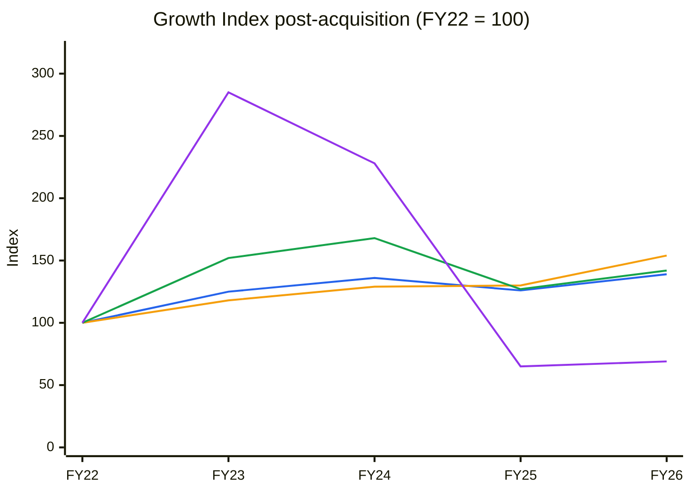
🟦 Revenue (CAGR 8.6%) · 🟧 Tangible PPE gross block (11.4%) · 🟩 EBITDA (9.2%) · 🟪 PAT (−8.9%). Base FY22 = first full year after the Pfaudler acquisition. Source: Screener consolidated P&L and fixed-asset schedule (table in Module 5).

**Read:** Since FY22, gross block (+54%) has outgrown revenue (+39%) and EBITDA (+42%), and PAT is 31% *below* FY22 after peaking in FY23.

**Business inference:** Capital and costs (employee cost 28.6% of sales vs about 15% before the acquisition) have grown faster than the business. Gross block is also inflated by FX translation and the SEMCO/Inox purchase price allocations. Profits leak between EBITDA and PAT through interest, a 49% tax rate and exceptionals. The investment case is about fixing conversion, not growing volume.

**Order book:** ₹2,289 Cr (Q1FY27) = **0.63× TTM revenue** (about 7.5 months), essentially all firm (no framework value). Book-to-bill TTM (reported order intake) **1.02×**; implied TTM 1.10×. Tracked order book today ₹2,289 Cr (no Reg 30 orders since).

---

## Module 1 — Broad Market Cycle (Marks)
- **Nifty 50:** 22,722 (13-Oct-2026), **14% below** its 52-week high of 26,329, below a **declining** 30-week MA (23,710, down from 24,098 eight weeks ago) and −12% over 52 weeks (Yahoo weekly data).
- **Flows:** FIIs net sold about ₹30,294 Cr in the week to 9-Oct, the **8th straight week** of selling; 2026 FPI outflows above ₹3 lakh Cr. DIIs absorbed it (newkerala/PTI 10-Oct-2026; Free Press Journal 11-Oct-2026). Drivers: elevated crude on Gulf supply worries, a strong dollar, US yields, a weak rupee.
- **India VIX:** about 13.2–13.9 (30-Sep to 1-Oct-2026, hdfcsky). Calm, despite the weak tape.
- **Assessment: Cautious.** Prices are falling without panic, so it is not fearful yet.
- **Sizing:** normal-to-smaller. A Stage-4-type market does not support new breakout buying.
- **Specific to GMM:** a weaker rupee *helps* reported numbers through translation (72% overseas revenue), which partly explains the stock's relative strength.

## Module 1b — Sector Cycle: Tailwinds & Headwinds
**Secular vs cyclical decomposition (FY26 consolidated revenue +10.2%):**
| Component | Estimate | Basis |
|---|---|---|
| FX translation | **~+7pp** | Overseas revenue (72%) × blended EUR/USD/other move of about +10% (EUR/INR +13.7%, USD/INR +5.3%, FY avg) *(est.)* |
| Acquisitions (SEMCO from Aug-25, GMM Inox from Jun-25) | ~+2–3pp | SEMCO consideration ₹162 Cr (AR Note 45); exact revenue not disclosed *(est.)* |
| Organic constant currency | **~0–1%** | Residual; India +14% (segment) offset by overseas organic decline *(est.)* |

- **Secular:** India pharma/CDMO/peptide capex, China+1, onshoring of US pharma ("large orders from the US"), defence (acid recovery), nuclear/power/O&G heavy engineering. Durable baseline about **8–10% INR growth** for India and **2–4% constant currency** internationally.
- **Cyclical:** Chemicals are **still flat in India and "very challenging" in Europe** (Q1FY27 call, Tarak Patel / Greg Gelhaus). The pharma upturn is real but young ("we haven't seen this kind of improvement for quite some time"). Do not capitalise it.
- **Input cost:** steel/specialty metals drove gross-margin pressure "during the two quarters through Q1FY27" (CRISIL). Gross margin is stable around 60% for the year (Screener).
- **Geopolitics:** Gulf tensions (crude, shipping); Middle East reordering after "recent events" is helping HET (Q1FY27 call). European macro is the main drag. Classification: **semi-structural** (Europe chemicals) → widen MoS by 5pp.
- **Net FX exposure:** mostly **translation**. Overseas units earn and spend locally, which is a natural hedge. Overseas share: about 72% of revenue and 50% of segment PBIT (FY26). **A 5% INR appreciation cuts reported revenue ~3.6% and EBIT ~2.5% (est.)**. Transactional and balance-sheet FX: losses on intercompany loans of ₹10.9 Cr in FY26, ₹13.9 Cr *gain* in Q4FY26 (Q4FY26 deck). Management is unwinding these loans over 12–18 months.
- **CY5/CY6:** not applicable. Engineered-to-order equipment has no industry capacity or spread series; no data available (data gap).
- **Sector cycle verdict: NEUTRAL.** Pharma is a tailwind, European chemicals a headwind. Expected duration: multi-quarter.

## Module 1c — Stock Cycle: Company-Specific Positioning

**Quarterly YoY growth (Screener consolidated):**
| Quarter | Q2FY25 | Q3FY25 | Q4FY25 | Q1FY26 | Q2FY26 | Q3FY26 | Q4FY26 | Q1FY27 |
|---|---|---|---|---|---|---|---|---|
| Revenue (₹ Cr) | 805 | 801 | 807 | 795 | 902 | 884 | 944 | 925 |
| Revenue YoY % | −14.1 | −6.4 | 8.9 | 1.3 | 12.0 | 10.4 | 17.0 | 16.4 |
| EBITDA (₹ Cr) | 93 | 96 | 83 | 101 | 122 | 105 | 75 | 94 |
| EBITDA YoY % | −34.5 | −15.8 | −7.8 | 13.5 | 31.2 | 9.4 | −9.6 | −6.9 |
| EBITDA margin % | 11.6 | 12.0 | 10.3 | 12.7 | 13.5 | 11.9 | 8.0 | 10.1 |

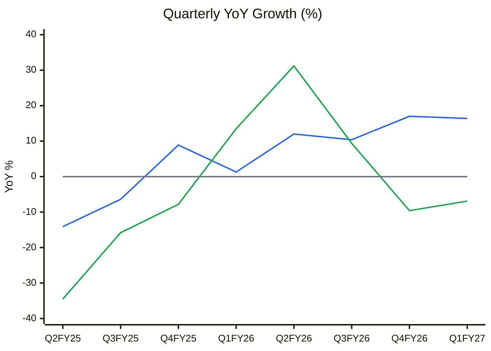
🟦 Revenue YoY % · 🟩 EBITDA YoY % · ⬜ zero line

**Read:** Revenue growth accelerated to +16–17% in the last two quarters, while EBITDA growth turned *negative* (−10%, −7%) and margins fell to 8.0% and 10.1%.

**Business inference:** This is negative operating leverage. Rupee translation and acquisitions lift the top line while pricing pressure, mix (lower-margin HET) and new global-organisation costs absorb it. An upgrade cycle needs EBITDA growth above revenue growth, and that is not yet visible.

- **Revenue decomposition:** Volume roughly flat organically; price weak ("continued pricing pressure", Q1FY27 CFO); mix shifting toward systems and heavy engineering (lower margin in India). FX is the largest single driver of reported growth.
- **Capacity:** not binding. CWIP only ₹20 Cr; Poland low-cost hub scaling; India Karamsad can do ₹700–800 Cr with small capex (Q4FY26 call). The constraint is margin, not capacity.
- **Order-book revenue model:** see Order Book Tracker (Module 6). FY27E revenue anchor: opening backlog ₹2,194 Cr × ~1.78 annual burn ≈ **₹3,900 Cr (+11%)**. Historical revenue / opening backlog was 1.89× (FY25) and 2.15× (FY26); haircut because part of the backlog is multi-year.
- **Operating leverage:** Contribution margin ≈ gross margin less variable conversion, about 45% *(est.)* → DOL ≈ 45% / EBIT margin 8.1% (ex-exceptional) ≈ **5.5×**. DFL = EBIT 284 / (284 − 112 underlying interest) = **1.65×**. **DTL ≈ 9×**: a 5% revenue miss means roughly a 45% EPS miss. **ICR ex-exceptional/FX ≈ 2.5×** (reported 1.8×), right at the skill's red line → +5pp MoS.
- **Guidance accuracy:** see WTT (0.70, MODERATE); margin guidance is the one-way miss.
- **FCF inflection:** already reached. FCF positive every year since FY21; FY26 FCF ₹311 Cr (CFO 389 − capex 78). FY26 CFO was helped by ₹357 Cr of payables/advances inflow (AR cash-flow statement), which will not repeat.
- **Stock-cycle classification: Trough / early recovery** in fundamentals (EBITDA margin and ROCE at the 20th percentile of their 10-yr ranges, CY7). **But the price already reflects mid-cycle earnings** (see Module 8).

---

## Module 2 — Industry Structure & Capital Cycle
| Force | Evidence | Signal |
|---|---|---|
| New entrants | Glass-lining metallurgy, firing know-how, 140-yr installed base; 70% of top customers served for 20+ yrs (CRISIL) | **Low threat** |
| Supplier power | Steel, specialty alloys, glass frit; price spikes pass through with lag (CRISIL) | Medium |
| Buyer power | Large pharma/chem/EPC buyers; tender-based in systems/HET; small-vessel segment intensely competitive (CRISIL) | Medium-High |
| Substitutes | Alloy, PTFE/fluoropolymer-lined vessels (GMM owns fluoropolymer via CRT) | Low |
| Rivalry | India: rational duopoly with HLE Glascoat. Europe/China: fragmented, price-led; GMM lost service share in Europe (Q1FY27 call) | India benign, global intense |
**Industry verdict: Attractive in India, Neutral-to-Unattractive internationally (blended: Neutral).**

**Capital cycle:** GMM is *withdrawing* capacity in high-cost locations (UK Leven closed FY25–26, Hyderabad closed and sold Feb-2026, Waghäusel Germany downsized) and shifting to Poland/India. HLE is still adding (Omeras, Aug-2025). No new IPOs in glass-lined equipment. GMM capex/depreciation on PPE = 78/63 = 1.2× (discipline). **Position: rationalisation phase**, a set-up for returns to recover if demand turns. CY8 not built (no peer capex series).

## Module 3 — Business Quality & Moat
**Moat Verdict:** Wide in India / Narrow consolidated. **Durability: Eroding → stabilising.**
**Greenwald source:** (1) **local economies of scale** in India (50% share, duopoly) and in large vessels globally (near monopoly, CRISIL); (2) **customer captivity** through qualification cycles and an installed base needing re-glassing and spares (service ~29% of revenue).
**Buffett 10% price test:** Pass in India; **Fail** internationally (Q1FY27: "continued pricing pressure").
**Market-share stability:** India stable at ~50% (CRISIL). Global GLE leader but **losing service share in Europe** (management, Q1FY27).
**Pricing power through inflation:** gross margin held at 59.7–60.7% across FY22–FY26 (Screener material cost %). The value-add is defended at gross level; erosion happens in **conversion costs** (employee cost 14–15% of sales pre-acquisition → 28.6% FY26).

**Fisher 15-point (1–3 each):** Market potential 3 · New products 3 (diversification, 4 divisions) · R&D effectiveness 2 · Sales org 2 · Profit margin 1 · Margin improvement 1 (repeated misses) · Labour relations 2 (Germany/UK severances) · Executive relations 1 (2 CFO exits in 21 months, CEO-International retired, 2 SMP cessations May-2026) · Management depth 2 · Cost/accounting controls 2 (DGFT ₹15 lakh export-control penalty for FY21–23, self-reported, BSE 18-Feb-2026) · Industry advantages 3 · Long-range orientation 2 · Dilution 3 (none since 2022) · Candour in adversity 2 (better disclosure, but declines to guide margins) · **Integrity 2 (no veto)** → **31 / 45**.
**Scuttlebutt (non-IR):** CRISIL rationale (17-Sep-2026); analyst pushback in Q1FY27 Q&A (employee costs, refusal to give debt targets); DGFT order. No SEBI/ED/SFIO actions found.

## Module 4 — Management & Capital Allocation
**Promoter holding:** 25.18% (flat 12 quarters) | **Pledge: none disclosed** → Normal | **Trend:** stable; small promoter buying (Millars Machinery).
**Share count:** stable since Sept-2022 (4.4955 Cr) → no dilution.
**Capital allocation (10-yr):**
| Deployment FY17–FY26 | ₹ Cr (Screener cash-flow schedules) |
|---|---|
| Cumulative CFO | 1,773 |
| Capex (PPE purchased) | 625 |
| Acquisitions (FY21–FY26 incl. other investing) | ~550 (Pfaudler 2020, minority buyout 2022–23, Mixel/MixPro/JDS, SEMCO ₹162 Cr, Inox) *(partly non-cash: Millars share swap)* |
| Net borrowings added | ~1,041 (zero in FY19 → ₹1,041 Cr incl. leases FY26) |
| Dividends | ~73 |
- **Verdict:** The transformational Pfaudler acquisition gave scale and global leadership but **incremental returns were below WACC**. FY22→FY26: EBIT (ex-exceptional) +₹126 Cr on about +₹970 Cr more capital employed → **incremental pre-tax ROCE ~13%, post-tax ~9% < WACC 12%** *(est.)*. FCF/share CAGR (FY22–26) far above EPS CAGR, so cash is fine and **earnings conversion is the problem**. **Rating: Average.**
- **RPT:** Tarak Patel remuneration **₹10.31 Cr FY26** (₹7.41 Cr FY25) = **20% of reported PAT**, 10% of adjusted PAT. That breaches the skill's 10% extraction flag on reported numbers. Lease rent to Ready Mix Concrete (promoter group) ₹3.20 Cr; J V Patel & Co ₹3.26 Cr (AR Note 40). No loans to promoters (AR Note 11). Small, but flagged.
- **Buffett 3 C's:** Candour **Moderate** (admitted "one, two, three units really underperforming", China and Germany loss-making; but no numeric margin or debt targets). Competence **Moderate** (India excellent; international return record weak). Caring **Moderate** (low payout ~16%; high MD pay vs PAT; family CEO "has skin in the game").

### Walk the Talk Scorecard (last 6 quarters)
| Quarter Guided | Statement | Guided | Actual | Verdict |
|---|---|---|---|---|
| Q4FY25 (May-25) | India margins "15–16% achievable for next financial year" | 15–16% FY26 | India FY26 EBITDA 13.1% | ❌ Miss |
| Q4FY25 | "Much better financial performance next year" | FY26 > FY25 | EBITDA +11%, adj PAT ₹99 vs ₹62 Cr *(adj FY25 per Screener)* | ✅ Hit |
| Q4FY25 | Strong order intake by end-Q1FY26 | Strong | Q1FY26 OI ₹1,004 Cr (record incl. ₹330 Cr defence order) | ✅ Hit |
| Q1FY26 (Aug-25) | India 15–16% "sustainable" | ≥15% | Q2–Q4FY26: 14%, 14%, 9%; Q1FY27 11% | ❌ Miss |
| Q1FY26 | Net debt/EBITDA stays below 1× | <1× | 0.4× (company definition) | ✅ Hit |
| Q2FY26 (Nov-25) | Backlog +15–20% | +15–20% | FY26 backlog +34% | ✅ Hit |
| Q2FY26 | Double-digit India growth | ≥10% | India FY26 +12% (Q1FY27 standalone +2%) | ✅ Hit |
| Q3FY26 (Feb-26) | Germany savings above ₹40 Cr, phasing over FY27 | ≥₹40 Cr | Not yet visible: Q1FY27 EBITDA −7% YoY | ⚠️ Pending (not scored) |
| Q4FY26 (May-26) | "At least maintain or grow margins" FY27 (vs 11.4%) | ≥11.4% | Q1FY27 10.1% (vs 12.7% Q1FY26) | ❌ Miss (1 qtr in) |
| Q4FY26 | No significant one-offs in FY27 | ~0 | Q1FY27 exceptionals nil | ✅ Hit |
| Q4FY26 / Q1FY27 | Repay ~EUR 7 m by Q2FY27 | EUR 7 m | Repaid 31-Aug-2026 (BSE) | ✅ Hit |

**WTT Score:** 0.70 / 1.00 (7 / 10 scored) — **MODERATE**
**Guidance points assessed:** 10 scored (+1 pending) | Hits: 7 | Near misses: 0 | Misses: 3 | Reversals: 0
**Key pattern:** **One-way misses on margins.** Every margin target (India 15–16%, group 15%, "maintain margins") has missed. Order, debt and one-off promises are reliable. Management now *declines* to give margin and debt numbers, which is selective disclosure.
**Insider action:** Promoter small buys (Millars Machinery, FY24 at ₹1,700 and FY26 +25k shares). No sells. **Mildly bullish.** But the Group CFO resigned 3.5 months after taking the Q1 call → **bearish** governance signal.
**DCF impact:** Margin path haircut ~15% versus management's 15% aspiration (base FY29 EBITDA 12.5%).
**Overall management credibility: MODERATE.**

---

## Module 5 — Financial Forensics
**Indian-specific flags:**
- Pledge: none → ✅
- RPT: MD remuneration ₹10.3 Cr = 20% of reported PAT → **flag (1)**. Promoter-group leases about ₹6.5 Cr → minor.
- ICDs to group: none.
- Auditor: S R B C & Co LLP (EY network, Tier-1); unmodified opinion; **KAMs:** business combinations (SEMCO/Inox purchase price allocation), goodwill impairment (₹229.64 Cr), revenue recognition. No emphasis-of-matter paragraph (AR FY26 consolidated auditor's report). No auditor resignation.
- Revenue quality: inventory incl. unbilled 100–140 days (CRISIL); DSO stable 44–51 days FY22–FY26.
- Goodwill + intangibles ₹852 Cr = 21% of assets, **69% of parent equity** (AR BS). Goodwill grew ₹109 → ₹230 Cr in FY26 (+₹88 Cr new purchase price allocations, +₹32 Cr FX translation). UK goodwill impaired ₹5.76 Cr in FY25. Impairment test WACC 9.41–13.18%, terminal growth 2%. **Germany/China loss-making units are the impairment risk** → **flag (2)** (Schilit EMS-5 screen: goodwill under 30% of assets, so watch item rather than red flag).

**Quantitative models (FY26 vs FY25, consolidated):**
| Model | Value | Read |
|---|---|---|
| Beneish M-Score | **−2.50** (DSRI 1.09, GMI 1.00, AQI 1.42, SGI 1.10, DEPI 1.07, SGAI 1.00, LVGI 0.95, TATA −0.084) | Unlikely manipulator. AQI high from acquisition intangibles *(FY25 current-liability inputs approximated)* |
| Altman Z'' | **3.14** (X1 0.23, X2 0.25, X3 0.06, X4 0.43) | Safe |
| Piotroski F | **5 / 9** (ROA+ ✓, CFO+ ✓, ΔROA ✗, CFO>NI ✓, LT-debt ratio ↓ ✓, current ratio ✗ (unverified), no dilution ✓, GM ↑ ✗, AT ↑ ✗) | Average |
| Sloan accrual | **−5.1%** | Excellent: cash exceeds earnings |
**Schilit screen:** Revenue too soon: no (collections normal). Other income/EBIT: normal other income ₹38 Cr vs EBIT ₹284 Cr = 13% (below 15%). Capex/depreciation 1.2×. "One-time" charges in **3 consecutive years** (FY24 India transformation ₹19.6 Cr; FY25 Leven ₹47.7 Cr; FY26 Waghäusel/labour code ₹59 Cr) → **flag (3), O'Glove #8**. CFS: FY26 CFO boosted by +₹357 Cr payables/advances (customer advances up with backlog); not factoring, but non-recurring.
**Forensic red-flag count: 3 / 15, all explained** (MD pay ratio, goodwill/intangible concentration, recurring "exceptionals"). None suggests manipulation. **Overall forensic verdict: Minor concerns.** Under the hard-stop rule ("≥ 3 *unresolved*"), these count as resolved or explained.

## Module 6 — Earnings Quality & Financial Statements

### 10-year financials (consolidated, ₹ Cr; Screener, cross-checked to AR FY26 for FY25–26)
| FY | Revenue | EBITDA | EBITDA % | PAT | EPS ₹ | CFO | Capex | FCF | ROCE % | Equity | Borrowings* | Tangible PPE GB |
|---|---|---|---|---|---|---|---|---|---|---|---|---|
| FY17 | 353 | 48 | 13.6 | 31 | 7.09 | 22 | 14 | 8 | 22 | 194 | 0 | 54 |
| FY18 | 406 | 62 | 15.3 | 43 | 9.72 | 68 | 24 | 44 | 29 | 228 | 0 | 72 |
| FY19 | 503 | 77 | 15.3 | 51 | 11.52 | 27 | 16 | 11 | 29 | 269 | 0 | 82 |
| FY20 | 591 | 112 | 19.0 | 71 | 16.20 | 27 | 36 | −9 | 31 | 329 | 34 | 146 |
| FY21 | 1,001 | 139 | 13.9 | 64 | 16.73 | 157 | 79 | 78 | 15 | 406 | 633 | 587 |
| FY22 | 2,541 | 284 | 11.2 | 75 | 19.37 | 236 | 132 | 104 | 13 | 527 | 636 | 701 |
| FY23 | 3,178 | 431 | 13.6 | 214 | 37.06 | 185 | 69 | 116 | 22 | 804 | 973 | 829 |
| FY24 | 3,446 | 476 | 13.8 | 171 | 39.03 | 284 | 64 | 220 | 19 | 964 | 906 | 903 |
| FY25 | 3,199 | 361 | 11.3 | 49 | 11.78 | 378 | 63 | 315 | 13 | 1,023 | 850 | 910 |
| FY26 | 3,524 | 403 | 11.4 | 52 | 12.86 | 389 | 78 | 311 | 14 | 1,205 | 1,041 | 1,081 |
*Borrowings include lease liabilities (FY26: LT ₹545 + ST ₹290 + leases ₹206 Cr). Excludes unfunded pension (~₹396 Cr). FCF = CFO − PPE capex (Screener "free cash flow" nets asset sales: FY26 ₹367 Cr). EPS FY17–22 bonus-adjusted (2:1, July-2022). Tangible PPE GB = land + buildings + plant + equipment + furniture + vehicles (excludes intangibles and "other fixed assets"/ROU). FY17 gross block reset on Ind AS transition.

**10-year summary:** The decade shows a 15–19% margin, 29–31% ROCE India niche (FY18–FY20) turned into a 3.5× larger global platform earning 11–14% margins and 13–22% ROCE, with PAT in FY26 *below* FY22. **Cash generation (cumulative CFO ₹1,773 Cr vs PAT ₹821 Cr) is the redeeming feature.**

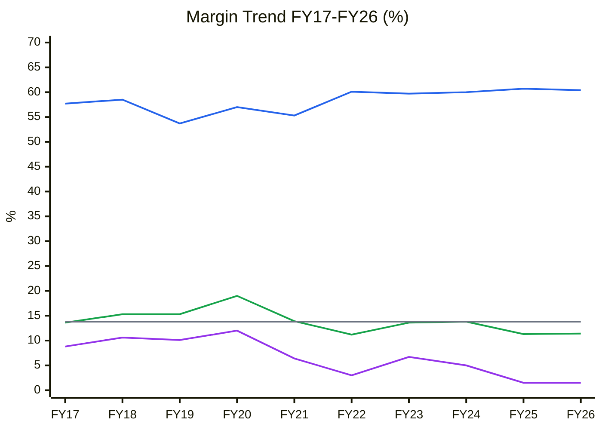
🟦 Gross margin (1 − material cost %) · 🟩 EBITDA margin · 🟪 PAT margin · ⬜ 10-yr avg EBITDA margin 13.8%

**Read:** Gross margin is *higher* than before the acquisition (~60% vs 54–58%). EBITDA margin (11.4%) sits 2.4pp below its 10-yr average (20th percentile), and PAT margin has collapsed to 1.5%.

**Business inference:** The technology premium is intact at the gross level. The damage is in European conversion costs (employee cost doubled as a share of sales) and below-EBITDA leakage. Margin recovery is a cost and restructuring job management controls, which is hopeful, but it has missed this job for six quarters.

**ROIC:** FY26 ROCE (pre-tax, ex-exceptional) ≈ 13.7%; **post-tax ROIC ≈ 9.6%** (30% normalised tax) vs **WACC 12%** → spread **−2.4pp**. FY25 similar (~9%). FY23–FY24 positive (~13–15% post-tax).
**Segment returns (AR Note 41, FY26):**
| Segment | Revenue (₹ Cr) | PBIT (₹ Cr) | PBIT margin | Net segment assets | Pre-tax return on net assets |
|---|---|---|---|---|---|
| India | 976 (FY25 854) | 113.2 (77.9) | 11.6% (9.1%) | 306 (246) | **37%** (32%) |
| Overseas | 2,548 (FY25 2,345) | 111.6 (121.6) | 4.4% (5.2%); ~6.4% ex-Waghäusel | 927 (783) | **12%** (16%); ~18% ex-exceptional |
| Total | 3,524 | 224.8 | 6.4% | 1,233 | 18% |

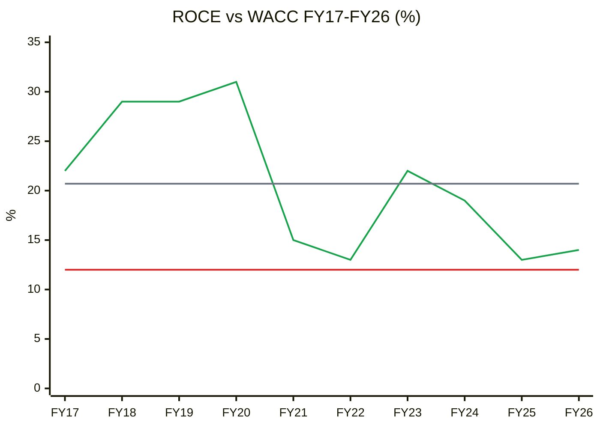
🟩 ROCE (pre-tax, Screener) · 🟥 WACC 12% · ⬜ 10-yr avg ROCE 20.7% (CY7 reference)

**Read:** Pre-tax ROCE has stayed above the 12% WACC every year, but at 14% it is at the 20th percentile of its 10-yr range, 6.7pp below average. Post-tax ROIC (~9.6%) has been below WACC in FY25–FY26.

**Business inference:** The India business still creates value (37% pre-tax). The consolidated group roughly earns its cost of capital, because overseas capital (₹927 Cr) earns only about 12% pre-tax. The hard stop (ROIC < WACC for 5+ years) is **not triggered**: only 2 consecutive years post-tax, and FY23–24 were above. The re-rating case needs overseas returns lifted toward India's.

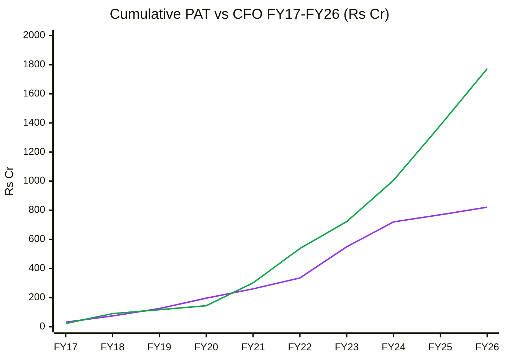
🟪 Cumulative PAT · 🟩 Cumulative CFO

**Read:** 10-yr cumulative CFO/PAT = **2.16×** (₹1,773 vs ₹821 Cr), and the gap widened after FY21.

**Business inference:** Reported profit *understates* cash generation (high D&A including acquisition amortisation, non-cash FX losses, advance-funded working capital). Earnings quality is high and the balance sheet can deleverage. But FY26 CFO included a one-off ₹357 Cr payables/advances swing, so do not extrapolate ₹389 Cr.

### DuPont (5-factor, consolidated)
| Year | EBIT margin | Asset turnover | Equity multiplier | Interest burden | Tax burden | ROE |
|---|---|---|---|---|---|---|
| FY22 | 6.2% | 0.94 | 4.07 | 0.84 | 0.56 | 11.2% |
| FY23 | 10.8% | 0.95 | 4.10 | 0.80 | 0.78 | 26.3% |
| FY24 | 10.0% | 1.09 | 3.26 | 0.73 | 0.68 | 17.6% |
| FY25 | 6.2% | 1.04 | 3.00 | 0.48 | 0.51 | 4.8% |
| FY26 | 6.4% | 0.88 | 3.26 | 0.45 | 0.51 | 4.2% |
| **Change FY24→26** | **−3.6pp** | **−0.21** | **0.00** | **−0.28** | **−0.17** | **−13.4pp** |
*Year-end total assets and total equity incl. NCI; PAT incl. minorities; EBIT = PBT + finance cost (reported, incl. exceptionals and FX).*
**Operating contribution (EBIT margin × AT):** Declining (10.9% → 5.6%).
**Financing contribution:** Equity multiplier flat; interest burden much worse (0.73 → 0.45) as finance cost rose to ₹123 Cr while EBIT fell.
**DuPont verdict:** The ROE collapse is **operational plus below-the-line leakage** (interest burden and a 49% tax). It is not masked by leverage. Even with EBIT margin back at FY24's 10%, a 0.45 interest burden and 0.51 tax burden would cap ROE at about 7%. **EBIT-to-PAT conversion (refinancing, entity simplification, tax) matters as much as operating margin.**
**AT trend → Module 10A:** tangible-PPE AT 3.62× (FY22) → 3.26× (FY26), declining (partly FX revaluation of land and buildings). Base AT 3.3–3.4×.

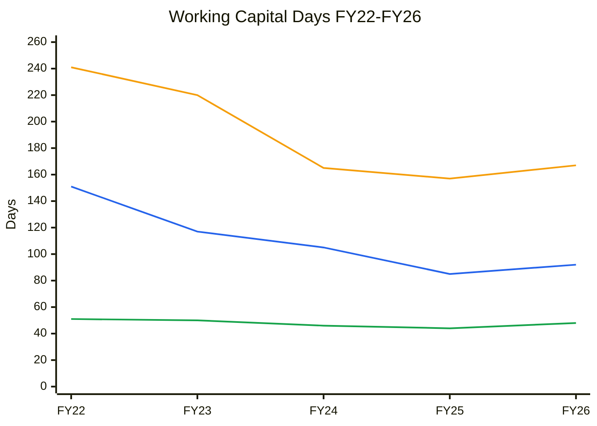
🟦 Cash conversion cycle · 🟧 Inventory days · 🟩 Debtor days (Screener ratios)

**Read:** The cash conversion cycle improved from 151 to 85–92 days, mostly through inventory discipline (241 → 167 days). Debtor days are flat at 44–51.

**Business inference:** Working capital is no longer a cash trap; customer advances fund the backlog. The FY26 uptick (85 → 92) with a larger backlog is normal. A reversal of advances in a downturn is the main cash-flow risk.

**O'Glove flags: 2 / 15** (#8 recurring "one-time" charges; #13 tax rate structurally above statutory, the opposite direction of the usual flag but a real earnings drag). **Key accounting concern:** none on integrity; the issue is **conversion leakage**.

---

## Module 7 — Industry KPIs & Peer Analysis
**Sector:** Process Equipment / Glass-Lined & Filtration-Drying Capital Equipment (KPI reference line 1985).
| KPI | GMM | Reference healthy range | Assessment |
|---|---|---|---|
| Book-to-bill | 1.05× FY26 (3,714/3,524); 1.02× TTM | > 1.0× | In line |
| EBITDA margin | 11.4% FY26; 10.1% Q1FY27 | 14–18% (IP-led); > 11% consolidated | **Below** |
| Order book / revenue | 0.63× (Q1FY27) | 0.5–1.0×; > 0.6× good | In line |
| India vs international margin spread | India PBIT 11.6% vs overseas 4.4% → 7.2pp | Intl within ~3pp | **Red flag** (> 5pp; international loss-making at PAT) |
| Aftermarket / service mix | ~29% of revenue (Q4FY26 deck) | Rising | Good, but losing service share in Europe |
| Working capital days | CCC 92; Screener WC days 23 | < 90 net | Borderline / good |
| Export / overseas revenue % | 72% | 20–40% | Over-dependent on overseas (structural) |
| Premium mix | Non-traditional industries 43% of OI (Q1FY27) | Rising premium | Diversifying (mixed margin) |
| ROCE | 14% | > 18% | **Below** |
| Net debt / EBITDA | 0.4× (company); 1.9× (CRISIL incl. pension/leases) | < 1.5–2.0× | OK |

**Peer comparison (Screener consolidated; prices 13-Oct-2026)**
| Metric | GMM Pfaudler | HLE Glascoat | Thermax | Praj Inds | Anup Engg |
|---|---|---|---|---|---|
| Revenue FY26 (₹ Cr) | 3,524 | 1,353 | 10,774 | 3,168 | 822 |
| Revenue 3-yr CAGR | 4% | 13% | 10% | −4% | 26% |
| EBITDA margin FY26 | 11.4% | 10.5% | 9.6% | 4.9% | 21.5% |
| EBITDA margin TTM / latest qtr | 10.8% / 10.1% | 9.0% / 7.0% | 8.0% / 3.0% | 4.6% / 4.2% | 18.5% / 7.6% |
| ROCE FY26 | 14% | 12% | 14% | 6% | 21% |
| P/E (Screener) | 47.2 (adj); 82 reported | 72.6 | 71.4 | 105 | 35.3 |
| EV/EBITDA TTM* | 17.0× | ~26× | ~48× | ~36× | ~22× |
| Market cap (₹ Cr) | 5,947 | 2,859 | 39,293 | 5,295 | 3,027 |
*GMM EV includes leases, pension, NCI and is net of cash. Peers: MCap + gross borrowings (cash not deducted), so peer multiples are overstated: indicative only.

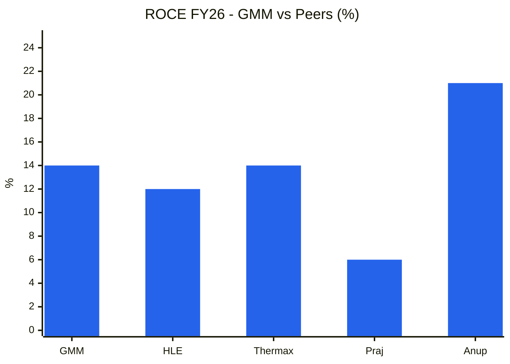

**Read:** GMM's 14% ROCE matches Thermax, beats HLE (12%) and Praj (6%), and trails Anup (21%).

**Business inference:** On EV/EBITDA, GMM is the *cheapest* in a richly valued, cyclically depressed process-equipment basket (every peer's latest-quarter margin fell). Relative value is not absolute value: the whole group trades on recovery hopes. GMM's discount reflects its low-return overseas capital, 72% overseas exposure and tax leakage. **Peer positioning:** discount to peers, justified.

**Peer DuPont note:** HLE's lower ROE (10.6%) comes from margin and acquisition dilution (Omeras); Anup's 17% is genuine margin (21% EBITDA, low leverage). GMM's ROE is depressed by tax and interest burdens more than by operations.

### Order Book Tracker
*Generated 2026-10-14 by scripts/order_book_tracker.py, run with `--report` on the previous report (it had no ledger, so this is the first ledger), plus 1 order announcement and 10 period snapshots. Ledger coverage starts 2024-04-01: every BSE filing for scrip 505255 from Apr-2024 to 13-Oct-2026 was harvested; only one Reg 30 order filing exists.*

#### 1. Disclosed vs tracked order book (reconciliation)
| Period | Revenue (₹ Cr) | Order book (₹ Cr) | Announced inflow | of which Framework | Implied inflow | Announced coverage | OB cover (× TTM rev) | Reported order intake (deck) | Source |
|---|---|---|---|---|---|---|---|---|---|
| Q4FY24 | 741 | 1,689 | — | — | — | — | 0.5 | — | Screener; Q4FY25 deck |
| Q1FY25 | 785 | 1,777 | 0 | — | 873 | 0% | 0.5 | 882 | Screener; Q2FY25 deck |
| Q2FY25 | 805 | 1,773 | 0 | — | 801 | 0% | 0.6 | 762 | Screener; Q2FY25 deck |
| Q3FY25 | 801 | 1,740 | 0 | — | 768 | 0% | 0.6 | 798 | Screener; Q3FY25 deck |
| Q4FY25 | 807 | 1,636 | 0 | — | 703 | 0% | 0.5 | 660 | Screener; Q4FY25 deck |
| Q1FY26 | 795 | 1,906 | 330 | — | 1,065 | 31% | 0.6 | 1,004 | Screener; Q1FY26 deck |
| Q2FY26 | 902 | 2,146 | 0 | — | 1,142 | 0% | 0.6 | 878 | Screener; Q2FY26 deck |
| Q3FY26 | 884 | 2,205 | 0 | — | 943 | 0% | 0.7 | 961 | Screener; Q3/Q4FY26 deck |
| Q4FY26 | 944 | 2,194 | 0 | — | 933 | 0% | 0.6 | 871 | Screener; Q4FY26 deck |
| Q1FY27 | 925 | 2,289 | 0 | — | 1,020 | 0% | 0.6 | 1,007 | Screener; Q1FY27 release |
*Implied inflow = OB(t) − OB(t−1) + revenue(t). Implied minus reported intake (e.g. Q2FY26 +₹264 Cr) = FX re-translation of the foreign-currency backlog + acquired backlog (SEMCO consolidated Q2FY26). Announced coverage is near 0% because Reg 30 forces disclosure only of material orders, and GMM's book is many small orders. Low coverage is normal here; the disclosed backlog gives the **level**.*

#### 2. Announced orders aggregated by quarter
| Quarter | # orders | Total (₹ Cr) | Firm | Framework | Largest single | Export | Govt/PSU/Defence | Private domestic |
|---|---|---|---|---|---|---|---|---|
| Q1FY26 | 1 | 330 | 330 | 0 | 330 | 330 | 330 (defence, private European) | 0 |

#### 3. Macro picture
| Metric | Value |
|---|---|
| Latest disclosed order book | ₹2,289 Cr (Q1FY27, 30-Jun-2026) |
| Orders announced since | ₹0 Cr |
| Tracked order book today | ₹2,289 Cr |
| Order-book cover | 0.63× TTM revenue (~7.5 months) |
| Framework / potential-value share | 0% |
| Book-to-bill TTM (reported intake ₹3,717 Cr / revenue ₹3,655 Cr) | **1.02×** (implied 1.10×) |
| Execution rate (revenue ÷ opening OB, quarterly) | Q1FY26 49% → Q2 47% → Q3 41% → Q4 43% → Q1FY27 42% (**falling, then stable**) |
| Concentration | The one announced order (EUR 33.2 m, 4-yr tenor) ≤ 14% of the book; no top-3 data |
| Mix (Q1FY27 OI by division) | CRT ₹502 Cr (+23%), PPT ₹367 Cr (+64%), HET ₹58 Cr, PST ₹80 Cr; non-traditional industries 43% |

#### 4. Charts
**OB-1 — Order book vs revenue (TTM), index = 100 at Q4FY24**
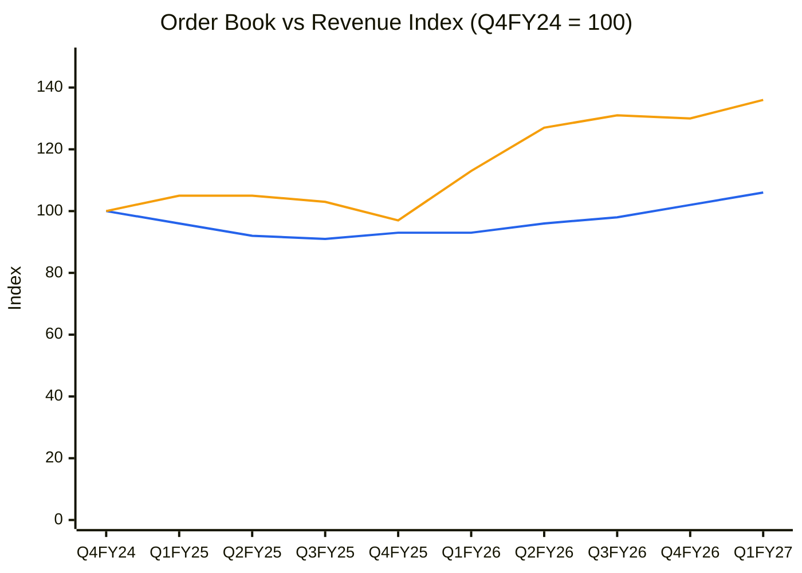
🟦 Revenue (TTM) · 🟧 Order book (disclosed points only)

**Read:** Since Q4FY24 the backlog is up 36% and TTM revenue only 6%. The gap opened in Q1–Q2FY26 (defence order, SEMCO, FX re-translation).

**Business inference:** Visibility is building faster than execution. Part of it is slow-burn (4-yr acid-recovery order) and FX-inflated, so it will not convert one-for-one. Management says Q1FY27 orders burn in 10–12 months, which supports about 11% FY27 revenue growth, not the 15–20% some analysts asked about.

**OB-2 — Order-book cover (× TTM revenue)**
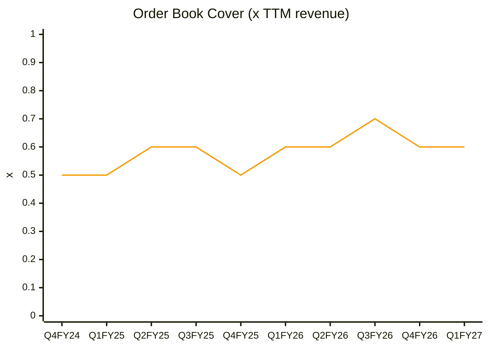
🟧 Order book / TTM revenue

**Read:** Cover is range-bound at 0.5–0.7×, the normal band for short-cycle engineered equipment.

**Business inference:** GMM is not an order-book compounder. Visibility is two to three quarters, so revenue follows the customer capex cycle with a short lag. The backlog cannot protect earnings in a downturn, which supports a cyclical (not compounder) multiple.

**OB-3** omitted: only one announced order (fewer than 4 ledger quarters), so aggregated announced orders add nothing to the disclosed book.

**OB-4 — Implied order inflow vs revenue (₹ Cr)**
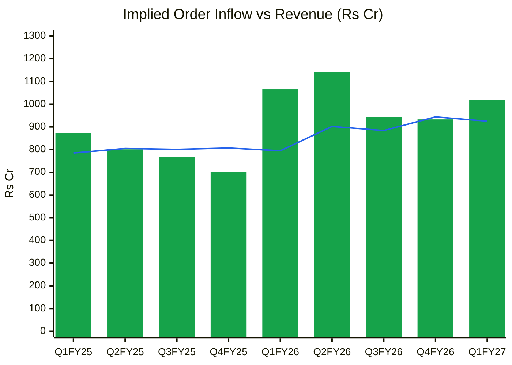
🟩 Implied inflow = ΔOB + revenue · 🟦 Revenue

**Read:** Implied inflow exceeded revenue in all five quarters since Q1FY26 (book-to-bill 1.02–1.34×), after sitting below revenue for 3 of 4 FY25 quarters.

**Business inference:** The order cycle turned in FY26 (pharma/CDMO, defence, US onshoring, mining/petrochem). Q1FY27's ₹1,007 Cr was a record without any single large order, which is better quality than Q1FY26's lumpy ₹330 Cr defence win. The revenue base for FY27–28 is secure; margin is the open question.

#### 5. Order Ledger — every announced order (source of truth; the next run appends here)
| order_id | date | customer | customer_type | segment | geography | value_cr | currency | value_fc | firmness | tenor_months | linked_to | source | notes |
|---|---|---|---|---|---|---|---|---|---|---|---|---|---|
| GMM-2506-01 | 2025-06-19 | European defence/ammunition manufacturer (unnamed) | Defence | PST (Systems) - acid recovery | Export | 330 | EUR | 33.2 | Firm | 48 |  | [BSE](https://www.bseindia.com/xml-data/corpfiling/AttachHis/17edde09-d3af-43eb-b5e0-8238676e4169.pdf) | Pfaudler Normag Systems GmbH (WOS, Germany); 30% down payment; end-to-end acid recovery systems; only Reg 30 order filing Apr-2024 to Oct-2026 |

#### 6. Order Book Snapshots — revenue and disclosed order book per period
| period | revenue_cr | revenue_ttm_cr | order_book_cr | order_linked_share | as_of_date | source |
|---|---|---|---|---|---|---|
| Q4FY24 | 741 | 3446 | 1689 | 1.0 |  | Screener qtr revenue; backlog Q4FY25 deck YoY chart |
| Q1FY25 | 785 | 3319 | 1777 | 1.0 |  | Screener; Q2FY25 investor presentation |
| Q2FY25 | 805 | 3187 | 1773 | 1.0 |  | Screener; Q2FY25 investor presentation |
| Q3FY25 | 801 | 3132 | 1740 | 1.0 |  | Screener; Q3FY25 investor presentation |
| Q4FY25 | 807 | 3198 | 1636 | 1.0 |  | Screener; Q4FY25 investor presentation |
| Q1FY26 | 795 | 3208 | 1906 | 1.0 |  | Screener; Q1FY26 investor presentation |
| Q2FY26 | 902 | 3305 | 2146 | 1.0 |  | Screener; Q2FY26 investor presentation |
| Q3FY26 | 884 | 3388 | 2205 | 1.0 |  | Screener; Q3FY26/Q4FY26 presentation |
| Q4FY26 | 944 | 3525 | 2194 | 1.0 |  | Screener; Q4FY26 investor presentation |
| Q1FY27 | 925 | 3655 | 2289 | 1.0 |  | Screener; Q1FY27 press release 05-Aug-2026 |

*Annual reference (company decks): backlog FY22 ₹1,932 / FY23 ₹2,162 / FY24 ₹1,689 / FY25 ₹1,636 / FY26 ₹2,194 Cr; order intake FY22 ₹2,956 / FY23 ₹3,392 / FY24 ₹3,014 / FY25 ₹3,102 / FY26 ₹3,714 Cr. (CRISIL's 17-Sep-2026 rationale calls ₹3,714 Cr the "order book"; it is FY26 order **intake**.)*

**Order-book verdict:** Firm visibility ~0.6 yrs (no framework value) · Book-to-bill (TTM) 1.02× reported / 1.10× implied · Framework share 0% · Concentration low · Execution rate: falling, then stable at ~42% of opening backlog per quarter.
**Forward link (Module 10):** Revenue FY27E ≈ opening OB ₹2,194 Cr × ~1.78 burn ≈ **₹3,900 Cr**. Bull case would be about ₹4,100 Cr at the FY26 2.15× burn plus FX.

---

## Module 8 — Market Size & Market Share
- **TAM:** No primary-source TAM for global glass-lined plus process equipment was found (data gap). The August "India GLE ₹2,000–2,500 Cr" figure is dropped as unverifiable.
- **Share (CRISIL, Sep-2026):** GLE **50% Americas, 40% Europe, 20% China, 50% India**; near-monopoly in large vessels; intense competition in small vessels.
- **Trend:** Stable in India (duopoly with HLE); **losing service share in Europe** (management admission); China recovering (new chemical investment near the Mongolian border).
- **Reconciliation:** Overseas constant-currency revenue roughly flat to −1% (FY26, est.) against weak European chemical capex, so this is **cycle more than share loss**, apart from Europe service. India revenue +14% against a flat chemical cycle and a rising pharma cycle, so **India is gaining or holding**.
- **Verdict:** Growing with the market in India, losing marginally in Europe.

---

## Module 9 — Valuation: PIE First, Then DCF
**Inputs (13-Oct-2026):** CMP ₹1,321 · shares 4.4955 Cr · MCap ₹5,939 Cr · net debt ₹147 Cr · leases ₹206 Cr · unfunded pension ₹396 Cr · NCI ₹28 Cr → **EV ₹6,716 Cr** · TTM EBITDA ₹395 Cr → **EV/EBITDA 17.0×** (15.9× ex-pension; ~19× on pre-Ind AS 116 EBITDA ~₹340 Cr) · TTM EPS reported ₹16.06 (**P/E 82×**); TTM adj EPS ₹26.18 (**50.5×**) · BVPS ₹268 (**P/B 4.9×**).
**WACC:** Ke = 7% + 1.1 × 6% = 13.6%; post-tax Kd ~4.9% (6–7% × 0.7, Q1FY27 CFO); D/V ~15% → **WACC ≈ 12%**.

### 9A. Price-Implied Expectations (two-stage reverse FCFF DCF: 8 yrs, terminal g 6%, tax 30%, capex 3% of revenue, NWC 3% of incremental revenue)
| PIE value driver | Market-implied | My base | Gap |
|---|---|---|---|
| Revenue CAGR (5-yr) at a 15% EBITDA margin | **14.0%** | 9% | −5pp |
| Revenue CAGR at a 13% margin | **18.2%** | 9% | −9pp |
| Steady-state EBITDA margin | 15% (management "minimum") | 12.5% | −2.5pp |
| Investment rate | ~0 net (capex ≈ D&A) | same | — |
**Gap: OPTIMISTIC.** The price assumes management's 15% margin target *and* mid-teens growth. Constant-currency growth has been about 0% for three years, and the 15% target has never been met as a global group (peak 13.8%, FY24).
**Expectations treadmill:** To outperform from ₹1,321, GMM must deliver EBITDA margin ≥ 15% by FY29 *and* ~14% revenue CAGR *and* bring tax below 30%. Hitting 13% margin with 9% growth (still a big improvement) is worth only about ₹750–1,000.
**Positive triggers:** (1) Q2FY27 (4-Nov) EBITDA margin ≥ 13% with Germany savings visible; (2) refinancing and intercompany-loan unwind cutting finance cost below ₹70 Cr; (3) Investor Day with divisional margins and ROCE targets.
**Negative triggers:** (1) another sub-11% quarter; (2) INR appreciation reversing the FX tailwind (EUR/INR already off 4% from Mar-2026 peak to 106.6); (3) goodwill impairment in Germany/China CGUs or more "exceptional" restructuring.
**SVAR:** Bear value ₹495 (FY29 EPS ₹22.5 × 22) → **SVAR 62%**, above 40% → unfavourable.
**Physical plausibility:** Capacity is not binding (Poland/India headroom), so the gap is a **margin and demand** disagreement, not unannounced capacity.

### 9B. Own model
| Method | Bear | Base | Bull |
|---|---|---|---|
| DCF (FCFF, WACC 12%, g 6%) | ₹398 (4.3% CAGR, 10.5% margin) | ₹744 (9%, 12.5%) | ₹1,147 (12.4%, 14.5%) |
| Earnings: FY29E EPS × P/E, discounted 2.5 yrs at 13.6% | ₹360 (₹495 FY29) | ₹992 (₹1,364 FY29) | ₹1,780 (₹2,448 FY29) |
| **Consensus intrinsic (today)** | **~₹380** | **~₹870** | **~₹1,460** |
DCF sensitivity (base): WACC 11% / 12% / 13% → ₹933 / ₹744 / ₹609; terminal g 5% / 6% / 7% → ₹643 / ₹744 / ₹884.
**Graham:** fails P/E (≫ 20×), P/B (4.9× > 3×), EPS growth (FY26 EPS 12.86 vs FY19 11.52); passes positive EPS 7 years, current ratio 1.6× (fails 2×). **Graham Number** (5-yr avg EPS ₹23.6 × BVPS ₹268) = √(22.5 × 23.6 × 268) = **₹377**.
**Margin of safety (base ₹870):** **−34%** (inadequate). **Upside/downside (FY29 targets, see 10D): bull vs bear 1.36:1; probability-weighted 1.47:1 → below 1.5:1, HARD STOP.**
**Misprice reason:** Not mispriced cheap. A sector-wide recovery narrative, FX-flattered top line, Q1FY27 PAT +118%, and a technical breakout pulled the multiple forward.
**Catalyst:** Q2FY27 results (4-Nov-2026) and the promised Investor Day (around Q2–Q3 FY27).

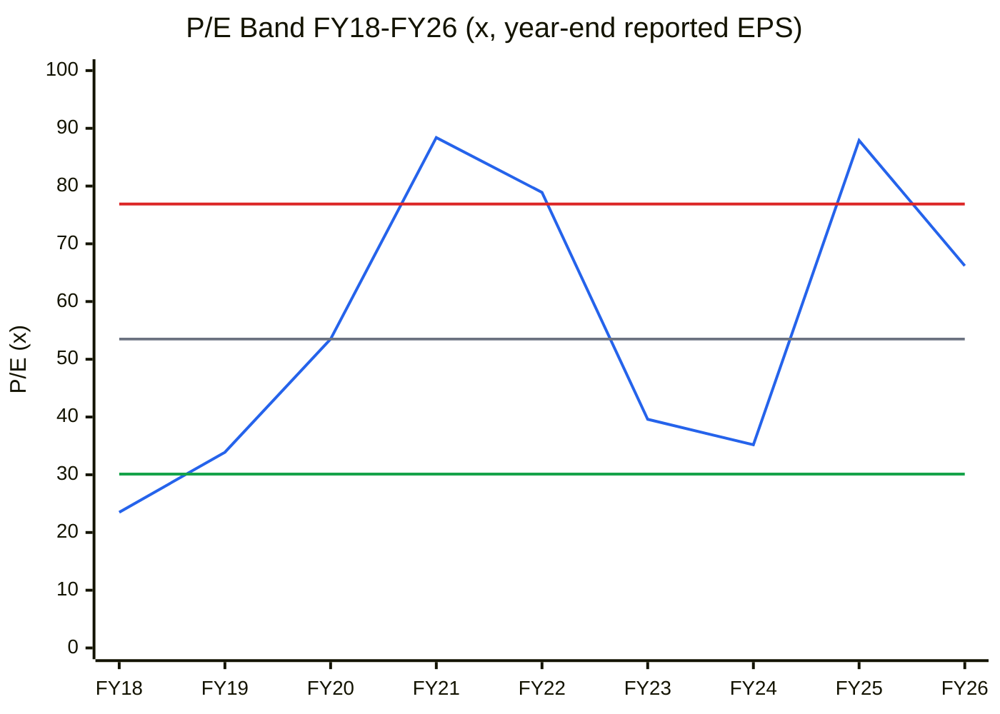
🟦 P/E (FY-end price ÷ reported EPS; Yahoo adj. prices, Screener EPS) · ⬜ Median 53.5× · 🟥 +1SD 76.9× · 🟩 −1SD 30.1×

**Read:** Current P/E is 82× on reported TTM EPS (**78th percentile**, above +1SD) and 50.5× on adjusted EPS (44th percentile).

**Business inference:** This is a cyclical capital-goods name on trough margins, so a high P/E on trough earnings *can* be a buy signal (cyclical P/E rule). That holds only if trough-to-normal earnings roughly double. The 50× adjusted multiple already discounts that doubling, so the P/E offers no cushion.

| FY | FY18 | FY19 | FY20 | FY21 | FY22 | FY23 | FY24 | FY25 | FY26 | Now |
|---|---|---|---|---|---|---|---|---|---|---|
| FY-end price ₹ (adj.) | 228 | 391 | 867 | 1,479 | 1,528 | 1,466 | 1,372 | 1,036 | 851 | 1,321 |
| BVPS ₹ (adj.) | 52.0 | 61.3 | 75.0 | 92.6 | 120.2 | 178.8 | 214.4 | 227.6 | 268.0 | 268.0 |
| P/B | 4.4 | 6.4 | 11.6 | 16.0 | 12.7 | 8.2 | 6.4 | 4.6 | 3.2 | 4.9 |
| ROE (PAT/avg parent equity) | ~20% | ~20% | ~24% | ~17% | ~16% | ~25% | ~20% | 5.3% | 5.2% | — |

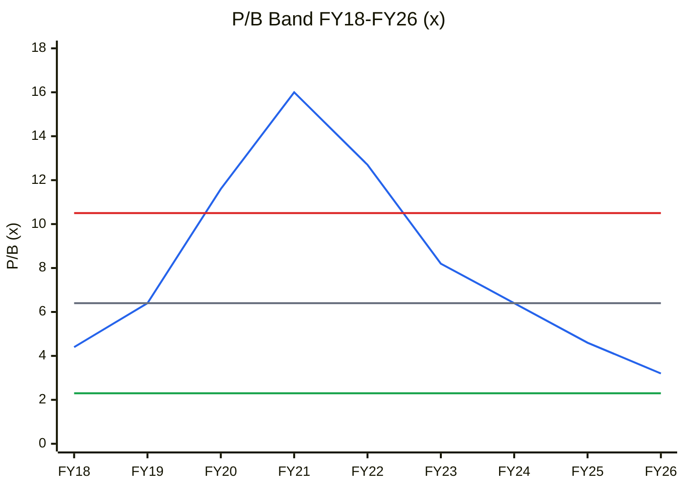
🟦 P/B · ⬜ Median 6.4× · 🟥 +1SD 10.5× · 🟩 −1SD 2.3×

**Read:** P/B 4.9× is at the **33rd percentile** of its range, while ROE is 5.2% vs a 10-yr norm of about 20%.

**Business inference:** Justified P/B at 5% ROE (Ke 13.6%, g 6%) is below 1×. Even at a recovered 15% ROE it is about 1.2×. On book, the market pays for ROE to return to the high teens; the "cheap vs history" look comes from comparing with years when ROE was four times higher. Note too that 69% of book is goodwill and intangibles.

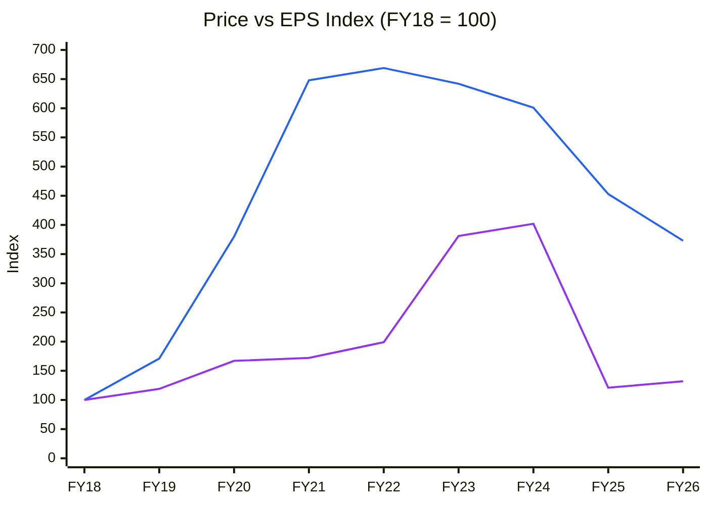
🟦 Price index (FY-end, adj.) · 🟪 EPS index (reported)

**Read:** From FY18 to FY26, price rose 3.7× and EPS only 1.3×. Since then price has added another 55% (₹851 → ₹1,321) with TTM EPS up 25%.

**Business inference:** Most of the decade's return was multiple expansion bought on the Pfaudler "global platform" story, and earnings never caught up. Returns from here have to come from earnings, because the multiple is already full.

### Cycle Position Dashboard
| Dimension | Current | 10-yr median | Percentile | Signal |
|---|---|---|---|---|
| P/E (reported TTM) | 82× | 53.5× | 78% | Expensive |
| P/E (adjusted TTM) | 50.5× | 53.5× | 44% | Fair on trough EPS |
| P/B | 4.9× | 6.4× | 33% | Fair (but ROE 5%) |
| EBITDA margin | 11.4% | 13.7% | 20% | **Trough** |
| ROCE | 14% | 20.5% | 20% | **Trough** |
| Industry utilisation / spread | n/a | n/a | n/a | Not applicable (engineered-to-order) |
| **Overall cycle position** | | | | **Trough fundamentals, mid-cycle valuation** (consistent with 1b Neutral / 1c Trough-early recovery) |

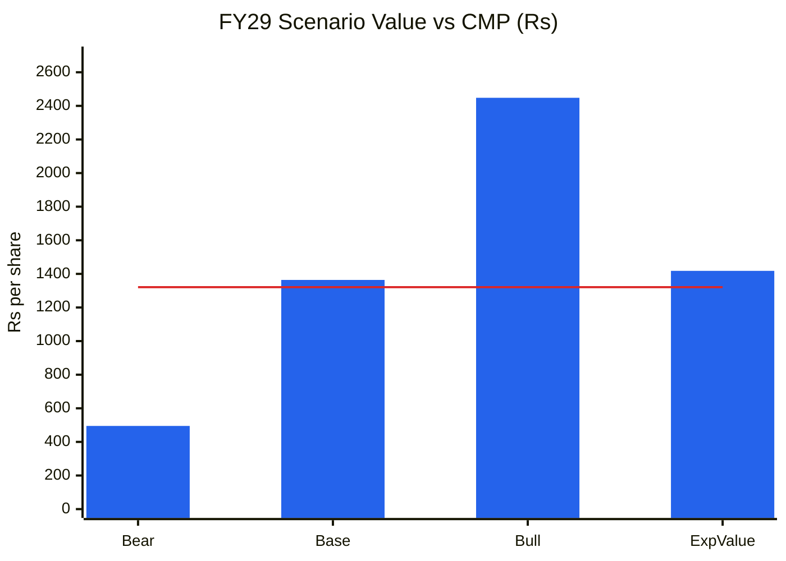
🟦 FY29E scenario value (EPS × exit P/E, undiscounted) · 🟥 CMP ₹1,321

**Read:** Base FY29 value ₹1,364 is just 3% above CMP; bull +85%, bear −63%; probability-weighted ₹1,418 (+7% over ~2.5 yrs).

**Business inference:** The market prices close to the *base* case two and a half years out, so most of the recovery is in the price today. The payoff depends on hitting the bull case (15% margin, 30% tax), which management has not shown it can do.

---

## Module 10 — Technical Stage (Weinstein + CANSLIM)
**Nifty 50 Market Stage:** **4 (or late 3)**. 22,722 is below its 30-week MA of 23,710, which is declining; 8 straight weeks of FII selling.
**Sector proxy:** HLE Glascoat ₹412 > rising 30w MA ₹368 → Stage 2. Peers Thermax and Praj near 52-week lows → mixed sector.
**Stock Stage:** **2.** ₹1,321 vs a **rising** 30w MA ₹981 (₹879 on 16-Aug). Base Jun–Aug 2026 (₹754–1,050), lasting about 16 weeks after a Stage 4 decline from ₹1,534.
**Breakout volume:** weeks of 30-Aug, 6-Sep and 13-Sep: 2.0 m, 3.96 m, 3.50 m shares vs 50-week average 0.65 m → **3–6× average: confirmed**.
**Extension:** CMP is about 26% above the ₹1,050 pivot after a −14% pullback from ₹1,505. This is a **"Stage 2 but 20%+ above base" late entry**.
**RS vs Nifty:** 52-week +23% vs Nifty −12%; 13-week +66% vs −4% → **strongly positive**.
**CANSLIM: 4 / 7.** C ✓ (Q1FY27 EPS +114%, off a low base) · A ✗ (3-yr EPS CAGR −23%) · N ✓ (new structure, new high Sep-2026) · S ✓ (up-volume ≫ down-volume) · L ✓ (RS leader in group) · I ✗ (FII 17.2% → 14.4%; DII up) · M ✗ (market Stage 4).
**Stop-loss (if held):** weekly close below ~₹1,050 (pivot); hard exit on a weekly close below the 30w MA (~₹980, rising).
**Stage + fundamental alignment:** **Misaligned.** Good technicals, weak market, full valuation.

---

## Module 11 — Forward View: 2–3 Year Thesis

### Capex classification
| Capex type (₹ Cr) | FY27E | FY28E | FY29E | In AT model? |
|---|---|---|---|---|
| Tangible growth capex (Poland expansion, India HET/power) | 35 | 35 | 35 | ✅ |
| Maintenance (≈ PPE depreciation FY26 ₹63 Cr) | 65 | 70 | 75 | ❌ sustains |
| Intangibles / acquisitions | 0 (management: "acquisition phase largely behind us") | 0 | 0 | ❌ |
| CWIP (FY26 ₹19.86 Cr) | transfers ~20 | — | — | ❌ until capitalised |
| ROU (leases ₹206 Cr) | ~50/yr renewals | ~50 | ~50 | ⚠️ excluded |
| **Total cash capex** | **~100** | **~105** | **~110** | |
**Current CWIP:** ₹19.86 Cr. No project-wise CWIP disclosed (data gap); all small.

| Year | Tangible PPE GB (₹ Cr) | Revenue (₹ Cr) | AT (×) |
|---|---|---|---|
| FY22 | 701 | 2,541 | 3.62 |
| FY23 | 829 | 3,178 | 3.83 |
| FY24 | 903 | 3,446 | 3.82 |
| FY25 | 910 | 3,199 | 3.52 |
| FY26 | 1,081 | 3,524 | 3.26 |
| **5-yr avg** | | | **3.61** |
| **Trend** | | | Declining (FX revaluation of land/buildings + Inox/SEMCO PPA) |

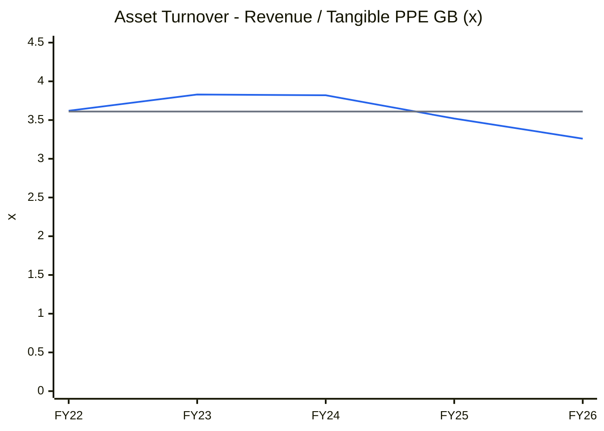
🟦 Asset turnover · ⬜ 5-yr average 3.61×

**Read:** AT fell from 3.83× (FY23) to 3.26× (FY26), 0.35× below its 5-yr average.

**Business inference:** Much of the drop is translation and acquisition accounting rather than idle plant. GMM is not capacity-constrained: getting back to 3.6× needs only volume recovery, not capex. Revenue growth is cheap in capital terms; the scarce input is margin. (Base AT 3.4×, bull 3.8×, bear 3.2×.)

**Incremental ROIC:** FY22→FY26 ≈ 9% post-tax vs WACC 12% → **value-neutral to slightly destroying** (flagged in Module 4). Forward incremental ROIC on growth capex (₹35 Cr/yr) is high. The question is the return on the existing ₹927 Cr of overseas capital.
**Capex-model implied revenue CAGR (FY26→FY29):** GB ~₹1,180 Cr × AT 3.4× ≈ ₹4,000 Cr plus pricing/FX → base **₹4,600 Cr = 9.3% CAGR** (vs PIE 14–18%) → **market is too optimistic**. It prices unannounced margin expansion more than capacity.

### Capex-to-earnings model (Base)
| Metric | FY27E | FY28E | FY29E |
|---|---|---|---|
| Opening tangible PPE GB (₹ Cr) | 1,081 | 1,116 | 1,151 |
| Growth capex commissioned | 35 | 35 | 35 |
| Closing tangible PPE GB | 1,116 | 1,151 | 1,186 |
| AT applied (×) | 3.49 | 3.69 | 3.88 (incl. price/FX) |
| **Revenue (₹ Cr)** | **3,900** | **4,250** | **4,600** |
| EBITDA margin | 11.5% | 12.0% | 12.5% |
| EBITDA | 449 | 510 | 575 |
| D&A (incl. ROU & intangible amortisation) | 165 | 170 | 175 |
| EBIT | 284 | 340 | 400 |
| Other income | 30 | 28 | 25 |
| Interest | 90 | 85 | 80 |
| ICR (EBIT/interest) | 3.2× | 4.0× | 5.0× |
| Gross debt incl. lease+pension / EBITDA | 3.0× | 2.5× | 2.0× |
| Tax rate | 40% | 37% | 35% |
| PAT (after ~₹5 Cr minority) | 129 | 173 | 219 |
| **EPS (₹)** | **28.7** | **38.5** | **48.7** |
| ΔWorking capital (6% of Δrevenue) | 23 | 21 | 21 |
| **FCF (PAT + D&A − capex − ΔWC)** | **~171** | **~217** | **~263** |
**FCF inflection:** already past (FCF positive since FY21). **Debt ceiling:** gross debt incl. pension 3.6× EBITDA in FY26 (> 3.0× flag) falling to about 2× by FY29. Net borrowings-only stays below 0.5×, so **within safe zone** (pension is long-dated).

### Key catalysts
1. Q2FY27 results, 4-Nov-2026: first quarter with Germany savings and HET/PPT mix (timing: Nov-2026).
2. Group refinancing + intercompany-loan unwind + legal-entity clean-up (24–25 entities) → finance cost and tax rate down (12–24 months, per CFO).
3. Investor Day with divisional margin/ROCE disclosure (guided "around Q2", FY27).
4. Pharma/CDMO/peptide capex in India and US onshoring orders (CRT/PPT order intake +23%/+64% in Q1FY27).
5. HET breakthroughs in nuclear, power, Middle East O&G (FY27–FY28).

### Key risks
1. **Margin misses continue** (international units, pricing pressure, new organisation costs) — **High**.
2. **FX reversal:** INR strengthening shrinks reported revenue, EBIT and backlog (EUR/INR already 110.8 → 106.6) — Medium.
3. **Goodwill/intangible impairment** (₹852 Cr; Germany and China loss-makers) and more "exceptional" restructuring — Medium.
4. **Management transition:** new Group CFO from 4-Nov-2026 (in the job since May-2026), CEO International retired, family-led top team — Medium.
5. European chemical capex stays depressed into FY28; pension (₹396 Cr) sensitive to discount rates — Medium.

### Scenario analysis (FY29E; AT-driven)
| Scenario | AT assumption | Revenue FY29E | EBITDA margin | Tax | EPS FY29E | Exit P/E | FY29 value | Probability |
|---|---|---|---|---|---|---|---|---|
| Bull | 3.8× (back to FY23–24 peak) + FX | ₹5,000 Cr (12.4% CAGR) | 14.5% | 30% | ₹76.5 | 32× | **₹2,448** | 25% |
| Base | 3.4× (5-yr avg, haircut) | ₹4,600 Cr (9.3%) | 12.5% | 35% | ₹48.7 | 28× | **₹1,364** | 50% |
| Bear | 3.2× (current) | ₹4,000 Cr (4.3%) | 10.5% | 40% | ₹22.5 | 22× | **₹495** | 25% |
| **Expected value** | | | | | | | **₹1,418** | |
**Return from CMP (expected value, ~2.5 yrs):** +7% (about 3% a year), below Ke 13.6%. **Upside/downside:** bull/bear 1.36:1; probability-weighted 1.47:1.

---

## Checklist Summary
**Checklist A (master-analysis-checklist.md):**
- Section 1 Market & cycle: 12/12. CY5/CY6 not applicable (no industry capacity data).
- Section 2 Industry: 5/5.
- Section 3 Moat: 13/15. Customer concentration (top-5) not disclosed; regulatory pipeline n/a.
- Section 4 Financials (10-yr): 15/17. Debt tenor/covenants not disclosed; ICR for every year only partly done.
- Section 5 Earnings quality: 13/13 (verdict **Clean / Aggressive-but-defensible boundary → "Clean with conversion leakage"**).
- Section 6 KPIs & peers: 6/6.
- Section 7 Market size: 4/6. TAM and 5-yr share history are data gaps.
- Section 8 Valuation: 24/26. Owner-earnings cross-check only partial; no full 3-stage DCF (2-stage used).
- Section 9 Technical: complete.
- Order Book Tracker: **Run** (first ledger; 1 order; 10 snapshots).
- Charts (Section I): C1, C2, C4, C5/CY7, C6, C7, C8, C12, C13, CY1, CY2, CY4, OB-1, OB-2, OB-4. Pre-save check passed: every series traces to a table, x-axis counts match, palettes and keys present, no illustrative numbers.

**Checklist B (pre-buy-final-check.md):**
1. **Falsifiability:** Downgrade further if Q2/Q3 FY27 EBITDA margin < 11%, any goodwill impairment, or tax rate stays > 40% through FY27. Upgrade if two quarters ≥ 13% margin *and* finance cost < ₹20 Cr/quarter.
2. **Inversion (why not buy):** margin misses (High probability, partly priced in? No); FX reversal (Medium, not priced); impairment (Medium, not priced); CFO churn (Medium); European chemicals (Medium); valuation de-rating to 30× (Medium). The bull case does **not** survive inversion at ₹1,321.
3. **Circle of competence:** Understood (simple product; complex multi-entity finances are a risk).
4. **Asymmetry:** U/D 1.36–1.47:1 < 2:1; SVAR 62% > 40% → **STOP**.
5. **5-year test:** The moat survives and the balance sheet is fine; capital-allocation trust is moderate.
6. **Narrative vs numbers:** "Strong execution / margin recovery" vs Q1FY27 EBITDA −7% YoY → numbers win.
7. **Recency:** Base uses 12.5% margin (below the 13.7% 10-yr median) and fades growth. ✓
8. **Confirmation bias:** Bear evidence actively sought (CFO exit, tax, pension, FX). ✓
9. **Crowd:** Rally driven by momentum/promotional notes ("78% in six months"); our view is more cautious than the price.
10. **Governance final:** No pledge; no SEBI/ED actions; DGFT self-reported ₹15 lakh penalty; no auditor qualification; **2 CFO exits in 21 months** (watch).

**Hard stops triggered:** **Upside/downside < 1.5:1 (YES).** Not triggered: Stage 4 with declining 30w MA (stock is Stage 2), ROIC < WACC 5+ years (only FY25–26 post-tax), integrity veto, pledge, ICDs, auditor resignation, Beneish (−2.50), unresolved forensic flags.

### Conviction Score
| Component | Max | Score |
|---|---|---|
| Market + sector + stock cycle | 1 | 0.5 |
| Industry structure | 1 | 0.6 |
| Business quality & moat | 2 | 1.2 |
| Management | 1 | 0.5 |
| Financial + earnings quality | 2 | 1.1 |
| Valuation & PIE asymmetry | 2 | 0.2 |
| Technical + CANSLIM | 1 | 0.6 |
| **Total** | **10** | **4.7 → 4.5** |

---

## Investment Decision
**Verdict:** **AVOID.** The hard stop on upside/downside (< 1.5:1) is triggered at ₹1,321. On business quality alone this would be "Quality at Wrong Price": an excellent Indian franchise, global GLE leadership, clean accounts and strong cash flow. But the stock now prices the 15% margin target and mid-teens growth that management has not delivered, on a constant-currency base that has not grown.
**Recommendation:** AVOID / keep on watchlist. **Conviction: 4.5 / 10** (August: 5/10).
**Suggested position size:** 0% now. If bought below the buy-below level: 1–2% (watchlist tier, ×0.5 sizing modifier for trough-cycle and SVAR).
**Buy-below / entry range:** **₹550–610** (35–30% MoS to base intrinsic ₹870). U/D also clears 2:1 below about ₹1,150 on FY29 targets, but MoS governs. Earlier re-entry is justified if two consecutive quarters show EBITDA margin ≥ 13% with finance cost falling (raise base intrinsic toward ₹1,100).
**Stop-loss (for existing holders):** weekly close below ₹1,050; hard exit below the 30w MA (~₹980).
**Base-case FY29 value:** ₹1,364 (PV today ~₹870–990). **Expected value:** ₹1,418 (FY29).
**Review triggers:** Q2FY27 results (4-Nov-2026): EBITDA margin, Germany savings, finance cost, tax rate. New CFO's first commentary. Investor Day targets. Any impairment or exceptional item. EUR/INR below 100.

**One-line thesis:** A world-leading glass-lined equipment franchise whose Indian core earns about 37% pre-tax, inside a global group that earns roughly its cost of capital. The 35% rally since August prices a margin and tax turnaround that is still a promise, so wait for the numbers or a much lower price.

---
**Key data gaps:** Q2FY27 results not yet released (due 4-Nov-2026). Divisional margins not disclosed. The India vs international split was dropped from quarterly decks (FY27 geography economics now only via standalone). No TAM source. 5-yr market-share history not available. FY25 current-liability split for Piotroski (approximated). Identity of Petunia Investments (8.25%) not found. Capital Markets Day ROCE target value not found. HLE latest order book not re-sourced. Debt maturity and covenant schedule not disclosed.

*Primary sources: BSE filings for scrip 505255 (results, investor presentations Q2FY25–Q1FY27, earnings-call transcripts Q4FY25–Q1FY27, Reg 30 order 19-Jun-2025, SEMCO/Inox acquisition filings, CFO/KMP changes May/Sep-2026, debt repayment 31-Aug-2026, DGFT order 18-Feb-2026, reclassification of Pfaudler Inc 2-Apr-2024); Annual Report FY2025-26 (consolidated BS, cash flow, Notes 9, 18, 40, 41, 43, 45, 47; auditor's report); CRISIL rating rationale 17-Sep-2026; Screener.in consolidated/standalone 10-yr data and schedules (accessed 13-Oct-2026); Yahoo Finance weekly prices and FX; news on FII flows (PTI/newkerala 10-Oct-2026, Free Press Journal 11-Oct-2026), VIX (hdfcsky 30-Sep/1-Oct-2026), DBAG/Pfaudler Inc stake sales (Business Standard Dec-2022; DBAG press releases). Estimates are labelled (est.); no figures fabricated.*

---
*Report generated by Stock Fundamental Analysis Skill v3.3 | Indian Markets Context*
*Save path: C:\Users\anubh\Documents\Anubhav\Stock Analysis\Stock Analysis\GMMPFAUDLR_GMMPfaudler_2026-10-14.md*
