# Stock Analysis Report — HLE Glascoat Ltd (NSE: HLEGLAS | BSE: 522215)
**Date:** 2026-10-14
**Analyst:** Claude (Stock Fundamental Analysis Skill v3.3)
**Investment Horizon:** 2–3 Years
**Recommendation:** AVOID at current price (several gates fail, no hard stop). Re-entry watchlist: buy-below ₹300, or two quarters of EBITDA margin ≥ 13%
**Conviction Score:** 4 / 10
**CMP:** ₹411.7 (NSE close 13-Oct-2026, the latest available close) · MCap ₹2,859 Cr · 6.945 Cr shares

---

## Revision Log

| Version | Date | Recommendation | Conviction | Price | Key change |
|---|---|---|---|---|---|
| Addendum | 2026-10-14 | AVOID (unchanged) | 4/10 (unchanged) | ₹411.7 | **10-year fixed-asset addendum** (Module 11, "Long-Term Fixed Assets"): gross/net block, age and reinvestment, organic-India vs acquired split, land/hidden value, installed base. Charts: asset turnover extended to FY17–26 (gross and net AT plus a 10-yr average); headline growth index now uses tangible gross block; new charts for gross vs accumulated depreciation vs net block, asset age, capex vs D&A, capex÷D&A, India vs consolidated AT, and land & buildings at book. Targets, ratio, buy-below and verdict unchanged. |
| Current | 2026-10-14 | AVOID (re-entry watchlist ₹300) | 4/10 | ₹411.7 | Q1FY27 collapse: EBITDA margin 7.5%, PAT ₹2.1 Cr. WACC corrected up to ~12.9%, so ROCE has now been below WACC for 3 years. Margin guidance missed again. Upside/downside is 1.8:1, below the 2:1 minimum. Offset: the €20.6 m Fehmarnbelt order (~₹228 Cr) for Omeras/HST, and the CFO slot is filled. |
| Previous | 2026-08-07 | WATCHLIST (Quality at Wrong Price) | 5/10 | ₹466 | Margin-trough thesis; buy-below ₹350–380 (full text in git history) |

**What changed in the thesis.** (1) The margin recovery the August report was waiting for went backwards. Q1FY27 EBITDA (incl. other income) fell to ₹22.6 Cr, a 7.5% margin, against 14.0% a year earlier. PAT was ₹2.1 Cr (−88.5% YoY), driven by dispatch deferrals in Heat Transfer (segment revenue −72.6%, EBIT −₹4.1 Cr) and weak GLE profitability (Q1FY27 investor release, 10-Aug-2026; ICRA material-event update, 19-Aug-2026). (2) Re-computing WACC with market-value weights gives ~12.9%, not ~11.5%. Consolidated ROCE (12–13% for FY24–FY26, Screener) is therefore below WACC, not "at" it. (3) The FY26 annual report shows that India GLE revenue has been flat at ~₹200–250 Cr since FY22 even though dispatch volumes rose 30–40%. Realisation per unit has fallen (Q4FY26 concall, 25-May-2026). Glass-lining pricing power is weaker than the duopoly framing implied. (4) On the positive side, HLE Surface Technologies (the Omeras business) won a €20.56 m vitreous-enamel panel order for the Fehmarnbelt tunnel, executable to Apr-2030 (BSE, 8-Sep-2026). This alone is about 3× Omeras' March order book. The stock rallied 306 → 483 on it and has since given back to ₹412.

**Addendum validation (2026-10-14, 10-year fixed-asset review):**

| Item | Before addendum | Now | Status |
|---|---|---|---|
| Gross-block history | FY23–FY26 only (listed as a data gap) | FY17–FY26 from AR PPE notes (FY17–18 Swiss Glascoat pre-merger; FY19–FY26 merged/consolidated) | ❌ Gap closed |
| Headline growth index (C1) | Used Screener net fixed assets incl. goodwill/intangibles as a proxy | Tangible PPE gross block, FY19 = 100: gross block CAGR 28.8% vs revenue 20.9% | ❌ Corrected (proxy replaced) |
| Asset-turnover anchor | 4-yr average 2.36× | 10-yr average gross AT 3.08× (net 3.81×); 5-yr average 2.34×; FY26 2.46× | 🔄 Updated |
| Organic India returns | Not separated | India standalone AT fell from 3.81× (FY20) to 2.09× (FY26). India operating profit +₹5 Cr FY21→26 on +₹223 Cr gross block, a ~2% pre-tax incremental return | 🔄 New finding (negative) |
| Maintenance capex | Not tested | Capex ÷ D&A ≥ 1.5× in 9 of 10 years (FY26 1.53×); average asset age 5.6 yrs | ✅ Adequate |
| Hidden asset value | Not assessed | Land surplus est. ₹19 Cr (₹2.7/sh), at most ~₹5/sh. FY25 investment property valued below book (₹1.42 vs ₹3.69 Cr) | 🔄 New: no asset floor |
| Aftermarket share | Not disclosed (gap) | Spares & service 15.4% of revenue (FY25 AR) vs ~6–7% (FY26 AR). Consolidated "sale of services" ₹80.7 / 78.7 Cr (7.9% / 5.8%) | ⚠️ Partly closed; disclosures inconsistent |
| Customer concentration | F&D top-10 = 69% of segment | Also one customer > 10% of consolidated revenue: ₹160.9 Cr (11.9%) FY26, ₹120.4 Cr FY25 (AR geographic note) | 🔄 New risk |
| Targets / ratio / buy-below / verdict | ₹225 / 440 / 745; 1.8:1; ₹300; AVOID 4/10 | Unchanged after re-test | ✅ Validated |

**Validation of previous report (2026-08-07):**

| Item | Previous | Now | Status |
|---|---|---|---|
| FY26 revenue / EBITDA (incl. OI) / PAT | ₹1,353 / 148.5 / 56.6 Cr | Same (AR FY26 consolidated P&L; investor release) | ✅ Validated |
| FY26 EPS | ~₹8.1 (PAT ÷ shares) | **₹7.12 attributable.** PAT ₹56.6 Cr includes ₹7.1 Cr non-controlling interest (Kinam 30%); owners' share ₹49.4 Cr (AR FY26 p.233; Q1FY27 results) | ❌ Corrected (used total PAT, not owners' PAT) |
| P/E at ₹466 | ~57–60× | ~65× on attributable EPS ₹7.12 | ❌ Corrected (follows from EPS) |
| WACC | ~11.5% ("11–12%") | **~12.9%.** Ke 13.6% (Rf 7% + 1.1×6%) at 89% market weight; post-tax Kd ~7.1% at 11% | ❌ Corrected (the August inputs, blended correctly, gave ~12.8%) |
| ROCE vs WACC | "ROCE ≈ WACC, spread ≈ 0" | ROCE 13/13/12% (FY24–26) < WACC 12.9%. Post-tax ROIC FY26 ~9.9% | ❌ Corrected: below WACC for 3 yrs (not yet 5, so no hard stop) |
| ROCE history | "FY19 ~42%" | Screener: FY19 n/a, FY20 42%, FY21 43%, FY22 30%, FY23 24% | ❌ Corrected (year label) |
| Promoter holding / pledge | 65.64% / 0% | 65.64% (Jun-26) / 0% | ✅ Validated |
| Promoter inter-se transfers | — | SAST Reg 10(1)(a)/10(6)/29 filings for Aalap Nilesh Patel (25-Aug and 12-Sep-2026). Inter-se promoter-group transfer; scanned PDFs not machine-readable, so detail unverified | ⚠️ New, partly unverifiable |
| RPT / governance | "No material RPT concerns" | KMP remuneration ₹12.8 Cr + ₹0.53 Cr commission = 27% of attributable PAT (AR FY26 RPT note). Promoter-director share est. ₹7–10 Cr ≈ 15–20% of PAT, above the 10% threshold. Auditor KAM includes RPTs. Sales to director-interested entities ₹7.8 Cr (immaterial) | ❌ Corrected: promoter pay is a red flag |
| CFO | Resigned 3-Jul-2026; reason unknown | "Personal reasons" (resignation letter, BSE 4-Jul-2026). **Amit Kalra appointed CFO 25-Sep-2026** (BSE) | 🔄 Updated; old gap closed |
| Order book | ₹681.6 Cr (Mar-26, +18.5% YoY) | ₹662.1 Cr (Jun-26); ₹713.8 Cr (31-Jul-26); + €20.56 m order on 8-Sep-26 | 🔄 Updated |
| Order book / revenue | 0.50× | 0.48× TTM (662/1,370) | 🔄 Updated |
| Net debt | ~₹300 Cr | ₹289 Cr incl. ₹34.4 Cr leases (borrowings 313.3 + leases 34.4 − cash 34.4 − bank 24.1; AR FY26 BS) | ✅ Validated (approx.) |
| FCF FY24–26 | ₹40 / 68 / 108 Cr | CFO 161.2 − capex 55.7 = ₹105.5 Cr (AR). Screener 108 ✅. Screener CFO columns match the AR (FY25 134.4, FY26 161.2) | ✅ Validated |
| EBITDA margin definition | 11.0% | 11.0% includes other income; operating-only 10.5% (Screener) / 10.3% (ICRA) | 🔄 Clarified |
| GLE "core, highest-quality segment" | GLE +15.2% FY26, quality core | GLE EBIT fell 46.5% to ₹28.6 Cr (4.2% EBIT margin). F&D EBIT +55.6% to ₹57.0 Cr (12.0%) is now the profit engine. India GLE revenue flat ~₹200–250 Cr since FY22 | ❌ Corrected framing |
| Q4FY26 heat-transfer growth | −10.9% | −7.4% (Q4FY26 concall, CFO remarks) | ❌ Corrected (minor) |
| GMM peer: ROCE | ~17.7% | 14% FY26 (Screener) | ❌ Corrected |
| GMM peer: P/E | ~57× | ~76× FY26 EPS ₹12.86 at the then ~₹975; now ₹1,320 = 82× TTM EPS ₹16.06 (Screener headline 47.2×) | ❌ Corrected |
| GMM peer: net debt ₹367 Cr | ₹367 Cr (1.44× EBITDA) | Not re-sourced. GMM gross borrowings ₹1,041 Cr (Mar-26); ₹367 Cr equals GMM's FY26 FCF, so likely a mix-up | ⚠️ Unverifiable, dropped |
| Altman Z'' | ~3.05 (safe) | **~2.67** (X2 = retained earnings + general reserve, excluding securities premium; X4 incl. NCI equity). 2.43 on retained earnings only | ❌ Corrected (methodology): borderline safe/grey |
| Beneish M | Directional "unlikely" | Full 8-variable M = **−2.47** (FY26 vs FY25, AR data) | ✅ Validated; old gap closed |
| Piotroski F | ~7/9 | 7/9 | ✅ Validated |
| Sloan ratio | −1.4% | −1.4% | ✅ Validated |
| DuPont | FY24 EBIT ~8%, FY22 ~14% | FY24 9.5%, FY22 15.0% (Screener PBT+interest) | ❌ Corrected (minor) |
| Weinstein stage | "Stage 1→2, MA likely flattening" (not computed) | Computed: price ₹412 > rising 30-wk MA ₹368; failed at ₹470–483; Nifty in Stage 4 | 🔄 Updated; old gap closed |
| 52-week range | ₹250–662 | ₹250–662 (Screener intraday); weekly closes 264–583 | ✅ Validated |
| "Independent analyst target ~₹440" | cited | Could not re-source | ⚠️ Unverifiable, dropped |
| Thaletec acquisition €12 m (2021) | stated | Not re-verified this run | ⚠️ Unverifiable (kept, marked) |
| Segment KPI block | "Pending approval / coordinator to append" | Now in `references/05-industry-kpis-india.md` (line 1985) | 🔄 Updated |

---

## Business Primer

HLE Glascoat makes capital process equipment that chemical and pharmaceutical plants buy when they build or expand capacity. It has three reported segments. Filtration, Drying & Other Equipment (₹474 Cr FY26) covers agitated nutsche filter-dryers, where HLE claims Indian leadership. Glass-Lined Products (₹676 Cr) covers India glass-lined reactors (~₹250 Cr), Germany's Thaletec (~₹345 Cr, €34 m), and since Aug-2025 Omeras' enamelled panels and glass-fused-to-steel tanks (~₹89 Cr part-year). Heat Transfer Equipment (₹200 Cr) is the 70%-owned Kinam heat-exchanger business (Q4FY26 concall; investor release). Customers are API/pharma, specialty and agro-chemical, dye, oil & gas and, through Omeras, water/biogas/infrastructure buyers. Revenue is engineered-to-order and recognised on dispatch, so it equals order inflow × execution × realisation. Plants are in Gujarat (Maroli, Anand), Silvassa, Ambernath and Germany. The economics depend on two things: the customer capex cycle, and the ability to keep a price premium for glass-lining and filtration know-how.

This is an **asset-heavy, narrow-moat cyclical capital-goods manufacturer** that has bought its way into adjacent niches (Thaletec FY22, Kinam FY24, Omeras FY26). The key value drivers are order inflow and EBITDA margin. Operating leverage is high: a 6% revenue rise in Q1FY27 came with a 44% EBITDA fall. The key risks are the chemical/agro capex cycle, falling India GLE realisations, and integration of a loss-making German turnaround (Omeras) alongside a newly-entered oil & gas heat-exchanger market. One structural feature colours the whole analysis. Consolidated returns (ROCE 12%) are now below a ~12.9% cost of capital, but the stock still trades at ~73–80× trailing earnings. The price assumes a sharp margin and growth recovery that management has guided to repeatedly and not yet delivered.

---

## New Segment Protocol — Result
*Segment: Process Equipment / Glass-Lined & Filtration-Drying Capital Equipment (Chemicals & Pharma). KPI reference is available at `references/05-industry-kpis-india.md` line 1985 ✓ (added Aug-2026 from the earlier HLE/GMM runs).* Top KPIs: Book-to-Bill, EBITDA margin, Order Book/Revenue.

---

## Executive Summary
HLE Glascoat is the smaller half of India's glass-lined-equipment duopoly. It has a clean, pledge-free promoter, genuine cash conversion (8-yr cumulative CFO/PAT 1.35×) and moderate leverage (net debt ~₹289 Cr, 0.47× equity). The investment case depended on EBITDA margins recovering from the FY26 trough of 11% to management's 14–15% consolidated target. Q1FY27 instead printed 7.5%, and the TTM operating margin is 9%. **At ₹412 the stock trades at ~80× TTM attributable EPS (₹5.16) and 5.35× book for a business earning a 12% ROCE against a ~12.9% WACC.** The probability-weighted value is ₹437 (+6%), and bull/bear upside/downside is 1.8:1. That fails the margin-of-safety and 2:1 asymmetry gates, though it is not a hard stop. The one real positive since August is the ~₹228 Cr Fehmarnbelt order, which gives Omeras multi-year volume through FY30.

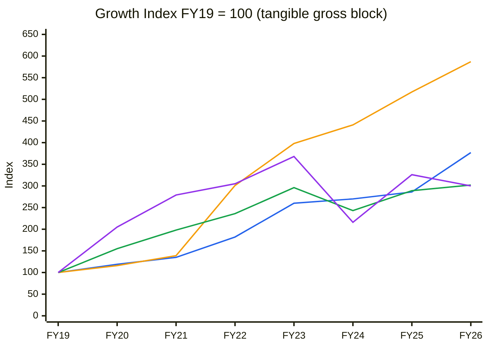
🟦 Revenue (CAGR 20.9%) · 🟧 Tangible PPE gross block, AR PPE notes (28.8%) · 🟩 EBITDA excl. OI (17.1%) · 🟪 PAT incl. NCI (17.0%). FY19 is the first merged year (Swiss Glascoat + HLE Engineers); FY17–18 pre-merger data are in Module 11, "Long-Term Fixed Assets". Goodwill (₹40 Cr) and acquired intangibles (₹155 Cr) come on top of this tangible block. Sources: Screener consolidated P&L; gross block from the FY20/FY21/FY23/FY26 annual-report PPE notes.

**Read:** Tangible gross block grew 5.9× from FY19 to FY26, against revenue 3.8×, EBITDA 3.0× and PAT 3.0×. The gap opened in FY22 with the Thaletec buildings and plant (+₹109 Cr) and the FY23 Silvassa plant and Anand land, and it has not closed since.

**Business inference:** Growth since FY22 has been bought with capital, both acquired and greenfield, and that incremental capital has not yet earned a return. EBIT fell from ₹124 Cr (FY23) to ₹112 Cr (FY26) while ~₹380 Cr more capital was employed. Inside India, operating profit rose just ₹5 Cr on ₹223 Cr of new gross block (Module 11). This is the core reason ROCE fell from 43% to 12%, and why a premium multiple is hard to justify until utilisation and Omeras repair it.

**Order book:** ₹662 Cr at 30-Jun-26 (0.48× TTM revenue); ₹713.8 Cr at 31-Jul-26. Implied book-to-bill TTM is **0.94** (vs 1.24 a year earlier). The tracked order book today is ≤ ₹890 Cr (662 + Fehmarnbelt ~₹228 Cr est., before execution). Framework share is 0%; the largest single order is 34% of the disclosed book.

---

## Module 1 — Broad Market Cycle (Marks)
- **Nifty 50:** 22,722 (13-Oct-2026), at its 52-week low (range 22,363–26,329 weekly closes); −11.9% YoY; below a **declining** 30-week MA (23,710 vs 24,146 ten weeks ago) → Weinstein Stage 4 (Yahoo ^NSEI weekly).
- **Nifty Midcap 100:** 68,928, below its 30-wk MA (70,941) (Yahoo ^NSMIDCP).
- **India VIX:** 14.1 (1-yr range 9.2–26.8). Fear is rising from complacent lows but is not panicky.
- **Pendulum:** Swinging from optimism toward fear. Geopolitics (Iran conflict, gas prices) is cited by HLE and its customers for deferred capex decisions (Q4FY26 concall; Q1FY27 release).
- **Assessment: Cautious (leaning Fearful).** Sizing: valuations in small-cap industrials have not yet capitulated (HLE at ~80× P/E). With the market in Stage 4, Weinstein discipline says no new longs until the index stabilises.

---

## Module 1b — Sector Cycle: Tailwinds & Headwinds
**Secular vs cyclical decomposition.** FY26 revenue +31.7% broke down as follows (investor release; concall):
- Omeras consolidation (~₹89 Cr) and the Kinam full year: inorganic, roughly 9pp
- Filtration/drying +50.9%: a cyclical catch-up in pharma/API capex
- GLE +15–16%: India GLE recovered from a low base, but realisations are falling
- Heat transfer +64.6%: helped by one large oil & gas order

Q1FY27 shows how fast that fades: +5.9% YoY with F&D −15.9%, HT −72.6% and GLE +49% (largely Omeras). **Durable structural baseline: ~10–12%/yr** (pharma/API capex, China+1, CDMO, Omeras water/biogas). Only about a third of FY26's growth rate should be treated as secular.
- **Input costs:** Steel/alloy exposure and gas-fired furnaces. Gas prices rose with the Iran conflict; management says it is "largely" passing them through (Q4FY26 call). Treat as a margin headwind.
- **Customer capex cycle:** Pharma/API is healthy. Specialty and agro chemicals are "not keeping up", and CDMO and agro clients deferred decisions after Feb-2026 (Q4FY26 call). Mixed.
- **Competitive capacity:** No destructive capacity wave. HLE's capex/depreciation is 1.5× (FY26) and GMM's is ~1.0× (capex 154/dep 158). HLE is adding a ₹35 Cr Omeras brownfield at Silvassa (COD Q4FY27, ICRA Aug-26).
- **FX / geopolitics:** Thaletec + Omeras make up ~₹434 Cr (~32%) of revenue in EUR. The European industrial slowdown hurts, and Fehmarnbelt is a EUR order. India exports are only 5–7% of India revenue (concall). Classification: transient-to-structural (European demand), so widen MoS by +5pp.
- **Sector cycle verdict: Neutral, with a near-term headwind.** Pharma capex is a multi-year tailwind; chemicals/agro and European industry are in a soft patch. Do not embed FY26's 32% growth.

---

## Module 1c — Stock Cycle: Company-Specific Positioning

| Quarter | Q2FY25 | Q3FY25 | Q4FY25 | Q1FY26 | Q2FY26 | Q3FY26 | Q4FY26 | Q1FY27 |
|---|---|---|---|---|---|---|---|---|
| Revenue (₹ Cr) | 235.8 | 231.0 | 333.7 | 284.0 | 350.8 | 326.6 | 391.7 | 300.8 |
| Revenue YoY % | 5.1 | −3.4 | 8.7 | 25.0 | 48.8 | 41.4 | 17.4 | 5.9 |
| EBITDA excl. OI (₹ Cr) | 34.1 | 25.6 | 52.0 | 37.6 | 38.2 | 21.1 | 42.8 | 20.9 |
| EBITDA YoY % | 28.9 | 3.9 | 42.5 | 72.1 | 12.1 | −17.7 | −17.6 | −44.3 |
| OPM % | 14.5 | 11.1 | 15.6 | 13.2 | 10.9 | 6.5 | 10.9 | 7.0 |

*Source: Screener consolidated quarterly results.*

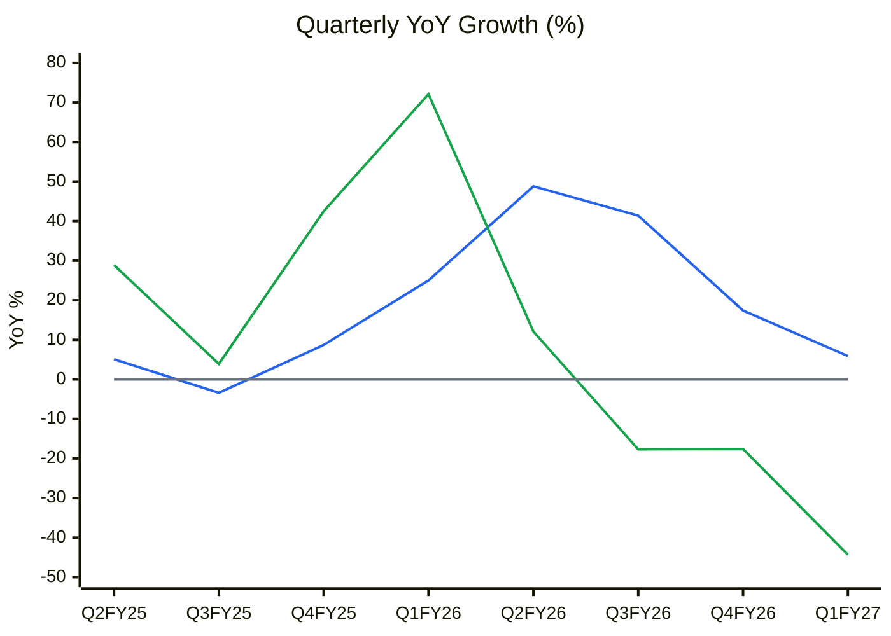
🟦 Revenue YoY % · 🟩 EBITDA YoY % · ⬜ zero line

**Read:** Revenue growth peaked at +48.8% in Q2FY26 and slowed for three straight quarters to +5.9%. EBITDA growth turned negative three quarters ago and reached −44% in Q1FY27.

**Business inference:** This is decelerating growth with negative operating leverage. Acquired revenue (Omeras, Kinam) is coming in at low or negative margins while the profitable India businesses slowed. Module 1c classification: margin trough, not early upcycle. Wait for EBITDA growth to turn positive before treating the cycle as turned.

- **Volume / price / mix:** India GLE volumes are up 30–40% since FY22 but value per equipment is down, so price is negative (concall). Mix is shifting toward lower-margin acquired lines (Omeras panels/tanks, oil & gas heat exchangers). Thaletec-range products are ~20% of India GLE, a positive mix lever. Net: growth is volume- and acquisition-led, price is a drag.
- **Capacity:** GLE India ~75% utilisation; heat transfer ~70–75%; Omeras sub-scale (EBITDA breakeven at ₹200–225 Cr/yr vs ₹89 Cr part-year FY26). CWIP is only ₹3.7 Cr (Mar-26), plus the ₹35 Cr Silvassa brownfield. The physical ceiling without new capex is roughly ₹1,750–1,900 Cr of revenue (90% utilisation, Omeras ramp, Fehmarnbelt execution of ~₹65 Cr/yr).
- **Operating leverage:** Contribution proxied by gross margin 53.2% ÷ EBIT margin 8.0% gives DOL ~6.6× (upper bound, since labour is semi-fixed). DFL = 112/(112−34) = 1.44×. DTL ~9×. Q1FY27 bears this out: revenue +6%, EBITDA −44%, PAT −88%. **Forward ICR:** Q1FY27 interest cover was 2.5× (ICRA). The base FY27E is 2.8× and the bear FY27E is 1.9×, below 2.5×, which adds 5pp to MoS.
- **Guidance accuracy:** WTT 0.50 (Module 4), so haircut guidance by 20–30%.
- **FCF inflection:** Reached in FY24 (FCF ₹40 → 68 → 106 Cr), but FY26's ₹161 Cr CFO was flattered by a ₹73 Cr payables stretch and a ₹46 Cr inventory release, partly offset by +₹130 Cr receivables (AR cash-flow statement). FY27 will likely give some of that back: Q1 saw a finished-goods build of ₹14 Cr.
- **Stock cycle classification: Trough / Recovery (margins), with the cause only partly reversible.** Dispatch deferral and Omeras scale are reversible; India GLE realisation decline is structural. MoS should be the widest band.

---

## Module 2 — Industry Structure & Capital Cycle

| Force | Assessment | Signal |
|---|---|---|
| New entrants | Low. Glass-lining metallurgy/firing know-how, customer approvals, decades of references | Favourable |
| Supplier power | Moderate. Steel, alloys and gas are commodities; gas is an Iran-war swing factor | Neutral / risk |
| Buyer power | **Moderate-to-high.** Customers dual-source across the duopoly; India GLE value per unit has fallen for ~4 years. F&D top-10 customers = 69% of segment revenue (ICRA Jul-26) | Unfavourable |
| Substitutes | Low-moderate (exotic alloys, PTFE-lined) | Favourable |
| Rivalry | Duopoly in GLE (GMM >50% India share per Screener key points; HLE #2), but price competition visible in falling realisations. New-entrant status in oil & gas heat exchangers | Neutral |

**Industry verdict: Neutral-to-Attractive.** The barriers are real, but buyer power is eroding pricing (downgraded from "Structurally Attractive").
**Capital cycle:** Returns sit well below their 10-yr average for both duopolists (HLE ROCE 12% vs 25% avg; GMM 14% vs ~22%). Both bought European assets. There is no IPO flood, and industry capex/depreciation is ~1.0–1.5×, so supply is disciplined. **Position: trough of returns. Supply discipline supports eventual recovery, but demand (chem/agro capex, Europe) has not turned.**

---

## Module 3 — Business Quality & Moat
**Greenwald barriers.** (1) Supply/cost: partial (process know-how, robotic welding, captive glass-lining), but GLE EBIT margin fell to 4.2% in FY26, so there is no cost advantage visible in the numbers. (2) Customer captivity: moderate. Approvals and reglassing/aftermarket help, but customers dual-source; the aftermarket share is not disclosed (data gap). (3) Local scale: yes, duopoly economics in Indian GLE and leadership in Indian F&D.
**Moat verdict: NARROW, and eroding in GLE.** F&D (12% EBIT margin, leadership) is the stronger franchise today.
**Long-life asset lens (see Module 11, "Long-Term Fixed Assets"):** The organic India plant base has been renewed (average asset age ~5.6 yrs; capex ≥ 1.5× D&A in 9 of 10 years). Underinvestment is not the problem. India asset turnover has halved (3.8× → 2.1×), so new capacity is not earning legacy returns. The installed base is long-lived (reactors last 10–30 yrs), but the disclosed aftermarket (spares & service ~6–15% of revenue, inconsistently reported) is too small to count as a captive annuity moat.
**Durability tests:** ROIC vs WACC is below for 3 years (fail, cyclical-plus-structural). Market share is stable (no data showing loss). Pricing power fails: India GLE value per unit fell while volume rose 30–40% (concall). Buffett 10% price test fails.

**Fisher 15-point (1–3):** market potential 3; new products 3; R&D→revenue 2; sales org 2; profit margin 1; active margin management 1 (16% then 14–15% targets missed); labour 2; executive relations 2; management depth 2 (new CFO Amit Kalra, VP Ops Maroli appointed Jun-26); cost/accounting controls 2; industry advantage 2; long-range orientation 3; dilution 3 (one 1.7% issue on the Kinam merger); candour 2 (concedes misses but reframes to "adjusted" margins); **integrity 3, Pass** (zero pledge, clean audit, no SEBI actions found). **Total 33/45 (vs 37 in August). No veto.**
**Scuttlebutt:** A Q4FY26 analyst pushed hard on the 16% miss and flat India GLE. ICRA (Jul/Aug-2026) flags working-capital intensity, cyclicality and Omeras execution risk; its downgrade trigger is debt/OPBDITA > 2.0× sustained, against an actual 2.4× in FY26 and ~2.8× TTM. Trading is thin (FII 2.05%, down from 4.3% over 8 quarters).

---

## Module 4 — Management & Capital Allocation
**Promoter Holding:** 65.64% (Jun-26) | **Pledge: 0%** → Risk: Normal. The slight dip from 66.78% (Jun-25) is from shares issued on the Kinam merger (Sep-25), not selling. Shareholding Sep-26 not yet on Screener.
**Pledge trend:** Nil throughout.
**FCF/share vs EPS:** FY23→FY26 EPS 10.23 → 7.12 (−11%/yr). FCF/share −5.3 → 15.2 (turned positive). Cash conversion is good; profit growth is negative.
**Share count:** Stable (6.945 Cr; 11.9 lakh issued on merger).
**Capital allocation rating: AVERAGE → BELOW AVERAGE.**
- Positives: no pledge, debt down (₹390 → 348 Cr incl. leases FY24–26), dividend maintained at ₹1.10.
- Negatives: three acquisitions in five years with **negative incremental ROIC** (EBIT FY23 ₹124 Cr → FY26 ₹112 Cr on ~₹380 Cr more capital). Omeras lost ₹15.6 Cr at PAT in FY26.
**RPT:** KMP remuneration ₹12.8 Cr + commission ₹0.53 Cr against attributable PAT ₹49.4 Cr (27%). The three promoter executive directors carry pay ratios to median of 40.9× / 28.7× / 20.1× (AR FY26 Annexure), so promoter pay is est. ₹7–10 Cr, about 15–20% of PAT. This is **above the 10% extraction threshold**, a red flag that worsens as profits fall. Unsecured loans from KMP (₹26.9 Cr repaid in FY26) were at interest and are now ₹0.2 Cr outstanding. Sales to director-interested entities (Yashashvi Rasayan etc.) ₹7.8 Cr, which is immaterial.
**Buffett's Three C's:** Candor: Mixed. Competence: Mixed-to-weak recently. Caring: Good on pledge and dilution, weak on pay vs profits.

### Walk the Talk Scorecard
| Quarter Guided | Statement | Guided | Actual | Verdict |
|---|---|---|---|---|
| Q2FY26 call | EBITDA margin ~16% (H2FY26 / run-rate) | 16% | FY26 11.0%; Q4 11.2% | ❌ Miss |
| Q2FY26 call | GLE India utilisation 60–65% → ~80% exit | ~80% | ~75% | ⚠️ Near miss |
| Q2FY26 call | Heat-exchanger utilisation 65–70% | 65–70% | ~75% | ✅ Hit |
| FY26 calls | Order book growth / visibility | Growing | Mar-26 ₹681.6 Cr (+18.5% YoY) | ✅ Hit |
| Q4FY25/Q2FY26 | Omeras breakeven by Q4FY26 | Breakeven | "Very close" (Q4FY26 call) | ⚠️ Near miss |
| Q4FY26 call | Heat transfer +15–20% FY27 | +15–20% | Q1FY27 −72.6% YoY (dispatch deferral) | ❌ Miss (Q1) |
| Q4FY26 call | Consolidated EBITDA 14–15% FY27; ex-Omeras 16% | 14–15% | Q1FY27 7.5% | ⏳ Tracking miss |
| Q4FY26 call | Revenue ~₹2,000 Cr "in a couple of years" | ~₹2,000 Cr by FY28 | TTM ₹1,370 Cr (needs ~21% CAGR) | ⏳ Unlikely |
| Q4FY26 call | Omeras FY27 revenue "way above ₹200 Cr" | >₹200 Cr | Pending (Fehmarnbelt helps from FY28) | ⏳ Pending |

**WTT Score: 0.50 / 1.00 — LOW** (resolved points 6: 2 hits, 2 near misses, 2 misses; 3 pending, all leaning negative).
**Key pattern:** Optimism bias on margins and growth, with post-event reframing ("adjusted ex-Omeras" margins). Order-book statements are reliable; profitability guidance is not.
**Insider action:** No open-market promoter buying or selling. Inter-se promoter-group transfers to Aalap N. Patel (SAST Reg 10(1)(a), Aug/Sep-26) are neutral. Continued high pay through a profit collapse is mildly negative.
**DCF impact:** Guidance haircut ~30%. Management's 14–15% margin is used only in the bull case (14.5% by FY29); base 13%.
**Overall management credibility: MODERATE-LOW.**

---

## Module 5 — Financial Forensics
- **Beneish M-Score: −2.47** (DSRI 1.109, GMI 1.056, AQI 0.898, SGI 1.317, DEPI 0.892, SGAI 0.990, LVGI 0.973, TATA −0.076; AR FY26 vs FY25) → **Unlikely manipulator** (< −2.22). DSRI > 1 (receivables +46% vs revenue +32%) is the one component to watch.
- **Altman Z'': ~2.67** (X1 0.081, X2 0.228, X3 0.081, X4 0.81) → borderline Safe/Grey; 2.43 on strict retained earnings. Trend is down from >3 as margins fell.
- **Piotroski F: 7/9 — Strong.** Gains: ROA+, CFO+, CFO>NI, lower LT debt, higher current ratio, no dilution, higher asset turnover. Fails: ROA down, gross margin down 56.2% → 53.2%.
- **Sloan accrual:** (56.6 − 161.2 + 85.9)/1,337.6 = **−1.4%**, so earnings are cash-backed.
- **Schilit screen:** DSO 66 → 73 days (+7, < 10 threshold). Other income/EBIT 8%. Capex/dep 1.5×. Payables days 88 → 85 by Screener, but AR cash flow shows a +₹73 Cr trade-payables inflow in FY26 that flatters CFO. No factoring disclosed.
- **Indian flags:** Pledge 0%. Promoter remuneration >10% of PAT (flag). Auditor M M Nissim & Co LLP; unmodified opinion. KAMs are defined benefit obligation (labour codes), PPE/capex, and RPTs; no EOM found. Contingent liabilities are tiny (service-tax disputes < ₹1 Cr).
- **Forensic red-flag count: 2 / 15** (Altman downtrend; promoter pay). **Overall verdict: CLEAN, minor concerns.** The problem is return level, not earnings integrity.

---

## Module 6 — Earnings Quality & Financial Statements
**ROIC (FY26, post-tax):** NOPAT ₹89.7 Cr (pre-exceptional EBIT 112.1 × 0.80) ÷ invested capital ₹908 Cr (equity incl. NCI 618 + debt incl. leases 348 − cash/bank 58) = **9.9%**. Ex-goodwill/intangibles (₹196 Cr) = 12.6%. **WACC 12.9%.** **ROCE (Screener pre-tax): 12% FY26 vs 10-yr avg 25.3%.** **Spread: −3pp post-tax, so Value Destroying** (third year).
**ROIC trend:** Declining (43% FY21 → 12%). **Driver:** both margin (EBIT 15% → 8%) and capital base: acquisitions plus organic India capex (see Module 11, "Long-Term Fixed Assets").
**Historical-cost check:** The Ind AS deemed-cost reset at 1-Apr-2016 (FY18 AR) carried the legacy Swiss Glascoat plants at depreciated value (₹22.7 Cr gross). That flattered FY19–FY21 ROCE (40%+). Today 83% of the tangible block (₹457 Cr of ₹551 Cr) was added after FY19, so the current ROCE is a near-current-cost return, and the early-ramp Silvassa plant and idle Anand land depress it rather than flatter it. **Economic profit:** ₹908 Cr × (9.9% − 12.9%) ≈ **−₹27 Cr**.

| Year | FY19 | FY20 | FY21 | FY22 | FY23 | FY24 | FY25 | FY26 |
|---|---|---|---|---|---|---|---|---|
| Revenue (₹ Cr) | 359 | 426 | 484 | 652 | 932 | 968 | 1,028 | 1,353 |
| EBITDA excl. OI (₹ Cr) | 47 | 73 | 93 | 111 | 139 | 114 | 136 | 142 |
| OPM % | 13 | 17 | 19 | 17 | 15 | 12 | 13 | 11 |
| PAT incl. NCI (₹ Cr) | 19 | 39 | 53 | 58 | 70 | 41 | 62 | 57 |
| PAT margin % | 5.3 | 9.2 | 11.0 | 8.9 | 7.5 | 4.2 | 6.0 | 4.2 |
| CFO (₹ Cr) | 49 | 45 | 48 | 1 | 5 | 95 | 134 | 161 |
| ROCE % | n/a | 42 | 43 | 30 | 24 | 13 | 13 | 12 |

*Source: Screener consolidated (10-yr view starts FY19 on Screener). FY25/FY26 CFO cross-checked to AR FY26 cash-flow statement (₹134.4 / 161.2 Cr) ✅.*

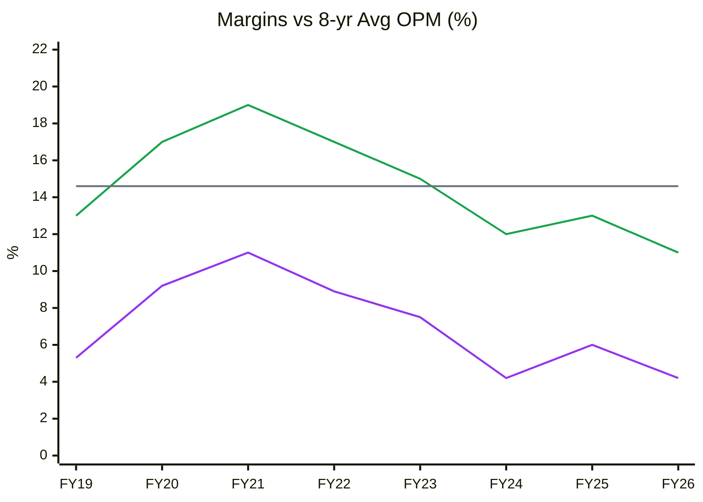
🟩 EBITDA margin (excl. OI) · 🟪 PAT margin · ⬜ 8-yr avg EBITDA margin 14.6% (SD 2.6pp)

**Read:** FY26 OPM of 11% is 1.4 SD below the 8-yr average, and TTM 9% is 2.1 SD below. Margins peaked at 19% in FY21 and have trended down for five years with only a brief FY25 uptick.

**Business inference:** This looks like a trough, but a five-year slide alongside falling India GLE realisations and dilutive acquired businesses is partly structural. Normalised margin for valuation should be ~12–13%, not the old 15–17% (feeds the Module 10 base case).

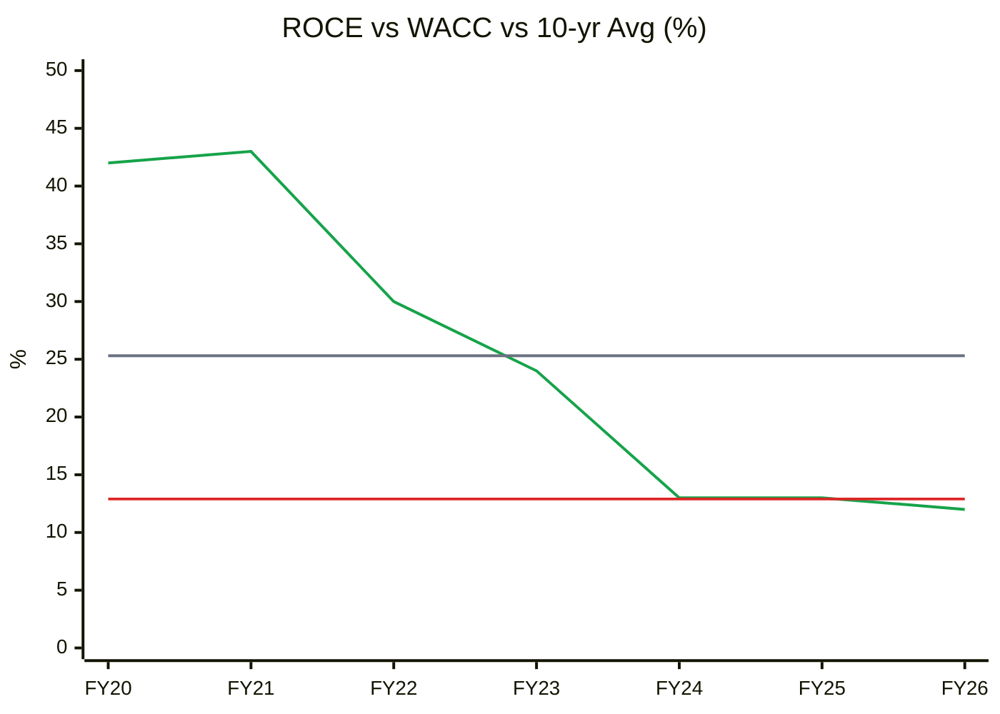
🟩 ROCE (pre-tax, Screener) · 🟥 WACC 12.9% · ⬜ 7-yr avg ROCE 25.3% (SD 12.5pp)

**Read:** ROCE fell from 43% to 12%, crossing below the 12.9% WACC in FY24. It is 1.1 SD below its average and has stayed below WACC for 3 years.

**Business inference:** The franchise that earned 40%+ on a small asset base now earns less than its cost of capital on an acquisition-enlarged one. The moat is not compounding capital. The hard stop (5+ years below WACC) is two years away if FY27–FY28 do not recover, so FY27 margin delivery is the decisive test.

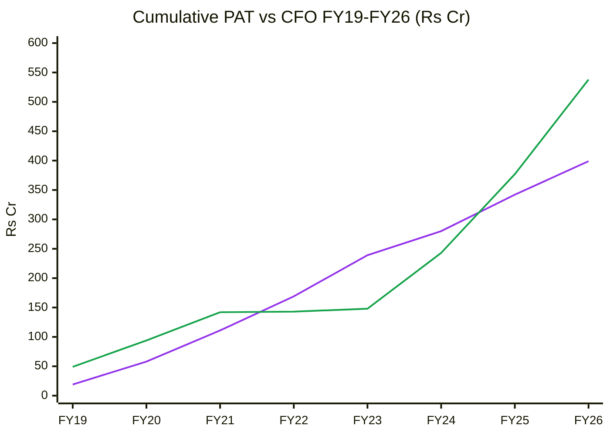
🟪 Cumulative PAT · 🟩 Cumulative CFO

**Read:** Cumulative CFO/PAT is 1.35×. CFO fell behind PAT in FY22–FY23 (working-capital build) and has run ahead since FY24.

**Business inference:** Reported profits are real cash over the cycle. FY24–FY26 cash came partly from releasing the FY22–23 working-capital bulge and stretching payables, so FY27 CFO will likely fall as inventory rebuilds (Q1 FG build). Earnings quality is not the problem; earnings level is.

**OCF/Net Income (FY22–26 avg):** 396/288 = 1.37× → Quality: High. **O'Glove flags: 2/15.**

| Days | FY19 | FY20 | FY21 | FY22 | FY23 | FY24 | FY25 | FY26 |
|---|---|---|---|---|---|---|---|---|
| Debtor | 34 | 38 | 52 | 83 | 95 | 89 | 66 | 73 |
| Inventory | 244 | 264 | 228 | 307 | 229 | 259 | 299 | 205 |
| Payable | 119 | 130 | 111 | 150 | 98 | 92 | 88 | 85 |

*Screener (COGS-based inventory days; ICRA's revenue-based figure is 125 days FY26).*

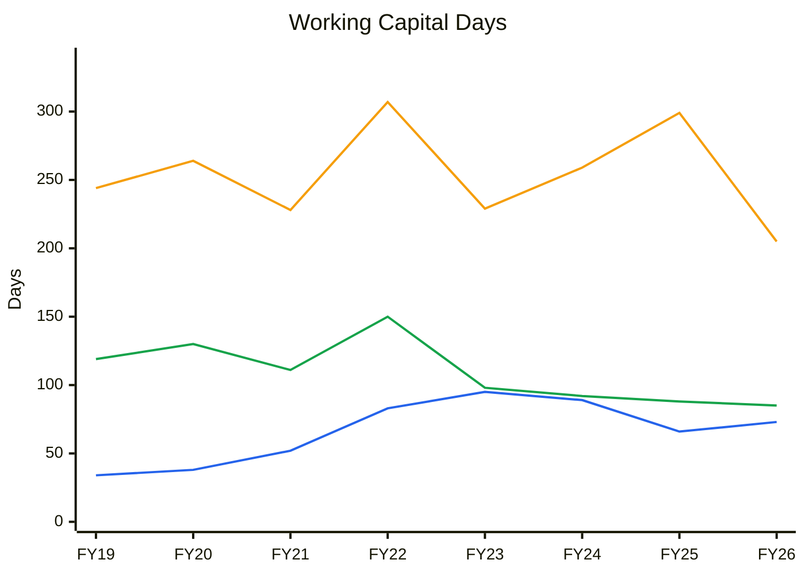
🟦 Debtor days · 🟧 Inventory days · 🟩 Payable days

**Read:** Debtor days doubled from 34 to 73 since FY19 while payable days fell from 119 to 85. Inventory days improved to 205 in FY26 from 299.

**Business inference:** HLE is funding customers more and getting less supplier credit than in FY19, consistent with weaker bargaining power. ICRA's NWC/OI did improve to 21% (from 34% in FY24), and a reversal would hit FY27 CFO.

### DuPont Decomposition (5-Factor)
| Year | EBIT Margin | Asset Turnover | Equity Multiplier | Interest Burden | Tax Burden | ROE |
|---|---|---|---|---|---|---|
| FY22 | 15.0% | 0.86 | 3.00 | 0.86 | 0.69 | 22.9% |
| FY23 | 13.3% | 1.04 | 2.74 | 0.80 | 0.71 | 21.5% |
| FY24 | 9.5% | 0.81 | 2.88 | 0.64 | 0.69 | 9.8% |
| FY25 | 11.1% | 0.80 | 2.69 | 0.66 | 0.83 | 13.0% |
| FY26 | 8.0% | 0.99 | 2.56 | 0.66 | 0.80 | 10.7% |
| **Change** | −7.0pp | +0.13 | −0.44 | −0.20 | +0.11 | **−12.2pp** |

*Screener consolidated; EBIT = PBT + interest; ROE on owners' equity using PAT incl. NCI (slight overstatement).*
**Operating contribution (EBIT margin × AT):** 0.129 → 0.079, Declining. **Financing contribution:** Falling (equity multiplier down, interest burden worse).
**DuPont verdict:** The ROE decline is purely operational (EBIT margin halved). Leverage is not masking it; debt has been reduced. AT recovered in FY26 on Omeras/Kinam revenue.
**AT trend → Module 11 base:** Revenue/tangible gross block is 2.46× in FY26, against a 5-yr average of 2.34× and a 10-yr average of 3.08×. It broke structurally lower in FY22 (see Module 11, "Long-Term Fixed Assets").

---

## Module 7 — Industry KPIs & Peer Analysis
**Sector:** Process Equipment / Glass-Lined & F&D Capital Equipment (ref. line 1985).

| KPI | HLE | Peer reference (GMM) | Healthy range | Assessment |
|---|---|---|---|---|
| Book-to-Bill (TTM, implied) | **0.94** (vs 1.24 a year ago) | Q1FY27 intake ₹1,007 Cr / rev ₹925 Cr = 1.09 | > 1.0× | **Below** |
| EBITDA margin | FY26 10.5% (11.0% incl. OI); Q1FY27 7.0% | FY26 11.4%; Q1FY27 10.1% | 14–18% (>11% consol) | **Below** |
| Order book / revenue | 0.48× | 2,289 / 3,654 = 0.63× | 0.5–1.0× | In-line / low |
| Capacity utilisation | GLE India ~75%, HT ~70–75% | n/a | > 80% | Slightly below |
| Intl vs India margin spread | Thaletec EBIT ~11–11.5%; Omeras ~breakeven (loss FY26) | Intl loss-making at PAT (GMM report) | Intl within 3pp | Below |
| Export % (India ops) | 5–7% | n/a | 20–40% | Below |
| ROCE | 12% | 14% | > 18% | **Below** |
| Net debt / EBITDA | 289/142 = 2.0× (TTM 2.3×) | — | < 1.5–2.0× | Borderline |
| Aftermarket / reglassing % | Spares & service 15.4% (FY25 AR) vs ~6–7% (FY26 AR); services ₹78.7 Cr = 5.8% (FY26) | Not disclosed | Rising | Small / inconsistent |

**Peer Comparison** (Screener consolidated, 13-Oct-2026):

| Metric | HLE Glascoat | GMM Pfaudler | Anup Engineering | Thermax | Praj Industries |
|---|---|---|---|---|---|
| MCap (₹ Cr) | 2,859 | 5,947 | 3,027 | 39,293 | 5,295 |
| Revenue FY26 (₹ Cr) | 1,353 | 3,524 | ~822 | 10,774 | 3,168 |
| Revenue 3-yr CAGR | 13.2% | 3.5% | n/a | 10.0% | −3.5% |
| EBITDA margin (FY26) | 10.5% | 11.4% | ~21% | ~10% | ~4.9% |
| ROCE (latest FY) | 12% | 14% | 21% | 14% | 6% |
| Net D/E | 0.47× | ~0.6× gross (borrowings 1,041 / equity 1,205+) | low | low | low |
| P/E (Screener TTM) | 72.6× (79.8× on attributable EPS ₹5.16) | 47.2× (82× on TTM EPS ₹16.06) | 35.3× | 71.4× | 105× |
| P/B | 5.35× | 4.9× | 4.4× | 7.1× | 4.0× |

**Peer positioning:** HLE trades at a P/E and P/B premium to GMM and Anup while earning a lower ROCE than both. **Is the premium justified? No.** Only Anup, with a 21% ROCE, earns its multiple on returns. The premium rests on HLE's faster (largely inorganic) growth, which has not converted into profit.

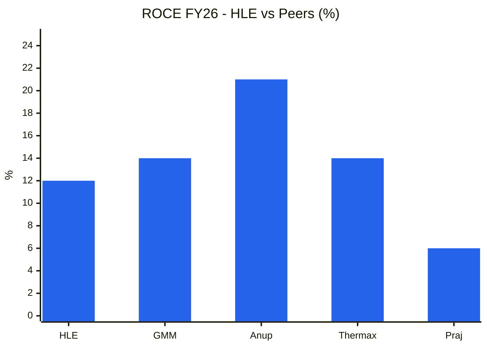
**Read:** HLE's 12% ROCE trails GMM (14%), Thermax (14%) and Anup (21%) and only beats Praj (6%).

**Business inference:** A higher P/B for the lower-ROCE duopolist is not supported. The market is valuing HLE's growth optionality, not its returns, so any growth disappointment de-rates the stock toward GMM/Anup multiples.

### Order Book Tracker *(references/13-order-book-tracking.md; scripts/order_book_tracker.py, first run, ledger start 2024-04-01)*
*Generated 2026-10-13 from 1 order announcement and 10 period snapshots. BSE Reg 30 filings were harvested from Apr-2024 to 13-Oct-2026; the only "Award of Order" is the 8-Sep-2026 Fehmarnbelt contract. HLE's many small orders sit below the disclosure threshold, so announced coverage is 0% for every historical quarter. The disclosed order book (investor releases) gives the level; the ledger gives the shape.*

#### 1. Disclosed vs tracked order book (reconciliation)

| Period | Revenue (₹ Cr) | Order book (₹ Cr) | Announced inflow | of which Framework | Implied inflow | Announced coverage | OB cover (× TTM rev) | Source |
|---|---|---|---|---|---|---|---|---|
| FY24 | 968 | 479 | — | — | — | — | 0.5 | Q4FY24 investor release (OB Rs 47936.07 lakh); Screener quarterly revenue |
| Q1FY25 | 227 | 476 | 0 | — | 224 | 0% | 0.5 | Q1FY25 investor release (Rs 47585.8 lakh) |
| Q2FY25 | 236 | 602 | 0 | — | 362 | 0% | 0.6 | Q2FY25 investor release (Rs 60247.1 lakh) |
| Q3FY25 | 231 | 683 | 0 | — | 312 | 0% | 0.7 | Q3FY25 investor release (Rs 68323.8 lakh) |
| Q4FY25 | 334 | 575 | 0 | — | 226 | 0% | 0.6 | Q4FY25 investor release (Rs 57506.2 lakh) |
| Q1FY26 | 284 | 739 | 0 | — | 448 | 0% | 0.7 | Q1FY26 investor release (Rs 73874.0 lakh) |
| Q2FY26 | 351 | 722 | 0 | — | 334 | 0% | 0.6 | Q2FY26 investor release (Rs 72221.6 lakh; incl. acquired Omeras backlog from Aug-2025) |
| Q3FY26 | 327 | 653 | 0 | — | 258 | 0% | 0.5 | Q3FY26 investor release (Rs 65339.2 lakh) |
| Q4FY26 | 392 | 682 | 0 | — | 420 | 0% | 0.5 | Q4FY26 investor release / ICRA Jul-2026 |
| Q1FY27 | 301 | 662 | 0 | — | 281 | 0% | 0.5 | Q1FY27 investor release 10-Aug-2026 (Rs 713.8 Cr at 31-Jul-2026) |

*Implied inflow = OB(t) − OB(t−1) + order-linked revenue(t). Coverage below 50% is expected here: a many-small-orders business (only one Reg 30 order since Apr-2024).*

#### 2. Announced orders aggregated by quarter

| Quarter | # orders | Total (₹ Cr) | Firm | Framework | Largest single | Export | Govt/PSU/Defence | Private domestic |
|---|---|---|---|---|---|---|---|---|
| Q2FY27 | 1 | 228 | 228 | 0 | 228 | 228 | 0 | 0 |

#### 3. Macro picture

| Metric | Value |
|---|---|
| Latest disclosed order book | ₹662 Cr (Q1FY27); ₹713.8 Cr at 31-Jul-2026 |
| Orders announced since that disclosure | ₹228 Cr (1 order; INR estimated) |
| Tracked order book today (before execution since Q1FY27) | ≤ ₹890 Cr (upper bound) |
| Order book cover (latest) | 0.48× TTM revenue |
| Book-to-bill, implied, TTM (Q2FY26–Q1FY27) | 1,293 / 1,370 = **0.94×** (incl. acquired Omeras backlog; organic ~0.91×) vs 1.24× prior TTM |
| Execution rate (revenue ÷ opening OB) | Q1FY27 0.44 vs Q1FY26 0.49: slowing (dispatch deferrals) |
| Framework / 'potential value' agreements | ₹0 Cr (0%) |
| Top-3 orders (last 12 m) as % of disclosed OB | 34% (single Fehmarnbelt order) |

**Mix, last 12 months (announced):** Export 100% · Private 100% · Glass Lined Products (HST/Omeras panels) 100% · Firm 100%.

#### 4. Charts

**OB-1 — Order book vs revenue (TTM), index = 100 at FY24**
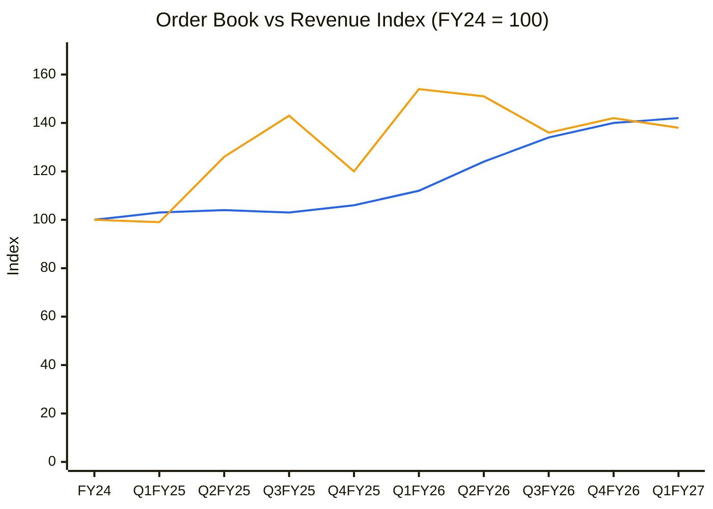
🟦 Revenue (TTM) · 🟧 Order book (disclosed points only)

**Read:** The order book led revenue through Q1FY26 (index 154 vs 112). It has since flattened to 138 while TTM revenue caught up to 142, so the book is now being consumed rather than built.

**Business inference:** Demand, not execution, is the binding constraint again. FY27 revenue growth will track fresh inflow (chem/agro deferrals), so high-single-digit growth is more realistic than management's ~20%+ trajectory, until the Fehmarnbelt order lifts the book.

**OB-2 — Order book cover (× TTM revenue)**
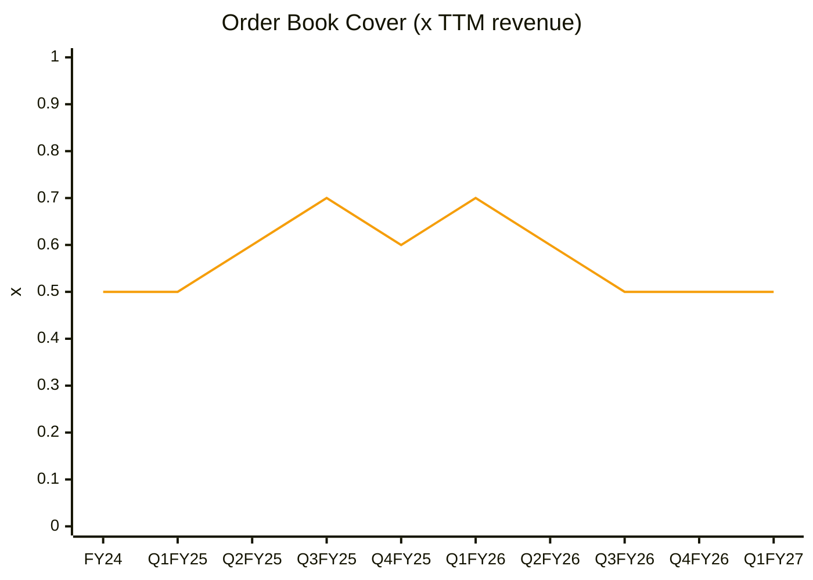
🟧 Order book / TTM revenue

**Read:** Cover has stayed in a 0.5–0.7× band and slid from 0.7× (Q1FY26) to 0.48× (Q1FY27).

**Business inference:** Six months of visibility is normal for a 3–6-month-cycle equipment maker. It means quarterly earnings swing with each quarter's order wins and dispatch timing, which adds risk to any high multiple. The Fehmarnbelt order adds long tenor (to Apr-2030) but only ~₹65 Cr/yr of revenue.

**OB-3 — omitted:** it needs ≥ 4 ledger quarters with announced orders, and the ledger has one order (Q2FY27). The quarterly shape is shown by OB-4 instead.

**OB-4 — Implied order inflow vs revenue (₹ Cr)**
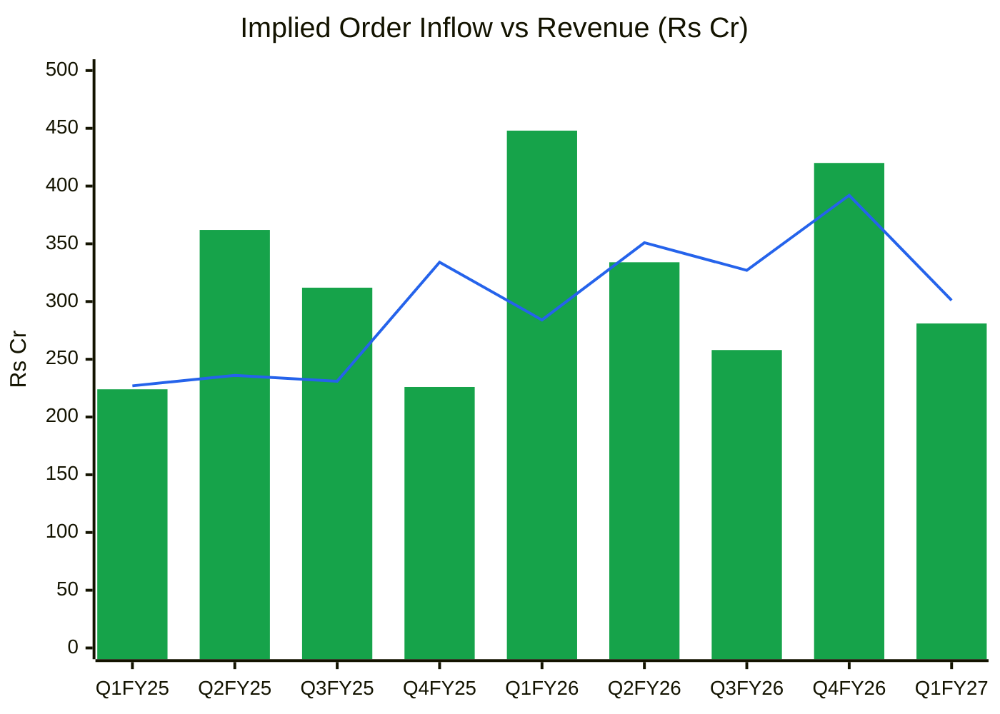
🟩 Implied inflow = ΔOB + revenue · 🟦 Revenue

**Read:** Implied inflow beat revenue in 4 of 5 quarters to Q1FY26 (peak ₹448 Cr) but fell short in 3 of the last 4 quarters (Q1FY27 ₹281 Cr vs revenue ₹301 Cr).

**Business inference:** Order momentum faded from mid-FY26, matching management's comment that CDMO/agro customers deferred decisions after Feb-2026. FY27 revenue growth is capped unless inflow re-accelerates in Q2–Q3. Q2FY27 inflow (Fehmarnbelt, plus the 31-Jul book of ₹713.8 Cr) is the first sign of that.

#### 5. Order Ledger — every announced order (source of truth; the next run appends here)

| order_id | date | customer | customer_type | segment | geography | value_cr | currency | value_fc | firmness | tenor_months | linked_to | source | notes |
|---|---|---|---|---|---|---|---|---|---|---|---|---|---|
| HLEG-2609-01 | 2026-09-08 | FLC Portals Group I/S (Denmark) | Private | Glass Lined Products (HST/Omeras enamel panels) | Export | 227.7 | EUR | 20.56 | Firm | 43 |  | [BSE](https://www.bseindia.com/xml-data/corpfiling/AttachHis/9b3edfae-79e5-434b-b343-a8e4fbe72575.pdf) | Vitreous enamel cladding panels for Fehmarnbelt tunnel; execution by Apr-2030; filing gives no INR value - INR estimated at EUR/INR ~110.8 (week of 8-Sep-2026, Yahoo EURINR=X) |

#### 6. Order Book Snapshots — revenue and disclosed order book per period

| period | revenue_cr | revenue_ttm_cr | order_book_cr | order_linked_share | as_of_date | source |
|---|---|---|---|---|---|---|
| FY24 | 967.7 | 967.7 | 479.4 | 1.0 |  | Q4FY24 investor release (OB Rs 47936.07 lakh); Screener quarterly revenue |
| Q1FY25 | 227.1 | 997.6 | 475.9 | 1.0 |  | Q1FY25 investor release (Rs 47585.8 lakh) |
| Q2FY25 | 235.8 | 1009.0 | 602.5 | 1.0 |  | Q2FY25 investor release (Rs 60247.1 lakh) |
| Q3FY25 | 231.0 | 1000.8 | 683.2 | 1.0 |  | Q3FY25 investor release (Rs 68323.8 lakh) |
| Q4FY25 | 333.7 | 1027.6 | 575.1 | 1.0 |  | Q4FY25 investor release (Rs 57506.2 lakh) |
| Q1FY26 | 284.0 | 1084.5 | 738.7 | 1.0 |  | Q1FY26 investor release (Rs 73874.0 lakh) |
| Q2FY26 | 350.8 | 1199.5 | 722.2 | 1.0 |  | Q2FY26 investor release (Rs 72221.6 lakh; incl. acquired Omeras backlog from Aug-2025) |
| Q3FY26 | 326.6 | 1295.0 | 653.4 | 1.0 |  | Q3FY26 investor release (Rs 65339.2 lakh) |
| Q4FY26 | 391.7 | 1353.0 | 681.6 | 1.0 |  | Q4FY26 investor release / ICRA Jul-2026 |
| Q1FY27 | 300.8 | 1369.8 | 662.1 | 1.0 |  | Q1FY27 investor release 10-Aug-2026 (Rs 713.8 Cr at 31-Jul-2026) |

*Every number above traces to the ledger / snapshot rows (source column). ICRA's 19-Aug-2026 update quotes "~₹750 Cr as of July 2026"; the company's own ₹713.8 Cr (31-Jul) is used.*

**Order-book verdict:** Firm visibility ~0.5 yrs (no framework) · Book-to-bill TTM 0.94 · Framework 0% · Top-1 order 34% of OB · Execution rate: Falling (Q1 dispatch deferrals).
**Forward link (Module 10):** FY27 revenue ≈ opening OB ₹681.6 Cr × ~2.0 annual turns (FY26: 1,353/575 = 2.35; slower now) ≈ ₹1,400–1,500 Cr → base ₹1,450 Cr.

---

## Module 8 — Market Size & Market Share
- **TAM:** India GLE is a ~₹2,000–2,500 Cr duopoly market (GMM report estimate, unverified). India F&D and heat-exchanger pools for chem/pharma add a few thousand crore. European GLE/enamel and tanks (Thaletec, Omeras) widen SAM into a multi-billion-euro market. No independent industry-body TAM was found (data gap).
- **TAM growth:** ~10–12%/yr structurally (pharma/API, CDMO, China+1, water/biogas), currently below trend in chem/agro.
- **Penetration / share:** India GLE ~₹250 Cr ≈ 10–12% of the estimated India GLE pool. That is far below the "duopoly #2" framing in value terms; GMM claims >50% India share (Screener key points). Share in value has been stable-to-down: India GLE flat at ₹200–250 Cr since FY22 while customers' capex continued and dispatch units rose 30–40%.
- **Reconciliation:** FY26 company growth (32%) vs market ~10–12%. The gap is inorganic and cyclical F&D catch-up, not structural share gain. **Verdict: growing roughly with the market organically; losing value share in India GLE on price.**

---

## Module 9 — Valuation: PIE First, Then DCF
**Inputs:** CMP ₹411.7 × 6.945 Cr = MCap ₹2,859 Cr. Net debt ₹289 Cr (incl. leases) plus NCI ₹84 Cr (book) gives **EV ≈ ₹3,232 Cr**. EV/EBITDA: FY26 22.8×, TTM (₹123 Cr) 26.3×. P/E: 79.8× TTM attributable EPS ₹5.16 (Screener 72.6×); 57.8× FY26 EPS ₹7.12. P/B 5.35× (BV ₹76.9). WACC 12.9%.

### 9A. Price-Implied Expectations (Mauboussin)
- **Quick PIE:** g = (EV×WACC − NOPAT₀)/(EV + NOPAT₀) with NOPAT₀ = ₹65 Cr (TTM EBIT ₹87 Cr × 0.75) gives **~10.7% perpetual growth**, essentially India's nominal-GDP ceiling, forever, from trough earnings.
- **Two-stage reverse DCF:** 10-yr explicit period; EBITDA margin ramps from 9% to the target by year 3; D&A 3% of revenue; tax 25%; terminal RONIC = WACC. With sales-to-capital 3.0×, implied 10-yr revenue CAGR is **~25% at a 15% margin** (23% at 16%, 30% at 13%). With sales-to-capital 2.0× (closer to HLE's actual, given acquisitions), it is 28–40%.

| PIE value driver | Market-implied | My base case | Expectations gap |
|---|---|---|---|
| Revenue CAGR (FY26–FY29) | ~23–25%/yr sustained (→ ~₹2,600 Cr FY29) | ~8.4% (→ ₹1,720 Cr FY29) | −15pp (market optimistic) |
| EBITDA margin (steady) | 15–16% | 13% | −2 to −3pp |
| Investment rate | Low (S2C 3×) | Higher (S2C ~2×; ₹50–60 Cr/yr capex + NWC 21% of ΔRev) | Market optimistic |

**Interpretation: OPTIMISTIC GAP**, larger than in August because the WACC is higher and earnings have fallen.
**Expectations treadmill:** To merely earn its cost of capital from ₹412, HLE must reach the ₹2,000 Cr+ revenue target and a 15%+ margin within about three years, and keep growing ~15% after that.
**Physical plausibility:** The ~₹2,600 Cr FY29 implied by the price exceeds the ~₹1,750–1,900 Cr ceiling of installed capacity plus Silvassa plus Fehmarnbelt. **The market is pricing an unannounced expansion or acquisition.** Given the negative incremental ROIC on the last three deals, that is a risk, not an upside.
**Expectation triggers:**
- Positive: two quarters of ≥13% EBITDA; Omeras EBITDA-positive with a growing book; India GLE realisations stabilising.
- Negative: a Q2FY27 margin < 10%; an ICRA outlook change (debt/OPBDITA > 2.0× already); further Heat Transfer deferrals.
**SVAR:** bear ₹225 → **45%**, above the 40% threshold, so asymmetry is unfavourable.

### 9B. Intrinsic Value — Own Model (FY29E, priced ~2 yrs out)

| Method | Bear | Base | Bull |
|---|---|---|---|
| FY29E EPS × exit P/E | ₹191 (₹7.63 × 25×) | ₹416 (₹14.86 × 28×) | ₹786 (₹22.46 × 35×) |
| EV/EBITDA cross-check / P/B | ₹255 (3.0× trough P/B on BV ~₹85) | ₹465 (16× FY29E EBITDA ₹224 Cr, less debt+NCI ₹350 Cr) | ₹707 (18× ₹290 Cr, less ₹310 Cr) |
| **Consensus value** | **₹225** | **₹440** | **₹745** |

**Asset floor check (Module 11, "Long-Term Fixed Assets"):** Tangible book is ~₹49/sh. Tangible net PPE plus an estimated land surplus, less net debt, is ~₹18/sh. Hidden land value is only ₹3–5/sh. There is **no asset floor near the ₹225 bear case**, so the bear value rests on earnings and P/B multiples, not on assets. The installed base does not justify a longer-duration DCF or a higher terminal value (aftermarket ≤ 7–15% of revenue, margin undisclosed), so the terminal assumptions are unchanged.
**Residual income cross-check:** With ROE ~10–11% below Ke 13.6%, residual income is negative and the RI value is below book value (₹77). Any value above book is a bet on ROE recovering above 13.6%.
**Current price ₹411.7 vs base ₹440 → MoS 6.4%: Inadequate.** The required MoS for a small-cap cyclical with integration risk and a sector headwind is 35–40%. **Buy-below ₹300** (32% below base; bull/bear asymmetry 5.9:1 at that price).
**Upside/Downside (bull vs bear):** (745 − 412)/(412 − 225) = **1.8:1**. That is acceptable against the 1.5:1 hard stop but fails the 2:1 minimum. Base-vs-bear is only 0.3:1.
**Graham screen:** fails (revenue < ₹2,000 Cr, current ratio 1.19, EPS growth negative over 3 yrs, P/E ≫ 20, P/B ≫ 3). Graham number = √(22.5 × 5-yr avg EPS 7.65 × BV 76.9) = **₹115**.
**Misprice reason:** Not mispriced cheap. Small-cap re-rating memory (P/E 135× in FY22) and growth narrative keep the multiple high. **Catalyst needed:** Q2/Q3FY27 margin recovery and Omeras breakeven.

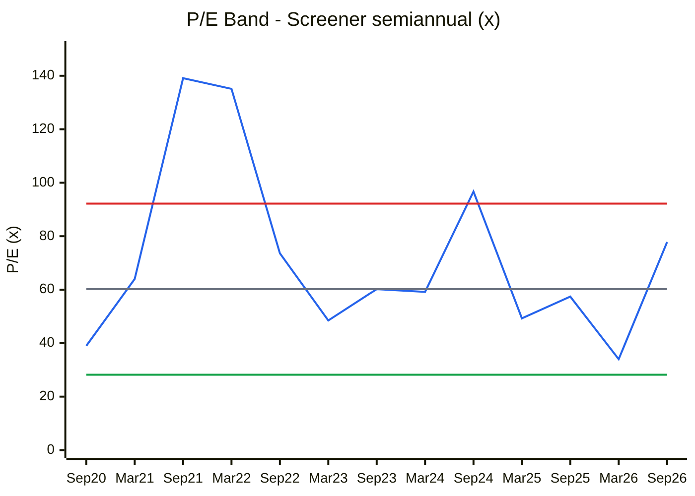
🟦 P/E · ⬜ Median 60.2× · 🟥 +1SD 92.2× · 🟩 −1SD 28.2× (Screener P/E series; earlier years unavailable)

**Read:** Current P/E is 72.5× (Screener) / 79.8× (attributable TTM), the **77th percentile** of its 6-yr history and above the 60× median. The only sub-40× readings were Sep-20 and Mar-26.

**Business inference:** This is the cyclical P/E trap in reverse. A high multiple on trough earnings is a buy signal only if earnings recover. The median itself is inflated by the FY21–22 bubble (135–139×) and a high-ROCE era, so for a 12%-ROCE business even the 60× median is not a fair anchor. Value on normalised EPS and P/B instead.

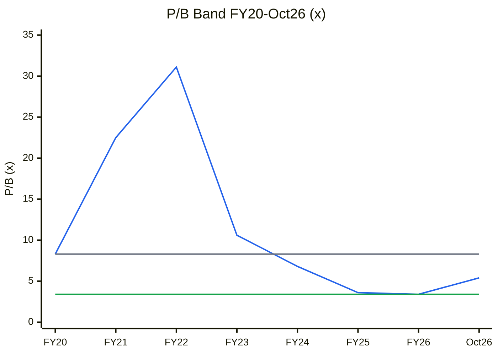
🟦 P/B (March price ÷ BVPS from Screener equity) · ⬜ Median 8.3× · 🟩 Period low 3.4× (SD 9.7× makes −1SD negative, so the low is used)

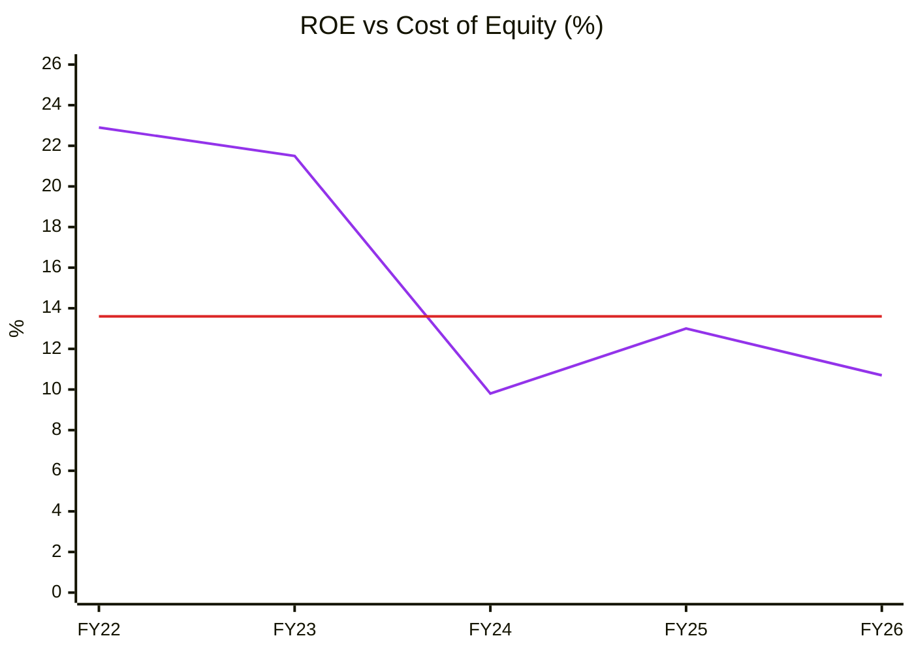
🟪 ROE (DuPont table) · 🟥 Ke 13.6%

**Read:** P/B of 5.4× sits at the 29th percentile of the FY20–26 range (median 8.3×, low 3.4× in Mar-26), while ROE of 10.7% has been below the 13.6% cost of equity for 3 of the last 3 years.

**Business inference:** P/B looks cheap only against the FY21–22 bubble. Justified P/B = (ROE − g)/(Ke − g) = (10.7 − 8)/(13.6 − 8) ≈ 0.5×, rising to ~1.4× even at a 16% ROE. Paying 5.4× book needs ROE back toward 20%+, which is the bull case.

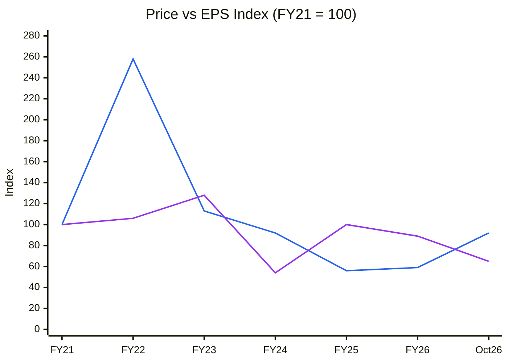
🟦 Price index (March closes; Oct26 = ₹411.7) · 🟪 EPS index (FY EPS; Oct26 = TTM attributable ₹5.16)

**Read:** Since FY21 the price index is at 92 and the EPS index at 65. The price has moved back above earnings since FY25 (re-rating from 56 to 92 while EPS fell from 100 to 65).

**Business inference:** The last 18 months' rally (₹250 → ₹412) was multiple expansion on falling earnings. Returns were borrowed from an expected recovery, so the stock is vulnerable to mean reversion if Q2–Q3FY27 margins disappoint.

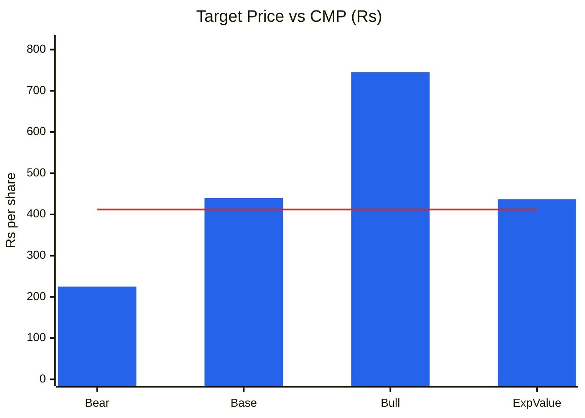
🟦 Scenario value · 🟥 CMP ₹412

**Read:** Downside to bear is −45% vs upside to bull +81%, giving U/D 1.8:1. Base +7%; probability-weighted ₹437 (+6%).

**Business inference:** The price sits near the base case, so the payoff depends on reaching the bull case (management's targets) while carrying 45% bear risk. That asymmetry is unattractive for a management team that has missed its margin guidance twice.

### Cycle Position Dashboard
| Dimension | Current | 10-yr Median / Avg | Percentile | Signal |
|---|---|---|---|---|
| P/E | 72.5× (Screener) / 79.8× | 60.2× | 77% | Expensive |
| P/B | 5.35× | 8.3× | 29% | Cheap vs own history (bubble-skewed); expensive vs ROE |
| EBITDA margin | 11% FY26 / 9% TTM | 14.6% avg | z −1.4 / −2.1 | Trough |
| ROCE | 12% | 25.3% avg | z −1.1 | Trough |
| Industry utilisation | GLE India ~75%, HT ~70–75% | n/a | — | Balanced |
| Spread / realisation | India GLE value/unit falling 4 yrs | n/a | — | Weak pricing |
| Industry capex/dep | HLE 1.5×, GMM ~1.0× | — | — | Disciplined |
| **Overall cycle position** | | | | **Trough earnings, expensive valuation** (matches Module 1c: Trough/Recovery; Module 1b: Neutral with headwind) |

---

## Module 10 — Technical Stage (Weinstein + CANSLIM)
**Nifty 50 Market Stage:** **4.** At its 52-wk low, below a declining 30-wk MA (22,722 vs 23,710).
**Sector proxy (Nifty Midcap 100; sector capital-goods index not retrieved):** Stage 3/4. Price is below the 30-wk MA (68,928 vs 70,941), which is flattening.
**Stock Stage:** **1→2 transition, unconfirmed.** Weekly close ₹412 sits above a rising 30-wk MA (₹368, up from ₹347 five weeks ago). Price history:
- Results crash: ₹474 → ₹306 (10–18 Aug 2026)
- Base at ₹306–320 through August
- Fehmarnbelt rally (8–22 Sep) on 2× average weekly volume (3.8 M vs 1.78 M 30-wk avg) to an intraday high of ₹483
- Since then a ₹405–476 range; the stock is now testing the bottom (₹406.6 on 12-Oct)

**30-Week MA:** Rising | Price is: Above.
**RS vs Nifty:** Improving. RS ratio 18.1 vs its 30-wk average 15.5. 26-wk return +24% vs Nifty −5%; 52-wk −15.6% vs −11.9%.
**Breakout volume:** Sep-26 breakout +114% above average, but the stock failed to hold above ₹470. Not a valid Stage 2 base: the base was only ~4 weeks, below the 12–16 week minimum.
**Stop-loss level (if held):** ₹390 weekly close, below the range floor; hard exit on a weekly close below the 30-wk MA (~₹370).
**CANSLIM:** C 0 (Q1 EPS −83%) · A 0 (3-yr EPS negative; ROE 11%) · N 1 (new 6-month high on a new order) · S 0 (volume mixed, float ~34%) · L 0 · I 0 (FII 4.3% → 2.05%; DII 3.9% → 4.7%) · M 0 (Nifty Stage 4) → **1/7.**
**Stage + fundamental alignment:** Misaligned. A rising stock MA with a Stage-4 market, and falling earnings with a rising multiple. **Hard stop (Stage 4 with declining 30-wk MA): not triggered for the stock.**

---

## Module 11 — Forward View: 2–3 Year Thesis

### Capex Classification
| Capex Type | FY27E (₹cr) | FY28E | FY29E | In AT Model? |
|---|---|---|---|---|
| Tangible growth capex (Omeras Silvassa brownfield ₹35 Cr; HT capacity "from next year") | 25 | 10 | 10 | ✅ Yes |
| Maintenance capex (≈ PPE depreciation ₹28 Cr FY26) | 30 | 35 | 35 | ❌ Sustains only |
| Intangibles / goodwill (₹40 Cr goodwill + ₹155 Cr intangibles on BS) | 5 | 5 | 5 | ❌ Excluded |
| CWIP (₹3.7 Cr Mar-26) | ~0 | — | — | ❌ Until capitalised |
| ROU assets (₹33.7 Cr) | — | — | — | ⚠️ Excluded |
| **Total capex** | **60** | **50** | **50** | |

*FY26 actual capex ₹55.7 Cr; FY25 ₹66.4 Cr (AR cash flow).*

### Long-Term Fixed Assets — 10-Year View (FY17–FY26)
*Addendum 2026-10-14. Cross-referenced from Modules 3, 6 and 9.*

**Current CWIP balance:** ₹3.7 Cr (Mar-26). Plus the ₹35 Cr Silvassa (Omeras India tanks) brownfield, COD Q4FY27 (ICRA 19-Aug-2026); WTT-adjusted, assume Q1FY28.

**Sources and basis.**
- FY17–FY18 are **Swiss Glascoat Equipments Ltd (SGEL) standalone**, the listed entity before it absorbed HLE Engineers in 2019 and was renamed HLE Glascoat. These rows are on the Ind AS deemed-cost basis, under which carrying value at 1-Apr-2016 became gross cost (FY18 and FY19 ARs, Note 2(a)). On the earlier IGAAP basis, FY17 historical gross block was ₹39.4 Cr with ₹18.7 Cr accumulated depreciation (FY17 AR, Note 11).
- FY19–FY20 are merged and consolidated with the H.L. Equipment partnership (FY20 and FY21 ARs, consolidated Note 2(a), restated).
- FY21–FY26 are consolidated: FY21 AR; FY23 AR for FY22–23; FY26 AR for FY24–26.
- Revenue for FY17–18 is Screener standalone; for FY19–26, Screener consolidated.
- Capex is "purchase of PPE incl. CWIP & capital advances" from the cash-flow statements (FY17–18 SGEL; FY19–26 consolidated).
- D&A is total depreciation and amortisation. Depreciation on PPE alone is used for remaining life.

| Year | Basis | Gross block (₹ Cr) | Acc. dep (₹ Cr) | Net block (₹ Cr) | CWIP (₹ Cr) | Revenue (₹ Cr) | AT gross (×) | AT net (×) | PPE dep (₹ Cr) | Total D&A (₹ Cr) | Capex (₹ Cr) |
|---|---|---|---|---|---|---|---|---|---|---|---|
| FY17 | SGEL, deemed cost | 22.7 | 2.3 | 20.3 | 0.4 | 81 | 3.57 | 3.98 | 2.3 | 2.5 | 6.3* |
| FY18 | SGEL, deemed cost | 23.9 | 4.7 | 19.2 | 2.0 | 97 | 4.06 | 5.05 | 2.4 | 3.0 | 1.3 |
| FY19 | Merged | 93.9 | 14.0 | 79.9 | 4.1 | 359 | 3.82 | 4.49 | 5.8 | 6.5 | 16.7 |
| FY20 | Merged | 109.2 | 19.8 | 89.4 | 10.0 | 426 | 3.90 | 4.77 | 6.7 | 7.4 | 22.7 |
| FY21 | Consol. | 130.5 | 21.9 | 108.6 | 3.1 | 484 | 3.71 | 4.46 | 7.5 | 9 | 32.2 |
| FY22 | Consol. (+Thaletec) | 282.7 | 57.7 | 225.0 | 31 | 652 | 2.31 | 2.90 | 9.4 | 11 | 69.4 (+₹112.6 Cr Thaletec) |
| FY23 | Consol. | 373.5 | 74.5 | 299.0 | 3 | 932 | 2.50 | 3.12 | 19.3 | 23 | 48.5 |
| FY24 | Consol. (+Kinam) | 413.9 | 99.2 | 314.7 | 19.4 | 968 | 2.34 | 3.08 | 21.3 | 26 | 55.2 (+₹82.1 Cr Kinam) |
| FY25 | Consol. | 485.3 | 122.3 | 363.0 | 5.0 | 1,028 | 2.12 | 2.83 | 22.5 | 30 | 66.4 |
| FY26 | Consol. (+Omeras) | 550.9 | 155.3 | 395.6 | 3.7 | 1,353 | 2.46 | 3.42 | 27.7 | 36.5 | 55.7 (+₹30.0 Cr Omeras) |
| **10-yr avg** | | | | | | | **3.08** | **3.81** | | | |
| **5-yr avg (FY22–26)** | | | | | | | **2.34** | **3.07** | | | |

\*FY17 capex includes ₹5.86 Cr spent on a patent (an intangible).

**Land / buildings / plant split (gross, ₹ Cr; same AR notes):**

| | FY19 | FY20 | FY21 | FY22 | FY23 | FY24 | FY25 | FY26 |
|---|---|---|---|---|---|---|---|---|
| Freehold land | 2.5 | 2.5 | 16.9 | 20.9 | 56.8 | 61.6 | 66.1 | 72.6 |
| Buildings | 26.3 | 28.3 | 36.3 | 117.8 | 145.3 | 152.0 | 180.6 | 191.5 |
| Plant & equipment | 47.3 | 56.4 | 53.1 | 94.2 | 108.9 | 126.3 | 150.8 | 180.1 |
| Other (windmill, tools, electricals, vehicles, office, computers) | 17.8 | 22.0 | 24.2 | 49.8 | 62.5 | 73.9 | 87.9 | 106.7 |

*Leasehold land sits in right-of-use assets (₹9.1 Cr gross, FY23 AR Note 2(b)). FY23 freehold-land additions of ₹37.8 Cr match the disclosed purchase of ~1.30 lakh m² near Anand for a new GLE plant (FY23 AR, operational highlights). No construction on it is reported in the FY24–FY26 ARs.*

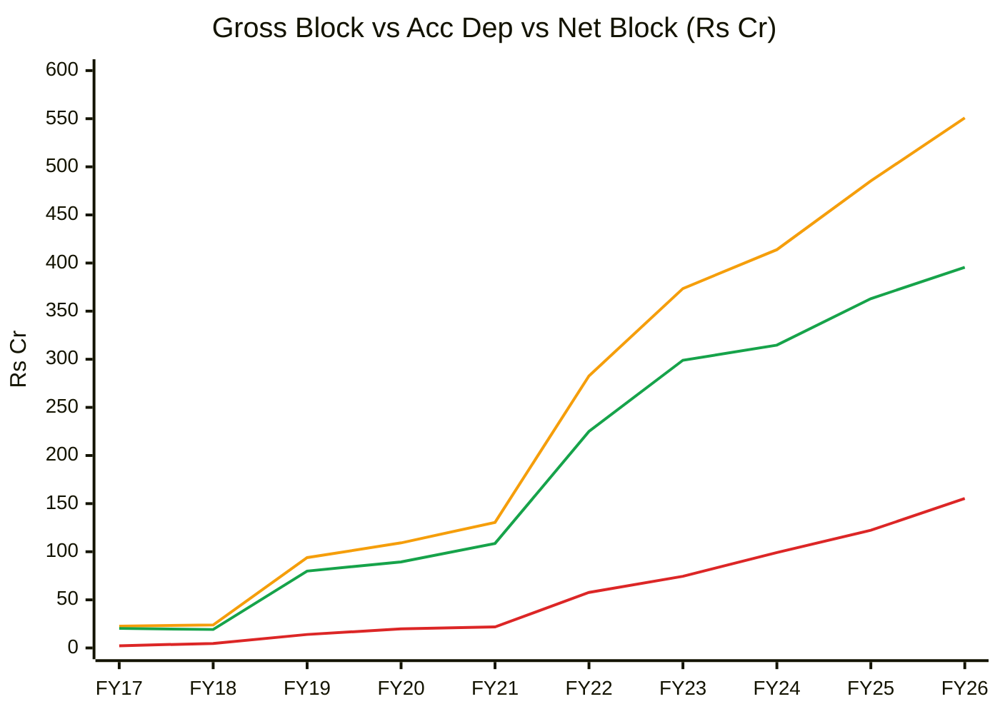
🟧 Tangible gross block · 🟥 Accumulated depreciation · 🟩 Net block. The FY18→FY19 step is the HLE Engineers merger; FY22, FY24 and FY26 include acquired assets (Thaletec ₹109 Cr gross / ₹82.5 Cr net; Kinam ₹14.5 Cr; Omeras asset deal ₹16.7 Cr).

**Read:** Gross block rose 24× in ten years (₹22.7 → 551 Cr; 5.9× since the FY19 merger) while accumulated depreciation stayed under 30% of gross. The asset base is young and was mostly bought or built after FY21.

**Business inference:** HLE is not a business sweating an old, written-down plant. About 83% of today's block was added after FY19, so there is no historical-cost cushion behind returns. Every rupee in the block is recent money that has to earn ~13% to cover WACC, and today it earns ~10% post-tax.

**Asset age and reinvestment:**

| Year | Acc. dep ÷ gross | Net ÷ gross | Avg age, yrs (acc. dep ÷ PPE dep) | Remaining life, yrs (net ÷ PPE dep) | Capex ÷ total D&A (×) |
|---|---|---|---|---|---|
| FY17 | 10.4% | 89.6% | 1.0 | 8.7 | 2.47 |
| FY18 | 19.8% | 80.2% | 2.0 | 8.0 | 0.43 |
| FY19 | 14.9% | 85.1% | 2.4 | 13.7 | 2.56 |
| FY20 | 18.1% | 81.9% | 2.9 | 13.3 | 3.05 |
| FY21 | 16.8% | 83.2% | 2.9 | 14.4 | 3.58 |
| FY22 | 20.4% | 79.6% | 6.1 | 23.9 | 6.31 |
| FY23 | 19.9% | 80.1% | 3.9 | 15.5 | 2.11 |
| FY24 | 24.0% | 76.0% | 4.7 | 14.8 | 2.12 |
| FY25 | 25.2% | 74.8% | 5.4 | 16.1 | 2.21 |
| FY26 | 28.2% | 71.8% | 5.6 | 14.3 | 1.53 |

*The deemed-cost reset at 1-Apr-2016 zeroed accumulated depreciation, so FY17–FY21 ages understate the true age of the legacy plants. The FY22 spike reflects Thaletec's acquired buildings, which carry long remaining lives.*

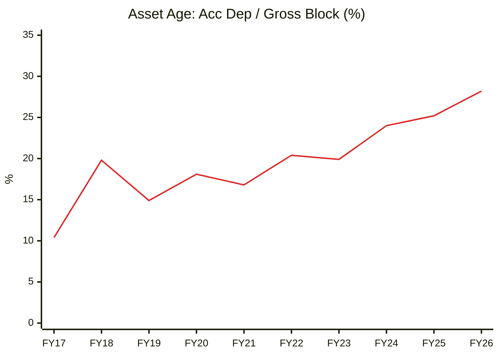
🟥 Accumulated depreciation ÷ gross block

**Read:** The age ratio crept up from 15% (FY19) to 28% (FY26). Average asset age is now ~5.6 years, against a ~20-year implied useful life (gross ÷ PPE depreciation).

**Business inference:** The plant is still young, so no catch-up replacement spike is due within the 2–3 year horizon. Maintenance capex can stay near PPE depreciation (~₹28–35 Cr/yr), which supports the Module 11 capex plan of ₹50–60 Cr.

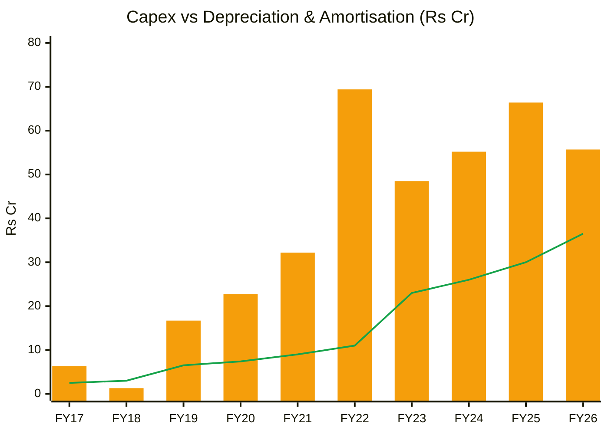
🟧 Capex (excludes acquisitions) · 🟩 Total D&A

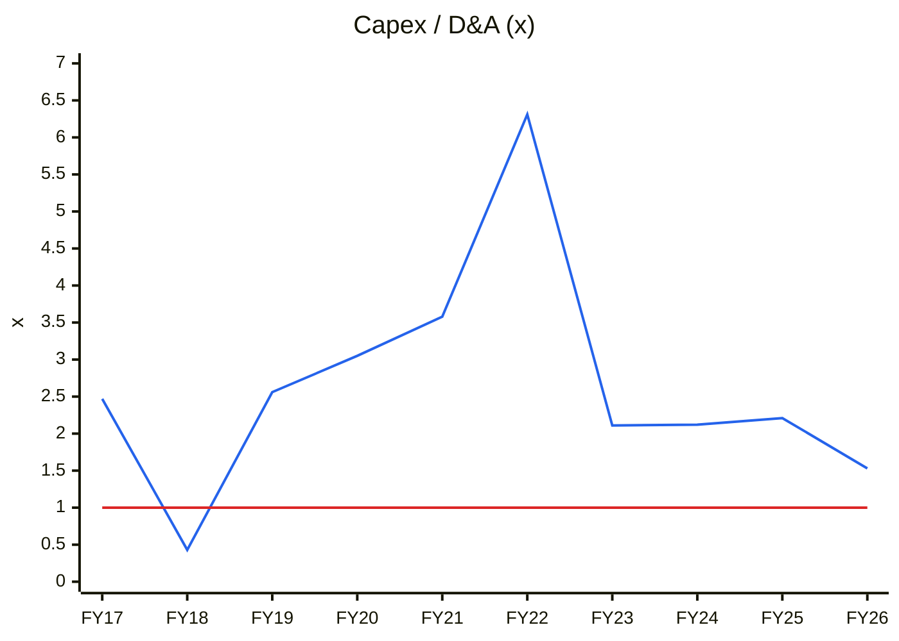
🟦 Capex ÷ D&A · 🟥 1.0× replacement line

**Read:** Capex beat D&A in 9 of 10 years (average 2.6×), peaking at 6.3× in FY22 (Silvassa greenfield). It has eased to 1.5× in FY26 as D&A caught up with the larger base.

**Business inference:** Maintenance capex is adequate and there is no underinvestment flattering FCF. The opposite risk applies: ₹367 Cr of organic capex over FY19–FY26 (on top of ~₹225 Cr of acquisitions) has gone into capacity that runs at 70–75% utilisation. Growth capex should stay modest until AT recovers. A new plant on the idle Anand land would be value-destructive at today's India returns.

**Organic India vs acquired businesses:**

| Year | India gross block (standalone) | India revenue (standalone) | India AT (×) | India op. profit (₹ Cr) | Subsidiaries gross block (consol − standalone) | Subsidiaries revenue (consol − standalone) | Subsidiaries AT (×) |
|---|---|---|---|---|---|---|---|
| FY20 | 101.5 | 387 | 3.81 | 64 | — | — | — |
| FY21 | 122.5 | 421 | 3.44 | 80 | — | — | — |
| FY22 | 165.2 | 508 | 3.08 | 89 | 117.6 | 144 (Thaletec ~1 qtr) | 1.22 |
| FY23 | 253.0 | 649 | 2.57 | 96 | 120.5 | 283 | 2.35 |
| FY24 | 273.5 | 591 | 2.16 | 66 | 140.3 | 377 | 2.69 |
| FY25 | 326.0 | 551 | 1.69 | 53 | 159.3 | 477 | 2.99 |
| FY26 | 345.2 | 723 | 2.09 | 85 | 205.7 | 630 | 3.06 |

*Sources: standalone gross block from AR standalone Note 2(a) (FY21 AR for FY20–21; FY23 AR for FY22–23; FY26 AR for FY24–26). Standalone revenue and operating profit from Screener standalone. Standalone = HLE India (F&D + India GLE). Subsidiaries = Thaletec Germany, Kinam Engineering (70%; only the holding entity Kinam Enterprise was merged into HLE), HST/Omeras and the H.L. Equipment/Thaletec LLP partnership. Before FY22 the difference was only the H.L. Equipment partnership, so it is not shown. Inter-company sales are not eliminated, so subsidiary revenue is approximate.*

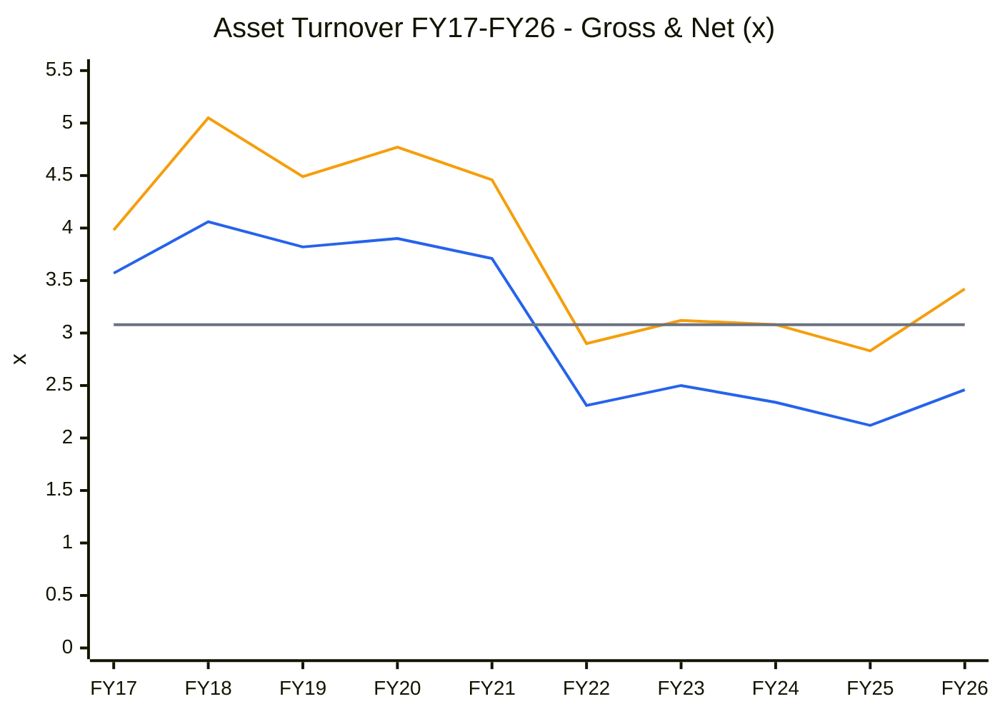
🟦 Revenue ÷ tangible gross block · 🟧 Revenue ÷ net block · ⬜ 10-yr average gross AT 3.08×. FY17–18 are SGEL pre-merger.

**Read:** Gross AT held at 3.6–4.1× through FY21 and then stepped down to 2.1–2.5× from FY22. FY26's 2.46× is 20% below the 10-yr average and 37% below the FY20 merged peak of 3.90×. Net AT follows the same path (4.8× → 3.4×).

**Business inference:** The FY22 break is structural, not a short ramp. Thaletec's building-heavy German base, the Silvassa greenfield, and ₹38 Cr of idle Anand land all brought assets that generate far less revenue per rupee than the legacy plants. A return to ~3.9× would need both higher realisations and full utilisation. That is why the bull case uses 2.95×, not the 10-yr peak, and the base 2.55× sits between the 5-yr average (2.34×) and FY26.

```mermaid
%%{init: {"themeVariables": {"xyChart": {"plotColorPalette": "#2563eb, #9333ea"}}}}%%
xychart-beta
    title "India (Standalone) vs Consolidated Gross AT (x)"
    x-axis [FY20, FY21, FY22, FY23, FY24, FY25, FY26]
    y-axis "x" 0 --> 4.5
    line [3.90, 3.71, 2.31, 2.50, 2.34, 2.12, 2.46]
    line [3.81, 3.44, 3.08, 2.57, 2.16, 1.69, 2.09]
```
🟦 Consolidated gross AT · 🟪 India standalone gross AT (organic HLE)

**Read:** India's own asset turnover fell from 3.81× to 2.09× (FY25 trough 1.69×). The India gross block grew 3.4× (₹101 → 345 Cr) while India revenue grew 1.9× (₹387 → 723 Cr). Since FY23 the acquired subsidiaries have turned assets faster than India (3.06× vs 2.09× in FY26).

**Business inference:** The return problem is organic as well as acquired. India operating profit rose only ₹5 Cr (₹80 → 85 Cr) over FY21–FY26 on +₹223 Cr of gross block, a **~2% pre-tax incremental return**. Lower India GLE realisations (Module 1c), the Silvassa ramp (65–70% utilisation, FY23 AR) and the idle Anand land explain it. Excluding the Anand land, India FY26 AT is 2.35×. Each rupee of India revenue now needs ₹0.48 of gross block, against ₹0.26 in FY20. Capacity-led growth now costs about twice as much capital as it used to.

**Land & buildings at book, and hidden asset value:**

```mermaid
%%{init: {"themeVariables": {"xyChart": {"plotColorPalette": "#f59e0b, #16a34a"}}}}%%
xychart-beta
    title "Land and Buildings at Book - Gross (Rs Cr)"
    x-axis [FY19, FY20, FY21, FY22, FY23, FY24, FY25, FY26]
    y-axis "Rs Cr" 0 --> 220
    line [2.5, 2.5, 16.9, 20.9, 56.8, 61.6, 66.1, 72.6]
    line [26.3, 28.3, 36.3, 117.8, 145.3, 152.0, 180.6, 191.5]
```
🟧 Freehold land (no revaluation; Ind AS cost/deemed cost) · 🟩 Buildings (gross)

**Read:** Freehold land rose from ₹2.5 Cr to ₹72.6 Cr. The jumps were FY21 (+₹14.5 Cr) and FY23 (+₹37.8 Cr, Anand ~1.30 lakh m²). Buildings went from ₹26 Cr to ₹192 Cr, including Thaletec's German buildings (₹62 Cr gross at acquisition, FY23 AR).

**Business inference:** Most land is recent purchase at near-market cost, so the book value is close to market and there is little hidden value. The one sizeable lever is the Anand plot, an undeveloped option that could be sold if the planned GLE plant is never needed.

**Market-value proof points and estimate.**
- No PPE revaluation has been made (cost model; FY26 AR accounting policy).
- **FY25 investment-property fair value was ₹1.42 Cr against book ₹3.69 Cr**, i.e. below book. FY26 shows "Nil" fair value after reclassification (FY26 AR Note 2(d)).
- The Anand land cost ~₹2,910/m² (₹37.8 Cr ÷ 1.30 lakh m²). GIDC's FY2026-27 allotment price for V.U. Nagar estate, Anand district, is ₹4,360/m² (gidc.gujarat.gov.in/allotmentprice). At that rate the plot would be worth ~₹56.7 Cr, a **surplus of ~₹19 Cr (₹2.7/share)**. This is an estimate: the plot may lie outside a GIDC estate.
- Marking all freehold land up 50% gives ~₹36 Cr (₹5.2/share).
- Thaletec's German land and buildings: no fair value is disclosed (data gap).

**Estimated hidden asset value: ₹3–5 per share (~1% of CMP).** Tangible book (ex-goodwill/intangibles) is ~₹49/share. Tangible net PPE plus the land surplus, less net debt, is ~₹18/share. **This gives no floor under the ₹225 bear case**, which is ~4.6× tangible book. The downside is set by earnings multiples.

**Long-life installed base and aftermarket:**
- Glass-lined reactors and filter-dryers run 10–30 years and need periodic re-glassing and spares. HLE markets an "After Sales & Service" network (FY26 AR, presence map).
- Disclosed aftermarket:
  - FY25 AR product split: **Spares & Service 15.38%** of revenue (~₹158 Cr).
  - FY26 AR product split: ~6–7% (the chart labels are ambiguous; either 6.1% or 6.7%, ~₹83–91 Cr).
  - Consolidated "sale of services": FY24 (restated) ₹65.9 Cr, FY25 ₹80.7 Cr, FY26 ₹78.7 Cr, i.e. 6.8% / 7.9% / 5.8% of revenue (AR Note 20).
- Aftermarket margin is not disclosed.
- The FY25→FY26 drop is unexplained and only three consistent points exist, so there is no chart.

**Installed-base verdict:** The aftermarket is real but small (~6–8% of revenue on the consistent "services" line) and flat in rupees while equipment revenue rose 32%. It does not justify a longer-duration DCF or a higher terminal value. Terminal growth (7%) and RONIC = WACC stay unchanged. If HLE disclosed a stable 10%+ aftermarket share at above-average margins, a 0.5–1pp lower discount rate on that stream would be defensible (bull-case sensitivity only).

**Incremental ROIC (FY23 → FY26):** ΔEBIT −₹12 Cr on ~₹380 Cr of added capital = **negative → Value-destroying** (flagged in Module 4). Organic India FY21→FY26: ~2% pre-tax on +₹223 Cr gross block (above). Forward (base FY26 → FY29): ΔEBIT (173.6 − 112.1) × 0.75 = ₹46 Cr on ~₹160 Cr capex + ~₹76 Cr NWC = **~19%**, above WACC, but it depends entirely on margin recovery.
**Capex-model implied revenue CAGR:** **8.4%** (₹1,353 → ₹1,720 Cr FY29) vs PIE-implied ~23–25%. **The market is pricing unannounced expansion.**

### Capex-to-Earnings Model (Base)
| Metric | FY27E | FY28E | FY29E |
|---|---|---|---|
| Opening Tangible PPE Gross Block (₹cr) | 551 | 606 | 651 |
| Capex additions (₹cr) | 55 | 45 | 45 |
| Closing Tangible PPE Gross Block (₹cr) | 606 | 651 | 696 |
| AT applied on average block (×) | 2.50 | 2.53 | 2.55 |
| **Total Revenue (₹cr)** | **1,450** | **1,590** | **1,720** |
| EBITDA Margin (%) | 9.5 | 12.0 | 13.0 |
| EBITDA (₹cr) | 137.8 | 190.8 | 223.6 |
| D&A (₹cr) | 44 | 47 | 50 |
| EBIT (₹cr) | 93.8 | 143.8 | 173.6 |
| Interest (₹cr) | 34 | 33 | 32 |
| ICR (×) | **2.8** | 4.4 | 5.4 |
| Debt (~₹340 Cr) / EBITDA (×) | **2.5** (above ICRA 2.0× trigger) | 1.8 | 1.5 |
| PAT (₹cr, incl. NCI; OI ₹4 Cr, tax 25%) | 47.8 | 86.1 | 109.2 |
| PAT attributable (₹cr) | 44.8 | 81.1 | 103.2 |
| EPS (₹) | 6.45 | 11.68 | 14.86 |
| ΔWorking Capital (21% of ΔRev) (₹cr) | 20 | 29 | 27 |
| **FCF (₹cr)** | **11** | **54** | **82** |

**FCF inflection year:** Already positive. FY27E dips to ~₹11 Cr on margin trough plus WC rebuild, then recovers.
**Debt ceiling verdict:** Peak leverage 2.5× EBITDA in FY27E (3.0× in the bear case) is within the safe zone (< 3×) but above ICRA's 2.0× downgrade trigger, so rating-outlook risk.

### Key Catalysts (3–5)
1. Q2FY27 and Q3FY27 results (Nov-2026 / Feb-2027): Heat Transfer deferred dispatches reverse and EBITDA margin returns above 11%.
2. Fehmarnbelt execution from FY28 (~₹65 Cr/yr through FY30) plus Silvassa tanks COD (Q4FY27) take Omeras past ₹200–225 Cr breakeven.
3. Pharma/API and CDMO capex re-acceleration in India; chem/agro orders resume after the geopolitical pause.
4. India GLE realisation stabilisation via Thaletec-range mix (now ~20%).

### Key Risks (3–5)
1. **Margin recovery fails again** (High). WTT 0.50; Q1 7.5%; operating leverage cuts both ways.
2. **De-rating** (High). At 80× trough EPS, a P/E reversion to the mid-30s (Anup/GMM-like) implies ~₹200–260 on current earnings.
3. **Credit/coverage** (Medium). Debt/OPBDITA above ICRA's 2.0× trigger; bear-case ICR 1.9×.
4. **Integration/acquisition** (Medium). Omeras turnaround; possible further M&A to chase the ₹2,000 Cr target with a negative incremental-ROIC track record.
5. **Customer concentration** (Medium). F&D top-10 = 69% of segment revenue (ICRA). One customer = ₹160.9 Cr, 11.9% of consolidated FY26 revenue (AR geographic note).

### Scenario Analysis (AT-Driven, FY29E)
| Scenario | AT Assumption | Revenue FY29E | EBITDA Margin | EPS FY29E | Target Multiple | Target Price | Probability |
|---|---|---|---|---|---|---|---|
| Bull | 2.95× (near-full utilisation, Omeras ramp, mgmt targets ~1 yr late) | ₹2,000 Cr | 14.5% | ₹22.46 | 35× P/E / 18× EV/EBITDA | ₹745 | 20% |
| Base | 2.55× (utilisation ~85%) | ₹1,720 Cr | 13.0% | ₹14.86 | 28× / 16× | ₹440 | 50% |
| Bear | 2.36× (≈ 5-yr avg 2.34×; deferrals persist) | ₹1,590 Cr | 10.0% | ₹7.63 | 25× / 3.0× P/B | ₹225 | 30% |
| **Expected Value** | | | | | | **₹437** | |

**Return from current price (Expected Value):** +6.0%, far short of the 35–40% required MoS.

---

## Checklist Summary

**Checklist A (master-analysis-checklist / Execution Verification):**
- **Section 0 (Existing Report Protocol):** 3/3. Old report read and validated; Revision Log written; renamed via `git mv` to today's date; one file remains.
- **Section A (Business Quality):** 17/18. Scuttlebutt is limited to concall Q&A, ICRA and AR; no channel checks.
- **Section B (Forensics):** 9/9. Red flags 2/15.
- **Section C (Financial Statements):** 12/12. Ind AS 116 leases (₹34.4 Cr) included in net debt.
- **Section D (KPIs & Peers):** 7/7.
- **Section E (Market Size & Share):** 5/7. No independent TAM or 5-yr share series.
- **Section F (Valuation):** 10/10.
- **Section G (Technical):** 8/8. Sector index proxied by Midcap 100.
- **Section H (Forward View):** 30/31. A 10-yr gross block and an India-vs-subsidiary split are now built (addendum); segment-level capex attribution is still not disclosed.
- **Section I (Charts):** 5/5. C1 (tangible gross block, FY19 base), C6 FY17–26 (gross + net AT, 10-yr avg), India-vs-consolidated AT, gross/acc-dep/net block, asset age, capex vs D&A, capex÷D&A, land & buildings at book, C2, C4/CY7, C5/CY7, C6, C7, C8, C12, C13, CY1, CY2 + ROE, CY4, OB-1, OB-2, OB-4. OB-3 omitted with reason.
- **Order Book Tracker:** Run (first ledger; carried forward from here).
- **Hard Stops Triggered:** **None.** Integrity pass; earnings quality clean; forensic flags 2; M −2.47; pledge 0%; no ICD; auditor unchanged; stock not in Stage 4; ROIC < WACC 3 yrs (< 5); U/D 1.8:1 (≥ 1.5).

**Checklist B (pre-buy-final-check):**
- Falsifiability: the downgrade/upgrade triggers are written below.
- Inversion: five failure modes listed (risks); most are not discounted at ₹412.
- Circle of competence: OK.
- **Asymmetry: fails** (U/D 1.8 < 2; SVAR 45% > 40%).
- **Buffett 5-yr test: fails on capital allocation** (negative incremental ROIC on M&A).
- **Narrative vs numbers: narrative (₹2,000 Cr, 15% margin) > numbers (flat EBITDA since FY23)**, so the numbers get the weight.
- Recency: base margin 13% is below the 8-yr average of 14.6% because the decline is partly structural.
- Confirmation bias: bear evidence actively sought (analyst Q&A on flat GLE, ICRA constraints).
- Crowd: no sell-side consensus found (data gap); FIIs exiting.
- Governance: pledge 0%, no SEBI action found, clean audit, promoter pay high.
- **Final: the process supports NOT buying at this price.**

---

## Investment Decision
**Verdict: AVOID (at current price).** Multiple gates fail: margin of safety (6% vs 35–40% needed), asymmetry (1.8:1 < 2:1; SVAR 45%), returns (ROIC < WACC for 3 yrs), management credibility (WTT 0.50) and market stage (Nifty Stage 4). No hard stop is triggered. This is not "Quality at Wrong Price": sub-WACC returns, falling India GLE realisations and value-destructive M&A no longer support the "quality" label.
**Recommendation:** AVOID; keep on re-entry watchlist.
**Conviction Score:** 4 / 10 (August: 5/10).

| Component | Max | Score |
|---|---|---|
| Market + Sector + Stock Cycle | 1 | 0.3 |
| Industry Structure | 1 | 0.7 |
| Business Quality & Moat | 2 | 0.8 |
| Management Quality | 1 | 0.4 |
| Financial + Earnings Quality | 2 | 1.1 |
| Valuation & PIE Asymmetry | 2 | 0.3 |
| Technical Stage + CANSLIM | 1 | 0.4 |
| **Total** | **10** | **4.0** |

**Suggested Position Size:** 0% now. 1–2% only below the buy-below price with margin evidence (sizing × 0.5 for trough classification and SVAR > 30%).
**Entry Price Range:** ≤ ₹300 (32% MoS to base ₹440). Or re-rate the case if two consecutive quarters print EBITDA margin ≥ 13% with book-to-bill > 1.0.
**Stop-Loss (if held):** weekly close < ₹390; hard exit below the 30-wk MA (~₹370).
**Target Price (Base, ~2 yr):** ₹440; Bull ₹745; Bear ₹225.
**Review triggers:**
- Upgrade: Q2/Q3FY27 EBITDA margin ≥ 13%; Omeras EBITDA-positive; implied book-to-bill > 1.0 for 2 quarters; India GLE value growth > volume growth; price ≤ ₹300.
- Downgrade further: Q2FY27 margin < 10%; ICRA outlook revised to Negative; another acquisition; FY27 ROCE < 12% (4th year below WACC).

**One-line thesis:** A clean, cash-generative #2 in a rational duopoly, but returns have fallen below the cost of capital on value-destructive acquisitions and eroding India GLE pricing. At ~80× trough earnings the price discounts management targets it has repeatedly missed, so it is attractive only near ₹300 or after proof of margin repair.

---

### Data Gaps (this run)
- Q1FY27 earnings-call transcript not found on BSE/NSE (no call filed after 1-Jun-2026). Q2FY27 results not yet announced (due ~Nov-2026).
- Sep-2026 shareholding pattern not yet published. SAST Reg 10(6)/29 PDFs for Aalap N. Patel are scanned images; quantities unverified.
- Aftermarket share disclosed inconsistently (15.4% FY25 vs ~6–7% FY26 product split); aftermarket margin not disclosed.
- No independent India GLE/F&D TAM or 5-yr market-share data.
- Gross block FY17–18 covers Swiss Glascoat only (pre-merger), and the Ind AS deemed-cost reset (2016) understates legacy asset age. No market valuation for land or buildings except the FY25 investment property; Anand land value is estimated from the GIDC V.U. Nagar allotment rate. No Thaletec Germany property fair value.
- No Nifty capital-goods sector index series; Midcap 100 used as proxy. Nifty P/E not retrieved.
- Fehmarnbelt order INR value is estimated (filing gives EUR only). Thaletec acquisition price (€12 m) not re-verified.
- No sell-side consensus found.

---
*Report generated by Stock Fundamental Analysis Skill v3.3 | Indian Markets Context*
*Primary sources:*
- *BSE filings for scrip 522215: Q1FY27 investor release and results (10-Aug-2026); Q4FY26 investor release (19-May-2026); Q4FY26 earnings-call transcript (25-May-2026, filed 1-Jun-2026); FY26 Annual Report (filed 7-Sep-2026: consolidated P&L, BS, cash flow, PPE note, RPT note, auditor KAMs, remuneration annexure); award of order (8-Sep-2026); CFO resignation (4-Jul-2026) and appointment (25-Sep-2026); group restructuring (5-Oct-2026); SAST disclosures (Aug/Sep-2026); quarterly investor releases Q4FY24–Q3FY26 for order-book history*
- *Annual reports FY2017–FY2025 (Swiss Glascoat / HLE Glascoat, BSE): PPE notes, capex, standalone and consolidated; GIDC FY2026-27 industrial allotment price table (gidc.gujarat.gov.in/allotmentprice)*
- *ICRA rationale (17-Jul-2026) and material-event update (19-Aug-2026)*
- *Screener.in consolidated financials for HLE, GMM Pfaudler, Anup, Thermax and Praj (13-Oct-2026)*
- *Yahoo Finance weekly/daily prices (HLEGLAS.NS, ^NSEI, ^NSMIDCP, ^INDIAVIX, EURINR=X)*
- *GMM Pfaudler Q1FY27 press release (NSE, 5-Aug-2026, via news summaries)*

*Estimates are labelled; no figures fabricated. Save path: C:\Users\anubh\Documents\Anubhav\Stock Analysis\Stock Analysis\*
