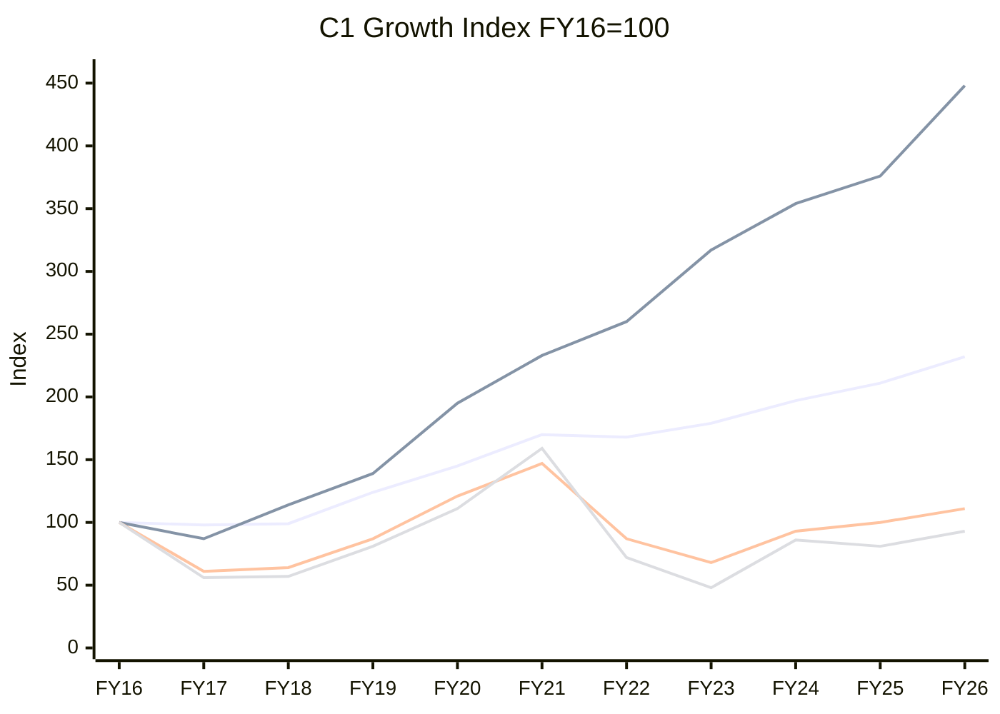
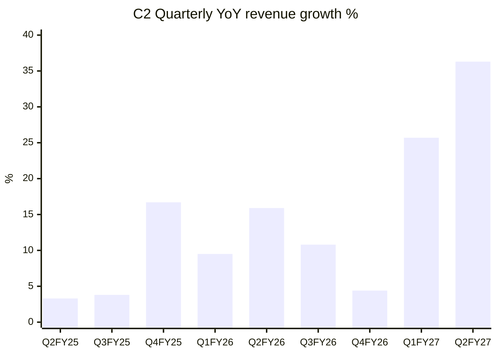
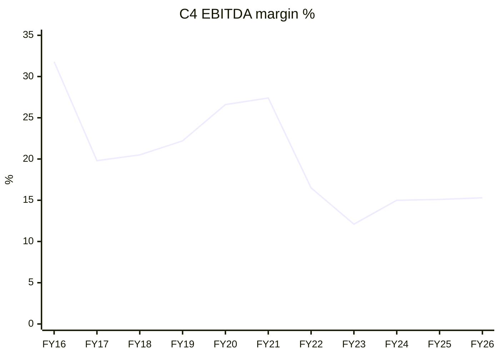
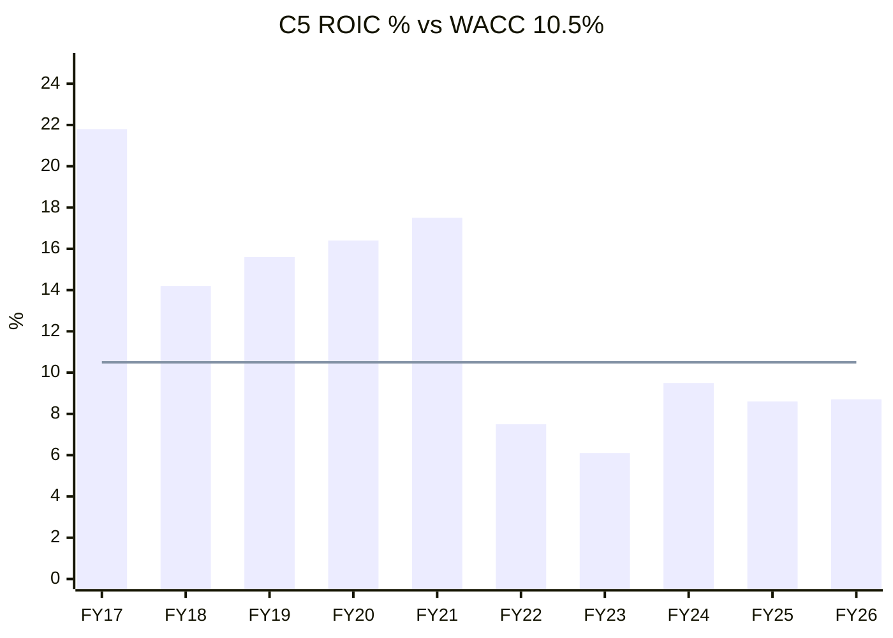
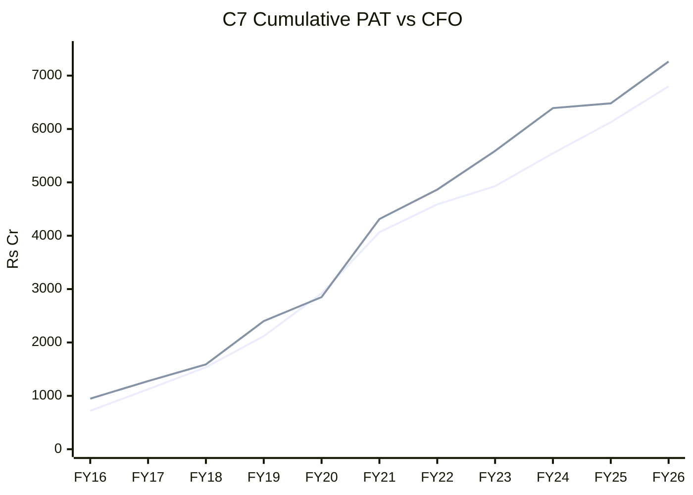
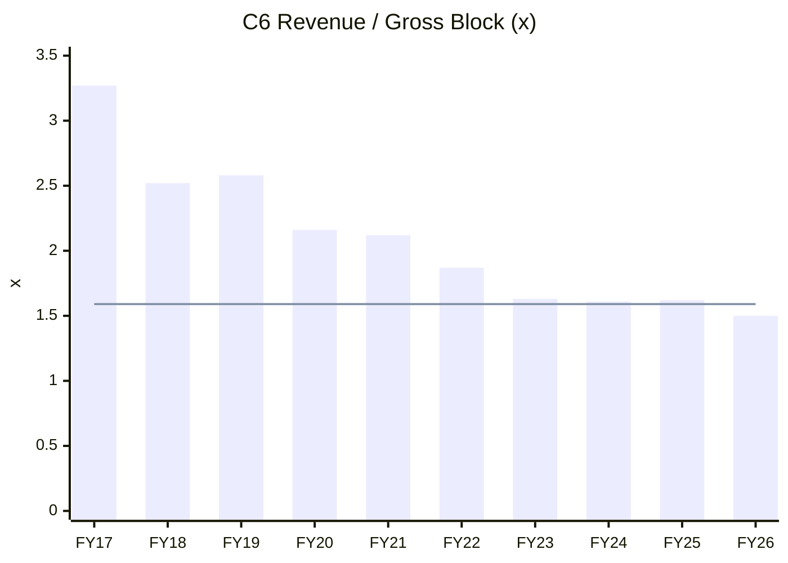
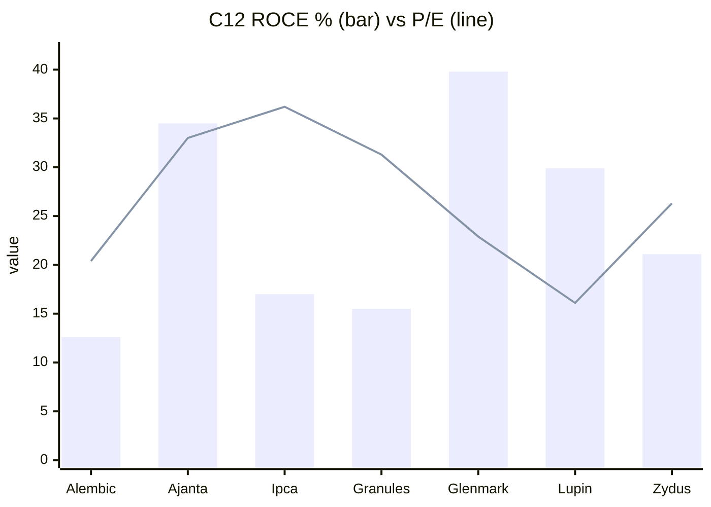
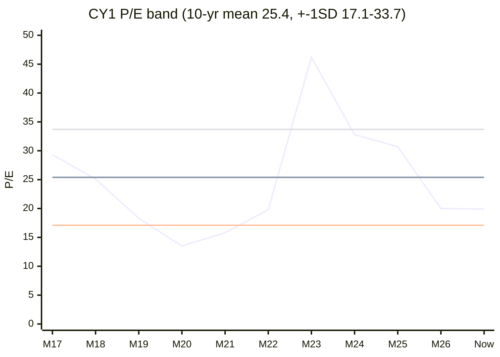
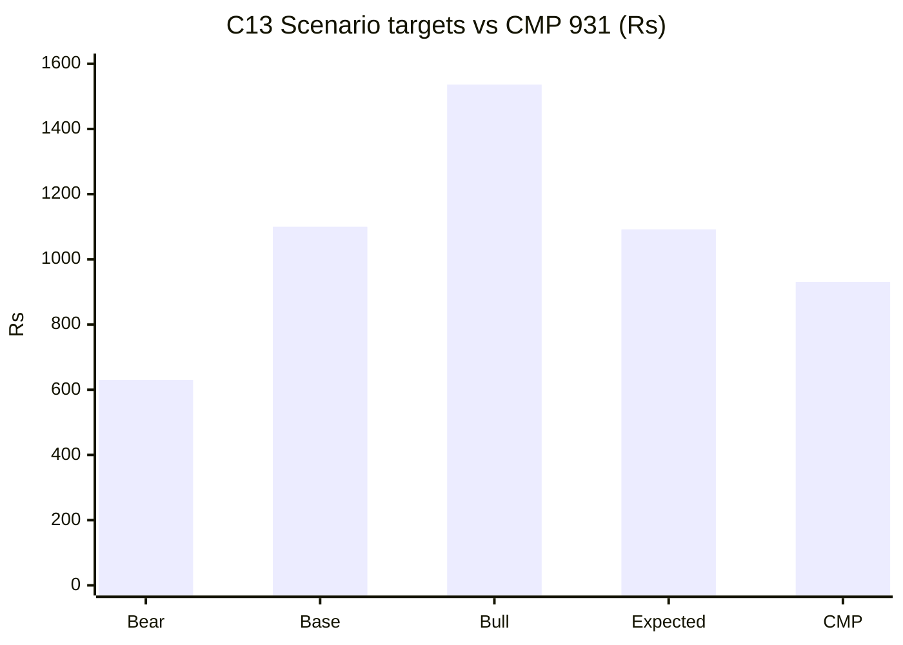
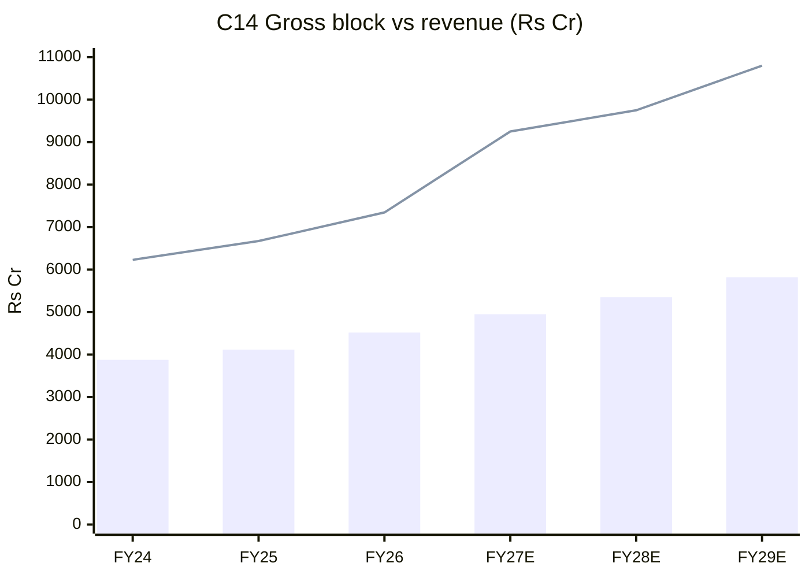

# Stock Analysis Report — Alembic Pharmaceuticals Ltd (APLLTD)
**Date:** 2026-11-05
**Analyst:** Claude (Stock Fundamental Analysis Skill v3.3)
**Investment Horizon:** 2–3 Years
**Recommendation:** WATCHLIST (Quality at Wrong Price — moderate quality, peak-quarter pricing)
**Conviction Score:** 5 / 10
**CMP:** ₹931 (NSE, 05-Nov-2026 10:21, Screener) · MCap ₹18,297 Cr · EV ≈ ₹19,580 Cr
**Filed under:** Healthcare / Pharma-API-and-CDMO · Themes: Pharma, CDMO & healthcare

## Revision Log
| Version | Date | Recommendation | Conviction | Price | Key change |
|---|---|---|---|---|---|
| Current | 2026-11-05 | WATCHLIST | 5/10 | ₹931 | Initial report — written the day after Q2 FY27 results (+36% revenue, +81% PAT, flattered by Bosutinib 180-day exclusivity) |

**Validation of previous report:** Initial report (no earlier Alembic report in the library).

---

## Business Primer

Alembic Pharmaceuticals is a 119-year-old Vadodara-based generic drug maker (demerged from Alembic Ltd in 2010) that earns money in four buckets: US generic formulations (~38% of H1 FY27 revenue), India branded generics incl. animal health (~29%), ex-US regulated / emerging-market formulations (~17%) and API sold to third parties (~16%) (Q2 FY27 investor presentation, slide 4). In the US it sells mostly oral-solid ANDAs to wholesalers/PBM-aligned buyers — revenue is volume × a price that erodes 5–10% a year, so growth depends on a steady stream of new launches (283 ANDAs filed, 245 approved, 188 launched as of Sep-26). In India it is ranked 20th in the IPM with 1.1% share, a 5,800-strong field force and six ₹100 Cr+ brands (Azithral, Althrocin, etc.), plus a fast-growing animal-health franchise (₹519 Cr FY26, 22% CAGR). Everything is manufactured at nine owned sites in Gujarat (Panelav, Karkhadi, Jarod) and Indore. The business depends on two things: clean US FDA status at Panelav/Karkhadi, and a launch cadence (and occasional limited-competition launches) that outruns US price erosion.

This is an asset-heavy, R&D-funded generics business, not a capital-light compounder. The key value driver is **mix and utilisation** (filling the ₹3,400 Cr of plants built in FY18–FY22) and the key risk is **US price erosion / FDA compliance**. Two structural features colour the whole analysis. (1) The Q2 FY27 quarter is not a clean base: generic Bosutinib (180-day exclusivity on 100mg/500mg, launched June 2026, exclusivity ending November 2026 — Q1 FY27 concall) added an estimated ₹300 Cr of very high-margin US revenue to Q2, so TTM margins and EPS overstate sustainable earnings. (2) Alembic spent a decade over-building capacity: gross block grew 4.5× (FY16→FY26) while revenue grew 2.3×, ROCE fell from 20%+ to ~13%, and roughly ₹1,000 Cr of capital disappeared from reserves in FY23 around the Aleor merger. The investment debate is therefore whether utilisation, US launches, a new US branded platform (Pivya) and the DifGen complex-generics deal can lift ROCE back above ~18% — and how much of that the price already assumes.

**Segment: Pharmaceuticals — KPI reference available ✓** (`references/05-industry-kpis-india.md` line 201).

---

## Executive Summary

Alembic is a mid-sized, conservatively financed generics company whose returns have been stuck at ~11–13% ROCE for five years after an over-built capex cycle. Q2 FY27 looked spectacular (revenue +36%, EBITDA margin 22%, PAT +81%), but most of the jump is a one-off: Bosutinib exclusivity ends this month, so FY28 EPS is likely to be roughly flat on FY27 (~₹46–48) unless the base business plus Pivya fully replaces it. At ₹931 the stock trades at ~20× FY28E EPS and ~24× normalised NOPAT. The reverse DCF says the market is pricing **16–22% revenue CAGR for five years** — about twice Alembic's 10-year record of 9%. Earnings quality is clean (no qualifications, 5-yr CFO/PAT 1.08, Altman Z'' 6.1), and the technical picture has just turned constructive (Stage 2 breakout on 5.7× volume). But there is **no margin of safety** on fundamentals. Watchlist with a buy-below of ~₹740. The key risk is a post-exclusivity earnings air-pocket in Q4 FY27–Q1 FY28.

**C1 — Growth Index (FY16 = 100): Revenue vs Gross Block vs EBITDA vs PAT**

| FY | 16 | 17 | 18 | 19 | 20 | 21 | 22 | 23 | 24 | 25 | 26 |
|---|---|---|---|---|---|---|---|---|---|---|---|
| Revenue (₹Cr) | 3,166 | 3,105 | 3,131 | 3,935 | 4,606 | 5,393 | 5,306 | 5,653 | 6,229 | 6,672 | 7,345 |
| Gross Block (₹Cr) | 1,094 | 950 | 1,242 | 1,523 | 2,132 | 2,545 | 2,840 | 3,468 | 3,875 | 4,117 | 4,897 |
| EBITDA (₹Cr) | 1,007 | 615 | 643 | 874 | 1,223 | 1,480 | 874 | 682 | 932 | 1,008 | 1,121 |
| PAT (₹Cr) | 720 | 403 | 413 | 583 | 801 | 1,146 | 521 | 342 | 616 | 582 | 671 |

*Source: Screener.in consolidated P&L and fixed-asset schedule (from annual reports). FY17 gross block reset on Ind AS deemed-cost transition.*

*Colour key (series order): 1 Revenue · 2 Gross Block · 3 EBITDA · 4 PAT.*
**Read:** Gross block rose to 448 while revenue reached only 232; EBITDA and PAT are *below* FY16 levels (FY16 included the Abilify exclusivity) and below FY21's COVID-era peak.
**Business inference:** A decade of capex has not yet earned its keep. The investment case depends entirely on sweating these assets (higher utilisation and better mix). That is what management is now promising, and it is what the market is already paying for.

---

## Module 1 — Broad Market Cycle (Marks)
- Nifty 50 at **23,441** on 02-Nov-2026 (JM Financial market wrap), ~8–9% below the ~25,600 level of Nov-2025; India VIX **15.5** (same source) — ordinary, not panicky.
- A market that has de-rated for a year with mid-level volatility is closer to **Neutral/Cautious** than euphoric. The IPO pipeline remains active (see library IPO folder), so it is not fearful.
- **Assessment: Neutral-to-Cautious → normal position sizing.**

## Module 1b — Sector Cycle
- **Secular vs cyclical:** US generics volume growth is secular (~3–5%). Pricing has stabilised after FY18–FY23 erosion but has not reversed (Q1 FY27 call: "pricing pressure remains"). A large part of the FY27 growth is cyclical or one-off: (a) Bosutinib exclusivity (~₹430 Cr in H1, roughly 9 percentage points of H1 growth), (b) INR depreciation of ~10% YoY (CFO, Q1 FY27 call: "take out the currency impact of about 10%"). **Durable baseline growth is ~10–12% in INR, ~7–9% in constant currency.**
- **India IPM** growing ~8–10%. Alembic human-health has under-grown the market for 3 years (FY26 India +5%).
- **Input costs:** solvents rose with the Middle East disruption (Q1 FY27 call). This is transient. Gross margin is guided at 70–75%.
- **Geopolitical / FX:** ~55% of revenue is in USD/EUR versus mostly INR costs, so the company is a net USD earner and weaker INR is a tailwind. Possible US Section 232 pharma tariffs are a structural risk for oral-solid generics (to be confirmed — not quantified in filings). API raw materials have China dependence (typical for the sector).
- **Verdict: Neutral.** The FY27 tailwind is mostly transient (exclusivity plus FX). Do not embed it in long-term growth.

## Module 1c — Stock Cycle

**C2 — Quarterly YoY revenue growth (%)**

| Q | Q2FY25 | Q3FY25 | Q4FY25 | Q1FY26 | Q2FY26 | Q3FY26 | Q4FY26 | Q1FY27 | Q2FY27 |
|---|---|---|---|---|---|---|---|---|---|
| Revenue ₹Cr | 1,648 | 1,693 | 1,770 | 1,711 | 1,910 | 1,876 | 1,848 | 2,150 | 2,603 |
| YoY % | 3.3 | 3.8 | 16.7 | 9.5 | 15.9 | 10.8 | 4.4 | 25.7 | 36.3 |

**Read:** Sharp acceleration in the last two quarters after an uneven 4–17% band.
**Business inference:** The acceleration is real in the base business (US ex-Bosutinib +20–25% in Q1 per MD) but is inflated by exclusivity and FX. Expect a visible deceleration from Q4 FY27 when Bosutinib faces competition.

**Revenue decomposition:** US growth is volume plus new launches (10 launched in H1 FY27, ~15 more guided). India growth is price-led (Q4 FY26 call: "price-led growth"). API growth is volume-led. Mix improves with injectables/ophthalmic/onco from the new Karkhadi plants.

**Bosutinib normalisation (estimate, derived):** Q1 FY27 US revenue ₹778 Cr, +49% YoY. Ex-Bosutinib growth was "closer to 25%" (MD), which puts Bosutinib at ~₹125 Cr for one month. Q2 US revenue was ₹1,003 Cr; with the base at ~₹690–700 Cr, Bosutinib ≈ ₹300 Cr. EBITDA went from ₹348 Cr to ₹578 Cr QoQ (+₹230 Cr), consistent with a ~70–75% margin on the exclusivity product. **Normalised Q2 OPM ≈ 15–16%, not 22%.**

**Operating leverage:** Fixed costs (employees ~22% plus most other expenses) are high. Each ₹100 of incremental base revenue at 73% gross margin adds ~₹35–40 of EBITDA (implied DOL ≈ 2.5–3×). DFL is small (interest is ~10% of EBIT). DTL is ≈ 2.8×.

**FCF inflection:** Capex has dropped to roughly maintenance level (₹300–350 Cr guided vs D&A ~₹400 Cr). FY27/FY28 should be the FCF inflection years, *provided working capital stops rising*. Inventory is at 125 days and NWC is ~₹3,000 Cr, so it has not stopped yet.

**Stock cycle classification: Mid-cycle, ramp-up of under-utilised assets** (margin and ROCE are below their 10-yr averages, see CY7). Note that the current quarter is a *peak* quarter inside a mid-cycle.

---

## Module 2 — Industry Structure & Capital Cycle
| Force | Assessment |
|---|---|
| New entrants | US oral solids: low barriers (many Indian and Chinese filers). Complex injectables/derma/ophthalmic/peptides: moderate (FDA site approval, development cost) |
| Supplier power | Moderate: China KSMs. Alembic is backward-integrated in API (153 DMFs) |
| Buyer power | **High**: three US buying consortia control most generic purchasing |
| Substitutes | Low for molecules; biosimilars/GLP-1 shift profit pools |
| Rivalry | **High** in US OSD; moderate in India branded |

**Porter verdict: Neutral-to-Unattractive** for plain US generics, Neutral for India branded.
**Capital cycle:** Indian pharma capex/depreciation for mid-caps has stayed ≥1.5× (PLI, injectables, CDMO). Alembic itself has moved from capex/dep of 4.0× (FY18–22) to 1.6× (FY23–26), so it is *past* its own capex cycle and into the harvest phase. **Position: Mid-cycle.**

## Module 3 — Business Quality & Moat
- **Greenwald:** *Supply advantage* — partial: vertical integration (in-house API), FDA-approved multi-dosage footprint, low-cost India R&D. *Customer captivity* — present only in India branded (doctor prescription habit; Azithral rank #1 in its molecule group) and animal health. *Local scale* — none.
- **Buffett pricing test (10% price rise):** Fails in US generics. Partially passes in India (NLEM/DPCO caps on part of the portfolio).
- **ROIC vs WACC 10 yrs:** ROIC (25% notional tax) was 14–22% in FY17–FY21 and **6–9.5% in FY22–FY26**, so it has been *below* a ~10.5% WACC for five straight years (see C5).
- **Market share:** India IPM 1.1%, rank 20 (IQVIA MAT Sep-26). FY26 India growth of 5% versus IPM ~8–9% means Alembic is **losing share**. In the US, prescription volume share is not disclosed.
- **Moat verdict: Narrow** (India brands plus compliance-heavy manufacturing). No durable barrier in US generics.

**Fisher 15-point (1–3):** market potential 2 · new products 3 (11 approvals/10 launches H1; DifGen 20+ complex products; peptides) · R&D effectiveness 2 (R&D 8–16% of sales for a decade, ROCE still 13%) · sales org 2 (India under-growth → new sales head Ramesh Juneja) · margin 2 · margin improvement 2 · labour 2 · executive relations 2 · depth 2 (CFO change Jul-2025: R.K. Baheti → G. Krishnan) · cost controls 2 · unique advantages 2 · long-range orientation 3 · dilution 3 (no dilution since FY21) · candour in adversity 2 · **integrity 3 (no SEBI/ED issues found; clean audit)**. **Total 34/45 — Integrity Pass.**

## Module 4 — Management & Capital Allocation
**Promoter Holding:** 69.87% (Sep-26), creeping up from 69.61% (Dec-23), mostly via Nirayu Pvt Ltd (35.65%) and Alembic Ltd (28.54%) (FY26 AR shareholding note).
**Pledge:** Nil per historical promoter filings (2018–19 Alembic group disclosures). ⚠️ Sep-26 pledge not independently re-verified, so this is a data gap to close. **Risk: Normal.**
**FCF/share vs EPS (FY16–26):** EPS fell from ₹38.2 to ₹34.3 over ten years. Cumulative FCF (CFO + CFI) over FY17–FY26 was **only ₹403 Cr** against ₹6,078 Cr of PAT, because the decade's cash went into plants.
**Share count:** One equity raise in FY21 (₹734 Cr proceeds) at a high valuation, a good-timing raise. Otherwise stable.
**Capital allocation rating: Average-to-Poor.** The FY18–FY22 capex (~₹3,400 Cr) was built ahead of approvals. About ₹1,000 Cr was taken out of reserves in FY23: reserves fell ₹867 Cr in a year with ₹342 Cr PAT and ₹197 Cr dividends, coinciding with the Aleor Dermaceuticals merger and CWIP collapsing from ₹2,304 Cr to ₹601 Cr. (This is derived from Screener balance sheets. The exact break-up between impairment and the scheme adjustment against reserves needs the FY23 AR scheme note.) The good side: dividends were maintained at a 35–46% payout and debt is ~1× EBITDA.
**RPTs (FY26 standalone AR, note on related parties):** small and operational — purchases from Shreno Publications (₹63 Cr, packaging/printing), services from Alembic Ltd (₹31.5 Cr) plus rent (₹12.4 Cr), PPE from Shreno Engineering (₹20 Cr). No ICDs to group entities. **Key concern:** KMP remuneration is **₹61 Cr (FY26)**, ≈ **9% of consolidated PAT**, just under the 10% extraction threshold. Three family executives (Chirayu, Pranav and Shaunak Amin) draw most of it.
**Buffett Three C's:** Candour 2/3 (openly discusses India under-performance; FY23 write-off handled through reserves) · Competence 2/3 · Caring 2/3 (steady dividends, but high family pay).

### Walk the Talk Scorecard
| Quarter guided | Statement | Guided | Actual | Verdict |
|---|---|---|---|---|
| Q3 FY26 (Feb-26) | US growth FY27 | 10–12% | H1 FY27 +64% (Bosutinib + FX) | ✅ (beat) |
| Q3 FY26 | India back to market growth | ≈ IPM in FY26 | FY26 India +5% vs IPM ~8–9% | ❌ |
| Q4 FY26 (May-26) | Consolidated FY27 growth | Low double digit | H1 +31% | ✅ (beat) |
| Q4 FY26 | US growth FY27 | 10–15% | H1 +64% | ✅ |
| Q4 FY26 | Ex-US growth | 15%+ | H1 +14% | ⚠️ |
| Q4 FY26 | API growth | High single / low double | H1 +36% | ✅ |
| Q4 FY26 | India close to market | ~market | H1 +10% (Q1 7%, Q2 14%) | ✅ |
| Q4 FY26 | R&D ₹750–800 Cr, ~9% | ~9% | H1 ₹407 Cr, 8.6% | ✅ |
| Q4 FY26 | Gross margin 70–75% | 70–75% | Q2 73.7% | ✅ |
| Q1 FY27 (Aug-26) | Reported EBITDA margin ≥ FY26 16% despite 150 bp Pivya drag | ~16–17% | H1 19% | ✅ |
| Q1 FY27 | Gross debt back to Mar-26 level (₹1,361 Cr) by Q2–Q3 | ≤₹1,361 Cr | Sep-26 ₹1,490 Cr (ex-lease); receivables +₹430 Cr in H1 | ❌ (Q3 pending) |

**WTT Score: 0.77 / 1.00 — MODERATE** (11 points · 8 hits · 1 near miss · 2 misses · 0 reversals)
**Key pattern:** Sandbagging on US/API growth, which is beaten every time. Chronic optimism on **India human-health** and on **working-capital release**.
**Insider action:** No open-market promoter selling. Promoter stake has crept up by 26 bp over 11 quarters. **Mildly bullish.**
**DCF impact:** US/API guidance used as-is. India growth held at 8–9% (not "market + share gain"). NWC% held at current levels, with no reversion assumed.
**Overall management credibility: MODERATE.**

---

## Module 5 — Financial Forensics
**Indian-specific flags:**
| Check | Finding | Flag? |
|---|---|---|
| Pledge | Nil (historical) | No |
| ICD to group | None | No |
| RPT pricing | Small, operational (<2% of revenue) | No |
| KMP pay / PAT | ~9% | ⚠️ Watch |
| Auditor | KKC & Associates LLP appointed Aug-2025 for 5 yrs (regular rotation); **no qualification / EoM**; KAM = inventory existence & valuation (FY26 AR) | No |
| Revenue quality | Receivables +29% in H1 FY27 (₹1,466 → ₹1,896 Cr) vs revenue +31%; DSO stable ~73 days | No (watch Q3) |
| Interest capitalisation | Screener flags it; P&L interest ₹94 Cr vs cash interest ₹88 Cr in FY26, so immaterial | No |
| FY23 reserves hit | ~₹1,000 Cr of value reduction bypassed the P&L (scheme accounting) | ⚠️ Historical |

**Quantitative models (FY26):**
- **Beneish M-Score: −2.60** → unlikely manipulator (DSRI 0.95, GMI 1.00, AQI 0.76, SGI 1.10, TATA −0.013). FY25 approx −1.97 (grey zone, driven by the TATA spike when CFO collapsed to ₹88 Cr on an inventory build of ₹645 Cr). This reversed in FY26.
- **Altman Z'': 6.09 → Safe.**
- **Piotroski F (FY26): 5/9** — ROA>0 ✓, CFO>0 ✓, ΔROA>0 ✓, CFO>NI ✓, LT debt ↑ ✗, current ratio ↓ ✗, no dilution ✓, gross margin ↓ ✗, asset turnover ↓ ✗ → Average.
- **Sloan accrual ratio:** FY24 2.1% · **FY25 14.9% (red)** · FY26 4.8%.
- **Schilit screens:** No revenue-too-soon signal (DSO 73 days, stable). Other income is <5% of EBIT. Capex/dep is now 1.6×. Inventory days of **462 (COGS basis, Screener) / 125 (sales basis)** are the real issue. That is a capital-intensity problem, not manipulation.

**Forensic red-flag count: 2 / 15** (FY25 Sloan; inventory build). **Verdict: Clean, with minor concerns.**

## Module 6 — Earnings Quality & Financial Statements
| FY | 16 | 17 | 18 | 19 | 20 | 21 | 22 | 23 | 24 | 25 | 26 |
|---|---|---|---|---|---|---|---|---|---|---|---|
| EBITDA margin % | 31.8 | 19.8 | 20.5 | 22.2 | 26.6 | 27.4 | 16.5 | 12.1 | 15.0 | 15.1 | 15.3 |
| EBIT margin % (PBT+int) | 29.7 | 17.2 | 17.4 | 19.5 | 22.3 | 25.7 | 12.1 | 7.2 | 11.0 | 11.8 | 10.7 |
| ROCE % (Screener) | 66 | 29 | 22 | 23 | 24 | 26 | 11 | 7 | 13 | 13 | 13 |
| ROIC % (NOPAT @25% tax / net cap. employed) | 55.6 | 21.8 | 14.2 | 15.6 | 16.4 | 17.5 | 7.5 | 6.1 | 9.5 | 8.6 | 8.7 |
| CFO / PAT | 1.32 | 0.82 | 0.76 | 1.39 | 0.56 | 1.28 | 1.06 | 2.12 | 1.30 | 0.15 | 1.17 |

**C4 — Margin trend (EBITDA %, 10 yrs)**

**Read:** Margins halved from the FY20–21 peak and have sat at 15% for three years. H1 FY27 is 19% (normalised ~16%).
**Business inference:** FY20–21 margins were a COVID plus Azithral windfall. The new fixed-cost base (R&D 8–10%, new plants) needs ~₹9,000 Cr+ of revenue to get back to 18–20%.

**C5 — ROIC vs WACC (10.5%)**

**Read:** ROIC has been below WACC for five consecutive years.
**Business inference:** Economic profit has been negative since FY22. This is *not* a hard stop, because there is a credible turnaround thesis (utilisation plus launches), but growth adds little value until ROIC clears ~11–12%. On TTM numbers (EBITDA ₹1,413 Cr) ROIC is ≈ 11%, right at WACC.

**C7 — Cumulative PAT vs CFO (₹Cr)**

*Key: 1 PAT · 2 CFO.* **Read:** Cumulative CFO (₹7,263 Cr) exceeds PAT (₹6,798 Cr). The 5-yr CFO/PAT is 1.08. **Business inference:** Profits are real cash. The problem is what the cash was reinvested in, not whether it exists.

**OCF/NI (5yr): 1.08 → High quality.** **O'Glove flags: 2/15** (FY25 NI vs OCF gap; inventory days rising). **Key accounting concern:** the FY23 reserves adjustment, plus intangible amortisation from the Utility Therapeutics/Pivya acquisition (~₹379 Cr intangibles capitalised Q4 FY26, amortised over 7–8 years per CFO) that will depress D&A-adjusted margins through ~FY33.

### DuPont (5-factor)
| FY | EBIT margin % | Asset turnover | Equity multiplier | Interest burden | Tax burden | ROE % |
|---|---|---|---|---|---|---|
| FY22 | 12.1 | 0.77 | 1.34 | 0.97 | 0.83 | 10.1 |
| FY23 | 7.2 | 0.85 | 1.38 | 0.88 | 0.96 | 7.1 |
| FY24 | 11.0 | 0.99 | 1.37 | 0.92 | 0.97 | 13.4 |
| FY25 | 11.8 | 0.94 | 1.42 | 0.90 | 0.82 | 11.6 |
| FY26 | 10.7 | 0.89 | 1.52 | 0.88 | 0.97 | 12.4 |
| Change | −1.4 pp | +0.12 | +0.18 | −0.09 | +0.14 | +2.3 pp |

**Operating contribution:** Stable to slightly declining since FY24. **Financing contribution:** Rising (EM 1.34 → 1.52). The tax burden is flattered by a near-zero tax rate in FY23/24/26 (MAT credit and the regime switch). From FY27 the company is on the new regime (~22–25%).
**DuPont verdict:** FY24–26 ROE stability is helped by leverage and an abnormally low tax rate. Underlying operating returns are flat, not improving. Normalising tax to 24% would give FY26 ROE ≈ 9.7%.
**AT trend → Module 10 base-case AT:** Revenue / gross block **1.50× (declining for 10 yrs: 3.27× FY17 → 1.50× FY26)**.

---

## Fixed-Asset Decade (long-life asset analysis)
| FY | Gross Block ₹Cr | Acc. Dep ₹Cr | Age (AccDep/GB) | CWIP ₹Cr | Capex ₹Cr | D&A ₹Cr | Capex/D&A | Rev/GB |
|---|---|---|---|---|---|---|---|---|
| 17 | 950 | 151 | 16% | 396 | n/a* | 83 | — | 3.27 |
| 18 | 1,242 | 249 | 20% | 1,010 | 822 | 105 | 7.8× | 2.52 |
| 19 | 1,523 | 364 | 24% | 1,551 | 764 | 115 | 6.6× | 2.58 |
| 20 | 2,132 | 581 | 27% | 1,846 | 735 | 157 | 4.7× | 2.16 |
| 21 | 2,545 | 757 | 30% | 2,183 | 660 | 183 | 3.6× | 2.12 |
| 22 | 2,840 | 1,042 | 37% | 2,304 | 426 | 287 | 1.5× | 1.87 |
| 23 | 3,468 | 1,069 | 31% | 601 | 443 | 275 | 1.6× | 1.63 |
| 24 | 3,875 | 1,328 | 34% | 524 | 327 | 273 | 1.2× | 1.61 |
| 25 | 4,117 | 1,594 | 39% | 837 | 564 | 279 | 2.0× | 1.62 |
| 26 | 4,897 | 1,816 | 37% | 683 | 495 | 319 | 1.6× | 1.50 |
*FY17 capex line blank in Screener cash-flow schedule. Source: Screener fixed-asset & cash-flow schedules.*

- **Installed base:** 9 plants — F1 Panelav OSD, F2 Panelav onco OSD + onco injectables, F3 Karkhadi general injectables & ophthalmic (EIR May-2026), F4 Jarod OSD, F5 Karkhadi derma, API I/II Panelav, API III Karkhadi, and India formulations at Indore/Pithampur (commissioned Apr-2025, WHO cert Apr-2026). Utilisation is not disclosed. Management repeatedly cites "improving utilisation".
- **Age:** 37% depreciated. The asset base is young, so maintenance capex is low for years. That makes it a utilisation story, not a re-capex story.
- **Land:** ₹121 Cr at historical cost (mostly Gujarat industrial land). Not a hidden-value driver.
- **Capacity trend:** Revenue/GB fell from 3.3× to 1.5×. Even returning to 1.9× (FY22 level) on today's block implies ~₹9,300 Cr revenue, which is roughly where FY27 is heading *with* Bosutinib.

**C6 — Asset turnover (Revenue / Gross Block)**

*Line = 5-yr average (FY22–26) 1.59×.* **Read:** A ten-year structural decline that has flattened at ~1.5–1.6×. **Business inference:** Treat 1.5–1.6× as the base case. A bull case needs AT back to ~1.9× (FY22), which requires the injectables/onco/derma plants to fill. That has been promised for four years.

---

## Module 7 — Industry KPIs & Peer Analysis
| KPI (Pharma block) | Alembic | Healthy range | Assessment |
|---|---|---|---|
| US revenue % | 30% FY26 / 38% H1 FY27 | 30–55% | In range |
| R&D / revenue | 9.6% FY26, 8.6% H1 FY27 | 7–12% | In range |
| EBITDA margin | 15.3% FY26 (19% H1 FY27, ~16% normalised) | 22–30% large caps | **Below** |
| Domestic formulation growth | 5% FY26; 10% H1 FY27 | >10% | Below → improving |
| ANDA pipeline | 283 filed / 245 approved / 188 launched → ~57 approved-not-launched + ~38 pending | >100 pending (large cap) | Adequate for size |
| Para IV / FTF | Bosutinib CGT/180-day; DifGen deal adds "open FTF" opportunities | Any FTF = high value | Positive |
| FDA status | No warning letter / import alert. F3 Karkhadi EIR May-2026 (2 obs. Feb-26); Panelav API 483 (4 obs., May-25, no data integrity) | None | Clean |
| API vs formulation mix | API ~16% | Formulations >60% | Good |

**Peer comparison (Screener, 05-Nov-2026, consolidated)**
| Metric | Alembic | Ajanta | Ipca | Granules | Glenmark | Lupin | Zydus |
|---|---|---|---|---|---|---|---|
| MCap ₹Cr | 18,297 | 41,645 | 49,767 | 21,986 | 71,290 | 90,773 | 118,992 |
| Sales CAGR 5y | 6% | 14% | 12% | 11% | 9% | 13% | 14% |
| Sales TTM growth | 20% | 25% | 11% | 22% | 33% | 24% | 24% |
| ROCE (latest) | 12.6% | 34.5% | 17.0% | 15.5% | 39.8% | 29.9% | 21.1% |
| ROE 3y avg | 13% | 25% | 13% | 14% | −3% | 22% | 21% |
| P/E (TTM) | 20.4 | 33.0 | 36.2 | 31.3 | 22.9 | 16.1 | 26.3 |
| 1-yr price | −6% | +27% | +52% | +40% | +36% | +1% | +22% |

**C12 — Peer ROCE vs P/E**

**Read:** Alembic has the lowest ROCE of the group and trades at a low-ish P/E, though not as low as Lupin, which has 2.4× the ROCE.
**Business inference:** The "discount to peers" is justified by returns. Alembic is cheap only if ROCE converges toward ~18%. On TTM P/E it is not cheaper than Lupin or Glenmark, which have far better economics.

**Peer positioning: Discount to most peers — justified (lower ROCE, slower 5-yr growth).**
**Order Book Tracker:** Not applicable (generics, not order-driven).

## Module 8 — Market Size & Market Share
- **India IPM:** ~₹2.3–2.4 lakh Cr MAT (IQVIA, via company); growth ~8–10%. Alembic is 1.1% share, rank 20 (17th by prescriptions: 137.6 Mn Rx MAT Sep-26 vs 133.2 Mn a year earlier, +3.3%). Prescriber count is 249k (+2%). **Revenue growth (5% FY26) below the market → losing share.** H1 FY27 at +10% is roughly at market.
- **US:** ~$90–100 bn generics market by value (IQVIA-type estimates; not company-sourced). Alembic US revenue of ₹2,206 Cr FY26 (~$255 Mn) is a ~0.3% share. Penetration is tiny, so growth is launch-driven, not TAM-limited.
- **Animal health India:** ~₹9,000–10,000 Cr market (industry estimates, unverified). Alembic at ₹519 Cr (~5%), growing 22% CAGR, is **taking share**.
- **Verdict:** Taking share in US (launch-led) and animal health; losing share in India human-health. Net: growing roughly with the market.

---

## Module 9 — Valuation: PIE First, Then DCF

### 9A. Price-Implied Expectations (reverse DCF)
Inputs: EV ₹19,579 Cr (MCap ₹18,294 Cr + net debt ₹1,285 Cr incl. leases). Base FY27 normalised revenue **₹8,700 Cr (ex-Bosutinib)**. WACC 10.5% (Rf 6.5%, β ~0.75, ERP 6%; negligible debt). Terminal growth 6%, terminal ROIC 14%, sales-to-capital 1.6× (FY22–26 avg AT). Model: `scratchpad/scripts/val.py`.

| PIE value driver | Market-implied | My base case | Gap |
|---|---|---|---|
| Revenue CAGR (5-yr) | **22% @ 12% EBIT margin / 16% @ 14% margin** | 11% | Market optimistic by 5–11 pp |
| NOPAT margin (steady) | 9–11% | 9.9% (13% EBIT) | ≈ |
| Investment rate | ~62% of Δrevenue (1/1.6) | Same | — |

Quick Mauboussin approximation: g = (EV×WACC − NOPAT₀)/(EV + NOPAT₀) = **6.2%** perpetual growth on a normalised NOPAT of ~₹795 Cr. That means the market pays **~24.6× normalised NOPAT**.

**Gap classification: Optimistic.** The market is extrapolating Q2 FY27 (or pricing a sector P/E re-rating), not Alembic's history.
**Expectations treadmill:** To beat the PIE, Alembic must compound base revenue at ≥15% *and* lift EBIT margin to ≥14% (EBITDA ~19%) for five years, i.e. ROCE ≥ 18%. It has not done this since FY21.
**Positive triggers:** (1) Bosutinib stays two-player beyond November. (2) Pivya/US branded turns EBITDA-positive by Q4 FY27 as guided. (3) DifGen FTF/day-1 launches in FY28. (4) India human-health growth back above market under the new sales head.
**Negative triggers:** (1) Q4 FY27/Q1 FY28 EPS drop as exclusivity ends. (2) US tariff on Indian generics. (3) FDA 483/OAI at Panelav or Karkhadi. (4) Receivables/inventory keep rising, so debt does not fall.
**SVAR:** Downside of trough EPS ₹38 × 14× (FY20 trough P/E) = ₹532 → **SVAR 43% → unfavourable asymmetry.**
**Physical plausibility:** The current block at the 5-yr avg AT of 1.59× supports ~₹7,800 Cr revenue; at FY22 AT of 1.87× it supports ~₹9,150 Cr. A 16–22% five-year CAGR (₹18,000–23,000 Cr by FY32) needs **~2× today's gross block or AT back to ~3×**. **The market is pricing either unannounced capacity or a mix shift to asset-light partnered/branded revenue** (DifGen manufacturing, CMO-sourced Pivya). That is plausible only in part.

### 9B. Intrinsic value
| Method | Bear | Base | Bull |
|---|---|---|---|
| DCF (2-stage, WACC 10.5%, g 6%) | ₹424 (7% CAGR, 11% EBIT) | ₹667 (11% CAGR, 13% EBIT) | ₹1,027 (14% CAGR, 15.5% EBIT, S/C 1.8) |
| Relative (FY28E EPS × P/E 15 / 20 / 25) | ₹690 | ₹920 | ₹1,150 |
| EPV (normalised NOPAT ₹795 Cr / 10.5% − net debt) | — | ₹320 per share (no-growth value) | — |
| **Consensus range** | **₹560** | **₹800** | **₹1,090** |

FY28E EPS of ₹46 is built from: base revenue ex-Bosutinib ₹8,700 Cr FY27 → ₹9,750 Cr FY28 (+12%); EBITDA 17.5% (Pivya breakeven plus operating leverage) = ₹1,705 Cr; D&A ₹420 Cr; interest ₹120 Cr; other income ₹30 Cr; tax 24%; 19.65 Cr shares. FY27E EPS is ~₹48 including ~₹550 Cr of Bosutinib revenue.

**CMP:** ₹931. **Margin of safety (base ₹800): −16% → Inadequate** (mid-cap requires 30–40%).
**Upside/downside:** (₹1,090 − 931) / (931 − 560) = **0.43 : 1 → Unacceptable.**
**Graham Number:** √(22.5 × 5-yr avg EPS ₹36 × BVPS ₹302) = **₹495.** Graham defensive screen: 4/7 (fails P/B ≤ 3 borderline, EPS growth over 7 yrs, current ratio ≥ 2).
**Misprice reason:** None in the stock's favour. The price reacted to a one-off quarter (+14% in a week on 5.7× volume).
**Catalyst:** The Q3 FY27 print (Feb-2027) shows the post-exclusivity run-rate, and that is the moment to reassess.

**CY1 — P/E at each March (TTM, Screener P/E chart)**
| Mar-17 | Mar-18 | Mar-19 | Mar-20 | Mar-21 | Mar-22 | Mar-23 | Mar-24 | Mar-25 | Mar-26 | Now |
|---|---|---|---|---|---|---|---|---|---|---|
| 29.3 | 25.1 | 18.3 | 13.5 | 15.8 | 19.8 | 46.2 | 32.8 | 30.7 | 20.0 | 19.9 |

*Key: 1 P/E · 2 mean · 3 −1SD · 4 +1SD. 10-yr daily series: mean 25.4, SD 8.3, min 13.4, max 51.7. Current at the 33rd percentile (Screener P/E history; median shown by Screener 24.9).*
**Read:** The TTM P/E of ~20 looks cheap against the 10-yr mean.
**Business inference:** This is the classic peak-earnings trap. TTM EPS (₹42.9) includes the Bosutinib windfall. On normalised EPS (~₹36–38) the stock is at ~25×, right at its 10-yr mean and *above* its −1SD level despite five years of sub-WACC ROIC.

**CY2 — P/B:** current 3.0× vs 10-yr mean 3.99× (SD 1.20, min 1.8, max 7.4), at the 27th percentile. ROE has fallen from 25%+ to ~12–13%, so a lower P/B is deserved. Justified P/B = (ROE − g)/(Ke − g) = (13 − 7)/(11 − 7) = **1.5×**.

*CY4 (price vs EPS index) omitted. Reliable March closing prices could not be sourced independently of the P/E chart. Logged as a data gap.*

**C13 — Scenario targets (FY29E EPS × exit P/E, ~2.5-yr horizon)**
| Scenario | AT assumption | Rev FY29E | EBITDA % | EPS FY29E | P/E | Target | Prob |
|---|---|---|---|---|---|---|---|
| Bull | AT → 1.9× (FY22), DifGen + Pivya scale | ₹12,000 Cr | 20% | ₹64 | 24× | ₹1,536 | 25% |
| Base | AT 1.6–1.7×, launches offset erosion | ₹10,800 Cr | 18.5% | ₹55 | 20× | ₹1,100 | 50% |
| Bear | AT 1.5×, US price erosion + India drift | ₹9,600 Cr | 15% | ₹42 | 15× | ₹630 | 25% |
| **Expected value** | | | | | | **₹1,092** | |

**Read:** The probability-weighted value of ₹1,092 is only +17% over ~2.5 years (~6.5% a year), below the cost of equity.
**Business inference:** The odds are not in the buyer's favour at ₹931. At ~₹740 the same scenarios would give ~+48% (~17% a year), which clears the 30% mid-cap MoS hurdle.

### Cycle Position Dashboard
| Dimension | Current | 10-yr median/mean | Percentile | Signal |
|---|---|---|---|---|
| P/E (TTM) | 19.9 | 24.9 / 25.4 | 33rd | Looks cheap — peak-EPS distorted |
| P/E (normalised EPS ~₹37) | ~25 | 25 | ~50th | Fair |
| P/B | 3.0 | 3.8 / 4.0 | 27th | Fair given ROE 13% |
| EBITDA margin | 22% (Q2) / 16.7% TTM | 20.5% (FY16–26 avg) | Q2 high / TTM low | Mid |
| ROCE | 12.6% | ~23% FY16–26 avg (13% last 5) | Low | Trough-ish |
| **Overall cycle position** | | | | **Mid-cycle (ramp-up), peak quarter** |

---

## Module 10 — Technical Stage (Weinstein + CANSLIM)
**Nifty 50:** 23,441 (02-Nov-26), ~9% below a year ago. **Stage not confirmed on a chart.** It is likely Stage 1/early-2 after a year-long correction (data gap: 30-wk MA not computed).
**Sector (Nifty Pharma):** Not verified. Peer 1-yr returns are strong (Ipca +52%, Glenmark +36%, Granules +40%), which suggests a sector in Stage 2.
**Stock (weekly, Screener price series):**
- Last weekly close ~₹912 (5-Nov, intraday high ₹965; CMP ₹931). 30-week SMA **₹798 and rising** (₹781 four weeks ago). 10-week SMA ₹820.
- Base: ~50 weeks between ₹656 and ~₹922 (Nov-25 → Oct-26). The week of the results broke out above ~₹865 resistance.
- **Volume:** 5.52 Mn shares in the breakout week vs a 30-week average of 0.97 Mn = **5.7× → confirmed.**
- RS vs Nifty: 1-yr −6% vs Nifty ≈ −8%, so marginally positive. RS vs pharma peers is strongly negative.
- **Stage: 2 (fresh breakout).** Entry is within 10–15% of the pivot (₹865–995).
- **Stop-loss:** weekly close below ₹795 (30-wk SMA / prior resistance band). Hard exit on a weekly close below a declining 30-wk MA.

**CANSLIM:** C ✓ (Q2 EPS +81%, but a one-off) · A ✗ (3-yr EPS 17.4 → 34.3 is uneven; ROE 13% < 17%) · N ✓ (52-wk high, new launches, DifGen) · S ✓ (30% float, up-volume) · L ✗ (laggard vs pharma peers) · I ✗ (DII 16.4% → 15.4% over 6 quarters; FII 3.9% → 4.6%) · M ✗ (Nifty not in confirmed uptrend) → **3/7.**
**Combined:** Stage 2 breakout but CANSLIM 3/7 and fundamentals not supportive → **misaligned**. This is a news-driven breakout on a non-recurring quarter. Breakouts like this often retest the pivot (~₹865) or the 30-wk MA.

---

## Module 11 — Forward View: 2–3 Year Thesis

### Capex classification
| Capex type | FY27E | FY28E | FY29E | In AT model? |
|---|---|---|---|---|
| Tangible growth (debottleneck/capacity) | ~₹50 Cr | ~₹100 Cr | ~₹150 Cr | ✅ |
| Maintenance (≈ D&A on tangibles ~₹300 Cr) | ~₹280 Cr | ~₹300 Cr | ~₹320 Cr | ❌ |
| Intangibles (Pivya-type in-licensing, DifGen milestones) | undisclosed | undisclosed | — | ❌ |
| CWIP | ₹543 Cr (Sep-26) | — | — | ❌ until capitalised |
| **Total (guided ₹300–350 Cr FY27)** | ₹330 Cr | ~₹400 Cr | ~₹470 Cr | |

**CWIP ₹543 Cr (Sep-26):** no project-wise disclosure. Management says "capex is all done" (Q4 FY26 call). Assume it transfers to PPE over FY27–28 as debottlenecking and peptide-API blocks.

### Capex-to-earnings model (₹ Cr)
| Metric | FY27E | FY28E | FY29E |
|---|---|---|---|
| Opening tangible gross block | 4,518 | 4,950 | 5,350 |
| Additions (CWIP transfer + capex) | 432 | 400 | 470 |
| AT applied (on opening block) | 1.93× incl. Bosutinib / 1.83× ex | 1.97× | 2.02× |
| **Revenue** | 9,250 (8,700 ex-Bosutinib) | 9,750 | 10,800 |
| EBITDA % | 18.5% | 17.5% | 18.5% |
| EBITDA | 1,710 | 1,705 | 2,000 |
| D&A (incl. ~₹50 Cr intangibles amortisation) | 400 | 420 | 450 |
| EBIT (+ other income ~₹30–40 Cr) | 1,350 | 1,315 | 1,580 |
| Interest | 130 | 120 | 100 |
| ICR | 10.4× | 11.0× | 15.8× |
| Peak debt / EBITDA | 0.9× | 0.8× | 0.6× |
| PAT (tax 23–24%) | 940 | 910 | 1,125 |
| **EPS (₹)** | **47.8** | **46.3** | **57.3** |
| ΔWC (NWC ~38% of Δrevenue) | −500 | −190 | −400 |
| **FCF (PAT + D&A − capex − ΔWC)** | **~510** | **~740** | **~705** |

*Tangible gross block excludes ~₹379 Cr of acquired intangibles. AT in the model rises only because the block is barely growing. This is the "sweat the assets" thesis in numbers.*

**Incremental ROIC:** ΔRevenue FY26→FY29 of ~₹3,450 Cr at a 14% EBIT margin × 0.76 ≈ ₹367 Cr NOPAT. Incremental capital is ~₹1,300 Cr (₹1,000 Cr WC + ₹300 Cr net capex), so **incremental ROIC ≈ 28% > WACC → value-creating**, *because* the plants are already paid for. This is the bull argument's best point.
**Capex-model implied revenue CAGR (FY26→FY29): 13.8%** (FY26 → FY29E ₹10,800 Cr), or ~11% on the FY27 normalised base, **vs PIE 16–22% → the market is pricing more than the installed base delivers.** That is the "unannounced expansion / asset-light mix" pricing.
**FCF inflection year: FY28E** (first year FCF clearly above ₹700 Cr and > 75% of PAT).
**Debt ceiling: within safe zone** (<1× EBITDA throughout).

**C14 — Gross block vs revenue (forward)**

*Bars: tangible gross block (FY26 ex-intangibles). Line: revenue.* **Read:** Revenue is meant to pull away from the block for the first time in a decade. **Business inference:** If it happens, ROCE climbs to ~17–18% by FY29 and the stock re-rates. If FY28 revenue stalls at ~₹9,000 Cr after Bosutinib, ROCE stays ~13% and the stock is worth ~₹700.

### Key catalysts
1. Pivya/US branded EBITDA breakeven: guided Q4 FY27, positive in FY28.
2. DifGen 20+ complex generics (~$5 bn reference market, open FTF/day-1): first launches FY28.
3. ~15 US launches per year (FY27 and FY28 guidance), with injectables/ophthalmic/onco from Karkhadi (EIR received).
4. India human-health turnaround under the new sales head: watch Q3–Q4 FY27 IQVIA growth versus IPM.
5. Peptide filings (5–6 portfolio, 2 filed) for GLP-1/peptide generics in FY28–FY30.

### Key risks
1. **Bosutinib cliff (High):** ~₹550 Cr revenue / ~₹400 Cr EBITDA in FY27 that does not recur. FY28 EPS is flat at best.
2. **US price erosion / tariffs (Medium):** possible US tariffs on imported generics; INR tailwind reverses.
3. **FDA compliance (Low–Medium):** Panelav/Karkhadi 483s with no data-integrity observations so far.
4. **Working capital (Medium):** inventory at 462 COGS-days; receivables +29% in H1. Debt-reduction promise missed so far.
5. **Capital allocation (Medium):** branded-US build-out and in-licensing could repeat the FY18–22 pattern of capital ahead of returns.

### Investment thesis (one line)
A cleanly financed generics maker with paid-for capacity and real operating leverage. But the stock already prices a five-year compounding path Alembic has never delivered, on the back of a one-off quarter. Buy only at ~₹740 or lower, or after Q3/Q4 FY27 proves that ex-Bosutinib EBITDA is running at ≥17%.

**Monitoring metrics:** quarterly revenue ex-Bosutinib (> ₹2,300 Cr), EBITDA margin ex-one-offs (≥17%), gross debt (< ₹1,361 Cr), inventory days, India human-health growth versus IPM, US branded (Pivya) drag versus the 150 bp guidance.

---

## Checklist Summary
**Section 0 (Existing report / filing):** 5/5 — none existed; filed in Healthcare/Pharma-API-and-CDMO (Unichem precedent for a generic formulator); theme added; index rebuilt.
**Section A (Business Quality):** 15/18 — scuttlebutt (AmbitionBox/channel checks) not done; Sep-26 pledge not re-verified; Form C insider filings not pulled.
**Section B (Forensics):** 9/9.
**Section C (Financial Statements):** 11/12 — Ind AS 116 adjustment immaterial (leases ₹57 Cr) and noted rather than recast.
**Section D (KPIs & Peers):** 6/7 — peer DuPont not built.
**Section E (Market Size & Share):** 5/7 — US/animal-health TAM not primary-sourced.
**Section F (Valuation):** 10/10.
**Section G (Technical):** 6/8 — Nifty and Nifty Pharma stage not chart-verified.
**Section H (Forward View):** 24/30 — project-wise CWIP and segment AT not disclosed; unit-economics track not applicable.
**Section I (Charts):** 4/5 — CY4 omitted (data gap).
**Order Book Tracker:** Not applicable.
**Hard stops triggered:** None (ROIC < WACC for 5 yrs, but a credible turnaround thesis exists; upside/downside 0.43:1 fails the 1.5:1 bar → this blocks a BUY, not the business).

**Pre-buy behavioural check:** The breakout plus the headline +81% PAT is the moment of maximum recency bias. The verdict deliberately anchors on normalised earnings.

## Conviction Score
| Component | Max | Score |
|---|---|---|
| Market + sector + stock cycle | 1 | 0.5 |
| Industry structure | 1 | 0.5 |
| Business quality & moat | 2 | 1.0 |
| Management | 1 | 0.5 |
| Financial + earnings quality | 2 | 1.5 |
| Valuation & PIE asymmetry | 2 | 0.5 |
| Technical + CANSLIM | 1 | 0.5 |
| **Total** | **10** | **5.0** |

## Investment Decision
**Recommendation:** WATCHLIST — *Quality at Wrong Price* (moderate quality)
**Conviction:** 5 / 10 → watchlist / ≤1% starter only for momentum-driven holders
**Buy-below price:** **₹740** (≈16× FY28E EPS; ~30% MoS to the ₹1,090 bull/base blend; scenario EV +48%)
**If already held:** Hold. Trail the stop to a weekly close below ₹795.
**Target (base, ~2.5 yr):** ₹1,100
**Review triggers:** (a) Q3 FY27 (Feb-27): US revenue ex-Bosutinib ≥ ₹700 Cr per quarter and EBITDA ≥ 17% → upgrade toward BUY on a pullback. (b) Gross debt not back below ₹1,361 Cr by Mar-27 → downgrade. (c) Any FDA OAI/warning letter → exit. (d) Price ≤ ₹740 with the thesis intact → initiate.

**Data gaps:** Sep-26 pledge disclosure; Q2 FY27 transcript (only audio available on 05-Nov); FY23 scheme note break-up of the ~₹1,000 Cr reserves reduction; Nifty/Nifty Pharma weekly stage; CY4 price-vs-EPS index; US/animal-health TAM primary sources.

**Sources:** Screener.in (APLLTD consolidated P&L, BS, CF, schedules, shareholding, P/E & P/B history; peers AJANTPHARM, IPCALAB, GRANULES, GLENMARK, LUPIN, ZYDUSLIFE); BSE filings — Q2 FY27 investor presentation (04-Nov-2026), DifGen press release (04-Nov-2026), Q1 FY27 transcript (04-Aug-2026), Q4 FY26 transcript (15-May-2026), Q3 FY26 transcript (Feb-2026), Annual Report FY26 (RPT note, Annexure-D remuneration, auditor's report KAMs); JM Financial market wrap (Nifty 23,441 / VIX 15.52, 02-Nov-2026); medicaldialogues.in (Karkhadi Form 483, Feb-2026; EIR May-2026).

---
*Report generated by Stock Fundamental Analysis Skill v3.3 | Indian Markets Context*
*Save path: C:\Users\anubh\Documents\Anubhav\Stock Analysis\Stock Analysis\Healthcare\Pharma-API-and-CDMO\*
