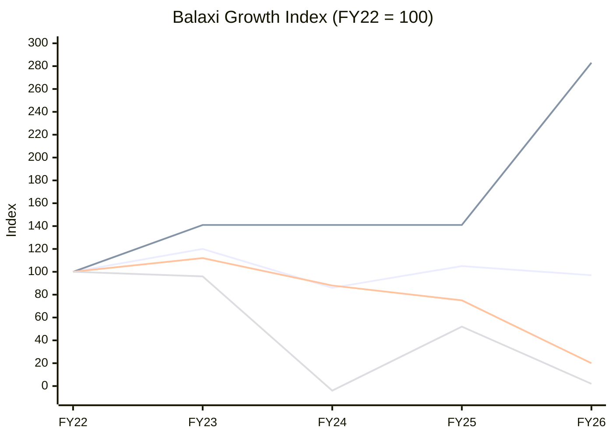
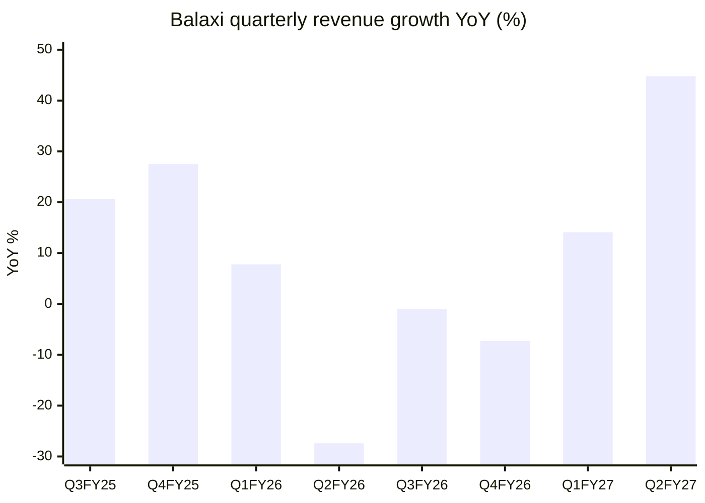
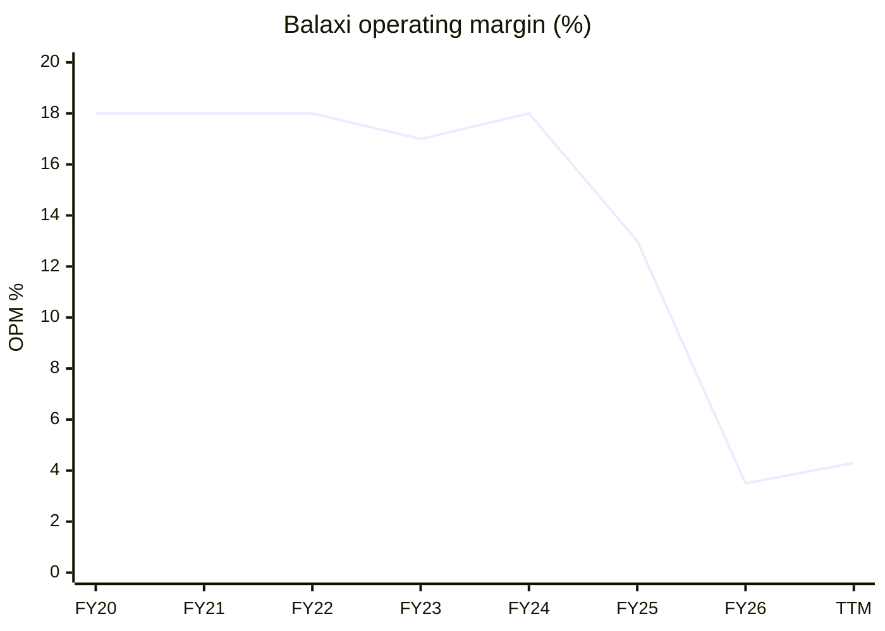
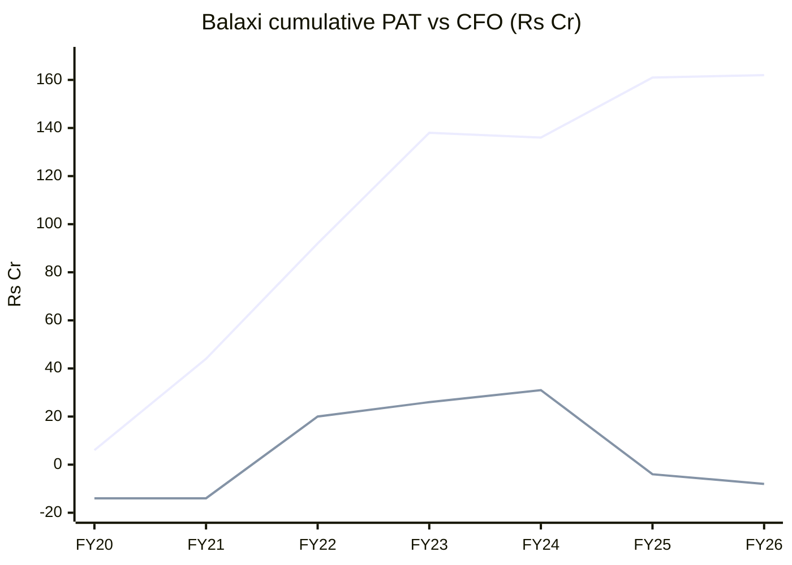
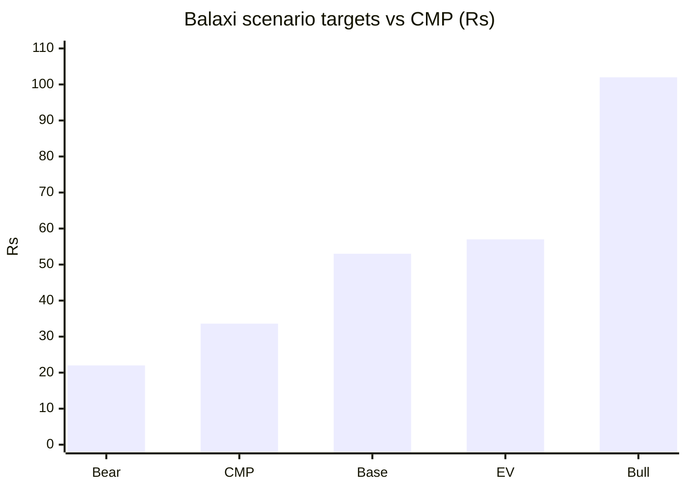

# Stock Analysis Report — Balaxi Pharmaceuticals Ltd (BALAXI)
**Date:** 2026-11-20
**Analyst:** Claude (Stock Fundamental Analysis Skill v3.3)
**Investment Horizon:** 2–3 Years
**Recommendation:** AVOID for now / WATCHLIST (cash-conversion forensic gate unresolved)
**Conviction Score:** 3 / 10
**CMP:** ₹33.6 (NSE, 20-Nov-2026 12:29 pm, −10% on the day after an exchange price-movement query) · Market cap ₹185 Cr · ~5.5 Cr shares · BVPS ₹46 · 52-wk ₹15.2–39.5
**Filed under:** Healthcare / Pharma-API-and-CDMO · Themes: Pharma, CDMO & healthcare, Export-led manufacturing

## Revision Log
| Version | Date | Recommendation | Conviction | Price | Key change |
|---|---|---|---|---|---|
| Current | 2026-11-20 | AVOID / Watchlist | 3/10 | ₹33.6 | Initial report |

Initial report. No earlier Balaxi report existed in the library.

**Sourcing note.** Financials: Screener.in consolidated (FY15–Q2 FY27; pre-FY19 standalone). H1 FY27 balance sheet, cash flow, registrations and plant details: secondary summaries of the 16-Nov-2026 investor presentation (Multibagg), Q3 FY26 review (Multibagg), Q4 FY26 analysis (MarketsMojo), Q2 FY27 press release (Devdiscourse/Univest). The NSE clarification letter of 30-Jun-2026 returned HTTP 403 and was **not read**. No earnings-call transcript was found for FY27. Facts from secondary sources only are marked *(sec.)*.

---

## Business Primer

Balaxi Pharmaceuticals is a Hyderabad-based company that registers, imports, warehouses and distributes generic and branded-generic medicines in **frontier markets**: Angola in Africa, and Guatemala, the Dominican Republic, Honduras, El Salvador and Nicaragua in Central America/Caribbean. It sells to pharmacies, distributors and institutional (government) buyers; revenue is volume × in-market price, earned in local currency and settled in USD. The gating asset is its **~964 product registrations** and a 38-warehouse, 500-person on-ground network *(sec.)*. Until 2024 it bought products from WHO-GMP contract manufacturers in India, China and Portugal ("asset light"); in May 2026 it began commercial production at its own oral-solids plant at the Jadcherla Pharma SEZ, Telangana (>1 bn tablets/capsules a year at three shifts) *(sec.)*. Therapy mix is antibiotic-heavy (42% of Q3 FY26 revenue), and generics are 61% of sales vs 39% branded *(sec.)*. Earnings depend on two things: **collecting cash from Angola** (where government buyers pay slowly and the kwanza is volatile), and keeping registration-protected gross margins (~44%) while scaling.

This is a **trading-and-distribution business turning into a small manufacturer**, in high-risk geographies. The value driver is margin: gross margins are healthy and stable (43–47%), but EBITDA margin has collapsed from 18% (FY20–FY24) to 3.5% (FY26) as overheads, Jadcherla readiness costs and Angola working-capital stress hit. The key risk is **counterparty and currency risk in Angola**, which shows up as receivables and inventory that keep cash from reaching shareholders: across FY20–FY26 the company reported ₹162 Cr of cumulative PAT but **negative cumulative operating cash flow**. That single fact colours the whole analysis — reported profits have not turned into cash, and the stock must be judged on cash conversion, not on P/E.

**Segment check:** Pharmaceuticals — KPI reference available ✓ (line 201). The US/ANDA KPIs do not apply; semi-regulated/frontier-market distribution KPIs (registrations, receivable days, gross margin, geographic concentration) are used instead.

---

## Executive Summary
Balaxi built a fast-growing frontier-market generics franchise (revenue ₹14 Cr FY19 → ₹336 Cr FY23 at ~18% EBITDA margin) and then stalled: revenue has been flat at ₹240–305 Cr for three years, EBITDA margin fell to 3.5% in FY26, debtor days rose to 184 and cash conversion broke (cumulative CFO FY20–26 ≈ −₹8 Cr vs cumulative PAT ₹162 Cr). H1 FY27 shows the first recovery — revenue +26%, CFO +₹23 Cr as receivables fell, Jadcherla in production — but margin is still only ~5%. At ₹33.6 (55× TTM EPS, 0.73× book) the price already assumes EBITDA margin returns to ~13%. **The forensic hard stop (≥3 unresolved flags, led by cash conversion) applies: AVOID until two more quarters confirm positive CFO and margin ≥10%.** Watchlist buy zone ₹22–25.

**C1 — Growth Index (consolidated, FY22 = 100)**

| FY | 22 | 23 | 24 | 25 | 26 |
|---|---|---|---|---|---|
| Revenue (₹ Cr) | 279 | 336 | 241 | 293 | 270 |
| Fixed assets, net (₹ Cr) | 29 | 41 | 41 | 41 | 82 |
| EBITDA (₹ Cr) | 51 | 57 | 45 | 38 | 10 |
| PAT (₹ Cr) | 48 | 46 | −2 | 25 | 1 |
| Index: Revenue | 100 | 120 | 86 | 105 | 97 |
| Index: Fixed assets | 100 | 141 | 141 | 141 | 283 |
| Index: EBITDA | 100 | 112 | 88 | 75 | 20 |
| Index: PAT | 100 | 96 | −4 | 52 | 2 |

🟦 Revenue · 🟧 Net fixed assets · 🟩 EBITDA · 🟪 PAT. Source: Screener consolidated. Net block used (gross block not available).
**Read:** Since FY22 the asset base has nearly tripled while revenue is flat and EBITDA has fallen 80%.
**Business inference:** The business moved from asset-light to asset-heavy just as its core market stalled. The Jadcherla plant has to be loaded and Angola cash collected before returns on this larger base can recover; until then capital is growing faster than earnings power.

---

## Module 1 — Market, Sector & Stock Cycle
**1. Market:** Nifty about 25,000 (Nov-26), flat-to-down YoY; India VIX about 17.5 (per this library's 17-Nov-2026 reports). RBI raised the repo rate effective 5-Oct-2026 (per Bank of Baroda Q2 FY27 call). → **Neutral-to-Cautious.** Micro-cap liquidity risk: ₹185 Cr market cap, ~14,500 shareholders.

**1b. Sector: Neutral.**
- **Secular:** demand for affordable generics in sub-Saharan Africa and Central America grows with population and healthcare access (~7–10% a year, est.). Registrations are a real barrier in small markets.
- **Cyclical:** Angola's oil-linked economy drives government drug procurement and FX availability. The kwanza's 2023 devaluation is the most likely cause of the FY24 other-income loss of −₹38 Cr *(inference — not confirmed in a filing)*.
- **Geopolitics / FX:** revenue in AOA (kwanza) and Central American currencies, purchases in USD/INR/CNY. FX convertibility in Angola is the structural risk (transient? no — recurring every oil down-cycle) → widen MoS 5–10 pp.
- **Raw materials:** finished-dose sourcing partly from China *(sec.)*; Jadcherla reduces this dependence over time.

**1c. Stock cycle: Trough / Recovery (margins depressed by an identifiable, partly reversible cause).**

**C2 — Quarterly YoY revenue growth (%)**

| Qtr | Q3FY25 | Q4FY25 | Q1FY26 | Q2FY26 | Q3FY26 | Q4FY26 | Q1FY27 | Q2FY27 |
|---|---|---|---|---|---|---|---|---|
| YoY % | 20.6 | 27.5 | 7.8 | −27.4 | −1.0 | −7.3 | 14.1 | 44.8 |
| OPM % | 5.4 | 16.5 | 5.9 | 2.1 | 4.3 | 0.2 | 5.8 | 6.3 |

**Read:** Growth is accelerating for two quarters, but Q2 FY27's +45% is against a −27% base quarter.
**Business inference:** On a two-year stack Q2 FY27 is only +5%. The rebound is real but mostly base effect; margins (6%) have not followed revenue, so the operating problem is not solved.

**Revenue decomposition:** no volume/price split is disclosed. Gross margin rose from 43.4% (FY25) to 44.2% (FY26) *(sec.)* while EBITDA margin fell, so the damage is in **overheads and working-capital cost**, not pricing. Mix: management wants the branded share up from ~40% *(sec.)*.

**Operating leverage:** FY26 EBITDA ₹11 Cr on gross profit ₹119 Cr → overheads ≈ ₹108 Cr. Every 10% revenue gain at 44% GM adds ~₹12 Cr gross profit, roughly doubling EBITDA if overheads are held: DOL ≈ 10× at today's margin. This cuts both ways.

**FCF inflection:** not yet. FY25 FCF −₹57 Cr, FY26 −₹25 Cr; H1 FY27 CFO +₹23 Cr with capex only ₹2.8 Cr *(sec.)* — the first sign of inflection if it holds.

---

## Module 2 — Industry Structure
| Force | Assessment | Signal |
|---|---|---|
| New entrants | Registrations take 1–3 years per product per country; local distribution needed | Moderate barrier |
| Supplier power | Many WHO-GMP generic makers in India/China | Low |
| Buyer power | Angolan state buyers pay slowly; private pharmacies fragmented | **High (in Angola)** |
| Substitutes | Other Indian/Chinese generics; donor-funded supply | Moderate |
| Rivalry | Fragmented importers; price-driven in generics, less so in branded | Moderate–high |

**Verdict: Neutral.** **Capital cycle:** small-scale; no sign of over-capacity in Balaxi's niches, but India's frontier-market exporters (Kilitch, Medicamen, Lincoln etc.) are all adding plants → mild late-cycle signal on the supply side.

---

## Module 3 — Business Quality & Moat
**Moat Verdict:** Narrow (local scale in small markets) · **Greenwald:** local economies of scale + registrations; no cost advantage, weak customer captivity · **Buffett moat type:** none durable · **Pricing power test:** Partial pass (gross margin held at 43–47% through FY22–26) · **Market share stability:** unknown (no data) · **Fisher 15-point:** 25 / 45 *(Point 15 Integrity: Pass, with disclosure-quality caveats)*

| # | Fisher point | Score |
|---|---|---|
| 1 | Market potential | 2 |
| 2 | New products | 2 (≈30 registrations/half-year) |
| 3 | R&D effectiveness | 1 (no R&D; IP = registrations) |
| 4 | Sales organisation | 2 |
| 5 | Profit margin | 1 |
| 6 | Margin improvement | 1 |
| 7 | Labour relations | 2 |
| 8 | Executive relations | 2 |
| 9 | Management depth | 1 |
| 10 | Cost controls/accounting | 1 (inconsistent cash-flow figures in deck) |
| 11 | Unique advantages | 2 |
| 12 | Long-range orientation | 2 |
| 13 | Dilution | 2 (equity capital ₹10→11 Cr) |
| 14 | Communication in adversity | 2 (no concall transcripts) |
| 15 | Integrity | 2 |

---

## Module 4 — Management & Capital Allocation
**Promoter Holding:** 65.99% | **Pledge:** nil *(sec., MarketsMojo)* → Normal · **Trend:** 73.2% (FY18) → 71.6% (FY23) → 66.9% (Mar-24) → 66.0% (flat since Jun-24); fall partly dilution from fresh equity.
**Equity raised:** reserves rose ₹220 Cr (FY20→FY26) vs cumulative PAT ₹162 Cr → ~₹55–60 Cr of fresh equity, likely FY23–FY25 (CFF +₹26/30/34 Cr) — instrument not verified from filings.
**FII exit:** FII holding fell from 18.66% (Mar-23) to 0% (Mar-26) — a full exit by (apparently) one foreign holder during the profit collapse; reason not disclosed.
**FCF/share vs EPS:** FCF negative in 5 of 7 years → capital allocation **Poor** so far (growth funded by equity and debt, no dividends).
**RPT / ICD:** not reviewed (annual-report RPT schedule not read) — data gap.
**Buffett Three C's:** Candor: Low–Moderate (no transcripts, inconsistent deck data) · Competence: Moderate (built the network; lost cost control) · Caring: Low (no dividend, dilution).

### Walk-the-Talk Scorecard
| Guided | Statement | Guided | Actual | Verdict |
|---|---|---|---|---|
| Q3 FY26 deck | Jadcherla final audit readiness, then production | FY26–27 | Commercial production May-26 | ✅ |
| FY27 roadmap | WHO-GMP certification for Jadcherla | H1 FY27 | Not granted by Nov-26 *(sec.)* | ❌ |
| Q3 FY26 | Elevated operating costs "to normalise over time" | Undated | OPM 0.2% Q4 FY26 → 6.3% Q2 FY27 | ⚠️ |
| FY27 roadmap | Angola working-capital normalisation | FY27 | Receivables ₹136 → ₹120 Cr in H1 | ✅ (partial) |
| FY27 roadmap | Exit hardware business | FY27 | Exit cited as under way | ⚠️ |

**WTT Score:** 0.60 / 1.00 — MODERATE (thin sample; no numeric guidance given) · Hits 2 | Near misses 2 | Misses 1
**Key pattern:** **Selective disclosure** — management gives no numeric revenue/margin guidance and holds no published concalls. Treat absence of guidance as a flag.
**Insider action:** no open-market promoter buying during the 60% fall to ₹15 — NEUTRAL-to-BEARISH.
**DCF impact:** own bottom-up model; no guidance to anchor.
**Overall management credibility:** LOW–MODERATE.

---

## Module 5 — Financial Forensics
| Check | Value | Flag? |
|---|---|---|
| Cumulative CFO / PAT (FY20–26) | −₹8 Cr / ₹162 Cr ≈ **−5%** | 🔴 |
| Debtor days | 36 (FY22) → 84 → 138 → **184** (FY26) | 🔴 |
| Inventory days | 184–233 since FY22 | 🟠 |
| Cash conversion cycle | 129 → 335 days (FY22→FY26) | 🔴 |
| Sloan accrual ratio | FY25 **+29%**; FY26 +8% | 🔴 (FY25) |
| Other income | FY24 −₹38 Cr (likely FX loss; unexplained in sources) | 🟠 |
| Tax rate | FY24 219%, FY26 73% (losses in some entities not tax-deductible) | 🟠 |
| Disclosure consistency | H1 FY27 deck cash-flow arithmetic does not reconcile *(sec.)*; FII exit unexplained; clarification letter unread | 🟠 |
| Pledge | Nil | ✅ |
| Auditor | Not reviewed (gap) | ⚠️ |

- **Altman Z'' (Sep-26):** X1 0.56, X2 0.71, X3 0.03, X4 2.9 → **≈ 9.2 Safe** (low leverage: borrowings ₹52 Cr vs equity ₹254 Cr).
- **Piotroski F (FY26):** 3 / 9 → Weak (ROA>0, no dilution, higher GM).
- **Beneish M:** not computed (needs gross receivables, SG&A, depreciation detail). DSRI alone (184/138 days = 1.33 FY26; 138/84 = 1.64 FY25) is in the manipulator zone (>1.46 in FY25) — a revenue-quality warning, not proof.

**Forensic red flags: 4 unresolved** (cash conversion, receivables, accruals, disclosure). **Overall verdict: Significant concerns → hard stop until resolved.** The H1 FY27 receivable release (₹16 Cr) is the first real counter-evidence.

---

## Module 6 — Earnings Quality & Financial Statements
**ROIC (FY26):** ~2.6% (NOPAT ₹7.5 Cr / invested capital ~₹292 Cr) · **ROIC FY23:** ~27% · **WACC:** ~15% (micro-cap, frontier FX) → **Value destroying** at present · **Trend:** sharply declining · **Driver:** margin collapse + asset turnover decline.

**C4 — OPM % (consolidated)**

| FY | 20 | 21 | 22 | 23 | 24 | 25 | 26 | TTM |
|---|---|---|---|---|---|---|---|---|
| OPM % | 18 | 18 | 18 | 17 | 18 | 13 | 3.5 | 4.3 |

**Read:** Margins were a steady 17–18% for five years, then fell to 3.5% in two years.
**Business inference:** Stable gross margin plus collapsing operating margin points to a cost base built for a bigger business (plant, people, 38 warehouses) plus working-capital cost. This is fixable if volumes return — but no margin target has been given.

**C7 — Cumulative PAT vs cumulative CFO (₹ Cr, from FY20)**

| FY | 20 | 21 | 22 | 23 | 24 | 25 | 26 |
|---|---|---|---|---|---|---|---|
| Cum. PAT | 6 | 44 | 92 | 138 | 136 | 161 | 162 |
| Cum. CFO | −14 | −14 | 20 | 26 | 31 | −4 | −8 |

🟦 Cumulative PAT · 🟧 Cumulative CFO.
**Read:** Seven years of profits produced no net operating cash.
**Business inference:** Profits were reinvested in Angolan receivables and inventory, financed by equity and debt. Until receivables are collected the "earnings" are claims on a slow-paying, FX-constrained customer base — the core reason this report does not trust the P/E.

### DuPont Decomposition (closing equity)
| Year | EBIT margin | Asset turnover | Equity multiplier | Interest burden | Tax burden | ROE |
|---|---|---|---|---|---|---|
| FY22 | 20.1% | 1.59 | 1.56 | 0.98 | 0.87 | 42.5% |
| FY23 | 17.3% | 1.40 | 1.31 | 0.98 | 0.81 | 25.1% |
| FY24 | 2.1% | 0.93 | 1.28 | 0.40 | n.m. | −1.0% |
| FY25 | 11.3% | 0.95 | 1.34 | 0.88 | 0.86 | 10.8% |
| FY26 | 3.7% | 0.80 | 1.35 | 0.50 | 0.27 | 0.6% |

**Operating contribution:** Declining (both margin and AT fell) · **Financing contribution:** Stable (leverage is not masking anything) · **DuPont verdict:** ROE decline is purely operational. **AT trend → base case:** ~0.9× on total assets, declining.

**O'Glove flags:** 5 / 15 (NI vs OCF, DSO, AR/revenue rising, inventory days, Sloan). **Key accounting concern:** receivable recoverability in Angola.

---

## Module 7 — Industry KPIs & Peers
| KPI | Balaxi | Benchmark | Assessment |
|---|---|---|---|
| Product registrations | ~964 (H1 FY27) *(sec.)* | n/a | Strong for size |
| Receivable days | 184 (FY26) | <90 for frontier exporters | Below |
| Gross margin | 44% | 35–50% for branded generics in RoW | In line |
| EBITDA margin | 3.5% (FY26), ~5% (H1 FY27) | 12–18% | Below |
| Top-geography concentration | Angola largest; LATAM ~41% of FY26 revenue *(derived)* | <40% single country | Below (Angola) |

| Metric | Balaxi | Kilitch Drugs (library, 17-Nov-26) |
|---|---|---|
| Revenue 3-yr CAGR (FY23–26) | −7% | ~19% |
| EBITDA margin (FY26) | 3.5% | ~16% |
| Debtor days | 184 | 227 (standalone) |
| P/E (TTM) | 55× | 35× |
| P/B | 0.73× | 2.9× |

**Peer positioning:** discount on P/B, premium on P/E — both reflect depressed earnings. Justified: Yes (earnings trough). Other frontier-market peers (Lincoln, Medicamen) not benchmarked — data gap.

---

## Module 8 — Market Size & Share
**TAM:** pharma markets of Angola (~US$1 bn est.) and the five Central American/Caribbean markets (~US$5–6 bn est.) — rough estimates, not sourced to an industry body. **Penetration:** ~0.5% of combined TAM. **Share trend:** not available. **Revenue vs market:** FY23–26 revenue −7% CAGR vs market growth ~7–9% → **losing share (or losing Angola institutional business)**. LATAM grew 11% in FY26 *(sec.)*, roughly with its market.

---

## Module 9 — Valuation & Margin of Safety
**PIE (reverse DCF):** EV ≈ ₹210 Cr (mcap 185 + borrowings 52 − cash 27). TTM NOPAT ≈ ₹8.5 Cr. At WACC 15%, g = (210×0.15 − 8.5)/(210 + 8.5) ≈ **10.5% perpetual**. Equivalently, at zero growth the price needs NOPAT ≈ ₹31 Cr → EBIT ~₹40 Cr → **~13% EBIT margin** on TTM revenue.

| PIE driver | Market-implied | My base | Gap |
|---|---|---|---|
| Revenue CAGR (5-yr) | ~10% | 12% | +2 pp |
| EBIT margin (steady) | ~13% | ~8% (FY29) | −5 pp |
| Investment rate | low | high (WC 236 days) | worse |

**Gap: Optimistic.** The market is already pricing a near-full margin recovery that management has not guided to. **Treadmill:** EBITDA margin must exceed ~12% by FY28 with positive CFO for the stock to beat its own PIE. **Positive triggers:** WHO-GMP grant for Jadcherla; two quarters of CFO > PAT; Angola receivables < 100 days. **Negative triggers:** kwanza devaluation; another sub-5% margin quarter; equity raise.

**Scenarios (FY29, 2.5 years)**
| Scenario | Revenue FY29 | EBITDA margin | PAT | EPS | Multiple | Target | Prob. |
|---|---|---|---|---|---|---|---|
| Bull | ₹430 Cr | 14% | ₹40 Cr | ₹7.3 | 14× | ₹102 | 25% |
| Base | ₹380 Cr | 10% | ₹24 Cr | ₹4.4 | 12× | ₹53 | 50% |
| Bear | ₹330 Cr | 5% | ₹8 Cr | ₹1.5 | 15× | ₹22 | 25% |
| **Expected value** | | | | | | **₹57** | |

Base present value (discounted 15% for ~2.5 years) ≈ ₹37–40 → **MoS ≈ 10–16% vs 40–50% required** for a micro-cap → **Inadequate.** Upside/downside to base vs bear: +58% / −35% → **1.7:1** (below 2:1). **SVAR** (bear) ≈ 35%. **Graham number** (5-yr avg EPS ₹4.6, BVPS 46): √(22.5×4.6×46) ≈ ₹69 — distorted by FY21–23 peak earnings. **Misprice reason:** trough-cycle earnings + FII exit + micro-cap neglect. **Catalyst:** H2 FY27 margin and CFO prints.

**Read:** Probability-weighted value is ~70% above CMP, but the bear case is a third below it.
**Business inference:** The payoff is a bet on margin recovery that has no numeric guidance and a poor cash record — wide outcome range, not enough cushion.

**Cycle Position Dashboard**
| Dimension | Current | 5-yr median | Signal |
|---|---|---|---|
| P/E | 55× (trough EPS) | n/a | Misleading |
| P/B | 0.73× | n/a (P/B history not sourced) | Cheap on book |
| EBITDA margin | 4.3% TTM | 18% | **Trough** |
| ROCE | 3.5% | 37% (FY21–25 avg) | **Trough** |
| **Overall** | | | **Trough / early recovery** |

*P/E and P/B 10-year band charts (CY1/CY2) not drawn: no sourced price history — data gap.*

---

## Module 10 — Technical Stage (Weinstein)
**Nifty 50:** Stage 1–3 range (flat YoY) · **Nifty Pharma:** not checked · **Stock:** rallied from ₹15.2 low to ₹39.5 high, now ₹33.6 after a −10% day and an exchange query on unusual price movement (19-Nov-2026) → **Stage 2 attempt, extended** (price ~2.2× its 52-week low). 30-week MA not sourced. **RS vs Nifty:** positive over 6 months (inferred from price). **Volume:** not verified. **Stop-loss (if held):** weekly close below ₹27. **Alignment:** Misaligned — price momentum ahead of fundamentals. **CANSLIM:** C 1 (Q2 PAT +450% off tiny base), A 0, N 1 (new plant), S 1 (small float), L 0, I 0 (FII exit), M 0 → **3/7**.

---

## Module 11 — Forward View
**Capex:** Jadcherla (oral solids; capex not disclosed) capitalised in FY26 (net FA ₹41 → ₹82 Cr). No new announced capex; H1 FY27 capex ₹2.8 Cr *(sec.)*. Growth capex for FY27–29 ≈ maintenance only → revenue growth must come from plant loading (substituting bought-in product → margin, not revenue), registrations and new markets (Honduras, El Salvador, Nicaragua, later Ecuador/Chile).

| Metric | FY27E | FY28E | FY29E |
|---|---|---|---|
| Revenue (₹ Cr) | 320 | 350 | 380 |
| EBITDA margin | 6% | 8% | 10% |
| EBITDA | 19 | 28 | 38 |
| D&A | 5 | 6 | 6 |
| Interest | 4 | 4 | 4 |
| PAT (20–25% tax) | 8 | 14 | 24 |
| EPS (₹) | 1.5 | 2.6 | 4.4 |
| ΔWC (236→180 days) | +10 (release) | −5 | −8 |
| FCF | ~20 | ~13 | ~18 |

ICR >3× throughout; debt/EBITDA < 2× → no lender risk. **FCF inflection:** FY27 *if* the H1 receivable release holds.

### Catalysts
1. WHO-GMP certification for Jadcherla (unlocks institutional tenders) — H2 FY27
2. Angola receivable release / positive CFO for two more quarters — Q3–Q4 FY27
3. Branded share >45% and new LATAM markets — FY28
4. Hardware exit completing (cleaner P&L) — FY27

### Risks
1. Angola FX/collection shock (kwanza devaluation, oil price fall) — **High**
2. Margin stays <6% (overheads, plant under-utilisation) — **Medium–High**
3. Equity dilution to fund working capital — Medium
4. Disclosure/governance surprises (unexplained FII exit, unreconciled figures) — Medium

**Thesis in one line:** A cheap-on-book frontier-market distributor whose profits have never turned into cash; recovery is possible, but the price already assumes it.

---

## Checklist Summary
**A (Business quality):** 12/18 — no scuttlebutt, RPT schedule not read · **B (Forensics):** 7/9 — Beneish partial · **C (Statements):** 9/12 · **D (KPIs & peers):** 5/7 · **E (Market):** 3/7 — TAM rough · **F (Valuation):** 9/10 · **G (Technical):** 4/8 — no MA/volume data · **H (Forward):** 18/32 (asset-light model; capex not disclosed) · **I (Charts):** C1, C2, C4, C7, C13 done; CY1/CY2 not possible (no price history) · **Order Book Tracker:** Not applicable.
**Hard stops triggered:** Forensic red flags ≥3 unresolved (cash conversion, receivables, accruals, disclosure).

---

## Investment Decision
**Recommendation:** AVOID for now / WATCHLIST
**Conviction Score:** 3 / 10
**Suggested Position Size:** 0% (watchlist only)
**Entry Price Range:** ₹22–25 *after* the re-test conditions below are met
**Stop-Loss:** n/a (not held); for existing holders, weekly close < ₹27
**Target Price (Base, FY29):** ₹53
**Review Trigger:** Re-test when (a) CFO stays positive for Q3 and Q4 FY27, (b) debtor days fall below 120, (c) quarterly EBITDA margin ≥10%, and (d) Jadcherla WHO-GMP is granted. Exit trigger for holders: another quarter of negative CFO or an equity raise.

**Data gaps to close next time:** annual report (RPT schedule, auditor KAMs/EOM, FY24 FX loss note), NSE clarification letter of 30-Jun-2026, the reason for the FII exit, Jadcherla capex, Angola revenue share, promoter names.

---
*Report generated by Stock Fundamental Analysis Skill v3.3 | Indian Markets Context*
*Sources: [Screener.in BALAXI](https://www.screener.in/company/BALAXI/consolidated/) · [Multibagg Jadcherla](https://www.multibagg.ai/market-pulse/articles/balaxi-jadcherla-fy27-capacity-rampup-ppt-cmwjtifwj00bv2ntk2fflcsam) · [Multibagg H1 FY27](https://www.multibagg.ai/market-pulse/articles/balaxi-h1-fy27-profit-recovery-ppt-cmwjtiq6i00by2ntk9anftgd8) · [Multibagg cash flow](https://www.multibagg.ai/market-pulse/articles/balaxi-cash-flow-h1-fy27-ppt-cmwjtinjz00bw2ntkbvhivo9h) · [Multibagg Q3 FY26](https://www.multibagg.ai/market-pulse/articles/balaxi-q3-fy26-review-90943) · [MarketsMojo Q4 FY26](https://www.marketsmojo.com/news/result-analysis/balaxi-pharmaceuticals-q4-fy26-profit-plunge-and-margin-collapse-signal-deep-operational-distress-4022843) · [ScanX FY26](https://scanx.trade/stock-market-news/companies/balaxi-pharma-reports-fy26-net-profit-of-514-69-crore/41547621) · [Devdiscourse Q2 FY27](https://www.devdiscourse.com/article/business/4006502-balaxi-pharmaceuticals-q2-fy27-revenue-rises-45-percentage-ebitda-surges-338-percentage-and-pat-grows-450-percentage-yoy)*
