# Stock Analysis Report — Kilitch Drugs (India) Ltd (KILITCH)
**Date:** 2026-11-17
**Analyst:** Claude (Stock Fundamental Analysis Skill v3.3)
**Investment Horizon:** 2–3 Years
**Recommendation:** AVOID for now / WATCHLIST (forensic gate unresolved; re-test after the Ethiopia sale cash lands and FY27 receivables are visible)
**Conviction Score:** 4 / 10
**CMP:** ₹239 (NSE close 16-Nov-2026, +10.9% on the day) · Market cap ₹834 Cr · ~3.49 Cr shares · BVPS ₹82.5 (consolidated) / ₹98.9 (standalone) · 52-wk ₹117–268
**Filed under:** Healthcare / Pharma-API-and-CDMO · Themes: Pharma, CDMO & healthcare, Export-led manufacturing

## Revision Log
| Version | Date | Recommendation | Conviction | Price | Key change |
|---|---|---|---|---|---|
| Current | 2026-11-17 | AVOID / Watchlist | 4/10 | ₹239 | Initial report |

Initial report. No earlier report existed in the library.

**Sourcing note.** Financials come from Screener.in (standalone and consolidated, FY15–Q2 FY27). Deal and corporate-action details come from secondary summaries of exchange filings (Kalkine, Whalesbook, Zerodha, Choice, ScanX, HDFC Sky, Sahi). The BSE filing PDF returned 403 and was not read. The company has held **no earnings call since June 2024**. Secondary-only facts are marked *(sec.)*.

---

## Business Primer

Kilitch Drugs is a Mumbai-based (Navi Mumbai plant) maker of finished pharmaceutical formulations: **parenterals (general and cephalosporin injectables), plus oral solids and liquids**. It sells mostly as exports to **semi-regulated markets in Africa, South-East Asia and Latin America**, through distributor, tender and B2B supply channels. It has no US or EU business. Revenue is volume × tender/contract price, and product registrations (dossiers per country) are the gating asset. Until now it owned **Kilitch Estro Biotech PLC (KEB)**, a cephalosporin injectables plant in Ethiopia. KEB contributed ₹47.6 Cr (20.2%) of FY26 consolidated revenue with **negative net worth** *(sec.)*. On 22-Oct-2026 the board agreed to sell 100% of KEB to the Ethiopian state-owned HarmeeCare Pharmaceuticals for **US$14 M (Kilitch's share US$12.855 M ≈ ₹113 Cr)**. Shareholders approved the sale on 16-Nov-2026, and completion is targeted for 31-Jan-2027. The earnings depend on **export registrations, collecting receivables from African buyers, and the new Pen (Maharashtra) greenfield plant**.

Kilitch is a **small, asset-light-turning-asset-heavy generic formulations exporter**. It is closer to a contract/branded-generic exporter than to a regulated-market pharma company. The value driver is **volume growth plus a mix shift** to sterile injectables (liquid vials, lyophilised products, ophthalmics) from the ₹150 Cr Pen plant, which is targeting EU-GMP/PIC-S approval and GLP-1 generics *(sec.)*. The key risks are **receivable quality** (227 standalone debtor days), **cash conversion**, the long and uncertain regulatory-approval timeline for the new plant, and thin disclosure. The structural feature that colours everything: **FY27 is a transition year**. The Ethiopian unit leaves the consolidation, its interest income and loans disappear from the standalone accounts, the Pen plant starts depreciating (Q2 FY27 depreciation ₹3.4 Cr vs ₹0.5 Cr a year ago) and earnings dip before any ramp.

**Segment check:** Pharmaceuticals — KPI reference available ✓ (line 201; the US/ANDA KPIs do not apply, so semi-regulated export KPIs are used instead)

---

## Executive Summary
Kilitch has compounded consolidated revenue at 27% a year over 10 years (₹21 Cr → ₹235 Cr) and lifted EBITDA margins from losses to about 16%. It is now selling its loss-making Ethiopian plant for about ₹113 Cr (13.5% of market cap) to fund debt repayment and the Pen sterile-injectables greenfield. **The growth is real, but the cash is not keeping up.** Standalone CFO was only 41% of PAT over FY19–26, debtor days rose to 227, other income is about 25% of EBIT, and promoters renounced their whole entitlement in the 2025 rights issue. At ₹239 (35× TTM consolidated EPS, 2.9× book) the market already prices a successful Pen ramp. The probability-weighted value is about ₹270 (+13%) against the 40–50% margin of safety a micro-cap needs. **Three or more unresolved forensic flags trigger the hard stop.** AVOID until the KEB cash arrives and receivables normalise. Watchlist buy zone: ₹150–160.

**C1 — Growth Index (consolidated, FY18 = 100)**

| FY | 18 | 19 | 20 | 21 | 22 | 23 | 24 | 25 | 26 |
|---|---|---|---|---|---|---|---|---|---|
| Revenue (₹ Cr) | 51 | 82 | 53 | 68 | 114 | 140 | 154 | 198 | 235 |
| Net fixed assets (₹ Cr) | 33 | 32 | 32 | 30 | 65 | 64 | 62 | 64 | 67 |
| EBITDA (₹ Cr) | 6 | 7 | 0 | 5 | 10 | 18 | 24 | 32 | 37 |
| PAT (₹ Cr) | 5 | 4 | 1 | 4 | 6 | 8 | 14 | 25 | 30 |

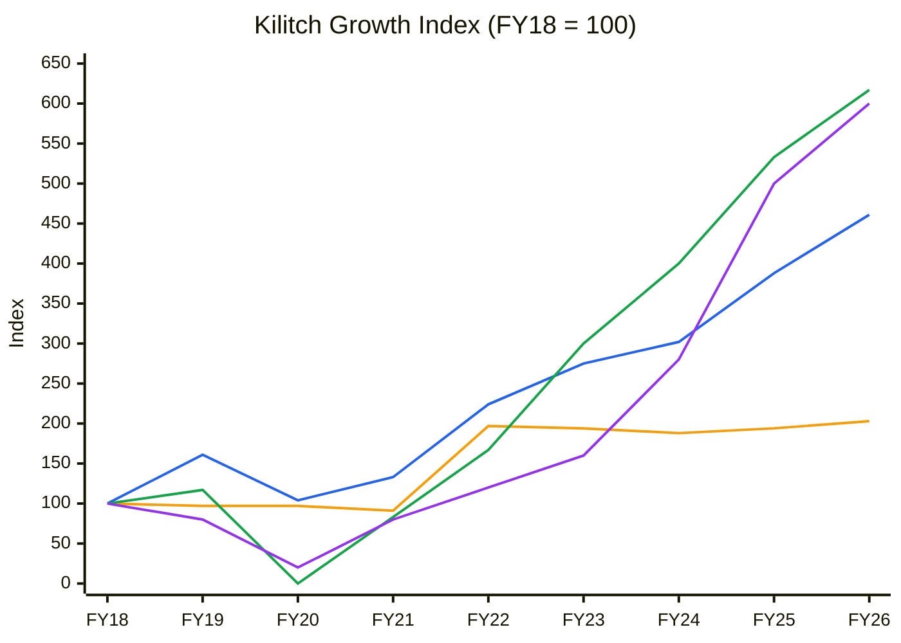
🟦 Revenue (CAGR 20.5%) · 🟧 Net fixed assets (9.3%) · 🟩 EBITDA (25.1%) · 🟪 PAT (25.1%). Net block is used because gross block is not available. FY26 excludes ₹140 Cr of Pen CWIP, which was capitalised in Q2 FY27 (net FA ₹220 Cr in Sep-26 = index 667).
**Read:** Through FY26 revenue and profit grew roughly 4.5–6× while fixed assets only doubled, so operating leverage worked on a light asset base.
**Business inference:** That era is ending. Pen triples the asset base in one step (index 203 → 667), so FY27–28 asset turnover and ROCE will fall sharply until the plant is approved and loaded. The next leg of growth is capital-heavy and regulator-gated.

---

## Module 1 — Market, Sector & Stock Cycle
**1. Market:** Nifty about 25,000 (Nov-26), flat-to-down YoY; VIX about 17.5 → **Neutral-to-Cautious**. Small/micro-caps carry liquidity risk: average daily volume is about 25–50k shares (≈ ₹1 Cr).

**1b. Sector: Neutral-to-Tailwind.**
- **Secular:** demand for affordable generics in Africa and SE Asia grows with healthcare access (~8–10% a year). Sterile injectables carry fewer competitors than oral solids. GLP-1 generics (semaglutide patent expiries in emerging markets, 2026+) are a real but crowded opportunity.
- **Cyclical:** Kilitch's FY25 jump (+29%) and its lumpy March quarters (Q4 FY26 revenue ₹89.6 Cr vs ₹44–54 Cr in other quarters) look like **tender/shipment timing**, not demand acceleration.
- **Geopolitics/FX:** USD-billed exports with African counterparty and FX-convertibility risk (Ethiopia's birr devaluation in 2024; the Nigerian naira). Raw materials (APIs, e.g. cephalosporin intermediates) are **China-dependent**, a structural sourcing risk.
- **Regulatory:** India's revised Schedule M (GMP) compliance deadline (2025–26) is pushing small plants to upgrade. The Pen EU-GMP/PIC-S path takes 18–36 months after commissioning.

**1c. Stock cycle: Early cycle / ramp-up (capex-heavy, margins about to be suppressed).**

**C2 — Quarterly YoY revenue growth (consolidated)**

| Qtr | Q3FY25 | Q4FY25 | Q1FY26 | Q2FY26 | Q3FY26 | Q4FY26 | Q1FY27 | Q2FY27 |
|---|---|---|---|---|---|---|---|---|
| Revenue (₹ Cr) | 56.2 | 61.2 | 43.1 | 48.9 | 53.8 | 89.6 | 44.9 | 50.2 |
| YoY % | +76.7 | +36.6 | +29.0 | +3.1 | −4.2 | +46.3 | +4.0 | +2.7 |
| EBITDA (₹ Cr) | 8.7 | 14.6 | 3.3 | 5.0 | 6.2 | 22.1 | 2.9 | 6.7 |

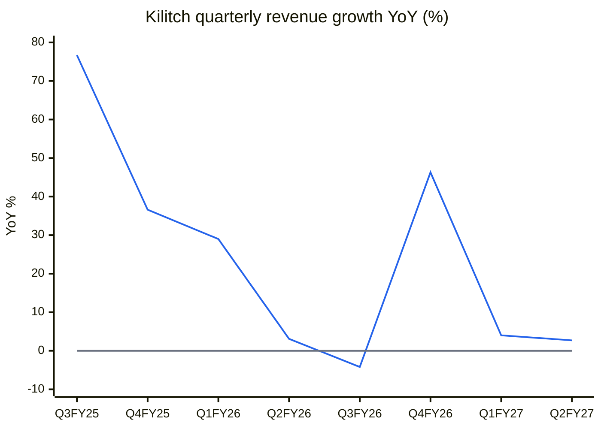
🟦 Revenue YoY · ⬜ zero line
**Read:** Outside the spike quarters (Q4), underlying growth has **decelerated to low single digits** over the last four of six quarters.
**Business inference:** The existing Navi Mumbai capacity and registrations appear to be maturing. The next growth step must come from Pen, so FY27–28 is a growth air pocket. Year-end-heavy revenue with rising debtor days needs watching for channel loading.

- **Revenue drivers:** volume and new registrations (mix). Pricing in tender markets is weak.
- **Capacity:** Navi Mumbai plant (capacity undisclosed) + Pen greenfield (≈ ₹150 Cr block; liquid vials, lyophilised, ophthalmic) *(sec.)*. Utilisation not disclosed.
- **Operating leverage:** Pen adds about ₹10–14 Cr a year of D&A plus fixed staff costs before revenue, so DOL is high in FY27–28. Q2 FY27 standalone PBT fell 40% YoY on +15% revenue.
- **FCF inflection:** not before FY29 (capex done, but working capital consumes cash).

---

## Module 2 — Industry Structure
| Force | Assessment |
|---|---|
| New entrants | Low barriers for oral solids; medium for sterile injectables (GMP, sterile know-how); high for EU-GMP |
| Supplier power | Medium-high: Chinese APIs and KSMs |
| Buyer power | High: tender buyers, distributors, governments; long credit periods |
| Substitutes | Low (essential medicines) |
| Rivalry | High: hundreds of Indian exporters in semi-regulated markets |

**Verdict: Neutral-to-unattractive** for the current business; **Neutral** for EU-GMP sterile injectables, if achieved.
**Capital cycle:** sterile-injectables capacity is being added widely in India (CDMO and GLP-1 rush). Watch for oversupply in commodity injectables by FY28–29.

---

## Module 3 — Business Quality & Moat
- **Greenwald:** no cost advantage at this scale. Mild captivity through country registrations (dossiers take 1–3 years per market). Local scale: none.
- **Buffett 10% price test:** Fail (tender markets).
- **Margin stability:** OPM 0.8% → 16% over FY20–26; improving, not proven through a downturn.
- **Moat verdict: None-to-Narrow** (registrations portfolio).

**Fisher 15-point:** market potential 2 · new products 2 (Pen, GLP-1) · R&D 1 (not disclosed, likely minimal) · sales org 2 · margin 2 · margin improvement 2 · labour 2 · executive relations 2 · depth 1 (small team, promoter-run) · cost/accounting controls 1 (receivables) · unique advantage 1 · long-range orientation 2 · dilution 2 (rights + bonus) · candour 1 (no calls in two years) · **integrity 2 (no veto; see RPT and rights-renunciation points)** → **25/45**.

---

## Module 4 — Management & Capital Allocation
- **Promoters (Mehta family):** 69.23% → **63.77% in Sep-25**. The drop matches the rights ratio exactly (2-for-23: 69.23 × 23/25 = 63.7), so **promoters renounced their entire entitlement** in the ₹49.9 Cr rights issue at ₹357 (≈ ₹178.5 after the 1:1 bonus) *(sec.)*. They did not put their own money into the Pen plant they are asking minorities to fund. **Mildly bearish.**
- **Pledge:** none flagged by Screener (not verified against the shareholding pattern) → Normal.
- **Institutions:** essentially nil (FII 0.10%, DII 0.50%). Undiscovered, but also unvetted.
- **Capital allocation:** ₹100 Cr of capex in FY25–26 (Pen), funded by the rights issue and debt (borrowings ₹22 Cr → ₹97 Cr). The KEB investment (Ethiopia) **ended in a negative-net-worth exit**. Kilitch converts up to ₹57 Cr of loans and service dues into KEB equity at ₹3,414/share and sells the whole unit for US$12.855 M ≈ ₹113 Cr *(sec.)*. Whether it books a gain or loss against its carrying value (investment plus loans) is undisclosed. **No dividend** since FY19.
- **RPT:** the KEB debt-to-equity conversion is classed as an RPT *(sec.)*. Standalone "investments" of ₹124–129 Cr and other income of ₹14 Cr a year (interest on KEB loans is likely part of it) disappear post-sale.
- **Three C's:** Candour: weak (no concalls since Jun-2024, sparse disclosure) · Competence: good growth execution · Caring: no dividend; rights renounced.

### Walk-the-Talk Scorecard
| Guided | Statement | Outcome | Verdict |
|---|---|---|---|
| Rights LoF (Jul-2025) | Proceeds for the Pen greenfield | CWIP ₹140 Cr capitalised by Sep-26 | ✅ |
| Jun-2024 call | (transcript not retrieved) | — | n/a |
| Oct-2026 | KEB sale completion by 31-Jan-2027 | Pending (EGM approved 16-Nov) | — |

**WTT Score: not scorable (1 point)**. **Key pattern: selective disclosure** (no guidance, no calls), which counts as a flag in itself.
**Insider action:** rights renunciation by promoters (BEARISH-ish); no open-market buys found.
**DCF impact:** no guidance to haircut; a bottom-up model is used with conservative ramp assumptions.
**Credibility: LOW-MODERATE.**

---

## Module 5 — Financial Forensics
| Model | Value | Verdict |
|---|---|---|
| Altman Z'' (FY26 consolidated) | ≈ 4.8 (X1 0.12, X2 0.53, X3 0.10, X4 1.57) | Safe |
| Piotroski F (FY26 consolidated) | **2/9** (only ROA > 0 and CFO > 0) | **Weak** |
| Sloan accrual (FY26 consolidated) | (30 − 24 + 100) / 385 ≈ **27%** | **Red flag** (inflated by Pen capex inside CFI; balance-sheet accruals still elevated) |
| Beneish (DSRI only) | Debtor days 168 → 227 (standalone) → DSRI ≈ 1.35 | Elevated |

**C7 — Cumulative PAT vs CFO (standalone, ₹ Cr)**

| FY | 19 | 20 | 21 | 22 | 23 | 24 | 25 | 26 |
|---|---|---|---|---|---|---|---|---|
| Cum PAT | 15 | 19 | 25 | 36 | 52 | 70 | 101 | 133 |
| Cum CFO | 7 | 14 | 20 | 25 | 31 | 28 | 43 | 55 |

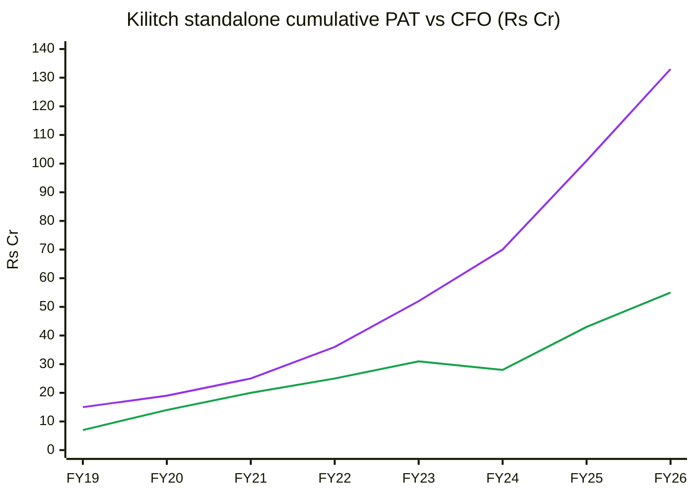
🟪 Cumulative PAT · 🟩 Cumulative CFO
**Read:** Over eight years only ₹55 Cr of ₹133 Cr of standalone profit (41%) turned into operating cash. Consolidated is 59% (FY22–26).
**Business inference:** Profits are being parked in receivables from export customers (and earlier in KEB loans). Until collections improve, reported EPS overstates distributable earnings, which is the core reason for the AVOID.

**C8 — Debtor days (standalone)**

| FY | 18 | 19 | 20 | 21 | 22 | 23 | 24 | 25 | 26 |
|---|---|---|---|---|---|---|---|---|---|
| Debtor days | 150 | 88 | 102 | 120 | 144 | 165 | 171 | 168 | 227 |

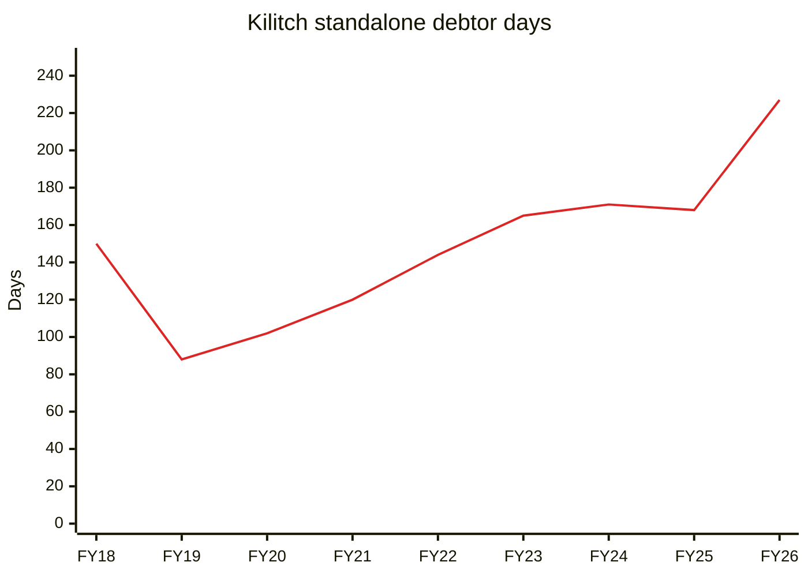
🟥 Debtor days
**Read:** Receivables have lengthened every year but one since FY19 (88 → 227 days), jumping 59 days in FY26.
**Business inference:** FY26 revenue (+4% standalone) was booked on much longer credit. That is a classic sign of growth bought with terms in African markets, where collection and FX-repatriation risk is real. A write-off would hit book value directly.

**Indian-specific flags**
1. Debtor days 227 and rising (Schilit EMS #1, revenue too soon / on terms).
2. Other income ₹14 Cr = 33% of standalone PBT in FY26 (O'Glove #7). Part is likely interest on KEB loans and so non-recurring after the sale.
3. CFO/PAT 0.41 standalone over eight years (O'Glove #1).
4. RPT: a loan-to-equity conversion in a subsidiary immediately before its sale.
5. Days payable 280 (standalone FY26), stretched supplier credit flattering CFO even at this level.

**Forensic red-flag count: 5 / 15 → ≥ 3 → deep investigation required (hard stop until resolved).** Auditor: not reviewed (data gap; check FY26 KAMs and receivable ageing).
**Overall forensic verdict: Significant concerns (cash conversion), not proven manipulation.**

---

## Module 6 — Earnings Quality & Financial Statements

**C4 / CY7 — EBITDA margin (consolidated)**

| FY | 18 | 19 | 20 | 21 | 22 | 23 | 24 | 25 | 26 |
|---|---|---|---|---|---|---|---|---|---|
| OPM % | 11 | 9 | 0.8 | 8 | 9 | 13 | 16 | 16 | 16 |

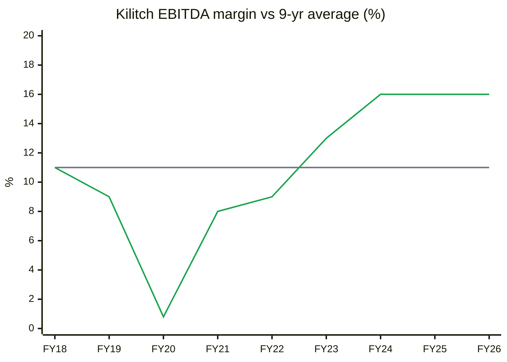
🟩 EBITDA margin · ⬜ 9-year average (11.0%)
**Read:** Margins have sat at 16% for three years, about 5 pp above the long-run average (~85th percentile).
**Business inference:** That level is close to the pharma-KPI red-flag threshold (< 18%). With Pen's fixed costs arriving and KEB leaving, FY27 margins will likely dip (Q1/Q2 FY27 consolidated OPM 6.6% / 13.3%). Current margins look like a cyclical high for this asset base.

**C5 — ROCE vs WACC (13%, small-cap)**

| FY | 18 | 19 | 20 | 21 | 22 | 23 | 24 | 25 | 26 |
|---|---|---|---|---|---|---|---|---|---|
| ROCE % | 5 | 6 | 1 | 3 | 6 | 10 | 13 | 16 | 13 |

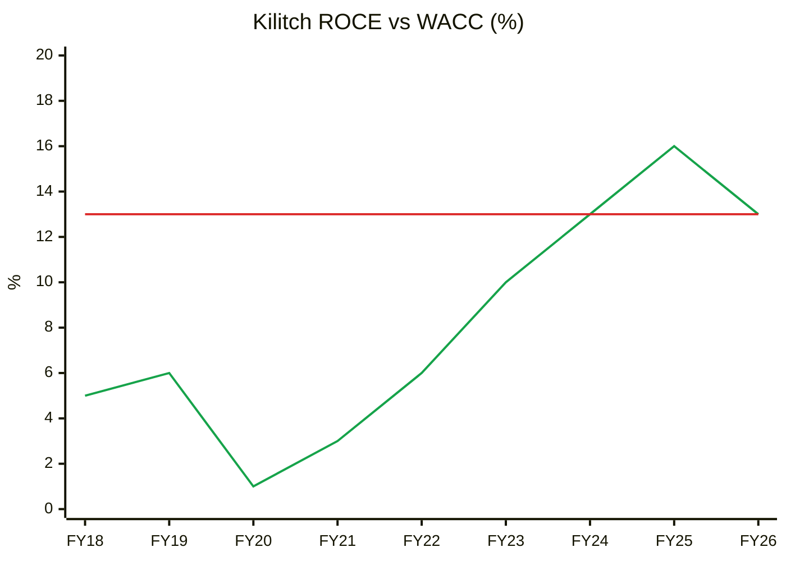
🟩 ROCE · 🟥 WACC 13%
**Read:** ROCE reached WACC only in FY24–26, and only just.
**Business inference:** Even at peak margins the business barely earns its cost of capital, because idle investments (~₹75–125 Cr) and receivables bloat capital employed. The KEB exit releases that capital. If the ₹113 Cr goes into debt repayment and Pen, the capital base gets cleaner, but Pen must earn more than 13% to create value.

### DuPont (consolidated, closing equity)
| FY | EBIT margin | AT | Equity mult. | Interest burden | Tax burden | ROE |
|---|---|---|---|---|---|---|
| FY22 | 9.6% | 0.54 | 1.50 | 0.91 | 0.60 | 4.3% |
| FY23 | 12.1% | 0.64 | 1.45 | 0.71 | 0.67 | 5.3% |
| FY24 | 16.2% | 0.64 | 1.36 | 0.76 | 0.74 | 8.0% |
| FY25 | 19.7% | 0.63 | 1.55 | 0.87 | 0.74 | 12.4% |
| FY26 | 19.1% | 0.51 | 1.64 | 0.87 | 0.77 | 10.7% |

**Operating contribution:** up (margin-led, but EBIT includes about 25% other income). **Financing contribution:** rising slightly (debt ₹22 Cr → ₹97 Cr).
**DuPont verdict:** ROE improvement is margin-led. AT is now falling (0.64 → 0.51) as Pen CWIP builds and will fall further in FY27. Base-case AT for the forward model: 0.5–0.6× on total assets.
**O'Glove: 5/15 flags** (#1, #2, #3, #5, #7).

---

## Module 7 — Industry KPIs & Peers
*KPI block: Pharmaceuticals (adapted for a semi-regulated exporter).*
| KPI | Kilitch | Benchmark | Assessment |
|---|---|---|---|
| US revenue % | 0% | 30–55% (large caps) | N/A, semi-regulated model |
| EBITDA margin | 16% (FY26), 13% (Q2 FY27) | 22–30% large caps; > 18% healthy | **Below** |
| R&D/revenue | not disclosed (likely < 2%) | 7–12% | **Below** |
| Regulatory status | Navi Mumbai: WHO-GMP (sec.); Pen targeting EU-GMP/PIC-S | No alerts | Neutral |
| Formulation share | ~100% formulations | > 60% | In line |

**Peers (Screener, TTM)**
| Metric | Kilitch | Lincoln Pharma | Medicamen Biotech | Brooks Labs |
|---|---|---|---|---|
| Mkt cap (₹ Cr) | 834 | 1,044 | 412 | 206 |
| Revenue TTM (₹ Cr) | 239 | 722 | 210 | 79 |
| OPM (TTM) | 16% | 14% | 11% | −2.5% |
| ROCE | 13.4% | 16.0% | 5.8% | 21.2% (one-offs) |
| P/E | 34.6× | 10.8× | 35.6× | 59.5× |
| P/B | 2.9× | 1.3× | 1.4× | 1.1× |

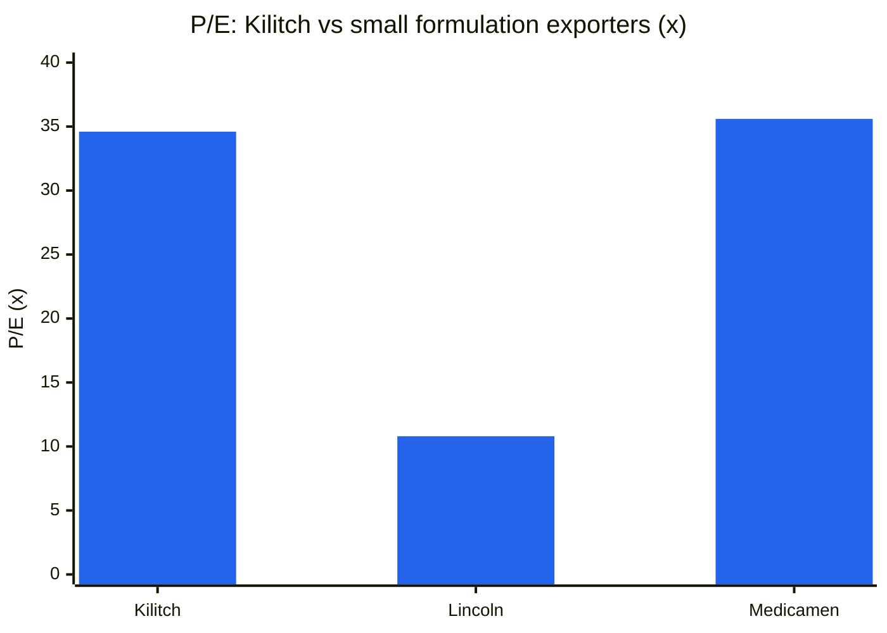
🟦 Trailing P/E (Brooks excluded: one-off-distorted earnings)
**Read:** Kilitch trades at 3.2× Lincoln's P/E even though Lincoln is three times larger, has higher ROCE and has a cleaner cash profile.
**Business inference:** The premium prices the Pen sterile-injectables and EU-GMP story, not the current business. **Peer positioning: premium, not justified on current fundamentals.**

---

## Module 8 — Market Size & Share
- **TAM:** Indian pharma exports ~US$30 bn (FY26), of which Africa is ~US$4 bn and sterile injectables a fast-growing slice. Kilitch's ~US$27 M of revenue is under 0.1% of exports and under 1% of Africa: **penetration is negligible, so growth is limited by approvals and capacity, not TAM**.
- **Share trend:** gaining in absolute terms (27% 10-year CAGR against ~8–10% market growth).
- **Verdict:** taking share in a large, fragmented market; driver is registrations (structural, slow).

---

## Module 9 — Valuation
**EV:** market cap ₹834 Cr + debt ₹97 Cr − cash/investments (~₹80 Cr consolidated; liquidity unverified) ≈ **₹850 Cr**. Post-sale pro forma: +₹113 Cr cash → **net cash ≈ ₹15–20 Cr**, EV ≈ ₹720–740 Cr *(estimate)*.

**PIE:** at WACC 13% and g 6% terminal, pro-forma EV of ₹730 Cr needs a steady-state NOPAT of 730 × 0.07 / 1.06 ≈ **₹48 Cr**. That is ~1.8× the current ~₹26 Cr standalone NOPAT (ex other income) and implies revenue of about ₹380–400 Cr at 17% EBITDA. **The market is pricing Pen at roughly ₹150 Cr of revenue at full margin**, about a 1.0× asset turn on the new block.
| Driver | Market-implied | Base case | Gap |
|---|---|---|---|
| Revenue (steady) | ~₹390 Cr | ₹386 Cr (FY29) | ≈ fair |
| EBITDA margin | ~17% | 17% | ≈ fair |
| Timing | ~FY29 | FY29–30 (EU-GMP 18–36 months) | Market slightly early |

**Gap: fairly priced to slightly optimistic.** The price leaves nothing for approval delays or a receivable write-off.
**Positive triggers:** KEB sale closes and the cash is used to retire debt; Pen EU-GMP/PIC-S inspection passed; first GLP-1 registration; receivables fall below 150 days.
**Negative triggers:** KEB deal slips or the price is renegotiated; a receivable provision; Pen commercialisation delay; standalone margin below 12%.

**CY1 — P/E band (consolidated EPS, Mar-end prices; bonus-adjusted)**

| | FY21 | FY22 | FY23 | FY24 | FY25 | FY26 | Now |
|---|---|---|---|---|---|---|---|
| Price (₹) | 40 | 83 | 68 | 190 | 177 | 139 | 239 |
| EPS (₹) | 1.16 | 2.31 | 3.28 | 4.44 | 8.12 | 8.63 | 6.89 (TTM) |
| P/E (×) | 34 | 36 | 21 | 43 | 22 | 16 | 35 |

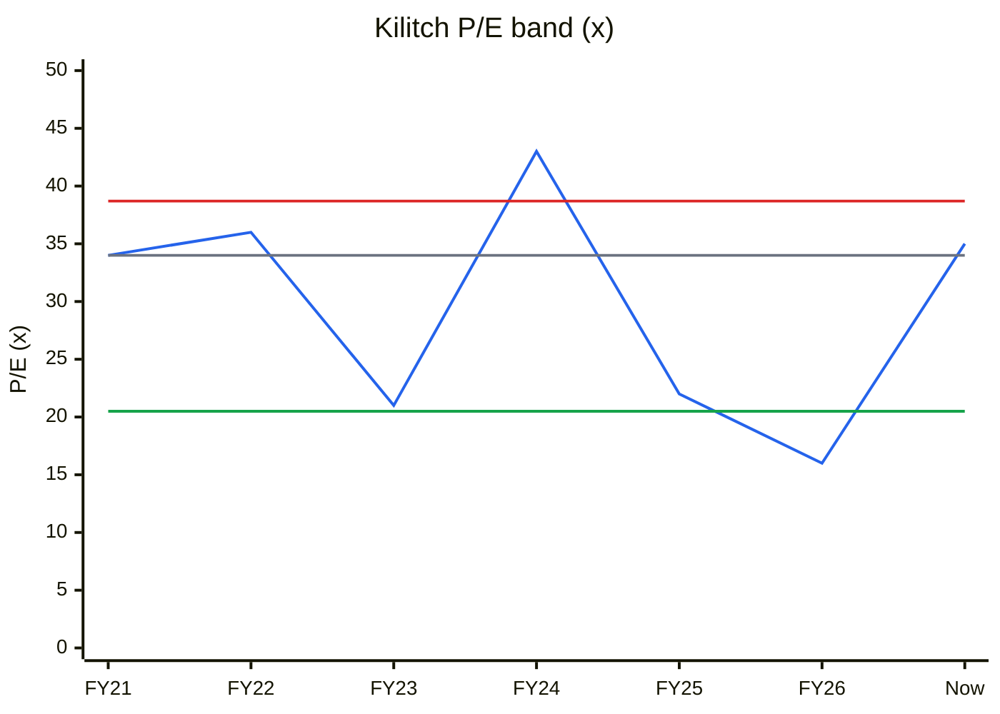
🟦 P/E · ⬜ median 34× · 🟥 +1SD 38.7× · 🟩 −1SD 20.5×
**Read:** 35× is at the median and the ~65th percentile, re-rated from 16× in March 2026 in eight months.
**Business inference:** The recent re-rating came with *falling* TTM EPS (₹8.63 → ₹6.89), so it is pure multiple expansion on the KEB sale and Pen narrative. On EPS that is about to dip further on Pen depreciation, the forward P/E is closer to 40×.

**CY2 — P/B band (consolidated)**

| | FY22 | FY23 | FY24 | FY25 | FY26 | Now |
|---|---|---|---|---|---|---|
| P/B (×) | 1.90 | 1.43 | 3.47 | 2.81 | 1.73 | 2.90 |

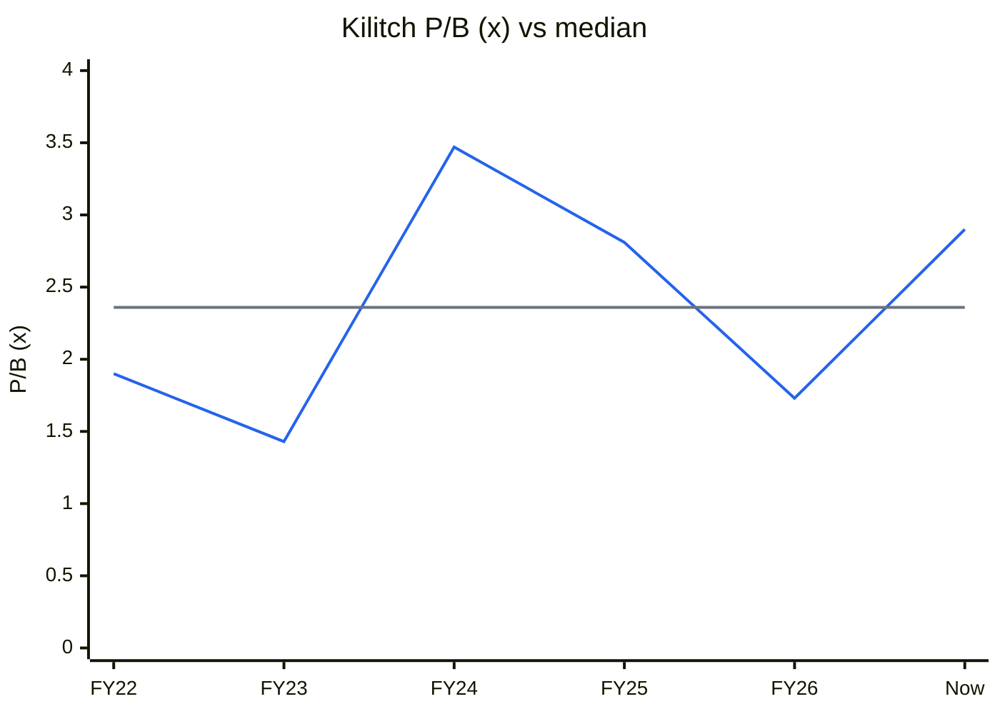
🟦 P/B · ⬜ median 2.36×
**Read:** P/B is 2.9×, about the 70th percentile, for a business with ~11% ROE.
**Business inference:** A justified P/B of (ROE − g)/(Ke − g) = (11 − 8)/(13 − 8) = **0.6×** at today's ROE. The price assumes ROE roughly doubles post-Pen.

**CY4 — Price vs EPS index (FY21 = 100)**

| | FY21 | FY22 | FY23 | FY24 | FY25 | FY26 | Now |
|---|---|---|---|---|---|---|---|
| Price | 100 | 208 | 170 | 475 | 443 | 348 | 598 |
| EPS | 100 | 199 | 283 | 383 | 700 | 744 | 594 |

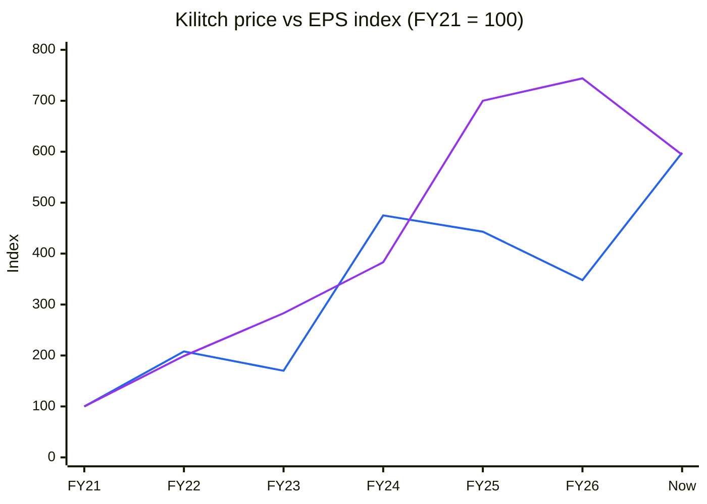
🟦 Price · 🟪 EPS
**Read:** Over five years price (6.0×) and EPS (5.9×) moved together, but in the last eight months price rose about 70% while EPS fell about 20%.
**Business inference:** Long-run returns were earnings-driven, which is healthy. The latest leg is anticipation, which is fragile if Pen or the deal slips.

### Cycle Position Dashboard
| Dimension | Current | Median/avg | Percentile | Signal |
|---|---|---|---|---|
| P/E | 35× | 34× | ~65th | Fair-to-expensive |
| P/B | 2.9× | 2.36× | ~70th | Expensive vs ROE |
| EBITDA margin | 16% (FY26) / 13% (Q2) | 11% | ~85th | Near peak for this asset base |
| ROCE | 13% | ~8% | ~80th | Above own history, ≈ WACC |
| **Overall** | | | | **Late in the old-asset cycle, early in the Pen cycle** |

**Graham number:** √(22.5 × 6.9 × 82.5) ≈ **₹113**.

---

## Module 10 — Technical Stage
- **Stock:** ₹239, above the rising 50-DMA (₹207) and the rising 200-DMA (₹189). 16-Nov: +10.9% on ~357k shares (≈ 10× average) on EGM approval. Prior high ₹268.
- **Stage: Stage 2 (advancing), extended.** The breakout from the ₹150–200 base (Apr–Sep 2026) is confirmed. Price is now ~20% above the 200-DMA and ~25% above the base pivot (~₹192), which makes it a **late entry: wait for the next base**.
- **RS vs Nifty:** +34% 1-year, strongly positive.
- **CANSLIM: 3/7** (N: deal + new plant · S: small float · L: RS leader). Fails C (Q2 EPS −73% YoY), A, I (no institutions), M.
- **Stop (if held):** weekly close below ₹200.

---

## Module 11 — Forward View
### Capex & capacity
| Item | Status |
|---|---|
| Pen greenfield | CWIP ₹140 Cr (Mar-26) → capitalised Q2 FY27 (standalone FA ₹20 Cr → ₹171 Cr). Liquid vials, lyophilised, ophthalmic. EU-GMP/PIC-S targeted *(sec.)* |
| Maintenance capex | ~₹3–5 Cr/yr |
| Ramp (greenfield) | FY28 ~30% → FY29 ~60% → FY30 ~85% of steady-state AT (~1.5× gross block) |
| Funding | Rights ₹50 Cr + debt; KEB proceeds to repay debt and finish the plant |

**Incremental ROIC (Pen, steady state):** ₹225 Cr revenue × 17% EBITDA = ₹38 Cr − D&A ₹12 Cr = EBIT ₹26 Cr × 0.75 = NOPAT ₹19.5 Cr on ₹150 Cr ≈ **13% ≈ WACC** (value-neutral at base margins; value-creating only with EU or GLP-1 pricing at 22%+ margins).

### Forward model (continuing business, base case; KEB deconsolidated from Q4 FY27)
| ₹ Cr | FY27E | FY28E | FY29E |
|---|---|---|---|
| Revenue | 225 | 300 | 386 |
| EBITDA (margin) | 31 (13.8%) | 48 (16%) | 66 (17%) |
| D&A | 12 | 15 | 16 |
| Interest | 5 | 2 | 2 |
| Other income | 8 | 6 | 6 |
| PBT | 22 | 37 | 54 |
| PAT | 16 | 28 | 40 |
| EPS (₹) | 4.6 | 8.0 | 11.6 |
| ΔWC (at 50% of incremental revenue) | −10 | −38 | −43 |
| FCF | −20 | −27 | −15 |

**FCF stays negative through FY29** at current working-capital intensity. Debt/EBITDA stays under 1.5× after the KEB proceeds, so leverage is not the risk; receivables are.

### Catalysts
1. KEB sale completion and cash receipt — by 31-Jan-2027
2. Debt repayment and a lower interest line — Q4 FY27
3. Pen commercial batches and first registrations — FY28
4. EU-GMP / PIC-S inspection — FY28–29
5. GLP-1 generic filings in emerging markets — FY28+

### Risks
1. Receivable write-off or FX repatriation issue in Africa — **Medium-High**
2. Pen approval delay; plant under-utilised — **Medium**
3. KEB deal slippage (state-owned buyer, Ethiopian FX controls) — **Medium**
4. API price or supply shock from China — **Medium**
5. Governance/disclosure (no calls; RPT-heavy transition) — **Medium**

### Scenarios (FY29)
| Scenario | Assumption | Revenue | EBITDA % | EPS | P/E | Target | Prob. |
|---|---|---|---|---|---|---|---|
| Bull | Pen at ~1.2× AT, EU-GMP done, GLP-1 wins | ₹450 Cr | 20% | ₹16.8 | 28× | **₹470** | 25% |
| Base | Pen at ~0.8× AT, semi-regulated exports | ₹386 Cr | 17% | ₹11.6 | 22× | **₹255** | 50% |
| Bear | Pen delayed, receivable provision | ₹260 Cr | 14% | ₹4.7 | 20× | **₹95** | 25% |
| **Expected value** | | | | | | **₹270 (+13%)** | |

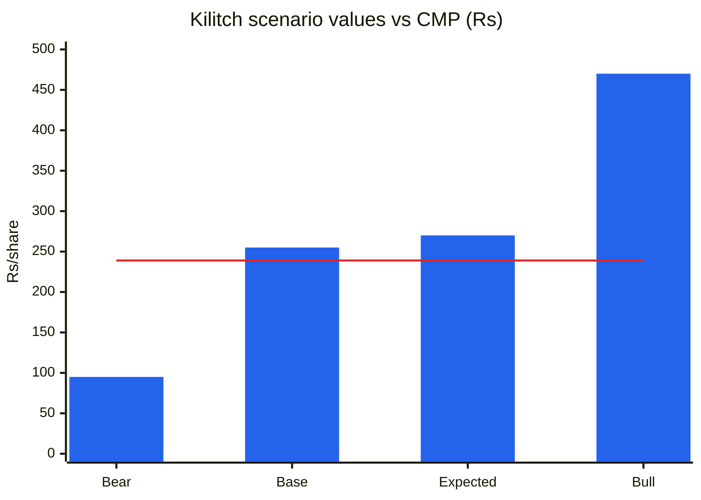
🟦 Scenario value · 🟥 CMP ₹239
**Read:** The base case is only 7% above CMP and the expected value 13% above it, against a required 40–50% margin of safety for a micro-cap.
**Business inference:** Upside/downside is 1.6:1, just above the hard-stop threshold, but the margin of safety fails. The stock already discounts most of a successful Pen ramp two to three years out.

---

## Checklist Summary
**A:** 14/18 (no concall; scuttlebutt not done) · **B:** 7/9 · **C:** 10/12 · **D:** 6/7 · **E:** 5/7 · **F:** 9/10 · **G:** 7/8 · **H:** 24/34 (Pen capacity and CWIP split undisclosed) · **I:** 5/5 · **Order book:** N/A.
**Hard stops triggered:** **Forensic red flags ≥ 3 unresolved** (cash conversion, debtor days, other-income share, Piotroski 2, accrual ratio).

## Investment Decision
**Recommendation:** AVOID for now (Watchlist)
**Conviction:** 4/10 (cycle 0.6 · industry 0.4 · moat 0.6 · management 0.4 · financial 0.5 · valuation 0.6 · technical 0.9)
**Position size:** 0% now; at most 1% if the gates clear
**Re-entry conditions:** (a) KEB cash received and debt repaid; (b) FY27 annual report shows debtor days < 170 and CFO/PAT > 0.7; (c) price ≤ ₹160 (≈ 40% MoS on the ₹270 expected value) **or** Pen EU-GMP clearance.
**Target (base, FY29):** ₹255
**Review triggers:** KEB completion filing; Q3/Q4 FY27 receivables; Pen inspection news; any auditor qualification.

**Data gaps:** the BSE KEB filing (gain/loss on sale, supply-agreement terms); FY26 annual report (receivable ageing, KAMs, RPT note, other-income break-up); Pen capacity in units; export country and registration counts.

---
*Report generated by Stock Fundamental Analysis Skill v3.3 | Indian Markets Context*
*Sources: Screener.in (KILITCH standalone and consolidated, accessed 2026-11-17); Kalkine (22-Oct-2026) and Whalesbook (23-Oct-2026) summaries of the KEB divestment filing; Zerodha/Choice/ScanX deal pages; HDFC Sky/BioSpectrum rights-issue reports (Jul-2025); Sahi Q2 FY27 (6-Nov-2026); Screener price/DMA API.*
