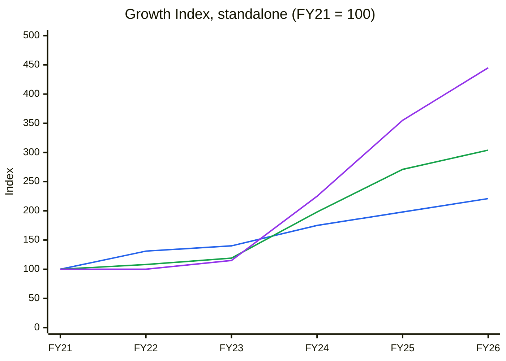
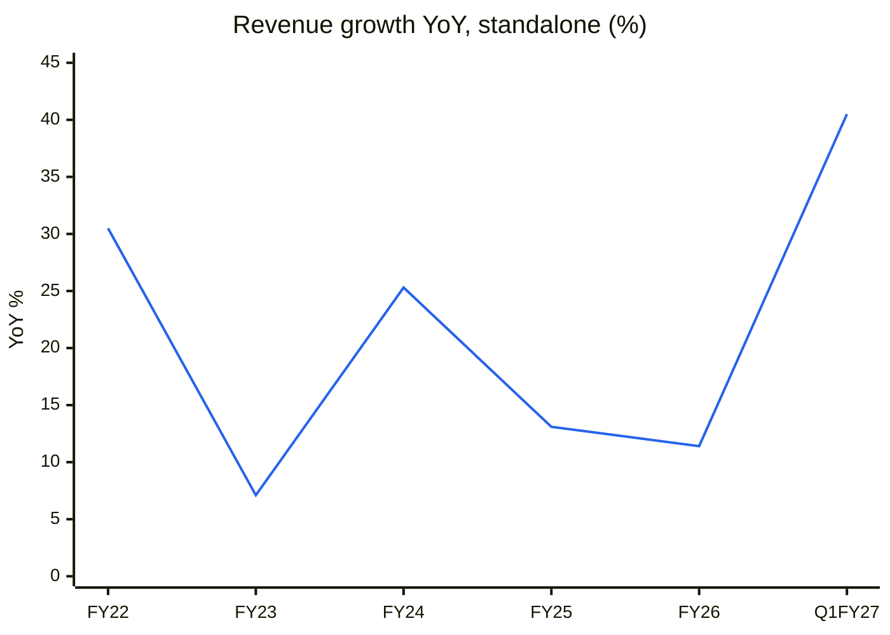
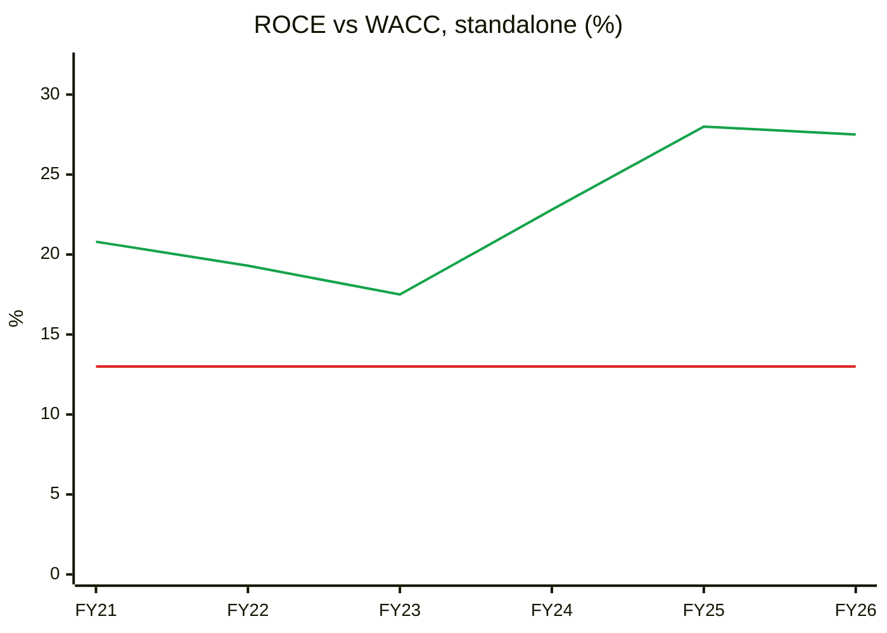
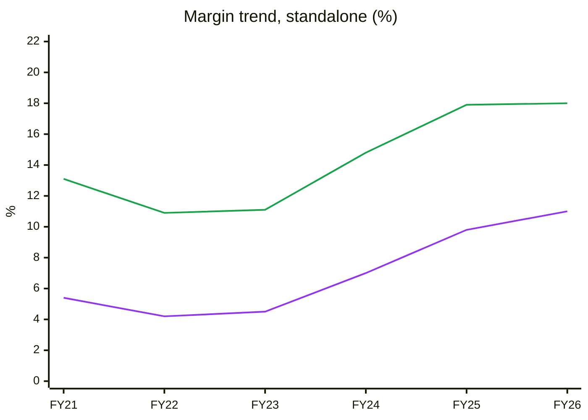
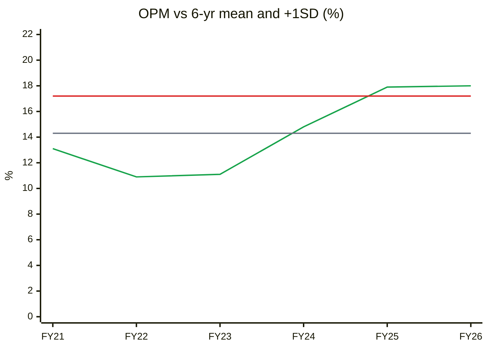
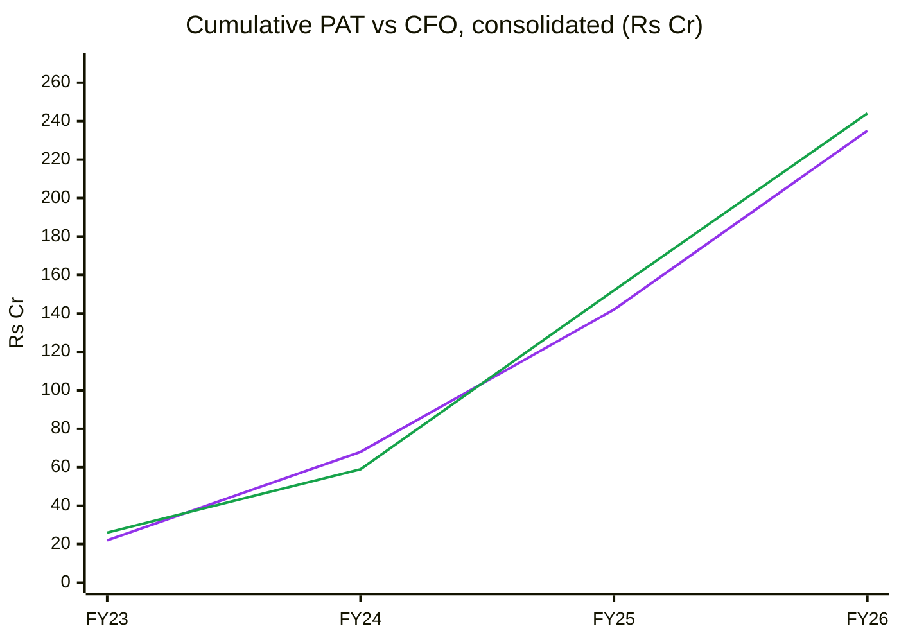
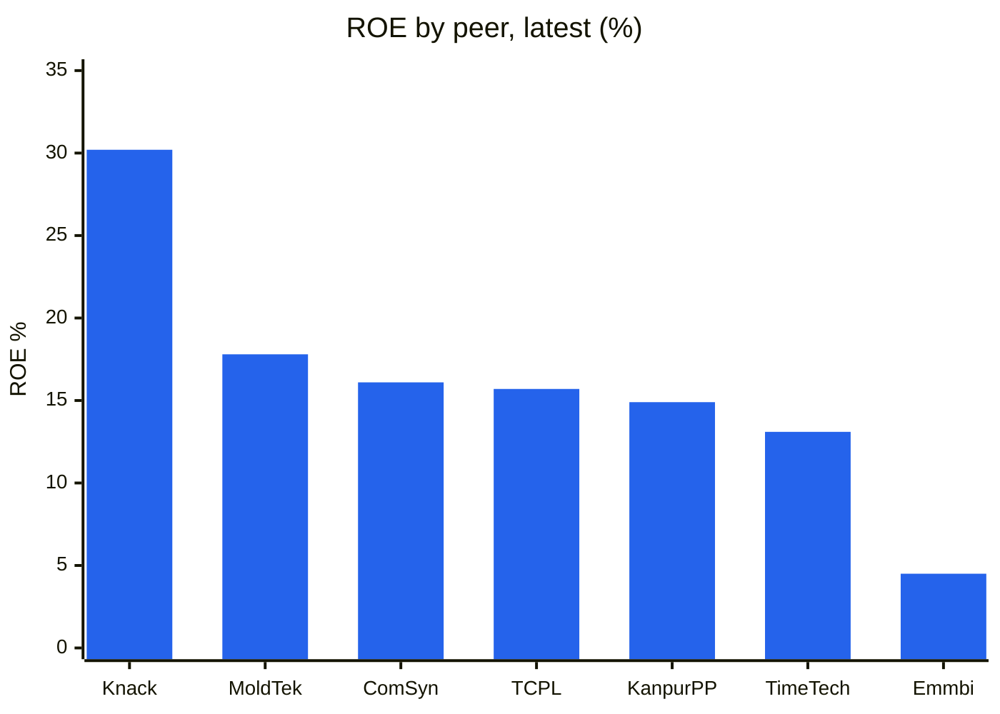
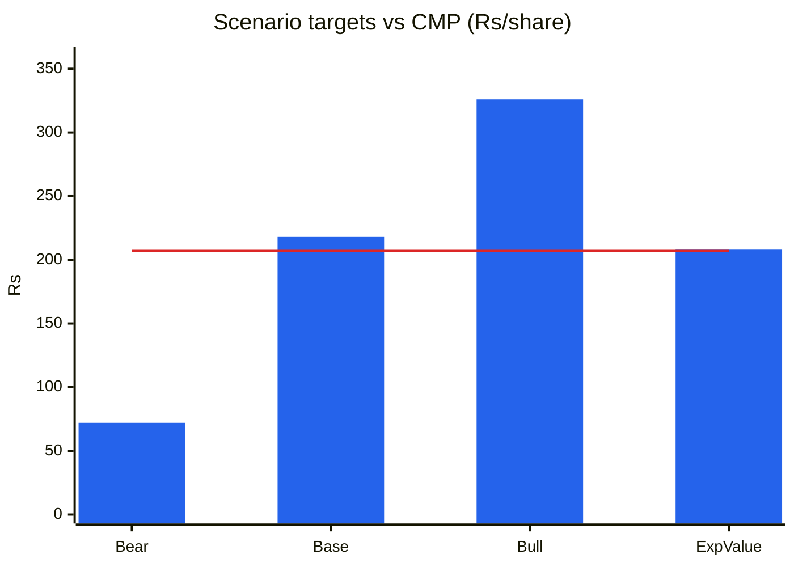
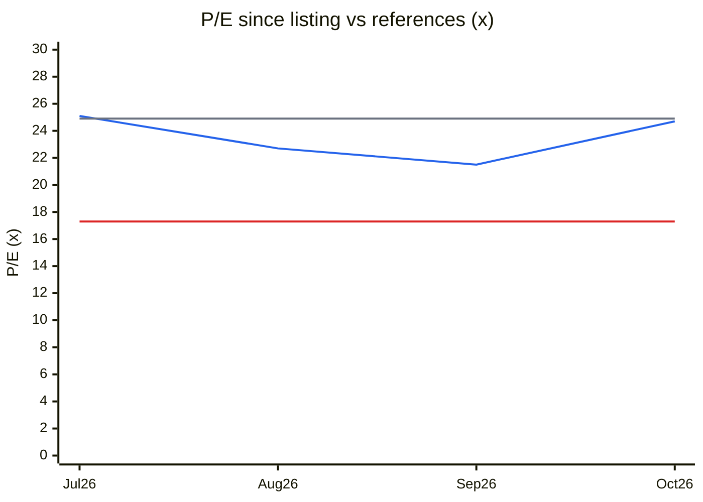
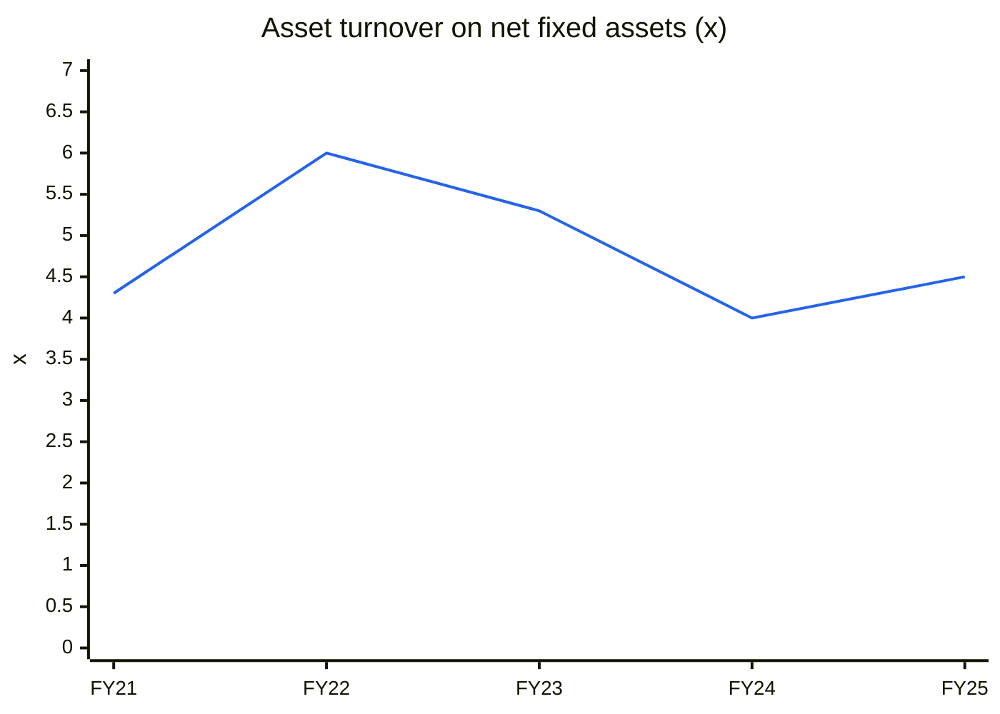

# Stock Analysis Report — Knack Packaging Ltd (NSE: KNACK · BSE: 544814)
**Date:** 2026-10-11
**Analyst:** Claude (Stock Fundamental Analysis Skill v3.3)
**Investment Horizon:** 2–3 Years
**Recommendation:** WATCHLIST — *Quality at Wrong Price* (do not buy at ₹207; buy-below ₹155, or upgrade on the triggers in the Investment Decision)
**Conviction Score:** 5.0 / 10
**CMP:** ₹207.14 (NSE close 09-Oct-2026) · **M-Cap:** ₹2,535 Cr · **TTM P/E:** 24.7× ([Screener](https://www.screener.in/company/KNACK/consolidated/))

## Revision Log
| Version | Date | Recommendation | Conviction | Price | Key change |
|---|---|---|---|---|---|
| **Current** | 2026-10-11 | WATCHLIST — Quality at Wrong Price (buy-below ₹155) | 5.0 /10 | ₹207.14 | First concall + Q1FY27 (+41% rev, 22.4% EBITDA margin) and a ₹150 Cr/yr Cargill-type renewal strengthen the business evidence, but the stock is 7% higher, margins are now >1SD above their 6-yr average while PP/crude spike, and payoff asymmetry at CMP is ~0.9:1 (a price hard stop). Several factual errors in the previous report corrected (realisation/MT, export share, plant cost/capacity, DuPont, verdict category). |
| Previous | 2026-08-28 | WATCHLIST — Wait for Confirmation | 5.5 /10 | ₹193 (₹192.61 close 28-Aug) | Initial report, written 7 weeks after listing (full text in git history). |

**What changed in the thesis:** The quality case got *more* evidence (scorable concall, pass-through mechanics explained, Cargill relationship renewed to Dec-2028, CARE A-/Stable, pinch-bottom mix 20%→23%). The risk case also got sharper. (1) Q1FY27 growth was roughly half price: realisation/kg rose ~16% with polymer pass-through, so volume grew 21%, not 40%. (2) Margins now sit above +1SD of their own history while crude is >$100 and the Nifty is 14.6% off its high. (3) The new plant is smaller and later than the old report said: ₹365 Cr, +32,710 MTPA net, from Oct-2027 (not ₹435 Cr "doubling" in FY27–28). The price rose to ₹207, so the asymmetry worsened. The "Wait for Confirmation" category was wrong because the MoS gate never passed, and is replaced by "Quality at Wrong Price".

**Validation of previous report (2026-08-28):**
| Item | Previous | Now | Status |
|---|---|---|---|
| Listing date / IPO subscription | Listed 8-Jul-2026; 83× (QIB 154×, NII 140×) | Same: 83.33× (QIB 154.34×, NII 139.81×, Retail 20.07×) ([Arihant](https://www.arihantcapital.com/News/News-Details/1708389/investor-attention)) | ✅ Validated |
| IPO structure | Fresh ₹380 Cr + OFS ₹60 Cr @ ₹170 | Fresh ₹380 Cr + OFS ₹59.5 Cr (35 lakh sh) @ ₹161–170 ([Outlook Business](https://www.outlookbusiness.com/amp/story/news/knack-packagings-440-cr-ipo-to-open-on-july-1-price-band-set-at-161-170-per-share)) | ✅ Validated |
| New plant cost | "~₹435 Cr new plant" | **₹364.96 Cr** total; ₹320 Cr from IPO net proceeds; ₹12.88 Cr already spent, ₹32.08 Cr from accruals (RHP, via [FundsIndia IPO note](https://www.fundsindia.com/blog/equities/knack-packaging-ltd-ipo-note-equity-research-desk/34818)); one secondary review cites ~₹456 Cr incl. other capex | ❌ Corrected |
| New plant capacity / timing | "Roughly doubles capacity over FY27–FY28" | +49,100 MTPA gross / **+32,710 MTPA net** of decommissioning (RHP via FundsIndia); commissioning **October 2027** (Q3FY28), total ~70,000 MTPA (Q1FY27 concall) — +62–75%, not 2× | ❌ Corrected |
| Realisation per MT | "~₹23k/MT (₹823 Cr / ~35k MT)" | 823 Cr ÷ 38,157 MT sold = **₹2.16 lakh/MT (₹216/kg)** — previous figure was off by 10× | ❌ Corrected |
| Volume vs price decomposition FY24→26 | "+19% volume, ~6% realisation/mix uplift" | Volume sold 30,590→38,157 MT = **+24.7%**; revenue +25.7% → realisation ~flat (+0.8%); the margin gain came from EBITDA/kg (₹33.1→₹45.2, company definition), not price (RHP via FundsIndia; concall Q&A) | ❌ Corrected |
| Export share | "≈43.7% — GEPL '56.3% export' is a mislabel" | **56.30% export (FY26)** per company Q1FY27 presentation; CARE: "~56% in both FY25 and FY24", US ≈ 50% of exports; concall "55–56% export". The earlier "correction" was itself wrong | ❌ Corrected |
| Q1FY27 growth driver | "+40% YoY (capacity + JV led)" | +40.5% standalone / +41.1% consolidated. The JV adds only ~₹5.7 Cr (consol − standalone). Growth = volume +20.9% (10,940 vs 9,047 MT) × realisation ~+16% (₹240 vs ₹206/kg, polymer pass-through) | ❌ Corrected |
| DuPont inputs | FY24 AT 1.46×, EM 3.2×; FY26 AT 1.18×, EM 2.27× | FY24 AT 1.73×, EM 2.69× (Screener BS); FY26 AT ~1.50×, EM ~1.78× (est., FY26 BS not on Screener). Conclusion (ROE now margin-led) unchanged | ❌ Corrected (numbers) / ✅ (conclusion) |
| Verdict category | "Wait for Confirmation" with ~0% MoS, 1.0:1 asymmetry | WFC requires the MoS gate to pass; it did not. Correct category = **Quality at Wrong Price**, and U/D < 1.5:1 is a price hard stop | ❌ Corrected |
| Broad market | "Optimistic-to-Euphoric; Nifty near record highs" | Nifty record was 26,373 on 5-Jan-2026; Nifty 22,520 on 9-Oct-2026 (−14.6%), 7 straight weekly losses to end-Sep, Brent >$100 ([BusinessToday 30-Sep](https://www.businesstoday.in/markets/trending-stocks/story/sensex-nifty-lose-from-record-highs-within-a-year-analysts-turn-cautious-558827-2026-09-30)). "Near record highs" was not supported by data even in August | ❌ Corrected → **Cautious/Fearful** |
| TTM P/E at ₹193 | "~23× (TTM)" | FY26 PAT ₹92.7 Cr ÷ 12.24 Cr post-issue shares = EPS ₹7.58 → **25.5×** at ₹193 (issue P/E 22.4× was at ₹170) | ❌ Corrected |
| FY24–FY26 revenue / EBITDA / PAT | 655/736/823; 97/133/152; 46/74/93 | Same (Screener consolidated; company EBITDA incl. other income ₹101/144/172 Cr) | ✅ Validated |
| Net worth FY26 | ₹308 Cr | ₹308.2 Cr consolidated (Q1FY27 PPT) | ✅ Validated |
| Promoter holding / pledge | 70.59% / nil | 70.59% (Jul-2026 SHP, Screener); Sep-2026 SHP not yet filed; no pledge disclosed | ✅ / ⚠️ (re-check Sep SHP) |
| Customer concentration | Cargill 17%, top-10 41% | Largest customer 16.73%, top-10 40.87% (FY26, RHP/PPT); Cargill ~₹140 Cr business (concall) | ✅ Validated |
| Customer retention | 88.3% FY26 (65–67% FY24–25) | Company now quotes "customer continuity" **93.75%** (PPT) and "as high as 90%" (concall) — different definitions; the 65–67% history could not be re-sourced | ⚠️ Unverifiable (metric inconsistent) |
| SACOS = customer #2 at ~6% (₹48 Cr) | RPT watch | JV (Sayem Knack, 50:50, Mexico) commissioned Apr-2026 (PPT); SACOS revenue share not re-sourced | ⚠️ Unverifiable |
| Capacity FY26 / utilisation | 43,300 MTPA @ 81.6%; ">48,000 MT now" | 43,300 @ 81.63% (RHP); >48,000 MTPA incl. rented @ ~91% in Q1FY27 + 5,040 MTPA rented plant added ~Jul-2026 (concall) | 🔄 Updated |
| Capacity FY24 "33,400 MT" | — | CARE: FY24 capex took capacity 28,800→36,400 MTPA | ⚠️ Conflicting source |
| TAM | Global flexible bulk packaging ~$90.7B, ~4.8% CAGR | Company/Technopak: India PLWPP bags ₹30 bn (FY24) → ₹60 bn (FY29P), **15% CAGR**; global PLWPP $1.45 bn → $1.85 bn, 5% CAGR (Q1FY27 PPT). The relevant pond is smaller and faster-growing in India | 🔄 Updated |
| FIBC peer P/E "~8–18×" | — | EMMBI 17.3×, COMSYN 36.9×, KANPRPLA 13.0× (Screener, 10-Oct-2026) | 🔄 Updated |
| PIE implied growth | ~8% | ~8.4% (EV ~₹2,380 Cr, NOPAT₀ ~₹100 Cr) | 🔄 Updated |
| Scenario values | Bull ₹300 / Base ₹176 / Bear ₹84, EV ₹184 | Bull ₹326 / Base ₹218 / Bear ₹72, EV ₹208 (FY29E) | 🔄 Updated |
| Walk-the-Talk | Not scorable | First concall 10-Aug-2026; 2 scorable points both hit (n too small) | 🔄 Updated |
| Technical stage | Not establishable (7 weeks) | 14 weeks: base ₹176–215, high-volume push to ₹207 this week; still no 30-week MA | 🔄 Updated |
| Old data gaps: concall, WTT, cash conversion | Open | Concall read; WTT started; FY26 CFO ₹92 Cr vs PAT ₹93 Cr (Screener); CARE shows lower CFO (FY25 ₹60.6 Cr vs Screener ₹93 Cr) | 🔄 Partly closed |

---

## Executive Summary
Knack Packaging makes printed, laminated woven-polypropylene (PLWPP) bags, including premium "pinch-bottom" bags, for branded 5–50 kg packs of rice, pulses, pet food, animal feed and fertiliser, with ~56% of revenue exported to 74 countries and Cargill as anchor customer. The thesis is a capacity-and-mix compounder. It has a 6-year record of 17% revenue CAGR and 35% PAT CAGR (standalone), ROCE in the high 20s, India's PLWPP market growing ~15%, and a ₹365 Cr plant adding ~33k MTPA net from Oct-2027. Q1FY27 (+41% revenue, 22.4% EBITDA margin) and a renewed ~₹150 Cr/yr supply contract to Dec-2028 confirm the franchise is real. **The key risk is that today's numbers are cycle-high.** Margins are 1.3 SD above their 6-year average, Q1 growth was partly polymer pass-through (plus likely inventory gains while PP rose), crude is >$100, and at ₹207 the probability-weighted value (~₹208) leaves no margin of safety and ~0.9:1 upside/downside. It is a good business at a full price, so wait for ~₹155 or for proof that FY27–28 margins hold through the PP spike.

🟦 Revenue (CAGR 17.2%) · 🟩 EBITDA / operating profit (24.9%) · 🟪 PAT (34.8%) — Screener standalone P&L. Gross block omitted: Screener lacks the FY26 balance sheet and shows only net block for FY21–25 (see C6). Company-disclosed gross block: ₹273 Cr (Jun-25) → ₹416 Cr (Jun-26).

**Read:** Since FY21, revenue grew 2.2×, operating profit 3.0× and PAT 4.5×. Almost all of the outperformance came after FY23, when OPM jumped from 11% to 18%.

**Business inference:** This is operating leverage plus mix (pinch-bottom bags, solar power, lower KMP pay per CARE) layered on a benign polymer window, not a decade-long record. The FY24–FY26 step-up is the thing that has to prove durable, and it has never been tested by a PP spike as a listed company. → Modules 1c, 5, 8.

*Order book (Reg 30 filer, but not an order-driven model):* disclosed orders in hand ₹130 Cr (~0.14× TTM revenue, 10-Aug concall) + one ₹150 Cr/yr framework renewal (2-Oct-2026, to Dec-2028; largely existing Cargill business). See Module 6 tracker.

---

## Business Primer
Knack Packaging converts polypropylene granules and BOPP film into printed, laminated woven-PP bags, the heavy-duty sacks used for 5–50 kg packs, and is vertically integrated from tape extrusion through weaving, gravure printing, lamination and bag conversion at its Gujarat plants (Q1FY27 concall). Customers are B2B: food brands (rice, pulses, flour, spices, sugar), pet food and animal feed (Cargill is ~17% of revenue), fertiliser, seeds and chemicals. There are 2,000+ customers and 13,493 SKUs, and ~56% of revenue is exported, with the US the single largest market (~24% of revenue). Revenue is volume (MT) × realisation, where realisation is essentially polymer cost plus a conversion margin; roughly half of customers are on a contractual "raw-material price + fixed conversion" formula and the rest are re-priced order-by-order (concall). The business depends on two things: keeping its expensive extrusion/printing/pinch-bottom lines full, and holding the conversion spread over PP granules when polymer prices move.

This is a niche industrial converter: a commodity process with a branded-print, customisation and export-certification overlay, not a consumer brand. The value drivers are volume and mix, especially the shift to pinch-bottom bags (10% of sales in FY23 → ~23% in Q1FY27) that carry "six-side branding" and command better margins. Price is largely a pass-through. The key risks are the polymer/crude cycle, a fragmented industry with low entry barriers where every upcycle invites new capacity (CARE), and US trade policy given that half of exports go to the US. Three structural features colour the analysis. The company listed only on 8-Jul-2026, so there is just one concall and FY26 audited statements are not yet on aggregators. The ₹380 Cr IPO money roughly doubles net worth, which will optically dilute ROE for two years. And the IPO-funded plant only starts in Oct-2027, so until then growth runs on rented capacity.

**Segment check:** Flexible / FIBC Woven-Polypropylene Packaging — KPI reference available ✓ (`references/05-industry-kpis-india.md`, line 8). *Note: that block contains Knack figures now known to be off (EBITDA/MT "₹15–25k" healthy range vs Knack ₹40–45k; "Knack doubling"); flagged in the hand-off, not edited here.*

---

## Module 1 — Broad Market Cycle (Marks)
**Assessment: Cautious → Fearful.** Nifty 50 closed at 22,520 on 9-Oct-2026, −14.6% from its 26,373 record (5-Jan-2026). It had 7 consecutive weekly losses into end-September (longest since 2020), Brent at $100–108 on the Middle-East/Hormuz stalemate, FII YTD outflows ~$25.9 bn and India VIX 14.35 (15.33 on 8-Oct) ([JM Financial](https://www.jmfinancialservices.in/market-news-and-insights/1735991); [BusinessToday](https://www.businesstoday.in/markets/trending-stocks/story/sensex-nifty-lose-from-record-highs-within-a-year-analysts-turn-cautious-558827-2026-09-30)). IPO froth seen in July (Knack 83× subscribed) has faded with the tape.
**Sizing implication:** A fearful market argues for normal-to-larger sizing *if* a stock is cheap. Knack is not cheap, so this does not rescue the verdict. It does mean a further market leg down could deliver the buy-below price.

## Module 1b — Sector Cycle: Tailwinds & Headwinds
**Verdict: Headwind (near-term input-cost) on a Tailwind (structural) base.**

**Secular vs cyclical decomposition:**
- **Secular:** India PLWPP bag market ₹30 bn (FY24) → ₹60 bn (FY29P), 15% CAGR, with PLWPP's share of the WPP-bag market rising 6.5–7% → 8.5–9%; pinch-bottom bags <0.5% of WPP but growing 8–10% (Technopak via Q1FY27 PPT; company-commissioned, so haircut). Globally, PLWPP grows ~5% ($1.45 bn → $1.85 bn). Labour-cost arbitrage also helps: management sells only into countries with labour cost >$500/month, and India is the low-cost producer vs Thailand/Cambodia (concall). **Durable baseline for Knack: ~10–12% volume+mix growth.**
- **Cyclical:** Q1FY27's +41% revenue included ~16% realisation inflation from polymer pass-through. FY25–FY26 margins benefited from a soft PP window, solar savings and lower KMP remuneration (CARE). **Do not embed >12% revenue growth or the Q1 22% EBITDA margin as permanent.**

**Input-cost cycle: rising.** Crude >$100. Reliance raised PP +₹4/kg from 5-Sep-2026; raffia $1,280–1,330/t CFR, up WoW ([Polymerupdate](https://www.polymerupdate.com/News/Details/1508042/pp)). Management says ~45–50% of customers are on RM+conversion formula pricing and the rest are re-priced "same day" (concall), and Q1 margin rose *while* PP rose. The flip side is that Knack "always buy[s] in cash… bulk buying" with ~76 inventory days, so a rising-PP quarter carries **inventory holding gains** that reverse when PP falls. Q1's ₹48/kg operating EBITDA (vs ₹40 FY26) is partly this.

**Competitive capacity pipeline:** CARE calls the woven-sack industry "highly fragmented… low entry barriers… favourable government policies led to entry of many new players". Knack itself is adding +62–75% capacity. Peer-level FIBC capex data could not be compiled (gap).

**Geopolitical / FX:** ~56% exports, US ~50% of exports (CARE) → ~28% of revenue US-linked. Cargill kept buying through an 8-month 50% US tariff episode and refused a shift to an Oman plant (concall), which is strong anecdotal evidence of stickiness. The company does **not hedge FX** (CARE). It is a net exporter, so a weak INR (current) is a tailwind (Q1 forex gain ₹1.6 Cr).

**CY5 (industry demand vs supply) and CY6 (spread cycle): not chartable.** There is no industry capacity series, and per-kg spread is available for only FY24, FY26, Q1FY26 and Q1FY27 (mixed periods). The spread table is in Module 6.

## Module 1c — Stock Cycle: Company-Specific Positioning
**Classification: Early capex ramp, but at late-cycle (peak-percentile) margins.** Per the cycle rule, OPM 18.0% (FY26) and 20.6% (Q1FY27 standalone) sit >1SD above the 6-yr mean of 14.3%, and ROCE ~27.5% sits above +1SD (26.6%) of its 6-yr range (CY7 below). The data overrides the old "early-cycle" label → **late-cycle MoS adjustment (+5–10pp) applies.**

**Revenue growth trajectory:**
| Period | FY22 | FY23 | FY24 | FY25 | FY26 | Q1FY27 |
|---|---|---|---|---|---|---|
| Revenue YoY (standalone) | 30.5% | 7.1% | 25.3% | 13.1% | 11.4% | 40.5% |

🟦 Revenue YoY. Annual points FY22–FY26 plus Q1FY27 vs Q1FY26. Only three quarters are publicly reported, so a true 8-quarter C2 is not possible.

**Read:** Growth decelerated from 25% (FY24) to 11% (FY26), then spiked to 40.5% in Q1FY27.

**Business inference:** Q1 is volume +21% (rented capacity and two new pinch-bottom machines) plus ~16% polymer-driven realisation. The underlying volume run-rate is ~20%, which is healthy but capacity-capped at ~91% utilisation until Oct-2027. Judge FY27 on MT and EBITDA/kg, not rupee revenue.

**Volume / price / mix:**
| Metric | FY24 | FY26 | Q1FY26 | Q1FY27 | Source |
|---|---|---|---|---|---|
| Volume sold (MT) | 30,590 | 38,157 | 9,047 | 10,940 | RHP via FundsIndia; concall |
| Realisation (₹/kg) | 214 | 216 | 206 | 240 | Revenue ÷ MT |
| Operating EBITDA (₹/kg, Screener OP) | 31.7 | 39.6 | 42.0 | 48.4 | Screener OP ÷ MT |
| Company EBITDA (₹/kg, incl. other income) | 33.1 | 45.2 | — | ~54 | RHP / concall |
| Pinch-bottom share of sales | ~16% | ~20% | — | 22.5–23% | Concall |

FY24→FY26 growth was **all volume (+25%)**; realisation was flat. The mix shift (pinch-bottom) and cost (11 MW solar, ~1.1% of revenue power saving per CFO) drove EBITDA/kg up 25%. That is the durable kind of improvement, but part of FY25's margin step came from lower KMP remuneration (CARE).

**Physical capacity model:**
| | MTPA | Utilisation | Note |
|---|---|---|---|
| FY26 effective installed | 43,300 | 81.6% | RHP |
| Q1FY27 incl. rented | >48,000 | ~91% | Concall |
| + rented plant (Jul-2026) | +5,040 | trial | Concall ("1–2 yrs until new plant") |
| Borisana plant (Oct-2027) | +49,100 gross / +32,710 net | ramp | RHP; ~70,000 MTPA total post-commissioning (concall) |

Capacity ceiling: ~53,000 MTPA incl. rented × ~90% ≈ 47–48k MT is the FY27 volume ceiling (+24% vs FY26). FY28 has only ~5 months of the new plant (greenfield ramp 25–35% in year 1). **The physical volume CAGR to FY29 is ~15% in the base case.**

**Operating leverage (FY26, consolidated):** EBIT ₹141 Cr, interest ₹16 Cr → DFL 1.13×. Fixed-cost share is not disclosed, so DOL is approximated at ~2× from FY24→FY26 (revenue +26%, EBIT +83%). → DTL ~2.3×. A 10% volume miss means roughly a 23% EPS miss.

**FCF inflection:** FY27–FY28 capex ≈ ₹150 Cr + ₹170 Cr (IPO deployment schedule, RHP) plus maintenance ~₹30 Cr/yr, so FCF is negative but funded by IPO cash. **Inflection FY29** once the plant ramps (✅ unchanged).

---

## Module 2 — Industry Structure & Capital Cycle
### Porter Five Forces
| Force | Read | Signal |
|---|---|---|
| New entrants | CARE: "low entry barriers in terms of capital and technology". The barrier exists only at the premium end: 73,000+ printing cylinders, gravure + lamination + European pinch-bottom lines (~₹20 Cr per machine, concall), food/export audits | Medium (low at commodity end) |
| Supplier power | PP from Reliance, Nayara etc.; top supplier 35.8%, top-5 73.5% of RM purchases; paid in 5–7 days (CARE, RHP) | High (adverse) |
| Buyer power | Cargill 16.7% (formula pricing); long tail of small mills; packaging is <1–2% of the customer's product cost, so low price sensitivity | Medium |
| Substitutes | Knack is the substitution *winner* (jute → PP → PLWPP → pinch-bottom); paper multiwall at premium end | Low-Medium |
| Rivalry | Fragmented domestic; overseas competition from Thailand/Cambodia; China under anti-dumping; US converter Polytex sells comparable dog-food bags at ~$0.70–0.75 vs Knack ~$0.35–0.40 (concall, management claim) | High at commodity end |

**Industry verdict: Neutral.** A spread business with adverse supplier power and fragmented rivalry, but Knack sits in the branded/printed niche where buyer price sensitivity is low → requires +5pp MoS.

### Capital Cycle (Chancellor)
High returns are attracting capital. Knack raised ₹380 Cr of equity and is adding +62–75% capacity, and the sector saw multiple packaging IPOs in 2026. India's labour-cost advantage supports exports, but domestic capacity additions are unmonitored (data gap). **Position: late-good phase**, with returns at a high, supply being added, and the market now fearful. Watch utilisation after Oct-2027: if the new 33k MT cannot be filled at ≥70% by FY29, the cycle has turned.

---

## Module 3 — Business Quality & Moat
**Moat verdict: NARROW** (✅ unchanged).

1. **Supply/cost advantage — moderate.** Full vertical integration, 80% renewable power (2.1 MW wind, 2.25 MW rooftop, 11 MW solar farm), India labour-cost advantage, and gross-block AT ~2.1–2.5× vs peers ~1.5–2.3× (concall). This can be replicated by a funded entrant, but not quickly at the print-quality end.
2. **Customer captivity — moderate, better evidenced than in August.** Packaging is <1% of the customer's product value, and proprietary colour formulations mean "any deviation in quality… immediately visible to the end consumer". Cargill grew from ₹6 Cr / 40 SKUs (2020) to ₹140 Cr / 600+ SKUs across 8 countries, stayed through the 50% US tariff, and has now renewed to Dec-2028 (concall; 2-Oct-2026 filing). The caveat is "no long-term contracts with top-10 customers" (RHP risk factors), so stickiness is behavioural.
3. **Local scale — absent** (competes globally).

**Buffett price test:** Partial pass. The formula customers cannot be squeezed on conversion, and small customers are price-insensitive; but realisation is not "pricing power" (FY24→26 realisation flat).
**Market share:** ~10.1% of Indian flexible bulk PLWPP bags (FY25, Technopak), "largest manufacturer of PLWPP and PLWPP pinch-bottom bags in India by FY25 revenue" (PPT). There is no 5-year share series, so stability is untestable.

**Fisher 15-point (indicative, /45): 31** (was ~30). Up on market potential (3), product development (pinch-bottom, laser-cut/easy-open, 3), sales organisation (74 countries, 3), margins (3) and cost analysis (SAP S/4HANA, 2). Down on management depth (2: family-run; CFO joined May-2025; CS joined Aug-2026), candor (2: the concall presented "ROCE 54.7%" and "total revenue +41.5%" generously, but answered the asset-turn and pass-through questions directly) and dilution (2: IPO). **Point 15 Integrity: provisional pass (2).** No SEBI or legal red flag was found. India Ratings moved the company to "issuer not cooperating" in Jun-2025 (CARE PR) before it consolidated to CARE, which is a minor flag.

---

## Module 4 — Management & Capital Allocation
**Promoter holding:** 70.59% (Jul-2026 SHP) | **Pledge:** none disclosed → Normal. Sep-2026 SHP due by 21-Oct.
**Lock-ins (SEBI ICDR norms, dates approximate):** anchor 90-day lock-in ended ~early Oct-2026; promoters' excess-over-20% and pre-IPO shareholders' 6-month lock-in ends ~Jan-2027, a supply overhang to monitor.
**Capital allocation:** Reinvestment-led, no dividend. FY26 internal-accrual capex of ~₹47 Cr (two pinch-bottom machines + lamination) is already earning (Q1 margin), and IPO proceeds are earmarked to one plant. **Incremental ROIC of the plant ~17% vs WACC 13%** (Module 10) → value-creating but thin.
**RPTs:** The 2-Oct order explicitly states no promoter interest and not an RPT. The Mexico JV (50:50) is now operating, and its RPT sales need checking in the FY27 annual report (first post-listing AR).
**Remuneration:** CARE attributes part of the FY25 margin rise (15.5% → 18.6% PBILDT) to **lower KMP remuneration**. Promoter pay was cut in the run-up to the IPO, which flatters pre-IPO margins. Track promoter pay vs PAT in the FY27 AR.
**Buffett's Three C's:** Candor — moderate (see Fisher). Competence — high (ROCE build, cost programme). Caring — unknown (no letter yet).

### Walk the Talk Scorecard
| Source / date | Statement | Guided | Actual | Verdict |
|---|---|---|---|---|
| CARE PR, 10-Apr-2026 (mgmt input) | FY26 TOI | ~₹825–830 Cr | ₹823 Cr revenue / ₹842 Cr incl. other income | ✅ Hit |
| CARE PR, 10-Apr-2026 | 2 pinch-bottom + 1 lamination machine (~₹47 Cr) to start Apr-2026, lift margins | Apr-2026 | Installed Q4FY26, benefit visible Q1FY27; EBITDA margin 22.4% | ✅ Hit |
| PPT / concall, Aug-2026 | Mexico JV commissioning | — | Commissioned Apr-2026 | ✅ Delivered (original guided date not sourced; not scored) |
| Concall, 10-Aug-2026 | "Sales we got in this quarter will be maintained" (Q2 ≈ Q1 run-rate) | ≥ ₹262 Cr/qtr | Q2FY27 due ~Nov-2026 | ⏳ Pending |
| Concall, 10-Aug-2026 | Borisana plant commissioning | Oct-2027 | — | ⏳ Pending |
| Concall, 10-Aug-2026 | Pinch-bottom mix | 22.5–23% | — | ⏳ Pending |

**WTT Score:** 1.00 on n = 2 → **provisional, statistically weak; treated as MODERATE** until 4+ points are scored.
**Key pattern:** None yet. Watch whether the "Oct-2027" plant date slips (greenfield; main construction only after monsoon, per the closing remarks).
**Insider action:** Promoters sold ₹59.5 Cr via OFS at ₹170 (neutral). Form C / SAST filings since listing could not be retrieved (BSE API blocked) — gap.
**DCF impact:** Base case adds a 1-quarter delay to the plant ramp. Q2 "maintain" guidance is not used as an anchor.
**Overall management credibility:** MODERATE.

---

## Module 5 — Financial Forensics
**Forensic red-flag count: 2 / 15** (inventory-gain risk on a rising-PP quarter; pre-IPO KMP-pay-driven margin step). Both are explainable, not manipulation signals.
| Model | Value | Read |
|---|---|---|
| Altman Z'' (FY25, consolidated) | **~5.4** (X1 0.18 using CARE current ratio 1.40×; X2 0.47; X3 0.26; X4 0.92) | Safe |
| Piotroski F (FY26 vs FY25) | **~6/9** (ROA+, CFO+, ROA ~flat, D/E down 0.88→0.62, no FY26 dilution, margin ~flat-up; fails CFO<NI marginally (92 vs 93) and AT down; current ratio n/a) | Average-to-strong (🔄 from ~7) |
| Sloan (NI − CFO − CFI)/avg TA | FY25 11.4%; FY26 ~20% (est. TA) | Flag *only* because of growth capex (CFI −₹100 Cr). Operating accruals (NI − CFO)/TA ≈ 0% → clean |
| Beneish M | Not computable (FY26 BS not public on aggregators). DSRI FY25/FY24 = 0.92 (debtor days 65→60) | No warning on the available component |
| Cash conversion | Cumulative CFO ₹244 Cr vs PAT ₹235 Cr (FY23–26, Screener) | ✅ but see the data conflict below |

**Data conflict:** CARE reports CFO of ₹44.2 Cr (FY24) and ₹60.6 Cr (FY25) vs Screener ₹33 Cr and ₹93 Cr. Using CARE figures, cumulative CFO/PAT FY23–26 ≈ 0.95. Either way it is acceptable, but cash conversion should be re-verified from the FY27 audited cash flow.
**Indian flags:** No pledge ✓; auditor qualification not checked (no AR yet; RHP restated) ⚠️; fund-based WC limits ~90–95% utilised (CARE). This is a working-capital-hungry model with CCC ~105 days (FY25), although the company quotes 86 working-capital days in Q1FY27.
**Overall forensic verdict: Clean-to-minor-concerns** (✅ unchanged).

---

## Module 5 (cont.) — Earnings Quality, ROIC & DuPont
| ₹ Cr (consolidated) | FY23 | FY24 | FY25 | FY26 | TTM Q1FY27 |
|---|---|---|---|---|---|
| Revenue | 515 | 655 | 736 | 823 | 899 |
| Operating profit (OPM) | 56 (11%) | 97 (15%) | 133 (18%) | 151 (18%) | 166 (18.5%) |
| Other income | 0 | 4 | 11 | 19 | 20 |
| PAT | 22 | 46 | 74 | 93 | 103 |
| Net worth | 103 | 141 | 215 | 308 | 338 (30-Jun, pre-IPO cash) |
| CFO / FCF | 26 / −8 | 33 / −36 | 93 / 36 | 92 / −10 | — |
*Source: Screener consolidated; net worth FY26/Q1 from Q1FY27 PPT. ~₹20 Cr other income (forex, interest) is ~14% of TTM PBT — monitor, it is part of the company's "EBITDA".*

**ROCE (standalone, year-end capital employed = equity + borrowings; FY26 CE estimated from D/E 0.62):**
| FY21 | FY22 | FY23 | FY24 | FY25 | FY26 |
|---|---|---|---|---|---|
| 20.8% | 19.3% | 17.5% | 22.8% | 28.0% | 27.5% |

🟩 ROCE (pre-tax, EBIT ÷ equity+debt) · 🟥 WACC ~13%

**Read:** ROCE has exceeded WACC every year (spread +4.5 to +15pp) and stepped up from ~18–21% to ~28% after FY24.

**Business inference:** This is a genuine value creator even at its FY23 trough. Post-tax ROIC is ~20% vs WACC 13%. The company's own "ROCE 46.7% (FY26) / 54.7% (Q1)" uses a narrower capital base; anchor on ~27%. Expect reported ROE/ROCE to fall in FY27–28 as ₹350+ Cr of IPO cash sits idle and then the plant ramps. That is mechanics, not deterioration.

**Margins:**
| | FY21 | FY22 | FY23 | FY24 | FY25 | FY26 |
|---|---|---|---|---|---|---|
| OPM (standalone) | 13.1% | 10.9% | 11.1% | 14.8% | 17.9% | 18.0% |
| PAT margin | 5.4% | 4.2% | 4.5% | 7.0% | 9.8% | 11.0% |

🟩 Operating margin · 🟪 PAT margin

**Read:** OPM fell to ~11% in FY22–23 (a PP spike year, FY22) and then rose 7pp in three years. PAT margin doubled.

**Business inference:** FY22 is the only "stress test" in the data. When polymer spiked, OPM fell ~2pp and revenue grew 30% on pass-through, which shows pass-through protects rupees per kg, not percentage margin. Expect a similar optical OPM dip in FY27 even if EBITDA/kg holds. → base-case OPM 19% FY27, 19% FY29.

**CY7 — Margin through the cycle:**

🟩 OPM · ⬜ 6-yr mean 14.3% · 🟥 +1SD 17.2%

**Read:** FY25–FY26 OPM (18%) and Q1FY27 (20.6%) sit above +1SD, the top of the 6-year distribution. ROCE 27.5% is also above +1SD (26.6%).

**Business inference:** By the skill's cycle rule this is late-cycle / peak-percentile profitability. Mix and solar are real, but valuation must be done on normalised (~16–19%) margins, not Q1's 22%. → MoS +5–10pp.

**Earnings quality (C7):**
| Cumulative ₹ Cr (consolidated) | FY23 | FY24 | FY25 | FY26 |
|---|---|---|---|---|
| PAT | 22 | 68 | 142 | 235 |
| CFO | 26 | 59 | 152 | 244 |

🟪 Cumulative PAT · 🟩 Cumulative CFO

**Read:** Cumulative CFO (₹244 Cr) ≥ cumulative PAT (₹235 Cr) over FY23–26 (ratio 1.04; ~0.95 using CARE's CFO).

**Business inference:** Profits convert to cash despite 100+ day cash-conversion cycles. Free cash flow, however, is cumulatively negative (−₹18 Cr) because all cash is reinvested. This is a self-funding grower that needed the IPO only for the step-change plant.

### DuPont (5-factor, consolidated; FY26 total assets estimated ≈ NW 308 + debt ~191 + other liabilities ~50)
| Year | EBIT margin | Asset turnover | Equity multiplier | Interest burden | Tax burden | ROE (year-end) |
|---|---|---|---|---|---|---|
| FY23 | 7.6% | 1.87× | 2.68× | 0.77 | 0.73 | 21.4% |
| FY24 | 11.8% | 1.73× | 2.69× | 0.81 | 0.74 | 32.6% |
| FY25 | 15.8% | 1.64× | 2.09× | 0.85 | 0.75 | 34.4% |
| FY26 | 17.1% | ~1.50× | ~1.78× | 0.89 | 0.74 | 30.2% |
| **Change FY23→26** | **+9.5pp** | **−0.37×** | **−0.90×** | **+0.12** | ~0 | **+8.8pp** |

**Operating contribution (EBIT margin × AT):** 14.2% → 25.7% — improving. **Financing contribution:** equity multiplier falling — de-leveraging.
**DuPont verdict:** ROE is now *margin-led and de-levered*, the good kind (✅ conclusion unchanged; inputs corrected). Asset turnover is drifting down as working capital and new machines are added ahead of revenue.
**AT trend → Module 10 base case:** gross-block AT ~2.1× (FY26 ₹823 Cr ÷ ~₹385 Cr gross block, derived from ₹416 Cr at Jun-26 less ₹30.75 Cr Q1 additions, concall). Use **2.1×** for the base case and 2.5× (Q1 annualised, company) for the bull case.
**Peer DuPont (ROE, Screener 10-Oct-2026):** Knack ~30% (margin-led) vs Mold-Tek 17.8%, TCPL 15.7%, Time Technoplast 13.1%, COMSYN 16.1%, Kanpur Plastipack 14.9%, Emmbi 4.5%. Knack's premium ROE comes from margin, not leverage.

**O'Glove flags: 2 / 15** (other income ~14% of PBT; rising-PP inventory gains). → Earnings quality: **Good, not pristine.**

---

## Module 6 — Industry KPIs & Peer Analysis
**Sector:** Flexible / FIBC woven-PP packaging. Top-3 KPIs: utilisation, realisation & EBITDA per MT, polymer spread.
| KPI | Knack | Reference healthy range | Assessment |
|---|---|---|---|
| Capacity utilisation | 81.6% (FY26) → ~91% (Q1FY27, incl. rented) | 80–90% | At ceiling — growth is capacity-capped until Oct-2027 |
| Realisation | ₹216/kg FY26; ₹240/kg Q1FY27 | Rising/stable | Flat FY24–26; Q1 jump is PP pass-through |
| EBITDA per MT | ₹39.6k (Screener OP) / ₹45.2k (company) FY26; ₹48–54k Q1 | ₹15–25k (reference block, too low for PLWPP) | Far above commodity-sack peers ✓ |
| Polymer spread | Material cost 59.6% of revenue FY26 → ~40% spread | 28–35% | Above range ✓ (print/lamination value-add) |
| Export % | 56.3% (US ~24% of revenue) | 40–60% | In range; US concentration ⚠️ |
| NWC days | 86 (Q1FY27, company); CCC 106 (FY25, Screener) | <100 | Borderline |
| Value-added mix | Pinch-bottom 10% (FY23) → 16% → 20% → 23% | Rising | ✓ Strongest durable lever |

**Peer comparison (Screener, prices 9/10-Oct-2026):**
| Metric | Knack | Commercial Syn Bags | Kanpur Plastipack | Emmbi | Mold-Tek Pkg | TCPL Pkg | Time Technoplast |
|---|---|---|---|---|---|---|---|
| Revenue FY26 (₹ Cr) | 823 | 387 | 718 | 456 | n/a | 1,810 | 6,105 |
| 3-yr sales CAGR | 17% | 10% | 15% | — | 16% | 7% | 12% |
| OPM (FY26) | 18% | 12% | 9% | 10% | ~19%* | 16% | 15% |
| ROCE | ~27–35% | 13.9% | 17.0% | 8.7% | 22.2% | 17.7% | 16.5% |
| ROE | ~30% | 16.1% | 14.9% | 4.5% | 17.8% | 15.7% | 13.1% |
| P/E (TTM) | 24.7× | 36.9× | 13.0× | 17.3× | 34.1× | 31.2× | 17.8× |
| M-Cap (₹ Cr) | 2,535 | 1,096 | 588 | 162 | 2,169 | 3,890 | 8,705 |
*Mold-Tek OPM from its FY21–22 history on Screener; latest-year value not extracted.*

🟦 ROE (Knack FY26 year-end; peers Screener latest)

**Read:** Knack's ROE is ~1.7× the next-best packaging peer, yet its P/E (24.7×) sits below COMSYN, Mold-Tek and TCPL.

**Business inference:** On returns, the market is *not* over-paying relative to peers. The discount reflects the 3-month listing, commodity-sack association and cycle-high margins. A clean FY27 could re-rate it toward 28–30×; a margin miss would pull it toward the 13–18× FIBC band. This dispersion is why the scenario range is wide.

### Order Book Tracker
*Trigger: Reg 30 "Receipt of Order" filing (2-Oct-2026) + "₹130 Cr order in hand" disclosure (10-Aug concall). Knack is a short-cycle make-to-order converter, so the order book is a weak visibility metric (0.14× TTM revenue). Charts OB-1…OB-4 are not generated because there is only one disclosed order-book point (needs ≥4).*

#### 1. Disclosed vs tracked order book (reconciliation)
| Period | Revenue (₹ Cr) | Order book (₹ Cr) | Announced inflow | of which Framework | Implied inflow | Announced coverage | OB cover (× TTM rev) | Source |
|---|---|---|---|---|---|---|---|---|
| FY24 | 655 | — | — | — | — | — | — | Screener consolidated |
| FY25 | 736 | — | — | — | — | — | — | Screener consolidated |
| FY26 | 823 | — | — | — | — | — | — | Screener consolidated / Q1FY27 PPT |
| Q1FY27 | 262 | 130 | — | — | — | — | 0.1 | Q1FY27 concall (orders in hand Rs130 Cr) / Screener |

#### 2. Announced orders aggregated by quarter
| Quarter | # orders | Total (₹ Cr) | Firm | Framework | Largest single | Export | Govt/PSU/Defence | Private domestic |
|---|---|---|---|---|---|---|---|---|
| Q3FY27 | 1 | 338 | 0 | 338 | 338 | 338 | 0 | 0 |

#### 3. Macro picture
| Metric | Value |
|---|---|
| Latest disclosed order book | ₹130 Cr (Q1FY27) |
| Orders announced since that disclosure | ₹338 Cr (1 order; framework, ~₹150 Cr/yr × 2.25 yrs) |
| Tracked order book today (before execution since Q1FY27) | ₹468 Cr (of which ₹338 Cr framework) |
| Order book cover (latest firm) | 0.1–0.14× TTM revenue |
| Framework share | 72% of tracked book |

**Read:** The only large filing is a 3-year supply framework of ~60 mn bags / ~₹150 Cr per year to Dec-2028 from "one of the largest private corporations in the world… leader in animal nutrition" in the USA. The description and size match Cargill (~₹140 Cr FY26 business, concall).

**Business inference:** This is mostly a **renewal**, worth only ~₹10 Cr/yr incremental, so the 5-day +15% price move over-reads it as new business. Its real value is de-risking ~17% of revenue through Dec-2028 and adding pinch-bottom volumes. It is not a step-change in the revenue base. Firm visibility stays ~1–2 months of sales; the model is driven by capacity × utilisation, not backlog.

**Order-book verdict:** Firm visibility ~0.15 yrs · Framework share 72% · Single-customer concentration 100% of announced · Not an order-driven valuation anchor.

#### 5. Order Ledger — every announced order (source of truth; the next run appends here)
| order_id | date | customer | customer_type | segment | geography | value_cr | currency | value_fc | firmness | tenor_months | linked_to | source | notes |
|---|---|---|---|---|---|---|---|---|---|---|---|---|---|
| KN-001 | 2026-10-02 | Large US private corp / animal-nutrition leader (likely Cargill; unnamed in filing) | Export | PLWPP + Pinch-bottom bags | Export | 337.5 | INR |  | Framework | 27 |  | [BSE](https://www.bseindia.com/stockinfo/AnnPdfOpen.aspx?Pname=b01ffb41-4b12-4a44-ad91-2535159840da.pdf) | New + renewal; ~60 mn bags/yr; ~Rs150 Cr per annum till Dec-2028 (value = 150 x 2.25 yrs); largely RENEWAL of existing ~Rs140 Cr/yr Cargill business - not incremental |

#### 6. Order Book Snapshots — revenue and disclosed order book per period
| period | revenue_cr | revenue_ttm_cr | order_book_cr | order_linked_share | as_of_date | source |
|---|---|---|---|---|---|---|
| FY24 | 655 |  |  |  |  | Screener consolidated |
| FY25 | 736 |  |  |  |  | Screener consolidated |
| FY26 | 823 |  |  |  |  | Screener consolidated / Q1FY27 PPT |
| Q1FY27 | 262 | 899 | 130 |  | 2026-08-10 | Q1FY27 concall (orders in hand Rs130 Cr) / Screener |

*Order-linked share left blank (not disclosed). Every number above traces to the ledger / snapshot rows.*

---

## Module 7 — Market Size & Market Share
**TAM (India PLWPP bags, 5–50 kg + rest):** ₹30 bn (FY24) → ~₹35 bn (FY25E) → ₹60 bn (FY29P), **15% CAGR**. Global PLWPP $1.45 bn (CY24) → $1.85 bn (CY29P), 5% CAGR (Technopak via Q1FY27 PPT). Global *pinch-bottom* is <0.2% of the WPP-bag market, growing 5–7% (8–10% in India).
**Penetration:** Domestic revenue ~44% × ₹736 Cr (FY25) ≈ ₹324 Cr vs Indian PLWPP ~₹35 bn → **~9%**, consistent with the stated 10.1% share (FY25). Export revenue (~₹460 Cr FY26) ≈ 3–4% of global PLWPP.
**Share trend:** No 5-year series. Knack's 17% revenue CAGR vs a ~15% Indian market implies roughly stable-to-gaining share domestically and gaining share globally (5% market).
**Verdict:** *Growing with a fast domestic market and taking share abroad.* The old "low-growth pond (5%)" framing was too harsh for the domestic PLWPP niche. Haircut the industry-report 15% to ~10–12% durable, since it is company-commissioned research.

---

## Module 8 — Valuation: PIE First, Then Scenarios
**Inputs:** CMP ₹207.14 · shares 12.24 Cr · M-Cap ₹2,535 Cr · debt ~₹200 Cr (D/E 0.59 × NW ₹338 Cr, 30-Jun) · IPO cash ~₹350–360 Cr net (est.; fresh ₹380 Cr less issue costs, received Jul-2026) → **EV ≈ ₹2,380 Cr** · TTM operating EBITDA ₹166 Cr → **EV/EBITDA ~14.3×** · TTM EPS ₹8.38 → **P/E 24.7×** · post-IPO BVPS ~₹57 → **P/B ~3.6×** · WACC 13% (Rf 7%, ERP 6%, β ~1.0 small-cap).

### 8A. Price-Implied Expectations
NOPAT₀ = (TTM EBIT ₹155 Cr − other income ₹20 Cr) × 0.74 ≈ ₹100 Cr. **PIE g = (2,380 × 0.13 − 100)/(2,380 + 100) ≈ 8.4% perpetual NOPAT growth.**
| PIE driver | Market-implied | My base case | Gap |
|---|---|---|---|
| Revenue/NOPAT growth | ~8.4% perpetual | ~16% FY26–29 (capacity-led), fading to ~8% | Mildly pessimistic near term |
| NOPAT margin | ~11–12% (current) | ~11% normalised (OPM 19%) | ~Fair |
| Investment rate | High (₹320 Cr plant) | High FY27–28 | Fair |

**Read:** The price is not heroic. But it already capitalises today's peak-percentile margins as permanent: 8.4% perpetual growth on a *peak* NOPAT base. **Expectations treadmill:** to outperform, Knack must hold EBITDA/kg ≥ ₹42k through the PP spike *and* fill the new plant to ≥70% by FY29. Matching the PIE on lower margins only earns the cost of capital.
**Triggers:** (+) Q2/Q3FY27 EBITDA/kg ≥ ₹45k with PP elevated; pinch-bottom mix >25%; Borisana commissioning on time. (−) OPM < 16% in any FY27 quarter; plant slip past Q4FY28; US tariff re-escalation; lock-in expiry supply in Jan-2027.
**SVAR:** downside scenario (OPM 15%, growth ~6%) → ₹72 → **SVAR ≈ 65%** (>40% → unfavourable).
**Physical plausibility:** PIE 8.4% is well within capacity (+62–75% capacity by FY29). The disagreement is on *margin durability*, not volume.

### 8B. Capex-to-earnings anchors (detail in Module 10)
Base FY29E: 58,000 MT × ₹225/kg = ₹1,305 Cr revenue; OPM 19%; EPS ₹10.9.

### Scenario table (FY29E earnings, valued ~mid-2028)
| Scenario | AT / volume assumption | Revenue FY29E | OPM | EPS FY29E | P/E | Target | Prob. |
|---|---|---|---|---|---|---|---|
| **Bull** | GB-AT 2.5×; plant on time; 62k MT; pinch-bottom >30% | ₹1,426 Cr | 21.5% | ₹14.8 | 22× | **₹326** | 25% |
| **Base** | GB-AT 2.1×; 1-qtr plant slip; 58k MT | ₹1,305 Cr | 19% | ₹10.9 | 20× | **₹218** | 50% |
| **Bear** | AT stays ~1.8× on new block; 52k MT; PP squeeze + price competition | ₹1,118 Cr | 15% | ₹5.6 | 13× | **₹72** | 25% |
| **Expected value** | | | | | | **₹208** | |

🟦 Target price · 🟥 CMP ₹207

**Read:** The probability-weighted value of ₹208 equals CMP, and upside/downside = (326−207)/(207−72) = **0.88:1**.

**Business inference:** The stock already prices the base case. The asymmetry is unfavourable because the bear case (margin mean-reversion on a fragmented industry) has a long left tail. For a ≥2:1 payoff, (326 − P) ≥ 2(P − 72) → **P ≤ ₹157** → buy-below ~₹155.

**Margin of safety:** 0% vs base-case value (required for a small-cap with late-cycle margins: 40–50%). **MoS gate: FAIL.**
**Graham number** (TTM EPS ₹8.38 × post-IPO BVPS ~₹57): √(22.5 × 8.38 × 57) ≈ **₹104**.
**Misprice reason:** none. If anything, the stock is under-priced vs peers on ROE and fairly priced on cycle-adjusted earnings.
**Catalyst:** Q2FY27 results (~Nov-2026), Sep SHP, Borisana progress, Jan-2027 lock-in expiry (supply).

### CY1 — P/E since listing
| Month-end | Jul-26 | Aug-26 | Sep-26 | 9-Oct-26 |
|---|---|---|---|---|
| Price (₹) | 190.15 | 190.35 | 180.00 | 207.14 |
| TTM EPS (₹) | 7.58 | 8.38 | 8.38 | 8.38 |
| P/E (×) | 25.1 | 22.7 | 21.5 | 24.7 |

🟦 Knack P/E · ⬜ RHP listed-peer average 24.85× · 🟥 FIBC peer median 17.3× (Emmbi/COMSYN/Kanpur Plastipack)

**Read:** P/E has ranged 21.5–25.1× in four months and is back at the top (24.7×), in line with the RHP peer average and 43% above the FIBC median. There is no 10-year band and no percentile; history is too short.

**Business inference:** The market prices Knack as a "packaging compounder" (Mold-Tek/TCPL class), not a sack maker. That multiple holds only if margins are structural. A cyclical-P/E reading warns that a mid-20s multiple on peak-percentile margins is the double-peak risk.

**CY2 (P/B band) and CY4 (price vs EPS index): not possible.** There is one post-IPO book value, and the listed price history is <1 year. Post-IPO P/B ~3.6× on ROE ~30% (falling to ~18–20% on the enlarged equity) → justified P/B (ROE 20%, g 8%, Ke 13%) = 2.4× → ~₹137, consistent with the buy-below zone.

### Cycle Position Dashboard
| Dimension | Current | Hist. reference | Percentile | Signal |
|---|---|---|---|---|
| P/E | 24.7× | 21.5–25.1× (4 m) | ~top of short range | Fair-to-expensive |
| P/B | ~3.6× | n/a | n/a | Expensive vs justified 2.4× |
| EBITDA margin | 18.0% FY26 / 20.6% Q1 | 6-yr mean 14.3%, +1SD 17.2% | >84th | **Peak** |
| ROCE | 27.5% | mean 22.7%, +1SD 26.6% | >84th | **Peak** |
| Utilisation | ~91% | 82% FY26 | high | Tight (bullish for pricing) |
| Polymer cost | PP rising (crude >$100) | — | — | Spread risk |
| Industry capex | Knack +62–75%; industry unmonitored | — | — | Adding supply |
| **Overall** | | | | **Late-cycle margins inside an early capacity ramp** → consistent with Module 1c |

---

## Module 9 — Technical Stage (Weinstein + CANSLIM)
**Nifty 50:** **Stage 4** (7 straight weekly losses to end-Sep; −14.6% from Jan high; a bounce in early Oct is unconfirmed).
**Sector:** No Nifty packaging index; the small-cap broad market is weak → treat as Stage 3/4.
**Stock:** **Stage 1 base, testing the top.** 14 weekly bars since listing: range ₹176.6 (29-Sep) – ₹215.3 (10-Aug close; intraday high ₹222). Week to 9-Oct: +14.7% to ₹207.14 on 158 lakh shares (~3.5× the ~46 lakh weekly average of the prior 8 weeks), triggered by the 2-Oct order filing ([Screener chart API](https://www.screener.in/company/KNACK/consolidated/)).
**30-week MA:** not yet formed. Price is above the 50-DMA (₹190.6) and 200-DMA proxy (₹187.9; <200 days of data).
**RS vs Nifty:** positive. The stock is +13% above its listing-day close (₹182.98) while the Nifty fell through Aug–Sep.
**Volume at breakout:** surge confirmed, but **no breakout yet**. The weekly close of ₹207 is below the ₹215 closing high / ₹222 intraday pivot.
**CANSLIM: 4/7.** C ✓ (Q1 EPS +48%), A ✓ (3-yr PAT CAGR ~60%, ROE >17%), N ✓ (new listing, new plant, near highs), S ✓ (12.2 Cr shares; promoters hold 70.6%), L ✗ (unproven leader on RS rank), I ✗ (DII 9.3%, FII 1.2%; no trend yet), M ✗ (Nifty Stage 4).
**Combined verdict:** Stage 1 base + CANSLIM 4/7 + M failing → **not a buy signal; a weekly close >₹222 on ≥1.5× volume would be the first valid pivot.**
**Stop reference (if bought on breakout):** weekly close <₹190 (50-DMA / mid-base); hard stop ₹176 (base low).
**Stage + fundamental alignment:** Misaligned. Technicals are improving while valuation is full and the market is in Stage 4.

---

## Module 10 — Forward View: 2–3 Year Thesis

### Capex classification (₹ Cr)
| Capex type | FY27E | FY28E | FY29E | In AT model? |
|---|---|---|---|---|
| Tangible growth capex (Borisana) | ~150 | ~170 | ~30 (balance) | ✅ |
| Maintenance (≈ depreciation) | ~35 | ~40 | ~60 | ❌ sustains |
| Rented capacity (5,040 + earlier rentals) | opex | opex | released | ⚠️ ROU, excluded |
| Intangibles | negligible | — | — | ❌ |
| **Total** | ~185 | ~210 | ~90 | |
*Borisana phasing: ₹150 Cr FY27, ₹170 Cr FY28 from IPO proceeds (RHP schedule via FundsIndia); total project ₹364.96 Cr. CWIP was ₹13 Cr at FY25 (Screener); FY26 CWIP not available.*

### Gross block & asset turnover
| Year | Net fixed assets (₹ Cr) | Revenue (₹ Cr, standalone) | AT on net block (×) |
|---|---|---|---|
| FY21 | 85 | 367 | 4.3 |
| FY22 | 80 | 479 | 6.0 |
| FY23 | 97 | 513 | 5.3 |
| FY24 | 162 | 643 | 4.0 |
| FY25 | 161 | 727 | 4.5 |
| FY26 | n/a | 810 | ~4.1 (company, Jun-26) |
| **Gross-block AT** | Jun-25: 1.98× · FY26 est. ~2.1× · Jun-26: 2.53× (company) | | |

🟦 Revenue ÷ net fixed assets (standalone, Screener)

**Read:** AT dropped from 5–6× to 4.0× in FY24 when ₹65 Cr of new block arrived, then recovered to 4.5× within a year.

**Business inference:** Knack absorbs brownfield capex fast. The greenfield Borisana block (₹365 Cr, ~2.3× the FY25 net block) is a far bigger digestion test. Expect AT on net block to halve to ~2.5× in FY28 before recovering, which will depress ROCE optically through FY28. → base-case AT 2.1× on gross block.

**Incremental ROIC:** new net capacity 32,710 MT × ~85% utilisation at maturity × ₹216/kg ≈ ₹600 Cr revenue × ~14% EBIT × 0.74 ≈ ₹62 Cr NOPAT ÷ ₹365 Cr = **~17% vs WACC 13% → value-creating (thin cushion).**
**Capex-model revenue CAGR FY26→FY29 (base): 823 → 1,305 = ~16.6%**, vs PIE ~8.4% → the market is not pricing volume aggressively. The gap is on margin.

### Capex-to-earnings model (base case, consolidated, ₹ Cr)
| Metric | FY27E | FY28E | FY29E |
|---|---|---|---|
| Volume sold (MT) | 46,000 | 50,000 | 58,000 |
| Realisation (₹/kg) | 235 | 230 | 225 |
| **Revenue** | **1,081** | **1,150** | **1,305** |
| EBITDA margin (operating) | 19.0% | 18.0% | 19.0% |
| EBITDA | 205 | 207 | 248 |
| D&A | 38 | 48 | 62 |
| EBIT | 167 | 159 | 186 |
| Interest | 16 | 15 | 14 |
| ICR (×) | 10.4 | 10.6 | 13.3 |
| Other income (IPO cash yield, forex) | 22 | 14 | 8 |
| PBT | 173 | 158 | 180 |
| PAT (26% tax) | 128 | 117 | 133 |
| EPS (₹, 12.24 Cr sh) | 10.5 | 9.6 | 10.9 |
| Total capex | 185 | 210 | 90 |
| ΔWorking capital (NWC ~24% of Δrevenue) | 62 | 17 | 37 |
| **FCF (PAT + D&A − capex − ΔWC)** | **−81** | **−62** | **+68** |
| Debt / EBITDA | ~1.0× | ~1.0× | ~0.8× |

**FCF inflection: FY29** (✅). **Debt ceiling:** comfortable (<1.2× EBITDA). The IPO cash funds the plant, so there is no equity-raise risk.
**Read-across:** base EPS is roughly flat FY27→FY28 (plant start-up costs, D&A, lost IPO-cash interest, PP-driven OPM dip) before growing in FY29. **The market may be disappointed by FY28 earnings** even if execution is on plan, which is a timing opportunity to buy lower.

### Key catalysts
1. Q2FY27 results (~Nov-2026): does EBITDA/kg hold ≥ ₹45k with PP elevated? (Q3FY27)
2. Borisana civil works post-monsoon → machinery orders → Oct-2027 commissioning (FY28)
3. Pinch-bottom mix >25% and new global brands on-boarded (FY27–28)
4. First annual report (FY27): RPT/JV disclosures, KMP pay, audited cash flow (Q2FY28)
5. Index/institutional discovery (DII 9.3%, FII 1.2%) after a clean 3–4 quarter record

### Key risks
1. **Margin mean-reversion via PP spike / inventory-gain reversal:** High probability, high impact
2. **Plant delay or slow greenfield ramp** (first greenfield of this size; construction post-monsoon): Medium
3. **US trade action / customer concentration** (US ~24–28% of revenue; Cargill ~17%): Medium
4. **Lock-in expiry supply (~Jan-2027) in a Stage-4 market:** Medium (price, not value)
5. **Fragmented-industry capacity response** (low entry barriers, per CARE): Medium, long-dated

---

## Checklist Summary
**Master Analysis Checklist**
| Section | Done | Notes |
|---|---|---|
| A — Business quality & management | 15 / 18 | Fisher scuttlebutt limited to concall/CARE; Form C not retrieved; WTT n=2 |
| B — Forensics | 7 / 9 | Beneish not computable; auditor/KAM review awaits first AR |
| C — Financial statements | 9 / 12 | 6-yr (not 10-yr) history; FY26 BS estimated; Ind AS 116 n/a (rented plants as opex) |
| D — KPIs & peers | 7 / 7 | |
| E — Market size & share | 5 / 7 | No 5-yr share series |
| F — Valuation | 9 / 10 | No 10-yr multiple band |
| G — Technical | 6 / 8 | No 30-week MA; sector index absent |
| H — Forward view | 24 / 30 | CWIP schedule FY26 unavailable; unit-economics track n/a |
| Section 0 — Existing report protocol | 3 / 3 | Read, validated (12 ❌ / 🔄 items), renamed via git mv |
| I — Charts | 4 / 5 | C1, C2, C4, C5, C6, C7, C12, C13, CY1, CY7 + dashboard. CY2/CY4/CY5/CY6/OB charts not possible (data length) — stated |
| Order Book Tracker | Run | Ledger + snapshot carried in Module 6 |
| Data sourcing | 4 / 6 | 1 concall (needs 4); no annual report since listing |
| **Hard stops triggered** | **1 — Upside/downside < 1.5:1 at CMP (0.88:1)** | Price-specific, not a business hard stop. No integrity, forensic, pledge or ROIC hard stop |

**Pre-Buy Final Check**
1. **Falsifiability:** downgrade if any FY27 quarter OPM < 16% or EBITDA/kg < ₹40k; if Borisana slips past Mar-2028; if debtor days > 75 or CFO/PAT < 0.7 in FY27.
2. **Inversion:** cycle-high margins, polymer spike, greenfield execution, US/Cargill concentration, lock-in supply, family-run depth. The price discounts none of the first three → bull case not sufficient at ₹207.
3. **Circle of competence:** ✓. Branded woven-PP bags priced as polymer + conversion; protected by print/quality stickiness; risk = spread and capacity cycle.
4. **Asymmetry:** ✗ (0.88:1; SVAR ~65%) → **stop**; do not override with narrative.
5. **5-year test:** Balance sheet ✓ (post-IPO net cash) and moat narrow ✓. The management track record is too short → trading-size at most until FY27 is reported.
6. **Narrative vs numbers:** Mostly consistent (ROCE > WACC every year; volume-led growth). Two narrative inflations: "ROCE 54.7%" and "+41.5% total revenue" (incl. other income/pass-through).
7. **Recency bias:** Base uses 19% OPM (below Q1's 22%, above the 6-yr mean 14%). The bear case uses 15%.
8. **Confirmation bias:** Read CARE weaknesses ("low entry barriers", no FX hedge, 90–95% WC-limit use) and the concall pushback on asset turns and PP. No short reports exist.
9. **Crowd:** IPO 83× subscribed and broker notes "Subscribe". My differing view is that the margin is cycle-high and FY28 EPS is likely flat.
10. **Governance:** No pledge; no SEBI/ED matters found; no auditor issues in RHP-era data; India Ratings non-cooperation (2025) and KMP-pay-cut margin effect noted.

---

## Investment Decision
**Verdict category:** **QUALITY AT WRONG PRICE** (MoS gate failed; payoff-asymmetry hard stop at CMP)
**Recommendation:** **WATCHLIST — do not buy at ₹207**
**Conviction Score: 5.0 / 10**
| Component | Max | Score |
|---|---|---|
| Market + sector + stock cycle | 1 | 0.4 (Stage-4 market, PP headwind, peak-percentile margins) |
| Industry structure | 1 | 0.5 |
| Business quality & moat | 2 | 1.2 |
| Management | 1 | 0.6 |
| Financial + earnings quality | 2 | 1.5 |
| Valuation & PIE asymmetry | 2 | 0.4 |
| Technical + CANSLIM | 1 | 0.4 |
| **Total** | 10 | **5.0** |

**Suggested position size:** 0% now; 1–2% if bought in the buy zone (× 0.5 sizing modifier: late-cycle margins, SVAR > 30%).
**Entry price range:** **₹145–157** (≥2:1 payoff), *or* a reduced 1% starter on a weekly close >₹222 on ≥1.5× volume *after* Q2FY27 confirms EBITDA/kg ≥ ₹45k.
**Stop-loss (if entered):** weekly close <₹176 (base low).
**Target price (base, ~2 yrs):** ₹218 · Bull ₹326 · Bear ₹72.
**Review triggers:** Q2FY27 results (EBITDA/kg, realisation vs PP, volume ≥ 11,000 MT/qtr); Sep-2026 SHP (pledge, DII/FII trend); Borisana machinery orders and civil progress; Jan-2027 lock-in expiry; FY27 annual report (RPT, KMP pay, audited CFO).

**Why not BUY:** (1) EV ₹208 ≈ CMP, so there is no margin of safety. (2) Margins and ROCE are above +1SD while crude is >$100. (3) Q1's +41% was half pass-through. (4) The new capacity arrives only in Oct-2027, and base FY28 EPS is ~flat. (5) The market is in Stage 4. **Why not AVOID:** ROCE above WACC every year in the data, margin-led ROE, net cash after the IPO, a renewed anchor-customer contract, a 15%-growth domestic niche where Knack is the largest player, and a P/E below quality-packaging peers. This is a business to own at the right price.

---
*Report generated by Stock Fundamental Analysis Skill v3.3 | Indian Markets Context*
*Sources: Screener.in (consolidated & standalone, price API, 9-Oct-2026); BSE filings: Q1FY27 [transcript](https://www.bseindia.com/stockinfo/AnnPdfOpen.aspx?Pname=81368eb4-1511-4aa2-ab88-0d80e6e7c05c.pdf) (10-Aug-2026), [investor presentation](https://www.bseindia.com/stockinfo/AnnPdfOpen.aspx?Pname=01bf35bb-f9f8-4afc-9b3c-47c9e5d7e383.pdf) (9-Aug-2026), [order filing](https://www.bseindia.com/stockinfo/AnnPdfOpen.aspx?Pname=b01ffb41-4b12-4a44-ad91-2535159840da.pdf) (2-Oct-2026), [investor-meet intimation](https://www.bseindia.com/stockinfo/AnnPdfOpen.aspx?Pname=7121376c-c403-467d-ba07-51ac45da38ae.pdf) (26-Sep-2026); [CARE Ratings PR](https://www.careratings.com/upload/CompanyFiles/PR/202604140413_Knack_Packaging_Limited.pdf) (10-Apr-2026); RHP data via [FundsIndia IPO note](https://www.fundsindia.com/blog/equities/knack-packaging-ltd-ipo-note-equity-research-desk/34818); IPO data via Arihant/Outlook Business; market data via JM Financial / BusinessToday; polymer prices via Polymerupdate.*
*Limitations: 3-month listing; FY26 balance sheet not yet on aggregators (estimated from D/E and PPT net worth); one concall; RHP read via secondary summaries; BSE announcement API and Form C filings not retrievable. Not investment advice.*
*Save path: C:\Users\anubh\Documents\Anubhav\Stock Analysis\Stock Analysis\*
