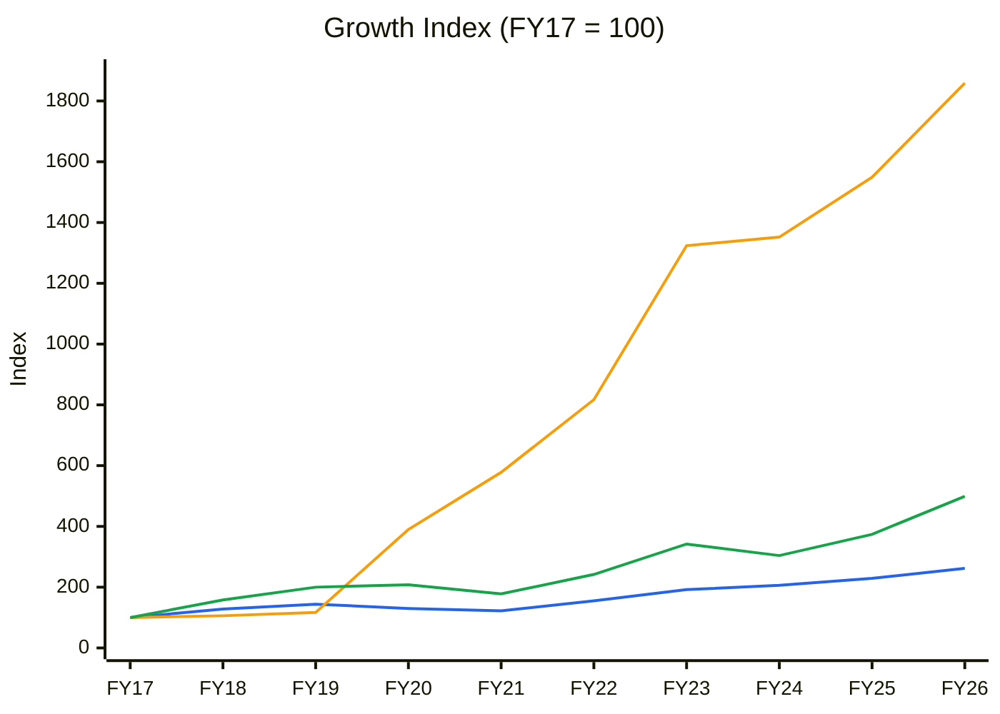
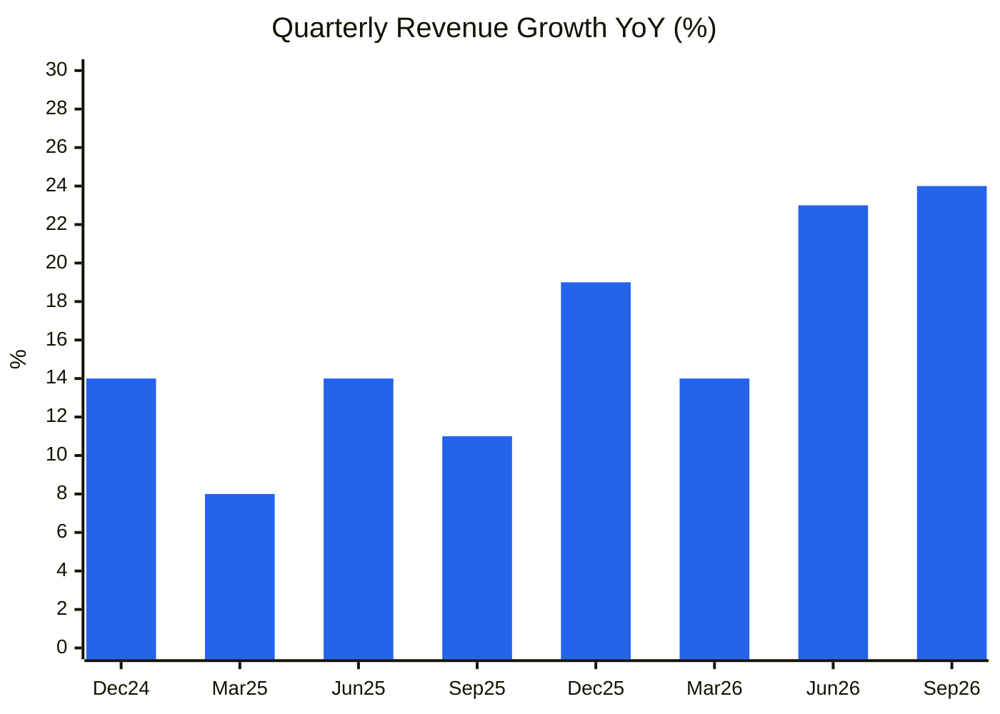
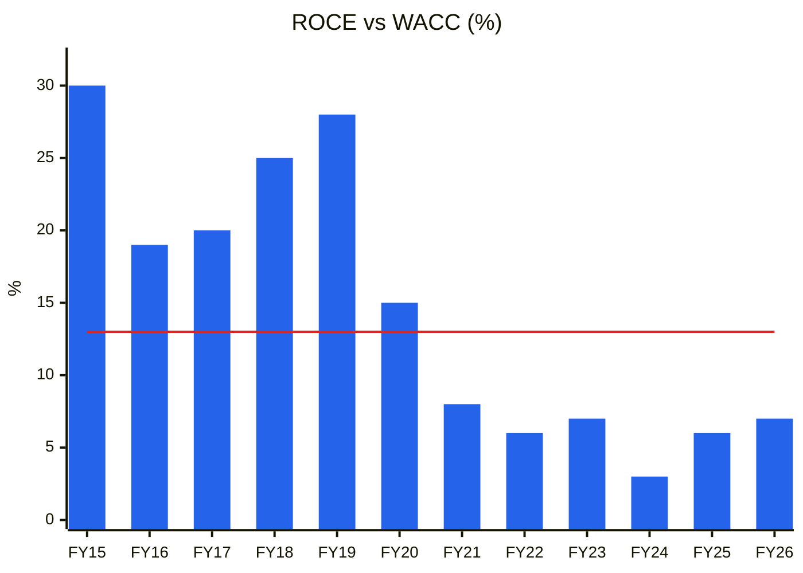
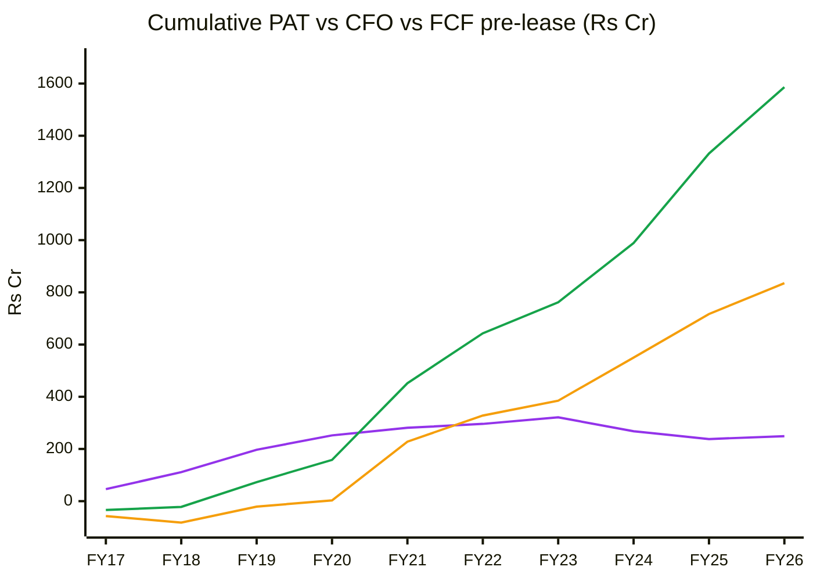
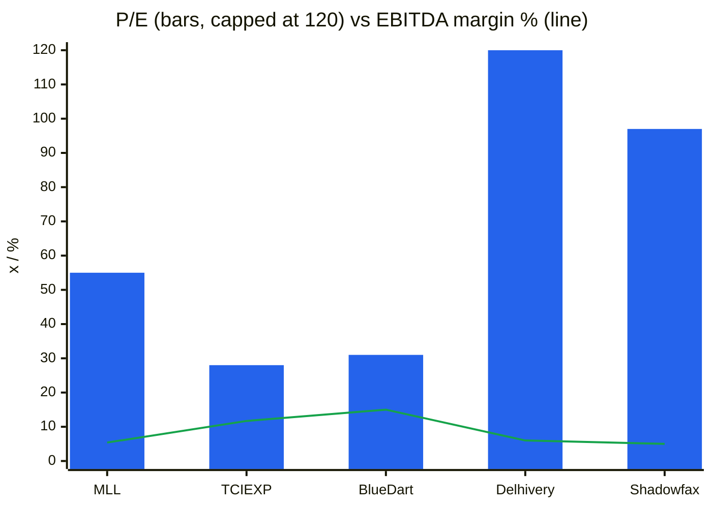
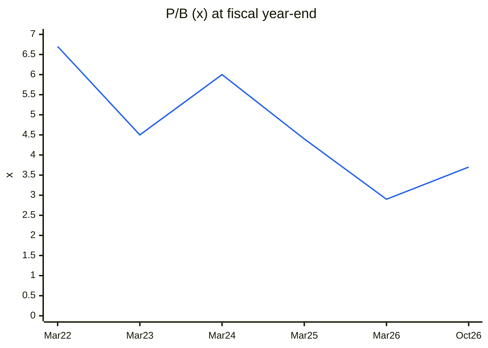
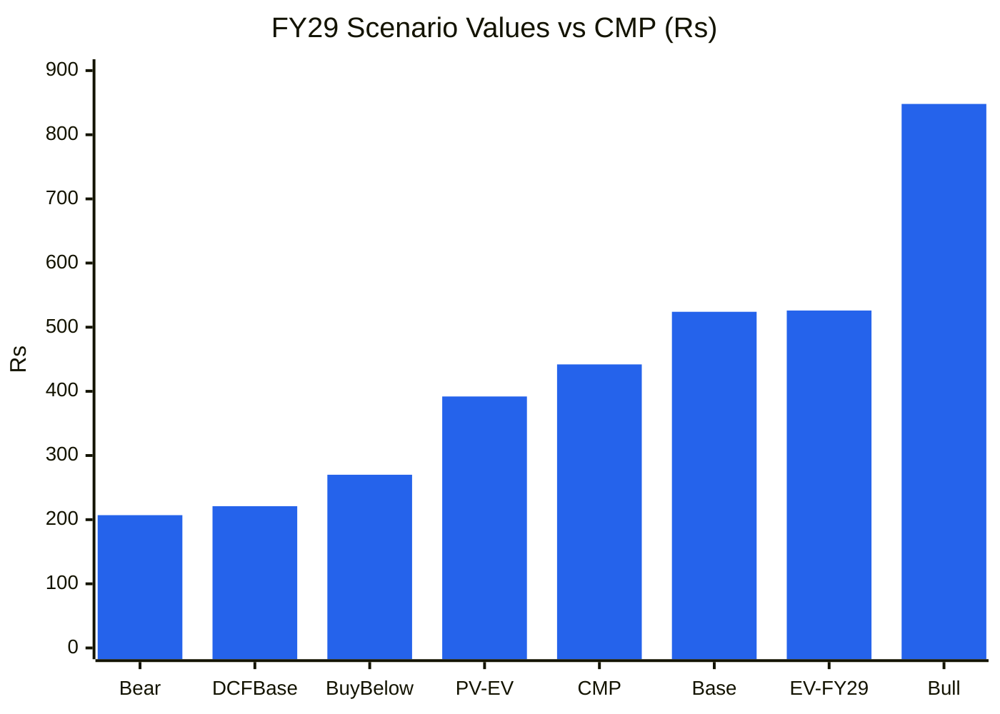

# Stock Analysis Report — Mahindra Logistics Ltd (NSE: MAHLOG · BSE: 540768)
**Date:** 2026-10-27
**Analyst:** Claude (Stock Fundamental Analysis Skill v3.3)
**Investment Horizon:** 2–3 Years
**Recommendation:** AVOID at current price → WATCHLIST (buy-below ~₹270); momentum is strong (Stage 2), so this is a valuation call, not a business-failure call
**Conviction Score:** 4.2 / 10
**CMP:** ₹442 (NSE, 27-Oct-2026, +12.7% on the day, Screener.in) · Market cap ₹4,387 Cr (9.93 Cr shares) · 52-wk range ₹275–451
**Filed under:** Logistics and Marine Services / Contract Logistics and 3PL · Themes: none of the existing cross-sector themes fits (logistics-only)

## Revision Log
| Version | Date | Recommendation | Conviction | Price | Key change |
|---|---|---|---|---|---|
| Current | 2026-10-27 | AVOID at CMP → Watchlist (buy-below ~₹270) | 4.2/10 | ₹442 | **Initial report.** A genuine turnaround: Q2 FY27 revenue +24%, PAT ₹26 Cr vs a loss, express (ex-Rivigo) EBITDA-positive for the first time, standalone debt-free after a ₹750 Cr rights issue. But lease-adjusted EBITDA is only ~2.9%, M&M is ~60% of contract logistics, ROCE has been 3–8% for six years, and at 52–58× TTM P/E the price already discounts years of margin expansion |

**Validation of previous report:** Initial report. No earlier report in the library (`--find MAHLOG`; name search "Mahindra Logistics" on 27-Oct-2026). New sub-sector folder `Logistics-and-Marine-Services/Contract-Logistics-and-3PL` created (existing logistics sub-sectors cover express/last-mile, freight forwarding and marine, not contract logistics).

---

## Executive Summary

Mahindra Logistics (MLL) is the Mahindra group's integrated logistics arm. It runs **contract logistics** (in-plant, warehousing and transportation management) for M&M's auto and farm businesses and ~40% non-Mahindra clients (consumer, e-commerce, quick commerce, telecom, pharma), plus **B2B express** (MESPL, the former Rivigo network, acquired 2022), **enterprise mobility** (employee transport), **last-mile delivery** and **freight forwarding**. Q2 FY27: revenue **₹2,095 Cr (+24%)**, EBITDA ₹124 Cr (5.9%; **2.9% lease-adjusted**), PAT **₹26 Cr** (vs −₹10 Cr). Contract logistics revenue ₹1,688 Cr (+28%), EBITDA ₹115 Cr. Express ₹169 Cr (+69%), **first EBITDA-positive quarter (₹2.3 Cr)**. H1 FY27 FCF ₹52 Cr (vs −₹210 Cr). Standalone debt-free; consolidated debt ₹55 Cr ex-leases; net cash ₹308 Cr (Q2 FY27 call).

**Why it is not a buy at ₹442:**
1. **Thin economics.** Lease-adjusted EBITDA margin is 2.9% (Q2 FY27, management). ROCE was **3–8% every year FY21–FY26** (Screener), well below a ~13% cost of capital. H1 FY27 ROCE of 12.9% is the best in six years.
2. **Anchor dependence.** M&M is **~60%** of contract-logistics revenue (FY26: 58%), and management "has no internal target to reduce it". Volumes and pricing track M&M's auto cycle and related-party negotiations.
3. **The price is ahead of the turnaround.** 52–58× TTM P/E, ~18× EV/lease-adjusted EBITDA. The reverse DCF needs **>25% revenue CAGR at 2.2% NOPAT margin**, or equivalently a doubling of lease-adjusted margins. The probability-weighted FY29 value is **₹526 (+19%)**, PV **₹392 (−11%)**. Upside/downside 1.7:1.
4. **Cash reality:** Ind AS 116 puts lease principal in financing cash flow, so CFO overstates cash generation. Ten-year cumulative PAT is only ₹249 Cr, and shareholders funded the Rivigo losses with a ₹750 Cr rights issue (FY26).

**What would make it a buy:** lease-adjusted EBITDA ≥4% for two quarters, express PAT-positive, non-M&M contract-logistics growth ≥20%, or a pullback to ₹260–280.

### C1 — Growth Index: Revenue vs Fixed Assets (incl. ROU) vs EBITDA (FY17 = 100, consolidated)
| ₹ Cr | FY17 | FY18 | FY19 | FY20 | FY21 | FY22 | FY23 | FY24 | FY25 | FY26 | TTM |
|---|---|---|---|---|---|---|---|---|---|---|---|
| Revenue | 2,667 | 3,416 | 3,851 | 3,471 | 3,264 | 4,141 | 5,128 | 5,506 | 6,105 | 6,999 | 7,788 |
| Fixed assets + CWIP (incl. ROU) | 63 | 67 | 74 | 246 | 364 | 515 | 834 | 852 | 976 | 1,171 | 1,247 (Sep) |
| EBITDA (Ind AS) | 76 | 120 | 152 | 158 | 135 | 184 | 260 | 231 | 284 | 379 | 454 |
| PAT | 46 | 65 | 86 | 55 | 29 | 15 | 25 | −53 | −30 | 11 | 85 |

*Source: Screener.in consolidated. PAT is not indexed (negative years). FY20 onward includes Ind AS 116 right-of-use assets.*

🟦 Revenue (9-yr CAGR 11%) · 🟧 Fixed assets incl. ROU (×19) · 🟩 EBITDA, Ind AS (×5)

**Read:** Revenue grew 2.6× in nine years; capitalised assets (mostly leased warehouses and the Rivigo network) grew 19×; PAT fell from ₹86 Cr (FY19) to ₹11 Cr (FY26) before recovering to ₹85 Cr TTM.

**Business inference:** MLL moved from an asset-light 3PL (ROCE 25–30% pre-FY20) to an asset-heavier, lease-heavy network without a matching rise in margins. Shareholder value was diluted for six years. The FY27 turnaround is real, but it starts from a low base of returns.

---

## Business Primer

MLL sells outsourced supply-chain services. In **contract logistics** (~80% of revenue) it runs inbound/outbound transportation, in-plant material handling and warehouses for manufacturers and consumer companies, chiefly M&M (cars, tractors), plus e-commerce, quick commerce, telecom and pharma clients. It charges per trip, per tonne, per pallet-position or per sq ft on multi-year contracts with fuel pass-through. Most trucks and warehouses are hired or leased ("asset-light"), so the margin is a thin spread between what it charges and what it pays sub-contracted fleet owners, labour and landlords. Smaller segments are **B2B express** (MESPL, the former Rivigo relay-trucking network: part-truck-load parcels, ₹169 Cr per quarter), **enterprise mobility** (employee commute, ₹119 Cr), **last-mile delivery** and **freight forwarding**. Returns depend on two things: M&M's production volumes, and keeping the gross spread (~10% gross margin) while absorbing manpower cost inflation that contracts often do not pass through.

This is an **asset-light-by-design but lease-heavy, low-margin B2B services business with an anchor parent**. The value drivers are volume (anchor plus new wins) and a small margin delta (each 50 bp of margin moves PAT by ~₹40 Cr). The key risks are anchor concentration, labour-cost inflation, and the express network's ability to earn returns. Two structural features colour everything. First, Ind AS 116 roughly doubles reported EBITDA versus economic (lease-adjusted) EBITDA. Second, the 2022 Rivigo acquisition turned a steady compounder into a turnaround story that needed a ₹750 Cr rights issue.

**New Segment Protocol:** contract logistics was not covered. The user approved a new block, **"Contract Logistics / Integrated 3PL"**, added on 27-Oct-2026 (references/05-industry-kpis-india.md, line ~2705). MESPL is assessed with the existing "Express Logistics / Surface B2B" block (line 1431).

---

## Module 1 — Broad Market Cycle
Nifty 50 ~22,750, Stage 4 (below a falling 30-week MA ~23,700); 1-yr −11% (Yahoo Finance). **CAUTIOUS.** MLL has decoupled (+28% over 52 weeks). Sizing: small.

## Module 1b — Sector Cycle
**Secular:** India 3PL ~12–15% a year: formalisation, GST/e-way bills, PLI manufacturing, quick commerce and e-commerce fulfilment, rail/DFC multimodal.
**Cyclical:** the auto upcycle (M&M SUV/tractor volumes at record highs in FY26–27) is ~60% of contract logistics. Auto volumes are cyclical; an M&M slowdown would hit MLL first.
**Input costs:** fuel passed through (complete); **manpower not fully passed through** (PF wage ceiling ₹15k → ₹25k, minimum wages). **Rising labour costs → compress margin assumptions.**
**Decomposition:** contract logistics +28% = ~12% secular + ~16pp cyclical (M&M volume boom + quick-commerce wins). **Durable baseline: 11–13%.**
**Verdict: TAILWIND (cyclical auto volumes), structural headwind on labour cost.** MoS +5pp.

## Module 1c — Stock Cycle

### C2 — Quarterly YoY revenue growth
| | Dec-24 | Mar-25 | Jun-25 | Sep-25 | Dec-25 | Mar-26 | Jun-26 | Sep-26 |
|---|---|---|---|---|---|---|---|---|
| Revenue (₹ Cr) | 1,594 | 1,570 | 1,625 | 1,685 | 1,898 | 1,791 | 2,003 | 2,095 |
| YoY | 14% | 8% | 14% | 11% | 19% | 14% | 23% | 24% |

🟦 YoY revenue growth (Screener quarterly)

**Read:** Growth accelerated from 8–14% to 23–24% over the last two quarters.

**Business inference:** Acceleration is a positive Module 1c signal, but it coincides with M&M's volume surge and express repricing. Separate what M&M gives from what MLL wins: management did not disclose non-M&M growth.

### Segment economics (Q2 FY27, management)
| Segment | Revenue (₹ Cr) | YoY | EBITDA (₹ Cr) | Margin |
|---|---|---|---|---|
| Contract logistics (SCM) | 1,688 | +28% | 115 | 6.8% (Ind AS) |
| Express (MESPL) | 169 | +69% | 2.3 | 1.4% |
| Mobility | 119 | +33% | 3.4 | 2.9% |
| Last mile | 68 | −23% | 1.6 | 2.4% |
| Freight forwarding | 51 | −44% | 1.7 | 3.4% |

**Losses in new businesses vs core profit:** express swung from −₹9 Cr to +₹2.3 Cr EBITDA (still PAT-negative after D&A and leases). New-business drag is now <5% of core EBITDA ✅, a big improvement from FY24–25.

### Operating leverage
Gross margin ~10.1%; lease-adjusted EBITDA 2.9%. A 100 bp gross-margin gain (management's medium-term aim) would lift lease-adjusted EBITDA to ~3.9% (+₹80 Cr on ₹8,000 Cr revenue), so **DOL ≈ 3.5×** on the lease-adjusted line. Leverage works both ways in an auto downturn.

### FCF
H1 FY27 FCF ₹52 Cr (after leases, per management). FY24–26 Screener FCF (pre-lease) was ₹165 Cr, ₹167 Cr and ₹118 Cr. Lease principal (~₹150–200 Cr a year, estimated) absorbs most of it. **Lease-adjusted FCF inflection: FY27 (first positive half-year).**

### CY7 — ROCE vs history
| | FY15 | FY16 | FY17 | FY18 | FY19 | FY20 | FY21 | FY22 | FY23 | FY24 | FY25 | FY26 |
|---|---|---|---|---|---|---|---|---|---|---|---|---|
| ROCE (Screener) | 30% | 19% | 20% | 25% | 28% | 15% | 8% | 6% | 7% | 3% | 6% | 7% |

🟦 ROCE · 🟥 WACC ~13%

**Read:** ROCE was 19–30% before FY20 and **3–8% from FY21–FY26**. H1 FY27 is 12.9% (management).

**Business inference:** Ind AS 116 (FY20) lowered measured ROCE, but most of the drop is economic: Rivigo losses and warehouse white space. Six years below WACC triggers the skill's "ROIC < WACC 5+ years" condition, but a **turnaround thesis now exists** (H1 FY27 ROCE ~13%, at WACC), so it is not applied as a hard stop.

**Cycle classification: Recovery / turnaround** (margins depressed by an identified, now-reversing cause). MoS: widest band. Size small initially.

---

## Module 2 — Industry Structure
| Force | Contract logistics (India) | Signal |
|---|---|---|
| New entrants | Medium. Asset-light, but scale, tech and client references matter | ⚠️ |
| Supplier power | Medium. Fleet owners and labour are fragmented, but wage regulation rises | ⚠️ |
| Buyer power | **High.** OEMs (M&M), e-commerce and quick-commerce majors tender aggressively | 🔴 |
| Substitutes | In-house logistics; captive 3PLs (Ekart, Amazon, Reliance) | ⚠️ |
| Rivalry | High: TVS SCS, DHL, Delhivery, Stellar, TCI, many regionals | 🔴 |

**Verdict: UNATTRACTIVE-to-NEUTRAL** (thin margins, strong buyers). **Capital cycle:** Grade-A warehousing and express networks are well funded (Delhivery after Ecom Express, Shadowfax IPO), so the capacity race in express continues.

## Module 3 — Business Quality & Moat
- **Greenwald:** **local/relationship scale with the anchor** (embedded in M&M plants for 15+ years) is the only barrier. No cost advantage (margins below peers like TCI). No customer captivity beyond multi-year contracts.
- **Buffett 10% test: Fail** (manpower inflation not passed through).
- **Moat: NARROW** (the anchor relationship).

| Fisher point | Score | | Fisher point | Score |
|---|---|---|---|---|
| 1 Market potential | 3 | | 9 Management depth | 2 |
| 2 New services | 2 | | 10 Controls | 2 |
| 3 R&D / tech | 2 | | 11 Industry advantage | 1 |
| 4 Sales | 2 | | 12 Long-range | 2 |
| 5 Margin | 1 | | 13 Dilution | 1 (rights ₹750 Cr) |
| 6 Margin actions | 2 | | 14 Candour | 3 (frank on margins, express) |
| 7 Labour relations | 2 | | 15 **Integrity** | **3** (Mahindra group governance) |
| 8 Executive relations | 2 | | **Total** | **30 / 45** |

## Module 4 — Management & Capital Allocation
**Promoter:** Mahindra & Mahindra **59.54%** (rose from 57.97% after subscribing above its share of the rights issue, a positive signal). **Pledge: nil** (group policy; verify). DIIs 13.8%, FIIs 5.3%.

| Check | Finding | Flag |
|---|---|---|
| RPT | ~60% of contract logistics is with M&M (promoter): pricing negotiated with a related party | ⚠️ Arm's-length review in the AR (data gap) |
| Acquisition | Rivigo B2B (2022, ~₹225 Cr): four years of losses, EBITDA-positive only in Q2 FY27 | ❌ Value-destroying so far |
| Equity raise | Rights issue ~₹750 Cr (FY26) to repay debt | ⚠️ Dilution to fund losses |
| Dividend | Paid through losses (payout >100% in FY26) | Neutral |
| Leadership | CEO Hemant Sikka (since 2024): turnaround delivered ahead of the market's expectations | ✅ |

**Capital allocation: Poor (FY21–FY25) → Improving (FY26–27).** **Three C's:** Candour High · Competence Moderate · Caring Moderate.

### Walk the Talk
| Period | Statement | Guided | Actual | Verdict |
|---|---|---|---|---|
| FY24–25 calls | Express EBITDA breakeven | Earlier target (FY25) | Achieved Q2 FY27 | ⚠️ Delivered, late |
| FY26 | Cut warehouse "white space" (1.6 mn sq ft) by 95% | 95% | Achieved (Q2 FY27 call) | ✅ |
| FY26 | Standalone debt-free | Yes | Sep-2025 | ✅ |
| FY26 | Freight forwarding growth | Growth | Q2 FY27 −44% YoY | ❌ |
| Q2 FY27 | Gross margin +100 bp (medium term) | — | Pending | — |
| Q2 FY27 | Last-mile YoY growth from Q3 FY27 | — | Pending | — |

**WTT Score: (2 + 0.5) ÷ 4 = 0.63 — MODERATE.** Pattern: targets hit eventually but late (express). Insider action: the promoter took up more than its rights entitlement → **BULLISH**. **DCF impact:** 10–15% haircut on the margin trajectory.

## Module 5 — Financial Forensics
| Check | Finding | Flag |
|---|---|---|
| Pledge / ICD | None | ✅ |
| Revenue quality | Debtor days fell 56 → 36 (FY20 → FY26) | ✅ |
| Other income | Small (₹20 Cr TTM); a ₹15 Cr one-time subsidiary dividend sits in *standalone* only | ✅ |
| Tax rate | Erratic in loss years (97%, 291%: deferred-tax and loss-making subsidiaries); ~28–30% now | ⚠️ |
| Ind AS 116 | Reported EBITDA ~2× lease-adjusted; borrowings on Screener (₹721 Cr) are mostly lease liabilities (company: ₹55 Cr debt ex-leases) | ⚠️ Use adjusted metrics |
| Goodwill | Rivigo goodwill/intangibles: impairment status not retrieved (data gap) | ⚠️ |

**Quant models (FY26):** Altman Z'' ~3.0 (Safe); Piotroski **6/9** (ROA+, CFO+, CFO>NI, leverage down, AT stable, margin up ✓; dilution ✗, current ratio ~flat, ΔROA small); Sloan CF accrual (11 − 254 + 316)/avg TA 2,842 = **2.6%** ✅. Beneish not run (lease accounting distortions).
**Red-flag count: 0 unresolved** (lease distortion is an analytical adjustment, not manipulation). **Verdict: Clean.**

## Module 5 (cont.) — Earnings Quality
- **Cumulative FY17–FY26:** PAT ₹249 Cr · CFO ₹1,586 Cr · FCF (pre-lease) ₹835 Cr. Lease principal (in financing) of roughly ₹1,000+ Cr over FY20–26 (estimate) means **lease-adjusted FCF ≈ PAT ≈ small**.

### C7 — Cumulative PAT vs CFO vs FCF (pre-lease)
| | FY17 | FY18 | FY19 | FY20 | FY21 | FY22 | FY23 | FY24 | FY25 | FY26 |
|---|---|---|---|---|---|---|---|---|---|---|
| Cum. PAT | 46 | 111 | 197 | 252 | 281 | 296 | 321 | 268 | 238 | 249 |
| Cum. CFO | −34 | −22 | 73 | 158 | 452 | 643 | 762 | 989 | 1,332 | 1,586 |
| Cum. FCF (pre-lease) | −57 | −82 | −21 | 3 | 228 | 328 | 385 | 550 | 717 | 835 |

🟪 Cumulative PAT · 🟩 Cumulative CFO · 🟧 Cumulative FCF (before lease payments)

**Read:** CFO and pre-lease FCF diverge sharply from PAT after FY20 (the Ind AS 116 effect).

**Business inference:** Do not treat ₹1,586 Cr of CFO as owner earnings. After paying rent (lease principal), the ten-year owner cash is close to the ₹249 Cr of PAT. The business has been roughly cash-neutral for shareholders, consistent with the ROCE record.

### DuPont (consolidated)
| Year | EBIT margin | Asset turnover | Equity multiplier | Interest burden | Tax burden | ROE |
|---|---|---|---|---|---|---|
| FY22 | 1.4% | 2.10 | 3.60 | 0.46 | 0.58 | 2.8% |
| FY23 | 1.7% | 2.01 | 4.53 | 0.40 | 0.71 | 4.4% |
| FY24 | 0.8% | 2.22 | 5.00 | neg. | neg. | −10.8% |
| FY25 | 1.2% | 2.37 | 5.87 | neg. | neg. | −6.9% |
| FY26 | 1.5% | 2.25 | 2.66 | 0.31 | 0.33 | 0.9% |

*EBIT = PBT + interest. Equity multiplier fell sharply in FY26 after the rights issue.*
**Verdict:** ROE collapse came from **margin** (EBIT ~1–1.5%) and lease interest. Leverage was high (multiplier 4.5–5.9×) until the rights issue. The FY27 recovery (H1 ROE 8.7%) is margin-led ✅.

## Module 6 — Industry KPIs & Peers
| KPI (new block) | MLL | Healthy | Assessment |
|---|---|---|---|
| Non-anchor revenue growth / share | ~40% non-M&M; growth not disclosed | >20%, anchor <50% | ⚠️ Anchor ~60% |
| Lease-adjusted EBITDA margin | 2.9% (Q2 FY27) | 3.5–6% | 🔴 Below |
| Warehousing utilisation | White space cut by 95% | >85–90% | ✅ |
| New-business losses vs core | Express +₹2.3 Cr EBITDA | Losses <20% of core | ✅ |
| Receivable days | 36 | <50 | ✅ |
| ROCE (incl. leases) | 7% FY26; 12.9% H1 FY27 | >15% | 🔴 Below |
| Lease-adjusted FCF ÷ PAT | ~1× (H1 FY27: ₹52 Cr FCF vs ₹54 Cr PAT) | >0.7 | ✅ (first time) |

**Express block KPIs (MESPL):** volume/realisation not disclosed (data gap); revenue +69% after repricing ("repricing is more or less over"); EBITDA 1.4% vs mature B2B peers 10–14% (TCI Express ~11.7%).

### Peer comparison (library data; Oct-2026 where marked)
| Metric | MLL | TCI Express | Blue Dart | Delhivery | Shadowfax |
|---|---|---|---|---|---|
| Revenue FY26 (₹ Cr) | 6,999 | ~1,237 | 6,141 | 10,508 | 4,202 |
| EBITDA margin (reported) | 5.4% | ~11.7% | ~15% | ~6% | ~5% |
| P/E (TTM) | **52–58×** | ~28× | ~31× | ~236× | ~97× |
| Model | Contract logistics + express | Pure B2B express | Premium air/B2B | Scale e-com + B2B | B2C last-mile |

*Sources: KPI reference peer tables (Jun–Oct 2026) and Screener.*

🟦 P/E TTM (Delhivery 236× shown capped at 120) · 🟩 EBITDA margin %

**Read:** MLL trades at ~2× the P/E of the profitable B2B franchises (TCI Express, Blue Dart) with less than half their margins.

**Business inference:** The market prices MLL as a turnaround with margin upside (closer to the Delhivery/Shadowfax "growth" bucket), not as a 3–5% margin contract-logistics company. That leaves no margin for error.

## Module 7 — Market Size & Share
India logistics ~₹20+ lakh Cr; organised 3PL/contract logistics ~₹1–1.5 lakh Cr (estimate; data gap), growing ~12–15%. MLL ~₹6,000 Cr contract logistics ≈ **4–6% share**. Share stable-to-gaining (contract logistics +28% vs market ~13%), helped by M&M volumes. **Verdict: growing faster than the market, largely through the anchor.**

## Module 8 — Valuation
### 8A. PIE
EV (ex-leases) ≈ ₹4,387 Cr − ₹308 Cr net cash = **₹4,079 Cr**; EV incl. lease liabilities (~₹665 Cr) ≈ ₹4,745 Cr. EV/Ind AS EBITDA ~10.5×; EV/lease-adjusted EBITDA (~₹226 Cr) **~18×**.
Reverse DCF (revenue ₹7,788 Cr, NOPAT margin 2.2% lease-adjusted, S/C 6.0, terminal g 6%, ROIC 15%):
| Driver | Market-implied | My base | Gap |
|---|---|---|---|
| Revenue CAGR (10 yr) at a 2.2% NOPAT margin | **27% (WACC 12%) – 34% (13%)** | ~10% | **very optimistic** |
| Equivalent: NOPAT margin at ~12% growth | ~4.5–5% (lease-adjusted EBITDA ~6–7%) | 2.4–3% | **+2pp margin needed** |
**Plausibility:** a lease-adjusted margin double today's, sustained, would put MLL at TCI-like economics, which contract logistics with a strong anchor customer has never delivered in India. **The market is pricing a structural margin change, not just the turnaround.**
**SVAR:** bear ₹207 → **53%** → unfavourable.

### 8B. DCF / relative / Graham
- DCF base (10% growth, 2.4% NOPAT margin, WACC 13%): **~₹221**.
- Relative: 25× FY29E EPS ₹21 = ₹524 (undiscounted); 20–22× FY28E EPS ~₹15 = ₹300–330.
- **Graham Number:** √(22.5 × 8.56 × 121) = **₹153**.

### CY1 — P/E history is not meaningful (losses FY24–FY25); P/B used instead
| | Mar-22 | Mar-23 | Mar-24 | Mar-25 | Mar-26 | Oct-26 |
|---|---|---|---|---|---|---|
| Price (₹, Yahoo, rights-adjusted) | 506 | 354 | 409 | 271 | 348 | 442 |
| Book value/share (₹) | 76 | 78 | 68 | 61 | 118 | 121 |
| P/B (×) | 6.7 | 4.5 | 6.0 | 4.4 | 2.9 | 3.7 |

*BVPS = (equity capital + reserves) ÷ shares outstanding at each date (7.2 Cr pre-rights; 9.93 Cr after). Pre-rights prices are adjusted by Yahoo, so P/B before FY26 is approximate.*

🟦 P/B

**Read:** P/B fell from 6–7× to ~3× as ROE collapsed and the rights issue enlarged the book, and is now re-rating (3.7×).

**Business inference:** At ROE ~9% (H1 FY27 annualised) a 3.7× P/B implies investors expect ROE in the high teens. Justified P/B at 13% ROE, 13% Ke and 8% g is ~1×; at 18% ROE it is ~2×. **The re-rating is running ahead of returns.**

### 8D. Scenarios (FY29E; 9.93 Cr shares)
| Scenario | Revenue FY29 | EBITDA (Ind AS) | EPS FY29 | P/E | Target | Probability |
|---|---|---|---|---|---|---|
| Bull | ₹11,000 Cr (M&M + quick commerce + express scaling) | 7.2% | ₹30.3 | 28× | **₹848** | 25% |
| Base | ₹10,000 Cr (~12.6% CAGR from FY26) | 6.5% | ₹21.0 | 25× | **₹524** | 50% |
| Bear | ₹8,800 Cr (auto slowdown; labour costs) | 5.6% | ₹9.4 | 22× | **₹207** | 25% |
| **Expected value** | | | | | **₹526 (+19%)** | |

*D&A ₹320–350 Cr; lease and other interest ₹60–65 Cr; OI ₹20–30 Cr; tax 27%.*
- **PV** (2.4 yrs @ 13%) = **₹392** (−11%). Base PV ₹391.
- **Upside/downside:** (848 − 442) ÷ (442 − 207) = **1.7:1** (<2:1).
- **Required MoS:** mid/small-cap turnaround (widest band) → 30% + 5pp → **buy-below ≈ ₹392 × 0.68 ≈ ₹267 → ~₹270** (≈1.8× P/B FY27E).

🟦 ₹ per share (C13)

**Read:** CMP sits above the discounted expected value and well above the fundamental DCF (₹221).

**Business inference:** At ₹442 the investor needs the bull case of a structurally better-margin MLL to earn more than the cost of equity. The turnaround is priced in.

### Cycle Position Dashboard
| Dimension | Current | History | Signal |
|---|---|---|---|
| P/B | 3.7× | 2.9–6.7× | Mid (but ROE low) |
| Lease-adjusted EBITDA margin | 2.9% | ~1.8–2.5% (FY24–26 est.) | Recovering, still thin |
| ROCE | 12.9% (H1) | 3–8% (6 yrs); 19–30% (pre-FY20) | Recovering |
| Anchor volumes (M&M) | Record | Cyclical | **Late auto cycle** |
| **Overall** | | | **Turnaround priced; anchor cycle late** |

## Module 9 — Technical Stage
**Nifty: Stage 4.** **Stock: Stage 2.**
| Check | MLL |
|---|---|
| Weekly close above resistance | New 52-week high ₹450 (intraday 27-Oct); prior resistance ₹420 (Sep-2026) |
| Volume | 8.6 M (week of 26-Oct, results) vs 20-wk avg ~1.3 M (**~6.6×**) |
| 30-week MA | ₹391, rising (₹357 → ₹384 → ₹391); price 12% above |
| RS vs Nifty | 52-wk +28% vs −11% (+39pp) |
| Base | ₹370–420 (Jun–Oct 2026), ~18 weeks |
| Entry vs pivot | Pivot ~₹420 → CMP +5% ✓ |
**Stop:** weekly close below **₹395** (back into the base).
**CANSLIM:** C 1 (PAT ₹26 Cr vs loss) · A 0 (losses FY24–25) · N 1 (new high; express turnaround) · S 0 · L 1 (RS leader in logistics) · I 0 (DIIs falling 18% → 14%) · M 0 → **3/7**.
**Verdict:** Stage 2 breakout + CANSLIM 3/7 → momentum without the fundamental confirmation the skill requires. **Misaligned.**

## Module 10 — Forward View
**Model track:** asset-light services (capacity driver = warehousing sq ft + network hubs). Capex FY27 ~₹100–110 Cr (contract logistics, 2x2 car-carrier JV with M&M, tech transformation). ROU additions sit outside capex.
| ₹ Cr | FY27E | FY28E | FY29E |
|---|---|---|---|
| Revenue | 8,150 | 9,050 | 10,000 |
| EBITDA (Ind AS) | 495 (6.1%) | 570 (6.3%) | 650 (6.5%) |
| Lease-adjusted EBITDA (~3.2–3.7%) | 260 | 315 | 370 |
| PAT | 115 | 160 | 208 |
| EPS (₹) | 11.6 | 16.1 | 21.0 |
| P/E at CMP | 38× | 27× | 21× |
**Catalysts:** express PAT-positive (FY28?); a large non-M&M contract (quick commerce/e-commerce); gross-margin +100 bp; car-carrier JV ramp.
**Risks:** M&M volume slowdown (**Medium**); labour-cost inflation (**High**); express re-investment losses (**Medium**); freight-forwarding weakness (**Medium**); multiple compression from 50×+ (**High**).

## Checklist Summary
Section 0 5/5 · A 16/18 · B 8/9 · C 11/12 (lease-adjusted figures partly estimated) · D 7/7 · E 5/7 · F 10/10 · G 8/8 · H asset-light track run · I 5/5. Order Book Tracker: n/a (contract revenue, no disclosed order book).
**Hard Stops:** none (ROIC < WACC for 6 years, but a turnaround thesis is evidenced; up/down 1.7:1 > 1.5).

## Investment Decision
**Recommendation:** **AVOID at ₹442 → WATCHLIST**
**Conviction:** 4.2 / 10 (Cycle 0.5 · Industry 0.4 · Moat 0.6 · Management 0.6 · Financial quality 0.8 · Valuation 0.5 · Technical 0.8)
**Position size:** 0% for value investors. A momentum trader could hold ≤1% with a stop at a weekly close below ₹395.
**Entry range:** **₹260–290**, or above ₹450 after two quarters of lease-adjusted EBITDA ≥3.5%.
**Target (base FY29):** ₹524; PV ₹392; DCF ₹221.
**Review triggers:** Q3 FY27 (Jan-2027): lease-adjusted margin, express EBITDA, non-M&M wins; M&M monthly volumes; labour-code costs.

### Sources
- Screener.in [MAHLOG consolidated](https://www.screener.in/company/MAHLOG/consolidated/) (27-Oct-2026).
- Q2 FY27: [Investing.com call transcript](https://in.investing.com/news/stock-market-news/earnings-call-transcript-mahindra-logistics-posts-stronger-q2-fy27-profit-93CH-5651458) · [Investing.com slides](https://in.investing.com/news/stock-market-news/mahindra-logistics-q2-fy27-slides-profit-surges-express-unit-positive-93CH-5651494) · [Maritime Gateway](https://www.maritimegateway.com/mahindra-logistics-q2-fy27-results-show-profit-recovery-as-express-business-improves/) · [ITLN](https://www.itln.in/financial/mahindra-logistics-q2-fy27-revenue-surges-24-to-2095-crores-1361045) · [Equitybulls](https://www.equitybulls.com/news/377569/mahindra-logistics-ltd-q2-fy27-revenue-up-by-24-yoy-at-rs-2-095-cr-pat-at-rs-26) · [Multibagg](https://www.multibagg.ai/market-pulse/articles/mll-q2fy27-50ae544f-03f5-4c8d-9716-76c559108d15).
- Peers: library reports and KPI-reference peer tables (TCI Express Jun-2026; Shadowfax Oct-2026).
- Prices: Yahoo Finance weekly API (MAHLOG.NS, ^NSEI), 27-Oct-2026.

---
*Report generated by Stock Fundamental Analysis Skill v3.3 | Indian Markets Context*
*Save path: C:\Users\anubh\Documents\Anubhav\Stock Analysis\Stock Analysis\Logistics-and-Marine-Services\Contract-Logistics-and-3PL\*
