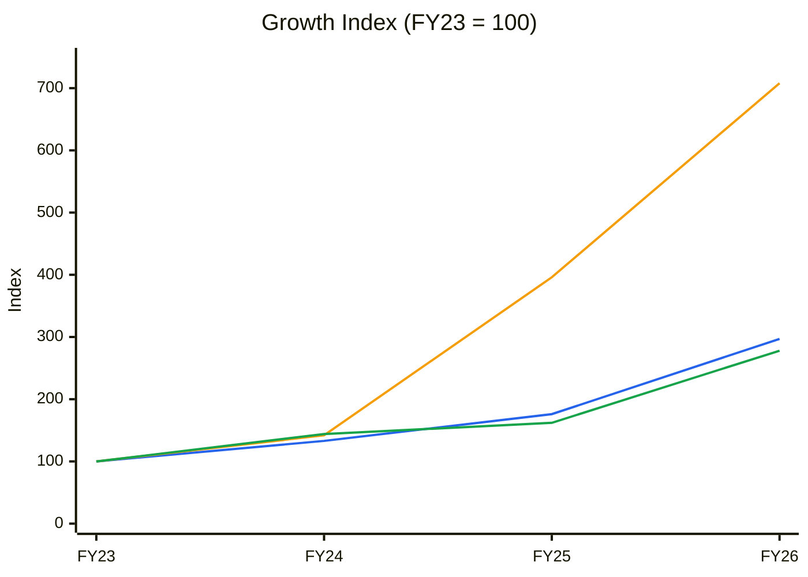
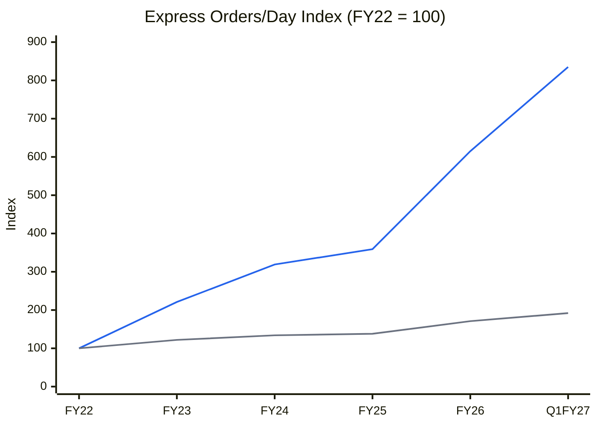
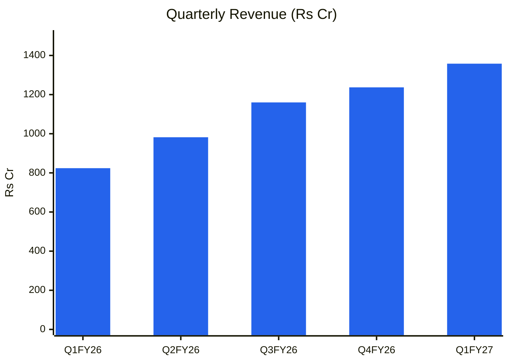
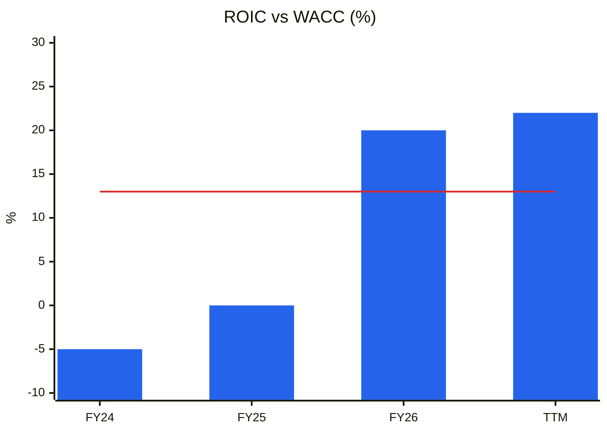
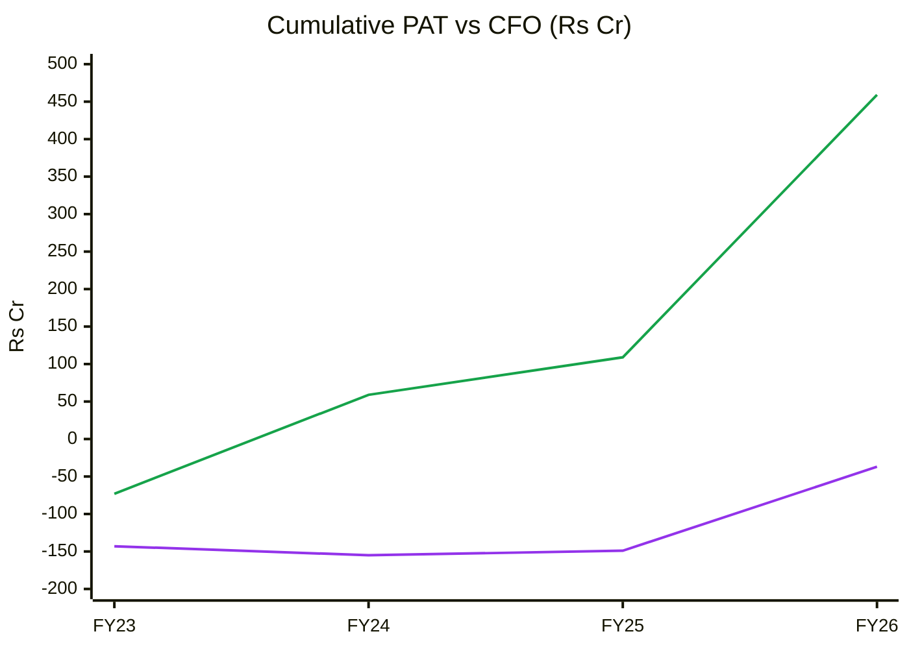
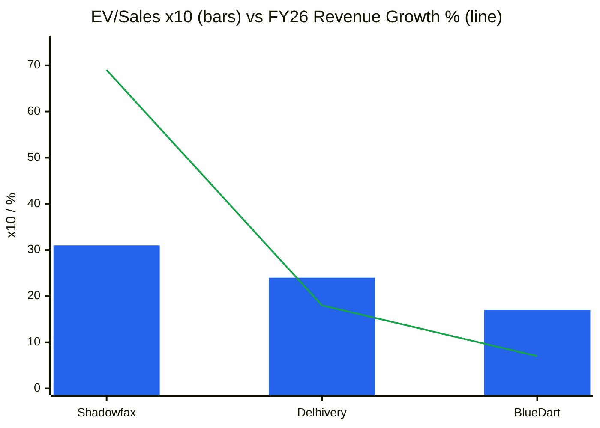
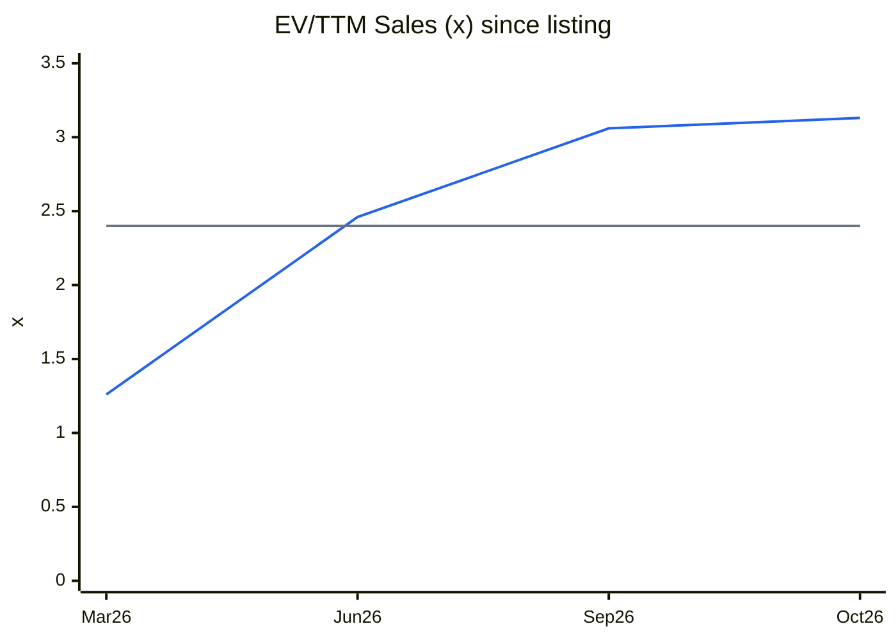
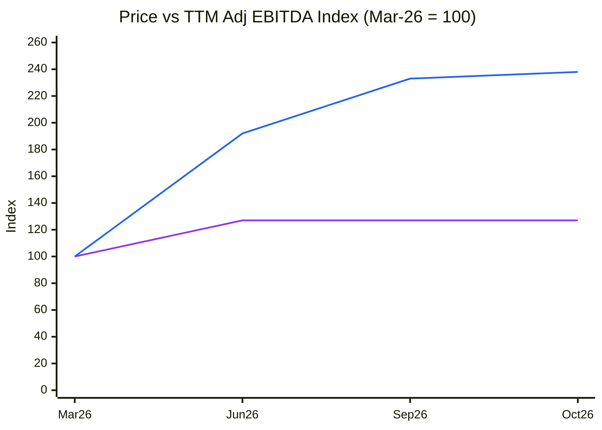
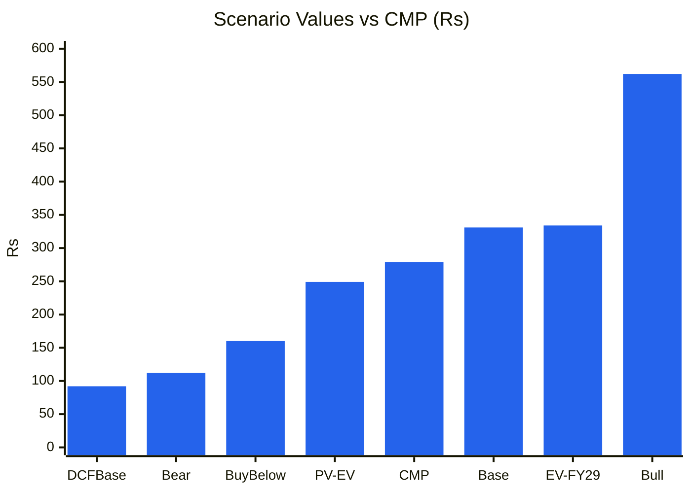

# Stock Analysis Report — Shadowfax Technologies Ltd (NSE: SHADOWFAX · BSE: 544685)
**Date:** 2026-10-26
**Analyst:** Claude (Stock Fundamental Analysis Skill v3.3)
**Investment Horizon:** 2–3 Years
**Recommendation:** WATCHLIST: Quality at Wrong Price, with client-concentration risk (buy-below ~₹160)
**Conviction Score:** 4.9 / 10
**CMP:** ₹279 (NSE, 26-Oct-2026 10:48, Screener.in) · Market cap ₹16,379 Cr (~58.7 Cr shares) · Cash & bank ₹1,537 Cr, borrowings nil, lease liabilities ₹270 Cr (Jun-2026) · 52-wk range ₹98.6–302 · IPO ₹124 (Jan-2026), listed ₹112.6

> ⚠️ **Q2 FY27 results are due 29-Oct-2026, three days after this report** (Screener "upcoming result date"). Q2 holds the start of the festive season (Diwali 8-Nov-2026 falls in Q3). Re-run this report after the results: the WTT ledger, TTM numbers, order KPIs and scenarios all update.

## Revision Log
| Version | Date | Recommendation | Conviction | Price | Key change |
|---|---|---|---|---|---|
| Current | 2026-10-26 | Watchlist: Quality at Wrong Price (buy-below ~₹160) | 4.9/10 | ₹279 | **Initial report.** Exceptional execution (5 quarters of 60%+ growth, 3PL express share ~8% → 28–30%, adj. EBITDA 2.9% → 4.9%, net cash ₹1,537 Cr). But at 73× EV/TTM adj. EBITDA the price implies ~34% revenue CAGR for 10 years. ~49% of revenue came from one client (Meesho, H1 FY26), which runs its own captive network (Valmo). The stock has re-rated 2.4× since March while TTM adj. EBITDA rose only 27% |

**Validation of previous report:** Initial report. No earlier report exists in the library (searched `SHADOW*`, "Shadowfax", logistics names on 26-Oct-2026). **New Segment Protocol:** the user approved a new KPI block, "B2C E-commerce Last-Mile & Hyperlocal / Quick-Commerce Logistics (Asset-Light, Gig Network)", now appended to references/05-industry-kpis-india.md.

---

## Executive Summary

Shadowfax (Bengaluru, founded 2015; co-founders Abhishek Bansal, CEO, and Vaibhav Khandelwal) is India's fastest-growing third-party logistics (3PL) company. It delivers **express e-commerce parcels** (forward, reverse pickup, exchange, same-day "Prime", heavy "Prime Large") and **hyperlocal / quick-commerce / food deliveries** for platforms such as Meesho, Flipkart, Zepto, Zomato, Swiggy and Amazon Now. It does this through ~2.9 lakh gig delivery partners and 53 lakh sq ft of leased operating space. Revenue rose from ₹1,415 Cr (FY23) to **₹4,202 Cr (FY26, +69%)** and **₹1,358 Cr in Q1 FY27 (+65%)**. Adjusted EBITDA margin (pre-Ind AS 116, ex-ESOP) went from 2.9% to **4.9%**, and Q1 PAT was a record ₹65 Cr. The company's estimate of its 3PL express share is **28–30% (Q1 FY27), up from ~8% in FY22.** After the ₹1,000 Cr fresh issue in Jan-2026 it has **₹1,537 Cr cash and no debt.** FY27 revenue-growth guidance was raised from 27–30% to **38–40%** after Q1.

**Why it is a watchlist, not a buy, at ₹279:**
1. **The price runs well ahead of earnings.** EV ₹14,842 Cr = **73× TTM adjusted EBITDA (₹202 Cr)**, 3.1× EV/Sales, and ~130× *normalised* EPS. Reported PAT is helped by treasury income (₹21 Cr in Q1, ~30% of PBT) and a ~0% tax rate from carried-forward losses. The reverse DCF needs **~34% revenue CAGR for 10 years** (FY36 revenue ~₹90,000 Cr) at a 5% steady-state NOPAT margin.
2. **Concentration and insourcing are existential risks.** The largest client (Meesho) was **~49% of revenue in H1 FY26**, and Flipkart + Meesho + Zepto + Zomato were ~74% (RHP). Meesho allocates lanes between its captive **Valmo** network and 3PLs on cost ("no fixed insourcing target", Meesho Q4 FY26 call). Ecom Express was forced into a sale to Delhivery after Meesho moved volume to Valmo.
3. **Returns so far come from re-rating.** Since 31-Mar-2026 the price rose **2.4×** while TTM adj. EBITDA rose 1.27×. Contribution per order is flat (~₹7.6–7.8). The margin gain came from overhead leverage and lower loss/QC cost (7.9% → 5.5% of revenue), not from pricing.

**What's working:** best-in-class execution, net cash, negative working capital, rising rider productivity (+20% orders per rider YoY), market-share gains that are verifiable against the market index, Stage 2 uptrend with institutions accumulating (FIIs 7.7% → 16.3%, DIIs 20.6% → 28.8% over two quarters after the lock-in supply). Probability-weighted FY29 value is **₹334 (+20%)**, which discounts to **₹249 (−11%)**. Upside/downside is **1.69:1**.

### C1 — Growth Index: Revenue vs Fixed Assets (PPE + ROU + intangibles) vs Orders (FY23 = 100)

| ₹ Cr (consolidated) | FY23 | FY24 | FY25 | FY26 | TTM Jun-26 |
|---|---|---|---|---|---|
| Revenue | 1,415 | 1,885 | 2,485 | 4,202 | 4,737 |
| Fixed assets (incl. ROU, intangibles) | 83 | 118 | 329 | 588 | 654 (Jun) |
| Ind AS EBITDA | −107 | 19 | 63 | 221 | 278 |
| Adjusted EBITDA | n.a. | n.a. | n.a. | 159 | 202 |
| PAT | −143 | −12 | 6 | 112 | 169 |
| Express orders/day index (FY22 = 100) | 221 | 319 | 359 | 615 | 835 (Q1) |

*Source: Screener.in consolidated; Q1 FY27 earnings presentation (NSE, 31-Jul-2026) pp.5, 13, 25. Fixed assets Jun-26 = PPE 292 + ROU 261 + intangibles 101. EBITDA/PAT are not indexed because the FY23–24 base is negative or near zero.*

🟦 Revenue (3-yr CAGR 44%) · 🟧 Fixed assets incl. ROU (×7.1) · 🟩 Express orders/day

**Read:** Revenue (🟦) and express volume (🟩) roughly tripled from FY23 to FY26, while the asset base (🟧) grew ~7×, mostly ROU leases and sort-centre automation.

**Business inference:** This is an asset-light business by revenue (fixed assets are only ~12% of revenue), but it is becoming more capital-intensive as it automates sortation and leases mid-mile space ahead of demand. The capex is still cheap relative to the revenue it supports. The real investment is ~₹950 Cr of IPO cash sitting in treasury, which depresses reported ROE.

---

## Business Primer

Shadowfax sells delivery capacity to digital-commerce platforms. **Express (₹997 Cr, 73% of Q1 FY27 revenue):** forward e-commerce parcels, reverse pickups and "hand-in-hand" exchanges (it is the largest 3PL for reverse pickups), same-day intracity / next-day intercity "Prime" for D2C brands and SMEs (via the self-serve Shadowfax 360 platform), and "Prime Large" for furniture and appliances. **Hyperlocal (₹272 Cr, 20%):** last-mile riders for quick-commerce (Zepto, Amazon Now, Flipkart Minutes, vertical QC brands), food delivery and on-demand mobility. **Other logistics (₹89 Cr, 7%):** critical logistics (CriticaLog), insourced unbundled services and dark-store operations (47 stores). Revenue is earned **per order** (₹55 average in Q1 FY27; ~₹50 express, ~₹56 hyperlocal) from a small number of enterprise clients, across 16,372 pin codes, 5,095 touchpoints, 3,500+ trucks a day and ~2.9 lakh average quarterly unique delivery partners. Returns depend on two things: **volume allocation from a handful of platforms** (Meesho ~49% of revenue in H1 FY26) and **network density**, meaning more orders per rider, per sq ft and per truck so that cost per order falls faster than the price per order the platforms push down.

This is an **asset-light, B2B2C logistics platform with gig labour**. It sits between a "platform" business and a "contract logistics" business: it has scale economics in density, but no customer captivity, because its customers are larger, more powerful platforms that can and do insource. The key value driver is **volume (market-share gains) × thin per-order margin (adj. EBITDA ₹2.7/order)**. The key risks are **client concentration and insourcing**, platform pricing pressure, and gig-labour regulation and wage costs (partner cost is 52% of revenue). Three structural features colour the analysis. First, the **IPO cash pile** (₹1,537 Cr; treasury income is ~30% of PBT) and **~0% tax** (carried-forward losses) flatter reported PAT. Second, **Ind AS 116** lifts reported EBITDA by ~2pp, so adjusted EBITDA is the right lens. Third, the shareholder base is **founder-led with low promoter holding (16.5%)** and an overhang from VC exits that is now largely absorbed.

**New Segment Protocol:** Segment **not previously covered**. The nearest block, "Express Logistics / Surface B2B" (line 1431), excludes B2C e-commerce and uses ₹/kg. Seven KPIs were proposed, and **the user approved adding a new block** (references/05-industry-kpis-india.md, "B2C E-commerce Last-Mile & Hyperlocal / Quick-Commerce Logistics"). Top KPIs: volume growth vs market, revenue and adj. EBITDA per shipment, client concentration and insourcing. Not order-book driven, so the Order Book Tracker does not apply. Forward model: **Unit Economics Build (Module 10A-ii).**

---

## Module 1 — Broad Market Cycle (Marks)

Nifty 50 is at **22,612** (26-Oct-2026), below a falling 30-week MA (23,729). The 52-week range is 22,180–26,373; the 26-week return is −5.8% (Yahoo Finance weekly). India VIX was ~14.4 and index P/E ~19.3× in early October (via the 14-Oct-2026 TARIL report: [JM Financial](https://www.jmfinancialservices.in/market-news-and-insights/1735991); [Stockpil](https://stockpil.com/india-markets-today-2026-10-05/)). Shadowfax's own IPO in Jan-2026 was subscribed only ~3× and listed 9% *below* issue ([TechCrunch](https://techcrunch.com/2026/01/27/indias-shadowfax-slips-on-listing-as-client-concentration-spooks-investors)), so new-age listings were not in a frothy phase then. Since then the stock is +125% from issue, against the market. **Assessment: CAUTIOUS (leaning fearful) for the broad market; the stock is a momentum outlier.** Sizing: normal-to-small.

---

## Module 1b — Sector Cycle: Tailwinds & Headwinds

**Secular (durable):** e-commerce shipment growth of ~18–20% a year. The 3PL express market index rose from 100 (FY22) to 192 (Q1 FY27), a ~15% CAGR in orders per day (company presentation p.5, Redseer to FY25). Value e-commerce (Meesho, Shopsy), D2C (shipments growing 2–3× mainstream e-com, company estimate), quick commerce including vertical QC, and tier-2/3 reach (pin-code coverage) are all structural. Consolidation helps the survivors: Ecom Express exited into Delhivery in 2025, and 3PL share is concentrating among Delhivery, Shadowfax, Xpressbees and Ekart.

**Cyclical / temporary:** the FY26–Q1 FY27 surge (+65–74% YoY) includes (a) share captured from Ecom Express's distress, which is a one-time transfer, (b) the quick-commerce land grab (Amazon Now, Flipkart Minutes launching and choosing 3PLs for volume), and (c) value-commerce volume at Meesho. Management itself guides growth decelerating to **38–40% for FY27** (implying ~31–34% for Q2–Q4).

**Decomposition:** Shadowfax express orders grew ~65% a year (FY25 → Q1 FY27 index 359 → 835) against the market's ~22% (138 → 192). Our split: **~18–20% secular** (market growth), **~25–35pp share gains** (partly one-time: Ecom Express exit; partly structural: reverse pickup, Prime, pin-code reach), plus hyperlocal client wins. **Durable DCF baseline after FY29: 15–18%, fading to 8–10%.**

**Input-cost cycle:** rising. Diesel (Hormuz disruption 2026), minimum-wage revisions and the gig-worker social-security code levy (1–2% of partner payouts) are absorbed in the Q1 margin, management says ("absorbing fuel and wage inflation"). Transport cost rose 17.7% → 18.8% of revenue YoY. **Assume flat-to-modestly rising margins, not the Q1 slope.**

**FX / geopolitics:** fully domestic; fuel is the only commodity exposure.

**Sector cycle verdict: TAILWIND (structural, multi-year), with platform-insourcing risk.** No sector-capacity cycle in the manufacturing sense. The "capacity" risk is platforms building captive networks.

### C3 — Market share: Shadowfax express orders/day vs 3PL express market (FY22 = 100)

| | FY22 | FY23 | FY24 | FY25 | FY26 | Q1 FY27 |
|---|---|---|---|---|---|---|
| Shadowfax express orders/day | 100 | 221 | 319 | 359 | 615 | 835 |
| 3PL express market | 100 | 122 | 134 | 138 | 171 | 192 |
| Implied share | ~8% | — | — | ~21% (FY25, Redseer) / 23% (H1 FY26) | — | 28–30% (company est.) |

*Source: Q1 FY27 presentation p.5 (Redseer to FY25; company estimates for FY26 and Q1 FY27); the 23% H1 FY26 figure is from the RHP via [INDmoney](https://www.indmoney.com/blog/ipo/shadowfax-ipo-review).*

🟦 Shadowfax express orders/day · ⬜ 3PL express market

**Read:** Shadowfax grew volume ~8× while the 3PL market grew ~2×. FY26 was the steepest year (+71% vs market +24%).

**Business inference:** This is a genuine share-gain story, the core of the bull case. The FY26 jump coincides with Ecom Express's exit, and the market index counts **only 3PL** volume. If platforms insource more (Valmo, Ekart), the 3PL pool itself can shrink even while Shadowfax's share of it rises. **The ~28–30% share is a company estimate, not third-party verified, for FY26 onward.**

---

## Module 1c — Stock Cycle: Company Positioning

### C2 — Quarterly revenue and orders

| | Q1 FY26 | Q2 FY26 | Q3 FY26 | Q4 FY26 | Q1 FY27 |
|---|---|---|---|---|---|
| Revenue (₹ Cr) | 824 | 982 | 1,160 | 1,237 | 1,358 |
| QoQ growth | — | 19.2% | 18.1% | 6.6% | 9.8% |
| YoY growth | 60%+ | 60%+ (H1 +68%) | 65% | 74% | 65% |
| Total orders (Cr) | 13.5 | 16.0 | 20.6 | 22.6 | 24.7 |
| Revenue per order (₹) | 61.0 | 61.4 | 56.3 | 54.7 | 55.0 |

*Source: Q1 FY27 presentation p.10; Screener quarterly. Q1/Q2 FY26 YoY comes from the company's "five consecutive quarters of 60%+" statement and RHP H1 FY26 +68% ([TechCrunch](https://techcrunch.com/2026/01/27/indias-shadowfax-slips-on-listing-as-client-concentration-spooks-investors)).*

🟦 Revenue from operations

**Read:** Sequential growth slowed from ~18–19% (Q2–Q3 FY26) to 7–10% (Q4 FY26–Q1 FY27). YoY growth is holding at ~65% because of the low FY26 base.

**Business inference:** YoY growth will **decelerate mechanically** from Q2 FY27 as the base absorbs the FY26 step-up. Guidance of 38–40% for FY27 implies ~31–34% for Q2–Q4. The stock is priced as if 60%-type growth persists, so Q2 (29-Oct) should show ~+43–48% YoY (₹1,400–1,450 Cr) to stay on the guided path.

### Revenue decomposition (Q1 FY27 vs Q1 FY26)
| Driver | Evidence | Durability |
|---|---|---|
| **Volume** (dominant) | Orders +83% (express +95%, hyperlocal +47%) | Share gains plus market; bounded by platform allocation, not capacity |
| **Price** (negative) | Express revenue/order ₹52.2 → ₹50.4 (−3.5%); total ₹61.0 → ₹55.0 (−10%, mix: "other logistics" fell 22%) | Fragile; platforms push price down |
| **Mix** (mildly positive) | Hyperlocal revenue/order ₹53.9 → ₹55.5 (+3%); D2C/SME revenue 2.7×; Prime Large ₹75 Cr run-rate | Most durable lever; still small |

**KPI 2 (revenue per shipment) is in its red-flag zone for express (−3.5% YoY)**, with partial mitigation from mix. Monitor whether the decline exceeds 5% for a second year.

### Capacity / network model (asset-light: riders, touchpoints, sq ft)
| Metric | Q1 FY26 | Q4 FY26 | Q1 FY27 | YoY |
|---|---|---|---|---|
| Pin codes | 14,357 | 15,656 | 16,372 | +14% |
| Touchpoints | 3,723 | 4,778 | 5,095 | +37% |
| Avg quarterly delivery partners (lakh) | 1.9 | 2.6 | 2.9 | +57% |
| Mid-mile space (lakh sq ft) | 19 | 22 | 24 | +29% |
| Total ops space (lakh sq ft) | ~35 (RHP) | 47 | 53 | ~+50% |
| **Orders per partner per quarter** | **711** | **869** | **852** | **+20%** |

*Source: Q1 FY27 presentation pp.4, 10, 14; RHP figure of 3.5 M sq ft via TechCrunch.*

**Physical plausibility:** the network has no hard capacity ceiling. Riders are variable and space is leased, so growth is constrained by **client allocation**, not assets. The PIE check (Module 8) is therefore against **TAM and share**, not capacity.

### Operating leverage
Variable costs (partner 52.4% + transport 18.8% + loss/QC 5.5% + consumables 2.2% + rent 3.2%) ≈ 82% of revenue, so contribution ≈ 18% before ~9% corporate overhead (management estimate) and other fixed costs. **DOL ≈ contribution 13.8% ÷ adj. EBITDA 4.9% ≈ 2.8×**, meaning a 10% volume miss is a ~28% adj. EBITDA miss. **DFL ≈ 1.0** (no debt; lease interest only). **DTL ≈ 2.8×.**

### FCF inflection
FY26 FCF was ₹165 Cr (CFO 350 − capex 185), helped by a ₹138 Cr working-capital inflow. After lease payments (₹82 Cr) it was ~₹83 Cr. Q1 FY27: CFO ₹50 Cr − capex ₹71 Cr − leases ₹28 Cr = **−₹49 Cr** (festive front-loading and a ₹46 Cr WC outflow). **Sustainable lease-adjusted FCF inflection: FY28E**, once growth slows below ~30% and WC stops oscillating.

### CY7 — Margin trajectory (adjusted EBITDA %, the right lens)

| | FY23 | FY24 | FY25 | FY26 | Q1 FY26 | Q4 FY26 | Q1 FY27 |
|---|---|---|---|---|---|---|---|
| Ind AS EBITDA margin | −7.6% | 1.0% | 2.5% | 5.0% | 3.1% | 6.6% | 6.8% |
| Adjusted EBITDA margin | n.a. | n.a. | n.a. | 3.8% | 2.9% | 4.7% | 4.9% |

**Stock cycle classification: early-to-mid ramp-up** (margins expanding from a low base, scale economics still accruing). Margin is **not** at a cyclical peak, so the risk is not mean reversion but **platform price takeback** once margins rise. MoS: standard plus concentration premium (+10pp).

---

## Module 2 — Industry Structure & Capital Cycle

| Force | Assessment | Signal |
|---|---|---|
| New entrants | **Medium-High.** Rider supply is commoditised; pin-code reach and reverse-logistics capability take years, but captive networks (Valmo, Ekart, ATS) are well-funded entrants | Scale and density are the only barrier |
| Supplier power (riders, landlords, fuel) | **Medium-High.** Gig partners are mobile across Zomato, Swiggy, Zepto, Rapido; wage floors and the social-security code are rising | Partner cost 52% of revenue |
| **Buyer power** | **Very high.** Top client ~49%; top-4 ~74%; platforms allocate lanes on cost and service monthly | **The decisive force** |
| Substitutes | Medium. Insourcing (captive networks), aggregators (Shiprocket routing across 3PLs) | Real |
| Rivalry | High. Delhivery (scale, ex-Ecom Express), Xpressbees, Ekart (opening to 3P), Blue Dart (premium), DTDC; Porter, Borzo, Rapido in hyperlocal | Price-driven |

**Industry verdict: UNATTRACTIVE structurally** (buyer power and insourcing threat), mitigated by consolidation to a few scaled 3PLs.

**Capital cycle (Chancellor):** IPOs and capital raising in the sector (Shadowfax ₹1,907 Cr in Jan-2026; Delhivery 2022; Meesho listed and building Valmo) mean capital is still flowing in. Exits of weaker players (Ecom Express) mark a consolidation phase. Delhivery is in Weinstein Stage 4 (−20% over 26 weeks), showing that the market rewards the share-gainer (Shadowfax), not the sector. **Position: mid-cycle consolidation.** CY8 (industry capex/depreciation) is a data gap.

---

## Module 3 — Business Quality & Moat

### Greenwald's three barriers
1. **Supply/cost advantage:** **Emerging.** Network density lowers cost per order: overhead fell from 9.8% to 8.9% of revenue, loss/QC from 7.9% to 5.5% (Vision-AI reverse-pickup checks catch ~40% of mismatches, ~30% lower return loss per order), and orders per rider rose 20%. These are real but replicable by Delhivery or Ekart at similar scale.
2. **Customer captivity:** **None.** Platforms multi-home across 3PLs and their own networks, and switch lanes on cost.
3. **Local economies of scale:** **Partial.** Leadership in reverse pickups and 3PL quick commerce, and the only national-scale same-day 3PL (company claims). Density advantages in hyperlocal clusters.

**Buffett 10% price test:** **Fail.** Express revenue/order fell 3.5% YoY.
**Moat verdict: NARROW at best (scale and density in niches), with no customer captivity.**

### Moat durability tests
| Test | Result |
|---|---|
| ROIC vs WACC | Negative FY23–FY24, ~0% FY25, ~20% FY26, ~22% TTM (asset-light, negative WC). Only 1.5 years above WACC |
| Market share | Rising 8% → 28–30% (company est.). Rising fast, not yet stable |
| Pricing power | Fail (revenue per express order falling) |
| Activity system | Reverse pickups + exchanges + same-day + hyperlocal riders + dark stores + AI loss control, shared across clients. **Good** |
| Scuttlebutt | Listing-day concern was client concentration (TechCrunch). Meesho's call says Valmo allocation is by lane cost. The CPO resigned effective 7-Aug-2026 ([Sahi](https://www.sahi.com/news/shadowfax-tech-raises-fy27-revenue-growth-forecast-to-38-40-on-strong-q1-results-6226072-PE1_)) |

### Fisher 15-point checklist
| # | Point | Score | Note |
|---|---|---|---|
| 1 | Market potential | 3 | E-com, QC, D2C, tier-2/3 |
| 2 | New products | 3 | Prime, Prime Large, SF 360, dark stores, vertical QC |
| 3 | R&D effectiveness | 3 | In-house AI (Vision QC at ~35× lower inference cost; rider copilot resolving 97% of queries) with visible P&L impact (loss cost −2.4pp) |
| 4 | Sales organisation | 2 | Enterprise wins (Amazon Now); D2C founder meet-ups |
| 5 | Profit margin | 1 | 4.9% adj. EBITDA, thin |
| 6 | Margin actions | 3 | Steady expansion; cost disclosure per line item |
| 7 | Labour relations | 2 | Gig model; 5,900 permanent + 20,600 contract staff; regulatory exposure |
| 8 | Executive relations | 2 | Founder-led; CPO exit (Aug-2026) |
| 9 | Management depth | 2 | VC-backed professional team |
| 10 | Cost/accounting controls | 3 | Granular cost and adj. EBITDA reconciliation published |
| 11 | Industry-specific advantages | 2 | Reverse/QC leadership |
| 12 | Long-range orientation | 3 | Capacity ahead of demand |
| 13 | Dilution | 2 | ESOP ₹22 Cr/yr (~0.5% revenue); IPO fresh issue done |
| 14 | Candour | 2 | Good KPI disclosure. Client concentration not updated after the IPO (data gap) |
| 15 | **Integrity** | **3** | **Pass.** No adverse governance findings; founders did not sell in the IPO OFS |
| | **Total** | **36 / 45** | |

---

## Module 4 — Management & Capital Allocation

**Promoter holding 16.46%** (Sep-2026; the founders). Flipkart is classified with retained ~2% for minimum promoter contribution (pre-deal report). **Pledge: none reported** (Screener). Institutions: **FIIs 7.65% → 16.34%, DIIs 20.64% → 28.78%** (Mar-2026 → Sep-2026), while "public" (which includes pre-IPO VC funds) fell from 55.1% to 38.4%. **The 6-month pre-IPO lock-in ended ~27-Jul-2026.** The weeks of 20-Jul and 27-Jul traded 166 M and 104 M shares (5× normal), with block and bulk sales by **Flipkart (~₹690 Cr)**, **Eight Roads (4.7 Cr shares, ~₹964 Cr)** and **TPG (₹301 Cr)** ([FPJ](https://www.freepressjournal.in/business/flipkart-plans-to-sell-700750-crore-stake-in-shadowfax-block-deal-may-reduce-holding-to-around-2); [Inc42](https://inc42.com/buzz/pe-giant-tpg-offloads-shadowfax-shares-in-₹301-cr-bulk-deal/)). The stock **rose 13% in the week of the lock-in supply**: institutions absorbed the VC exits. TPG held 11.53% at Jun-2026, so further secondary supply is possible (data gap: current TPG and Qualcomm/IFC/Mirae stakes).

| Check | Finding | Flag |
|---|---|---|
| Promoter trend | 16.6% → 16.5% (ESOP dilution) | ✅ |
| Pledge | None | ✅ |
| **Client = shareholder** | Flipkart was the top shareholder (14.8% pre-IPO) **and** a top client; sold most of its stake after the lock-in | ⚠️ Alignment loosened |
| ICDs / group | None (no promoter group) | ✅ |
| Founder pay vs PAT | Not retrieved (data gap) | ⚠️ |
| ESOP | ₹22 Cr FY26 (0.5% revenue), ₹3 Cr Q1 FY27 | ✅ Modest |
| IPO proceeds | ₹1,000 Cr fresh: network capex ₹423 Cr, lease payments ₹139 Cr, branding ₹89 Cr, acquisitions + GCP. Net ₹951 Cr received FY26; ₹906 Cr parked in investments | Neutral; utilisation statement not reviewed (data gap) |

**Capital allocation:** the first profitable years and IPO cash. Capex ₹185 Cr (FY26) and ~₹60–71 Cr (Q1 FY27) went to network and automation (77% of Q1 capex). The CriticaLog acquisition is integrated ("Other logistics"). **Incremental ROIC** (FY25→TTM): ΔAdj. EBIT ≈ ₹150 Cr × 0.75 ÷ Δinvested capital ≈ ₹300 Cr → **~35%**, clearly value-creating on operating capital. **Rating: Good (early).**

**Buffett Three C's:** Candour: Good (granular KPI and cost disclosure; concentration not updated). Competence: High (share gains with margin expansion). Caring: Good (founders did not sell; ESOP modest).

### Walk the Talk Scorecard (listed Jan-2026; two results calls so far)
| Period guided | Statement | Guided | Actual | Verdict |
|---|---|---|---|---|
| Q4 FY26 call (May-2026) | FY27 revenue growth | 27–30% | Q1 +65%; guidance raised to 38–40% | ✅ Hit / sandbagged |
| Q4 FY26 | Prime Large FY27 pin-code target | 10,000 | 10,000 reached in Q1; target raised to 12,000 | ✅ Hit |
| FY26 (RHP / Q4) | Sustained margin expansion with growth | Expansion | Adj. EBITDA 2.9% → 4.7% → 4.9% | ✅ Hit |
| Q1 FY27 | Dark stores 100+ | 100+ | 47 (from 15) | Pending |
| Q1 FY27 | White goods (Prime Large) live | Q2 FY27 | — | Pending (29-Oct) |
| Q1 FY27 | Full national pin-code coverage | FY28 | 16,372 pin codes | Pending |

**WTT Score: 3 / 3 = 1.00 (provisional, tiny sample) — HIGH.**
**Key pattern:** **Sandbagging.** Guidance was set low and beaten heavily.
**Insider action:** founders did not sell in the IPO OFS (BULLISH). Pre-IPO investors (including client-shareholder Flipkart) exited after the lock-in (NEUTRAL: expected VC behaviour). BSE Form C insider check: data gap.
**DCF impact:** guidance used as the floor (FY27 +38–40%).
**Overall management credibility: HIGH (provisional).**

---

## Module 5 — Financial Forensics

### 5A. Indian-specific red flags
| Check | Finding | Flag |
|---|---|---|
| Pledge / RPT / ICD | None found; Flipkart was a related party as both shareholder and client (arm's-length tender economics per RHP; data gap) | ✅ / ⚠️ |
| **Revenue quality: concentration** | Largest client ~49% (H1 FY26, ₹883 Cr); top-4 ~74% (RHP) | ⚠️ **Business risk, not an accounting risk** |
| Receivables | Debtor days 40 → 36 → 48 → 45 (FY23–26); ₹562 Cr Jun-2026 (~38 days on annualised Q1) | ✅ |
| Reported EBITDA vs adjusted | Ind AS EBITDA exceeds adjusted by ~₹25 Cr/qtr (leases) | Disclosed and reconciled ✅ |
| Profit quality | Q1 PBT ₹65 Cr includes other income ₹21 Cr (32%); tax ~0% (losses carried forward) | ⚠️ Normalise |
| Audit | Auditor and KAMs not retrieved (data gap) | ⚠️ |
| Loss/damage cost | 8.2% of revenue in H1 FY26 (RHP) → 5.5% Q1 FY27 | ✅ Improving |

### 5B. Quantitative models (consolidated FY26 vs FY25)
| Model | Value | Reading |
|---|---|---|
| **Beneish M-Score** (GMI proxied by EBITDA margin; AQI from soft-asset share; SGAI = 1) | **−2.66** | Unlikely manipulator. DSRI 0.93 · GMI 0.50 · AQI ~0.47 · SGI 1.69 · DEPI 1.00 · LVGI 0.56 · TATA −0.08 |
| **Altman Z''** | **~4.2** | Safe (X1 0.49 on IPO cash · X2 ~−0.3, accumulated losses, estimate · X3 0.05 · X4 1.60) |
| **Piotroski F** | **7 / 9** | Strong. ROA+, CFO+, ΔROA+, CFO>NI, no debt, current ratio up, margin up ✓. IPO dilution, AT down (cash) ✗ |
| **Sloan CF accrual** | +42% reported → **−2.6% ex-treasury** | The headline is distorted by ₹906 Cr of IPO cash moved into investments. Using operating capex only: clean |

### 5C. Schilit screen
| Shenanigan | Result |
|---|---|
| Revenue too soon | DSO stable 36–48 days; CFO/EBITDA 170% FY26 ✅ |
| One-time boosts | Other income ₹49 Cr TTM (~29% of PBT): treasury yield on IPO cash, recurring but non-operating ⚠️ (O'Glove #7) |
| Capitalising expenses | Capex/D&A ~1.6× (FY26 185 ÷ 117); intangibles ₹101 Cr include capitalised tech (data gap on the capitalisation policy) ⚠️ |
| Hiding losses | Goodwill and intangibles ₹101 Cr (3.5% of assets) ✅ |
| WC manipulation | FY26 WC inflow ₹138 Cr, then Q1 FY27 outflow ₹46 Cr. Payables ₹380–386 Cr steady ✅ |
| Lease classification | Lease principal (₹82 Cr FY26) sits in financing, so CFO overstates cash generation by that amount. Adjusted below ⚠️ |

**Forensic red-flag count: 0 unresolved / 15** (2 normalisation items: treasury income, zero tax). **Verdict: Clean.**

---

## Module 5 (cont.) — Earnings Quality & Financial Statements

### Normalised earnings (TTM to Jun-2026)
| ₹ Cr | Reported | Normalised |
|---|---|---|
| Ind AS EBITDA | 278 | — |
| Adjusted EBITDA (pre-Ind AS 116, ex-ESOP) | — | 202 |
| D&A (Ind AS, incl. ROU) | 135 | non-ROU ~60 (est.) |
| Operating EBIT (ex-OI) | 143 | ~142 (adj. EBITDA − non-ROU D&A) |
| Other income | 49 | 49 (treasury) |
| Interest (mostly lease) | 24 | — |
| PBT | 168 | 191 (142 + 49) |
| Tax | ~0% | 25% |
| **PAT** | **169** | **~143** |
| **EPS (58.7 Cr shares)** | ₹2.88 | **₹2.44** |
| P/E at ₹279 | 97× | **114×** (ex-cash ~104×) |

### ROIC / WACC
| | FY24 | FY25 | FY26 | TTM Jun-26 |
|---|---|---|---|---|
| Operating EBIT ex-OI (Ind AS) | −10 | −3 | 104 | 143 |
| NOPAT (25% normalised tax) | neg | neg | 78 | 107 |
| Invested capital (equity + borrowings + leases − cash & investments, year-end, est.) | ~150 | ~364 | 418 | 546 |
| ROIC (avg IC) | neg | ~0% | ~20% | ~22% |
| WACC | 13% | 13% | 13% | 13% |

*WACC: Ke = 7% + β 1.1 × 5.5% ≈ 13%; no debt. Invested capital before FY26 is estimated (the cash split was not available).*

### C5 — ROIC vs WACC (%)

🟦 ROIC (operating, normalised tax; FY24 shown as −5 for "negative", not computed precisely) · 🟥 WACC 13%

**Read:** Operating ROIC crossed WACC only in FY26 and is now ~22%.

**Business inference:** Negative working capital and leased assets mean every incremental order needs little capital, so ROIC can rise steeply with margin. But it has been above WACC for only ~1.5 years, which is not evidence of a durable moat. Reported ROE (10%) understates operating returns because of the ₹1,537 Cr cash.

### C7 — Cumulative PAT vs CFO vs lease-adjusted CFO (₹ Cr)

| | FY23 | FY24 | FY25 | FY26 |
|---|---|---|---|---|
| PAT | −143 | −12 | 6 | 112 |
| CFO | −73 | 132 | 50 | 350 |
| Cumulative PAT | −143 | −155 | −149 | −37 |
| Cumulative CFO | −73 | 59 | 109 | 459 |

🟪 Cumulative PAT · 🟩 Cumulative CFO

**Read:** CFO has run far ahead of PAT: cumulative +₹459 Cr against −₹37 Cr.

**Business inference:** Cash generation is real (negative WC, non-cash D&A). But ~₹180–200 Cr of FY23–26 lease payments sit in financing cash flow, and FY26 had a ₹138 Cr WC inflow. **Lease-adjusted CFO ÷ adj. EBITDA = 169% in FY26, 33% in Q1 FY27** (KPI 6): strong over the year, volatile by quarter.

**O'Glove flags:** 1 / 15 (#7 other income >15% of PBT) → **Earnings quality: Good, after normalisation.**

### DuPont (5-factor, consolidated, year-end balances)
| Year | EBIT margin (incl. OI) | Asset turnover | Equity multiplier | Interest burden | Tax burden | ROE |
|---|---|---|---|---|---|---|
| FY24 | 0.1% | 2.40 | 4.57 | n.m. | n.m. | −7% |
| FY25 | 1.1% | 1.97 | 3.15 | 0.22 | 1.06 | 1.5% |
| FY26 | 3.3% | 1.48 | 1.62 | 0.79 | 1.01 | 6.4% |
| TTM Jun-26 | 4.1% | 1.62 | 1.61 | 0.88 | 1.00 | 9.3% |

**Operating contribution:** **Improving sharply** (margin ×4).
**Financing contribution:** **Falling** (equity multiplier 4.6 → 1.6 after the IPO).
**DuPont verdict:** ROE improvement is entirely operational. Leverage fell. The tax burden of 1.0 (no tax) will fall to ~0.75 once losses are used up, a ~25% headwind to reported EPS (FY28–29E).
**AT:** total-asset turnover is depressed by IPO cash. Operating asset turnover (revenue ÷ invested capital) is ~9×.

---

## Module 6 — Industry KPIs & Peer Analysis

**Sector:** B2C E-commerce Last-Mile & Hyperlocal Logistics (new KPI block, approved Oct-2026).

| KPI | Shadowfax | Healthy | Assessment |
|---|---|---|---|
| 1. Volume growth vs market | Orders +83% YoY; express +95% vs market ~+20% | >25% and above market | ✅ **Strong** |
| 2. Revenue per shipment | Express ₹50.4 (−3.5% YoY); total ₹55.0 (−10%, mix) | Stable/rising | ⚠️ **Watch** (below the 2-year −5% trigger so far) |
| 3. Adj. EBITDA margin / per order | 4.9%; ₹2.71/order (₹1.78 a year ago) | 4–8%, rising | ✅ In range, rising |
| 4. Client concentration | Top client ~49% (H1 FY26); top-4 ~74% | Top <25%; top-5 <60% | ❌ **Red flag** |
| 5. Network productivity | Orders/partner/qtr 711 → 852 (+20%); orders +83% vs ops space ~+50% | Rising | ✅ |
| 6. Lease-adjusted cash conversion | FY26 169%; Q1 FY27 33% | >70% | ✅ FY / ⚠️ quarter |
| 7. Receivable days | ~38–45 | <45 | ✅ |
| 8. Loss & QC cost | 7.9% → 5.5% of revenue | Falling, <5% | ✅ Improving |

### Peer comparison (Screener.in, 26-Oct-2026)
| Metric | Shadowfax | Delhivery | Blue Dart |
|---|---|---|---|
| Revenue FY26 (₹ Cr) | 4,202 | 10,508 | 6,141 |
| Revenue growth FY26 | **69%** | 18% | 7% |
| Revenue 3-yr CAGR | 44% | 13% | 6% |
| EBITDA margin (Ind AS, FY26) | 5.0% (adj. 3.8%) | 6% | 15% |
| ROCE | 10% (cash-diluted) | 1% | 16% |
| Net debt (₹ Cr) | −1,537 (net cash) | ~−1,500 (inv. 2,961 vs borrowings 1,463) | ~1,100 (incl. leases) |
| Market cap (₹ Cr) | 16,379 | 28,148 | 10,069 |
| EV / TTM sales | **3.1×** | 2.4× | 1.7× |
| P/E (TTM) | 97× | 236× | 31× |
| Stock trend (26 w) | **+69%**, Stage 2 | −20%, Stage 4 | — |

### C12 — EV/Sales vs revenue growth

🟦 EV/TTM Sales ×10 (31 = 3.1×) · 🟩 FY26 revenue growth %

**Read:** Shadowfax's EV/Sales (3.1×) is only ~30% above Delhivery's (2.4×), while it grows ~4× faster. On a growth-adjusted basis it looks *cheaper* than Delhivery. (Three peers only; shown for direction despite the <4-point rule, because no other listed peers exist.)

**Business inference:** The premium valuation is relative to *earnings*, not to sales. Delhivery's multiple itself embeds hopes of margin expansion that have not yet arrived (6% EBITDA, 1% ROCE). The whole listed B2C logistics set is valued on future margin. Shadowfax's case rests on 6–8% adj. EBITDA at 2–3× today's revenue.

**Peer positioning:** premium on earnings, discount on growth-adjusted sales. **Justified? Partly**, given the superior growth and clean net cash. Concentration risk is the offset.

---

## Module 7 — Market Size & Market Share

**TAM:** Indian e-commerce logistics (express parcel incl. reverse) of roughly ₹45,000–55,000 Cr (FY26 est.; 3PL share ~50–60%), plus hyperlocal/QC delivery services (₹10,000–15,000 Cr est.), growing ~18–20% a year. *Estimates triangulated from the Redseer market index (company p.5) and sector reports; a precise third-party TAM was not retrieved (data gap).*
**Penetration:** ₹4,737 Cr ÷ ~₹60,000–70,000 Cr ≈ **7–8% of the total**; **28–30% of 3PL express** (company est.).
**Market share trend:** **gaining fast** (8% → 28–30% of 3PL express in four years).
**Share-gain driver:** structural (reverse/exchange leadership, pin-code reach, AI loss control, D2C/SME) **plus** temporary (Ecom Express exit in FY26).
**Revenue vs market:** company ~+65% vs market ~+20% → **taking share.** At 28–30% of 3PL, further share gains are mathematically limited: growth must converge toward market growth plus new services by FY29–30.

---

## Module 8 — Valuation: PIE First, Then DCF

### 8A. Price-Implied Expectations
**EV** = ₹16,379 Cr − ₹1,537 Cr cash = **₹14,842 Cr** (leases excluded because adj. EBITDA expenses rent). **EV/TTM adj. EBITDA 73×; EV/annualised Q1 adj. EBITDA 55×; EV/Sales 3.1×.**
Reverse DCF: WACC 13%, sales-to-capital 5.0 (asset-light), terminal g 6%, terminal ROIC 25%, NOPAT margin ramping linearly from 2.2% (TTM normalised) to the steady state over 5 years.

| Steady-state NOPAT margin | Implied revenue CAGR (10 yr) | FY36 revenue | Implied CAGR (7 yr) |
|---|---|---|---|
| 4% (≈ adj. EBITDA 7%) | 40% | ₹1.34 lakh Cr | 55% |
| **5% (≈ adj. EBITDA 8.5%)** | **34%** | **₹90,700 Cr** | 46% |
| 6% (≈ adj. EBITDA 10%) | 31% | ₹67,900 Cr | 41% |

| PIE value driver | Market-implied | My base case | Gap |
|---|---|---|---|
| Revenue CAGR (10 yr) | ~34% | ~16% (FY27 +38%, fading to 8%) | **−18pp: optimistic gap** |
| Steady-state NOPAT margin | 5% | 4.8% | ~0 |
| Sales-to-capital | 5.0 | 5.0 | 0 |

**Plausibility check (TAM, not capacity):** a FY36 revenue of ~₹90,000 Cr is ~8.6× Delhivery's current revenue and would be **~25–30% of the entire projected FY36 e-commerce + hyperlocal logistics market** (~₹3–3.5 lakh Cr at ~20% a year), with **no insourcing loss**. The market is pricing Shadowfax becoming *the* dominant Indian e-commerce logistics network. That is the core disagreement.

**Expectations treadmill:** to outperform, Shadowfax must (a) sustain ≥35% growth through FY29 (≈₹10,000+ Cr), **and** (b) reach ≥7.5% adj. EBITDA, **and** (c) diversify the top client below ~30% without losing Meesho volume. Delivering guidance alone (38–40% in FY27, then ~25%) earns roughly the cost of capital.

**Triggers:**
- Positive: Q2/Q3 FY27 beats with adj. EBITDA ≥5.5%; disclosed fall in top-client share; new horizontal e-com wins (one was onboarded in Prime Large); index inclusion and FTSE/MSCI flows.
- Negative: Meesho shifting lanes to Valmo (watch Meesho's 3PL mix commentary); revenue per order falling >5%; gig-worker levy or minimum-wage shock; further VC block sales (TPG ~11.5%).

**SVAR:** bear ₹112 (FY29 revenue ₹6,000 Cr after partial Meesho insourcing; 0.85× EV/Sales + cash) → SVAR = (279 − 112)/279 = **60%** → unfavourable.

### 8B. Own DCF (10-year explicit, S/C 5.0, WACC 13%, g 6%, terminal ROIC 25%; + ₹1,537 Cr cash; 58.7 Cr shares)
| Scenario | Revenue path | FY36 revenue | Terminal NOPAT margin | Value/share |
|---|---|---|---|---|
| Bull | +40%, +30%, +25%, +20% … 9% | ₹23,200 Cr | 5.8% | ₹125 |
| Base | +38%, +26%, +20%, +17% … 8% | ₹19,200 Cr | 4.8% | ₹92 |
| Bear | +25%, +5%, +4%, then 6–8% | ₹9,400 Cr | 3.0% | ₹47 |

A fundamental DCF supports **₹50–125**. Even the bull path (5.5× revenue in 10 years) gets only ~45% of today's price. As with other Indian new-age names, the market capitalises **terminal dominance** at a lower effective discount rate. **The DCF anchors margin of safety; the multiple-based scenarios (8D) anchor 2–3-year price expectations.**

### 8C. Relative & Graham
- EV/Sales: 3.1× vs Delhivery 2.4×. On growth it is cheaper; on margin it is pricier.
- PEG: normalised P/E 114× ÷ ~45% FY27E normalised EPS growth = **2.5**.
- **Graham Number** = √(22.5 × ₹2.88 × ₹30) = **₹44.**
- Graham defensive screen: revenue >₹2,000 Cr ✓ · current ratio ≥2 ✓ (~2.6, IPO cash) · positive EPS 7 yrs ✗ · dividends ✗ · EPS growth 7 yrs ✗ · P/E ≤20 ✗ · P/B ≤3 ✗ (9.3×) → **2/7, fails.**

### CY1 (substitute) — EV/Sales since listing (P/E history is meaningless: losses until FY25)

| | Mar-26 | Jun-26 | Sep-26 | 26-Oct-26 |
|---|---|---|---|---|
| Price (₹, weekly close) | 117 | 225 | 273 | 279 |
| Market cap (₹ Cr, 58.7 Cr sh) | 6,868 | 13,208 | 16,025 | 16,379 |
| Cash (₹ Cr) | 1,574 | 1,537 | 1,537 | 1,537 |
| TTM revenue (₹ Cr) | 4,202 | 4,737 | 4,737 | 4,737 |
| **EV/Sales (×)** | **1.26** | **2.46** | **3.06** | **3.13** |

🟦 Shadowfax EV/Sales · ⬜ Delhivery EV/Sales today (2.4×)

**Read:** EV/Sales went from a discount to Delhivery (1.3× in Mar-2026) to a premium (3.1×) in seven months.

**Business inference:** The market moved from "concentration-risked, low-margin 3PL" (the IPO and listing-day view) to "share-gaining platform" (today). The re-rating already prices most of the operating improvement shown so far.

### CY4 — Price vs TTM adjusted EBITDA (Mar-26 = 100)

| | Mar-26 | Jun-26 | Sep-26 | Oct-26 |
|---|---|---|---|---|
| Price index | 100 | 192 | 233 | 238 |
| TTM adj. EBITDA index | 100 | 127 | 127 | 127 |

🟦 Price · 🟪 TTM adjusted EBITDA (Sep/Oct = Jun until Q2 is reported)

**Read:** Price rose 2.4× while TTM adj. EBITDA rose 1.27×. **~80% of the return since March is multiple expansion.**

**Business inference:** Q2 FY27 must show a large EBITDA step-up (TTM toward ₹250 Cr+) to "grow into" the price. A merely in-line quarter risks de-rating.

### 8D. Scenario analysis (FY29E; ~60 Cr diluted shares; EV/adj. EBITDA multiples; cash grows from FCF)
| Scenario | FY29 revenue | Adj. EBITDA margin | Adj. EBITDA | Multiple | Net cash | Target price | Prob. |
|---|---|---|---|---|---|---|---|
| Bull | ₹10,500 Cr (36% CAGR; share + QC + D2C; concentration diluted) | 7.5% | ₹788 Cr | 40× | ₹2,200 Cr | **₹562** | 25% |
| Base | ₹9,150 Cr (~30% CAGR; FY27 +39%, FY28 +28%, FY29 +22%) | 6.5% | ₹595 Cr | 30× | ₹2,000 Cr | **₹331** | 50% |
| Bear | ₹6,000 Cr (Meesho moves ~40% of its volume to Valmo in FY28) | ~3.5% | ₹210 Cr | 0.85× EV/Sales | ₹1,600 Cr | **₹112** | 25% |
| **Expected value (FY29)** | | | | | | **₹334 (+20%)** | |

- **PV of expected value** (2.4 yrs @ 13%) = **₹249** (−11% vs CMP). Base-case PV ₹247.
- **Upside/downside** = (562 − 279) ÷ (279 − 112) = **1.69:1** (below 2:1; above the 1.5:1 hard stop).
- **Required MoS:** mid-cap 30% + 5–10pp for concentration = ~35% → **buy-below ≈ ₹249 × 0.65 ≈ ₹160** (≈ 1.7× EV/Sales; ≈ 30× FY28E adj. EBITDA).

### C13 — Scenario values vs CMP (₹)

🟦 ₹ per share

**Read:** CMP sits above the discounted expected value and well above the DCF. Only the bull case gives a cost-of-equity-beating return.

**Business inference:** At ₹279 the buyer is long the "dominant national 3PL" outcome, with no discount for the ~25% probability that the top client insources.

### Cycle Position Dashboard
| Dimension | Current | Reference | Signal |
|---|---|---|---|
| EV/Sales | 3.1× | 1.3× (Mar-26) / Delhivery 2.4× | **Expensive vs own history** |
| EV/Adj. EBITDA | 73× TTM | Delhivery ~42× Ind AS EBITDA | Expensive |
| Adj. EBITDA margin | 4.9% | 2.9% a year ago; 6–8% steady-state target | **Early / mid ramp** |
| ROIC (operating) | ~22% | < WACC until FY25 | Improving |
| Share of 3PL express | 28–30% | 8% FY22 | High; gains slowing mathematically |
| **Overall position** | | | **Early-mid operating cycle; late valuation cycle** |

---

## Module 9 — Technical Stage (Weinstein + CANSLIM)

**Nifty 50: Stage 4** (22,612 vs falling 30-week MA 23,729).
**Sector:** listed logistics is mixed. Delhivery is Stage 4 (₹374, below its 30-week MA of ₹451; −20% over 26 weeks). Shadowfax is the outlier.
**Stock: Stage 2 (advancing), extended.**

| Check | Evidence |
|---|---|
| Price vs 30-week MA | ₹279 vs MA **₹226** (rising steeply: ₹175 → ₹198 → ₹226 over 10 weeks). **+23% above the MA, so extended** |
| Base / breakout | Base Aug–Sep 2026 (₹236–268). Breakout week of 21-Sep (close ₹282.5, +12%, 37 M shares). High ₹302 (12-Oct week). Now ₹274–279, a pullback to near the pivot (~₹268–282) |
| Lock-in supply | Weeks of 20-Jul and 27-Jul: 166 M and 104 M shares (VC block deals) with price **up** 13%. Supply absorbed |
| Volume | Up weeks carry more volume than down weeks |
| RS vs Nifty | 26-wk +68.5% vs −5.8% → **+74pp**; 13-wk +15% vs −7% |

**Stop-loss:** weekly close below **₹236** (Aug–Sep base low / below the rising MA trajectory). Hard exit: a weekly close below a flattening 30-week MA.

**CANSLIM (0–7)**
| Criterion | Evidence | Score |
|---|---|---|
| C | Q1 FY27 EPS ₹1.11 vs ₹0.16 (+594%) | 1 |
| A | FY24 loss, FY25 ₹0.42, FY26 ₹1.92; ROE 10% (no 3-yr record) | 0 |
| N | Recent IPO, new services, near a 52-week high | 1 |
| S | Large float, but heavy supply absorbed on up-volume | 1 |
| L | RS leader in its sector (vs Delhivery −20%) | 1 |
| I | FIIs 7.7% → 16.3%, DIIs 20.6% → 28.8% | 1 |
| M | Nifty Stage 4 | 0 |
| **Total** | | **5 / 7** |

**Combined technical verdict:** Stage 2 + CANSLIM 5/7 = "buy with normal sizing" **on technicals alone**. But it is 23% extended above the MA, Q2 results are three days away, and the market is in Stage 4.
**Stage + fundamental alignment: MISALIGNED** (technicals strong; valuation fails MoS).

---

## Module 10 — Forward View: 2–3 Year Thesis

### 10A-ii. Unit Economics Build (asset-light B2B2C; the unit = one delivered order)

**Step 1: unit count.** Orders went from 13.5 Cr (Q1 FY26) to 24.7 Cr (Q1 FY27, +83%). FY26 ≈ 72.7 Cr (sum of quarters). Base: FY27 ~108 Cr (+48%), FY28 ~138 Cr (+28%), FY29 ~168 Cr (+22%).

**Step 2: per-order economics (₹ per order)**
| ₹ / order | Q1 FY26 | Q4 FY26 | Q1 FY27 |
|---|---|---|---|
| Revenue | 61.0 | 54.7 | 55.0 |
| Partner (rider) cost | 32.8 | 28.6 | 28.8 |
| Transportation | 10.8 | 10.2 | 10.3 |
| Lost shipments & QC | 4.8 | 3.3 | 3.0 |
| Rent (full, pre-Ind AS 116) | 1.8 | 1.8 | 1.8 |
| Consumables + other | 3.4 | 3.3 | 3.5 |
| Employee (ex-ESOP) | 5.7 | 4.9 | 4.9 |
| **Adjusted EBITDA** | **1.78** | **2.57** | **2.71** |
| Contribution (adj. EBITDA + corporate overhead, mgmt est.) | ~7.8 | ~7.5 | ~7.6 |
| Corporate overhead (mgmt est. % × revenue) | 6.0 | 4.9 | 4.9 |

*Derived from the cost-structure % table (presentation p.26) × revenue ÷ orders. Mix shifts across express, hyperlocal and other distort per-order lines. Read the direction, not the decimals.*

**Read:** Adjusted EBITDA per order rose 52% YoY (₹1.78 → ₹2.71). **Contribution per order is flat (~₹7.6–7.8).** The whole gain is overhead leverage (−₹1.1) and lower loss/QC cost (−₹1.8), partly offset by lower revenue per order.

**Business inference:** This is the decisive unit-economics finding. Shadowfax has **not** shown pricing power or rising contribution per order. It is getting more efficient (AI loss control, overhead absorption) while passing density gains back to clients through lower prices. Further margin gains need either (a) overhead to keep falling as a share of revenue (plausible, ~9% → 6–7%), or (b) a mix shift to D2C/SME/Prime (higher price per order). Loss/QC cost cannot fall indefinitely (floor ~3–4%).

**Steps 3–5 (CAC / retention / LTV):** not applicable in consumer form. The "customers" are a few enterprise platforms; client acquisition is a sales cost inside overheads. The relevant "retention" metric is **client wallet share**: largest client ~49% (H1 FY26). **Updated client concentration has not been disclosed since the RHP (data gap; check the FY26 annual report).**

**Step 6 (blended vs marginal):** marginal volume comes from (a) express share gains (low price per order, ~₹50), (b) quick commerce (Amazon Now ramping "ahead of plan"), (c) D2C/SME (2.7× growth; higher price per order). Marginal economics look **at least as good as blended** (adj. EBITDA/order is rising). ✅

**Step 7 (breakeven bridge):** already EBITDA-, PAT- and FCF-positive (FY26). At ₹7.6 contribution per order and ~₹4.9 per order of overhead, the business makes ~₹2.7 per order. Doubling volume with flat overhead in ₹ terms would lift adj. EBITDA/order toward ₹5 (~9% margin), which is the bull-case mechanism.

**Step 9 (forward revenue and earnings, base)**
| Metric | FY26 | FY27E | FY28E | FY29E |
|---|---|---|---|---|
| Orders (Cr) | 72.7 | 108 | 138 | 168 |
| Revenue / order (₹) | 57.8 | 54.0 | 53.5 | 54.5 |
| Revenue (₹ Cr) | 4,202 | 5,830 | 7,400 | 9,150 |
| Adj. EBITDA margin | 3.8% | 5.2% | 5.9% | 6.5% |
| Adj. EBITDA (₹ Cr) | 159 | 303 | 437 | 595 |
| Non-ROU D&A | ~55 | 85 | 115 | 150 |
| Adj. EBIT | ~104 | 218 | 322 | 445 |
| Other income (treasury) | 36 | 85 | 95 | 105 |
| Tax rate | ~0% | ~5% (losses) | 20% | 25% |
| PAT (₹ Cr) | 112 | ~288 | ~334 | ~413 |
| EPS (₹, ~60 Cr sh) | 1.92 | 4.8 | 5.6 | 6.9 |
| P/E at ₹279 | 145× | 58× | 50× | 40× |
| Capex | 185 | ~250 | ~250 | ~280 |
| Lease payments | 82 | ~115 | ~140 | ~165 |
| Lease-adjusted FCF (approx.) | ~83 | ~−20 to +20 | ~100 | ~200 |

**Cross-check vs PIE:** unit-economics CAGR FY26–29 ≈ 30%, fading to ~16% over 10 years, **vs PIE ~34% for 10 years** → the market is pricing an unproven decade of hyper-growth with zero client loss.

### Key catalysts
1. **Q2 FY27 results (29-Oct-2026):** revenue ≥₹1,420 Cr and adj. EBITDA ≥5% keep the guided path. Festive Q3 (Diwali 8-Nov) follows in January.
2. **FY26 annual report:** updated client concentration. A top client <40% would be a major de-risking.
3. **Quick-commerce scale-up:** Amazon Now, vertical QC, dark stores to 100+ (FY27).
4. **Index inclusion / FTSE-MSCI** as the free float has expanded after the lock-in.
5. **Prime Large white goods go-live** (Q2 FY27) and D2C/SME mix lifting revenue per order.

### Key risks
1. **Meesho insourcing to Valmo** (lane-level cost allocation). Probability **Medium**; impact **severe** (bear case).
2. **Platform price takeback** as Shadowfax's margins rise (express revenue/order already −3.5%). **Medium-High.**
3. **Gig-labour regulation and wages** (social-security code levy, state gig-worker laws, minimum wages): partner cost is 52% of revenue. **Medium.**
4. **Growth deceleration and de-rating** after a 2.4× re-rating (CY4). **High** probability of volatility.
5. **Further VC secondary supply** (TPG ~11.5% and others). **Medium**, though supply has so far been absorbed.

---

## Checklist Summary
**Section 0 (Existing Report Protocol):** 3/3. Initial report; New Segment block approved and appended.
**Section A (Business Quality):** 15/18. Founder pay and Form C are data gaps; promoter-trend history only 3 quarters.
**Section B (Forensics):** 8/9. Auditor/KAM data gap.
**Section C (Financial Statements):** 11/12. 10-year ROIC impossible (4 years of data); Ind AS 116 adjustment done.
**Section D (KPIs & Peers):** 7/7 (new KPI block).
**Section E (Market Size & Share):** 6/7. TAM is an estimate.
**Section F (Valuation):** 10/10.
**Section G (Technical):** 8/8.
**Section H (Forward View):** Unit-economics track run (10A-ii); capex-AT steps n/a for an asset-light model; FCF, leases, catalysts, risks, scenarios done.
**Section I (Charts):** C1, C3 (market share), C2, CY7 (table), C5, C7, C12, CY1-substitute (EV/Sales), CY4, C13. All x-axis counts were validated.
**Order Book Tracker:** Not applicable (not order-driven).
**Hard Stops Triggered:** None (forensic 0; M-score −2.66; no pledge; Stage 2; upside/downside 1.69:1 > 1.5).

### Pre-buy final check (behavioural)
- **Falsifiable downgrade triggers:** (1) adj. EBITDA margin <4.5% in Q2 or Q3 FY27; (2) express revenue/order down >5% YoY for a second year; (3) any disclosure of top-client share falling through *volume loss* rather than dilution; (4) a weekly close <₹236.
- **Inversion:** insourcing, price takeback, gig-labour cost, de-rating, VC supply. The price discounts essentially none (bear probability effectively priced at ~0).
- **Asymmetry:** 1.69:1; SVAR 60% → **fails.**
- **5-year test:** the balance sheet survives anything (net cash); the moat is narrow and the top client is decisive → position, not a core holding.
- **Recency bias:** the base case fades growth from 39% to 22% by FY29 and does not extrapolate Q1's 65%.
- **Crowd test:** institutions have bought ~₹2,500 Cr+ of VC paper since July; the momentum crowd is long. Sell-side targets were not retrieved (data gap).

---

## Investment Decision
**Recommendation:** **WATCHLIST — Quality at Wrong Price (client-concentration-risked)**
**Conviction Score:** 4.9 / 10

| Component | Max | Score | Note |
|---|---|---|---|
| Market + sector + stock cycle | 1 | 0.5 | Structural tailwind; Stage 4 market |
| Industry structure | 1 | 0.3 | Buyer power, insourcing |
| Business quality & moat | 2 | 0.8 | Narrow moat (density); no captivity |
| Management | 1 | 0.8 | Founder-led, sandbagging; CPO exit |
| Financial + earnings quality | 2 | 1.5 | Net cash, clean; PAT flattered by OI and zero tax |
| Valuation & PIE asymmetry | 2 | 0.2 | 73× EV/adj. EBITDA; PIE 34% CAGR; 1.69:1; SVAR 60% |
| Technical + CANSLIM | 1 | 0.8 | Stage 2, CANSLIM 5/7, extended |
| **Total** | **10** | **4.9** | |

**Suggested position size:** 0% before Q2 results. At the buy-below: 1.5–2% (× 0.5 for SVAR >30%).
**Entry price range:** **₹150–170** (≈1.6–1.8× EV/Sales; ~30× FY28E adj. EBITDA). Alternatively, a momentum-only half position on a post-Q2 base holding above ₹268, if Q2 adj. EBITDA ≥5.5% *and* concentration disclosure improves.
**Stop-loss (trading holders):** weekly close <₹236.
**Target price (base, FY29):** ₹331; PV ₹247.
**Review trigger:** **re-run after Q2 FY27 results (29-Oct-2026)** and again after the FY26 annual report (client concentration).

---

### Sources
- Screener.in: [Shadowfax consolidated](https://www.screener.in/company/SHADOWFAX/consolidated/), [Delhivery](https://www.screener.in/company/DELHIVERY/consolidated/), [Blue Dart](https://www.screener.in/company/BLUEDART/consolidated/) (26-Oct-2026).
- NSE filings: [Q1 FY27 press release (31-Jul-2026)](https://nsearchives.nseindia.com/corporate/9900590024_31072026124024_Press_Release.pdf) · [Q1 FY27 earnings presentation](https://nsearchives.nseindia.com/corporate/9900590024_31072026130039_Earnings_Presentation.pdf) (KPIs, cost structure, adj. EBITDA bridge, balance sheet, cash flow, market share).
- Guidance: [Sahi, FY27 guidance raised to 38–40%](https://www.sahi.com/news/shadowfax-tech-raises-fy27-revenue-growth-forecast-to-38-40-on-strong-q1-results-6226072-PE1_).
- IPO / concentration: [TechCrunch listing](https://techcrunch.com/2026/01/27/indias-shadowfax-slips-on-listing-as-client-concentration-spooks-investors) · [INDmoney IPO review (largest client 48.9% H1 FY26)](https://www.indmoney.com/blog/ipo/shadowfax-ipo-review) · [Inc42 price band](https://inc42.com/buzz/shadowfax-sets-ipo-price-band-at-inr-118-124) · [Chittorgarh IPO page](https://www.chittorgarh.com/ipo_faqs/shadowfax-technologies-ipo/2526/) · [Inc42 hyperlocal moat](https://inc42.com/features/shadowfaxs-hyperlocal-moat).
- Lock-in sales: [FPJ, Flipkart block deal](https://www.freepressjournal.in/business/flipkart-plans-to-sell-700750-crore-stake-in-shadowfax-block-deal-may-reduce-holding-to-around-2) · [Inc42, TPG bulk deal](https://inc42.com/buzz/pe-giant-tpg-offloads-shadowfax-shares-in-₹301-cr-bulk-deal/).
- Meesho/Valmo: Meesho Q4 FY26 broker note ([Business Standard broker tips PDF](https://bsmedia.business-standard.com/_media/bs/data/market-reports/equity-brokertips/2026-05/17781299120.76677200.pdf)).
- Prices: Yahoo Finance weekly chart API (SHADOWFAX.NS, DELHIVERY.NS, ^NSEI), pulled 26-Oct-2026.

---
*Report generated by Stock Fundamental Analysis Skill v3.3 | Indian Markets Context*
*Save path: C:\Users\anubh\Documents\Anubhav\Stock Analysis\Stock Analysis\*
