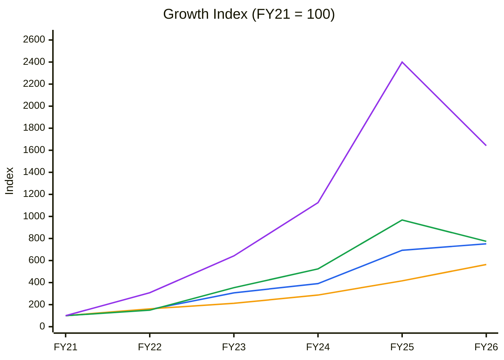
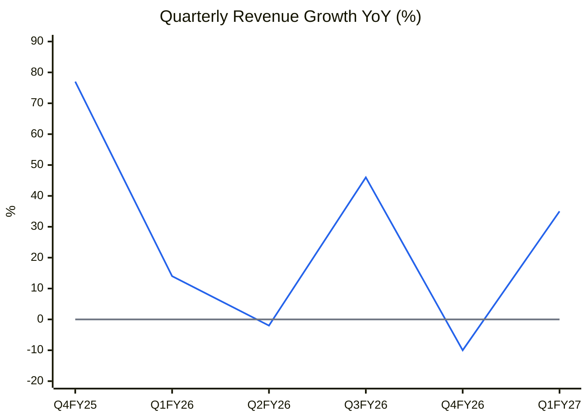
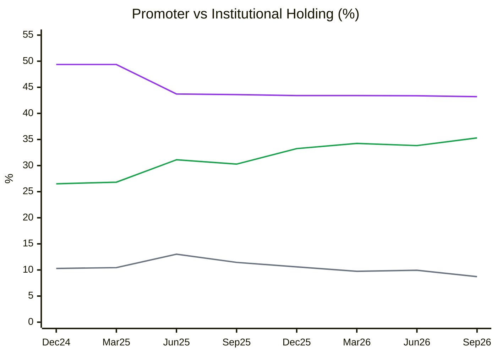
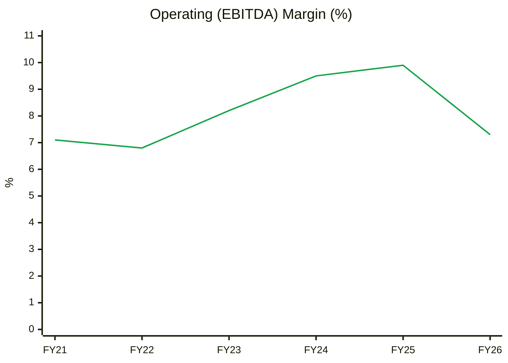
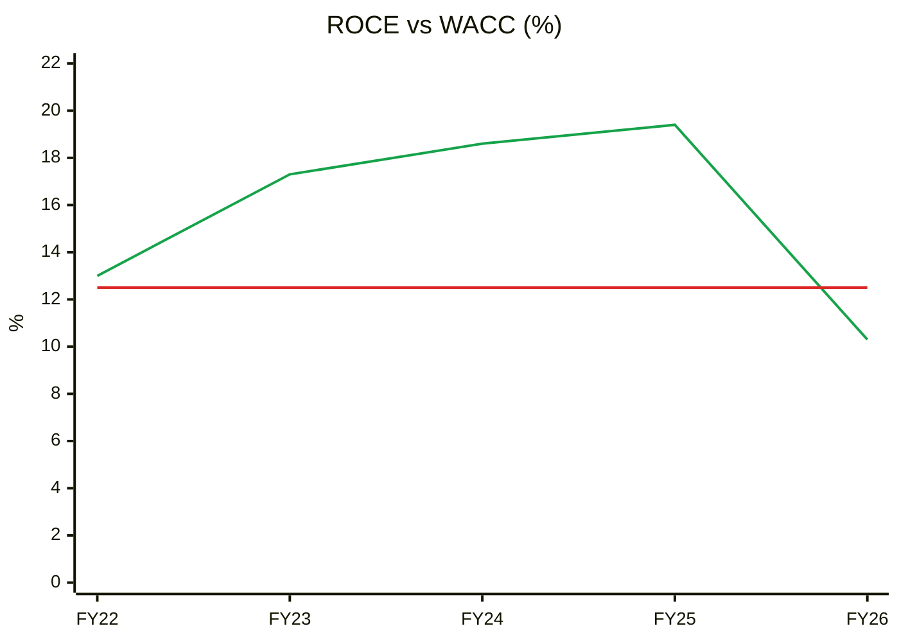
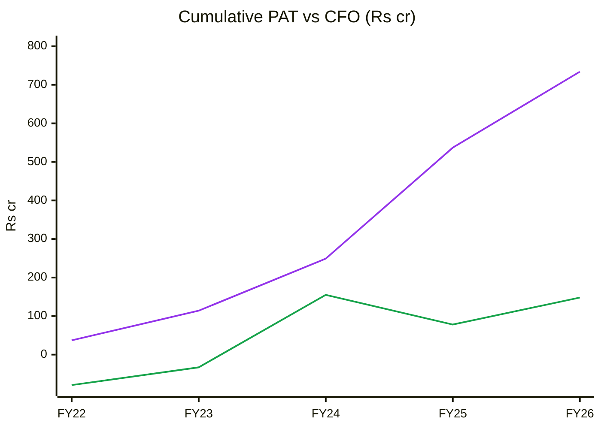
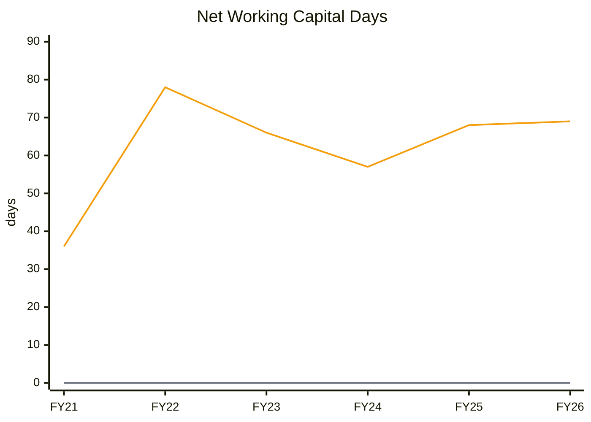
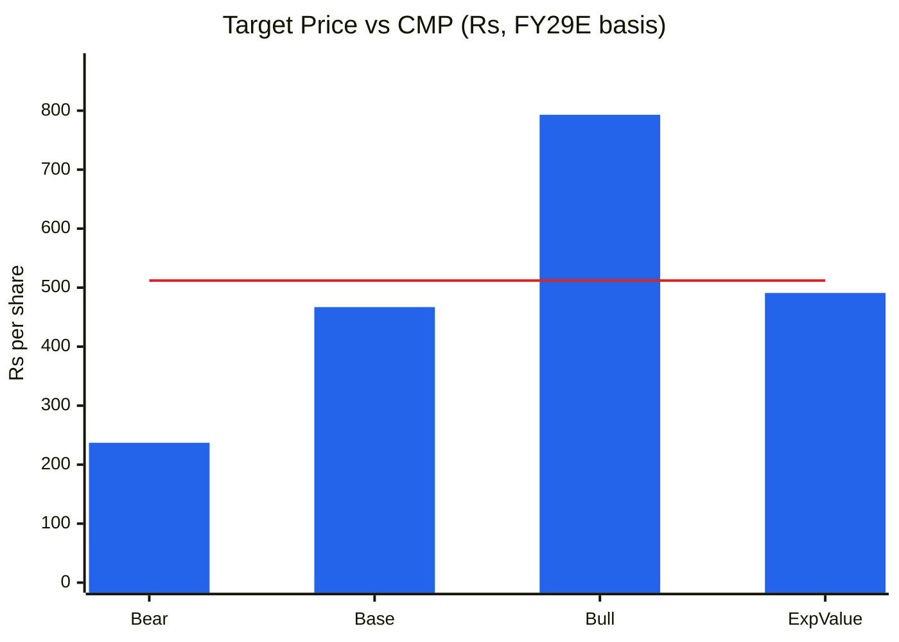

# Stock Analysis Report — PG Electroplast Ltd (PGEL)
**Date:** 2026-10-12
**Analyst:** Claude (Stock Fundamental Analysis Skill v3.3)
**Investment Horizon:** 2–3 Years
**Recommendation:** AVOID at CMP (WATCHLIST only on a deep pullback or Stage 2 base)
**Conviction Score (as a buy at CMP):** 3.5 / 10
**CMP:** ₹512 (NSE close 09-Oct-2026) · **Market cap:** ₹14,676 cr · **Buy-below:** ₹300–330 (revised from ₹380–430)

## Revision Log
| Version | Date | Recommendation | Conviction | Price | Key change |
|---|---|---|---|---|---|
| Current | 2026-10-12 | AVOID at CMP / WATCHLIST | 3.5/10 | ₹512 | Price −19%, but base EPS corrected down ~5% (FY29 basis) and stock moved to Stage 4. Asymmetry improved from 0.65:1 to ~1.0:1, still below the 1.5:1 gate. Re-run as part of a four-way EMS comparison |
| Previous | 2026-08-07 | AVOID at CMP / WATCHLIST | 3.5/10 | ₹631 | Initial report (full text in git history) |

**What changed in the thesis:** Nothing structural. Q1 FY27 (+35% revenue) confirmed that summer 2026 was normal, but margins (7.3–7.7%) did not snap back to FY25's ~10%. Management now calls 8% an *aspiration*, not guidance, and has floated FY29 as a possible "consolidation year". The stock fell 19% with the sector, and the Nifty's turn to a Stage 4 tape. The correction in base-case EPS offsets most of the price fall, so the verdict holds.

**Validation of previous report (2026-08-07):**
| Item | Previous | Now | Status |
|---|---|---|---|
| Price / P/E | ₹631 / ~88× | ₹512 / 71.3× TTM | 🔄 Updated |
| Market context | "Nifty near highs, sentiment Optimistic" | Nifty 22,520, ~14.5% below 52-wk high, below falling 30-wk MA → Cautious | 🔄 Updated |
| ROCE / ROE (FY26) | 10.3% / 6.69% | 10.3% / 6.70% | ✅ Validated |
| Borrowings / equity (FY26) | ₹597 cr / ~₹3,049 cr | ₹597 cr / ₹3,049 cr | ✅ Validated |
| Net leverage | Net D/E ~0.15–0.2× | Cash ₹491 cr (Jun-26) vs debt ₹597 cr → net debt ~₹106 cr (~0.03×); company describes a net cash position | 🔄 Updated |
| CFO history | "FY24 −₹77 cr, FY25 +₹66 cr" | **FY24 +₹188 cr, FY25 −₹77 cr, FY26 +₹70 cr.** Screener's cash-flow columns are shifted one year (FY26 column missing); cross-checked with stockanalysis.com (FY26 OCF ₹69.9 cr, capex ₹785 cr) | ❌ Corrected (year labels shifted) |
| FY26 capex | ₹700–750 cr | ₹785 cr | ✅ Validated (slightly above) |
| Promoter holding | 43.37% (Jun-26) | 43.20% (Sep-26) | 🔄 Updated |
| FII / DII | 9.95% / 23.88% | 8.72% / 26.58% | 🔄 Updated |
| Promoter block sale | 5.62% at ₹740 (₹1,177 cr) | Consistent with the Jun-25 step 49.37% → 43.72% | ✅ Validated |
| Promoter 68.2% in 2020 | 68.2% | Not re-sourced (Screener shows last 8 quarters only) | ⚠️ Unverifiable this run (kept as historical claim) |
| Peer: Dixon FY26 revenue | "~₹38,000 cr+" | ₹48,873 cr (₹38,860 cr was FY25) | ❌ Corrected (wrong year) |
| Peer: Amber FY26 revenue | "~₹10,000 cr+" | ₹12,186 cr (₹9,973 cr was FY25) | ❌ Corrected (wrong year) |
| Peer: Amber ROCE | "~13–15%" | 10.3% FY26 (14% was FY25) | ❌ Corrected |
| Peer: Dixon / Amber P/E | ~70–80× / ~60–70× | Dixon 41.6× headline, ~90× core (ex stake gains); Amber 110× TTM, ~92× adjusted | 🔄 Updated |
| Base case | FY28 rev ₹7,500 cr, margin 7.75%, **EPS ~₹13**, 45× → ₹585 | Arithmetic: ₹7,500 cr × 7.75% = ₹581 cr EBITDA − ~₹150 cr D&A − ~₹100 cr interest + ~₹40 cr other income ≈ ₹370 cr PBT → ~₹285 cr PAT → **EPS ~₹10**. Rolled to FY29: EPS ₹12.3 × 38× = ₹467 | ❌ Corrected (EPS overstated ~30%; multiple lowered with sector de-rating) |
| Q1 FY27 margin | ~7.7% | Company EBITDA 7.7% (₹156 cr); Screener OPM 7.3% (different definition) | ✅ Validated (definition noted) |
| FY26 inventory ~₹1,300 cr | ~₹1,300 cr | Inventory days 134 (FY26) vs 122 (FY25); absolute figure not re-sourced | ⚠️ Unverifiable (direction confirmed) |
| WTT score | 0.40 | 0.40 (2 new hits offset by no new deliveries on margin) | ✅ Validated |
| Technical stage | "Choppy Stage 3-ish" | **Stage 4.** Price ₹512 below a falling 30-wk MA (₹538) | 🔄 Updated (worse) |
| Old data gaps (8-variable Beneish, ODM/OEM split, 30-wk MA) | Gaps | 30-wk MA now computed from weekly closes. Beneish and ODM split still not available | 🔄 Partly closed |

---

## Executive Summary
PG Electroplast is India's leading room-AC ODM and a broadening appliance EMS platform (washing machines +67% in Q1 FY27; refrigerators and compressors coming in FY27). The secular runway is real. The economics are not yet: **ROCE of 10.3% is below a 12.5% WACC**, FY26 PAT fell 32% on one weak summer, **five-year CFO is only 20% of PAT**, and growth has been funded by equity (QIP) and a promoter that has sold down to 43%. At ₹512 (71× trailing) the stock is 19% cheaper than in August, but base earnings are also lower than previously modelled and the chart has rolled into **Stage 4**. Expected value of about ₹491 is roughly at CMP, and upside/downside is about 1.0:1. Still below the gate.

🟦 Revenue (CAGR 50%) · 🟧 Net Fixed Assets (41%; net block used — gross block not on Screener) · 🟩 EBITDA (51%) · 🟪 PAT (75%)

**Read:** FY21→FY26: revenue 7.5×, net fixed assets 5.6×, EBITDA 7.7×, PAT 16.4×. PAT peaked at 24× in FY25 and fell back in FY26.

**Business inference:** The FY21–25 surge was real operating leverage off a tiny base. FY26 showed how fragile it is: one short summer took a third off profit. Revenue still outgrows fixed assets, so capital efficiency is acceptable. Profit volatility, not capital intensity, is the problem.

---

## Business Primer
PG Electroplast is India's largest room-air-conditioner **ODM/OEM contract manufacturer** and a broader EMS player. It designs and builds products for other brands rather than selling mainly under its own. Revenue flows from a **Product segment** (finished RACs, washing machines, air coolers; RACs ₹1,401 cr and washing machines ₹211 cr of Q1 FY27's ₹2,034 cr), plus plastic injection moulding, electronics/PCB assembly, and OEM work. Customers are the large consumer-durables brands. Economics are volume × realisation on thin manufacturing margins. The business depends on utilisation of a fast-expanding, capital-heavy asset base and on its **ODM mix** (own design earns more, and is stickier, than build-to-print).

This is an **asset-heavy, working-capital-intensive manufacturer on a powerful secular tailwind with a brutal seasonal overlay.** RAC profit is concentrated in the Mar–Jun summer, so a weak summer wrecks the year. That is exactly what FY26 showed: revenue +9%, PAT −32% (company: ₹290.9 cr → ₹193.6 cr), with cash falling from ₹979 cr to ₹389 cr and inventory days rising to 134. New legs (refrigerators at Sri City, a compressor JV, washing-machine capacity, a new Rajasthan parcel; FY27 capex ~₹400 cr) diversify the seasonality but defer free cash flow. Structural features that colour everything: an extreme multiple on depressed earnings; ROCE around cost of capital; chronically negative FCF; recurring dilution; and a multi-year fall in promoter holding.

**Segment check:** EMS / Consumer Durables Contract Manufacturing. KPI reference available ✓ (line 2023; this block was originally added for PGEL in Aug-2026).

---

## Module 1 — Broad Market Cycle
Nifty 22,520 (09-Oct-2026), ~14.5% below its 52-week high, below a declining 30-week MA. P/E ~19.3× (about average). VIX 14.35. **Cautious** (previously Optimistic). EMS momentum has broken: three of the four names are down 13–24% over 52 weeks.

## Module 1b — Sector Cycle
- **Secular:** RAC household penetration under 10%; China+1; PLI and component localisation. Category growth 12–15%+.
- **Seasonal / cyclical:** Summer 2026 was normal (Q1 FY27 RAC +38%), but channel inventory and pricing stayed competitive. Every RAC ODM and brand captive is adding capacity at the same time, so **pricing pressure in build-to-print is structural**.
- **Input / FX:** Compressor imports (China), copper; compressor JV timing depends on Chinese-partner clearances.
- **Verdict: Tailwind (secular), Headwind (pricing and seasonality).** Unchanged.

## Module 1c — Stock Cycle

🟦 Revenue YoY % · ⬜ zero line

**Read:** YoY growth: +77% (Q4 FY25), +14%, −2%, +46%, −10% (Q4 FY26), +35% (Q1 FY27). Violent swings.

**Business inference:** The cyclicality is weather plus base effects, not a steady trend. Q2 FY27 (off-season, results due ~Nov-2026) is the real test of whether the expanded fixed-cost base can avoid another near-zero-profit quarter (Q2 FY26 PAT ₹3 cr).

- **Operating leverage:** Very high DOL. Off-season OPM was 4.6% (Q2 FY26) vs 11% in peak quarters. DFL ≈ 1.4× (FY26 EBIT ₹354 cr / (₹354 cr − ₹102 cr)).
- **Guidance (Q1 FY27 call):** Volume growth 20%+ for FY27 (some summaries say 10–20%+). **8% EBITDA margin is an "aspiration", not guidance**, and H2-weighted. FY28 growth 25–30%. **FY29 possibly a "consolidation year" focused on ROCE/ROE** ([Baroda BNP Q1 FY27 review](https://www.barodaetrade.com/Reports/PGElectroplast-Q1FY27ResultReview7Aug26-Research.pdf), [Sahi](https://www.sahi.com/news/pg-electroplast-aspires-to-8-full-year-operating-margin-excluding-incentives-3912-PE1_COR)).
- **Capacity:** Refrigerator plant (Sri City) commercial production targeted for Q4 FY27 (another summary says mass production Dec–Jan). Compressor JV completing. FY27 capex ~₹400 cr.
- **FCF inflection:** Not before FY29. FY26 FCF ≈ ₹70 cr CFO − ₹785 cr capex = **−₹715 cr**.
- **Classification: Early/mid-cycle capex ramp with a cyclical air-pocket.** Unchanged.

---

## Module 2 — Industry Structure & Business Quality
- **Porter:** Entry barriers high on capital (favours incumbents). Supplier power high (compressors). **Buyer power high** (a few large brands). Substitutes: brand in-sourcing. Rivalry intense (Amber, Epack, Dixon JV, captives). **Verdict: Neutral.**
- **Capital cycle:** Mid-to-late inflow. Capital is flooding into RAC/EMS capacity.
- **Moat (Greenwald):** Narrow. RAC-ODM scale and design capability; moderate switching costs in ODM; none in OEM. **Buffett price test: fails.**
- **Fisher:** ~28/45 (unchanged). Point 15 integrity: pass, with promoter selling as a caution flag.

---

## Module 3 — Management & Capital Allocation
**Promoter holding:** 43.20% (Sep-2026), down from 49.37% (Dec-2024). The Jun-2025 step (−5.65 pp) is the ₹1,177 cr block sale of 5.62% at ₹740. Since then there has been minor drift only. Pledge: none disclosed.

🟪 Promoter · 🟩 FII + DII · ⬜ FII alone

**Read:** Promoter holding fell 6.2 pp in eight quarters (almost all in the Jun-2025 block). DIIs rose from 16.2% to 26.6%; FIIs went from 10.3% to 13.0% and back to 8.7%.

**Business inference:** Domestic funds absorbed the promoter's sale at ₹740. The stock now trades ~31% below that block price, so the institutions that bought from the promoter are under water. That overhang caps rallies.

- **Capital allocation:** Everything is reinvested (capex, new categories, compressor JV). The Sep-2026 AGM sought approval for corporate guarantees and loans to the JV, so off-balance-sheet support for the JV is rising. Dividend ₹0.25/share (token).
- **Earnings-to-cash:** FY22–26 cumulative CFO ₹148 cr vs PAT ₹734 cr (C7).

### Walk the Talk Scorecard (carried forward and extended)
| Quarter Guided | Statement | Guided | Actual | Verdict |
|---|---|---|---|---|
| Q1 FY26 call | FY26 net profit (standalone) | ₹300–310 cr | FY26 consolidated PAT ₹193.6 cr (company) | ❌ Big miss (weather) |
| Q1 FY26 | FY26 EBITDA margin | Modest decline from ~10% | ~7.3–8.4% (Screener / company) | ❌ Miss |
| FY26 | Washing-machine growth | 40–45% | Q1 FY27 WM +67% | ✅ Hit |
| — | Compressor JV commissioning | On schedule | Delayed (China clearance) | ❌ Slip |
| Q4 FY26 / Q1 FY27 | FY27 volume growth | 20%+ | Q1 FY27 revenue +35%, RAC +38% | ✅ Hit (Q1) |
| FY27 | Margin ~8% | ~8% | **Downgraded to an "aspiration"** in the Q1 FY27 call; Q1 at 7.3–7.7% | ⏳ Pending (softened) |
| Q1 FY27 | Refrigerator commercial production | Q4 FY27 / Dec–Jan | — | ⏳ Pending (conflicting summaries) |

**WTT Score:** (2 hits) / 5 scored = **0.40 — LOW** (unchanged). Volume and segment guidance are reliable; profit, margin and project-timing guidance are not.
**Insider action:** ₹1,177 cr promoter block at ₹740 (Jun-2025). **BEARISH** (action outweighs words).
**DCF impact:** Own estimates are used. FY27 margin is modelled at 7.5%, not 8%.

---

## Module 4 — Financial Forensics
| Test | Value | Read |
|---|---|---|
| Altman Z'' (approx.) | **5.12** (FY24 4.71 → FY25 6.22 → FY26 5.12) | Safe (equity-funded) |
| Piotroski F (8 testable) | **2/8** | 🚩 **Weak.** ROA, CFO/NI, leverage, margin and AT all deteriorated in FY26 |
| Sloan accrual (CF) | +5.9% | Acceptable (helped by liquidating treasury in CFI) |
| TATA (NI − CFO)/TA | +0.021 | NI > CFO |
| CFO / PAT (5-yr) | **0.20** | 🚩 Very low |
| Inventory days | 134 (FY26) vs 90 (FY24) | 🚩 Rising |
| Payable days | 147 vs 107 | Supplier credit stretched |
| Beneish (8-var) | Not computable (data gap persists) | Inventory and accrual pattern is consistent with unsold stock, not revenue inflation |

**Forensic verdict:** **3 soft flags** (accruals/CFO, inventory, Piotroski), plus promoter selling. Same conclusion as before: not fraud, but weak earnings-to-cash quality and high cyclicality.

## Module 5 — Earnings Quality & Financial Statements

🟩 OPM % (Screener operating profit ÷ sales; excludes other income)

**Read:** OPM: 7.1% (FY21) → 9.9% (FY25 peak) → 7.3% (FY26).

**Business inference:** FY25's ~10% was the peak-summer, ODM-mix high. 7–8% looks like mid-cycle. Valuations built on 9–10% are therefore built on peak margins.

🟩 ROCE (EBIT ÷ avg capital employed, computed) · 🟥 WACC 12.5%

**Read:** Computed ROCE: 13.0% (FY22), 17.3%, 18.6%, 19.4% (FY25), 10.3% (FY26). Below WACC only in FY26.

**Business inference:** On a normal summer PGEL has earned above its cost of capital. The issue is that the post-QIP capital base (₹3,646 cr) needs ~₹600 cr of EBIT to earn 16%+ pre-tax, nearly double FY26's ₹354 cr. The capital is now ahead of the earnings.

🟪 Cumulative PAT · 🟩 Cumulative CFO

**Read:** FY22–26: cumulative PAT ₹734 cr vs cumulative CFO ₹148 cr. CFO was negative in FY22 and FY25.

**Business inference:** Five years of reported profit have produced almost no operating cash, because inventory and receivables absorb it. Shareholders have funded the growth through dilution, so per-share value compounds much more slowly than PAT.

### DuPont Decomposition (5-Factor, computed)
| Year | EBIT Margin | Asset Turnover | Equity Multiplier | Interest Burden | Tax Burden | ROE |
|---|---|---|---|---|---|---|
| FY22 | 6.5% | 1.33 | 3.27 | 0.69 | 0.76 | 14.7% |
| FY23 | 6.8% | 1.68 | 3.64 | 0.67 | 0.79 | 21.8% |
| FY24 | 8.3% | 1.44 | 2.66 | 0.77 | 0.77 | 18.8% |
| FY25 | 9.3% | 1.31 | 1.92 | 0.80 | 0.79 | 14.9% |
| FY26 | 6.7% | 0.96 | 1.88 | 0.71 | 0.78 | 6.7% |

**Operating contribution:** Collapsed in FY26 (margin −2.6 pp, AT 1.31 → 0.96). **Financing contribution:** Falling (equity raised). Not leverage-masking. **Verdict:** ROE fall is purely operational plus capital ahead of use. AT trend: **declining for three years**, so the base case uses ~1.0× total-asset turnover (net fixed-asset turnover 3.4×).

🟧 Debtor + Inventory − Payable days · ⬜ zero line

**Read:** Net working-capital days have stayed at 57–78 since FY22 (69 in FY26).

**Business inference:** Unlike Dixon (−6 days), PGEL carries over two months of sales in working capital. Every ₹1,000 cr of new revenue needs ~₹190 cr of cash before any capex. That is the structural reason FCF stays negative.

---

## Module 6 — Industry KPIs & Peers (corrected)
| KPI | PGEL | Dixon | Amber | Syrma | Comment |
|---|---|---|---|---|---|
| Revenue FY26 | ₹5,288 cr | ₹48,873 cr | ₹12,186 cr | ₹4,819 cr | Corrected (previous report used FY25 for Dixon and Amber) |
| EBITDA margin FY26 | 7.3% | 3.8% | 7.1% | 11.3% | Thin, except Syrma |
| ROCE (Screener) | 10.3% | 29.2% | 10.3% | 16.8% | PGEL joint-lowest |
| Net WC days FY26 | **69** | −6 | 53 | 48 | **PGEL worst** |
| CFO/PAT (5-yr) | **0.20** | 1.22 | 2.78 | 0.32 | **PGEL worst** |
| ODM mix | High in RAC | Low | High in RAC | 17% | PGEL's strength |
| P/E | 71× | 41.6× / ~90× core | 110× / ~92× adj. | 89× | PGEL now the *cheapest* headline multiple |
| 52-wk price | −13% | −24% | −22% | +119% | |

**Positioning:** PGEL has gone from the richest to the cheapest multiple in the group, but it still has the weakest cash conversion and working capital.

## Module 7 — Market Size & Share
- **TAM:** Indian RAC ~₹35,000–40,000 cr growing double-digit; washing machines and refrigerators add a further ₹50,000 cr+ of appliance TAM (estimates).
- **Share:** #1 RAC ODM; gaining in washing machines; entering refrigerators. Q1 FY27 RAC +38% vs industry ~30–35% (estimate), so **gaining share**.
- **Verdict:** Runway is not the question. Returns and price are.

---

## Module 8 — Valuation: PIE First, Then Own Model
### PIE (EV ≈ ₹14,782 cr; WACC 12.5%; terminal growth 6%; tax 23%; sales-to-capital 1.5×)
| PIE driver | Market-implied | My base | Gap |
|---|---|---|---|
| Revenue CAGR at today's ~7% EBIT margin | **Not reachable.** ROIC ~8% < WACC, so growth destroys value | — | — |
| EBIT margin needed at 20%/yr for 10 yrs | **~15%** (ROIC ~18%) | 6.5–7.5% | **Optimistic, ~2× margin** |
| EBIT margin needed at 25%/yr | ~13.5% | — | — |

**Treadmill:** The price needs PGEL to roughly double its margin (ODM, compressors, refrigerators) *and* compound at 20%+ for a decade. FY25's peak margin of 9.9% OPM is still well short.
**SVAR:** Bear ₹237 implies **SVAR ≈ 54%** (previously 35–40%; the bear case is now built from corrected EPS arithmetic).

### Own model (rolled to FY29E)
| Scenario | Revenue FY29 | EBITDA margin | PAT | EPS | Multiple | Target | Prob |
|---|---|---|---|---|---|---|---|
| Bull | ₹10,000 cr (strong summers; fridge and compressor ramp) | 8.5% | ₹474 cr | ₹16.5 | 48× | ₹793 | 25% |
| Base | ₹9,130 cr (FY27 +20%, FY28 +25%, FY29 +15% consolidation) | 7.75% | ₹352 cr | ₹12.3 | 38× | ₹467 | 50% |
| Bear | ₹7,800 cr (weak summer, pricing pressure) | 7.0% | ₹213 cr | ₹7.4 | 32× | ₹237 | 25% |
| **Expected value** | | | | | | **₹491** | |

Assumptions: D&A ~₹190 cr (FY26 ₹88 cr + FY26–27 capex of ~₹1,200 cr), interest ₹95–115 cr, other income ₹35–50 cr, tax 23%, 28.66 cr shares. Multiples are cut from the previous 35/45/50× to 32/38/48× in line with the sector de-rating and a consistent four-name framework.

🟦 Scenario price · 🟥 CMP Rs 512

**Read:** Expected value is ₹491 (−4% vs CMP). Bull +55%, bear −54%. **U/D ≈ 1.0:1** (previously 0.65:1). Still below the 1.5:1 gate.

**Business inference:** The 19% price fall has removed the excess premium. The stock now prices roughly the base case, but there is still no margin of safety for a business whose profits can fall by a third in one summer.

- **Graham number:** far below CMP. Fails.
- **Buy-below:** base ₹467 with a 30–35% MoS ≈ **₹300–330** (revised down from ₹380–430 because of the EPS correction).

### Cycle Position Dashboard
| Dimension | Current | Reference | Signal |
|---|---|---|---|
| P/E | 71× | Sector 60–90× | Lower end of a rich range |
| EBITDA margin | 7.3% | 6-yr range 6.8–9.9% | Mid-to-low |
| ROCE | 10.3% | 5-yr range 10–19% | **Trough** |
| **Overall** | | | **Trough earnings, mid-to-late valuation** |

⚠️ CY1/CY2 bands not built: the Screener history has a FY14–20 gap. Data gap.

---

## Module 9 — Technical Stage (Weinstein, Yahoo weekly closes)
- **Nifty:** Stage 4 / late 3. **Headwind.**
- **Stock: Stage 4 (declining).** ₹512 vs a 30-week MA of ₹538 that is **falling** (−1.9% over 5 weeks). Lower highs from ₹631 (Aug). Weekly low ₹481 (late Sep), then a 7% bounce on 06-Oct. 52-week range ₹437–645 (Screener).
- **RS:** In line over 52 weeks (−13% vs −12%), weak over 13 weeks (−17% vs −7%).
- **CANSLIM:** C 0 (Q1 PAT +13%) · A 0 · N 1 (refrigerators) · S 0 · L 0 · I 1 (DIIs rising) · M 0 → **2/7.**
- **Verdict: Hard stop, Stage 4 with a declining MA.** Wait for a base above the MA, or a reclaim of ₹600+ on volume.

---

## Module 10 — Forward View
### Capex & AT model
| Item | FY26 | FY27E | FY28E | FY29E |
|---|---|---|---|---|
| Net FA + CWIP (₹ cr) | 1,852 | ~2,150 | ~2,350 | ~2,450 |
| Revenue (base) | 5,288 | 6,350 | 7,940 | 9,130 |
| Net FA turnover (ex-CWIP) | 3.4× | ~3.3× | ~3.6× | ~3.9× |

- **Capex:** FY27 ~₹400 cr (refrigerators, compressor completion, Rajasthan parcel), mostly greenfield (refrigerator Y1 ramp ~30% of steady state).
- **Incremental ROIC:** ΔRevenue ₹3,840 cr × ~5.5% EBIT × 0.77 ≈ ₹163 cr on ~₹1,400 cr (fixed assets plus ~19% working capital) → **~12%, about WACC (value-neutral).**
- **Capex CAGR (~20%) vs PIE:** Capacity is fine. The PIE requires a margin of ~13–15% EBIT. **The market is pricing a quality step-change.**
- **Debt / ICR:** ICR 3.5× (FY26 EBIT ₹354 cr / ₹102 cr). OK. JV guarantees are a contingent liability (AGM Sep-2026).
- **FCF inflection:** FY29 at the earliest (management's own "consolidation year" framing).

### Catalysts
1. Q2 FY27 (off-season) print. A loss-free quarter would show the cost base is under control.
2. Refrigerator commercial production (Q4 FY27) and compressor JV start.
3. Summer 2027 (Q4 FY27 – Q1 FY28).
4. An FY29 "consolidation year" pivot to ROCE (could re-rate if credible).

### Risks
1. **Weak summer.** Probability: High (recurring).
2. **ROCE stays below WACC** while capex compounds. Medium-High.
3. **Inventory and working-capital build, cash burn.** Medium-High.
4. **Promoter-block overhang** (institutions under water at ₹740). Medium.
5. **JV guarantee and contingent exposure.** Low-Medium.

---

## Checklist Summary
**Section 0:** Existing report found and read ✓; all items validated (5 ❌ corrected); renamed via `git mv` ✓; one file only ✓ · **A:** 15/18 · **B:** 7/9 · **C:** 10/12 · **D:** 7/7 · **E:** 6/7 · **F:** 9/10 · **G:** 8/8 · **H:** done at net-block level · **I:** 9 charts. CY bands missing (data gap).
**Order Book Tracker:** Not applicable (customer-programme business).
**Hard stops:** **(1) Upside/downside < 1.5:1 (~1.0:1). (2) Stage 4 with declining 30-week MA.**

## Investment Decision
**Recommendation:** **AVOID at CMP** (WATCHLIST).
**Conviction (buy at CMP):** 3.5/10 (cycle 0.25 · industry 0.5 · moat 1 · management 0.5 · financial quality 0.5 · valuation 0.5 · technical 0.25).
**Position size now:** 0%.
**Buy-below:** **₹300–330**, or on a confirmed Stage 2 breakout above ~₹600 with OPM ≥ 8% in an off-season quarter.
**Target (base, FY29E basis):** ₹467 · Bull ₹793 · Bear ₹237.
**Review trigger:** Upgrade on two consecutive years of ROCE > 14% and CFO/PAT > 0.6. Downgrade on another sub-7% margin year or further promoter selling.

**Bottom line:** The price has come down to meet the business, but the business has not come up. PGEL is a category leader with real growth, earning roughly its cost of capital, converting little profit to cash, and still exposed to one summer's weather. At ₹512 the payoff is roughly even. It needs to be closer to ₹300, or to prove ROCE above 14%, before it is a buy.

---
*Report generated by Stock Fundamental Analysis Skill v3.3 | Indian Markets Context*
*Sources: Screener.in (PGEL consolidated, fetched 12-Oct-2026; cash-flow year labels corrected against [stockanalysis.com](https://stockanalysis.com/quote/nse/PGEL/financials/cash-flow-statement/)); Yahoo Finance weekly prices; [Quartr Q1 FY27 summary](https://quartr.com/events/pg-electroplast-limited-533581-q1-26-27_F4YVFTge); [Baroda BNP Q1 FY27 review](https://www.barodaetrade.com/Reports/PGElectroplast-Q1FY27ResultReview7Aug26-Research.pdf); [Sahi — 8% margin aspiration](https://www.sahi.com/news/pg-electroplast-aspires-to-8-full-year-operating-margin-excluding-incentives-3912-PE1_COR); [Investywise — AGM notice](https://www.investywise.com/pg-electroplast-limited-announces-24th-annual-general-meeting-details); previous report (2026-08-07, git history) for the promoter block sale (Business Standard / Angel One). Concall figures are from secondary summaries. Scenario inputs and TAM are labelled analyst estimates.*
*Save path: C:\Users\anubh\Documents\Anubhav\Stock Analysis\Stock Analysis\*
