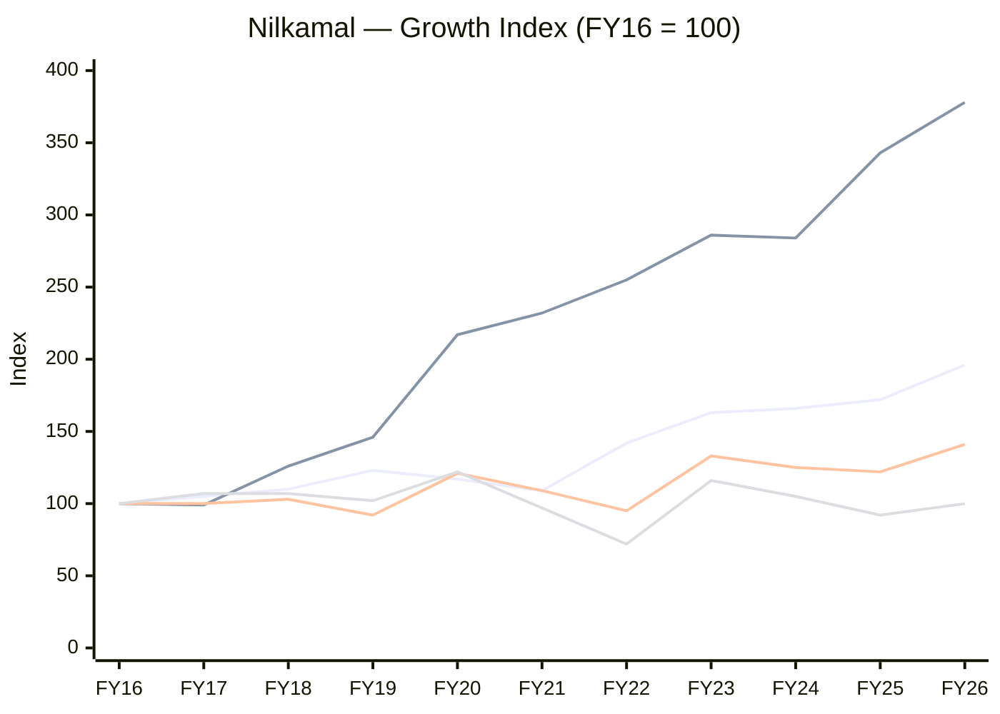
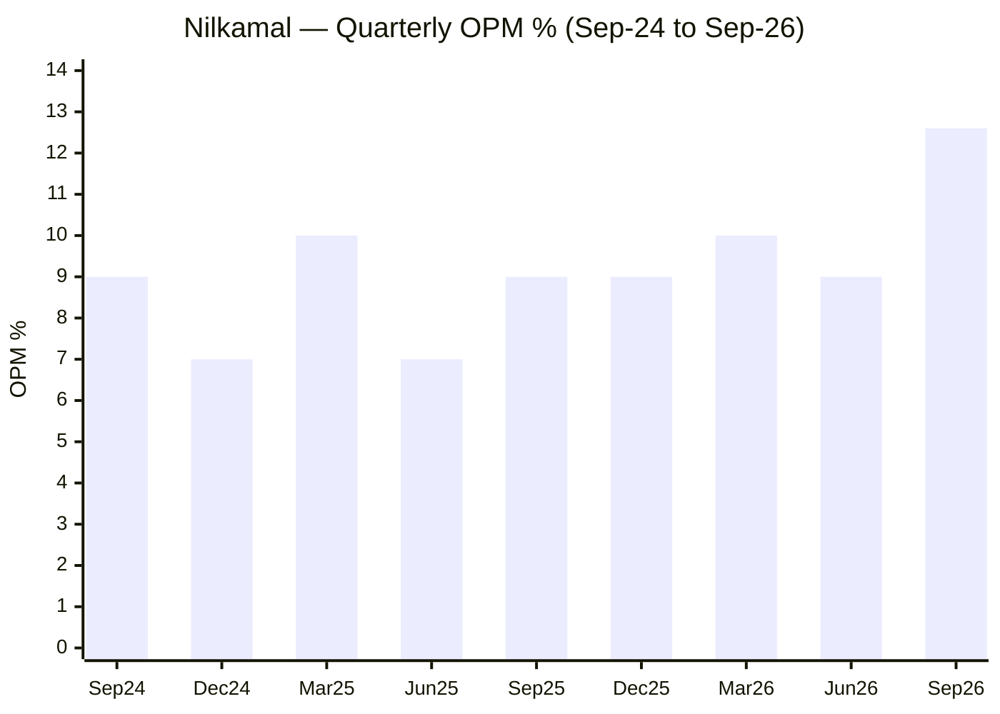
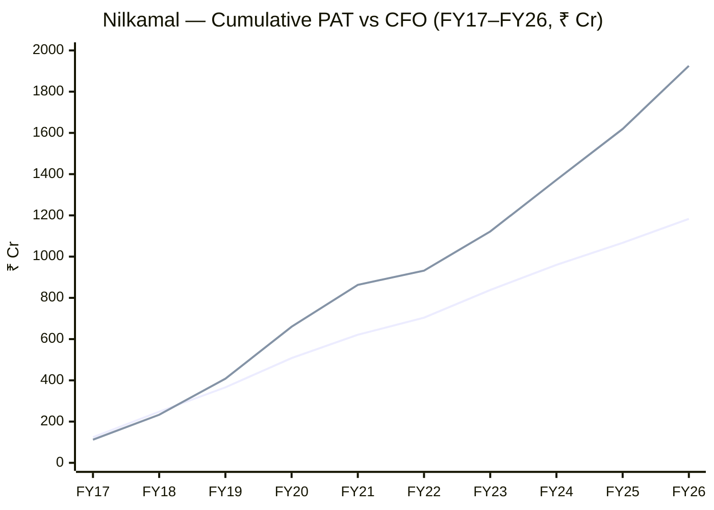
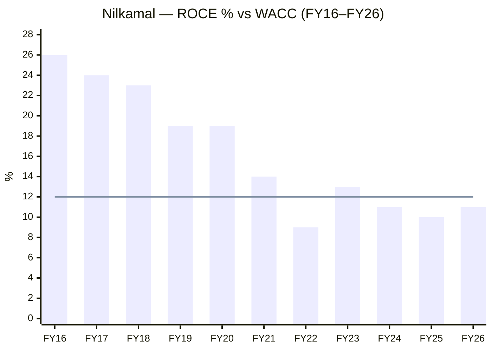
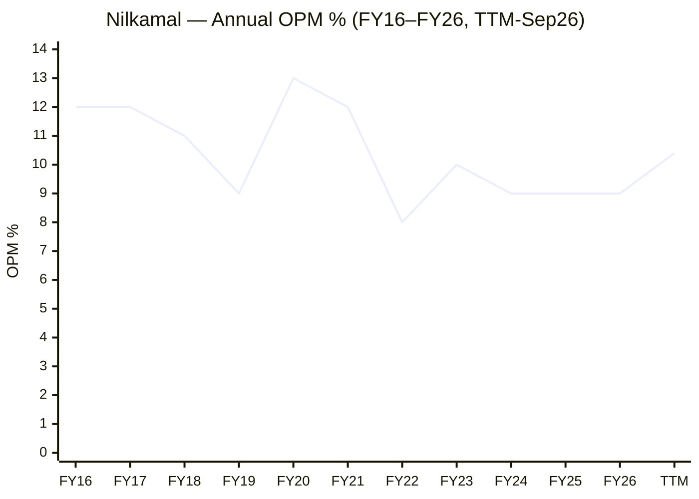
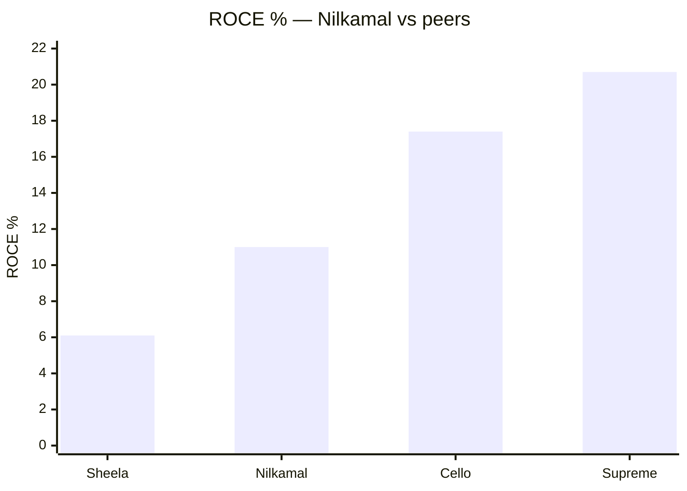
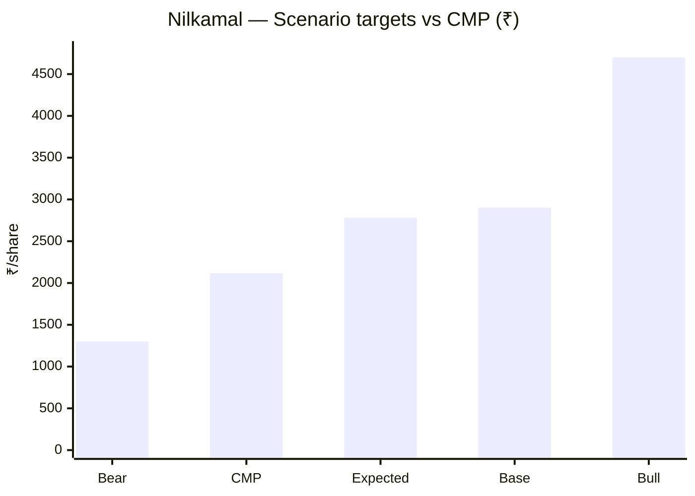

# Stock Analysis Report — Nilkamal Ltd (NSE: NILKAMAL | BSE: 523385)
**Date:** 2026-10-29
**Analyst:** Claude (Stock Fundamental Analysis Skill v3.3)
**Investment Horizon:** 2–3 Years
**Recommendation:** WATCHLIST — wait for Q3 FY27 to confirm margin durability; buy zone ₹1,750–1,850
**Conviction Score:** 5 / 10
**CMP:** ~₹2,116 (29-Oct-2026 intraday, +20% on Q2 results; prev. close ₹1,764) | **Market Cap:** ~₹3,157 Cr | **Shares:** 1.49 Cr (FV ₹10) | **P/E:** ~20× on Q2-updated TTM EPS ₹106 (25× on reported TTM to Jun-26) | **P/B:** 2.0× | **Div. yield:** ~1%
**Filed under:** Packaging-and-Plastics / Moulded-Plastics-and-Material-Handling · Themes: Consumption & consumer brands, Sustainability, recycling & circular economy

## Revision Log
| Version | Date | Recommendation | Conviction | Price | Key change |
|---|---|---|---|---|---|
| Current | 2026-10-29 | WATCHLIST | 5/10 | ₹2,116 | Initial report |

*Initial report. New sub-sector folder `Packaging-and-Plastics/Moulded-Plastics-and-Material-Handling` created (no existing sub-sector fits moulded furniture + material handling). New KPI block "Moulded Plastics, Material Handling & Home Furniture / Mattresses" added to `05-industry-kpis-india.md`, approved by the user.*

---

## Executive Summary
Nilkamal is India's best-known moulded-plastic-furniture brand and largest maker of plastic crates, pallets and bins. Over the last decade it has spent heavily to move into mattresses, foam, ready-to-assemble furniture, racking, rigid packaging and its own retail chain (Nilkamal Homes). The decade record is weak: revenue doubled (₹1,926 → ₹3,778 Cr) but **PAT and EPS are exactly where they were in FY16 (₹116 Cr / ₹77)**, and ROCE fell from 26% to ~11%, below its cost of capital for five years. **Thesis:** Q2 FY27 may be the first evidence that the capex cycle is paying off. Revenue was +17%, EBITDA margin ~12.6% (the best in years), PAT doubled to ₹67 Cr, capacity utilisation rose from <50% to >70%, retail turned EBIT-positive, and capex has dropped to ~₹30–40 Cr a quarter, near depreciation. If margins hold at 10.5–11% with capex at maintenance, EPS can roughly double to ₹140–160 by FY28. **Key risk:** one quarter does not make a trend. Q2 likely carried price-hike / low-cost-inventory gains after the March-2026 polymer spike, and the market has already re-rated the stock 20% in a day.

### C1 — Growth Index (FY16 = 100)
| Year | Revenue | Net fixed assets | EBITDA | PAT |
|---|---|---|---|---|
| FY16 | 100 | 100 | 100 | 100 |
| FY17 | 105 | 99 | 100 | 107 |
| FY18 | 110 | 126 | 103 | 107 |
| FY19 | 123 | 146 | 92 | 102 |
| FY20 | 117 | 217 | 121 | 122 |
| FY21 | 109 | 232 | 109 | 97 |
| FY22 | 142 | 255 | 95 | 72 |
| FY23 | 163 | 286 | 133 | 116 |
| FY24 | 166 | 284 | 125 | 105 |
| FY25 | 172 | 343 | 122 | 92 |
| FY26 | 196 | 378 | 141 | 100 |
*Source: Screener.in consolidated. Net fixed assets include Ind AS 116 right-of-use assets from FY20 (part of the FY20 jump).*

*Colour key: line 1 = Revenue, line 2 = Net fixed assets, line 3 = EBITDA, line 4 = PAT (series order).*
**Read:** The asset base grew 3.8× and revenue 2×, but EBITDA only 1.4× and PAT not at all.
**Business inference:** For ten years each new rupee of capital earned less than the last. Diversification into furniture, mattresses, retail and packaging consumed capital without lifting profit. The investment case depends on this pattern breaking now that capex is slowing and utilisation is rising.

---

## Business Primer

Nilkamal (Mumbai; plants at Silvassa, Bhiwandi, Hosur, Noida, Puducherry, Jammu, Barjora, Sinnar and Haryana) sells injection-moulded plastic products and furniture through two reported segments. **B2B (~89% of revenue, ₹3,370 Cr in FY26)** covers material handling (crates, bins, pallets, racking, insulated boxes, waste bins, road-safety barriers) for food, logistics, e-commerce, auto and pharma customers; moulded plastic furniture and ready furniture sold through ~dealers and channel partners; Nilkamal Sleep mattresses (trade +53% in FY26, 3,500+ counters); PU foam; EDGE institutional/office/hospital furniture; BubbleGUARD packaging sheets; and rigid packaging. **Retail & E-commerce (~11%, ₹408 Cr)** is the Nilkamal Homes store chain (108 stores) plus D2C/marketplace sales. Revenue is volume × price per kg/piece. The main input is polypropylene/polyethylene, so gross margin depends on how fast price lists follow crude-linked polymer costs. The business depends on two things: its brand and dealer reach in moulded furniture and crates, and keeping its moulding machines full.

This is a mature, branded consumer-industrial manufacturer, partly a cyclical commodity converter and partly a consumer brand. The value driver is margin (polymer spread × utilisation); the key risks are polymer price spikes (PP/PE rose up to 45% in three weeks after the Strait of Hormuz blockade on 28-Feb-2026), a long record of value-diluting diversification, and a family-run governance style. Three structural features colour the analysis. Ten years of flat EPS despite heavy capex makes "it will be different this time" the central question. The retail chain lost money until Q1 FY27. And the balance sheet is conservative (CARE AA Stable, debt/equity 0.16×), so this is a return-on-capital question, not a solvency one.

**Segment check:** New block added → *Moulded Plastics, Material Handling & Home Furniture / Mattresses* (`05-industry-kpis-india.md` line 2786). ✓

---

## Module 1 — Broad Market Cycle
**CAUTIOUS.** Nifty 50 22,753 (26-Oct-2026), down from ~25,000 in June; India VIX ~17. Sizing below normal. *Source: JM Financial market feed.*

## Module 1b — Sector Cycle: Polymer Products / Home Furniture
**Verdict: NEUTRAL, turning TAILWIND on margins (transient) and on demand (structural for material handling).**
- **Input cost cycle:** PP/PE spiked ~45–50% after 28-Feb-2026 (FY26 MD&A; Q1 FY27 press release). Q1 FY27: B2B volume **−37%**, value −10%, gross margin *improved* through price hikes. Q2 FY27: volume recovered and margins jumped. **Risk:** if polymer prices ease, list prices tend to stick for a while (a margin tailwind), but competitors will cut, so Q2's margin is partly cyclical.
- **Demand, secular:** Grade-A warehousing, quick-commerce dark stores, PLI factories and returnable packaging (material handling +11% volume in FY26); organised mattresses and RTA furniture.
- **Demand, cyclical:** Q2 FY27 likely benefited from restocking after a destocked Q1 and from festive pre-buying.
- **Decomposition:** Of the Q2 margin jump (9.3% → ~12.6%), roughly 1.5–2pp looks structural (utilisation, retail breakeven, foam/RTA backward integration) and 1–1.5pp cyclical (price-hike lag, restocking). Model 10.5–11% as the sustainable base, not 12.6%.
- **FX:** Small net import exposure (polymer is dollar-linked, mostly bought domestically); no material export book.

## Module 1c — Stock Cycle

### C2 — Quarterly revenue and OPM (consolidated, ₹ Cr)
| Qtr | Sep-24 | Dec-24 | Mar-25 | Jun-25 | Sep-25 | Dec-25 | Mar-26 | Jun-26 | Sep-26 |
|---|---|---|---|---|---|---|---|---|---|
| Revenue | 822 | 854 | 894 | 883 | 968 | 962 | 965 | 820 | 1,106* |
| OPM % | 9 | 7 | 10 | 7 | 9 | 9 | 10 | 9 | ~12.6* |
| PAT | 33 | 22 | 34 | 15 | 34 | 25 | 42 | 24 | 67* |
*\*Q2 FY27 from Whalesbook's report of the results (revenue ₹1,106 Cr, EBITDA ₹139 Cr, PBT ₹89 Cr, PAT ₹67 Cr; prior-year base stated as ₹948 Cr vs Screener's ₹968 Cr). Single secondary source; exchange filing not yet reviewed. The stock's +20% move corroborates a strong print.*

**Read:** Eight quarters stuck at 7–10% OPM, then a break to ~12.6%.
**Business inference:** This is either the first quarter of a new earnings base (utilisation and mix), or a polymer-cycle spike like FY20's 13%. Q3 FY27 is the test.

- **Growth driver:** Mix (mattress +39–49%, ready furniture +15–20%, retail/e-com +8–13%) with B2B volume rebounding. Plastic furniture is flat-to-down (FY26 +1%, Q1 FY27 −13%).
- **Physical capacity:** Utilisation <50% (Q1) → >70% (Q2). Headroom to ~85% supports roughly 15–20% more volume with little capex.
- **Operating leverage:** DOL ≈ contribution / EBIT. With ~₹150 Cr D&A and ~₹600 Cr+ fixed employee/other costs, DOL is ~3×: 10% revenue growth → ~30% EBIT growth. This cut both ways in Q1 and Q2.
- **FCF inflection:** **FY27.** Capex fell from ₹250–290 Cr/yr (FY25–26 gross additions) to ~₹68 Cr in H1 FY27, roughly at depreciation. FY26 FCF was already ₹150 Cr.
- **Classification:** **Early cycle / ramp-up of past capex** (capex-heavy years done, margins starting to recover). Standard MoS.

---

## Module 2 — Industry Structure & Capital Cycle
| Force | Signal | Verdict |
|---|---|---|
| New entrants | Moulding is easy to start; scale, distribution and brand are not | Moderate |
| Supplier power | Polymer from Reliance, HPL, IOCL, GAIL plus imports; price-takers | Unfavourable |
| Buyer power | Dealers (furniture) weak; large B2B (FMCG, e-com, auto) strong | Moderate |
| Substitutes | Steel/wood (furniture), corrugated (crates), returnable vs one-way | Moderate |
| Rivalry | Supreme (furniture + material handling), Cello, regional moulders; mattress: Sheela/Sleepwell, Kurl-on, Wakefit, D2C | High in mattresses/retail; moderate in material handling |

**Industry verdict: NEUTRAL.** **Capital cycle:** mid-cycle for moulded plastics (no visible capacity glut); late-cycle for mattresses (many brands, Sheela ROCE ~6%).

## Module 3 — Business Quality & Moat
**Moat: NARROW.**
- **Customer captivity (brand):** "Nilkamal chair" is close to a generic term in India — real habit and trust in moulded furniture. Not a pricing moat, though: the category is commoditised and flat.
- **Scale / local economies:** Largest crate/pallet maker with a pan-India plant footprint (freight-heavy, bulky products favour nearby plants). Supreme is the main scaled rival.
- **Buffett 10% test:** **Partial pass.** Q1 FY27 passed a ~50% input-cost rise with only −10% value growth and a better gross margin, but volume fell 37%. Customers accepted the price eventually, so this is pass-through rather than true pricing power.
- **Moat durability:** ROCE 26% (FY16) → 9–13% (FY22–26). On numbers, the moat has **not** protected returns through the diversification decade.
- **Fisher 15-point: 28 / 45.** Points 1, 2, 4 and 14 score well (market potential, new products, distribution, candid MD&A). Points 5, 6, 12 and 13 score poorly (margins, margin improvement, return focus). **Point 15 (Integrity): PASS.**

## Module 4 — Management & Capital Allocation
**Promoters (Parekh family) 64.54%**, flat for 8 quarters · pledge: none reported on Screener (not separately verified) · **DIIs 12.90% → 7.90% in the Sep-26 quarter** — roughly 7.5 lakh shares (~₹130–150 Cr) sold into the Aug–Sep rally to ₹1,860–2,050; public 21.6% → 26.5%. Buyer/seller identity not verified.

**Capital allocation: AVERAGE-to-POOR over 10 years, improving now.**
- FY16–FY26: ~₹1,500 Cr cumulative capex (CFI) against flat PAT. Diversifications (retail since 2000s, mattresses, foam, RTA, rigid packaging, EDGE healthcare startup acquisition FY26) have each been small and slow to reach scale.
- Positives: conservative leverage (debt/equity 0.16×, CARE AA), dividends every year (payout rising 9% → 26–28%), no dilution in 10+ years.
- **Promoter remuneration:** three executive Parekhs drew **₹12.2 Cr** in FY26 (₹4.25 / ₹4.06 / ₹3.84 Cr, each including ~₹0.96 Cr commission at 1% of net profit) = **11.6% of standalone PAT (₹105 Cr)**. That is above the skill's 10% extraction threshold. MD pay rose 11.4% in a year when standalone PAT fell. Next generation (Mihir H. Parekh) is in senior management. *Source: FY26 Annual Report, Corporate Governance Report.*
- **Buffett Three C's:** Candor — good (MD&A openly flagged Q1 demand hit, Bubbleguard Q1 weakness, foam margin pressure). Competence — mixed (operations solid; capital returns poor). Caring — mixed (steady dividends vs high family pay).

### Walk-the-Talk (qualitative guidance only; no concall transcripts reviewed)
| Source | Statement | Outcome | Verdict |
|---|---|---|---|
| FY26 MD&A (Jun-26) | Polymer spike has a "temporary impact on demand" | Q1 revenue −7%; Q2 +17% | ✅ Hit |
| FY26 MD&A | BubbleGUARD short-term hit in Q1 FY27 | Q1 −36% | ✅ Hit (honest warning) |
| FY26 MD&A | Foam: FY27 a "consolidation and margin discipline" year | Mattress & foam +49% (Q1), +39% (Q2) | ✅ Hit (beat on growth) |
| FY26 MD&A | Nilkamal Homes: +23 stores in FY27 (101 base) | 108 by Q2 (+7 in H1) | ⚠️ Behind pace |
| FY25–26 | Reduce debt | D/E 0.25× → 0.16×; net debt ₹116 Cr (Jun-26), ₹254 Cr (Sep-26, WC build) | ✅ Hit |
| FY26 MD&A | Rigid packaging "well-positioned to scale from FY27" | Not disclosed | ⚠️ Unverifiable |

**WTT Score: ~0.75 / 1.00 — MODERATE** (4 hits / 6, two not yet verifiable). **Pattern: selective disclosure** — management rarely gives numeric revenue or margin guidance, so the score rests on few, soft points. **Insider action:** no promoter open-market buying found; a family gift transfer in Dec-2025 (Madanlal Jain, 8.14 lakh shares, inter-se). **DCF impact:** no guidance to haircut; the base case uses my own utilisation/margin build.

---

## Module 5 — Financial Forensics
| Check | Result | Verdict |
|---|---|---|
| Auditor | S R B C & Co LLP (EY network); unmodified opinion; KAM = revenue recognition (standard) | ✅ |
| Cumulative CFO / PAT (FY17–FY26) | ₹1,925 / ₹1,183 Cr = **1.63×** | ✅ Excellent |
| Sloan accrual FY26 | (116 − 306 + 156) / avg TA 2,531 = **−1.3%** | ✅ |
| Beneish M-Score FY26 (approx.) | **≈ −2.78** (DSRI 0.88, SGI 1.14, TATA −0.075) | ✅ Unlikely manipulator |
| Altman Z'' FY26 (approx.) | **≈ 6.2** | ✅ Safe |
| Piotroski F-Score FY26 | **8 / 9** (gross-margin point uncertain) | ✅ Strong |
| Debtor days | 45 (Screener) / 38 (company) — falling | ✅ |
| Inventory days | 110 (Screener) / 66 (company basis) — falling | ✅ |
| RPTs | No material RPTs in FY26 (Board's Report); ICDs to group: none found | ✅ |
| Promoter pay / PAT | 11.6% | 🔴 Flag |
| Exceptional item | FY26 −₹15.4 Cr (new labour code, one-time) | ⚠️ Explained |
| DII exit in Sep-26 quarter | −5pp | ⚠️ Not forensic; noted |

**Forensic red flags: 1 / 15** (promoter remuneration). **Verdict: CLEAN.** Earnings are cash-backed. The issue is the *level* of returns, not their quality.

### C7 — Cumulative PAT vs CFO (₹ Cr)
| FY | 17 | 18 | 19 | 20 | 21 | 22 | 23 | 24 | 25 | 26 |
|---|---|---|---|---|---|---|---|---|---|---|
| Cum PAT | 124 | 248 | 366 | 508 | 621 | 704 | 838 | 960 | 1,067 | 1,183 |
| Cum CFO | 112 | 233 | 408 | 660 | 863 | 932 | 1,122 | 1,372 | 1,619 | 1,925 |

*Colour key: line 1 = cumulative PAT, line 2 = cumulative CFO.*
**Read:** Operating cash has run well ahead of reported profit for eight years.
**Business inference:** Reported earnings are conservative — high depreciation (now ₹142 Cr/yr) is a real non-cash charge. The cash existed; it went into capex that has not yet earned its keep.

## Module 6 — Earnings Quality & Financial Statements
**ROCE (Screener):** 26% (FY16) → 19% (FY20) → 9% (FY22) → **11% (FY26)**; 10-yr median ~14%. Post-tax ROIC ≈ 11% × 0.77 ≈ **8.5% vs WACC ~12% → negative spread ~3.5pp for five years (FY22–FY26).** Economic profit has been negative. *This would be a hard stop ("ROIC < WACC 5+ years with no turnaround thesis"), but a specific turnaround thesis exists (utilisation + capex taper + retail breakeven, with Q2 evidence). It must be confirmed, not assumed.*

### C5 — ROCE vs WACC

*Colour key: bars = ROCE (pre-tax, Screener); line = WACC ~12%.*
**Read:** Pre-tax ROCE has sat at or below WACC since FY21; on a post-tax basis the gap is larger.
**Business inference:** The FY18–FY26 investment programme destroyed value in aggregate. A re-rating needs ROCE back to 15%+, which needs EBITDA margin ≥11% *and* capex held near depreciation.

### DuPont (5-factor, consolidated, year-end equity)
| Year | EBIT margin | Asset turnover | Equity multiplier | Interest burden | Tax burden | ROE |
|---|---|---|---|---|---|---|
| FY17 (ref.) | 9.5% | 1.85× | 1.47× | 0.93 | 0.70 | 16.8% |
| FY22 | 5.1% | 1.40× | 1.62× | 0.78 | 0.76 | 6.9% |
| FY23 | 6.9% | 1.51× | 1.58× | 0.82 | 0.76 | 10.3% |
| FY24 | 6.3% | 1.44× | 1.58× | 0.80 | 0.76 | 8.7% |
| FY25 | 5.6% | 1.30× | 1.71× | 0.77 | 0.76 | 7.3% |
| FY26 | 5.3% | 1.50× | 1.60× | 0.76 | 0.76 | 7.3% |

**Operating contribution (margin × AT):** 0.176 (FY17) → 0.08 (FY26) — halved; this is the whole ROE story. **Financing contribution:** stable (leverage did not mask anything). **DuPont verdict:** an operational problem — EBIT margin collapsed as D&A tripled while OPM slipped 12% → 9%. AT is stable-to-recovering (1.30 → 1.50×) as capex slows.

### C4 — Annual OPM %

**Read:** 10-yr median OPM ~10%; FY20's 13% is the only year above 12%. TTM including Q2 is 10.4%.
**Business inference:** A sustained 12%+ would be unprecedented. A 10.5–11% steady state is a reasonable base and already above the last four years.

**OCF/NI (5-yr):** ~1.9× → **High quality.** **O'Glove flags: 1 / 15.** **Ind AS 116:** ROU gross block ₹298 Cr (standalone, Mar-26); pre-116 EBITDA ≈ reported − ~₹35–40 Cr lease payments; EV below includes ~₹150 Cr estimated lease liabilities.

---

## Module 7 — Industry KPIs & Peer Analysis
| KPI | Nilkamal | Healthy | Assessment |
|---|---|---|---|
| B2B volume growth | FY26 material handling +11%; Q1 FY27 B2B −37%; Q2 recovery (not quantified) | ≥ 8% | ⚠️ Volatile |
| Capacity utilisation | <50% (Q1) → >70% (Q2 FY27) | 65–80% | ✅ Now in range |
| Asset turnover (standalone revenue / tangible gross block ex-ROU) | FY25 ~2.3× (₹3,230 / ₹1,397 Cr est.); FY26 **2.33×** (₹3,686 / ₹1,585 Cr) | > 2.5× | ⚠️ Below |
| Retail & e-com segment EBIT | FY26 −₹17.6 Cr (−4.3%); Q1 FY27 **+₹1.7 Cr** | > 5% | ⚠️ Just turned positive |
| Non-plastic mix | FY26: non-plastic home furniture + mattress + foam surpassed plastic furniture for the first time | Rising | ✅ |
| Inventory days (company) | 72 → 66 | < 75 | ✅ |
| Net debt / EBITDA | ~0.6× (Sep-26: ₹254 Cr / ₹400 Cr TTM) | < 1.5× | ✅ |

### Peer comparison (Screener consolidated, 29-Oct-2026)
| Metric | Nilkamal | Supreme Ind. | Cello World | Sheela Foam |
|---|---|---|---|---|
| TTM revenue (₹ Cr) | ~3,853 (incl. Q2) | 12,294 | 2,321 | 4,031 |
| OPM | ~10.4% | 14% | 20% | 11% |
| ROCE | ~11% | 20.7% | 17.4% | 6.1% |
| Borrowings (₹ Cr) | 418 (Mar-26) | 80 | 38 | 908 |
| P/E | ~20× (Q2-adj.) / 25× | 36× | 24× | 29× |
| P/B | 2.0× | 6.4× | 2.8× | 1.8× |

**Peer positioning:** Nilkamal trades at a P/E discount to Supreme and Cello, which is **justified** by ROCE roughly half theirs. It sits at a premium to Sheela on ROCE (11% vs 6%). Re-rating towards Cello/Supreme multiples needs ROCE above 15%.

**Read:** Nilkamal is mid-pack on ROCE: above the mattress pure-play, well below the moulded-plastics leaders.
**Business inference:** The P/E gap to Supreme and Cello is a returns gap, not mispricing. It closes only if Nilkamal's ROCE moves up.

**Order Book Tracker:** Not applicable (not order-driven; EDGE institutional orders are not disclosed separately).

## Module 8 — Market Size & Share
- **Material handling:** No reliable public TAM. Demand is linked to warehousing (Grade-A stock growing), quick-commerce dark stores, F&B/pharma returnable packaging and PLI factories. Nilkamal is the scale leader alongside Supreme. Share trend: stable (FY26 +11% volume vs a market growing roughly with industrial production + warehousing).
- **Moulded furniture:** Mature, no growth (FY26 +1%; Q1 FY27 −13%). Nilkamal is a leading brand; share stable to slightly losing to unorganised players at the low end.
- **Mattresses:** Organised market dominated by Sheela (Sleepwell/Kurl-on), Duroflex, Wakefit and D2C brands. Nilkamal Sleep trade grew 53% in FY26 off a small base → **gaining share**, though not yet disclosed as a profit contributor.
- **Verdict:** Gaining share in mattresses and RTA furniture, stable in material handling, flat in moulded furniture. Growth now comes from newer, more competitive categories. *TAM figures not cited — no primary source found.*

---

## Module 9 — Valuation: PIE First, Then DCF
**EV** ≈ ₹3,157 Cr mcap + ₹254 Cr net debt (Sep-26) + ~₹150 Cr lease liabilities ≈ **₹3,560 Cr**. TTM EBITDA (Dec-25 → Sep-26) ≈ ₹400 Cr → **EV/EBITDA ≈ 8.9×**.

### PIE (reverse DCF, Mauboussin value-driver form)
NOPAT₀ ≈ (TTM EBITDA ₹400 − D&A ~₹150) × 0.76 ≈ **₹190 Cr**; WACC 12%.
- Quick form: g ≈ (3,560 × 0.12 − 190) / (3,560 + 190) ≈ **6.3%**.
- With reinvestment, Value = NOPAT × (1 − g/RONIC) / (WACC − g): at g = 7% the price needs **RONIC of ~100%+**. In plain terms, the market is pricing NOPAT of ~₹190 Cr growing ~7% a year **with almost no new capex** — growth coming from filling existing capacity, not from building more.

| Driver | Market-implied | My base | Gap |
|---|---|---|---|
| Revenue CAGR (3-yr) | ~7% | ~8% (₹3,778 → ₹4,720 Cr FY29) | ≈ Fair |
| EBITDA margin | ~10.5% held (TTM level) | 10.5% (FY27–29 avg) | ≈ Fair |
| Investment rate | Capex ≈ D&A | Capex ₹150–170 Cr/yr ≈ D&A | ≈ Fair |

**PIE classification: FAIRLY PRICED after today's +20%** (before the move, at ₹1,764, the market was pricing ~4% growth — a modest pessimistic gap that has now closed). **Treadmill:** to beat the price, Nilkamal must sustain ≥11% EBITDA margin *and* hold capex at maintenance for 3 years, lifting ROCE above 15% — something it has not done since FY19.
**Positive triggers:** Q3 FY27 OPM ≥ 11%; retail EBIT ≥ 3%; FY27 FCF > ₹250 Cr. **Negative triggers:** margin back below 9.5%; a new large capex announcement; polymer re-spike.

### Forward model (base case)
| ₹ Cr | FY26A | FY27E | FY28E | FY29E |
|---|---|---|---|---|
| Revenue | 3,778 | 4,045 | 4,370 | 4,720 |
| EBITDA margin | 8.8% | 10.8% | 10.5% | 10.5% |
| EBITDA | 332 | 437 | 459 | 496 |
| D&A | 142 | 150 | 160 | 170 |
| Interest | 47 | 40 | 35 | 30 |
| Other income + JV | 9 (net of one-offs) | 20 | 20 | 20 |
| PBT | 152 | 267 | 284 | 316 |
| PAT (24% tax) | 116 | 203 | 216 | 240 |
| EPS (₹) | 77 | 136 | 145 | 161 |
| Capex | ~250 | ~150 | ~160 | ~170 |
| ΔWC (≈14% of Δrevenue) | — | ~40 | ~45 | ~50 |
| **FCF** | 150 | **~165** | **~170** | **~190** |
| ROCE (pre-tax) | 11% | ~14% | ~14% | ~15% |
*H1 FY27 actual: revenue ₹1,926 Cr, EBITDA ~₹214 Cr. H2 assumed +10% YoY at 10.5% margin.*

**ICR:** > 7× throughout. **Peak debt / EBITDA:** < 1× → no balance-sheet risk.

**Incremental ROIC (sunk capex):** FY24–FY26 gross additions ~₹790 Cr (standalone PPE note, incl. ROU). If they lift EBITDA by ~₹160 Cr at maturity (FY29 ₹496 Cr vs FY24–26 average ~₹305 Cr, adjusted for organic growth ~₹30 Cr) → incremental EBIT after ~₹55 Cr extra D&A ≈ ₹105 Cr → NOPAT ~₹80 Cr / ₹790 Cr ≈ **10% → roughly WACC-neutral** even in the base case. Value creation from here comes from *not* spending more.

### Scenarios (FY29)
| Scenario | Assumption | FY29 revenue | EBITDA % | EPS | Multiple | Target | Prob. |
|---|---|---|---|---|---|---|---|
| Bull | Utilisation 85%, mattress/RTA scale, retail 5% EBIT | 5,000 | 12% | ₹214 | 22× | **₹4,700** | 20% |
| Base | Margin 10.5%, capex = D&A | 4,720 | 10.5% | ₹161 | 18× | **₹2,900** | 50% |
| Bear | Margin reverts to 8–9% (10-yr norm), polymer re-spike | 4,300 | 8% | ₹81 | 16× | **₹1,300** | 30% |
| **Expected value** | | | | | | **₹2,780** | |

**Read:** Expected value ₹2,780 is +31% over three years (plus ~1%/yr dividend). The bear case equals the Graham number.
**Business inference:** At ₹2,116 the stock prices the base case fairly. Expected return (~10–11% a year) is about the cost of equity, so there is no margin of safety yet for a business with a decade-long record of not converting capex into profit.

- **Upside/downside:** (4,700 − 2,116) / (2,116 − 1,300) = **3.2:1** ✅. **SVAR:** 39% (borderline).
- **MoS:** 3-yr base ₹2,900 discounted at 12% ≈ ₹2,065 → **~0% MoS** vs 30–40% required (mid-cap, low-ROCE history) → **gate FAILS.**
- **Residual income cross-check:** at normalised ROE 10%, Ke 12.5%, g 7% → justified P/B ≈ 0.55×; at ROE 14% → 1.3×. The current 2.0× P/B needs **ROE ~16–17% sustained**, a clear stretch vs 7–10% for five years.
- **Graham number:** √(22.5 × 5-yr avg EPS ₹75.3 × BV ₹1,057) ≈ **₹1,338**.
- **P/E band (10-yr, Screener):** median 25.8×, SD 6.3, p10 16×, p90 32×. Current 25× on reported TTM (44th percentile) / ~20× on Q2-updated TTM (~25th percentile). Note: the historical median was paid for a business with flat EPS, so the band flatters the stock.
- **Misprice reason (pre-move):** low float, thin coverage, ten years of disappointment. Today's +20% has largely removed it.

### Cycle Position Dashboard
| Dimension | Current | 10-yr median | Signal |
|---|---|---|---|
| P/E | 20–25× | 25.8× | Fair |
| P/B | 2.0× | ~2.3× | Fair |
| EBITDA margin | 10.4% TTM (Q2 12.6%) | ~10% | Mid → upper |
| ROCE | 11% | ~14% | Below median, turning |
| Utilisation | >70% | — | Rising |
| **Overall** | | | **Early recovery in earnings; valuation already at mid-band** |

---

## Module 10 — Technical Stage (Weinstein + CANSLIM)
| Level | Stage | Evidence |
|---|---|---|
| Nifty 50 | Stage 3/4 risk | 22,753; VIX ~17 |
| Sector (consumer durables / plastics) | Mixed | Supreme, Cello near mid-range; Sheela weak |
| NILKAMAL | **Stage 2 — fresh breakout** | Base Dec-25 → Jul-26 (₹1,067–1,500, ~8 months); first leg to ₹2,050 (Sep-26); pullback to ₹1,620 (Oct-26); **29-Oct breakout above the ₹2,050 pivot to ₹2,116 (new 52-wk high)**. 30-week MA **₹1,592 and rising** (₹1,511 four weeks ago, ₹1,394 ten weeks ago) |

- **RS vs Nifty:** strongly positive (+40% over 12 months vs Nifty negative).
- **Volume:** today ~79k shares by mid-session vs 50-day average ~61k → **only ~1.3× — breakout volume not yet confirmed** (needs ≥1.5–2× on a weekly close).
- **Extension:** price is 33% above the 30-week MA and ~3% above the pivot → within the 10–15% buy window from pivot, but extended from the MA after a 20% gap day.
- **CANSLIM: 4 / 7** — C ✅ (Q2 EPS +102%); A ❌ (3-yr EPS flat/down); N ✅ (52-wk high, new categories); S ✅ (small float, ~53 lakh non-promoter shares); L ✅ (RS leader); I ❌ (DIIs cut 5pp); M ❌ (market cautious).
- **Stop-loss (if entered):** weekly close below ₹1,600 (Oct low / 30-week MA).
- **Combined:** Stage 2 breakout with CANSLIM 4/7 → below the 5/7 threshold for a normal-size buy; a pullback entry is preferable.

---

## Module 11 — Forward View

### Capex classification (standalone PPE note, ₹ Cr)
| Type | FY25 | FY26 | FY27E | In model? |
|---|---|---|---|---|
| Plant & machinery + buildings (growth) | ~248 | ~206 | ~70 | ✅ |
| Land | 5 | 0 | — | ✅ |
| ROU (leased stores/warehouses) | 24 | 38 | ~25 | ⚠️ Store leases = productive retail capacity |
| Maintenance (≈ D&A) | ~120 | ~142 | ~150 | Sustains only |
| **Total gross additions** | **287** | **249** | **~150 (H1: ₹68 Cr)** | |
Tangible gross block ex-ROU: ₹1,149 Cr (Mar-24) → ₹1,397 Cr (Mar-25) → **₹1,585 Cr (Mar-26)**; CWIP ₹22 Cr (Mar-26, down from ₹75 Cr) → **pipeline largely commissioned.**

### Catalysts
1. Q3 FY27 results (Jan-2027): OPM ≥ 11% would confirm the new base.
2. FY27 FCF > ₹250 Cr and net cash by FY28 → dividend/buyback capacity.
3. Nilkamal Sleep / RTA scale-up with segment disclosure — FY27–28.
4. Retail & e-com EBIT reaching 3–5% — FY28.
5. Re-entry of institutions after the Sep-26 DII exit.

### Risks
1. Q2 margin proves cyclical (price-lag gains reverse) — **Medium-High**
2. Polymer re-spike (Middle East) → another Q1-style volume shock — **Medium**
3. New diversification capex restarts the ROCE drag — **Medium**
4. Mattress category price war (D2C + Sheela) — **Medium**
5. Governance drift: rising family remuneration and succession — **Low-Medium**

---

## Checklist Summary
**Section 0:** initial report; new sub-sector folder justified; themes added; index rebuilt.
**A (Business quality):** 15/18 — scuttlebutt and concall transcripts not reviewed; pledge from Screener only.
**B (Forensics):** 9/9.
**C (Financial statements):** 11/12 — 10-yr ROIC from Screener ROCE (pre-tax).
**D (KPIs & peers):** 7/7 — new KPI block added after approval.
**E (Market size):** 4/7 — no primary TAM data.
**F (Valuation):** 10/10.
**G (Technical):** 7/8 — sector index stage inferred.
**H (Forward view):** core items done; segment-level capex not disclosed (B2B/B2C only).
**I (Charts):** C1, C2, C4, C5, C7, C12, C13 included; P/E band summarised as a table.
**Order Book Tracker:** not applicable.
**Hard stops:** none triggered. ROIC < WACC for 5 years is **conditionally waived** on a specific, evidenced turnaround thesis — re-test at Q3/Q4 FY27.

---

## Investment Decision
**Recommendation: WATCHLIST** | **Conviction: 5 / 10** | **Position: 0% today; 2–3% on confirmation**

The turnaround is real enough to watch: capex is tapering, utilisation is up, retail is breakeven and earnings are cash-backed with a clean balance sheet. Q2 FY27 is the best quarter in years. But today's 20% gap prices the base case fully. The margin of safety gate fails, and the long record (flat EPS, sub-WACC ROCE) means one quarter should not be extrapolated.

| Parameter | Value |
|---|---|
| Buy zone | **₹1,750–1,850** (pivot retest / ~13× FY28E EPS), *after* Q3 FY27 OPM ≥ 10.5% |
| Chase condition | Weekly close > ₹2,150 on ≥ 2× average volume **and** Q3 confirms → starter 1% only |
| Stop-loss | Weekly close < ₹1,600 |
| Base target (3-yr) | ₹2,900 · Bull ₹4,700 · Bear ₹1,300 |
| Review triggers | OPM < 9.5% for 2 quarters (exit thesis); new capex > ₹200 Cr/yr (re-test ROIC); DII re-entry (positive) |

---
*Sources: Screener.in consolidated financials, shareholding, price and P/E series (29-Oct-2026); Nilkamal FY26 Annual Report (BSE filing 22-Jun-2026: MD&A pp. 32–38, remuneration table, PPE note, KAMs); Q1 FY27 results and press release (BSE filing 1-Aug-2026); [Whalesbook — Q2 FY27 results](https://www.whalesbook.com/corporate-news/English/industrial-goodsservices/Nilkamal-Q2-Profit-Doubles-to-Rs-67-Crore-Revenue-Up-17percent/6ae2ff61c6c6dccbb90acd68) (single source — verify against exchange filing); [Trendlyne shareholding](https://trendlyne.com/equity/share-holding/943/NILKAMAL/30-06-2021/nilkamal-ltd/); [FilingReader — promoter gift transfer](https://filingreader.com/news-wire/mumbai/2025-12-22/madanlal-jain-gifts-entire-stake-in-nilkamal-limited); peers from Screener (SUPREMEIND, CELLO, SFL); Nifty/VIX from JM Financial market feed.*
*Report generated by Stock Fundamental Analysis Skill v3.3 | Indian Markets Context*
