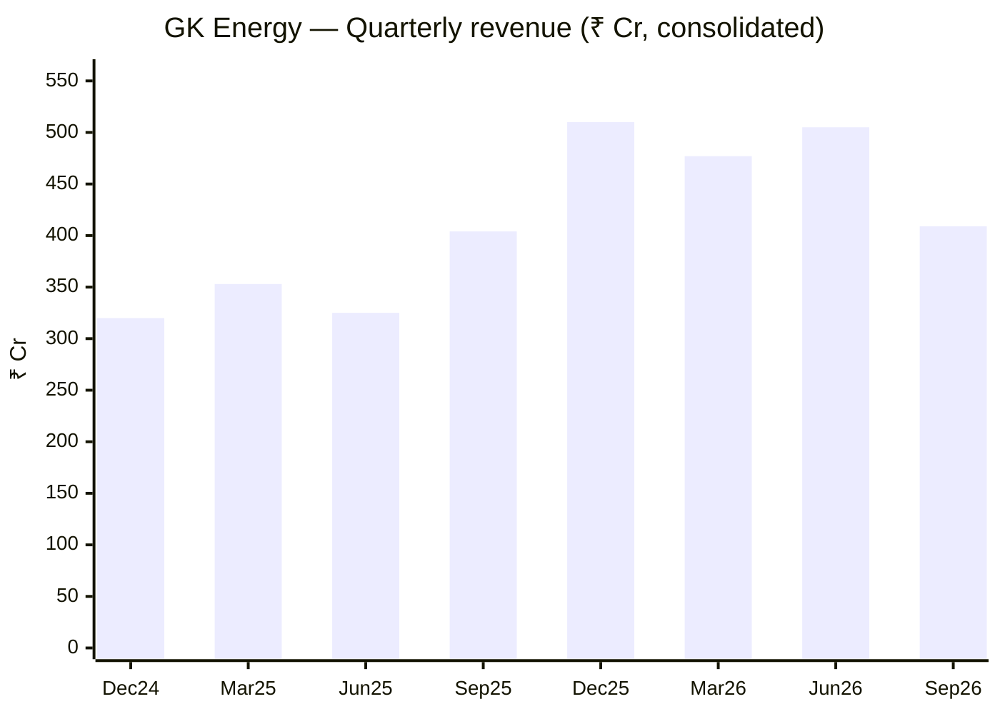
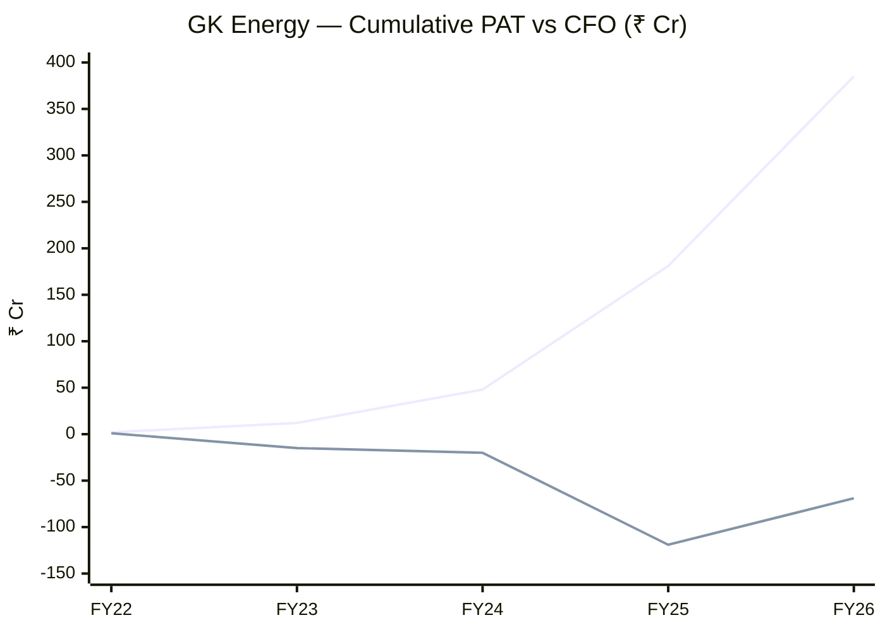
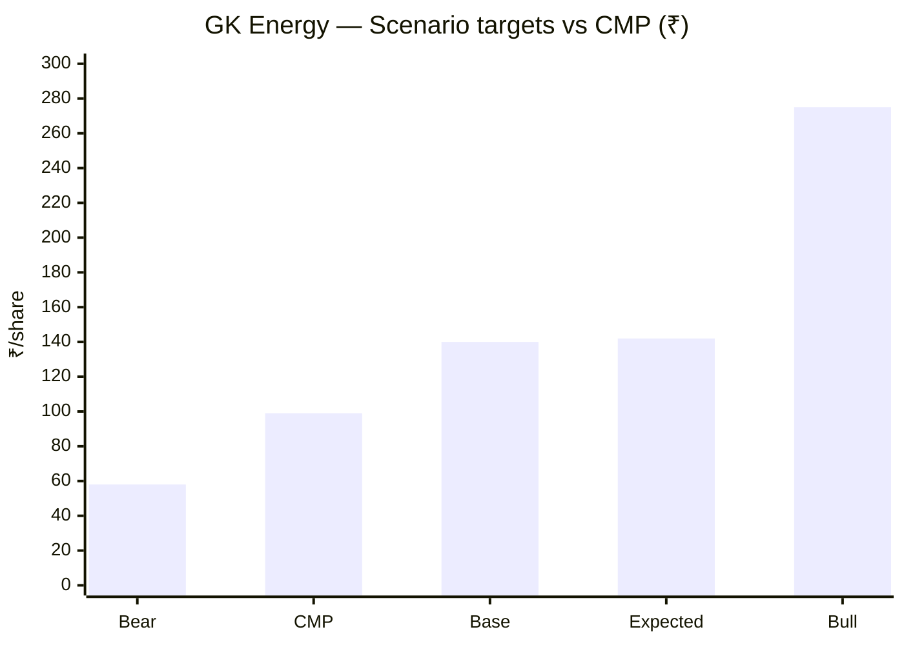

# Stock Analysis Report — GK Energy Ltd (NSE: GKENERGY | BSE: 544525)
**Date:** 2026-10-29
**Analyst:** Claude (Stock Fundamental Analysis Skill v3.3)
**Investment Horizon:** 2–3 Years
**Recommendation:** AVOID for now — fundamentally "Cheap but Flawed"; re-entry watchlist
**Conviction Score:** 4 / 10
**CMP:** ₹99 (29-Oct-2026) | **Market Cap:** ₹2,008 Cr | **Shares:** ~20.3 Cr (FV ₹2) | **TTM P/E:** ~8.8× | **P/B:** 2.3× | **IPO price:** ₹153 (Sep-2025)
**Filed under:** Power-and-Renewables / Renewable-EPC-and-IPP · Themes: Renewables & energy transition

## Revision Log
| Version | Date | Recommendation | Conviction | Price | Key change |
|---|---|---|---|---|---|
| Current | 2026-10-29 | AVOID now / Cheap-but-Flawed watchlist | 4/10 | ₹99 | Q2 FY27 revenue flat YoY and −19% QoQ; FY27 ₹3,000 Cr guidance now needs H2 = 2.3× H1; order book fell to ₹541 Cr; KUSUM 2.0 still not approved; new 150 MW/300 MWh BESS LoA adds a capex-funded annuity; stock −35% since June, P/E 9× |
| Previous | 2026-06-20 | WAIT FOR CONFIRMATION | 5/10 | ₹151 | Initial report (full text in git history) |

**Validation of previous report:**
| Item | Previous | Now | Status |
|---|---|---|---|
| CMP / mcap (Jun-2026) | ₹151 / ₹3,067 Cr | Screener: ₹152 on 24-Jun-2026 | ✅ Validated (now ₹99 / ₹2,008 Cr) |
| FY26 revenue / PAT | ₹1,533 / ₹201 Cr | Standalone figures; **consolidated ₹1,715 / ₹204 Cr** used from now on | 🔄 Updated |
| FY26 EBITDA margin | 20.4% | Standalone 20%; **consolidated 18%** | 🔄 Updated |
| "1 GW solar module plant, ~₹250 Cr debt-funded" | Central thesis question | Management (Q4 FY26 & Q1 FY27 calls): **asset-light, OEM/ODM partners, no large manufacturing capex**; backward integration only "under consideration". FY26 fixed-asset jump (₹14 → ₹110 Cr) = **~₹90 Cr corporate office** bought as collateral for bank limits | ❌ Corrected — premise was wrong |
| Manufacturing incremental ROIC 7.1% | stated | Removed (premise false); replaced with BESS project analysis | ❌ Corrected |
| IPO "listed at ₹171" | stated | **Issue price ₹153**; opened ₹165, high ₹173.65 on 26-Sep-2025 | ❌ Corrected |
| Promoters 79.2% / DII 8.3% | stated | 79.20% ✅ / **DII 7.03%** (Sep-26) | ✅ / 🔄 |
| Promoter pledge zero | stated | Not re-sourced | ⚠️ Unverifiable |
| Debtor days 140 | standalone | Consolidated **125** (FY26) | 🔄 Updated |
| Sloan accrual 24.8% | stated | Consolidated FY26 **30.7%** | 🔄 Updated |
| 276 MW / 61,085 pumps FY26 | stated | Not re-sourced | ⚠️ Unverifiable |
| Verdict "WAIT" with Stage-4 hard stop triggered | stated | Skill rule: any hard stop = AVOID | ❌ Corrected (classification error) |
| Weinstein Stage 4 | stated | Still Stage 4 | ✅ Validated |

---

## Executive Summary
GK Energy is an asset-light solar-pump EPC house (Pune) that installs PM-KUSUM / Magel Tyala solar pump systems using contract-manufactured kit; it went from ₹70 Cr to ₹1,715 Cr revenue in four years with ~18% EBITDA margins and now holds net cash after a ₹400 Cr fresh-issue IPO. At ₹99 it trades at ~9× TTM earnings, the 2nd percentile of its own short P/E history — the market is pricing a scheme cliff. **Thesis (conditional):** if KUSUM 2.0 is approved and GK's 15%+ Maharashtra share carries over, today's price embeds almost no growth; rooftop solar and the new 150 MW BESS annuity cushion the gap. **Key risk:** Q2 FY27 already shows the cliff (revenue +1% YoY, −19% QoQ, order book ₹541 Cr), cash conversion has been poor since listing, and the stock is in Stage 4.

### C2 — Quarterly revenue (consolidated, ₹ Cr)
| Qtr | Dec-24 | Mar-25 | Jun-25 | Sep-25 | Dec-25 | Mar-26 | Jun-26 | Sep-26 |
|---|---|---|---|---|---|---|---|---|
| Revenue | 320 | 353 | 325 | 404 | 510 | 477 | 505 | ~409 |
| OPM % | 17 | 19 | 18 | 18 | 19 | 18 | 16 | n/a |
| PAT | 37 | 45 | 37 | 47 | 61 | 59 | 60 | 49 |
*Sep-26 revenue derived: H1 FY27 ₹913.8 Cr (Whalesbook) − Q1 ₹505.2 Cr. Sep-26 PAT ₹49.4 Cr (AngelOne). EBITDA not yet available — concall today (29-Oct-2026, 3:30 pm).*

**Read:** Five quarters of step-ups ended in Sep-26: revenue roughly equal to a year ago and 19% below June.
**Business inference:** The pump business is now limited by tender flow, not by execution capacity (15,000 pumps/month). Growth will not resume until a new scheme phase or rooftop scale-up arrives.

---

## Business Primer

GK Energy designs, supplies, installs and maintains solar-powered agricultural pump systems — panels, pump, controller, structure and five-year maintenance — mainly under PM-KUSUM Component B and Maharashtra's Magel Tyala scheme run through MSEDCL. In FY25 about 84% of revenue came from this, sold to farmer-beneficiaries with the subsidy paid by state agencies. Revenue is installations × realisation per system, recognised on installation milestones. Operations are concentrated in Maharashtra and Madhya Pradesh (plus five smaller states, 7,500+ villages). The company does not manufacture: it buys kits from OEM/ODM partners and adds value in tender wins, logistics, decentralised warehousing and field execution. It is now adding residential rooftop solar (5% of revenue, 20% of order book in Q1 FY27) and, since Sep-2026, a 150 MW / 300 MWh grid battery project for MSEDCL that will earn a fixed ₹42.84 Cr/year for 15 years.

This is an asset-light, government-procurement EPC business. The value driver is tender volume at a stable spread over kit cost; the key risks are scheme continuity, a single dominant buyer (Maharashtra), and slow subsidy collections. Two structural features colour the analysis. The near-term P&L is governed by a policy calendar (Component B deadline 30-Sep-2026; KUSUM 2.0 awaiting Cabinet), not by company decisions. And the business is turning partly into an infrastructure owner: BESS is long-life, debt-funded and annuity-like, unlike anything GK has done before.

**Segment check:** *Solar EPC* — KPI reference available ✓ (`05-industry-kpis-india.md` line 947).

---

## Module 1 — Broad Market Cycle
**CAUTIOUS.** Nifty 50 22,753 (26-Oct-2026), down from ~24,500–25,000 in June; India VIX 17.2. The small-cap renewables cohort is in a bear phase. Sizing below normal.

## Module 1b — Sector Cycle
**HEADWIND** — same scheme-cliff evidence as the Shakti report: KUSUM-B 9.30 lakh sanctioned / 8.40 lakh installed (31-Aug-2026) against a 14 lakh target, leaving ~90,000 sanctioned pumps nationally. The Component B commissioning deadline was 30-Sep-2026, and nothing can be extended beyond 31-Mar-2027. KUSUM 2.0 has not been approved by Cabinet. Competitive bidding is cutting realisations (Oswal ~−9%). **Secular baseline:** state schemes (Magel Tyala phases 6–7 in pipeline per management) + rooftop (PM Surya Ghar / Maharashtra Smart scheme). Cyclical share of FY25–26 growth: ~70%.

## Module 1c — Stock Cycle
- **Revenue driver:** Volume (Q1 installations +123% to 24,118) at "stable realisations" per management, but Q2 volume fell back.
- **Guidance vs reality:** FY27 target ~₹3,000 Cr (pumps ₹2,200–2,400 Cr + rooftop ₹600–1,000 Cr). H1 = ₹914 Cr, so H2 must be **₹2,086 Cr (2.3× H1)**. Even with Q4 seasonality (35–40% of a year), this needs KUSUM 2.0 or large state orders in Q3. Base case: **~₹1,950–2,000 Cr**.
- **FCF inflection:** FY27 marginally positive if receivables hold; BESS capex pushes FY28 negative.
- **Classification:** **Trough / gap year** in a policy-driven cycle; MoS widest; size ×0.5.

---

## Module 2 — Industry Structure & Capital Cycle
| Force | Verdict |
|---|---|
| New entrants | Unfavourable — empanelment is easy; GK itself scaled from ₹70 Cr in 3 years |
| Supplier power | Moderate — DCR modules are the main cost; asset-light means no stranded capacity |
| Buyer power | Highly unfavourable — MSEDCL and state agencies, L1 tenders |
| Substitutes | Favourable — diesel/grid pumps are disfavoured by policy |
| Rivalry | Unfavourable — Shakti, Oswal, Tata Power, regional EPCs bidding down the last tranches |

**Verdict: NEUTRAL-to-UNATTRACTIVE. Capital cycle: LATE** (sector IPO/QIP wave in 2025 and capacity additions by manufacturers). GK's asset-light model is the *right* structure for a late cycle: little fixed cost to under-absorb.

## Module 3 — Business Quality & Moat
**Moat: NONE-to-NARROW.** No cost advantage (no manufacturing), no customer captivity (re-tendered). **Local scale in Maharashtra** (15%+ share per management; 8–9% nationally) gives execution reliability and agency relationships — a real but contestable edge.
- **Buffett 10% test:** Fail.
- **Evidence of execution edge:** GK held 16–19% margins through the price war while Shakti (integrated manufacturer) fell to 9% — the asset-light model passes the downturn better.
- **Fisher 15-point: 26 / 45.** Point 15 (Integrity): **PASS** — no enforcement found. Watch item: a ₹90 Cr corporate-office purchase in the IPO year (~10% of post-IPO net worth) for bank-limit collateral is an unusual use of capital (seller/RPT status not verified).

## Module 4 — Management & Capital Allocation
**Promoters 79.20%** (Gopal Kabra, MD & CEO; Mehul Shah) · pledge ⚠️ not re-verified · **DIIs 8.64% → 7.03%**, FIIs ~1% · shareholders 65,099 at listing → 47,617 → **58,390** (retail returning on the fall).

**Capital allocation: AVERAGE.** IPO cash was used to cut bank debt (interest ₹11 Cr/qtr → ₹5 Cr in Q1 FY27) — good. The ₹90 Cr office is questionable. BESS (150 MW/300 MWh, five new BESS subsidiaries approved Oct-2026) diversifies into a 15-year annuity — sensible on paper, but it contradicts the Q4 FY26 statement that BESS was a ">5-year" idea with no near-term plans.

### Walk-the-Talk Scorecard
| When | Statement | Guided | Actual | Verdict |
|---|---|---|---|---|
| Q2 FY26 | Receivable days normalising | ↓ | 120 → 125 days (cons.) | ❌ Miss |
| Q4 FY26 | EBITDA margin double-digit in FY27 | >10% | Q1 16–17% | ✅ Hit |
| Q4 FY26 | Order book ~₹1,400 Cr by end-Q1 FY27 | 1,400 | ₹541 Cr (30-Jun) | ❌ Miss |
| Q4 FY26 | KUSUM 2.0 scale-up from Q3 FY27 | Q3 FY27 | Not Cabinet-approved by late Oct | ⚠️ Pending, likely miss |
| Q4 FY26 | No large manufacturing capex | — | None started | ✅ Hit |
| Q4 FY26 | BESS only beyond 5 years | — | LoA within 6 months | 🔴 Reversal |
| Q4 FY26 / Q1 FY27 | FY27 revenue ~₹3,000 Cr | 3,000 | H1 ₹914 Cr (30%) | ⚠️ Tracking to a miss |

**WTT Score: 0.36 / 1.00 — UNRELIABLE** (2 hits + 1 near-miss credit for 7 points; FY27 revenue scored as a near-miss pending H2). **Pattern:** timelines tied to government decisions are consistently early; margin guidance is conservative and delivered. **Insider action:** no promoter open-market buys found after a 35% fall from the IPO price. **DCF impact:** revenue guidance haircut ~35%; margin guidance used as-is. **Credibility: MODERATE on margins, LOW on volume and timelines.**

---

## Module 5 — Financial Forensics (consolidated)
| Check | Result | Verdict |
|---|---|---|
| Cumulative CFO FY22–FY26 | **−₹69 Cr** vs cumulative PAT ₹385 Cr | 🔴 |
| FY26 CFO / EBITDA | 50 / 309 = 16% | 🔴 |
| Sloan accrual FY26 | (204 − 50 + 136) / avg TA 944 = **30.7%** | 🔴 |
| Debtor days | 135 → 120 → 125 | ⚠️ Stable but high |
| Beneish M-Score FY26 (approx.) | **≈ −1.22** (above −1.78) — driven by SGI 1.57 and TATA 0.12; DSRI only 1.04 | ⚠️ Formal trigger, explained by hyper-growth + govt receivables (no receivable-to-sales spike) |
| Altman Z'' FY26 | ≈ 9.9 (reserves include IPO premium) | ✅ Safe |
| Piotroski FY26 | **4 / 9** | ⚠️ Average |
| Leverage | Borrowings ₹206 Cr vs net surplus cash ~₹240 Cr (mgmt, Mar-26) | ✅ |
| Audit / RPT | Not re-reviewed this run; office purchase counterparty unverified | ⚠️ |

**Forensic red flags: 4 / 15.** The Beneish trigger is a known false-positive pattern for a company growing 57% with subsidy receivables. Because the hard-stop rule says "without explanation", it is explained here rather than treated as a stop. It still has to be re-tested on FY27, when growth slows: if TATA stays high while SGI falls, it becomes a real flag. **Verdict: aggressive but defensible earnings quality; cash conversion is the weak link.**

### C7 — Cumulative PAT vs CFO (₹ Cr)
| FY | 22 | 23 | 24 | 25 | 26 |
|---|---|---|---|---|---|
| Cum PAT | 2 | 12 | 48 | 181 | 385 |
| Cum CFO | 1 | −15 | −20 | −119 | −69 |

*Colour key: line 1 = cumulative PAT, line 2 = cumulative CFO.*
**Read:** Five years and ₹385 Cr of profits have produced negative cumulative operating cash; FY26 was the first year CFO turned positive.
**Business inference:** Growth was funded by banks and then the IPO, not by the business. The pause in growth is the test: an asset-light EPC should *release* cash when it stops growing. If FY27 CFO is not strongly positive, the receivables are the problem, not growth.

## Module 6 — Earnings Quality & Financial Statements
**ROCE:** FY26 ≈ EBIT ₹315 Cr / avg CE (~₹750 Cr) ≈ **42%** (inflated by the late-year IPO cash); on year-end CE (₹1,094 Cr) ≈ 29% → well above **WACC ~14%**. Value-creating at the operating level.

### DuPont
| Year | EBIT margin | AT | Equity multiplier | Interest burden | Tax burden | ROE (yr-end eq.) |
|---|---|---|---|---|---|---|
| FY24 | 13.1% | 1.92× | 3.82× | 0.89 | 0.75 | 64% |
| FY25 | 18.4% | 1.88× | 2.79× | 0.89 | 0.74 | 64% |
| FY26 | 18.4% | 1.31× | 1.47× | 0.87 | 0.75 | 23% |
*Only three years of audited history exist.*

**Read:** ROE fell from 64% to 23% entirely through **financing** (IPO equity cut the multiplier from 3.8× to 1.5×) and AT (cash + receivables); operating margin held. **DuPont verdict:** high-quality operating ROE; the reported decline reflects de-leveraging, not deterioration — the opposite of Shakti's pattern.

**OCF/NI (5-yr):** negative → **Low.** **O'Glove flags: 4 / 15.**

---

## Module 7 — Industry KPIs & Peer Analysis (Solar EPC block)
| KPI | GK Energy | Healthy | Assessment |
|---|---|---|---|
| Order book / TTM revenue | ₹541 Cr / ₹1,901 Cr = **0.28×** (30-Jun) | > 1.5× | 🔴 Below |
| EBITDA margin | 16–18% | 8–14% (EPC norm) | ✅ Above |
| Working-capital days | 72 (FY26) | < 90 | ⚠️ Rising (44 → 72) |

### Peer comparison
| Metric | GK Energy | Shakti Pumps | Oswal Pumps |
|---|---|---|---|
| FY26 revenue (₹ Cr) | 1,715 | 2,698 | ~2,064* |
| 3-yr revenue CAGR (FY23–26) | 82% | 41% | n/a |
| Latest EBITDA margin | 16–17% (Q1) | 8.6% (Q2) | 17.4% (Q1) |
| Net debt | Net cash ~₹240 Cr | ~₹890 Cr | n/a |
| TTM P/E | **8.8×** | 27.7× | n/a |
| Model | Asset-light EPC | Integrating into cells/modules | Manufacturer |
*Oswal per Saur Energy, 24-Sep-2026.*

**Peer positioning:** Deep discount to Shakti — **justified partly** (GK is younger, smaller, Maharashtra-concentrated, and has no manufacturing or export business) but **not fully**: GK has the better margin, the clean balance sheet and no capex overhang.

### Order Book Tracker
| Date | Order book (₹ Cr) | Note | Source |
|---|---|---|---|
| 31-Mar-2026 | 710 | incl. a recent ~₹350 Cr order | Q4 FY26 call (Arthneeti) |
| 30-Jun-2026 | 541 | rooftop ~20% of book | Q1 FY27 presentation (Arthneeti/Multibagg) |
| Sep-2026 | BESS LoA 150 MW/300 MWh — ₹42.84 Cr/yr × 15 yrs (₹643 Cr undiscounted) | **Framework/annuity — excluded from EPC book** | NSE filing 21-Sep-2026 (Sahi, SolarQuarter) |

**Reconciliation:** Q1 FY27 implied inflow = 541 − 710 + 505 = **₹336 Cr** → book-to-bill **0.67**. Expected Smart-scheme rooftop orders (₹300–400 Cr) and Magel Tyala phases 6–7 have not appeared as filed awards in the sources reviewed. *Reg 30 ledger not harvested this run; Q2 FY27 order book due on today's call.*
**Verdict:** firm visibility ~3–4 months; book-to-bill < 1; BESS is a separate capex project, not EPC backlog.

## Module 8 — Market Size & Share
- **Share:** 8–9% of national KUSUM-B, 15%+ in Maharashtra (management).
- **TAM now:** residual KUSUM-B ~90,000 pumps nationally (≈ ₹2,300–2,700 Cr) shared by all vendors, + Magel Tyala phases + rooftop (management cites a ~70 lakh-system national rooftop pool).
- **Verdict:** gaining share in a pool that is shrinking until KUSUM 2.0 → revenue now set by the pool, not by share.

---

## Module 9 — Valuation: PIE First, Then DCF
**EV** ≈ ₹2,008 Cr − ~₹240 Cr net cash (Mar-26; Q2 balance due today) ≈ **₹1,770 Cr**. TTM EBITDA ≈ ₹330 Cr → **EV/EBITDA ≈ 5.4×**.

### PIE
NOPAT₀ ≈ TTM EBIT ₹325 Cr × 0.75 ≈ ₹245 Cr; WACC 14%.
g ≈ (1,770 × 0.14 − 245) / (1,770 + 245) ≈ **0.1% — zero growth priced.**

| Driver | Market-implied | My base | Gap |
|---|---|---|---|
| Revenue CAGR (3-yr) | ~0% (flat earnings in perpetuity) | ~8% (₹1,901 → ₹2,440 Cr FY29 incl. BESS) | Pessimistic |
| EBITDA margin | ~16% held | 15–16% | ~Fair |
| Investment rate | none | BESS ~₹350 Cr + WC | Market ignores BESS capex (offsetting) |

**PIE classification: MILDLY PESSIMISTIC.** Note the caveat: the reverse DCF uses NOPAT, but GK's NOPAT has historically not converted to cash. On a cash basis the market is fairer than it looks. **Treadmill:** GK only needs to *hold* FY26-level earnings to earn its cost of capital; any KUSUM 2.0 volume is upside.
**Triggers:** (+) KUSUM 2.0 Cabinet approval; Magel Tyala phase-6 award; FY27 CFO > ₹150 Cr. (−) H2 FY27 revenue below H2 FY26 (₹987 Cr); receivables > 150 days; equity raise for BESS.

### Forward model (base)
| ₹ Cr | FY26A | FY27E | FY28E | FY29E |
|---|---|---|---|---|
| Revenue (EPC) | 1,715 | 1,960 | 2,100 | 2,400 |
| BESS revenue | — | — | — | 43 |
| EBITDA | 309 | 324 | 315 | 398 |
| EBITDA margin | 18.0% | 16.5% | 15.0% | 16.3% |
| D&A | 4 | 6 | 10 | 30 |
| Interest | 41 | 25 | 30 | 55 |
| PAT | 204 | 228 | 213 | 242 |
| EPS (₹) | 10.1 | 11.2 | 10.5 | 11.9 |
| Capex (BESS equity + other) | 136 | ~110 | ~260 | ~40 |
| FCF | −49 | ≈ +30 | ≈ −60 | ≈ +150 |
| Debt / EBITDA | 0.7× | ~0.6× | ~1.2× | ~1.2× |
*BESS capex, debt split and VGF amount are not disclosed — the figures above are estimates (~₹1.0–1.2 Cr/MWh gross, net of VGF, ~70% project debt). BESS gross yield ~₹43 Cr on ~₹270–330 Cr net cost ≈ 13–16% pre-O&M: roughly WACC-neutral, a cushion rather than a value driver.*

**ICR:** > 7× throughout → no lender-behaviour risk.

### Scenarios (FY29)
| Scenario | Assumption | FY29 revenue | EBITDA % | EPS | Multiple | Target | Prob. |
|---|---|---|---|---|---|---|---|
| Bull | KUSUM 2.0 large from FY28; rooftop scales | 3,543 | 17% | ₹19.7 | 14× | **₹275** | 20% |
| Base | KUSUM 2.0 from H2 FY28 | 2,443 | 16% | ₹11.9 | 12× | **₹140** | 50% |
| Bear | KUSUM 2.0 slips to FY30; price war | 1,443 | 14% | ₹4.8 | ~1× P/B | **₹58** | 30% |
| **Expected value** | | | | | | **₹142** | |

**Read:** The expected value (₹142) sits 44% above the price, and the bull case is nearly 3× the price; the bear case still loses ~40%.
**Business inference:** The payoff is asymmetric because the market already prices the cliff. What remains is timing risk (KUSUM 2.0) plus a cash-conversion risk that could turn "cheap" into "value trap".

- **3-yr expected return:** +44% (~13% CAGR) — about equal to cost of equity, so **no margin of safety on expectation** for a small-cap with scheme and concentration risk (40–50% MoS required).
- **Upside/downside:** (275−99)/(99−58) = **4.3:1** ✅. **SVAR:** 41% (borderline).
- **Graham number:** √(22.5 × avg EPS ~₹7.8 × BV ₹43.6) ≈ **₹87**.
- **P/E band (since listing):** median 13.3×, p10 10.4×, p90 19.9× → current 9.3× = **2nd percentile** (only one year of history — low statistical weight).

### Cycle Position Dashboard
| Dimension | Current | Median (since IPO / 3-yr) | Signal |
|---|---|---|---|
| P/E | 9.3× | 13.3× | Cheap |
| P/B | 2.3× | ~3.5× | Cheap-ish |
| EBITDA margin | 16–18% | 18% | Mid |
| ROCE | ~29–42% | 41–74% | Normalising |
| Order cover | 0.28 yr | — | Thin |
| **Overall** | | | **Cheap stock, gap-year earnings, healthy balance sheet** |

---

## Module 10 — Technical Stage
| Level | Stage | Evidence |
|---|---|---|
| Nifty 50 | Stage 3/4 risk | 22,753; VIX 17 |
| Sector cohort | Stage 4 | Shakti / GK / Oswal −50–65% |
| GKENERGY | **Stage 4** | ₹99 vs 30-week MA **₹126, flat-to-declining** (₹126.7 four weeks ago); failed the Jun-26 rally at ₹152; 52-wk low ₹87.2 (intraday) / ₹90.2 (close) |

- **RS vs Nifty:** negative (−51% over 12 months).
- **Volume:** 50-day average ~6 lakh shares/day; ~13 lakh on today's results day — distribution.
- **CANSLIM: 1 / 7** (A only).
- **Hard stop:** Stage 4. **Re-entry:** base ≥ 12 weeks above ₹87–90, 30-week MA flattening, weekly close above ~₹130 on ≥1.5× volume — **or** a fundamental trigger (KUSUM 2.0 approval) plus a Stage-1 base.

---

## Module 11 — Forward View

### Capex classification
| Type | FY27E | FY28E | FY29E | In model |
|---|---|---|---|---|
| EPC growth capex | ~10 | ~10 | ~10 | Asset-light — not an AT business |
| BESS 150 MW/300 MWh (equity + project debt) | ~100 | ~250 | ~30 | ✅ Annuity, 18 months from BESPA |
| Corporate office (FY26, ₹90 Cr) | done | — | — | ❌ Non-productive |
EPC revenue is modelled on order book × execution plus scheme flow (Module 1c), not on gross block.

### Catalysts
1. KUSUM 2.0 Cabinet approval and state allocations — FY27 H2 / FY28 H1
2. Magel Tyala phase 6/7 awards (Maharashtra) — Q3–Q4 FY27
3. Strong FY27 CFO as growth pauses (receivables release) — Q4 FY27
4. BESPA signing and financial close for BESS — FY27–28
5. Rooftop (Maharashtra Smart scheme) orders of ₹300–400 Cr — FY27

### Risks
1. KUSUM 2.0 delay beyond FY27 — **High**
2. Maharashtra concentration / MSEDCL payment delays — **Medium-High**
3. Receivables fail to convert as growth slows — **Medium**
4. BESS cost overrun or equity raise — **Medium**
5. Key-man (Gopal Kabra) — **Medium**

---

## Checklist Summary
**Section 0:** complete — 13 items validated (4 ❌ corrected), renamed via `git mv`.
**A:** 13/18 (scuttlebutt, pledge, RPT schedule not re-done). **B:** 8/9. **C:** 8/12 (three-year history limits 10-yr items). **D:** 6/7. **E:** 5/7. **F:** 9/10. **G:** 7/8. **H:** most items done; BESS costs estimated. **I:** C2, C7, C13 + DuPont / P/E-band tables; C1 skipped (fewer than 4 annual points on a meaningful base).
**Order Book Tracker:** snapshots + reconciliation; Reg 30 ledger not harvested.
**Hard stops:** **Weinstein Stage 4.** Beneish > −1.78 — triggered but explained (see Module 5).

---

## Investment Decision
**Recommendation: AVOID for now (Stage-4 hard stop) — fundamentally CHEAP BUT FLAWED; keep on the re-entry watchlist** | **Conviction: 4 / 10** | **Position: 0% now; 1–2% max on re-entry**

GK is the better business of the two solar-pump names analysed today: an asset-light model that held its margins, a net-cash balance sheet, and a price that already assumes no growth. What blocks it is timing and cash conversion. Revenue has stalled while the policy window is closed, guidance is far from reality, and the chart is still in Stage 4.

| Parameter | Value |
|---|---|
| Re-entry trigger (fundamental) | KUSUM 2.0 Cabinet approval **or** Magel Tyala phase-6 award, plus FY27 CFO clearly positive |
| Re-entry trigger (technical) | Stage-1 base ≥ 12 weeks; weekly close > ~₹130 on volume |
| Value zone | ₹80–90 (≈ Graham number, ~7–8× EPS) |
| Invalidation | Receivables > 150 days; H2 FY27 revenue below H2 FY26; promoter pledge appears |
| Base target (3-yr) | ₹140 · Bull ₹275 · Bear ₹58 |

---
*Sources: Screener.in consolidated + standalone financials, shareholding and price series (29-Oct-2026); [AngelOne — Q2 FY27](https://www.angelone.in/news/stocks/gk-energy-share-price-falls-over-3-after-q2-fy27-earnings-results-total-income-up-10-8-yoy); [Whalesbook — H1 FY27](https://www.whalesbook.com/corporate-news/English/energy/GK-Energy-H1-Net-Profit-Jumps-29percent-to-Rs-1090-Million/6ae2e9afc6c6dccbb90a9f8d); [Arthneeti Q1 FY27](https://www.arthneeti.com/insights/gk-energy-q1-fy27-earnings) and [Q4 FY26](https://www.arthneeti.com/insights/gk-energy-q4-fy26-earnings) call summaries; [Sahi — BESS LoA](https://www.sahi.com/news/gk-energy-receives-msedcl-award-for-150-mw-battery-storage-with-42-84-crore-annual-revenue); [5paisa — IPO listing](https://www.5paisa.com/news/gk-energy-sales-ipo-listing); [Saur Energy sector piece](https://www.saurenergy.com/solar-energy-news/the-solar-pump-hangover-what-broke-indias-former-renewable-stock-darlings-12573939); [Renewable Watch — MNRE KUSUM timelines](https://renewablewatch.in/2026/03/31/mnre-extends-timelines-for-projects-under-pm-kusum-scheme/); [NSE — Q2 call intimation](https://nsearchives.nseindia.com/corporate/GKENERGY_26102026213049_Intimation_sd.pdf). Q2 FY27 EBITDA, order book and balance sheet were not yet available (concall 29-Oct-2026, 3:30 pm) — refresh after the presentation is filed.*
*Report generated by Stock Fundamental Analysis Skill v3.3 | Indian Markets Context*
