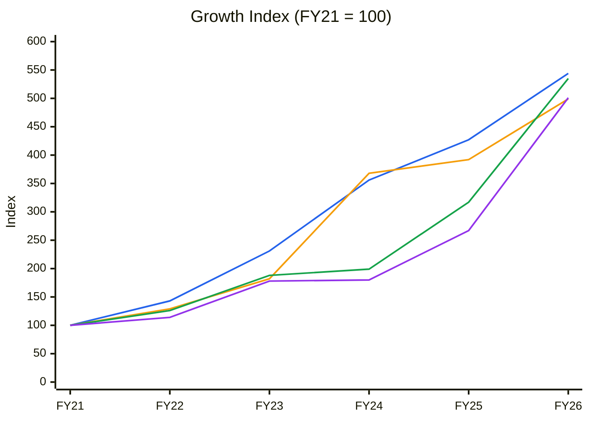
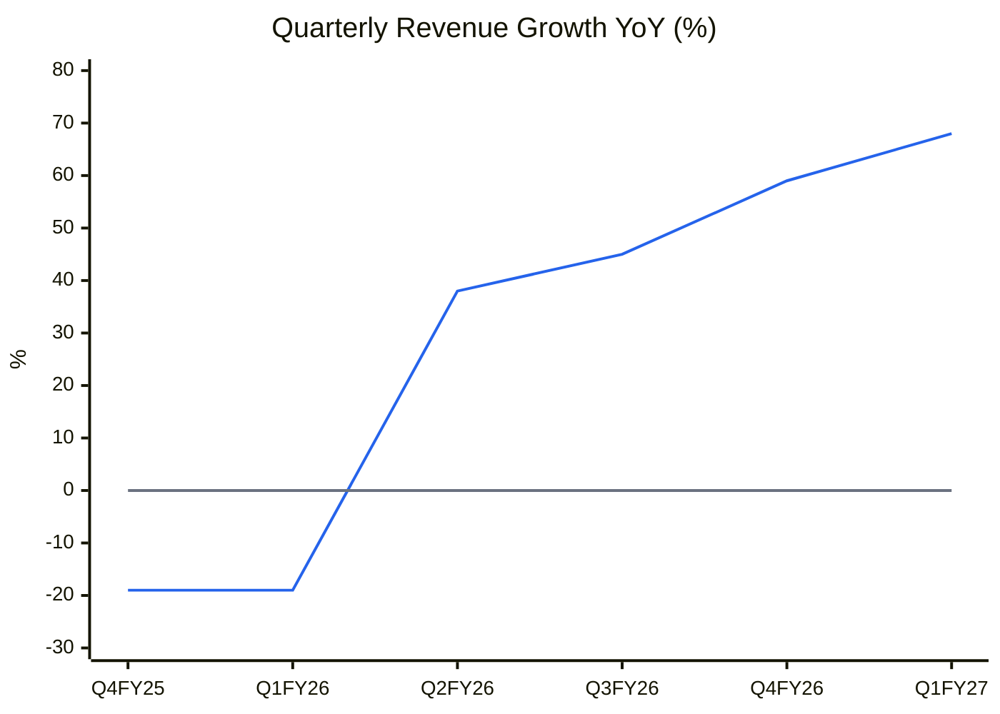
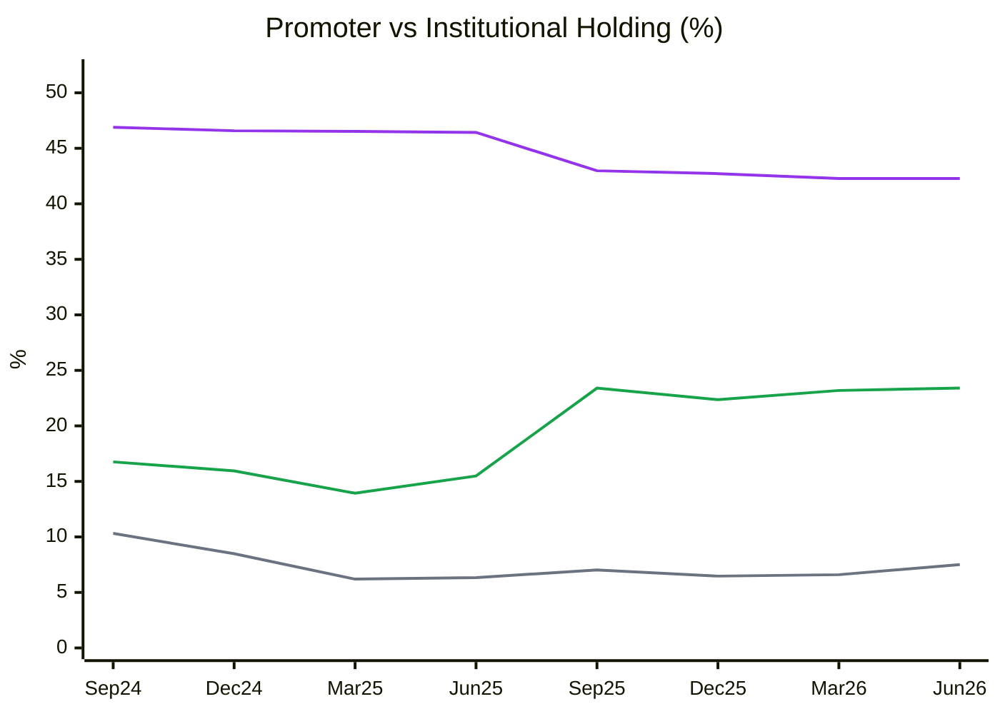
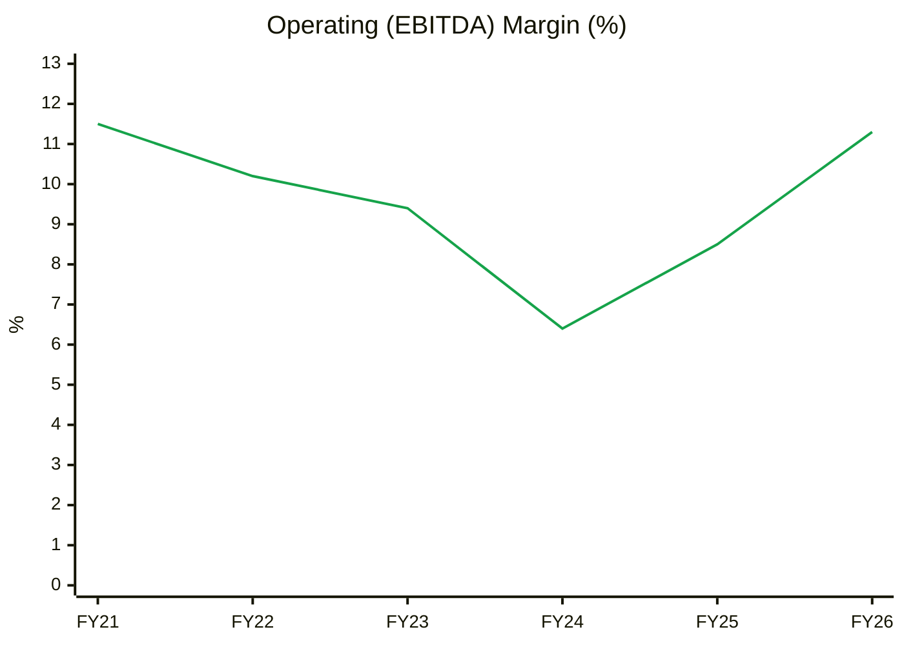
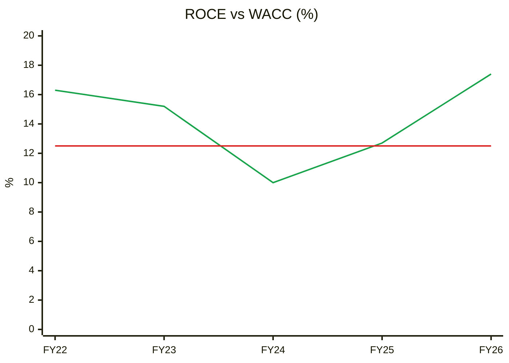
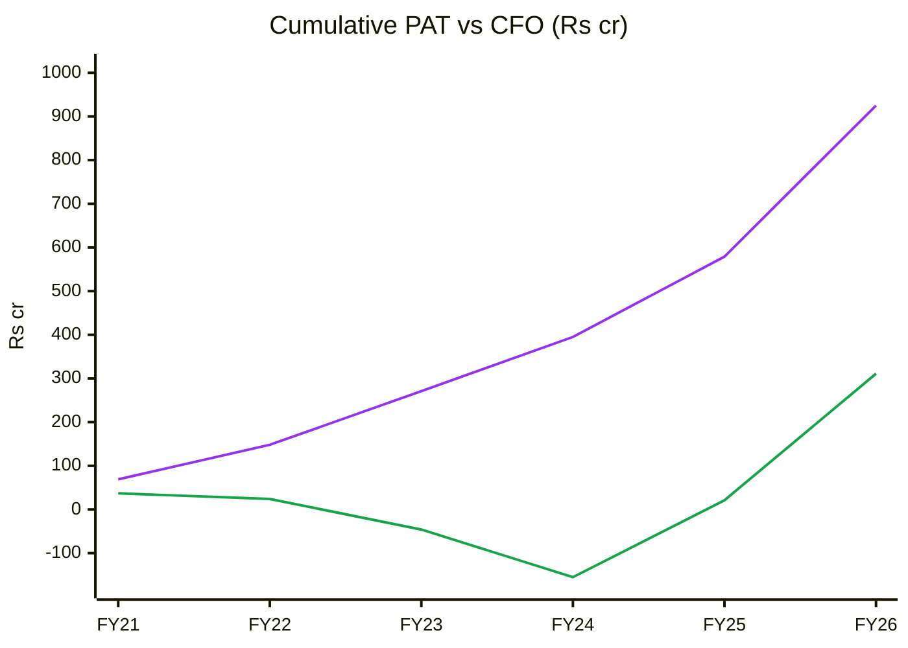
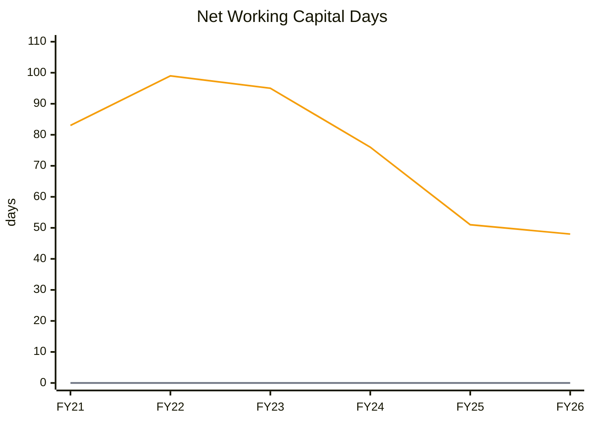
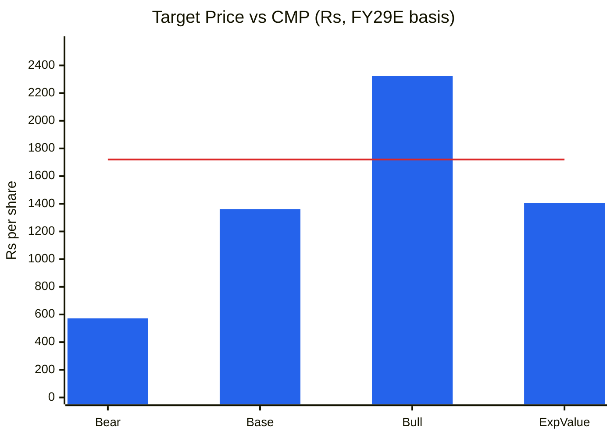

# Stock Analysis Report — Syrma SGS Technology Ltd (SYRMA)
**Date:** 2026-10-12
**Analyst:** Claude (Stock Fundamental Analysis Skill v3.3)
**Investment Horizon:** 2–3 Years
**Recommendation:** WATCHLIST — Quality at Wrong Price (no buy at CMP)
**Conviction Score (as a buy at CMP):** 4.5 / 10
**CMP:** ₹1,720 (NSE close 09-Oct-2026) · **Market cap:** ₹33,165 cr · **Buy-below:** ₹900–1,000

## Revision Log
| Version | Date | Recommendation | Conviction | Price | Key change |
|---|---|---|---|---|---|
| Current | 2026-10-12 | WATCHLIST (Quality at Wrong Price) | 4.5/10 | ₹1,720 | Initial report. Run as part of a four-way EMS comparison (Amber, Dixon, Syrma, PGEL) |

**Validation of previous report:** Initial report. No earlier Syrma file in the library.

---

## Executive Summary
Syrma is the fastest-improving of the four EMS names. Revenue grew 68% YoY in Q1 FY27, FY26 EBITDA margin expanded ~310 bps to ~11%, ROE recovered from 7.9% to 15.0%, and its industrial, auto, healthcare and export mix earns roughly 1.5–3× Dixon's margin. The stock has priced all of it and more. It is up **119% in 52 weeks** to ₹1,720 (89× trailing EPS, 11.6× book). A reverse DCF says the price needs **~25% revenue CAGR for a decade at roughly double today's EBIT margin**. The weak spot is cash: **cumulative CFO over FY21–26 was ₹311 cr against ₹925 cr of PAT**, with receivables at 139 days. Growth is being funded by two ₹1,000 cr QIPs (one done in Aug-2025, a second approved Jul-2026). The business is good and in a genuine Stage 2 uptrend, but the upside/downside at CMP is about 0.5:1.

🟦 Revenue (CAGR 40%) · 🟧 Net Fixed Assets (38%; net block used — gross block not on Screener) · 🟩 EBITDA (40%) · 🟪 PAT (38%)

**Read:** FY21→FY26: revenue 5.4×, net fixed assets 5.0×, EBITDA 5.4×, PAT 5.0×. The four lines move together.

**Business inference:** Syrma has grown roughly in proportion to the capital it deploys, with no operating leverage yet beyond the FY24 trough recovery. The FY26 margin jump restored FY22–23 levels rather than setting new highs. Future operating leverage depends on the PCB plant and the ODM mix (→ Module 11).

---

## Business Primer
Syrma SGS is a Chennai-headquartered electronics manufacturing services company focused on **high-mix, lower-volume** products: printed circuit board assemblies (PCBA), box builds, RFID tags and inlays, magnetics, and increasingly its own designs (ODM: ₹270 cr, 17% of Q1 FY27 revenue). It sells to OEMs in **industrial, automotive, healthcare, consumer, IT/railways and exports** (exports 24% of Q1 FY27 operating revenue). Revenue is build-to-order: volume × BOM pass-through plus a conversion and design margin. Because the work is more engineered and the batches smaller than smartphone assembly, margins are 9–12% EBITDA vs ~3–4% at Dixon. Returns depend on (1) winning and ramping new programmes (18 new clients added in Q1 FY27, ~₹1,000 cr potential) and (2) controlling the working capital that high-mix work traps in inventory and receivables.

This is an **asset-moderate, working-capital-heavy engineering-EMS business in a growth spurt.** The key value driver is revenue growth with margin mix. The key risks are working capital and cash conversion, plus the execution of a large, new **₹1,595 cr PCB and copper-clad laminate project** (51:49 JV with Korea's Shinhyup, Naidupeta, Andhra Pradesh; AP incentive ₹856 cr), whose first phase has slipped from Oct-2026 to Apr-2027. Structural features: the balance sheet is equity-funded (net cash after the Aug-2025 QIP of ₹1,000 cr, with a second ₹1,000 cr QIP approved), so dilution is a recurring cost. Margins swing quarter to quarter with the seasonal consumer mix (Q1 consumer share 34%, full-year target 30–32%).

**Segment check:** EMS / Consumer Durables Contract Manufacturing. KPI reference available ✓ (line 2023).

---

## Module 1 — Broad Market Cycle
Nifty 22,520, ~14.5% below its 52-week high, below a falling 30-week MA. P/E ~19.3× (about average). VIX 14.35. **Assessment: Cautious.** A momentum mid-cap at 89× is vulnerable if risk appetite falls further. Sizing: small.

## Module 1b — Sector Cycle
- **Secular:** Industrial and auto electronics content growth, China+1 export sourcing (exports guided +30–40% in FY27), and PCB/component localisation (ECMS). These are durable in the high teens to 20s.
- **Cyclical:** FY26–27 growth includes the recovery from the FY24–25 consumer-mix trough (Q4 FY25 and Q1 FY26 revenue were −19% YoY) and new-client onboarding. The base effect flatters Q2–Q4 FY26 and Q1 FY27 (+38% to +68%).
- **Input / supply:** Middle East geopolitics and component supply were flagged in the Q1 FY27 call. Copper-clad laminate inflation hits PCB economics.
- **Split (estimate):** ~20–25% secular baseline. The rest of today's 50–68% growth is recovery plus onboarding, which will fade by FY28.
- **Verdict: Tailwind.** Do not embed 35%+ beyond FY28.

## Module 1c — Stock Cycle

🟦 Revenue YoY % · ⬜ zero line

**Read:** YoY growth went from −19% (Q4 FY25, Q1 FY26) to +68% (Q1 FY27). Six quarters of acceleration.

**Business inference:** Textbook acceleration. It is partly a low base, but new clients and exports show the mix shift is real. The second derivative turns negative from Q3 FY27 as the base normalises, which is when momentum stocks usually stall.

- **Revenue drivers:** Volume (new programmes) and mix (ODM, exports, industrial). Price is pass-through.
- **Capacity:** FY27 capex is ₹100–150 cr plus ₹250 cr for the PCB project. The PCB phase 1 starts commercial production around Apr-2027 at 40–50% utilisation in year 1. Management guides 15–18% EBITDA at full ramp but ~10% or less initially.
- **Operating leverage:** Moderate. FY26 DFL ≈ 1.1× (EBIT ₹493 cr / interest ₹48 cr).
- **FCF inflection:** **Not reached.** FCF was −₹446 cr in FY26 and negative in five of the last six years. The PCB project pushes the inflection to FY29+.
- **Classification: Early-cycle ramp-up with a capex wave ahead.** Standard MoS plus 5 pp for the execution risk of a new technology (PCB/CCL).

---

## Module 2 — Industry Structure & Capital Cycle
**Porter:** New entrants moderate (customer qualification in auto, medical and industrial takes 12–24 months, which is a real barrier) · Supplier power high (semiconductors) · Buyer power **moderate** (fragmented OEM base, lower than consumer EMS) · Substitutes: in-house manufacturing · Rivalry: Kaynes, Cyient DLM, Avalon, Centum and global EMS. **Verdict: Neutral to Attractive.** High-mix EMS is structurally better than consumer EMS.
**Capital cycle:** Heavy inflow. Multiple EMS IPOs and QIPs, and many PCB projects under ECMS (Amber/Ascent, Kaynes, Epitome and others) at the same time. PCB oversupply is a 2028–29 risk.

## Module 3 — Business Quality & Moat
- **Greenwald:** (1) Cost advantage: limited. (2) **Customer captivity: moderate-to-strong** in auto, medical and industrial, where re-qualification is costly. Weak in consumer. (3) Local scale: no.
- **Buffett price test:** Partial. ODM and design programmes have some pricing; build-to-print does not.
- **Market share:** Small (<5%) in a fragmented high-mix market. Gaining.
- **Moat verdict: NARROW.** It rests on customer qualification and a growing ODM/design layer.

**Fisher (abridged):** market 3 · new products 3 · R&D 2 · sales 3 · margin 2 · margin improvement 3 · labour 2 · exec 2 · depth 2 · controls 2 · industry advantages 2 · long-range 3 · **dilution 1** (two QIPs in 12 months) · candour 2 · **integrity 2 (pass)**. **Total 34/45.**

---

## Module 4 — Management & Capital Allocation
**Promoter holding:** 42.28% (Jun-2026), down from 46.89% (Sep-2024). Pledge: none disclosed. The decline is **mostly QIP dilution**: shares rose ~8.4% (equity capital ₹178 cr → ₹193 cr) with the Aug-2025 ₹1,000 cr QIP (floor ₹735.61, [ScanX](https://scanx.trade/stock-market-news/corporate-actions/syrma-sgs-technology-launches-qip-with-735-61-floor-price/16131161)). 46.43% ÷ 1.084 ≈ 42.8%. The residual ~0.5 pp is ESOP or minor sales.

🟪 Promoter · 🟩 FII + DII · ⬜ FII alone

**Read:** Promoter holding fell 4.6 pp (mostly the Sep-2025 QIP step). DIIs more than doubled (6.4% → 15.9%); FIIs were flat to down (10.3% → 7.5%).

**Business inference:** Domestic mutual funds came in through the QIP and are now the marginal holder. The next ₹1,000 cr QIP (approved Jul-2026) will dilute another ~3% at today's price. That is the cost of funding a working-capital-heavy model with equity.

- **Capital allocation:** All cash flow and both QIPs go into capex, working capital and the PCB JV. Cumulative FY21–26 CFO ₹311 cr vs CFI −₹2,219 cr; the gap is funded by equity (IPO in 2022, QIP in 2025). Dividend is token.
- **Buffett's 3 C's:** Candour: good (kept margin guidance conservative despite a strong Q1). Competence: improving (FY24 margin trough to FY26 recovery). Caring: neutral (dilution).

### Walk the Talk Scorecard
| Quarter Guided | Statement | Guided | Actual | Verdict |
|---|---|---|---|---|
| Q4 FY25 call | FY26 revenue and EBITDA | Indicated at start of FY26 | FY26 revenue +27%, operating EBITDA ₹545 cr, "ahead of what we had indicated" ([Outlook Business](https://www.outlookbusiness.com/corporate/syrma-sgs-posts-119-crore-profit-in-mar-quarter-revenue-jumps-58)) | ✅ Hit |
| 2025 (JV announcement) | PCB plant commissioning | Oct-2026 | Phase 1 commercial production now Apr-2027 | ❌ Miss (~2 qtr slip) |
| Q4 FY26 call | FY27 revenue growth | 35%+ | Q1 FY27 +68% YoY | ✅ Tracking |
| Q4 FY26 call | FY27 EBITDA margin | 10.5–11% | Q1 FY27 10.2% (consumer-heavy quarter) | ⚠️ Near miss (provisional) |
| 2025 press coverage | PCB to add ₹6,200 cr to FY27 topline | ₹6,200 cr | Plant not producing in FY27 | Not scored. Attribution to management unverified, and not credible |
| Q1 FY27 call | FY27 exports | +30–40% | — | ⏳ Pending |

**WTT Score:** 2.5 / 4 = **0.63 — MODERATE.** Hits 2 · Near misses 1 · Misses 1 · Reversals 0.
**Key pattern:** Delivers on the operating business; slips on new-project timelines (PCB).
**Insider action:** No open-market promoter buying found. Dilution through the QIP. **NEUTRAL.**
**DCF impact:** Haircut growth guidance 10–15% (FY27 modelled at +32%, FY28 +25%). PCB revenue is delayed one year versus management.
**Overall credibility:** MODERATE.

---

## Module 5 — Financial Forensics
| Test | Value | Read |
|---|---|---|
| Beneish M-Score | Partial. DSRI proxy: debtor days 72 (FY23) → 108 → 142 → 139 (FY26) | 🚩 **Receivables have nearly doubled relative to sales over three years** → investigate (likely export, auto and industrial credit terms) |
| Altman Z'' (approx.) | **4.47** (FY24 4.43 → FY25 4.23 → FY26 4.47) | Safe |
| Piotroski F (8 testable) | **5/8** | Average. CFO < NI; dilution; AT down |
| Sloan accrual (CF) | **+15.9%** | 🚩 Warning (> 10%). Inflated by deploying QIP cash into investments (₹547 cr), but the accrual signal stands |
| CFO / PAT (5-yr) | **0.32** | 🚩 Low. PAT is not converting to cash |
| Other income / EBIT | 31 / 493 = 6% | Fine |
| Payables days | 199 (FY26) vs 110 (FY20) | Supplier credit is stretched to offset receivables. Watch DPO normalisation (Schilit CFS #3) |

**Indian flags:** No pledge; RPT not re-read; receivables and payables both stretched.
**Forensic red-flag count:** **3 soft flags** (DSO trend, Sloan, CFO/PAT) → **deep-dive item before any purchase.** This is not evidence of manipulation. The pattern is typical of high-mix EMS growing at 50%+, but it means **reported PAT is not distributable cash**.

## Module 6 — Earnings Quality & Financial Statements

🟩 OPM % (Screener operating profit ÷ sales; excludes other income)

**Read:** OPM fell from 15.7% (FY20) to 6.4% (FY24 trough, consumer-heavy mix) and recovered to 11.3% in FY26.

**Business inference:** The margin is a mix outcome. Each 10 pp of consumer mix is worth roughly 100–150 bps of margin. Management's 10.5–11% guide for FY27 is sensible. The bull case needs the PCB and ODM layers to push it above 12%.

🟩 ROCE (EBIT ÷ avg capital employed, computed) · 🟥 WACC 12.5%

**Read:** Computed ROCE: 16.3% (FY22) → 10.0% (FY24 trough) → 17.4% (FY26), versus WACC of 12.5%.

**Business inference:** Syrma creates value again, but only by ~5 pp. A ₹1,595 cr PCB project earning ~10% margin early will dilute ROCE in FY28–29 before it helps.

🟪 Cumulative PAT · 🟩 Cumulative CFO

**Read:** Over FY21–26, cumulative PAT was ₹925 cr against cumulative CFO of ₹311 cr. CFO was negative for three straight years (FY22–24).

**Business inference:** The weakest cash conversion of the high-margin names. Growth consumes working capital roughly 1:1 with profit. Until receivable days fall back toward ~90, the business needs repeat equity raises, which caps per-share compounding.

### DuPont Decomposition (5-Factor, computed)
| Year | EBIT Margin | Asset Turnover | Equity Multiplier | Interest Burden | Tax Burden | ROE |
|---|---|---|---|---|---|---|
| FY22 | 9.6% | 1.20 | 1.80 | 0.91 | 0.71 | 13.5% |
| FY23 | 10.0% | 1.11 | 1.75 | 0.87 | 0.69 | 11.6% |
| FY24 | 6.6% | 1.01 | 1.98 | 0.80 | 0.75 | 7.9% |
| FY25 | 7.8% | 0.96 | 2.35 | 0.80 | 0.78 | 10.9% |
| FY26 | 10.2% | 0.97 | 2.16 | 0.90 | 0.78 | 15.0% |

**Operating contribution:** Margin-led recovery; AT drifting down (1.20 → 0.97). **Financing contribution:** Multiplier up, then down after the QIP. Not leverage-masking. **Verdict:** ROE recovery is genuine and operational, but capital efficiency (AT) is eroding as working capital and assets build. AT trend for Module 11: **declining, so use 0.95× in the base case.**
**O'Glove flags:** #1 (NI vs CFO), #2 (DSO trend), #3 (AR/revenue rising), #9 (Sloan) → **4/15.** Three or more means deep investigation (done above: a working-capital pattern, not fabrication).

🟧 Debtor + Inventory − Payable days · ⬜ zero line

**Read:** Net working-capital days (debtor + inventory − payable) improved from 99 (FY22) to 48 (FY26), but only because payable days rose to 199. Screener's "working-capital days" metric rose from 37 to 68.

**Business inference:** The headline cash cycle looks better than it is. Suppliers are funding the receivable build. If suppliers tighten terms, working capital could absorb ₹500+ cr.

---

## Module 7 — Industry KPIs & Peers
| KPI | Syrma | Dixon | Amber | PGEL | Assessment |
|---|---|---|---|---|---|
| EBITDA margin (FY26) | **11.3%** | 3.8% | 7.1% | 7.3% | Best (mix) |
| ODM mix | 17% | Low | High (RAC) | High (RAC) | Rising, still small |
| ROCE (Screener) | 16.8% | 29.2% | 10.3% | 10.3% | Above WACC; 2nd best |
| Net WC days | 48 (payables-assisted) | −6 | 53 | 69 | Middling |
| CFO/PAT (5-yr) | 0.32 | 1.22 | 2.78 | 0.20 | Weak |
| Revenue 3-yr CAGR | 33% | 59% | 21% | 35% | Good |
| P/E | 89× | ~90× core | ~92× adj. | 71× | All extreme |
| 52-wk return | **+119%** | −24% | −22% | −13% | Only winner |

**Positioning:** On margin and mix, Syrma deserves to be valued above PGEL and Amber. The market already values it at the top of the group (P/S ~6× vs Dixon ~1.5×, PGEL ~2.5×, Amber ~1.8×).

## Module 8 — Market Size & Share
- **TAM:** Indian non-mobile EMS (industrial, auto, medical, consumer, IT) is roughly US$25–30 bn and growing ~20–25%. PCB demand in India is US$4–5 bn, mostly imported today (industry estimates, ICEA/ELCINA; labelled estimates).
- **Share:** <5% of addressable high-mix EMS, rising. Revenue grew 27% in FY26 and 68% in Q1 FY27 vs the market's ~20–25%, so Syrma is **taking share**, partly on recovery.
- **Verdict:** Ample runway. TAM is not the constraint; cash and execution are.

---

## Module 9 — Valuation: PIE First, Then Own Model
### PIE (reverse DCF: EV ≈ ₹32,800 cr; WACC 12.5%; terminal growth 6%; tax 24%; sales-to-capital 1.6×)
| PIE driver | Market-implied | My base | Gap |
|---|---|---|---|
| Revenue CAGR at today's ~9.5% EBIT margin | **Not reachable.** Even 79%/yr for 10 years does not justify the price at ROIC ~12% | 25% (FY27–29), fading | Optimistic |
| EBIT margin needed at 25%/yr for 10 yrs | **~20%** (ROIC ~24%) | 9.5–10.5% | **Optimistic, ~2× margin** |
| EBIT margin needed at 20%/yr | ~25% | — | — |

**Treadmill:** The price requires Syrma to become a 20%+ EBIT-margin business (comparable to global precision-electronics firms, not EMS) while growing 25% a year for a decade. Even the PCB plant at full ramp (15–18% EBITDA) does not get the blended margin there.
**Positive triggers:** PCB phase 1 on time (Apr-2027) at the guided margin; ODM share above 25%; receivable days below 100. **Negative triggers:** QIP pricing at a discount; growth decelerating as the base normalises from Q3 FY27; PCB delay or cost overrun.
**SVAR:** Bear target ₹572 implies **SVAR ≈ 67%**. Very unfavourable.

### Own model (FY29E)
| Scenario | Revenue FY29 | EBITDA margin | Attrib. PAT | EPS | Multiple | Target | Prob |
|---|---|---|---|---|---|---|---|
| Bull | ₹12,000 cr (PCB on time) | 11.5% | ₹841 cr | ₹42.3 | 55× | ₹2,325 | 25% |
| Base | ₹10,500 cr | 10.5% | ₹602 cr | ₹30.3 | 45× | ₹1,362 | 50% |
| Bear | ₹8,500 cr (growth fades, PCB losses) | 9.0% | ₹356 cr | ₹17.9 | 32× | ₹572 | 25% |
| **Expected value** | | | | | | **₹1,406** | |

Assumptions: D&A ₹230–250 cr (PCB plant), interest ₹80–100 cr, other income ₹40–50 cr, tax 24%, NCI ₹5–15 cr, **19.9 cr diluted shares** (includes the second ₹1,000 cr QIP at ~₹1,600).

🟦 Scenario price · 🟥 CMP Rs 1,720

**Read:** Expected value is ₹1,406 (−18% vs CMP). Bull +35%, bear −67%. **U/D ≈ 0.53:1.**

**Business inference:** Even the bull case (PCB on time, margins up, 55×) delivers only 35% upside over 2–3 years. The price already discounts the good outcome, leaving no reward for the execution risk.

- **Graham number:** √(22.5 × 16.5 × 148) ≈ ₹234. Fails.
- **MoS:** Negative. Buy-below for a mid-cap with execution risk (30–35% MoS on base) ≈ **₹900–1,000**.
- **Misprice reason:** Momentum and re-rating after the turnaround. Not mispriced cheap.

### Cycle Position Dashboard
| Dimension | Current | Reference | Signal |
|---|---|---|---|
| P/E | 89× | Sector 60–90× | Top of range |
| P/B | 11.6× | — | Expensive |
| EBITDA margin | 11.3% (FY26) | 7-yr range 6.4–15.7% | Mid |
| ROCE | 17.4% | 6-yr 10–17% | **Near peak** |
| **Overall** | | | **Early-cycle business (capex wave ahead), late-cycle valuation** |

⚠️ CY1/CY2 bands not built (no 10-yr listed history; IPO Aug-2022). Data gap.

---

## Module 10 — Technical Stage (Weinstein, Yahoo weekly closes)
- **Nifty:** Stage 4 / late 3 (below a falling 30-week MA). **Headwind.**
- **Stock:** **Stage 2, advancing.** ₹1,724 vs 30-week MA ₹1,307, rising sharply (+13.6% over 5 weeks). New 52-week high of ₹1,733. The last five weekly closes sit in a tight ₹1,718–1,733 range, a flat flag forming.
- **RS:** Strongly positive (+119% vs Nifty −12% over 52 weeks; 13 weeks +27% vs −7%).
- **Extension:** Price is ~32% above the 30-week MA. That is a **late entry** (more than 20% above the base). Wait for a pullback toward the MA or a new base.
- **Stop:** A weekly close below ~₹1,450 (flag base / rising MA zone) breaks the structure.
- **CANSLIM:** C 1 (Q1 EPS +112%) · A 0 (3-yr ROE < 17%) · N 1 (52-wk high, PCB, new clients) · S 0 (QIP supply ahead) · L 1 (sector RS leader) · I 1 (DIIs up) · M 0 → **4/7.**
- **Alignment:** The technicals are the strongest of the four, but valuation fails, so fundamentals and price are **misaligned**. Trend-followers can own it with tight stops; it is not a 2–3 year fundamental buy here.

---

## Module 11 — Forward View
### Capex & AT model
| Item | FY26 | FY27E | FY28E | FY29E |
|---|---|---|---|---|
| Net fixed assets + CWIP (₹ cr) | 1,530 | ~1,900 | ~2,500 | ~2,900 |
| Revenue (base, ₹ cr) | 4,819 | 6,360 | 8,000 | 10,500 |
| Net FA turnover | 3.3× | 3.3× | 3.2× | 3.6× |

- **Capex classification:** FY27 ₹100–150 cr core EMS (brownfield) + ₹250 cr PCB (greenfield, multi-year; total project ₹1,595 cr at the JV, 51% Syrma). Maintenance ≈ D&A of ~₹85 cr.
- **Ramp:** Greenfield PCB, Y1 40–50% utilisation (management), roughly 30% of steady-state turnover on the skill's ramp → modest FY28 revenue, real contribution in FY29.
- **Incremental ROIC (core EMS):** ΔRevenue ₹5,700 cr × ~8% EBIT × 0.76 ≈ ₹350 cr on ~₹2,500 cr incremental capital (fixed assets plus working capital at ~45% of incremental sales, given 139 debtor days) → **~14%, just above WACC.** PCB incremental ROIC is unknown until ramp; likely below WACC in FY28.
- **Capex-model CAGR vs PIE:** The physical model supports ~30% CAGR to FY29. The PIE needs ~25% for 10 years *at 20% margin*. **Margin, not capacity, is the gap.** The market is pricing a step-change in business quality.
- **Debt / ICR:** Net cash after the QIPs. JV debt at the PCB SPV will rise. ICR > 5×. No ceiling issue.
- **FCF inflection:** FY29+ (after the PCB capex peak and receivable normalisation).

### Catalysts
1. Q2 FY27 results (late Oct/Nov-2026): margin back above 11%, export growth.
2. Second QIP pricing (₹1,000 cr): neutral, unless done at a deep discount.
3. PCB phase 1 commercial production around Apr-2027, and central ECMS approval.
4. ODM share rising toward 20–25%.

### Risks
1. **Working-capital blow-out / cash burn.** Probability: Medium-High.
2. **Growth deceleration from Q3 FY27** as the base normalises, causing momentum de-rating. High.
3. **PCB execution** (new technology, CCL inflation, Korean-partner dependence). Medium.
4. **Dilution** (serial QIPs). High (already approved).
5. **PCB capacity glut** (multiple ECMS projects). Medium (FY29+).

---

## Checklist Summary
**Section 0:** New report ✓ · **A:** 15/18 · **B:** 7/9 (Beneish partial) · **C:** 10/12 · **D:** 6/7 · **E:** 6/7 · **F:** 9/10 · **G:** 8/8 · **H:** capex model built at net-block level (gross block not on Screener) · **I:** 9 charts. CY1/CY2/CY4 missing (data gap).
**Order Book Tracker:** Not applicable (client programmes; no Reg 30 order flow).
**Hard stops:** **Upside/downside < 1.5:1** (0.53:1). Forensic soft flags = 3 → investigated: a working-capital pattern, not manipulation. Monitor.

## Investment Decision
**Recommendation:** **WATCHLIST — Quality at Wrong Price.** It is the best operating momentum of the four, but there is no margin of safety.
**Conviction (buy at CMP):** 4.5/10 (cycle 0.5 · industry 0.5 · moat 1 · management 0.5 · financial quality 1 · valuation 0 · technical 1).
**Position size now:** 0% for a fundamental portfolio.
**Buy-below:** **₹900–1,000**, or re-underwrite higher if receivable days fall below 100 and PCB phase 1 starts on time.
**Target (base, FY29E basis):** ₹1,362 · Bull ₹2,325 · Bear ₹572.
**Review trigger:** Upgrade on two consecutive years of CFO/PAT > 0.8 with EBITDA margin ≥ 11.5%. Downgrade if margin < 10% for two quarters or the PCB slips beyond Q2 FY28.

---
*Report generated by Stock Fundamental Analysis Skill v3.3 | Indian Markets Context*
*Sources: Screener.in (SYRMA consolidated, fetched 12-Oct-2026); Yahoo Finance weekly prices; [ICICI Securities Q1 FY27](https://mailcontent.icicidirect.com/mailcontent/idirect_syrmasgs_q1fy27.pdf); [Yahoo/GuruFocus Q1 FY27 call highlights](https://finance.yahoo.com/markets/stocks/articles/syrma-sgs-technology-ltd-bom-010053099.html); [Perivis — guidance reaffirmed](https://blog.perivis.com/2026/08/04/syrma-sgs-q1-fy27-exports-surge-guidance-reaffirmed/); [Outlook Business Q4 FY26](https://www.outlookbusiness.com/corporate/syrma-sgs-posts-119-crore-profit-in-mar-quarter-revenue-jumps-58); [Baroda BNP Q4 FY26 review](https://www.barodaetrade.com/Reports/SyrmaSGS-Q4FY26ResultReview13May26-Research.pdf); [KNN — Shinhyup JV](https://knnindia.co.in/news/newsdetails/sectors/manufacturing/syrma-sgs-forms-jv-with-south-korean-shinhyup-to-make-multi-layer-pcbs-copper-clad-laminates-ccls-in-ap); [Outlook Business — AP ₹856 cr incentive](https://www.outlookbusiness.com/industry/andhra-clears-856-cr-incentive-for-indias-largest-printed-circuit-board-plant); [Multibagg — Jul-2026 QIP approval](https://www.multibagg.ai/market-pulse/articles/syrma-sgs-board-meeting-qip-cms5xkpet005c0zo16ehqz5rj). Concall details are from secondary summaries; the full transcript was not read. TAM, share, scenario inputs and the second-QIP price are labelled estimates.*
*Save path: C:\Users\anubh\Documents\Anubhav\Stock Analysis\Stock Analysis\*
