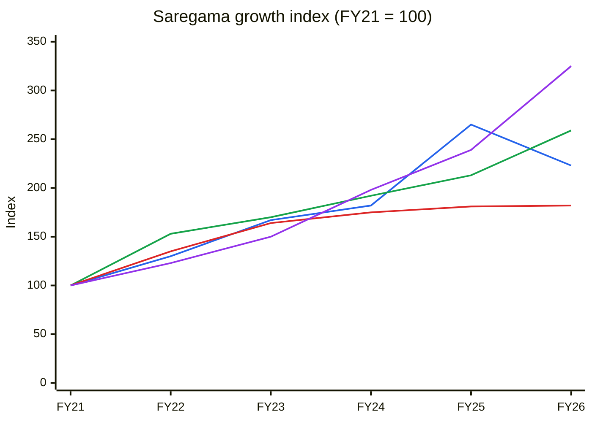
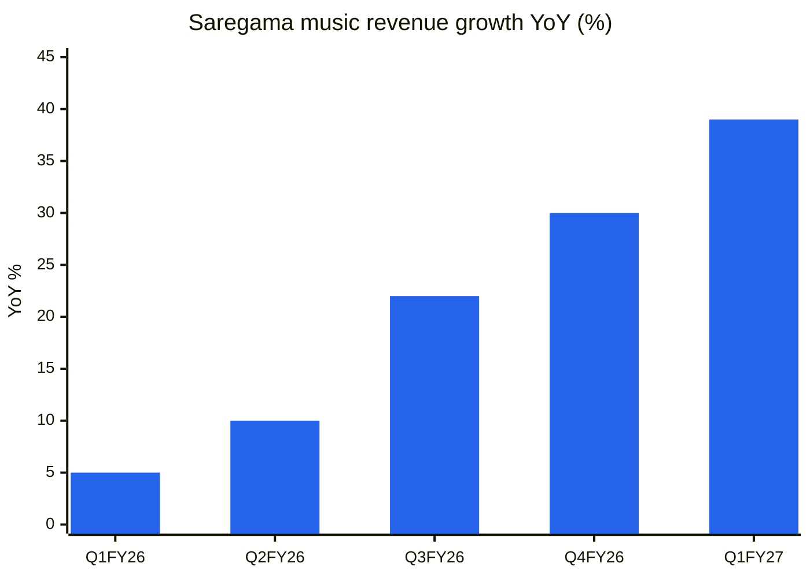
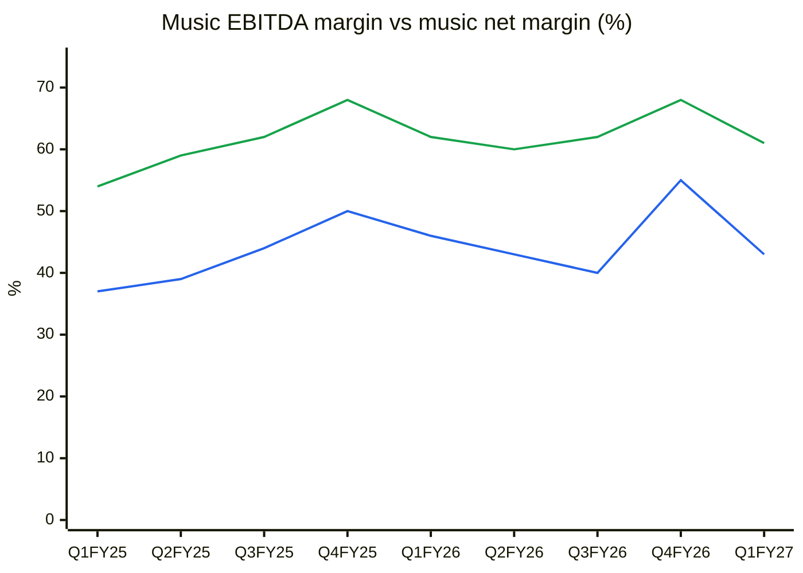
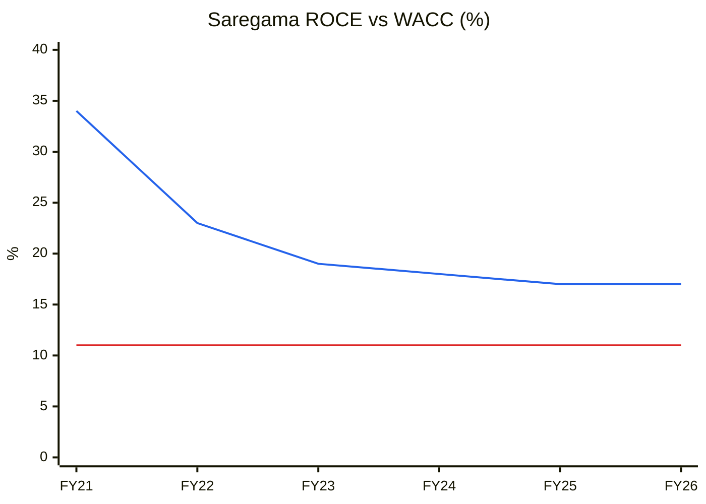
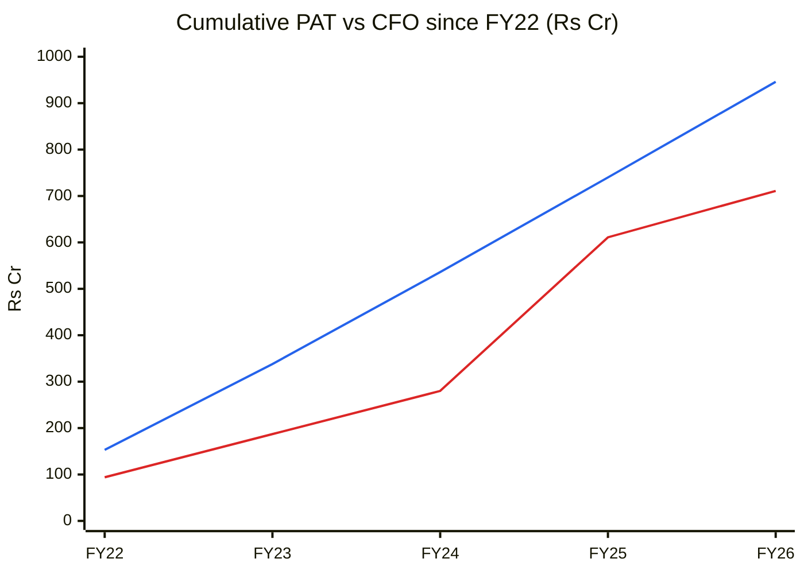
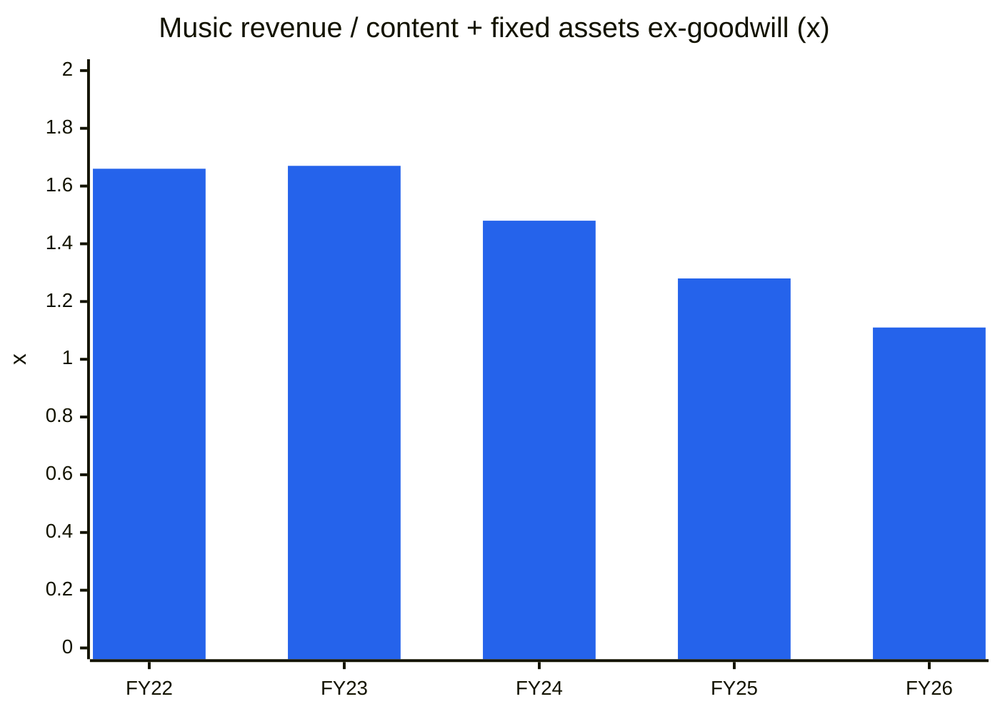
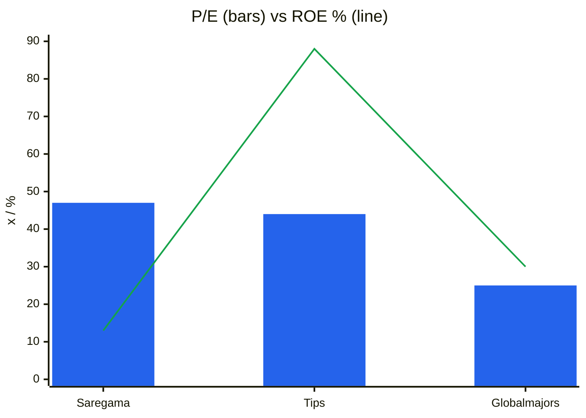
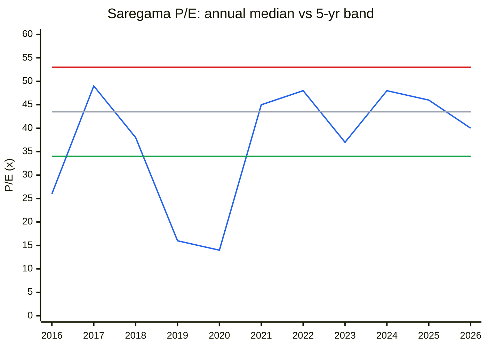
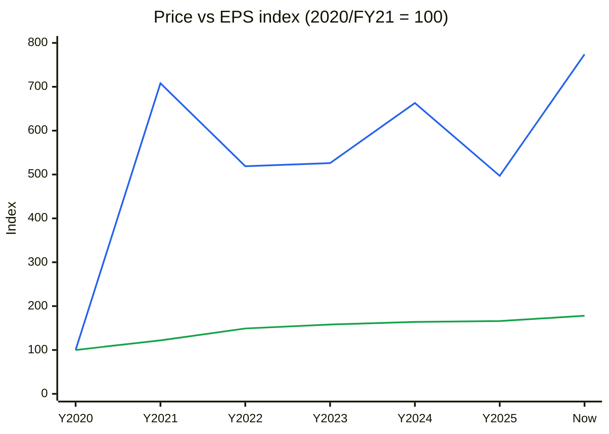
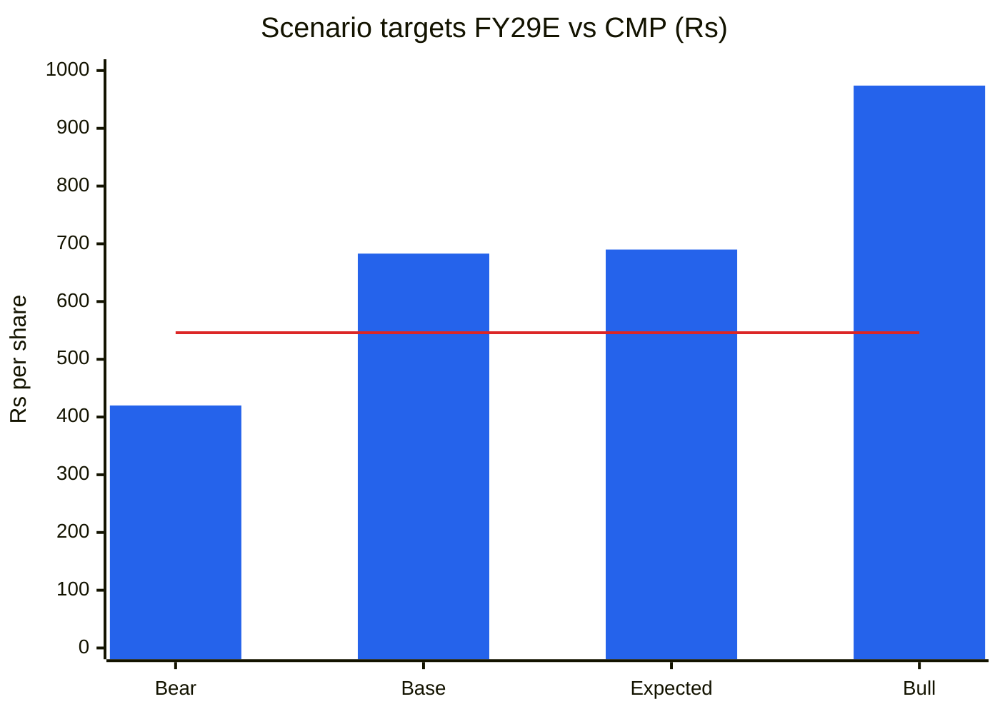

# Stock Analysis Report — Saregama India Ltd (NSE: SAREGAMA · BSE: 532163)
**Date:** 2026-11-02
**Analyst:** Claude (Stock Fundamental Analysis Skill v3.3)
**Investment Horizon:** 2–3 Years
**Recommendation:** WATCHLIST: Quality at Wrong Price (buy-below ~₹440)
**Conviction Score:** 5.8 / 10
**CMP:** ₹546 (NSE, 02-Nov-2026, Screener.in / Yahoo) · Market cap ₹10,540 Cr (19.28 Cr shares, FV ₹1) · 52-wk range ₹320–549 · All-time high ₹609 (Oct-2024)
**Filed under:** Services-and-Platforms / Media-and-Entertainment · Themes: Consumption & consumer brands, Digital platforms & fintech

> **Q2 FY27 results are due on 4-Nov-2026** (board meeting intimation, BSE 15-Oct-2026). All TTM numbers run to Q1 FY27 (Jun-2026). Re-check the report after the results: Q2 FY26 is a soft base (music +10% YoY), so a strong print is likely and largely expected.

## Revision Log
| Version | Date | Recommendation | Conviction | Price | Key change |
|---|---|---|---|---|---|
| Current | 2026-11-02 | WATCHLIST: Quality at Wrong Price (buy-below ~₹440) | 5.8/10 | ₹546 | Initial report. New sub-sector folder `Services-and-Platforms/Media-and-Entertainment` created (no existing sub-sector fits a music label). New KPI block "Music Labels / Media IP & Content Licensing" added to `references/05-industry-kpis-india.md` (line 2832) with user approval |

**Validation of previous report:** Initial report. No earlier Saregama report exists in the library (searched by ticker and name fragment).

---

## Business Primer

Saregama is India's oldest music label: the Gramophone Company of India (1902), later HMV. It is controlled by the RP-Sanjiv Goenka (RPSG) group. It owns the master and underlying rights to **1.8 lakh+ songs in perpetuity** and adds 5,000–6,000 new film and non-film tracks a year, buying film soundtracks from producers and commissioning non-film music. It earns money by licensing that catalogue to streaming and social platforms (YouTube, Spotify, JioSaavn, Meta, Amazon), broadcasters, OTT services, brands and public-performance users. Platforms pay a share of subscription and advertising revenue, fixed fees or minimum guarantees. Around this core sit artiste management (309 managed artistes), Carvaan retro players and vinyl, live events (concerts, devotional shows, stand-up comedy), and a shrinking video arm (TV serials, FilterCopy short-form, Dice digital series via Pocket Aces). FY26 revenue was ₹985 Cr: Music 83% (licensing, artiste management, retail), Video 11%, Live Events 6%. By source, 67% came from platforms, 19% from brands and 14% from consumers (FY26 Annual Report). The business depends on two things: how much digital platforms pay per stream as India moves from free to paid listening, and whether the ₹300–350 Cr a year spent on new content earns back its cost within the targeted five years.

This is a **capital-light IP company** in physical terms, but content spending works like capex. New music is capitalised and amortised over 1–10 years (AR accounting policy), so cash spent runs ahead of the P&L charge. In FY26, ₹155 Cr of operating cash flow (company definition) funded ₹265 Cr of content spend, plus ₹336 Cr for acquisitions, mainly ₹325 Cr for a ≥28% stake in Bhansali Productions. The key value driver is music licensing growth (guided 20–23% a year) at 60–65% segment EBITDA margins. The key risks are paying too much for film-music rights in a competitive auction market, concentration on a few platforms (one customer was 13% of FY26 revenue), and a valuation that already assumes the paid-streaming boom arrives on time. Three features colour the analysis: (a) FY25 revenue was inflated by the one-off Diljit Dosanjh tour (₹285 Cr events revenue vs ₹62 Cr in FY26), so headline revenue "fell" 16% in FY26 while music grew 17%; (b) ₹750 Cr of QIP money raised in FY22 depressed ROE to ~13% and has now been spent on content, Pocket Aces and Bhansali; (c) a near-100% reinvestment rate means reported PAT and owner free cash flow diverge sharply.

**New Segment Protocol:** Segment **not covered** → user approved a new block, "Music Labels / Media IP & Content Licensing" (`references/05-industry-kpis-india.md`, line 2832). Top KPIs: music licensing growth, content investment intensity vs catalogue yield, owner-FCF conversion.

---

## Executive Summary

Saregama owns one of the deepest music catalogues in Asia, and its core music business is accelerating again: music revenue growth went from +5% (Q1 FY26) to **+39% (Q1 FY27)** once the shutdown of free platforms (Wynk, Hungama, Resso) dropped out of the base. Music EBITDA margins sit at 60–68%. The balance sheet is net cash (~₹181 Cr), the auditor is BSR (KPMG network), there is no pledge, and the promoter has been buying (54.54% → 55.28% via Composure Services in FY26; group 59.65% → 60.84%). **The issue is price.** At ₹546 the stock trades at 47× TTM EPS, near its 5-year median (43.5×) and above Tips Music (44×) despite far lower returns (ROE 13% vs Tips 88%). A reverse DCF at 11% WACC implies **28–36% NOPAT growth for five years**, above the company's own "PBT to double in 3–4 years" ambition. Owner free cash flow (CFO − content spend) was **negative in FY26 (−₹110 Cr)**. Catalogue yield (music revenue ÷ content and fixed assets) has fallen from 1.7× (FY23) to 1.1× (FY26). Management's Walk-the-Talk score is LOW (0.40), with repeated misses on growth and content-timing guidance. Our FY29 scenarios give an expected value of ~₹690 (+26% over ~2.5 years, ~10% a year), but only if the market keeps paying a 35× scarcity multiple. The intrinsic (DCF) base is ~₹295. **Verdict: Quality at Wrong Price.** Wait for ~₹440 (≈32× FY27E EPS, about one standard deviation below the 5-year median P/E) or for proof that content returns are lifting ROE.

### C1 — Growth index since the music pivot (FY21 = 100)

| FY | Revenue (₹ Cr) | EBITDA (₹ Cr) | PAT (₹ Cr) | Fixed + content assets ex-goodwill (₹ Cr) | Rev idx | EBITDA idx | PAT idx | Assets idx |
|---|---|---|---|---|---|---|---|---|
| FY21 | 442 | 130 | 113 | 226 | 100 | 100 | 100 | 100 |
| FY22 | 576 | 199 | 153 | 278 | 130 | 153 | 135 | 123 |
| FY23 | 737 | 221 | 185 | 338 | 167 | 170 | 164 | 150 |
| FY24 | 803 | 249 | 198 | 448 | 182 | 192 | 175 | 198 |
| FY25 | 1,171 | 277 | 204 | 541 | 265 | 213 | 181 | 239 |
| FY26 | 985 | 337 | 206 | 735 | 223 | 259 | 182 | 325 |

*Source: Screener.in consolidated; fixed assets net of goodwill (~₹294 Cr Pocket Aces goodwill from FY24; Mar-26 balance sheet in Q1 FY27 deck). Screener EBITDA is after royalty/MG content costs; outright-purchase amortisation sits in depreciation.*

🟦 Revenue · 🟩 EBITDA · 🟥 PAT · 🟪 Fixed + content assets (ex-goodwill)

**Read:** Since FY23, content and fixed assets (🟪) have roughly doubled, while PAT (🟥) has grown only 11%. The PAT line has been flat for three years.

**Business inference:** Saregama is in a heavy reinvestment phase. Each rupee of new content earns less in its first years than the mature catalogue does, and amortisation runs ahead of revenue. Management says this flips "2–3 years after purchase" (Q1 FY27 call). Q1 FY27's PBT jump (+38%) is the first evidence. The thesis needs the 🟥 line to turn up and stay up through FY27–28.

---

## Module 1 — Broad Market Cycle (Marks)

Nifty 50 is at **23,441** (week to 30-Oct-2026, Yahoo Finance). It is below its 30-week MA (23,723), which is still drifting down (23,738 four weeks ago); the 1-year return is −8%. India VIX was ~14 and index P/E ~19× (early Oct-2026, as cited in recent library reports). Consumption and media stocks have outperformed the industrial basket. Saregama is +33% over one year against the falling index.

**Assessment: Cautious.** **Sizing:** normal-to-small; no chasing strength into resistance.

---

## Module 1b — Sector Cycle: Tailwinds & Headwinds

**Demand: a structural tailwind.** Global recorded music reached $31.7–32 bn in 2025 (+7%; streaming 69%). India has 18% of the world's population but only ~1% of recorded-music revenue (MD, Q1 FY27 call; FY26 AR MD&A). Paid-streaming penetration is ~3% of internet users vs 18% in Brazil/China and 57% in the US (Goldman Sachs estimate cited by management). Free tiers are closing: Wynk (Nov-2024), Hungama, Resso, and Gaana going fully paid. YouTube Premium and Spotify are pushing price-led paid plans. Short-video licensing (Meta, Moj, ShareChat) and brand syncs are rising.

**Secular vs cyclical decomposition:**
- **Secular (~15–18% industry):** free-to-paid conversion, rising digital ad spend (~15% a year), public-performance rights, sync licensing. This anchors long-term growth.
- **Cyclical / base effects:** Q3 FY26–Q1 FY27 music growth (22–39%) is flattered by the Wynk shutdown leaving the base, and by big Q4 releases (Dhurandhar). Management itself says the Q1 FY27 base was low. Don't extrapolate 39%: the durable rate is the guided 20–23%, and history says the realised rate is lower (FY25 +3%, FY26 +17% for the music vertical).

**Input-cost cycle (content prices): headwind.** Film-music rights are auctioned among T-Series, Zee, Sony, Saregama, Tips and others. Prices spiked in some South Indian languages, then eased (Q2 FY26 call). Saregama walked away from Dhurandhar 2 on price (Q4 FY26 call), a sign of discipline but also of intense competition.

**Competitive capacity:** there is no physical-capacity cycle. The "supply" risk is global capital (Bain, Apollo, KKR catalogue funds, cited by management) and Indian labels bidding up rights.

**Geopolitical / FX:** small. Some diaspora revenue (Punjabi music, US tours). AI is a two-sided risk: unlicensed AI music dilutes streaming pools, while licensed AI could be a new revenue line.

**Sector cycle verdict: Tailwind (multi-year, structural).** Content-cost inflation is the main offset.

---

## Module 1c — Stock Cycle: Company-Specific Positioning

### C2 — Quarterly YoY music-vertical revenue growth

| Quarter | Music revenue (₹ Cr) | YoY |
|---|---|---|
| Q1 FY26 | 166.0 | +5% |
| Q2 FY26 | 186.0 | +10% |
| Q3 FY26 | 219.5 | +22% |
| Q4 FY26 | 242.9 | +30% |
| Q1 FY27 | 230.6 | +39% |
*Source: Q1 FY27 investor presentation (music = licensing + artiste management + retail).*

🟦 Music revenue YoY growth %

**Read:** Music growth has accelerated for five straight quarters, from +5% to +39%.

**Business inference:** This is a genuine **accelerating** signal, the best part of the setup. Part of it is base effect (Wynk revenue was in the FY25 base until Nov-2024) and part is release timing. From Q3 FY27 the base is high (₹220–243 Cr per quarter), so growth should drop back to the guided ~20%.

### Revenue decomposition
- **Volume (streams/views):** YouTube views were flat at 270–290 bn per quarter for four quarters, then 333 bn in Q1 FY27. Subscribers rose from 160 mn to 211 mn (deck).
- **Price (monetisation per stream):** rising as paid subscriptions grow and free tiers close. This is the most durable driver here, unlike in manufacturing. Short-video deals are still fixed-fee and renewed annually (Q4 FY26 call), so monetisation is not yet on a revenue share.
- **Mix:** 60% of FY26 music revenue came from post-2000 songs and ~45% from post-2020 releases (Q1 FY27 call). The catalogue is being refreshed, at the cost of higher amortisation.

### "Capacity" model for an IP business
There is no physical ceiling. The binding constraints are (a) content budget (₹300–350 Cr guided for FY27, most of it already committed) and (b) the hit rate. Management targets **25–30% of all new music released in India** (FY26 AR, MD letter). Growth is limited by capital and pricing discipline, not capacity.

### Operating leverage
Adjusted EBITDA (before content charge) margin was 41% in FY26, against 32–33% guidance. Content charge was ₹140 Cr (14% of revenue), mostly semi-fixed amortisation of past purchases. **DOL is high** (~1.6–1.8×). Once revenue from 2023–25 purchases exceeds their amortisation, PBT grows faster than revenue. Q1 FY27 showed this: revenue +27%, adjusted EBITDA +69%, operational PBT +38%. DFL ≈ 1.0 (interest ₹5 Cr).

### Management guidance accuracy: 0.40 (LOW)
See Walk-the-Talk in Module 3. **Haircut growth guidance by 20–30%** in the model.

### FCF inflection year
Owner FCF = CFO − content spend: FY26 ₹155 Cr − ₹265 Cr = **−₹110 Cr** (company cash-flow statement; acquisitions excluded). Q1 FY27 was ₹78 Cr − ₹44 Cr = +₹34 Cr. With FY27 content spend guided at ₹300–350 Cr and CFO perhaps ₹280–320 Cr, owner FCF stays near zero in FY27. **The inflection comes only when content spend stops growing (FY28–29), or if the Bhansali formula pricing lowers costs.**

### Stock cycle classification: **Mid cycle, re-accelerating after a two-year investment trough**
Music margins are at the top of their range (62–68%), PBT growth is turning up, and the stock is at a 52-week high. Sizing: normal, but the valuation discipline of "late cycle" applies because the multiple already reflects the recovery.

---

## Module 2 — Industry Structure & Capital Cycle

### Porter Five Forces (Indian recorded music)
| Force | Assessment | Signal |
|---|---|---|
| New entrants | **Low for catalogue, moderate for new music.** A 120-year catalogue cannot be replicated. New film-music rights are open to any well-funded bidder (global labels, PE catalogue funds, producers keeping rights) | Catalogue moat; new-music returns contestable |
| Supplier power (producers, composers, artists) | **High and rising.** Hit producers auction soundtracks; star artists demand revenue shares and combined deals | Content-cost inflation |
| Buyer power (platforms) | **High.** YouTube, Meta, Spotify, JioSaavn and Amazon are giants. Short-video deals are fixed-fee and annual. One customer was 13% of revenue (₹129 Cr; FY26 AR Note 42) | Concentration |
| Substitutes | **Low–moderate.** AI-generated music and user-generated audio are emerging threats; there is no substitute for hit film music | Watch AI |
| Rivalry | **Oligopoly** (T-Series, Saregama, Sony, Zee, Tips, Universal) with rational pricing, but film-music bids are aggressive | Rational on catalogue, aggressive at the margin |

**Industry verdict: Structurally attractive** (long-duration IP, high margins, oligopoly), tempered by buyer concentration.

### Capital cycle: **capital flowing in.**
Global PE catalogue funds, Saregama's ₹750 Cr QIP (FY22), Tips' growth, and content budgets rising across labels all point to rising capital intensity. Industry returns on *new* content are likely falling, while catalogue returns stay high. Saregama's own falling catalogue yield (Module 6) fits this.

---

## Module 3 (Skill Module 2) — Business Quality & Moat

### Greenwald's three barriers
1. **Supply/cost advantage: strong on catalogue.** 1.8 lakh songs owned in perpetuity across 14+ languages, including the 1950s–90s Hindi film golden age that only Saregama owns. Rivals cannot buy this at any price. Weakness: original music *videos* for old songs belong to the film-negative owners (MD, Q1 FY27 call). AI video generation could fix this cheaply.
2. **Customer captivity: moderate.** Platforms must license Saregama's catalogue to be complete; no major Indian service can drop it. That gives bargaining power on catalogue but not on price per stream.
3. **Local economies of scale: moderate.** It has the largest owned audience among Indian labels (680 mn+ followers and subscribers, 211 mn YouTube subscribers), Pocket Aces' Gen-Z marketing reach (400–450 mn), and a data-driven A&R process. That scale helps win producers, who choose the label that makes albums into hits.

**Buffett moat test (raise price 10%?):** **Pass on catalogue** (platform renewals step up with usage). **Fail on new content** (auction pricing).
**Market share stability:** management claims to be the revenue leader in new music with a 25–30% target share. No independent annual share series exists ⚠️.
**Moat verdict: Wide on catalogue / Narrow on new music. Overall: Narrow-to-Wide.** Greenwald source: supply (unique IP) + local scale. Buffett type: intangible asset (IP).

### Fisher 15-point checklist
| # | Point | Score | Note |
|---|---|---|---|
| 1 | Market potential | 3 | India at 1% of global music revenue; paid streaming at 3% penetration |
| 2 | New products | 3 | Artiste management, live events, brand syncs, vinyl, AI content experiments |
| 3 | R&D effectiveness | 2 | Predictive-AI A&R ("hit-to-flop better than any competitor", unverifiable) |
| 4 | Sales organisation | 3 | Unified brand-partnership team; 430+ brand deals in Q1 FY27 |
| 5 | Profit margin | 3 | Music EBITDA 60–68% |
| 6 | Margin improvement | 2 | Adjusted EBITDA margin 38% → 41% (FY22–26); PAT margin flat |
| 7 | Labour relations | 2 | 279 permanent employees; no disputes |
| 8 | Executive relations | 2 | CFO change (Jul-2026); CS change (Sep-2025) |
| 9 | Management depth | 2 | Professional MD (Vikram Mehra, 14+ yrs) and segment heads; key-person risk on the MD |
| 10 | Cost/accounting controls | 3 | BSR & Co (KPMG) auditor; clean opinion; KAMs on goodwill and content |
| 11 | Industry advantage | 3 | Irreplaceable catalogue |
| 12 | Long-range orientation | 3 | Explicit 5-year payback discipline; walked away from Dhurandhar 2 |
| 13 | Dilution | 2 | FY22 QIP; ESOPs (10.5 lakh options granted Sep-2026 to one employee at ₹497) |
| 14 | Communication in adversity | 2 | Detailed decks and transcripts; but guidance slips are framed as "timing" every year |
| 15 | **Integrity** | **2** | No SEBI issues; brand-royalty and MD pay are high (Module 4) but disclosed |
| **Total** | | **37 / 45** | Point 15: **Pass** |

---

## Module 4 (Skill Module 3) — Management & Capital Allocation

**Promoter:** RPSG group, **60.84%** (Sep-2026): Composure Services 55.28%, Quest Capital 4.85%, STEL Holdings 0.44% (FY26 AR Note 15). **Pledge: nil** (STEL confirms no encumbrance). **Trend: rising** (59.09% Dec-23 → 60.84%), i.e. **open-market creeping acquisition, a bullish insider signal.**
**Institutions:** FII 16.8% → 11.9% (two years, selling); DII 2.6% → 9.4% (buying).
**Board:** Chairman Dr Sanjiv Goenka, Vice Chair Avarna Jain, Preeti Goenka, MD Vikram Mehra, plus four independent directors.
**Related-party transactions (FY26 AR Note 33):**
- **Brand-royalty to RPSG Resources Pvt Ltd (a KMP-controlled entity): ₹15.0 Cr** (FY25 ₹14.0 Cr), ~7% of PAT. A standard RPSG group practice, but a **steady leak to the promoter**.
- Licence fee income from RPSG Ventures ₹1.5 Cr. CSR to the group trust ₹5 Cr.
- Loans to the Saregama Welfare Trust for treasury-share purchases (₹9.6 Cr lent, ₹4.9 Cr recovered): an ESOP trust buying shares in the market.
**MD remuneration:** Vikram Mehra **₹20.3 Cr** in FY26 (+39%; 124× median employee), **9.8% of PAT**, and above that in FY27 with ESOP grants. A further **10.5 lakh options at ₹497** were granted to "an eligible employee" in Sep-2026 (~0.54% of equity; intrinsic value ~₹5 Cr today). **Pay is high for a ₹200 Cr PAT company**, though he is a professional, not a promoter.
**Capital allocation (Thorndike lens):**
- FY22 QIP ₹750 Cr at ~₹4,500 pre-split. Use: content (~₹1,000 Cr over FY24–27), **Pocket Aces (~₹177 Cr, FY24; goodwill ₹294 Cr incl. later stake)**, **Bhansali Productions ₹325 Cr for ≥28%** with performance-linked further tranches "for a monetary consideration to be determined" (BSE, 16-Dec-2025). Finnet Media (via Pocket Aces, Nov-2025).
- **Video wound down** after years of low returns (FY26 video segment result ₹1.5 Cr on ₹108 Cr revenue). Events lost ₹7 Cr in FY26. These are honest pivots, but they confirm that diversification away from music has diluted returns.
- **ROE has been 13–15% since the QIP** (company deck), versus 30%+ for Tips. Management: "Are we happy with the 13.3% ROE? We are not" (Q4 FY26 call).
- Dividend ₹4.50/share (~42% payout); no buybacks.
**FCF/share vs EPS (FY22–26):** EPS CAGR ~6% (₹8.4 → ₹10.7); owner FCF/share negative. **Divergence: large.**
**Share count:** flat (19.28 Cr) since the QIP.
**Capital allocation rating: Average.** The 5-year payback discipline is good. Bhansali is opaque, with uncapped further tranches. Pocket Aces and video returns are low. ROE has not recovered four years after the QIP.
**Buffett's Three C's:** Candor: Medium-High (detailed disclosure, admits Punjabi failures and ROE shortfall). Competence: High in music, Low in video/events. Caring: Medium (high MD pay plus brand royalty).

### Walk the Talk Scorecard
| When guided | Statement | Guided | Actual | Verdict |
|---|---|---|---|---|
| Q4 FY25 call (May-25) | Music vertical growth medium term | 22–23% p.a. | FY26 +17% | ❌ Miss |
| Q4 FY25 call | Adjusted EBITDA margin (company) | 32–33% | FY26 41% | ✅ Hit (beat) |
| Q1 FY26 call (Aug-25) | FY26 new-content spend | ₹350–380 Cr | Cut to ₹320–330 Cr (Nov), ₹275–300 Cr (Feb); actual ₹235 Cr new + ₹105 Cr catalogue | ❌ Miss (releases pushed) |
| Q2 FY26 call (Nov-25) | FY26 music growth (cut) | 19–20% | 17% | ❌ Miss (−11% vs low end) |
| Q2 FY26 call | Pocket Aces breakeven FY26 | Breakeven | Achieved (Q1 FY27 call) | ✅ Hit |
| Q1 FY26 call | Carvaan mid-single-digit margin by end-FY26 | Mid-single-digit | Not separately disclosed | ⚠️ Unverifiable |
| Q4 FY25 call | Company PBT to double in 3–4 years (FY25 ₹276 Cr base) | ~₹550 Cr by FY28–29 | FY26 ₹284 Cr (+3%), TTM ₹304 Cr | ⏳ Pending (needs ~22% CAGR) |
| Q2 FY26 call | Consolidated revenue ex-Carvaan 30% CAGR FY24–27 | ~₹1,600 Cr+ FY27 | FY26 ₹985 Cr | ⏳ Pending (very likely miss) |
| Repeated (FY25–27) | Love & War album release | Q4 FY26 → Q2 FY27 → Jan-2027 | Still pending | 🔴 Repeated timing slippage (producer-driven) |

**WTT Score: 0.40 / 1.00 — LOW** (5 resolved points: 2 hits, 3 misses)
**Key pattern:** optimism bias on revenue growth and content timing; conservative on margins. Growth guidance has been cut mid-year in each of the last two years, and every miss is framed as release "phasing."
**Insider action:** promoter creeping acquisition (+1.75pp in two years). **BULLISH.**
**DCF impact:** music growth haircut from 21.5% to ~17% in the base case.
**Overall management credibility: MODERATE** (strong on capital discipline in music, weak on forecasts).

---

## Module 5 (Skill Module 4) — Financial Forensics

### Indian-specific checks
| Check | Finding | Flag |
|---|---|---|
| Pledge | Nil | ✅ |
| ICD / guarantees to group | None material | ✅ |
| RPT | Brand royalty ₹15 Cr to RPSG Resources (~7% of PAT); welfare-trust loans for treasury shares | ⚠️ |
| Auditor | BSR & Co LLP (KPMG), term to the 2027 AGM; unmodified opinion; KAMs: goodwill impairment, content intangibles | ✅ |
| Revenue quality | Debtor days 45 → 66 (FY25 base had cash-collected tour revenue); receivables ₹177 Cr | ⚠️ minor |
| Customer concentration | One customer ₹129 Cr (13%) in FY26; two customers ₹351 Cr in FY25 (incl. tour) | ⚠️ |
| Content accounting | Music rights amortised over 1–10 years from release; outright purchases capitalised; royalty MGs in inventory (₹243 Cr incl. film/TV) | ⚠️ judgment-heavy |
| Goodwill | ₹294 Cr (Pocket Aces) vs a business that only broke even in FY26 | ⚠️ impairment risk |

### Quantitative models (FY26 vs FY25, consolidated)
**Beneish M-Score: ≈ −2.07 → grey zone.** DSRI 1.46 (FY25 tour cash base), GMI ~0.85, AQI ~1.3 (Bhansali stake, intangibles), SGI 0.84, DEPI ~1.0, SGAI ~1.1, LVGI ~1.0, TATA 0.022. DSRI and AQI are explained by the tour base and the Bhansali investment. **No manipulation signal.**
**Altman Z'': ≈ 7.1 → Safe.**
**Piotroski F-Score: 4/9 → Average** (ROA >0 ✓, CFO >0 ✓, no dilution ✓, margin up ✓; ROA down, CFO < NI, borrowings up, current ratio down, asset turnover down).
**Sloan accrual ratio:** ~10% on the Screener CFO/CFI basis (borderline). ~28% if content and acquisition capex is excluded, but that reflects investment intensity, not accrual manipulation.
**5-year CFO/PAT (FY22–26): 0.75** (₹711 Cr / ₹946 Cr) → acceptable. **Owner-FCF/PAT (FY26): −0.53** → weak.

### Schilit screen
- Revenue too soon: DSO up 21 days, base-explained. ⚠️
- One-time boosts: other income fell from ₹63 Cr to ₹34 Cr as cash was deployed, so earnings quality *improved*. ✅
- Capitalising expenses: content is capitalised by design. Watch for amortisation life being stretched (no change disclosed). ⚠️
- Big bath / cookie jar: Q4 FY26 margin of 42% was partly helped by "cost structures getting wound down" provisions (Q4 FY26 call Q&A). ⚠️ minor
- CFS: no factoring. ✅

**Forensic red-flag count (O'Glove, Module 6): 4 / 15.** Mostly investment-intensity flags rather than manipulation.
**Overall forensic verdict: Minor concerns.** Clean auditor and governance basics; the cash-conversion gap is a business-model feature during a content build.

---

## Module 6 (Skill Module 5) — Earnings Quality & Financial Statements

### Ten-year P&L (consolidated, ₹ Cr, Screener.in)
| FY | Revenue | EBITDA | OPM | Dep + amort | PBT | PAT | EPS (₹) | CFO |
|---|---|---|---|---|---|---|---|---|
| FY16 | 222 | 13 | 6% | 5 | 9 | 7 | 0.39 | 32 |
| FY17 | 218 | 9 | 4% | 4 | 16 | 9 | 0.48 | −4 |
| FY18 | 357 | 36 | 10% | 4 | 39 | 28 | 1.64 | −19 |
| FY19 | 545 | 38 | 7% | 3 | 85 | 54 | 3.11 | −36 |
| FY20 | 521 | 60 | 12% | 5 | 60 | 44 | 2.53 | 79 |
| FY21 | 442 | 130 | 29% | 6 | 152 | 113 | 6.47 | 190 |
| FY22 | 576 | 199 | 35% | 13 | 204 | 153 | 7.91 | 94 |
| FY23 | 737 | 221 | 30% | 21 | 248 | 185 | 9.61 | 93 |
| FY24 | 803 | 249 | 31% | 36 | 271 | 198 | 10.25 | 93 |
| FY25 | 1,171 | 277 | 24% | 58 | 276 | 204 | 10.59 | 331 |
| FY26 | 985 | 337 | 34% | 82 | 284 | 206 | 10.74 | 100 |
| TTM Q1 FY27 | 1,041 | 374 | 36% | 88 | 304 | 221 | 11.51 | — |

*FY16–FY20 included the low-margin Carvaan hardware ramp; the business became a high-margin IP company from FY21. Depreciation plus amortisation rose from ₹6 Cr to ₹88 Cr, which is the content build becoming visible.*

### Segment results (FY26 AR Note 42; ₹ Cr)
| Segment | Revenue FY26 | Result FY26 | Margin | Revenue FY25 | Result FY25 |
|---|---|---|---|---|---|
| Music (licensing + retail) | 683.5 | 364.1 | 53% | 624.8 | 292.3 |
| Artiste management | 130.9 | 12.7 | 10% | 69.3 | 2.7 |
| Video | 108.4 | 1.5 | 1% | 192.0 | −4.0 |
| Events | 61.8 | −7.1 | n.m. | 285.2 | 22.9 |
| **Total** | **984.6** | **371.2** | 38% | **1,171.4** | **314.1** |

**Read:** Music earns 98% of segment profit. Everything else is near breakeven.

### C4 — Music EBITDA margin and music net margin (after content charge), quarterly

🟩 Music EBITDA margin · 🟦 Music net margin (EBITDA − content charge)

**Read:** Music EBITDA margin holds at 60–68%. Net margin after the content charge is lower and more volatile (37–55%), with a clear Q4 seasonal peak.

**Business inference:** The gap between the lines (~18–22pp) is the cost of the new-content programme. It has not narrowed over nine quarters, so the "content starts paying back" thesis is not yet visible in net margin. Watch whether FY27 net margin averages above 47%.

### Reformulated returns
- FY26 EBIT (operating, ex other income) = ₹337 − ₹82 = ₹255 Cr; NOPAT (27% tax) ≈ ₹186 Cr.
- Invested capital ≈ equity ₹1,693 + debt ₹73 − liquid assets ₹217 − Bhansali ₹325 ≈ **₹1,224 Cr** (incl. ₹294 Cr goodwill).
- **ROIC ≈ 15%** (≈20% ex-goodwill). **WACC 11%** (Rf 7%, β ~0.85, ERP 5.5%, +~0.3pp). **Spread +4pp → modest value creation.** Economic profit ≈ ₹50 Cr.
- ROIC trend: Screener ROCE 34% (FY21) → 23% → 19% → 18% → 17% → 17%. **Declining 5 years**, cyclically explained (QIP cash, then acquisitions). It has to turn by FY28 for the moat narrative to hold.

### C5 — ROCE vs WACC

🟦 ROCE (pre-tax, Screener) · 🟥 WACC 11%

**Read:** ROCE has halved since FY21 and has flattened at 17%, still above WACC.

**Business inference:** The QIP and the acquisitions (Pocket Aces, Bhansali) diluted returns. The spread over WACC is thin for a company priced at 47×. Re-rating depends on ROCE climbing back above 20% as FY23–25 content matures.

### C7 — Cumulative PAT vs CFO (₹ Cr, Screener)
| FY | FY22 | FY23 | FY24 | FY25 | FY26 |
|---|---|---|---|---|---|
| Cumulative PAT | 153 | 338 | 536 | 740 | 946 |
| Cumulative CFO | 94 | 187 | 280 | 611 | 711 |

🟦 Cumulative PAT · 🟥 Cumulative CFO

**Read:** CFO converts ~75% of PAT over five years. The FY25 jump came from tour advances.

**Business inference:** Operating cash is fine. The real drain sits *below* CFO, in content spend (₹265 Cr cash in FY26) and acquisitions. Owner FCF has been negative or near zero for three years. Dividends (₹87 Cr) were funded from the QIP float that is now spent, so payout growth depends on owner FCF turning.

### DuPont (5-factor; EBIT incl. other income)
| Year | EBIT margin | Asset turnover | Equity multiplier | Interest burden | Tax burden | ROE |
|---|---|---|---|---|---|---|
| FY22 | 36.3% | 0.47× | 1.31× | 0.98 | 0.75 | 16.3% |
| FY23 | 34.5% | 0.43× | 1.25× | 0.98 | 0.75 | 13.6% |
| FY24 | 34.1% | 0.43× | 1.33× | 0.99 | 0.73 | 14.1% |
| FY25 | 24.1% | 0.57× | 1.35× | 0.98 | 0.74 | 13.4% |
| FY26 | 29.3% | 0.45× | 1.35× | 0.98 | 0.73 | 12.6% |
| **Change** | −7.0pp | −0.02× | +0.04× | 0 | −0.02 | **−3.7pp** |

**Operating contribution:** declining (margin hit by rising amortisation; asset turnover stuck at ~0.45× because of the QIP cash and acquisitions).
**Financing contribution:** flat (no leverage).
**DuPont verdict:** ROE erosion is operational and capital-structure-driven (excess equity), not financial engineering. A turn requires margin recovery as content matures, plus asset turnover rising as cash is replaced by earning content.
**AT trend → Module 10:** stable-low, ~0.45×.
**Peer DuPont:** Tips Music runs ~70% EBITDA margins, asset-light outright licensing and little excess cash → ROE ~88%. Its premium is operational. Saregama's lower ROE reflects its diversification and cash drag.

### O'Glove 15-point checklist
| # | Check | Result |
|---|---|---|
| 1 | NI vs OCF | ⚠️ FY26 CFO 100 vs PAT 206 (Screener); 5-yr 0.75× |
| 2 | DSO trend | ⚠️ +21 days (base effect) |
| 3 | AR/Revenue | ⚠️ up one year |
| 4 | Inventory days | ⚠️ content inventory ₹243 Cr (MG advances, films) |
| 5 | DPO | ✅ |
| 6 | Capex/Dep | ⚠️ content investment ~4× amortisation (growth by design) |
| 7 | Other income/EBIT | ✅ falling (12% → 9%) |
| 8 | Recurring one-offs | ✅ (labour-code exceptional ₹8.5 Cr, FY26) |
| 9 | Sloan | ⚠️ borderline |
| 10 | Beneish | ✅ grey, explained |
| 11 | Piotroski | ✅ 4 |
| 12 | Altman | ✅ 7.1 |
| 13 | Tax rate | ✅ ~27% |
| 14 | Auditor | ✅ |
| 15 | Segment vs consolidated | ✅ reconciles |
**Hard flags: 4 / 15** (items 1, 4, 6, 9; the rest are watch items). Earnings quality: **Clean, investment-heavy.**

---

## Content Assets — Ten-Year, Long-Life Lens (fixed-asset analysis for an IP business)

| FY | Net fixed + intangible assets (₹ Cr) | of which goodwill | Ex-goodwill | Dep + amortisation | Content charge (P&L, company) | Revenue / assets ex-goodwill | Music revenue / assets ex-goodwill |
|---|---|---|---|---|---|---|---|
| FY16 | 85 | — | 85 | 5 | — | 2.6× | — |
| FY17 | 199 | — | 199 | 4 | — | 1.1× | — |
| FY18 | 197 | — | 197 | 4 | — | 1.8× | — |
| FY19 | 215 | — | 215 | 3 | — | 2.5× | — |
| FY20 | 219 | — | 219 | 5 | — | 2.4× | — |
| FY21 | 228 | — | 228 | 6 | 18 | 1.9× | — |
| FY22 | 280 | — | 280 | 13 | 46 | 2.1× | 1.66× |
| FY23 | 342 | — | 342 | 21 | 68 | 2.2× | 1.67× |
| FY24 | 748 | ~294 | 454 | 36 | 86 | 1.8× | 1.48× |
| FY25 | 835 | ~294 | 541 | 58 | 128 | 2.2× | 1.28× |
| FY26 | 1,031 | 294 | 737 | 82 | 140 | 1.3× | **1.11×** |
*Screener fixed assets incl. CWIP; FY17 step-up likely reflects Ind AS deemed-cost land valuation (Dum Dum, Kolkata). Goodwill from the Pocket Aces acquisition (FY24; Mar-26 ₹294 Cr per Q1 FY27 deck). Content charge from company decks. Music revenue: FY22 ₹464 Cr → FY26 ₹814 Cr.*

**Catalogue size:** 1.8 lakh+ songs (FY26), +5,000–6,000 a year. **Investment vs amortisation:** FY26 content spend ₹340 Cr (₹235 Cr new + ₹105 Cr catalogue) against D&A ₹82 Cr → ~4×.
**Land floor:** legacy Dum Dum (Kolkata) and Mumbai properties are inside PPE of ₹222 Cr; no market valuation disclosed ⚠️. Irrelevant to a ₹10,500 Cr valuation.

### FA-1 — Music revenue yield on content and fixed assets (ex-goodwill)

🟦 Catalogue yield proxy

**Read:** Yield fell 33% in three years (1.67× → 1.11×). That breaches the KPI red-flag threshold (>10% decline over three years).

**Business inference:** Part of the fall is timing: FY24–26 purchases haven't reached peak revenue, and the asset base includes ₹220 Cr of PPE. But it also suggests new content earns less per rupee than the old catalogue, consistent with rising auction prices. The 5-year-payback claim ("26% IRR", Q1 FY27 deck) is management's own figure and is not audited. **This is the key metric to watch.** It should stabilise by FY27–28 if the payback claim holds.

---

## Module 7 (Skill Module 6) — Industry KPIs & Peer Analysis

**Sector:** Music labels / media IP (new KPI block, line 2832).

| KPI | Saregama | Benchmark | Assessment |
|---|---|---|---|
| Music licensing revenue growth | FY26 +17%; Q1 FY27 +39% (+43% licensing + artiste management) | >18% | **In-line, accelerating** ✅ |
| Content investment intensity | FY26 42% of music revenue (₹340 Cr / ₹814 Cr); FY27 guide ~31–36% | 25–35% | **FY26 above range ❌; FY27 in range** |
| Catalogue yield trend | 1.67× → 1.11× (FY23–26) | Stable/rising | **Red flag ❌** |
| Music segment EBITDA margin | 61–68% (quarterly); FY26 ~63% | 55–65% | ✅ |
| Owner-FCF conversion | FY26 −0.53×; ~0 over three years | >0.6× | **Red flag ❌** |
| Platform concentration | Top customer 13% of revenue; 67% of revenue from platforms | Single platform <30% | ✅ |
| New-release / hit share | Dhurandhar (all 11 songs charted), Krishnavataram in Spotify Top 200 albums; 45% of music revenue from post-2020 releases | Rising | ✅ (qualitative) |

### Peer comparison (Screener.in, 02-Nov-2026; global from KPI reference ranges)
| Metric | Saregama | Tips Music | UMG / WMG (global) |
|---|---|---|---|
| Revenue FY26 (₹ Cr) | 985 (music 814) | 376 | ~$12 bn / ~$6.5 bn |
| Revenue 3-yr CAGR | 10% (music ~21%) | 26% | ~6–8% |
| EBITDA margin | 34% reported / 41% adjusted; music 63% | 73% | ~22–24% |
| ROE | 13% | 88% | ~20–40% |
| Net debt | net cash ~₹181 Cr | net cash | levered |
| P/E (TTM) | **47×** | 44× | ~20–30× |
| Market cap (₹ Cr) | 10,540 | 10,044 | — |
| Content model | Outright + royalty; diversified (video, events, artistes) | Pure catalogue licensing, outright buys, low cash | Majors + publishing |

### C12 — P/E vs ROE

🟦 P/E (TTM; global ~midpoint) · 🟩 ROE % (global ~midpoint)

**Read:** Saregama trades at a higher P/E than Tips with one-seventh of Tips' ROE. Global majors trade at roughly half the multiple.

**Business inference:** **Peer positioning: premium. Justified? Only partly.** Saregama has the bigger, irreplaceable catalogue and better growth optionality (artistes, live events, Bhansali access). But its lower ROE, negative owner FCF and diversification drag argue for parity with Tips, not a premium. India-label scarcity value (only two listed) inflates both.

---

## Module 8 (Skill Module 7) — Market Size & Market Share

**TAM:** Indian recorded music ≈ 1% of $31.7 bn global ≈ **$0.3 bn (~₹2,700 Cr)** in 2025 (MD, Q1 FY27 call). The wider M&E sector is ₹2.78 tn (+9.1%, FY26 AR MD&A). Growth expectation: mid-to-high teens as paid streaming rises from 3% penetration. Each 1pp of penetration ≈ 10 mn payers (management).
**Penetration / share:** Saregama licensing (ex-artiste management and retail) ≈ ₹550–600 Cr (est.) → **~20–22% of Indian recorded-music revenue**. Tips ~14%. T-Series is the largest (unlisted). Estimates are labelled.
**Share target:** 25–30% of all new music released in India (FY26 AR).
**Share trend:** not independently measurable. Music growth of +17% (FY26) vs industry mid-teens → **roughly holding to slightly gaining share**. The FY25 +3% (Wynk shutdown) shows exposure to platform churn.
**Verdict:** growing with or slightly ahead of the market. Driver: structural (catalogue plus content spend), but bought with capital.

---

## Module 9 (Skill Module 8) — Valuation: PIE First, Then DCF

### 8A. Price-Implied Expectations
EV (operating) = market cap ₹10,540 Cr − net cash ~₹181 Cr − Bhansali stake at cost ₹325 Cr ≈ **₹10,034 Cr**. TTM NOPAT ≈ ₹212 Cr (EBIT ₹286 Cr × 0.74). Model: FCF = NOPAT × (1 − g/RONIC), five years at g then a five-year fade to 6.5%, WACC 11%.

| RONIC (return on new content) | Market-implied NOPAT growth, years 1–5 |
|---|---|
| 18% | **36%** |
| 25% | **28%** |
*(At 11.5% WACC: 41% / 32%.)*

| PIE value driver | Market-implied | My base case | Expectations gap |
|---|---|---|---|
| NOPAT growth (5-yr) | 28–36% | ~17–20% (music +17–20%, operating leverage, video/events flat) | **−10 to −16pp** |
| Return on new content (RONIC) | 18–25% | ~15–20% (yield falling; mgmt claims 26% IRR) | −3 to −5pp |
| Reinvestment rate | 70–100% of NOPAT | ~90% FY27, falling to 60% | — |

**Classification: optimistic gap.** The price assumes the paid-streaming inflection *and* high returns on the content programme together.
**Expectations treadmill:** to outperform, Saregama must deliver ~25%+ PBT CAGR for 3–5 years (above the "PBT doubles in 3–4 years" ambition) while lifting ROIC above 20%. Matching guidance earns roughly the cost of capital.
**Positive triggers:** music growth sustaining >25% after Q3 FY27 laps the high base; YouTube/Spotify paid price hikes; short-video deals moving to ad-revenue share; a Love & War / Bhansali hit; catalogue yield stabilising; ROE >15%.
**Negative triggers:** music growth falling to <15% from Q3 FY27; further content-spend creep; a Pocket Aces goodwill impairment; Bhansali further tranches at rich prices; platform concentration shock.
**SVAR (bear: PBT CAGR 10%, P/E 28×):** ₹420 → **SVAR 23%** (moderate).

### 8B. Own model
**DCF (11% WACC, terminal 6.5%; + net cash + Bhansali at cost):**
| Scenario | NOPAT growth yrs 1–5 | RONIC | Equity value | Per share |
|---|---|---|---|---|
| Bear | 10% | 16% | ₹3,839 Cr | ₹199 |
| Base | 17% | 20% | ₹5,689 Cr | ₹295 |
| Bull | 22% | 25% | ₹8,001 Cr | ₹415 |

**EPV (no growth, 12%):** ₹212 Cr / 12% + ₹506 Cr ≈ ₹2,273 Cr → **₹118**. The catalogue alone, with no new spend, is worth roughly ₹120–200/share.
**Relative (P/E on FY27E EPS ₹13.9; FY27E PBT ~₹360 Cr, +23%):** 30× (global premium-adjusted) = ₹417; 35× = ₹487; 43.5× (own 5-yr median) = ₹605.
**Graham number:** √(22.5 × ₹10.6 normalised EPS × ₹87.8 BV) = **₹144**.
**Residual income:** ROE 13% vs Ke 11.5% → justified P/B ≈ (13 − 6.5)/(11.5 − 6.5) = 1.3× → **₹114**, rising to ~₹260 at a 20% ROE.

| Method | Bear | Base | Bull |
|---|---|---|---|
| DCF | ₹199 | ₹295 | ₹415 |
| Relative (FY27E P/E) | ₹417 | ₹487 | ₹605 |
| EPV / RIM | ₹114 | ₹118 | ₹260 |
| **Consensus range** | **₹200–420** | **₹300–490** | **₹415–605** |

**CMP ₹546 → above every base estimate. Margin of safety: negative** (−11% vs the relative base, −85% vs the DCF base).
**Graham defensive screen:** revenue <₹2,000 Cr ❌; current ratio ~1.7 ❌; positive EPS 7 yrs ✅; no dividend cut 5 yrs ✅; EPS growth >30% over 7 yrs ✅; P/E ≤20 ❌; P/B ≤3 ❌ (6.2×). **3/7.**
**Misprice reason:** none. The stock is fairly-to-richly priced on scarcity value (two listed Indian labels) and on the streaming narrative.
**Catalyst for a better entry:** the Q3 FY27 high base slowing growth, or a broader market drawdown.

### CY1 — P/E band (10 years, Screener)
| Year | 2016 | 2017 | 2018 | 2019 | 2020 | 2021 | 2022 | 2023 | 2024 | 2025 | 2026 |
|---|---|---|---|---|---|---|---|---|---|---|---|
| Median P/E | 26 | 49 | 38 | 16 | 14 | 45 | 48 | 37 | 48 | 46 | 40 |
*10-yr median 39.4×; 5-yr median 43.5×, SD 9.5×; current 45.2× (57th percentile of 5 years).*

🟦 Annual median P/E · ⬜ 5-yr median (43.5×) · 🟩 −1 SD (34×) · 🟥 +1 SD (53×)

**Read:** Since 2021 the stock has re-rated into a 37–48× band. The current 45× sits at the band's middle.

**Business inference:** The market has paid a steady IP-scarcity multiple for five years while EPS grew only ~6% a year. Returns since 2021 have therefore been close to zero (₹499 at end-2021 → ₹546), as one analyst pointed out on the Q3 FY26 call. Buying near the median relies on earnings growth alone. The −1 SD level (~34× ≈ ₹470 on FY27E EPS) is a better entry.

### CY4 — Price vs EPS index (base = 100)
| | CY2020 / FY21 | CY2021 / FY22 | CY2022 / FY23 | CY2023 / FY24 | CY2024 / FY25 | CY2025 / FY26 | Now / TTM |
|---|---|---|---|---|---|---|---|
| Price (year-end) | 70.5 | 499 | 366 | 371 | 468 | 350 | 546 |
| EPS | 6.47 | 7.91 | 9.61 | 10.25 | 10.59 | 10.74 | 11.51 |
| Price idx | 100 | 708 | 519 | 526 | 663 | 497 | 774 |
| EPS idx | 100 | 122 | 149 | 158 | 164 | 166 | 178 |

🟦 Price index · 🟩 EPS index

**Read:** The stock rose 7.7× since 2020 while EPS rose 1.8×. Almost all of the return has come from re-rating.

**Business inference:** The re-rating (P/E 14× → 45×) is done. Future returns must come from EPS growth. At ~15–20% EPS growth and a flat multiple that is ~15–20% a year, while any de-rating towards 34× wipes out a year or two of growth.

### C13 — Scenario targets (FY29E, ~2.5 years)
| Scenario | Music growth | PBT FY29E | EPS FY29E | P/E | Target | Probability |
|---|---|---|---|---|---|---|
| Bull | 25% CAGR; paid-streaming step-up; Bhansali hits | ₹600 Cr | ₹23.2 | 42× | **₹974** | 25% |
| Base | ~19% (guidance −10%); PBT +20% CAGR | ₹506 Cr | ₹19.5 | 35× | **₹683** | 50% |
| Bear | 12%; content-cost inflation; video/events losses | ₹390 Cr | ₹15.0 | 28× | **₹420** | 25% |
| **Expected value** | | | | | **₹690** | |

🟦 Scenario target · 🟥 CMP ₹546

**Read:** The expected value is ₹690 (+26% in ~2.5 years, ~10% a year), with a bear case of −23%.

**Business inference:** Upside/downside ≈ 144/126 ≈ **1.1:1** on bull vs bear around the expected value, or 1.6:1 measured as expected gain over bear loss. That is below the 2:1 threshold. The return also depends on the market still paying ≥35× in FY29. At the global-major multiple (25×), even the base case is ₹488 (−11%). **Fair to slightly expensive; not a buy.**

---

## Module 10 (Skill Module 9) — Technical Stage (Weinstein + CANSLIM)

**Nifty 50: Stage 4 / early Stage 1** (23,441 below a flat-to-falling 30-week MA of 23,723).
**Sector (media / consumption):** outperforming industrials. Peer Tips is at ₹790.
**Stock stage: Stage 2 (advancing), testing major resistance.** The price is ₹546, above a **rising 30-week MA (₹470, up from ₹445 four weeks ago)**, the 50-DMA (₹503) and the 200-DMA (₹461). Last week (to 30-Oct) it rose +12.7% to a 52-week closing high. Overhead supply sits at **₹550–609** (Jun-2024 to Jun-2025 congestion; all-time high ₹609 Oct-2024).
**Volume:** breakout-week volume of 3.0 mn shares vs a 20-week average of 3.2 mn → **no volume confirmation** (needs ≥40% above average). Delivery was 48% (healthy).
**RS vs Nifty (1 yr):** +33% vs −8% → **strongly positive** (+41pp).
**Base:** Jun–Oct 2026 flat base at ₹480–527 (~18 weeks), and a larger two-year base from ₹320 to ₹609.
**Stop-loss (holders):** weekly close below ₹480 (base low); trailing below the 30-week MA.
**Stage + fundamental alignment: partially aligned.** Technicals and business momentum are positive; valuation is not.

### CANSLIM
| C | Q1 FY27 EPS +41% YoY | 1 |
|---|---|---|
| A | EPS 3-yr CAGR ~4%; ROE 13% | 0 |
| N | New 52-week high; new paid-streaming era; Bhansali | 1 |
| S | 19.3 Cr shares; promoter buying; ESOP trust buying | 1 |
| L | RS strongly positive; sector leader | 1 |
| I | DII rising 2.6% → 9.4%; FII falling 16.8% → 11.9% | 0.5 → 0 |
| M | Nifty not in Stage 2 | 0 |
| **Total** | | **4 / 7** |

**Combined verdict:** Stage 2 at resistance without volume, CANSLIM 4/7 → **wait for a weekly close above ₹610 on ≥1.5× average volume, or a pullback to the ₹480–500 base.**

---

## Module 11 (Skill Module 10) — Forward View: 2–3 Year Thesis

### Unit-economics track (IP business; replaces the capex-AT model)
**The unit is a year's content cohort.** Management's stated cohort economics: content "charges through the P&L in ~10 years, pays back in ~5 years, then earns for 60–80 years"; steady-state margin ~90%; **IRR 26%** (Q1 FY27 deck).

| Cohort metric | Disclosed / estimated |
|---|---|
| Annual cohort spend | FY24 ~₹250 Cr (est.) · FY25 ~₹300 Cr · FY26 ₹340 Cr (₹235 Cr new + ₹105 Cr catalogue) · FY27E ₹300–350 Cr |
| Payback target | 5 years (management KPI for every acquisition) |
| Content charge (P&L) | ₹46 Cr → ₹140 Cr (FY22–26), i.e. ~41% of FY26 cohort spend |
| Evidence of payback | Stree 2, Amaran, RRKPK, GOAT "now contributing positive margins" (Q1 FY27 call); music net margin not yet expanding (C4) |
| Marginal vs blended | Blended music EBITDA 63%; **marginal cohort economics unaudited** and catalogue yield falling (FA-1) |

**Payback cross-check:** if a ₹300 Cr cohort pays back in 5 years, it must earn ~₹60 Cr/yr of net contribution, i.e. ~₹90–100 Cr of revenue at ~65% margin. Four cohorts (FY23–26) should therefore add ~₹350–400 Cr of revenue at maturity. Music revenue rose ₹350 Cr over FY22–26 (₹464 Cr → ₹814 Cr), so this is **broadly consistent, but leaves no room for catalogue decay**. Plausible, not proven.

### Three-year model (base)
| Metric | FY27E | FY28E | FY29E |
|---|---|---|---|
| Music revenue (₹ Cr) | 970 (+19%) | 1,150 | 1,370 |
| Video + events (₹ Cr) | 200 | 210 | 220 |
| **Revenue** | **1,170** | **1,360** | **1,590** |
| Adjusted EBITDA (41–43%) | 480 | 575 | 685 |
| Content charge | 165 | 190 | 215 |
| D&A + finance − other income | 0 | 0 | −4 |
| **PBT** | **~360** | **~430** | **~506** |
| PAT (26%) | 266 | 318 | 375 |
| EPS (₹; +0.5% ESOP dilution) | 13.9 | 16.5 | 19.5 |
| CFO (≈ PAT + content charge − ΔWC) | 320 | 400 | 470 |
| Content spend | 330 | 350 | 360 |
| **Owner FCF** | **−10** | **50** | **110** |
| Dividend (₹4.5–6/share) | 90 | 100 | 115 |

**Owner-FCF inflection: FY28–29.** Dividends exceed owner FCF until then, funded by the remaining ~₹217 Cr of liquid assets and WC lines (borrowings ₹64 Cr in Jun-2026). There is also a further Bhansali tranche of undisclosed size. **Leverage stays low** (<0.5× EBITDA).
**Incremental ROIC:** ΔNOPAT FY26→FY29 ≈ (₹375 Cr − ₹206 Cr) on ~₹1,000 Cr of content + Bhansali ≈ **~17%** vs WACC 11% → **value-creating, modestly.**
**Model CAGR vs PIE:** PBT ~21% vs PIE-implied NOPAT growth of 28–36% → **the market is pricing upside beyond the base case.**

### Key catalysts
1. Q2 FY27 results (4-Nov-2026): music growth on a soft base; adjusted EBITDA margin. Near term.
2. Love & War (Bhansali, Jan-2027) and the Paradise / Dharman / Naagzilla soundtracks. Q4 FY27.
3. Paid-streaming price increases or short-video revenue-share deals. FY27–28.
4. Catalogue yield stabilising and ROE >15% in FY27 accounts. Aug-2027.
5. Diljit India tour (tentative Q3 FY27) lifting events revenue (low margin).

### Key risks
1. **Content-cost inflation** eroding returns on new music (yield already falling). **Medium–High.**
2. **Growth disappointment from Q3 FY27** as the high base kicks in; guidance credibility is low. **Medium.**
3. **De-rating** from 45× toward the −1 SD level (34×) or global-major multiples. **Medium.**
4. **Capital allocation:** further Bhansali tranches, Pocket Aces goodwill impairment, video/events losses. **Medium.**
5. **Platform/AI risk:** concentration (top customer 13%) and AI-generated music diluting streaming pools. **Low–Medium.**

### Scenario analysis
| Scenario | Driver | Revenue FY29E | Adjusted EBITDA margin | EPS FY29E | Multiple | Target | Probability |
|---|---|---|---|---|---|---|---|
| Bull | Music 25% CAGR, yield recovers | ₹1,800 Cr | 44% | ₹23.2 | 42× | ₹974 | 25% |
| Base | Music ~19%, yield stable | ₹1,590 Cr | 43% | ₹19.5 | 35× | ₹683 | 50% |
| Bear | Music 12%, yield keeps falling | ₹1,350 Cr | 38% | ₹15.0 | 28× | ₹420 | 25% |
| **Expected value** | | | | | | **₹690** | |

**Return from current price (expected): +26% over ~2.5 years (~10% a year), below a ~15% hurdle for a 47× stock.**

**Thesis (1–3 sentences):** Saregama is a high-quality, irreplaceable music IP franchise entering India's paid-streaming era, with music growth re-accelerating and a promoter who keeps buying. But the price already assumes faster growth and higher content returns than the company has delivered or guided, owner free cash flow is still negative, and ROE is 13%. Buy on a pullback to ~₹440, or after evidence that content returns are lifting ROE above 15%.

**Monitoring metrics:** music growth after Q3 FY27 (≥20%), music net margin (FY27 >47%), catalogue yield (FY27 ≥1.1×), owner FCF (positive in FY28), ROE (>15% FY28), Bhansali tranche terms, Pocket Aces profitability.

---

## Checklist Summary
**Section 0 (Existing Report / Filing):** 5 / 5. Initial report; new sub-sector folder created and justified; themes added; index rebuilt and `--check` run.
**Section A (Business Quality):** 16 / 18. Independent market-share series and scuttlebutt beyond filings are gaps.
**Section B (Forensics):** 9 / 9.
**Section C (Financial Statements):** 12 / 12.
**Section D (KPIs & Peers):** 7 / 7. New KPI block applied.
**Section E (Market Size & Share):** 5 / 7. Share estimates labelled.
**Section F (Valuation):** 10 / 10.
**Section G (Technical):** 8 / 8.
**Section H (Forward View):** Unit-economics (cohort) track used in place of capex-AT, as the skill specifies for IP/asset-light businesses. Cohort data is partly management-only.
**Section I (Charts):** 5 / 5. C1, C2, C4, C5, C7, FA-1, C12, CY1, CY4, C13.
**Order Book Tracker:** Not applicable (licensing business; no Reg 30 order filings).
**Hard stops triggered:** **None** (no integrity, pledge, auditor, Stage-4 or manipulation triggers). The upside/downside ratio (1.1–1.6:1) is below the preferred 2:1 but above the 1.5:1 hard stop on the expected-gain basis → MoS gate fails, so the verdict is Quality at Wrong Price.

### Pre-buy behavioural check
- Am I paying for the streaming story the market already sees? Yes: PIE 28–36% vs base ~20%. ✔ Wait.
- Am I chasing a 52-week-high breakout without volume? Yes. ✔ Wait.
- Would I own it through a 25% de-rating? Only from a lower entry. ✔

---

## Investment Decision
**Recommendation:** **WATCHLIST: Quality at Wrong Price**
**Conviction Score:** **5.8 / 10** (cycle 0.6 · industry 0.8 · moat 1.6 · management 0.6 · financial/earnings quality 1.1 · valuation 0.5 · technical 0.6)
**Suggested position size:** 0% now. 2–3% (standard) on entry.
**Entry price range:** **₹420–460** (≈30–33× FY27E EPS; −1 SD of the 5-yr P/E band), **or** a confirmed weekly breakout above ₹610 on ≥1.5× volume *together with* FY27 music growth ≥20% and a catalogue-yield stabilisation (momentum entry, half size).
**Stop-loss (holders):** weekly close below ₹480.
**Target price (base, FY29E):** ₹683.
**Review trigger:** Q2 FY27 results (4-Nov-2026); Q3 FY27 music growth on the high base (Feb-2027); FY27 annual report (catalogue yield, Bhansali tranche terms, MD pay).

---
**Sources:** Screener.in (SAREGAMA consolidated; company id 2899 price/P-E chart API) · BSE filings for scrip 532163: Q1 FY27 press release and investor presentation ([BSE](https://www.bseindia.com/xml-data/corpfiling/AttachHis/522606f0-c816-4cc6-8a54-c5efeb4d65c6.pdf)), Q1 FY27 transcript ([BSE](https://www.bseindia.com/xml-data/corpfiling/AttachHis/230ecb5d-c611-4baa-be27-98cf079bcf8e.pdf)), Q4 FY26 transcript ([BSE](https://www.bseindia.com/xml-data/corpfiling/AttachHis/da3893ed-1ba7-4df9-96d4-2ad822c0d55e.pdf)), Q3 FY26 transcript ([BSE](https://www.bseindia.com/xml-data/corpfiling/AttachHis/8fba2711-1940-4dbe-bf84-0d169763f63f.pdf)), Q2 FY26 transcript ([BSE](https://www.bseindia.com/xml-data/corpfiling/AttachHis/22a967fc-49fc-4e19-8024-c4b076555593.pdf)), Q1 FY26 transcript ([BSE](https://www.bseindia.com/xml-data/corpfiling/AttachHis/45c4c953-2610-4ef1-aabc-f9f079e2a909.pdf)), Q4 FY25 transcript ([BSE](https://www.bseindia.com/xml-data/corpfiling/AttachHis/8689a6ed-39f3-453a-997f-c5d25be0b342.pdf)), FY26 Integrated Annual Report ([BSE](https://www.bseindia.com/xml-data/corpfiling/AttachHis/005c99f8-916b-44d9-b085-f1eb5964358e.pdf)), Bhansali Productions acquisition ([BSE](https://www.bseindia.com/xml-data/corpfiling/AttachHis/3c990233-a733-48e0-9445-ff5f8e60f6e3.pdf)), CARE rating Jun-2026 ([BSE](https://www.bseindia.com/xml-data/corpfiling/AttachHis/f2ccf284-b915-4a3e-8f60-da7e9133e0f5.pdf)), ESOP grant Sep-2026 ([BSE](https://www.bseindia.com/xml-data/corpfiling/AttachHis/84f5b7b8-18dc-4c46-9686-8f1b9e3095d5.pdf)) · Tips Music (Screener.in) · secondary: [Music Ally](https://musically.com/2026/08/13/with-60-of-revenue-from-post-2020-releases-saregama-is-now-a-new-age-ip-company/), [ICICI Direct](https://www.icicidirect.com/research/equity/trending-news/saregama-q1-revenue-up-275-yoy-to-264-cr), [indiantelevision.com](https://indiantelevision.com/iworld/saregama-fy26-profit-rises-as-music-and-artist-business-strike-a-chord/), [Multibagg](https://www.multibagg.ai/market-pulse/articles/saregama-q1fy27-97136) · Yahoo Finance (^NSEI, SAREGAMA.NS weekly).

*Report generated by Stock Fundamental Analysis Skill v3.3 | Indian Markets Context*
*Save path: C:\Users\anubh\Documents\Anubhav\Stock Analysis\Stock Analysis\Services-and-Platforms\Media-and-Entertainment\*
