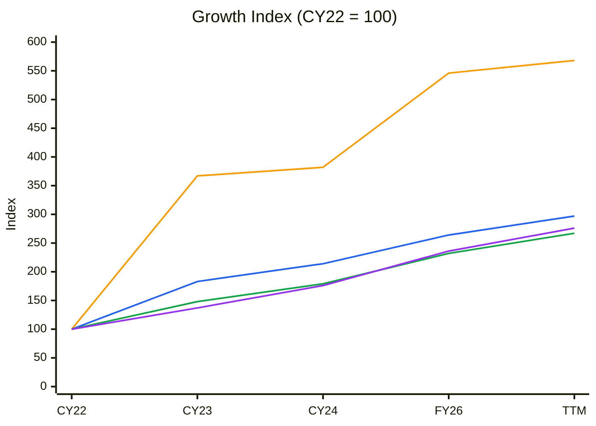
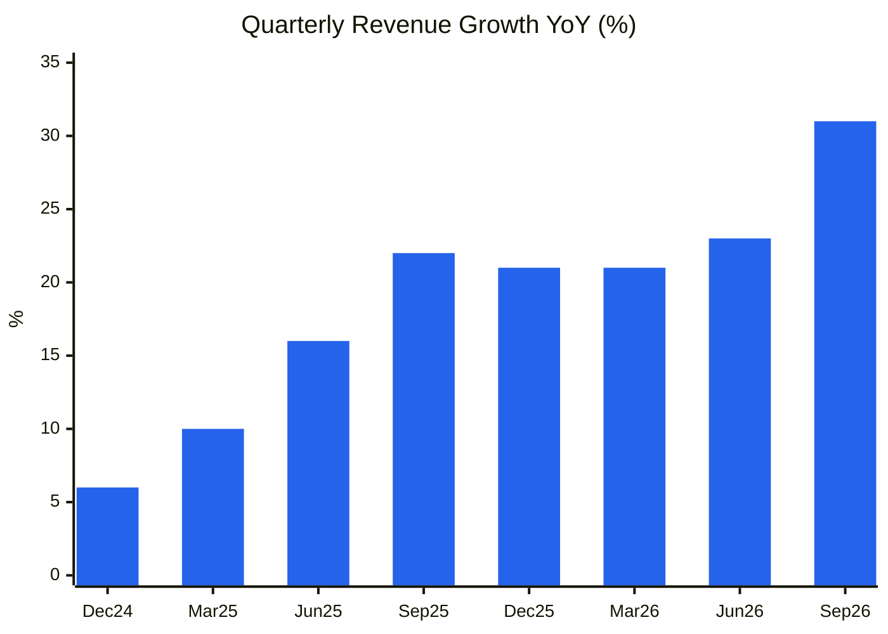
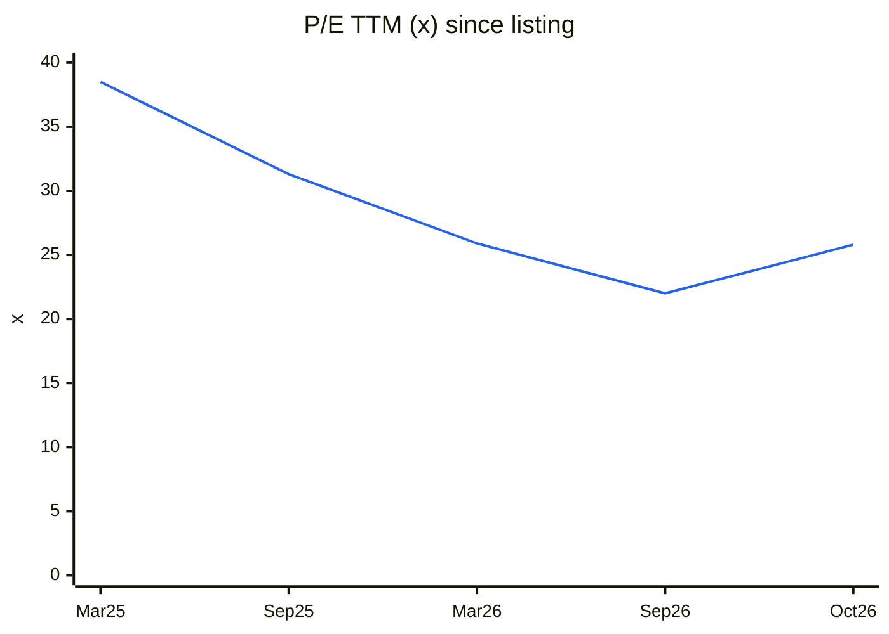
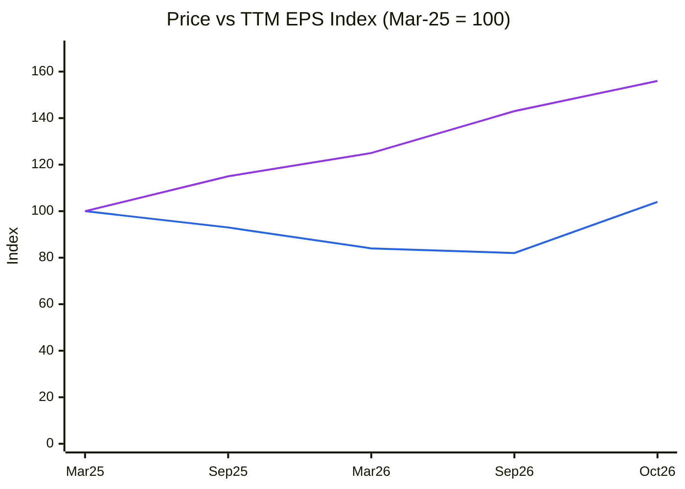
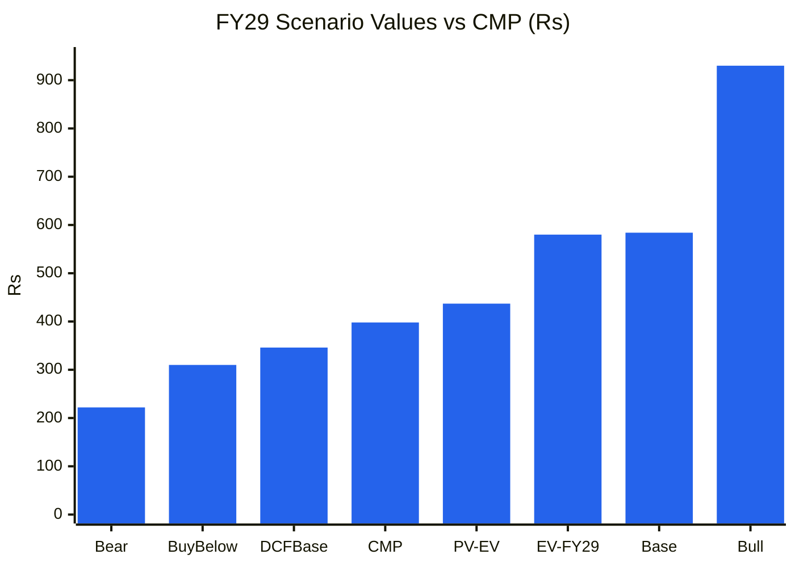

# Stock Analysis Report — International Gemological Institute (India) Ltd (NSE: IGIL)
**Date:** 2026-10-27
**Analyst:** Claude (Stock Fundamental Analysis Skill v3.3)
**Investment Horizon:** 2–3 Years
**Recommendation:** WATCHLIST: Quality at Wrong Price (buy-below ~₹310); technically a Stage 2 breakout, so a half-size momentum entry is defensible only with a stop
**Conviction Score:** 6.0 / 10
**CMP:** ₹398 (NSE, 27-Oct-2026, Screener.in) · Market cap ₹17,183 Cr (43.2 Cr shares, FV ₹2) · 52-wk range ₹287–419 · IPO Dec-2024 at ₹417
**Filed under:** Services and Platforms / Testing Inspection and Certification · Themes: Jewellery & gems (natural + lab-grown)

## Revision Log
| Version | Date | Recommendation | Conviction | Price | Key change |
|---|---|---|---|---|---|
| Current | 2026-10-27 | Watchlist: Quality at Wrong Price (buy-below ~₹310) | 6.0/10 | ₹398 | **Initial report.** Exceptional economics (61% EBITDA margin, ROE ~56%, CFO/EBITDA 94%, net cash) and strong Q2 FY27 (+31% revenue, +43% PAT). But 54% of certification revenue comes from lab-grown loose stones, an industry in price deflation; Blackstone owns 76.6% (a block-sale overhang); and the price implies 14–16% revenue CAGR for 10 years, so the PV of expected value (₹437) gives only ~9% margin of safety |

**Validation of previous report:** Initial report. No earlier report exists in the library (`update_library_index.py --find IGIL` and a "Gemolog" name search on 27-Oct-2026). New sub-sector folder `Services-and-Platforms/Testing-Inspection-and-Certification` created (no existing sub-sector fits a TIC lab).

---

## Executive Summary

IGI is the world's second-largest independent gem-grading laboratory by reports issued, and the **leader in lab-grown diamond (LGD) certification**. It grades loose diamonds and jewellery (natural and lab-grown), coloured stones (via AGL, acquired) and runs gemmology education across India, Belgium, the US, Hong Kong, Thailand, the UAE and new hubs (Italy, Saudi Arabia, Turkey). Blackstone bought IGI for ~US$570 m in 2023 and listed the India entity in Dec-2024 (₹4,225 Cr IPO at ₹417), using ₹1,475 Cr of fresh issue to acquire IGI Belgium and Netherlands from its own group (a related-party transaction). Q2 FY27 (Sep-2026): **4.35 mn reports (+26%)**, revenue **₹398 Cr (+31%)**, EBITDA **₹245 Cr (61.4% margin)**, PAT **₹186 Cr (+43%)**; interim dividend ₹2.55/share.

**What's strong:** an asset-light "toll on trust": 61% EBITDA margins, ~56% ROE, CFO 94% of EBITDA, net cash ~₹410 Cr, 20%+ volume growth, first-mover brand in LGD.

**What stops a buy at ₹398:**
1. **LGD concentration:** LGD loose stones are 54% and LGD jewellery 9% of certification revenue. LGD prices are deflating fast. Certification has grown with stone count so far, but the risk is that growers stop certifying small stones, use cheaper labs (GCAL, SGL) or that retailers self-grade.
2. **Realisation is mix-driven, not priced:** average realisation per report was ₹891, +4% YoY but **−12% QoQ**. The CFO says increases are mix, not price.
3. **Supply overhang:** Blackstone holds 76.55% (~₹13,150 Cr at CMP). A private-equity sponsor will sell down over time (block deals/OFS).
4. **Valuation already discounts strong growth:** 25.8× TTM P/E, ~18.7× EV/EBITDA. The reverse DCF implies **14–16% revenue CAGR for 10 years**. The probability-weighted FY29 value is ₹580 (+46%), but its **PV is ₹437, only ~9% above CMP**, against a required 30% MoS. Upside/downside is a healthy **3.0:1**.

**Technicals are supportive:** a Stage 2 breakout in the week of 19-Oct-2026 (₹327 → ₹381) on **~7× average volume** after results, above a 7-month base (₹287–360), with RS vs Nifty +21pp over 52 weeks.

### C1 — Growth Index: Revenue vs Fixed Assets vs EBITDA vs PAT (CY22 = 100, consolidated)
| ₹ Cr | CY22 (Dec-22) | CY23 (Dec-23) | CY24 (Dec-24) | FY26 (12m Apr-25–Mar-26)* | TTM Sep-26 |
|---|---|---|---|---|---|
| Revenue | 491 | 898 | 1,053 | 1,294 | 1,458 |
| Fixed assets + CWIP | 110 | 404 | 420 | 601 | 625 |
| EBITDA (ex-OI) | 335 | 497 | 600 | 777 | 896 |
| PAT | 242 | 331 | 427 | 572 | 667 |

*\*FY26 was reported as a 15-month period (Jan-25–Mar-26: revenue ₹1,598 Cr). The 12-month Apr-25–Mar-26 figures are built from Screener quarterly rows (Jun-25 + Sep-25 + Dec-25 + Mar-26). CY22 is the India entity before the Belgium/Netherlands acquisition (common-control accounting restates CY23 onward), so CY22→CY23 is not like-for-like. Source: Screener.in consolidated.*

🟦 Revenue · 🟧 Fixed assets + CWIP · 🟩 EBITDA · 🟪 PAT

**Read:** From CY23 (like-for-like after the acquisition) to TTM, revenue rose 62%, EBITDA 80% and PAT 102%, while fixed assets rose 55%.

**Business inference:** Profits are growing faster than revenue and roughly in line with the asset base, the signature of an operating-leverage, asset-light lab. The FY26–TTM step in fixed assets is new labs (Italy, Saudi, Turkey, Dubai scale-up) and AGL, so capital intensity should be watched, but at ~43% revenue-to-fixed-asset growth parity it is still modest.

---

## Business Primer

IGI sells trust. A diamond manufacturer, jeweller or retailer sends a stone or piece of jewellery to an IGI lab, which grades it on the 4Cs (cut, colour, clarity, carat), identifies whether it is natural or lab-grown, laser-inscribes it and issues a certificate, charging a fee per report that rises with stone size and service. Customers are B2B: diamond cutters and LGD growers (Surat, Mumbai), jewellery manufacturers, and retailers and brands in the US, Europe, the Middle East and India, who rely on the IGI report to sell to consumers. Revenue = reports × average realisation (₹891/report in Q2 FY27), split by category: LGD loose 54%, natural jewellery 16%, natural loose 14%, LGD jewellery 9%, gemstones and other 6% (Q2 FY27 presentation). Labs sit next to the cutting and trading hubs (Mumbai, Surat, Antwerp, New York, Hong Kong, Bangkok, Dubai). The business depends on two things: the **brand's credibility with retailers and consumers** (the moat), and the **number of stones that need certifying**, which today is driven by the LGD boom.

This is a **capital-light, very high-margin services franchise** (a "toll-road" on gem trade), more like a ratings agency or exchange than a manufacturer. The value driver is volume, with realisation set by mix. The key risks are **LGD industry deflation and concentration** (two-thirds of certification revenue is lab-grown), **reputational events** (grading-consistency questions are the existential risk for any lab), US tariffs and trade flows in gems, and the **Blackstone overhang**. Two structural features colour the analysis. First, the listed entity was assembled from a common-control acquisition funded by IPO proceeds paid to the promoter group, which makes pre-2024 history hard to compare. Second, the financial year changed (Dec → Mar, with a 15-month FY26).

**New Segment Protocol:** segment **"Testing, Inspection & Certification (TIC): Gem & Jewellery Grading"** was not covered. The user approved a new block, added on 27-Oct-2026 (references/05-industry-kpis-india.md, line ~2747). Top KPIs: report volume growth by category, realisation per report, EBITDA margin.

---

## Module 1 — Broad Market Cycle
Nifty 50 is at ~22,750 (27-Oct-2026), below a falling 30-week MA (~23,700); 1-yr −11%, 26-wk −6% (Yahoo Finance weekly). India VIX ~14 and index P/E ~19× in early October (via the 14-Oct-2026 TARIL report). **Assessment: CAUTIOUS.** IGIL is outperforming the market (+10% over 52 weeks vs −11%), so its demand driver is decoupled from India macro. Sizing: normal-to-small.

## Module 1b — Sector Cycle
**Secular:** certification penetration is rising (IGI cites 80–85% by 2030). LGD jewellery is mainstreaming (US mass-market retailers, India's emerging LGD brands). LGD labelling rules (BIS/consumer protection in India, FTC in the US) favour independent certification. The global jewellery market is US$340–350 bn growing 3–5%.
**Cyclical:** LGD output capacity expansion (India CVD, China HPHT) drives stone counts *now*. Grower consolidation and price deflation could reverse that. Natural diamonds are in a multi-year slump (high gold prices, China weakness, De Beers price cuts); IGI natural loose +8%, natural jewellery +3% in Q2 FY27.
**Decomposition:** Q2 FY27 volume +26% = LGD stone growth (~35–45%, mostly cyclical capacity-driven) + natural (+3–8%, depressed). **Durable baseline: ~10–14%** revenue growth (penetration + jewellery certification + geography), not the current 25–30%.
**Geopolitics / FX:** a large share of revenue is ex-India (Belgium, US, HK); INR depreciation helps translation. US tariffs on Indian gems/jewellery (2025) are a demand risk for US-bound certification (not quantified by management; data gap).
**Verdict: TAILWIND (LGD volume), with a cyclical overlay that will fade.** MoS +5pp.

## Module 1c — Stock Cycle

### C2 — Quarterly YoY revenue growth (consolidated)
| | Dec-24 | Mar-25 | Jun-25 | Sep-25 | Dec-25 | Mar-26 | Jun-26 | Sep-26 |
|---|---|---|---|---|---|---|---|---|
| Revenue (₹ Cr) | 265 | 305 | 301 | 304 | 320 | 369 | 371 | 398 |
| YoY | 6% | 10% | 16% | 22% | 21% | 21% | 23% | 31% |

*Source: Screener.in quarterly. Dec-24 and Mar-25 YoY bases are Dec-23 (250) and Mar-24 (278); Jun-25 vs Jun-24 (260); Sep-25 vs Sep-24 (250).*

🟦 YoY revenue growth

**Read:** Growth has **accelerated** for eight quarters, from 6% to 31%.

**Business inference:** This is the opposite of what the bear case predicts. LGD certification demand has *grown* through price deflation so far, because falling prices mean more (cheaper) stones and more jewellery pieces get graded. The accelerating trajectory is a Module 1c buy signal. The question is durability (Module 1b).

### Volume / price / mix
| | Q2 FY26 | Q2 FY27 | YoY |
|---|---|---|---|
| Reports (mn) | 3.45 | 4.35 | +26% |
| Certification revenue (₹ Cr) | ~293 | 387.5 | +32% |
| Realisation (₹/report) | ~857 | 891 | +4% (2pp AGL, 2pp mix) |

Volume dominates; realisation is mix (LGD share 54% vs 52%) plus AGL. **No pricing power has been demonstrated or claimed.**

### Operating leverage
Fixed costs (graders, labs, brand) are a large share of the ~39% cost base. EBITDA grew 39% on 31% revenue (incremental EBITDA margin ~72%). **DOL ≈ 1.3×.** No debt (borrowings ₹150 Cr are mostly lease liabilities; ICR >80×).

### FCF
Already strong: FY26 (15m) CFO ₹624 Cr, FCF ₹543 Cr. H1 FY27 CFO ₹416 Cr. Investing outflow ₹257 Cr in H1 (labs, AGL, deposits). **FCF inflection: passed.**

### CY7 — EBITDA margin
| | CY22 | CY23 | CY24 | FY26 (15m) | Q2 FY27 |
|---|---|---|---|---|---|
| EBITDA margin | 68% | 55% | 57% | 61% | 61.4% |

*CY22 is the India-only entity (pre-acquisition).*

**Cycle classification: Mid-cycle compounder with a cyclical volume tailwind.** Margins are stable at 55–61%, not >1 SD above history. MoS standard (+5pp for LGD cyclicality).

---

## Module 2 — Industry Structure
| Force | Gem grading | Signal |
|---|---|---|
| New entrants | **Low-medium.** Lab set-up is cheap; *trust* is not. Retailer acceptance of reports takes decades; AI-enabled low-cost labs are a long-run threat | Brand barrier |
| Supplier power | Low (graders, equipment) | ✅ |
| Buyer power | **Medium-high.** Large LGD growers and US retailers send millions of stones and can switch labs or negotiate fees | ⚠️ |
| Substitutes | Medium: retailer self-certification, blockchain provenance, simplified LGD classification (IGI says no shift seen) | ⚠️ |
| Rivalry | Concentrated: GIA dominates natural; IGI dominates LGD; GCAL, SGL, HRD smaller | Oligopoly |

**Industry verdict: ATTRACTIVE** (oligopoly, trust barrier, asset-light).
**Capital cycle:** no flood of capacity. New labs are small and lack brand. LGD *grower* capacity is flooding (the customer's capital cycle), which raises IGI's volumes now but threatens a customer shake-out later.

## Module 3 — Business Quality & Moat
- **Greenwald:** **customer captivity** (retailers and consumers ask for "IGI-certified" LGD; switching is costly for brands with marketing tied to IGI reports) plus **scale economies** (4.35 mn reports a quarter gives data for AI-assisted grading, per management). Cost advantage: moderate.
- **Buffett 10% price test:** **not demonstrated.** Realisation gains are mix; management avoids price increases while competing for LGD volume. Inconclusive.
- **Durability tests:** ROE ~56%, ROCE ~69% (Screener) → far above WACC. Market share: leader in LGD for 20 years (certifying since 2005). Main threat: a grading-credibility scandal.
- **Moat verdict: NARROW-to-WIDE (brand/trust).** The trust moat is real, but it is exposed to a single category (LGD) whose economics are in flux.

### Fisher 15-point checklist
| # | Point | Score | Note |
|---|---|---|---|
| 1 | Market potential | 3 | Penetration + LGD + jewellery + new geographies |
| 2 | New products | 2 | AGL coloured stones, education, jewellery certification |
| 3 | R&D effectiveness | 2 | AI grading claims; detection technology |
| 4 | Sales organisation | 3 | Embedded with manufacturers and US retailers |
| 5 | Profit margin | 3 | 61% EBITDA |
| 6 | Margin improvement | 2 | Group margin +340 bp; India standalone −340 bp |
| 7 | Labour relations | 2 | No issues found |
| 8 | Executive relations | 2 | Lorie family (founders) + Blackstone |
| 9 | Management depth | 2 | Professional, global team |
| 10 | Controls | 2 | Big-4-type audit expected (auditor not retrieved) |
| 11 | Industry advantage | 3 | LGD first mover, brand |
| 12 | Long-range orientation | 2 | PE sponsor horizon |
| 13 | Dilution | 3 | None since IPO |
| 14 | Candour | 2 | Detailed disclosure; grading-consistency questions answered generally |
| 15 | **Integrity** | **2** | Pass. Related-party acquisition via IPO disclosed in the RHP |
| | **Total** | **35 / 45** | |

## Module 4 — Management & Capital Allocation
**Promoter:** Blackstone (BCP Asia II TopCo IV) **76.55%**, unchanged since listing. **Pledge: none shown** (verify; data gap). FIIs 8.8%, DIIs 5.5%, public 9.2%.

| Check | Finding | Flag |
|---|---|---|
| Promoter type | PE sponsor; exit-driven | ⚠️ Supply overhang (~₹13,150 Cr) |
| MPS | 76.55% → must fall to ≤75% (within ~3 yrs of listing, i.e. by ~Dec-2027) | ⚠️ Minimum ~1.6% sale; in practice a much larger sell-down is likely |
| RPT | IPO fresh issue ₹1,475 Cr paid to Blackstone affiliates to buy IGI Belgium & Netherlands (common control; valuation per RHP) | ⚠️ Disclosed RPT, value-neutral if fairly priced |
| Dividends | 25% payout (CY24), interim ₹2.55 (H1 FY27) | ✅ |
| Capital allocation priorities | Growth labs → M&A (AGL) → dividends (CFO, Q2 call) | ✅ |

**Capital allocation rating: Good** (high-ROIC reinvestment, dividends, no dilution).
**Buffett Three C's:** Candour: Good. Competence: High. Caring: Moderate (PE sponsor).

### Walk the Talk
| Period | Statement | Guided | Actual | Verdict |
|---|---|---|---|---|
| FY27 (initial) | Revenue growth | ~15% | H1 +27% | ✅ Beat |
| FY27 (initial) | EBITDA growth | ~20% | H1 +34% | ✅ Beat |
| FY26 calls | EBITDA growth > revenue growth | Yes | Q2: 39% vs 31% | ✅ Hit |
| FY26–27 | New geographies (Italy, Saudi, Turkey, Dubai) | Launch | Italy entered; Dubai and Turkey scaling; Saudi planned | ✅ Broadly on track |
| FY26 | Natural diamond double-digit growth (FY27 target) | ≥10% | Natural loose +8%, jewellery +3% (Q2) | ⚠️ Near miss |

**WTT Score: (4 + 0.5) ÷ 5 = 0.90 — HIGH.** Pattern: **sandbagging** (beats initial guidance). Insider action: no open-market trades; PE holder static → NEUTRAL. **DCF impact: guidance used as a floor.**

## Module 5 — Financial Forensics
| Check | Finding | Flag |
|---|---|---|
| Pledge / ICDs | None found | ✅ |
| Revenue quality | Debtor days rising 47 → 51 → 57 → 66 | ⚠️ Watch (large LGD customers) |
| Other income | ₹64 Cr TTM = 7% of EBIT | ✅ |
| Tax rate | ~25–27% | ✅ |
| Audit | Auditor/KAMs not retrieved (data gap) | ⚠️ |
| Common-control accounting | CY23 reserves −₹605 Cr (pre-IPO restructuring) | ⚠️ History not comparable |

**Quant models (FY26 15m vs CY24, approx.):** Altman Z'' **>8 (Safe)**; Piotroski **7/9** (ROA+, CFO+, CFO>NI, no dilution, margin up, leverage down; AT down on longer period; current ratio n.a.); Sloan CF accrual (711 − 624 + 320)/avg TA 1,679 = **24%**, inflated by the 15-month period and lab/AGL investment; balance-sheet accrual 5% ✅. Beneish not run (period-length and common-control distortions).
**Forensic red-flag count: 1** (rising debtor days). **Verdict: Clean to minor concerns.**

## Module 5 (cont.) — Earnings Quality
- **ROIC:** NOPAT (EBIT ex-OI ₹841 Cr × 0.74 = ₹622 Cr) ÷ invested capital (equity ₹1,751 Cr + borrowings ₹150 − cash ₹560 ≈ ₹1,340 Cr) ≈ **46%** vs WACC 12.5% → large economic profit.
- **CFO/EBITDA:** 87%, 90%, 91%, 94% (CY22–FY26) → **High quality.**
- **O'Glove flags: 1/15** (debtor days).

### DuPont (approx.)
| Period | EBIT margin | Asset turnover | Equity multiplier | Interest burden | Tax burden | ROE |
|---|---|---|---|---|---|---|
| CY24 | 56.4% | 0.70 | 1.42 | 0.98 | 0.73 | 40% (year-end equity, IPO year) |
| FY26 (15m) | 61.4% | 0.86 | 1.25 | 0.99 | 0.73 | 48% (15-month PAT on year-end equity) |

**DuPont verdict:** ROE is driven by **margin and asset turnover with falling leverage**, the high-quality pattern.

## Module 6 — Industry KPIs & Peers
| KPI | IGIL | Healthy | Assessment |
|---|---|---|---|
| Report volume growth | +26% (Q2); natural +3–8%, LGD +37–47% | >15% | ✅ |
| Realisation per report | ₹891 (+4% YoY, −12% QoQ, mix-driven) | Stable/rising | ⚠️ Mix-dependent |
| LGD concentration | 63% of certification revenue (54% loose + 9% jewellery) | <60% | ⚠️ Above |
| EBITDA margin | 61.4% | >50% | ✅ |
| Cash conversion | CFO/EBITDA 94% | >85% | ✅ |
| Brand risk | Grading-consistency questions raised on the call; no major controversy found | — | ⚠️ Monitor |

**Peers:** no direct Indian listed peer. Global TIC (SGS, Bureau Veritas, Intertek) trade at roughly 22–28× P/E with 17–25% EBITDA margins (indicative; verify). IGIL at 25.8× is **in line with global TIC despite ~3× the margin and 2× the growth**, a fair discount for LGD concentration and single-industry exposure.

| Metric | IGIL | Global TIC (indicative) |
|---|---|---|
| Revenue growth | 27% (H1) | 4–8% |
| EBITDA margin | 61% | 17–25% |
| ROE | ~50% | 20–30% |
| Net debt | Net cash | Moderate leverage |
| P/E | 25.8× | ~22–28× |

*Order Book Tracker: not applicable (per-report services business).*

## Module 7 — Market Size & Share
**TAM:** global gem/jewellery certification, a few US$ bn (IGI does not quantify; data gap). IGI TTM revenue ₹1,458 Cr (~US$175 m).
**Share:** #1 in LGD certification (majority of graded LGD, by industry reports); #2 overall by volume behind GIA (GIA leads natural by value).
**Trend:** gaining (volume +22% H1 vs market growth well below that). **Driver:** structural (LGD first mover, jewellery certification push) plus temporary (LGD output boom).
**Verdict: taking share in a growing category.**

## Module 8 — Valuation
### 8A. PIE
EV ≈ ₹17,183 Cr − ~₹410 Cr net cash ≈ **₹16,770 Cr**; EV/EBITDA TTM 18.7×; NOPAT margin 42.7%.
| Driver | Market-implied | My base | Gap |
|---|---|---|---|
| Revenue CAGR (10 yr) | **13.6% (WACC 12%) – 16.1% (13%)** → FY36 revenue ₹5,200–6,500 Cr | ~13% blended (22% FY27 fading to 7%) | **≈ 0 to −3pp (fairly to slightly optimistically priced)** |
| NOPAT margin | 42.7% | 42% | ~0 |
| Sales-to-capital | 2.5 | 2.5 | 0 |

**Plausibility:** FY36 revenue of ₹5,200–6,500 Cr means ~4× today's volume at today's fees, i.e. **~70 mn reports a year** vs ~16 mn now. Possible only if LGD jewellery certification becomes near-universal and IGI expands well beyond diamonds. The market is pricing a successful decade, not a cycle.
**Treadmill:** to outperform, IGI must keep **≥20% growth through FY29** *and* show natural-diamond recovery *and* hold realisation as LGD deflates.
**Triggers (+):** natural diamond recovery; US/EU retailer mandates; Blackstone sells via a well-absorbed block (removes overhang); new categories (coloured stones, jewellery).
**Triggers (−):** LGD grower shake-out; realisation drop; grading controversy; a large discounted block sale.
**SVAR:** bear ₹222 → **44%** (just above the 40% threshold).

### 8B. DCF & cross-checks
- 3-stage DCF (WACC 12.5%, terminal g 6%, terminal ROIC 40%, S/C 2.5): **base ₹346, bull ₹445, bear ₹178**.
- Relative: 22–28× FY28E EPS (~₹19.8) = ₹435–555.
- **Graham Number:** √(22.5 × 15.45 × 40.5) = **₹119** (not meaningful for an asset-light franchise).
- Graham defensive screen: 3/7 (revenue <₹2,000 Cr; P/E >20; P/B ~9.8).

### CY1 — P/E since listing (TTM EPS, approximate)
| | Mar-25 | Sep-25 | Mar-26 | Sep-26 | 27-Oct-26 |
|---|---|---|---|---|---|
| Price (₹) | 382 | 357 | 320 | 312 | 398 |
| TTM EPS (₹, reported by that date) | 9.91 | 11.40 | 12.35 | 14.15 | 15.45 |
| P/E (×) | 38.5 | 31.3 | 25.9 | 22.0 | 25.8 |

*TTM EPS = last four reported quarters of PAT (Screener) ÷ 43.17 Cr shares: Mar-25 uses Mar-24..Dec-24 (₹428 Cr); Sep-25 uses Sep-24..Jun-25 (₹492 Cr); Mar-26 uses Mar-25..Dec-25 (₹533 Cr); Sep-26 uses Sep-25..Jun-26 (₹611 Cr); Oct-26 uses Dec-25..Sep-26 (₹667 Cr).*

🟦 P/E TTM

**Read:** The P/E de-rated from ~38× to ~22× (Sep-2026) while EPS grew ~43%, then re-rated to ~26× on the Q2 beat.

**Business inference:** The market spent a year pricing LGD-deflation risk into the multiple even as earnings compounded. The October re-rating reflects evidence that volumes are holding. The ~22× trough is a reasonable "pessimistic" anchor for a buy-below.

### CY4 — Price vs EPS index (Mar-25 = 100)
| | Mar-25 | Sep-25 | Mar-26 | Sep-26 | Oct-26 |
|---|---|---|---|---|---|
| Price | 100 | 93 | 84 | 82 | 104 |
| TTM EPS | 100 | 115 | 125 | 143 | 156 |

🟦 Price · 🟪 TTM EPS

**Read:** EPS +56% since Mar-2025; price +4%.

**Business inference:** Returns have lagged earnings: the multiple absorbed the growth. Future returns from here need EPS growth with a stable multiple. That is plausible given the de-rating already done, but it leaves little room if LGD volumes slow.

### 8D. Scenarios (FY29E = Mar-2029; 43.17 Cr shares)
| Scenario | Revenue FY29 | EBITDA margin | EPS FY29 | P/E | Target | Probability |
|---|---|---|---|---|---|---|
| Bull | ₹2,700 Cr (~28% CAGR; LGD jewellery + natural recovery) | 63% | ₹29.1 | 32× | **₹930** | 25% |
| Base | ₹2,250 Cr (~20% CAGR) | 61% | ₹23.4 | 25× | **₹584** | 50% |
| Bear | ₹1,500 Cr (LGD shake-out; flat from FY26) | 55% | ₹13.9 | 16× | **₹222** | 25% |
| **Expected value** | | | | | **₹580 (+46%)** | |

*FY26 12-month base ₹1,294 Cr. D&A ₹65–75 Cr, OI ₹60–80 Cr, tax 26%.*
- **PV** (2.4 yrs @ 12.5%) = **₹437** (+10% vs CMP); base PV ₹440.
- **Upside/downside:** (930 − 398) ÷ (398 − 222) = **3.0:1** ✅.
- **Required MoS:** mid-cap, LGD concentration, PE overhang → 30% → **buy-below ≈ ₹437 × 0.70 ≈ ₹306 → ~₹310** (≈20× TTM, just below the Sep-2026 trough multiple of ~22×).

### C13 — Scenario values vs CMP

🟦 ₹ per share

**Read:** CMP (₹398) sits just below the discounted expected value (₹437) and above the DCF base (₹346).

**Business inference:** At ₹398 the expected return is roughly the cost of equity (~12–15% a year) with a favourable 3:1 skew. It's a fair price for a high-quality business, not a margin-of-safety price.

### Cycle Position Dashboard
| Dimension | Current | History | Signal |
|---|---|---|---|
| P/E | 25.8× | 21–34× since listing | Mid |
| EBITDA margin | 61.4% | 55–68% | Mid-high |
| ROE | ~50% | 40–56% | High (stable) |
| Volume growth | +26% | 6–31% | High (cyclical LGD) |
| **Overall** | | | **Mid-cycle; customer-industry (LGD) late-boom** |

## Module 9 — Technical Stage
**Nifty: Stage 4.** **Stock: Stage 2, confirmed breakout (Oct-2026).**
| # | Check | IGIL | ✓/✗ |
|---|---|---|---|
| 1 | Weekly close above base resistance | Base ₹287–360 (Mar–Oct 2026); week of 19-Oct closed ₹381, then ₹385 and ₹396 | ✓ |
| 2 | Volume | 29.7 M vs ~2.5–4 M weekly average (**~7–10×**, results week) | ✓ |
| 3 | 30-week MA | ₹349, rising (₹334 → ₹345 → ₹349); price 13% above | ✓ |
| 4 | RS vs Nifty | 52-wk +10% vs −11% (+21pp); 26-wk +12% vs −6% | ✓ |
| 5 | Base width | ~7 months | ✓ |
| 6 | Within 10–15% of pivot | Pivot ~₹360 → CMP +10% | ✓ (upper edge) |
**Stop-loss:** weekly close below **₹355** (back inside the base). IPO price ₹417 and the 52-week high ₹419 are overhead resistance (IPO holders breaking even).
**CANSLIM:** C 1 (EPS +43%) · A 1 (EPS growth ~30%+ for 3 yrs; ROE >17%) · N 1 (new geographies; price at a new high from a base) · S 0 (large PE overhang) · L 1 (sector leader, top RS) · I 0 (FII/DII flat to down) · M 0 → **4/7**.
**Combined verdict:** Stage 2 breakout + CANSLIM 4/7 → below the 5/7 "buy" bar. The fundamentals fail MoS. **Misaligned: the chart says go, valuation says wait.**

## Module 10 — Forward View
**Model track:** asset-light services. Capacity driver = reports per lab/grader. Capex ~₹100–150 Cr a year (labs, equipment, AGL integration); maintenance ≈ D&A (~₹55–70 Cr).
| ₹ Cr | FY27E | FY28E | FY29E |
|---|---|---|---|
| Revenue | 1,600 | 1,900 | 2,250 |
| EBITDA (60–61%) | 965 | 1,150 | 1,373 |
| PAT | 715 | 855 | 1,008 |
| EPS (₹) | 16.6 | 19.8 | 23.4 |
| FCF (after ~₹130 Cr capex) | ~600 | ~720 | ~860 |
| P/E at CMP | 24× | 20× | 17× |

**Catalysts:** Q3 FY27 (festive, natural recovery); Blackstone block sale absorbed (removes overhang); MSCI/index inclusion as float rises; new categories (coloured stones via AGL, jewellery).
**Risks:** LGD shake-out / fee pressure (**Medium**); grading-credibility event (**Low prob., High impact**); Blackstone sell-down at a discount (**High prob.**, temporary); US tariffs/trade disruption (**Medium**); GIA entering LGD aggressively (**Low-Medium**).

## Checklist Summary
Section 0 (filing) 5/5 · A 16/18 · B 7/9 (auditor, Beneish) · C 10/12 · D 6/7 · E 5/7 · F 10/10 · G 8/8 · H asset-light track run · I 5/5.
**Hard Stops Triggered:** None (forensic flags 1; Stage 2; up/down 3:1; ROIC ≫ WACC).

**Pre-buy check:** falsifiable downgrade triggers: (1) report volume growth <10% for two quarters; (2) realisation per report −10% YoY on a stable mix; (3) any major retailer dropping IGI reports. Inversion: LGD deflation, grower consolidation, PE overhang, grading scandal. The price discounts some LGD risk (P/E 26× vs 34× at listing) but not a shake-out.

## Investment Decision
**Recommendation:** **WATCHLIST: Quality at Wrong Price**
**Conviction Score:** 6.0 / 10
| Component | Max | Score |
|---|---|---|
| Cycle | 1 | 0.5 |
| Industry structure | 1 | 0.8 |
| Business quality & moat | 2 | 1.4 (narrow-to-wide moat, single-category LGD exposure) |
| Management | 1 | 0.6 (PE sponsor overhang) |
| Financial + earnings quality | 2 | 1.7 |
| Valuation & PIE | 2 | 0.6 (MoS fails; 3:1 skew) |
| Technical | 1 | 0.4 (Stage 2 stock in a Stage 4 market) |
| **Total** | **10** | **6.0** |

**Position size:** 0% at CMP for a value entry. If you want to follow the breakout, use **half size (≤1.5%)** with a stop at a weekly close below ₹355.
**Entry range:** **₹300–330** (≈20× TTM, ~16× FY28E), or on a Blackstone block-sale dip.
**Target (base FY29):** ₹584; PV ₹437.
**Review triggers:** Q3 FY27 volumes (natural vs LGD), realisation per report, any Blackstone block deal, debtor days.

### Sources
- Screener.in [IGIL consolidated](https://www.screener.in/company/IGIL/consolidated/) (27-Oct-2026).
- Q2 FY27: [Investing.com slides](https://in.investing.com/news/stock-market-news/igi-q2-fy27-slides-certification-revenue-surges-32-ebitda-up-39-93CH-5645567) · [Multibagg](https://www.multibagg.ai/market-pulse/articles/igi-q2-fy27-a4816126-2b2f-4b1c-a48e-1aae7eaaa069) · [Yahoo Finance call highlights](https://finance.yahoo.com/markets/stocks/articles/international-gemological-institute-ltd-nse-010117288.html) · [Equitybulls](https://www.equitybulls.com/news/377393/international-gemological-institute-delivers-strong-q2fy27-performance) · [Investywise](https://www.investywise.com/igi-investor-presentation-for-q2-h1-fy27) · [Diamond World](https://www.diamondworld.net/news/igi-targets-double-digit-natural-diamond-growth-in-fy27-as-certification-demand-rises).
- Background: [JCK on Blackstone purchase](https://www.jckonline.com/editorial-article/igi-sold-569-65-million-blackstone/) · [Rough & Polished on IPO valuation](https://www.rough-polished.com/article/valuation-questions-raised-over-blackstones-bn-ipo-of-indias-international-gemmologist-institute).
- Prices: Yahoo Finance weekly API (IGIL.NS, ^NSEI), 27-Oct-2026.

---
*Report generated by Stock Fundamental Analysis Skill v3.3 | Indian Markets Context*
*Save path: C:\Users\anubh\Documents\Anubhav\Stock Analysis\Stock Analysis\Services-and-Platforms\Testing-Inspection-and-Certification\*
