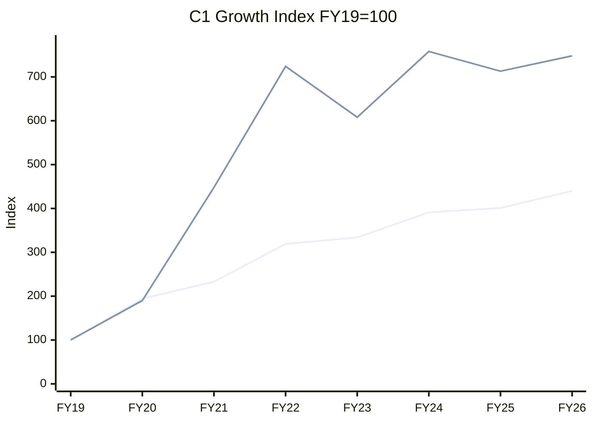
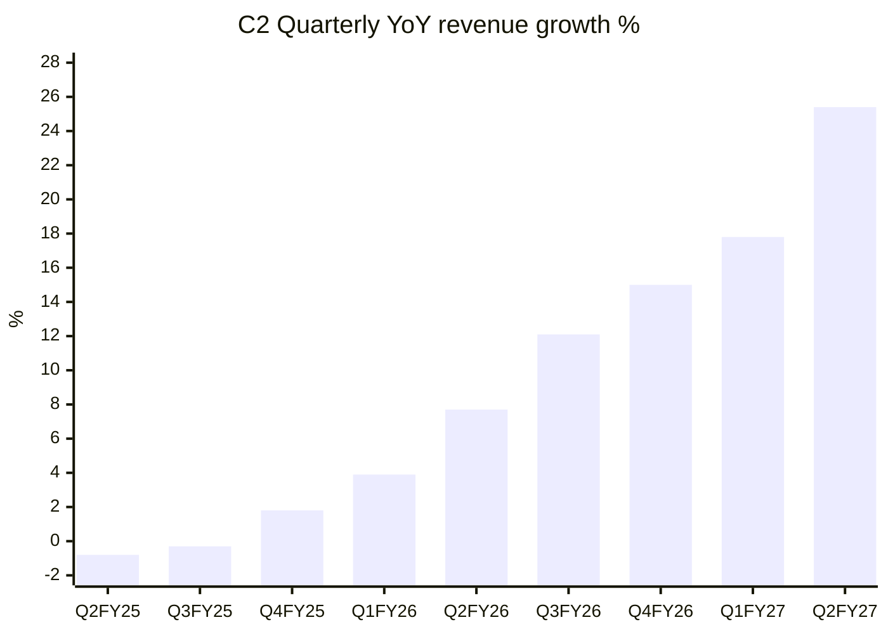
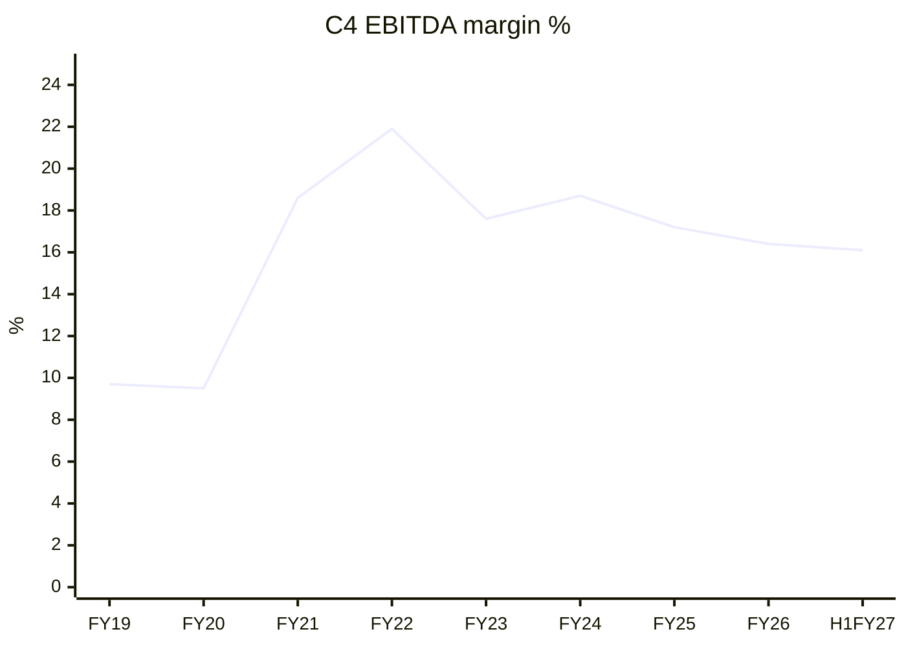
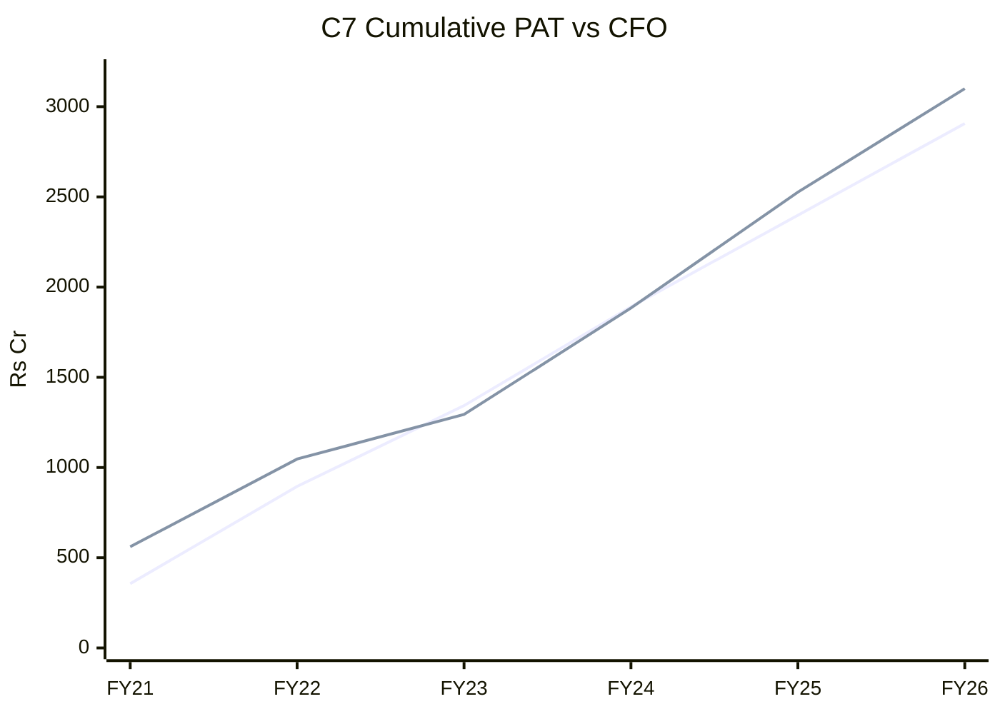
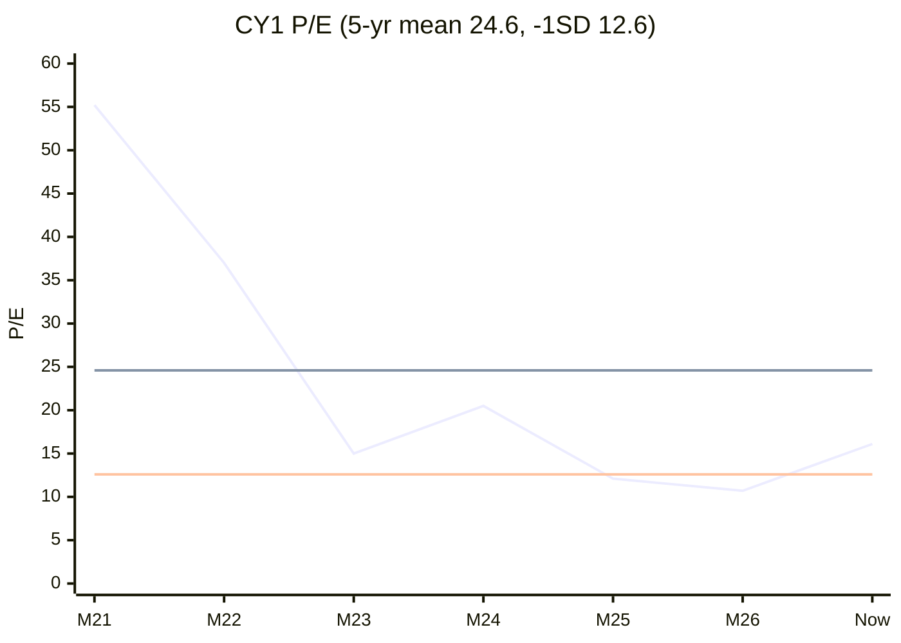
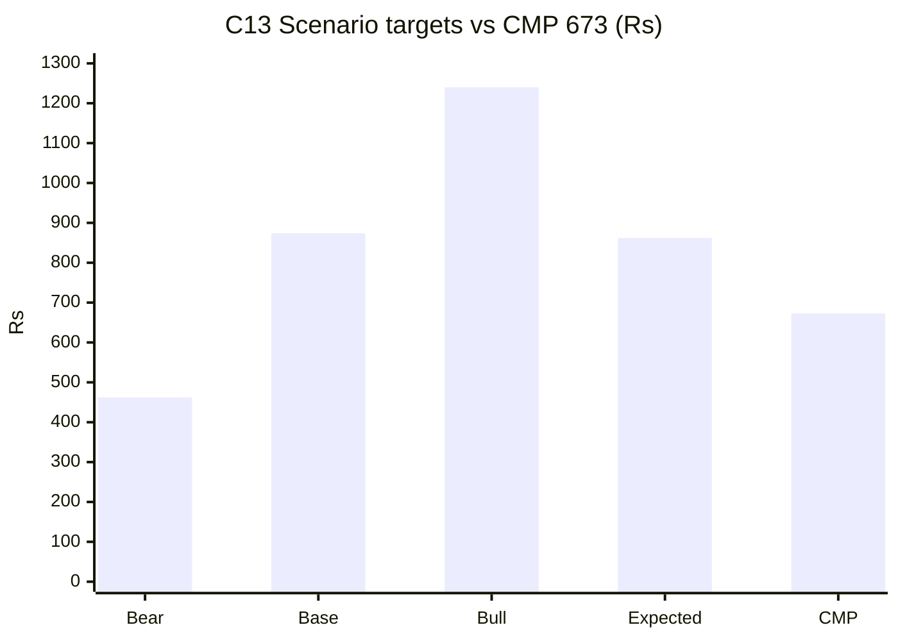

# Stock Analysis Report — Tanla Platforms Ltd (TANLA)
**Date:** 2026-11-05
**Analyst:** Claude (Stock Fundamental Analysis Skill v3.3)
**Investment Horizon:** 2–3 Years
**Recommendation:** WATCHLIST / HOLD (good business, fair price; Stage 2 breakout under way)
**Conviction Score:** 5 / 10
**CMP:** ₹673 (Screener, 05-Nov-2026) · MCap ₹8,928 Cr · Cash & investments ₹1,447 Cr (Q2 FY27 letter) · EV ≈ ₹7,480 Cr
**Filed under:** Technology-and-Electronics / IT-Services-and-Software · Themes: Digital platforms & fintech

## Revision Log
| Version | Date | Recommendation | Conviction | Price | Key change |
|---|---|---|---|---|---|
| Current | 2026-11-05 | WATCHLIST / HOLD | 5/10 | ₹673 | Initial report — after Q2 FY27 (revenue +25% YoY, sixth straight quarter of acceleration) |

**Validation of previous report:** Initial report. **New KPI block added to the skill reference:** "CPaaS / A2P Messaging Platforms" (`references/05-industry-kpis-india.md`, line 2869), approved by the user on 05-Nov-2026.

---

## Business Primer

Tanla is India's largest enterprise-messaging aggregator (CPaaS — Communications Platform as a Service), Hyderabad-based and founder-run (Uday Reddy, 46% promoter). Its **Enterprise Communications** business (92% of Q2 FY27 revenue; brands Karix and ValueFirst) sends OTPs, transaction alerts and marketing messages for banks, fintechs, e-commerce and government over SMS, WhatsApp, RCS, voice and Truecaller. It buys termination from telcos (Jio, Airtel, Vi) or Meta and resells it with routing, reliability and analytics, so revenue is messages × price, and most of that price passes straight through to the carrier (gross margin ~20% in Enterprise). Its **Digital Platforms** business (8% of revenue, ~79% EBITDA margin) licenses technology to telcos: Trubloq (the blockchain DLT registry TRAI mandates for commercial SMS), Wisely.ai (real-time anti-scam/smishing, live at Indosat Indonesia and a top-5 Indian private bank), and a consent-management platform waiting on DPDP rules. The business depends on two things: telco/Meta relationships (supply and pricing) and wallet share with large BFSI enterprises (the ₹50 Cr+ cohort is ~43% of revenue).

This is an asset-light, cash-generative **platform-plus-aggregator** hybrid. It is not a SaaS compounder: about 70% of gross profit comes from a low-margin, telco-dependent resale business. The key value driver is **gross-profit growth via channel mix** (SMS → WhatsApp/RCS, now 36% "OTT" of revenue) and **operating leverage on a ~₹550 Cr indirect cost base**. The key risks are disintermediation (Meta and telcos selling directly) and regulation (TRAI pricing/consent timing). Three features colour the analysis. (1) EBITDA margin has fallen from 22% (FY22) to 16% (FY26) as mix shifted to lower-margin channels and platforms stalled. (2) The stock fell ~67% from its 2022 peak (₹2,062) and has re-rated from 55× to ~11–16× P/E, so expectations are low. (3) Management gives no numeric guidance, and its platform promises (Wisely scale-up, consent platform) have repeatedly slipped.

**Segment: CPaaS / A2P Messaging Platforms — new KPI block added on approval ✓.**

---

## Executive Summary
Tanla has turned from 2024's flat revenue into six quarters of accelerating growth: Q2 FY27 revenue +25% YoY (≈ +23% organic) and enterprise gross profit +32%, driven by WhatsApp volumes doubling and BFSI wallet share. The balance sheet is pristine (₹1,447 Cr cash, no debt, FCF ~100% of PAT, ₹179 Cr buyback in FY26). But the margin story has not turned. Group gross margin fell 48 bp YoY, EBITDA margin stays ~16%, and the high-margin Platforms business grew only 6%. At ₹673 the market prices ~10% five-year NOPAT growth (reverse DCF). Our base case is ~11–12%, so the price is **roughly fair**: DCF base ₹690, 2.5-yr probability-weighted ~₹862 (+28% plus ~2% a year in dividends). The stock just made a **Stage 2 breakout to a 52-week high** on rising volume. **Watchlist for fundamentals (buy-below ₹550); existing holders hold with a stop below ₹540.**

**C1 — Growth Index (FY19 = 100)**
| FY | 19 | 20 | 21 | 22 | 23 | 24 | 25 | 26 |
|---|---|---|---|---|---|---|---|---|
| Revenue ₹Cr | 1,004 | 1,943 | 2,341 | 3,206 | 3,355 | 3,928 | 4,028 | 4,418 |
| EBITDA ₹Cr | 97 | 184 | 435 | 702 | 590 | 735 | 692 | 726 |
| PAT ₹Cr | 30 | −211 | 356 | 539 | 448 | 548 | 507 | 509 |
*Screener consolidated. FY20 loss = Karix acquisition intangibles amortisation/impairment (₹378 Cr D&A).*

*Key: 1 Revenue · 2 EBITDA.* **Read:** EBITDA grew 7.5× in FY19–22 (Karix integration plus the DLT platform windfall), then went sideways for four years while revenue kept rising. **Business inference:** FY22 was peak margin. The FY23–26 period shows a business adding lower-margin revenue. The thesis now hinges on EBITDA re-accelerating with revenue, which in H1 FY27 it did (+22% YoY).

---

## Module 1 — Broad Market Cycle
Nifty 50 ~23,441 (02-Nov-2026), India VIX 15.5 → **Neutral-to-Cautious, normal sizing** (same backdrop as the Alembic/Zensar reports of this date).

## Module 1b — Sector Cycle
- **Secular:** India A2P volumes are mature (SMS flat-to-low single digit). The secular growth is **channel migration** to WhatsApp Business (Meta targeting 2 Mn SMEs; Tanla WhatsApp volumes doubled YoY) and RCS, plus **trust/anti-fraud** spending by banks and telcos under the TRAI/RBI anti-scam push.
- **Cyclical:** Q2 FY27 "benefited from one-time campaigns from select customers" (Q2 letter Q1). The ValueFirst overseas consolidation added 2.3 pp of QoQ growth (inorganic). **Durable organic baseline: ~12–15% revenue, ~12% GP.**
- **Pricing:** RCS pricing changed sharply from Sep-2026, which is a partial headwind. Telco termination price hikes inflate revenue but compress gross margin %.
- **Regulatory:** The consent framework (DPDP Act) keeps getting delayed, so the platform opportunity is deferred. Trubloq DLT revenue is mature.
- **FX:** Small, but growing after the VF international deal (Middle East/SE Asia).
- **Verdict: Tailwind (enterprise), Neutral (platforms).**

## Module 1c — Stock Cycle
**C2 — Quarterly YoY revenue growth %**
| Q | Q2FY25 | Q3FY25 | Q4FY25 | Q1FY26 | Q2FY26 | Q3FY26 | Q4FY26 | Q1FY27 | Q2FY27 |
|---|---|---|---|---|---|---|---|---|---|
| Revenue ₹Cr | 1,001 | 1,000 | 1,024 | 1,041 | 1,078 | 1,121 | 1,178 | 1,226 | 1,352 |
| YoY % | −0.8 | −0.3 | 1.8 | 3.9 | 7.7 | 12.1 | 15.0 | 17.8 | 25.4 |

**Read:** A textbook acceleration: eight consecutive quarters of rising YoY growth. **Business inference:** This is the strongest operating signal in the report. Strip out VF (~₹28.5 Cr) and one-off campaigns and organic growth is still ~20%. The question is whether it converts into margin (see C4).

- **Volume/price/mix:** Volume-led (WhatsApp ×2). Price is mixed (WhatsApp utility pricing lower; RCS repriced). Mix is shifting toward OTT, which is lower-margin than DLT-platform revenue but higher than plain SMS.
- **Unit lens (asset-light):** NRR **119%** (existing customers). New-customer revenue is only ₹6.5 Cr in the quarter, so growth is wallet expansion. The ₹50 Cr+ cohort grew 42.5% YoY. 12 of last year's top 20 remain in the top 20.
- **Operating leverage:** EBITDA/GP 60.7% (Q2 FY27) vs 61.9% a year ago. Indirect costs grew +26.9% YoY vs GP +23.1%, so **negative operating leverage** for now.
- **FCF:** Already high (Q2 FCF ₹232 Cr = 158% of PAT on DSO falling 16 days to 63).
- **Classification: Early cycle / re-acceleration** (revenue accelerating, margins still depressed relative to the FY22 peak).

---

## Module 2 — Industry Structure
| Force | Assessment |
|---|---|
| New entrants | Moderate: telco interconnects and DLT integration are needed; Meta's BSP status is easy to get |
| Supplier power | **High**: three telcos plus Meta set termination prices |
| Buyer power | High: large banks multi-source and run tenders |
| Substitutes | **High**: OTT apps, in-app notifications, telco- or Meta-direct CPaaS |
| Rivalry | High: Route Mobile (Proximus), Gupshup, Sinch, Infobip, Kaleyra |
**Verdict: Neutral-to-Unattractive** for aggregation; **Attractive** for the regulatory platforms (DLT/anti-scam), which have scale and telco-integration barriers.
**Capital cycle:** Consolidation phase (Twilio exited India via ValueFirst → Tanla; Route sold to Proximus). Fewer, larger players, which is mildly positive for pricing.

## Module 3 — Business Quality & Moat
- **Greenwald:** *Local scale* — yes, partly: ~35% India A2P volume share (Screener key points; company claims leadership) gives routing economics and telco leverage. *Customer captivity* — moderate (integration into bank OTP flows, NRR 119%). *Supply advantage* — the Trubloq DLT platform, embedded at telcos, is a genuine niche moat.
- **Pricing power:** Fails in aggregation (gross margin flat-to-down); passes in platforms (~79% EBITDA margin).
- **ROIC vs WACC:** ROCE 52–59% (FY21–22) → 26% (FY26). ROE 48% → 21%. Still well above a 12.5% WACC, but **eroding for four years**.
- **Market share:** Leader and gaining (enterprise +27% vs industry growth in low teens per the letter). Route Mobile TTM sales +1%.
- **Moat: Narrow** (scale + DLT platform). It does not protect the margin on the 92% of revenue that is aggregation.
- **Fisher 15:** potential 2 · new products 2 (Wisely; consent stalled) · R&D effectiveness 1 (platform growth 6%) · sales org 3 (BFSI wallet share) · margin 2 · margin mgmt 1 (five years of decline) · labour 2 · culture 2 · depth 2 · controls 2 (SEBI ₹5 lakh fine on insider-trading/board-composition lapses, FY26 compliance report) · unique advantages 2 · long-range 2 · dilution 3 (buybacks) · candour 2 (no guidance; platform delays acknowledged only after the fact) · **integrity 2** (no veto, but see governance) → **30/45, Pass.**

## Module 4 — Management & Capital Allocation
**Promoter:** 46.17% (Sep-26), up from 44.11% via non-participation in buybacks. **Pledge:** not re-verified (⚠️ data gap). **Risk: Normal (pending check).**
**Institutions:** FII 15.5% → 8.1% in 11 quarters; DII <1%. Ownership is retail-heavy (2.58 lakh shareholders), so sentiment-driven volatility is high.
**Capital allocation:** Strong cash return: buybacks (₹179 Cr in FY26 plus earlier rounds), dividends ~31% payout, ₹6 interim declared Oct-26. **M&A record:** Karix (2018) was transformative but cost the FY20 write-down; ValueFirst India (2021, from Twilio) worked; ValueFirst International took ~2 years to close and runs at lower margins ("~22% gross margin, ₹150–170 Cr top line", Q4 FY26 call). Goodwill rose ₹91 Cr and customer relationships ₹63 Cr in Q2 FY27. Capitalised development: intangibles under development ₹66 Cr, "Platforms" intangibles ₹170 Cr.
**Rating: Good (cash return) / Average (R&D capitalisation and platform returns).**
**Governance:** ₹46.9 Cr income-tax demand (AY2020-21, TDS on an asset purchase; contested and indemnified by the seller — aggregator report, unverified on BSE); SEBI ₹5 lakh fine; audit-and-governance independent director added Jun-2025. **Minor flags, no veto.**
**Three C's:** Candour 2 · Competence 2 · Caring 3 (buybacks).

### Walk the Talk Scorecard (Tanla gives no numeric guidance, so qualitative commitments are scored)
| Quarter | Statement | Actual | Verdict |
|---|---|---|---|
| Q4 FY26 (May-26) | Enterprise to keep gaining share | Enterprise +27% YoY vs industry low-teens | ✅ |
| Q4 FY26 | Margins have bottomed; operating leverage ahead | H1 FY27 EBITDA margin 16.1% = H1 FY26; EBITDA/GP 61.2% vs 62.4% | ⚠️ |
| Q4 FY26 | Platforms: "aspire higher percentage growth" | Q2 FY27 +6.4% YoY, "below our expectations" | ❌ |
| Q3/Q4 FY26 | ValueFirst international closure imminent | Closed Aug-2026, ~2 yrs after announcement | ❌ |
| FY25–26 | Consent platform rollout / commercialisation | Delayed (regulation) | ❌ |
| Q4 FY26 | Capex ~₹100–150 Cr/yr | H1 FY27 ₹57 Cr (annualised ~₹115 Cr) | ✅ |
| Q4 FY26 | Not actively hunting acquisitions; prefer to build | No new M&A beyond VF | ✅ |
**WTT: 0.50 — LOW** (7 points · 3 hits · 1 near miss · 3 misses). **Pattern:** Delivers on the core enterprise business and on capital return. **Chronic optimism on platforms and new products.**
**Insider:** Promoter creep-up via buybacks; no open-market sales found. **Neutral-to-bullish.**
**DCF impact:** Zero platform acceleration in the base case. Margin expansion only in the bull case.

---

## Module 5 — Financial Forensics
| Check | Finding | Flag? |
|---|---|---|
| RPT / ICD | None material found (⚠️ FY26 AR RPT schedule not parsed) | — |
| Receivables | DSO 82 days (FY26) → 63 (Q2 FY27) | Improving |
| **Other current financial assets** | ₹540 Cr (Sep-26), ~40% of quarterly revenue (likely deposits/accrued revenue/telco advances; not broken out) | ⚠️ Investigate |
| **Capitalised development** | Platforms + intangibles under development ₹236 Cr; FY26 capex ₹197 Cr vs D&A ₹122 Cr | ⚠️ Schilit "capitalising expenses" watch |
| Tax demand | ₹46.9 Cr AY21 (contested, indemnified) | Minor |
| Compliance | SEBI ₹5 lakh fine (insider trading / board composition) | Minor |
- **Sloan accrual:** FY25 2.7%, FY26 −3.2% ✓. **Cumulative CFO/PAT (FY21–26):** ₹3,100 / ₹2,907 = 1.07 ✓.
- **Altman Z'':** X1 ≈ (2,669 − 1,359)/4,152 = 0.32; X2 ≈ 0.65; X3 ≈ 0.17; X4 ≈ 2.0 → **≈ 7.6 Safe.**
- **Piotroski (FY26): 5/9** (ROA+, CFO+, CFO>NI, no LT debt rise, no dilution ✓; ROA ↓, margin ↓, AT ↓, current ratio ≈ ✗).
- **Beneish:** not fully computed; DSRI ≈ 1.08 (DSO 76 → 82), TATA negative → unlikely manipulator.
- **Forensic flags: 2/15. Verdict: Minor concerns.**

## Module 6 — Earnings Quality & Financial Statements
**C4 — EBITDA margin % (FY19–FY26)**

**Read:** Margin peaked at 21.9% (FY22) and has eroded steadily to ~16%. **Business inference:** The DLT-platform windfall faded and growth came from lower-margin channels. Margin recovery needs Platforms (79% EBITDA) to grow faster than Enterprise, which is the opposite of what is happening.

**C7 — Cumulative PAT vs CFO (₹Cr, FY21–26)**

*Key: 1 PAT · 2 CFO.* **Read:** CFO tracks PAT one-for-one. **Business inference:** Earnings are cash-backed. FY23's dip (₹247 Cr CFO) was a working-capital swing that has since reversed.

### DuPont (5-factor)
| FY | EBIT % | Asset T/O | Equity mult. | Int. burden | Tax burden | ROE % |
|---|---|---|---|---|---|---|
| FY22 | 21.1 | 1.60 | 1.78 | 1.00 | 0.80 | 48.0 |
| FY23 | 17.0 | 1.40 | 1.67 | 0.99 | 0.79 | 31.2 |
| FY24 | 17.6 | 1.45 | 1.57 | 0.99 | 0.80 | 31.7 |
| FY25 | 15.8 | 1.27 | 1.51 | 0.99 | 0.81 | 24.1 |
| FY26 | 14.5 | 1.25 | 1.49 | 0.99 | 0.80 | 21.4 |
**Verdict:** ROE fell from 48% to 21% **entirely operationally**: EBIT margin −6.6 pp and asset turnover −0.35 (cash build-up). Leverage also fell, so nothing is being masked. **Operating contribution declining; financing contribution falling.** A clean but deteriorating-then-stabilising profile.

**Fixed-asset note:** Tangible PPE ₹195 Cr (Hyderabad offices/data centres), platforms/tech intangibles ₹216 Cr, goodwill ₹355 Cr, ROU ₹61 Cr. Capex ₹100–200 Cr/yr is mostly capitalised platform R&D, so the "gross block → revenue" model does not apply. Capacity is not a constraint.
**O'Glove flags: 3/15** (declining gross margin; capitalised development > D&A; unexplained other financial assets). **OCF/NI 1.07 → High quality**, with the capitalisation caveat.

---

## Module 7 — Industry KPIs & Peers (new CPaaS block)
| KPI | Tanla | Healthy | Assessment |
|---|---|---|---|
| Gross-profit growth | +23.1% YoY (Enterprise GP +31.6%) | >12% | ✅ Strong |
| Gross margin % | 26.1% group; Enterprise 20.0%; Platforms 98.7% GP margin | 18–25% enterprise | In range; −48 bp YoY |
| Net revenue retention | 119% | >110% | ✅ |
| OTT (WhatsApp/RCS) share | 36.2% of revenue | Rising | ✅ Rising |
| Platform share of GP | ₹103 Cr of ₹353 Cr = **29%** (was ~35% a year ago) | >25–30% | ⚠️ Falling |
| Customer concentration | ₹50 Cr+ cohort = ~43% of revenue; top-10 not disclosed | Top-10 <35% | ⚠️ Likely high |
| DSO / CFO-to-EBITDA | 63 days / 121% (Q2) | <75 / >80% | ✅ |

| Metric | Tanla | Route Mobile (Proximus Opal) | Sinch / Twilio (global, qualitative) |
|---|---|---|---|
| MCap ₹Cr | 8,928 | 2,879 | — |
| Sales CAGR 5y | 14% | 26% | ~10–15% |
| Sales TTM | 18% | 1% | low-mid single digit |
| ROCE | 26.3% | 17.4% | low (goodwill-heavy) |
| P/E | 16.1 | 8.3 | Twilio ~25–30× fwd (approx.) |
| 1-yr price | +6% | −37% | — |
**Read:** Tanla is the clear quality and growth leader among listed Indian CPaaS names and trades at ~2× Route's P/E. **Business inference:** The premium is justified by growth, ROCE and cash. The sector multiple ceiling is set by its aggregation economics (EV/GP 5.8× vs the KPI-block 3–6× band, so Tanla is at the top of it).

## Module 8 — Market Size & Share
India A2P/CPaaS market is ~₹10,000–12,000 Cr (industry estimates; not primary-sourced). Tanla's FY26 revenue of ₹4,418 Cr implies ~35–40% value share, consistent with the ~35% volume share cited. WhatsApp Business messaging in India is growing 50%+ a year (Tanla's own volumes ×2). Tanla is **taking share** (enterprise +27% vs industry low-teens per company; Route +1%). Platforms TAM (anti-scam for telcos and banks) is large but unproven commercially.

---

## Module 9 — Valuation
### PIE (reverse DCF)
EV ₹7,484 Cr = MCap ₹8,928 Cr − cash ₹1,447 Cr (no debt). TTM core NOPAT = (EBITDA ₹798 Cr − D&A ₹136 Cr) × 0.78 = ₹516 Cr, so **EV/NOPAT 14.5×, EV/EBITDA 9.4×, EV/GP ~5.8×** (TTM GP ≈ ₹1,280 Cr estimated). WACC 12.5% (β ~1.1), terminal growth 5%, incremental ROIC 40% (asset-light). Model: `scratchpad/scripts/tan.py`.

| Driver | Market-implied | My base | Gap |
|---|---|---|---|
| NOPAT growth (5-yr) | **~10%** (quick-form perpetuity 5.2%) | 11–12% | Slightly pessimistic → fair |
| EBITDA margin | ~16% | 16–16.5% | ≈ |
**Gap: Fairly priced, with slight upside.** To outperform, Tanla must grow EBITDA ≥15% a year, i.e. get operating leverage *and* platform growth back.
**Triggers (+):** consent-framework notification; Wisely.ai wins at another Indian telco/bank; VF international margin uplift; EBITDA/GP back above 62%. **(−):** Meta/telco disintermediation or price moves; growth fades once one-off campaigns lapse; another platform delay; tax/compliance surprises.
**SVAR:** EPS ₹38 × 10.7× (Mar-26 trough P/E) = ₹407, plus cash already in the price → **SVAR ~40%** (high: this stock has round-tripped ₹400–700 twice in two years).

### Intrinsic value
| Method | Bear | Base | Bull |
|---|---|---|---|
| DCF (incl. ₹109/sh cash) | ₹511 (3% g) | ₹690 (11% g) | ₹867 (16% g) |
| Relative (FY28E EPS ₹49.3 × 11 / 15 / 19) | ₹542 | ₹740 | ₹937 |
| EPV (NOPAT/WACC + cash) | — | ₹420 (no-growth value) | — |
| **Consensus** | **₹525** | **₹715** | **₹900** |
**CMP ₹673 vs base ₹715 → MoS 6% → Inadequate** (small/mid-cap with platform/governance complexity needs ~35–40%).
**Upside/downside:** (900 − 673)/(673 − 525) = **1.5:1 → borderline.**
**Graham Number:** √(22.5 × 5-yr avg EPS ₹38 × BVPS ₹205) = **₹419.**

**CY1 — P/E at each March (TTM)**

*5-yr daily series: mean 24.6, SD 12.0, range 10.7–66.5, current at the 24th percentile.* **Read:** The re-rating from 55× to 11× is complete. The stock is now coming off the bottom. **Business inference:** The 2021–22 multiple priced a SaaS-like platform story that did not materialise. Today's 16× prices a cash-rich aggregator, which is fair. Upside needs the platform story to come back with numbers.

**C13 — Scenarios (FY29E EPS × exit P/E)**
| Scenario | Assumption | Rev FY29E | EBITDA % | EPS FY29E | P/E | Target | Prob |
|---|---|---|---|---|---|---|---|
| Bull | GP +17%/yr, platforms re-accelerate (consent live) | ₹7,600 Cr | 17.5% | ₹62 | 20× | ₹1,240 | 25% |
| Base | Revenue +15%, GP +13%, margin ~16% | ₹6,700 Cr | 16% | ₹54.6 | 16× | ₹874 | 50% |
| Bear | One-offs lapse, Meta/telco squeeze, margin 14% | ₹5,600 Cr | 14% | ₹42 | 11× | ₹462 | 25% |
| **Expected** | | | | | | **₹862 (+28%)** | |

**Read:** ~+28% (~10% a year) plus a ~1.8% yield. A wide distribution. **Business inference:** It is a fair bet, not a mispriced one. At ₹550 the expected return rises to ~57% (~20% a year), which meets the MoS bar.

### Cycle Position Dashboard
| Dimension | Current | 5-yr mean | Percentile | Signal |
|---|---|---|---|---|
| P/E | 16.1 | 24.6 | 24th | Cheap vs own history (history inflated) |
| EBITDA margin | 15.9% | ~17.5% | Low | Below mid |
| ROCE | 26% | ~40% | Low | Down-cycle bottoming |
| Revenue growth | +25% | ~10% | High | Accelerating |
| **Overall** | | | | **Early cycle / recovery** |

---

## Module 10 — Technical Stage
- **Stock (weekly, Screener):** ₹677.6 weekly close = **new 52-week high** (range ₹398–678). 30-week SMA **₹542 and rising** (₹518 four weeks ago). Price is 25% above it, which is somewhat extended. The base ran from Nov-25 to Oct-26 (~₹400–620, ~45 weeks).
- **Volume:** breakout weeks 5.6 / 7.0 / 9.7 Mn vs a 30-wk average of 5.3 Mn = **1.3–1.8× → confirmed.**
- **RS vs Nifty:** 1-yr +6% vs −8% → **positive**; vs CPaaS peer Route (−37%) → leader.
- **Stage: 2 (confirmed breakout, extended).** Ideal entries are pullbacks to the ₹600–620 pivot. Above ~₹700 counts as chasing (>13% above pivot).
- **Stop:** weekly close < ₹540 (30-wk MA / base top).
- **CANSLIM:** C ✗ (Q2 EPS +17.7%) · A ✗ (EPS 40.8 → 37.7 → 38.4) · N ✓ (52-wk high, VF intl, WhatsApp) · S ✓ (buybacks shrink float) · L ✓ (sector leader, RS+) · I ✗ (FII 8%, DII <1%) · M ✗ → **3/7.**
**Combined:** Stage 2 breakout with CANSLIM 3/7 → buy with normal-to-small sizing *only* on a pullback to the pivot. Fundamentals say fair value, so the price-action edge is short-term.

---

## Module 11 — Forward View (asset-light: unit-economics build, Module 10A-ii)
| Metric | FY26A | FY27E | FY28E | FY29E |
|---|---|---|---|---|
| Revenue ₹Cr | 4,418 | 5,350 (+21%, incl. VF ~₹120 Cr) | 6,050 (+13%) | 6,700 (+11%) |
| Gross profit ₹Cr (26%) | ~1,150 | 1,390 | 1,570 | 1,740 |
| Platform GP share | ~33% | ~30% | ~29% | ~29% |
| EBITDA / GP | 63% | 62% | 61% | 61% |
| EBITDA ₹Cr | 726 | 865 | 960 | 1,060 |
| D&A | 122 | 150 | 165 | 180 |
| Other income | 37 | 45 | 50 | 55 |
| PAT (ETR 22%) | 509 | 588 | 654 | 725 |
| **EPS ₹ (13.27 Cr sh)** | **38.4** | **44.3** | **49.3** | **54.6** |
| FCF (~95% of PAT) | 477 | ~560 | ~620 | ~690 |

- **Unit economics:** NRR 119% plus ~₹25–30 Cr a year of new-logo revenue makes growth almost entirely wallet expansion. The growth is cheap (no CAC treadmill), but it depends on concentration in large BFSI accounts. Marginal economics: Enterprise incremental GP margin ~20% and incremental indirect cost/GP ~40%, so **incremental EBITDA margin ≈ 12%, below the 16% average.** This dilutes margin until platforms grow.
- **Incremental ROIC:** very high (>40%, little capital needed). Growth creates value even at lower margins.
- **PIE cross-check:** The base EPS CAGR of ~12.5% (FY26–29) sits just above the ~10% PIE, so there is a **small positive gap**.

### Catalysts
1. Q3 FY27 (Jan-27): sustained ≥18% organic growth after one-off campaigns lapse.
2. DPDP consent-manager notification → consent platform revenue.
3. Wisely.ai: second Indian telco or more bank deployments.
4. VF international margin uplift to the group level.
5. Continued buybacks / special dividend.

### Risks
1. Meta or telcos going direct to enterprises; WhatsApp/RCS pricing changes — **Medium-High.**
2. Large-customer concentration in BFSI (₹50 Cr+ cohort = 43% of revenue) — **Medium.**
3. Margin dilution persists (platforms stall) — **High** (already happening).
4. Governance/tax surprises (₹46.9 Cr demand; compliance lapses) — **Low-Medium.**
5. Retail-heavy shareholder base leads to sharp drawdowns (−67% from 2022 peak) — **Medium.**

**Thesis:** Growth has clearly returned and the balance sheet is excellent. But the profit mix is moving the wrong way (low-margin aggregation outgrowing high-margin platforms), and at ₹673 the market already pays for the base case. Buy below ₹550, or on a pullback toward ₹600–620 if Q3 confirms ≥18% organic growth with EBITDA/GP stable.
**Monitoring:** organic growth ex-VF, Platform revenue growth, EBITDA/GP, NRR, other current financial assets, DSO, promoter pledge.

---

## Checklist Summary
Section 0: 5/5 (initial; IT-Services-and-Software folder chosen as the closest tech-services fit — no CPaaS sub-sector exists; theme "Digital platforms & fintech") · A: 14/18 (pledge, Form C, RPT schedule, scuttlebutt pending) · B: 7/9 (full Beneish; RPT schedule) · C: 10/12 · D: 6/7 (only one listed Indian peer) · E: 4/7 (TAM not primary-sourced) · F: 10/10 · G: 6/8 (index stages not chart-verified) · H: unit-economics track used · I: 5/5.
**Hard stops:** None. **New skill KPI block:** CPaaS added (user-approved).

## Conviction Score
| Component | Max | Score |
|---|---|---|
| Cycles | 1 | 0.75 |
| Industry | 1 | 0.5 |
| Moat | 2 | 1.0 |
| Management | 1 | 0.5 |
| Financial + earnings quality | 2 | 1.25 |
| Valuation & PIE | 2 | 0.75 |
| Technical | 1 | 0.5 |
| **Total** | **10** | **5.25 → 5** |

## Investment Decision
**Recommendation:** WATCHLIST (HOLD if owned)
**Conviction:** 5/10 → up to 1–2% only, on a pullback
**Buy-below (fundamental):** **₹550** (~11× FY28E EPS ex-cash; ~23% below base value ₹715 and at the rising 30-wk MA)
**Tactical entry (technical):** pullback to ₹600–620 holding above the 30-wk MA, after Q3 FY27 confirms growth.
**Stop (if held):** weekly close < ₹540.
**Target (base, ~2.5 yr):** ₹874 (+ dividends).
**Review triggers:** Platform revenue growth > 15% YoY → upgrade; EBITDA/GP < 58% or organic growth < 10% → downgrade; any SEBI/tax escalation → reassess integrity score.

**Data gaps:** Q2 FY27 earnings-call transcript not yet filed (shareholder letter used); Q1 FY27 transcript not on Screener; promoter pledge status; FY26 AR RPT schedule; top-10 customer %; breakdown of ₹540 Cr other current financial assets; primary-sourced CPaaS TAM.

**Sources:** Screener.in (TANLA consolidated P&L/BS/CF/ratios/shareholding, P/E history; ROUTE peer); BSE — Q2 FY27 Shareholders' Letter & investor presentation (27-Oct-2026), Q4 FY26 transcript (May-2026), Q3 FY26 transcript (Jan-2026), Q1 FY27 presentation; secondary reports on the ₹46.9 Cr tax demand and SEBI compliance fine (whalesbook.com, investywise.com — unverified on BSE); Sunil Bhumralkar appointment (The Week, Jun-2025); JM Financial market wrap (02-Nov-2026).

---
*Report generated by Stock Fundamental Analysis Skill v3.3 | Indian Markets Context*
*Save path: C:\Users\anubh\Documents\Anubhav\Stock Analysis\Stock Analysis\Technology-and-Electronics\IT-Services-and-Software\*
