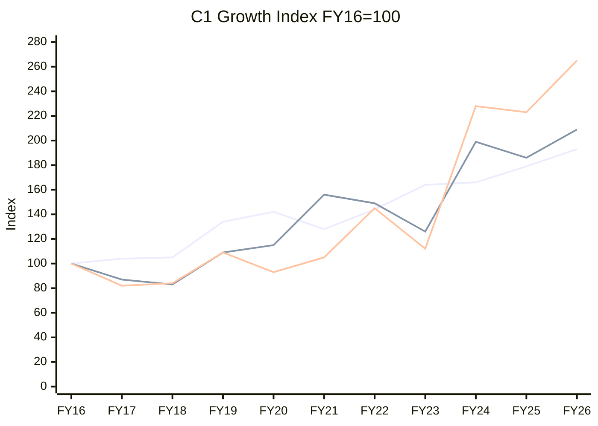
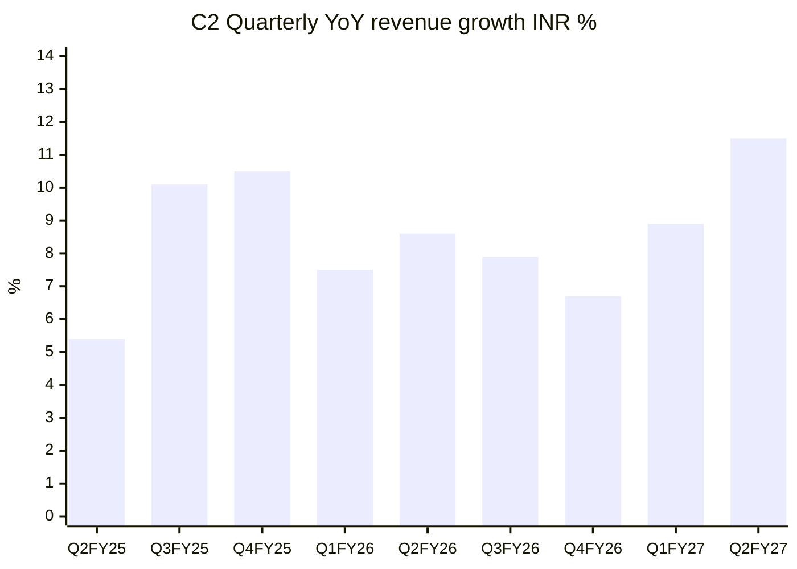
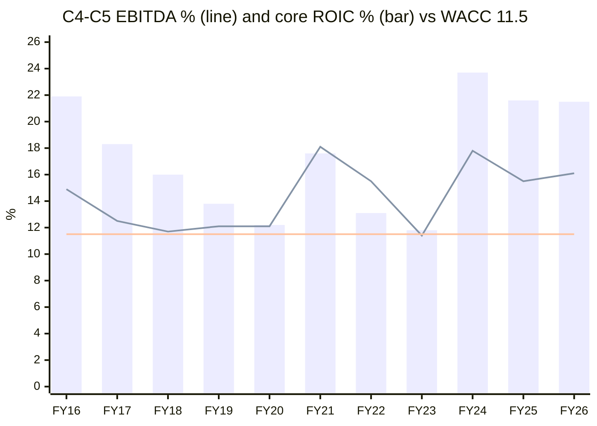
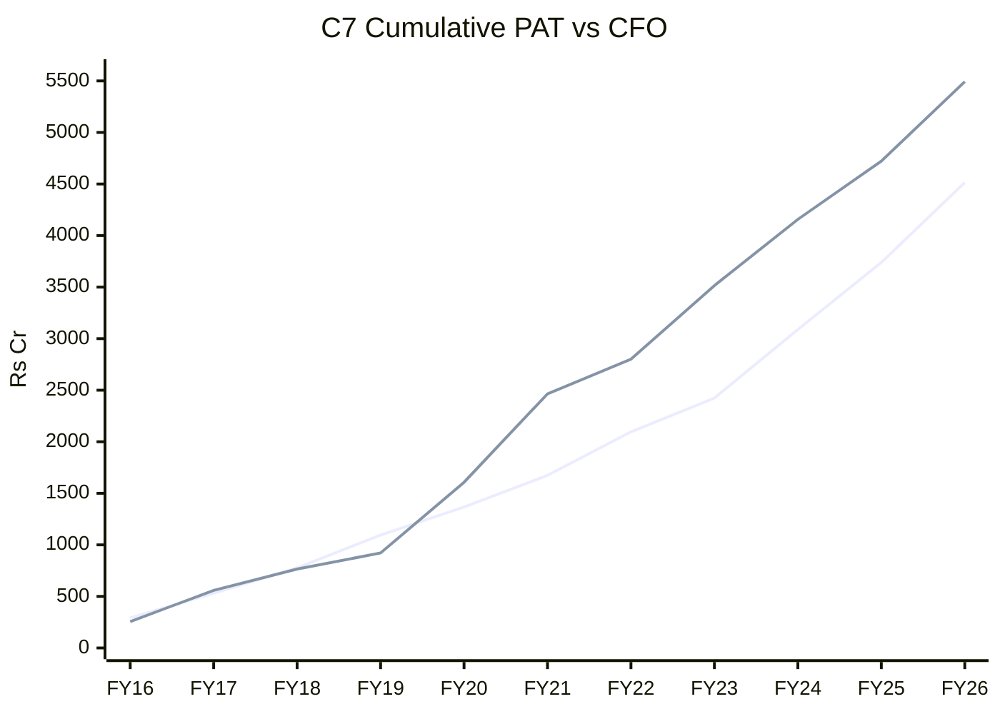
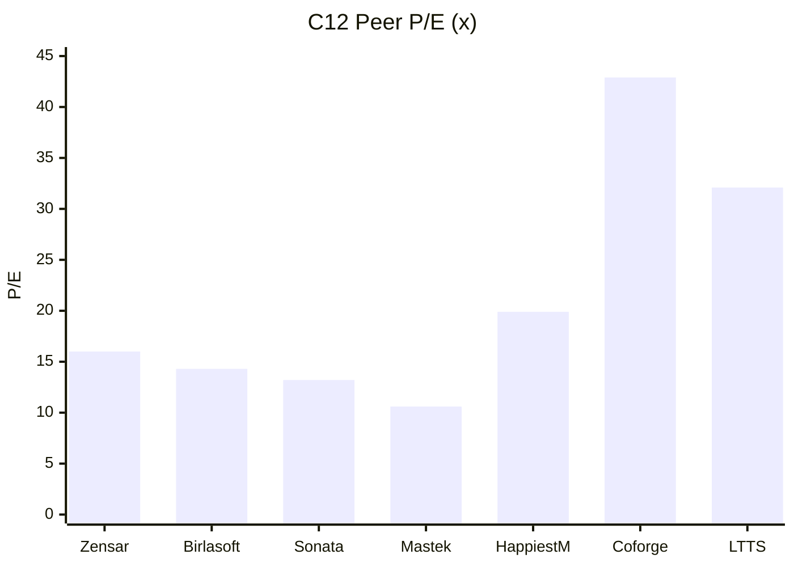
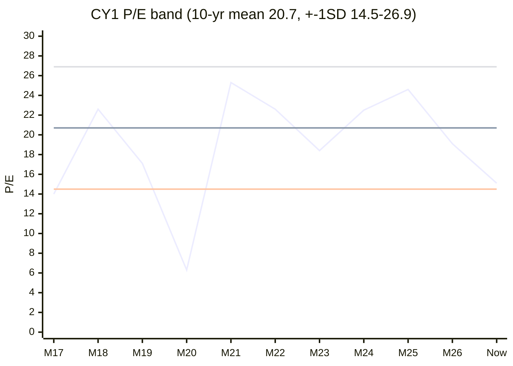
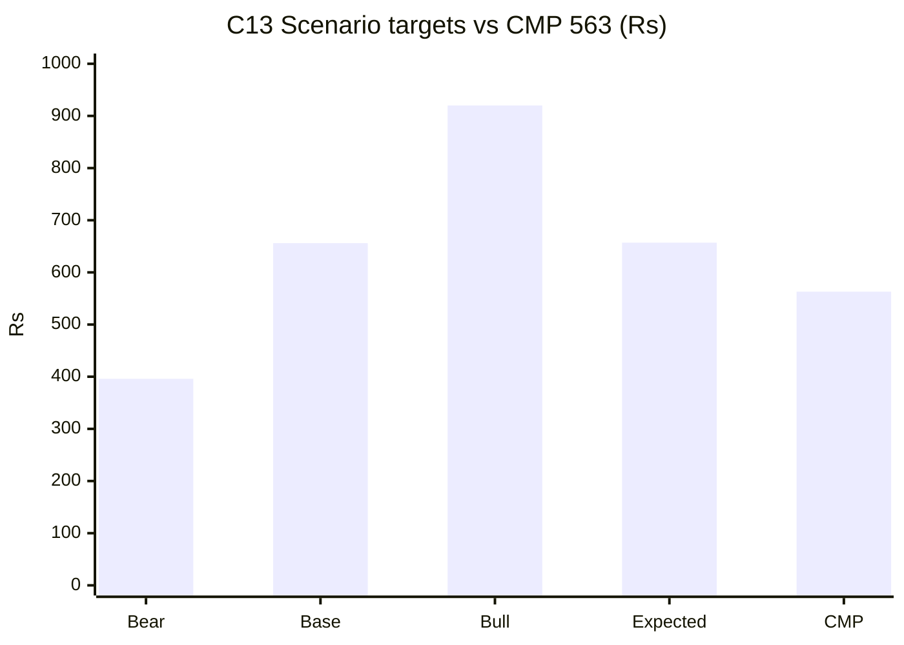

# Stock Analysis Report — Zensar Technologies Ltd (ZENSARTECH)
**Date:** 2026-11-05
**Analyst:** Claude (Stock Fundamental Analysis Skill v3.3)
**Investment Horizon:** 2–3 Years
**Recommendation:** WATCHLIST / HOLD (fairly priced, no margin of safety; Stage 1 base not yet broken)
**Conviction Score:** 5 / 10
**CMP:** ₹563 (Screener, 05-Nov-2026) · MCap ₹12,831 Cr · Cash + investments $297 Mn ≈ ₹2,848 Cr · EV (ops) ≈ ₹10,050 Cr
**Filed under:** Technology-and-Electronics / IT-Services-and-Software · Themes: — (no existing cross-sector theme fits)

## Revision Log
| Version | Date | Recommendation | Conviction | Price | Key change |
|---|---|---|---|---|---|
| Current | 2026-11-05 | WATCHLIST / HOLD | 5/10 | ₹563 | Initial report — after Q2 FY27 (4.1% QoQ cc, EBITDA 15.8%), with the $210 Mn BFSI mega-deal ramping |

**Validation of previous report:** Initial report.

---

## Business Primer

Zensar is a Pune-based, RPG-group mid-tier IT services company (~$664 Mn revenue run-rate, 12,320 people, 181 active clients). It sells digital application services (78% of revenue: application management, Guidewire/SaaS implementation, product engineering, data & analytics) and cloud/infrastructure & security services (22%). Customers are enterprises in the US (66%), UK/Europe (21%) and South Africa (13%). By vertical, BFSI is now 50% of revenue, Manufacturing & Consumer 25%, Telecom-Media-Tech 15% and Healthcare/Life Sciences 10% (Q2 FY27 fact sheet). Revenue is billed on time-and-material and fixed-price contracts, so it scales with billable headcount × utilisation × rate. The two things it depends on are a steady flow of medium and large deal wins (TCV order book) and keeping its biggest accounts. The largest TMT client is shrinking (6–8% of revenue and "budgeted for continuous decline", Q4 FY26 call).

This is a capital-light, cash-generative services business (ROE ~17%, net cash ~22% of market cap, dividend payout ~45%). The key value driver is **volume growth in constant currency**. The key risk is **technology disruption plus client concentration**: generative/agentic AI compresses billable effort in exactly the application-maintenance and testing work Zensar sells, while Tier-1 firms now compete for mid-size deals (Q4 FY26 call). Two structural features colour the analysis. (1) INR-reported growth (+11.5% YoY in Q2) flatters a business that grew only **2.0% YoY in constant currency**. The rupee at ~95/$ (vs 87 a year ago) is doing most of the work. (2) A $210 Mn BFSI "mega-deal" (≈⅓ of annual revenue in TCV, won Q4 FY26) is the swing factor for FY27–28, and management is openly hunting a "scaled" acquisition of $150–200 Mn+ revenue with the cash pile. That is a large capital-allocation event in waiting.

**Segment: IT Services — KPI reference available ✓** (`references/05-industry-kpis-india.md` line 125).

---

## Executive Summary
Zensar is a clean, net-cash, mid-tier IT services firm. Its INR earnings have compounded at a respectable pace (PAT 2.65× in 10 years) but its constant-currency growth has stalled (FY26 +1.7% cc). At ₹563 the market prices ~10% NOPAT growth for five years (reverse DCF), roughly what INR depreciation plus the mega-deal ramp can deliver. The DCF base case is ₹536 and the probability-weighted 2.5-yr target is ~₹657 (+17%, plus ~2.6% a year in dividends). It is **fairly priced, not cheap**, despite a 15× P/E that sits at the 22nd percentile of its 10-year range. The stock has bounced 30% off its September low (₹425) but remains below last year's ₹750 high, with a still-flattening 30-week average. It is a **Stage 1 base, not yet a Stage 2 breakout**. **Watchlist, buy-below ₹470.** Key risk: AI-driven deflation in app-maintenance revenue and a value-destroying large acquisition.

**C1 — Growth Index (FY16 = 100)**
| FY | 16 | 17 | 18 | 19 | 20 | 21 | 22 | 23 | 24 | 25 | 26 |
|---|---|---|---|---|---|---|---|---|---|---|---|
| Revenue ₹Cr | 2,952 | 3,056 | 3,108 | 3,966 | 4,182 | 3,781 | 4,244 | 4,848 | 4,902 | 5,281 | 5,687 |
| EBITDA ₹Cr | 439 | 382 | 365 | 479 | 507 | 685 | 656 | 552 | 872 | 817 | 916 |
| PAT ₹Cr | 292 | 238 | 246 | 319 | 272 | 307 | 422 | 328 | 665 | 650 | 775 |
*Source: Screener.in consolidated. Fixed assets are not shown — goodwill/ROU dominate an asset-light block, see Fixed-Asset note.*

*Key: 1 Revenue · 2 EBITDA · 3 PAT.*
**Read:** Revenue roughly doubled in INR over 10 years (~7% CAGR). PAT grew faster (~10% CAGR) thanks to the FY24 margin reset and treasury income.
**Business inference:** This is a margin-and-cash story, not a growth story. Profit growth from here needs top-line growth, because margins (16% EBITDA) are already at the top of the 14–16% guided band.

---

## Module 1 — Broad Market Cycle
Nifty 50 at 23,441 (02-Nov-2026), ~9% below a year earlier; India VIX 15.5 (JM Financial wrap). **Neutral-to-Cautious → normal sizing.** (The same market backdrop is used in the Alembic report of the same date.)

## Module 1b — Sector Cycle
- **Demand:** Discretionary IT spend is being re-allocated to AI and modernisation. Run-the-business budgets are under deflation pressure. Large Tier-1 clients are in-sourcing (Zensar's top TMT client). Mid-tier peers on Screener show weak growth: Birlasoft TTM sales +4%, Sonata +4%, Mastek +6%. Coforge (+42%) is the outlier.
- **Secular vs cyclical:** The secular part (cloud, data, AI engineering) is ~6–9% a year for the industry. The cyclical part is a BFSI recovery that is real today (Zensar BFSI +17% cc). **Durable baseline for Zensar: 4–7% cc.**
- **FX:** ~100% of revenue is in USD/GBP/ZAR against INR costs (~53% offshore). The rupee has gone from 87.2 to 95.4 average (Q2 FY26 → Q2 FY27). A 5% INR appreciation would cost roughly 150–200 bp of EBITDA margin, partly hedged ($70.8 Mn hedges outstanding).
- **Geopolitical:** US immigration tightening (visa costs flagged in Q1 FY27). South Africa (13%) brings ZAR volatility.
- **Verdict: Headwind-to-Neutral** (AI deflation plus Tier-1 competition, offset by a weak rupee). Requires a **+5 pp MoS**.

## Module 1c — Stock Cycle
**C2 — Quarterly YoY revenue growth (INR %) vs constant currency**
| Q | Q2FY25 | Q3FY25 | Q4FY25 | Q1FY26 | Q2FY26 | Q3FY26 | Q4FY26 | Q1FY27 | Q2FY27 |
|---|---|---|---|---|---|---|---|---|---|
| Revenue ₹Cr | 1,308 | 1,326 | 1,359 | 1,385 | 1,421 | 1,431 | 1,450 | 1,508 | 1,585 |
| YoY INR % | 5.4 | 10.1 | 10.5 | 7.5 | 8.6 | 7.9 | 6.7 | 8.9 | 11.5 |
| YoY cc % | n/a | n/a | n/a | n/a | 3.4 | n/a | n/a | −2.0 | 2.0 |

**Read:** INR growth looks stable to rising (7–11%), while cc growth was −2% to +3% over the last year.
**Business inference:** Underlying volume growth only turned up in Q2 FY27 (+4.1% QoQ cc) as the mega-deal ramped. The sequential cc trajectory (0.0% → 1.7% → 1.1% → 4.1%) is accelerating, and that is the signal to watch in Q3–Q4.

- **Volume/price/mix:** Growth is volume-led (headcount +1,973 gross in Q2; utilisation up 250 bp to 87.6%). Pricing is flat to down (AI pass-through). Mix is shifting to BFSI and products & platforms (28% of revenue, up from 24%).
- **Capacity (asset-light: headcount):** 12,320 people. Utilisation at 87.6% is near the ceiling (~88–90%), so further growth needs hiring, which pressures margins. Revenue/employee is falling: $59.7k (FY26) → ~$54k annualised (Q2 FY27) as the deal is pre-staffed.
- **Operating leverage:** Low DOL (~1.5×) — costs are mostly variable people costs. DFL ≈ 1.0 (no debt).
- **FCF:** Already strong. FCF = CFO − capex ~₹719 Cr in FY26 (Screener), ≈ 93% of PAT.
- **Classification: Mid-cycle / steady (low growth) — recovery attempt.** EBITDA margin (16%) is above the 10-yr average (~14.5%). ROIC (21.5% core) is near its 10-yr high, so this is not a trough.

---

## Module 2 — Industry Structure
| Force | Assessment |
|---|---|
| New entrants | Low barriers at small scale; high for large deals (reference-ability, delivery scale) |
| Supplier power (talent) | Moderate; attrition 9.3% (benign) |
| Buyer power | **High** — vendor consolidation, Tier-1s pricing down into mid-size deals |
| Substitutes | **Rising** — AI coding/testing agents, GCCs (in-house centres) |
| Rivalry | High |
**Verdict: Neutral-to-Unattractive** for a sub-$1 bn generalist. **Capital cycle:** Mid-tier IT is de-rated (peer 1-yr returns −14% to −39%). Consolidation is underway (PE-backed roll-ups) and the IPO pipeline is thin, so this is a late-bust/early-recovery phase for valuations.

## Module 3 — Business Quality & Moat
- **Greenwald:** No supply advantage beyond India labour arbitrage (shared by all). *Customer captivity* is moderate (application knowledge, Guidewire/insurance domain; top-20 clients = 56% of revenue). No local scale advantage. **Moat: Narrow-to-None.**
- **Pricing power:** Fails (gross margin fell from 32.0% FY26 to 29.5% in Q2 FY27 with deal transition).
- **ROIC vs WACC:** Core ROIC (ex-cash) of 12–24% over 10 years against an ~11.5% WACC. Above WACC in 9 of 11 years. Value-creating but modest.
- **Client stability:** Number of $10 Mn+ clients rose from 15 to 18. Top-5 concentration fell from 27% to 25%, which is healthy diversification away from the shrinking TMT anchor.
- **Fisher 15-point:** potential 2 · new offerings 2 (ZenseAI suite, 36% of order book AI-influenced) · R&D/IP 2 · sales org 2 (won a mega-deal) · margin 2 · margin mgmt 3 (FY23 11% → FY24 18% reset) · labour 2 · culture 2 · depth 2 · controls 3 · unique advantages 1 · long-range 2 · dilution 3 · candour 3 (the CEO is unusually blunt about TMT decline and budgets) · **integrity 3** → **34/45, integrity pass.**

## Module 4 — Management & Capital Allocation
**Promoter:** 48.99% (RPG group / H.V. Goenka), drifting down 0.2 pp over 11 quarters (ESOP dilution, no selling). **Pledge:** no promoter pledge disclosed (FY26 AR; ⚠️ Sep-26 SHP not re-checked). **Risk: Normal.**
**FII exodus:** 17.1% → 10.2% over 11 quarters, with DIIs 16.5% → 21.7% absorbing. This is the technical overhang of sector de-rating.
**Capital allocation:** Strong FCF (cumulative 10-yr CFO ₹5,238 Cr vs PAT ₹4,222 Cr). Dividend payout raised to 44–45% (FY25–26). No buyback despite ~22% of MCap in cash. M3BI (acquired FY20) is being folded in via a wholly-owned-subsidiary amalgamation (Board, 28-Oct-2026 — no shareholder impact). **The big open question:** the CEO is "actively looking at scaled assets… north of $200 Mn… 2 or 3 assets even as we speak" (Q1 FY27 call). A $150–200 Mn revenue target at 1.5–2.5× sales would cost $250–450 Mn, i.e. *more than the entire cash pile*, implying debt or equity. **Rating: Good (history), with a binary risk ahead.**
**Remuneration (FY26 AR):** Chairman commission ₹3.0 Cr (0.39% of PAT); Vice-Chairman ₹2.4 Cr; CEO paid via the US subsidiary (ESOP-heavy; holds 3.43 lakh shares). Total promoter extraction is under 1% of PAT. **No concern.**
**RPTs:** No material group RPTs flagged in the auditor's report. Auditor: **S R B C & Co LLP (EY)**, term FY23–FY27, no qualifications. KAM: goodwill impairment testing.
**Three C's:** Candour 3 · Competence 2 · Caring 2.

### Walk the Talk Scorecard
| Quarter guided | Statement | Guided | Actual | Verdict |
|---|---|---|---|---|
| Q4 FY26 (May-26) | FY27 EBITDA in mid-teens band | 14–16% | H1 FY27 15.2% | ✅ |
| Q4 FY26 | Top TMT client: continued decline, budgeted | Decline | TMT −21.6% YoY cc | ✅ |
| Q4 FY26 | BFSI will continue to grow | Growth | +17.1% YoY cc | ✅ |
| Q4 FY26 | HLS growth after consolidation wins | Growth | −9.9% YoY cc ("expected it to be much higher", Q1 call) | ❌ |
| Q4 FY26 | MCS: no declines, some growth | ≥0% | −0.1% YoY cc | ⚠️ |
| Q4 FY26 | Mega-deal related cost ~0.5% in Q1/Q2 | ~0.5% | Q1: pre-staffing/transition ~2% | ❌ |
| Q1 FY27 (Jul-26) | Mega-deal keeps ramping in Q2; full weight Q3–Q4 | Ramp | Q2 +4.1% QoQ cc; BFSI +7.1% QoQ | ✅ |
| Q1 FY27 | Q2–Q3 margins ≈ Q1 (14.6%) | ~14.6% | Q2 15.8% | ✅ (beat) |
| Q1 FY27 | Book-to-bill aspiration 0.9–1.1× | 0.9–1.1× | Q2 order book $151.5 Mn / rev $166.2 Mn = 0.91× | ✅ |

**WTT Score: 0.72 — MODERATE** (9 points · 6 hits · 1 near miss · 2 misses · 0 reversals).
**Pattern:** Reliable on margins and on the concentration risk it flags. Optimistic on non-BFSI verticals and on transition costs.
**Insider action:** No promoter open-market activity; CEO holds shares and ESOPs. **Neutral.**
**DCF impact:** Margin guidance used as-is (15.5–16%). Non-BFSI growth haircut to ~0–2% cc.

---

## Module 5 — Financial Forensics
| Check | Finding | Flag? |
|---|---|---|
| Pledge / ICD / RPT | None material | No |
| Auditor | SRBC (EY), clean; KAM = goodwill | No |
| **Unbilled revenue** | Unbilled days 24 → 35 (Q4 FY26 → Q2 FY27); billed 54 → 42; total DSO 77 | ⚠️ Watch — typical early in a fixed-price mega-deal ramp, but this is the IT-sector forensic tell |
| Other income / PBT | 20% (₹209 Cr FY26), treasury income on ₹2,850 Cr cash | Explained — exclude from core valuation |
| Exceptional | ₹25 Cr labour-code charge FY26 (statutory) | No |

- **Beneish:** not fully computed (gross-margin detail by year not available on Screener for services). DSRI ≈ 1.03 (debtor days 55 → 59). TATA ≈ 0.001 (PAT ≈ CFO). **Unlikely manipulator** on the key components.
- **Altman Z'': ~8.8 → Safe.** **Piotroski F (FY26): 7/9** (fails CFO>NI marginally and asset turnover). **Sloan:** FY25 11.4% (⚠️, investment build) · FY26 4.1% ✓.
- **Forensic flags: 1/15 (unbilled build).** **Verdict: Clean.**

## Module 6 — Earnings Quality & Financial Statements
| FY | 16 | 17 | 18 | 19 | 20 | 21 | 22 | 23 | 24 | 25 | 26 |
|---|---|---|---|---|---|---|---|---|---|---|---|
| EBITDA % | 14.9 | 12.5 | 11.7 | 12.1 | 12.1 | 18.1 | 15.5 | 11.4 | 17.8 | 15.5 | 16.1 |
| Core EBIT % (ex-OI) | 12.7 | 10.9 | 9.7 | 9.8 | 8.3 | 13.5 | 11.1 | 7.6 | 15.1 | 13.5 | 14.5 |
| Core ROIC % (NOPAT/(Eq+Debt−Inv.)) | 21.9 | 18.3 | 16.0 | 13.8 | 12.2 | 17.6 | 13.1 | 11.8 | 23.7 | 21.6 | 21.5 |
| Other income / PBT % | 13 | 7 | 21 | 21 | 23 | −6 | 24 | 23 | 18 | 19 | 20 |
| CFO / PAT | 0.87 | 1.28 | 0.84 | 0.49 | 2.52 | 2.79 | 0.80 | 2.18 | 0.97 | 0.87 | 0.99 |

**C4/C5 — EBITDA margin and core ROIC vs WACC 11.5%**

*Key: bars core ROIC · line 1 EBITDA % · line 2 WACC.* **Read:** ROIC dipped to WACC in FY20/FY23 and recovered to ~22% after the FY24 cost reset. **Business inference:** Returns are good, not elite (Sonata 31%, LTTS 27% ROCE). They are capped by goodwill from past acquisitions and by mid-tier pricing.

**C7 — Cumulative PAT vs CFO (₹Cr)**

*Key: 1 PAT · 2 CFO.* **Read:** Cumulative CFO exceeds PAT by 22%. The 5-yr CFO/PAT is 1.07. **Business inference:** High-quality earnings. The cash pile is real.

### DuPont (5-factor)
| FY | EBIT % | Asset T/O | Equity mult. | Interest burden | Tax burden | ROE % |
|---|---|---|---|---|---|---|
| FY22 | 14.3 | 1.17 | 1.45 | 0.94 | 0.74 | 16.8 |
| FY23 | 9.7 | 1.22 | 1.41 | 0.94 | 0.74 | 11.6 |
| FY24 | 18.3 | 1.12 | 1.34 | 0.98 | 0.76 | 20.3 |
| FY25 | 16.6 | 1.08 | 1.29 | 0.98 | 0.76 | 17.0 |
| FY26 | 18.2 | 1.01 | 1.28 | 0.99 | 0.76 | 17.6 |
**Verdict:** ROE is **operational, not financial**. Leverage has fallen every year (EM 1.45 → 1.28). Asset turnover is declining *because cash is accumulating*: 32% of assets are treasury. A buyback or acquisition is the lever that would lift ROE; the business itself is fine. **AT trend:** declining (cash-driven), so it is not a moat signal.

**Fixed-asset note (decade lens):** Fixed assets (₹1,223 Cr FY26) are mostly goodwill (Foolproof/Indigo Slate/M3BI acquisitions) plus ROU leases plus Pune campus. Capex is ~₹50–75 Cr a year (~1% of sales). Physical capacity is irrelevant; capacity = headcount (12,320) × utilisation (87.6%). FY26 CWIP of ₹176 Cr (office build-out) was capitalised in H1 FY27, which is why D&A rose to ₹37 Cr in Q2.

**O'Glove flags: 2/15** (other income >15% of PBT — explained; unbilled build). **OCF/NI 5-yr 1.07 → High.**

---

## Module 7 — Industry KPIs & Peers
| KPI (IT block) | Zensar | Peer context | Assessment |
|---|---|---|---|
| USD cc revenue growth | FY26 +1.7%; Q2 FY27 +2.0% YoY, +4.1% QoQ | Mid-tier median ~3–6% | Below → improving |
| EBIT margin | 13.4% (Q2 FY27), 14.4% FY26 | Mid-tier 12–17% | In line |
| Deal TCV / book-to-bill | $151.5 Mn quarterly (0.91×); Q4 FY26 $401.8 Mn incl. $210 Mn mega-deal | ≥1.1× healthy | Below ex mega-deal |
| Utilisation (ex-trainees) | 87.6% | 82–88% | High — limited slack |
| Attrition (LTM) | 9.3% | 11–14% | Better |
| Top-5 client % | 25.0% | <25% preferred | Borderline |

| Metric | Zensar | Birlasoft | Sonata | Mastek | Happiest Minds | Coforge | LTTS |
|---|---|---|---|---|---|---|---|
| MCap ₹Cr | 12,831 | 9,199 | 6,650 | 4,658 | 4,873 | 93,236 | 44,777 |
| Sales CAGR 5y | 9% | 8% | 20% | 17% | 25% | 29% | 15% |
| Sales TTM | 9% | 4% | 4% | 6% | 12% | 42% | 9% |
| ROCE | 22.8% | 21.2% | 30.7% | 17.7% | 13.3% | 23.5% | 26.7% |
| P/E | 16.0 | 14.3 | 13.2 | 10.6 | 19.9 | 42.9 | 32.1 |
| Div yield | 2.65% | 1.97% | 3.36% | 1.62% | 2.02% | 0.57% | 1.38% |
| 1-yr price | −28% | −14% | −39% | −33% | −38% | +17% | +1% |

**C12 — Peer P/E**

**Read:** Zensar sits mid-pack among de-rated mid-tiers. Only the growth leaders (Coforge, LTTS) command 30–43×.
**Business inference:** The market pays for growth, not for cash or margin. Zensar re-rates only if cc growth sustains at ≥6–8%. **Positioning: in line with mid-tier peers — justified.**

## Module 8 — Market Size & Share
Global IT services TAM is ~$1.4–1.5 tn (industry estimates; NASSCOM puts Indian IT exports at ~$225–235 bn). Zensar's ~$660 Mn is ~0.3% of Indian exports, so penetration is negligible and growth is execution-limited, not TAM-limited. Share trend: FY26 cc growth of 1.7% against Indian IT export growth of ~3–5% means **slightly losing share**. H1 FY27 is improving. **Verdict: Growing below market → Q2 suggests catch-up.**

---

## Module 9 — Valuation
### PIE (reverse DCF)
EV (ops) ₹10,047 Cr = MCap ₹12,831 Cr − cash/investments ₹2,848 Cr + debt ₹64 Cr. Normalised core NOPAT = TTM core EBIT ₹848 Cr × 0.75 = ₹636 Cr, so **EV/NOPAT 15.8×**. WACC 11.5% (Rf 6.5% + β ~0.9 × 6%, no debt). Terminal growth 5%, ROIC 30% on incremental capital (asset-light). Model: `scratchpad/scripts/zen.py`.

| PIE driver | Market-implied | My base | Gap |
|---|---|---|---|
| NOPAT growth (5-yr, INR) | **~10%** (quick-form perpetuity: 4.9%) | 8–9% (USD 5–6% + INR ~3%) | Market slightly optimistic |
| Core EBIT margin | ~14% | 14–14.5% | ≈ |
| Reinvestment | ~1/3 of NOPAT at 10% growth | Same | — |
**Gap: Fairly priced → slightly optimistic.** To outperform, Zensar must deliver **≥8% cc growth with EBIT ≥15%**, or deploy the cash accretively.
**Triggers (+):** mega-deal full run-rate in Q3–Q4 FY27; a second large deal; accretive acquisition at ≤2× sales; buyback. **(−):** top-client decline accelerates; INR appreciates; dilutive or expensive M&A; AI deflation in managed-services renewals.
**SVAR:** Downside of FY27E EPS ₹34.8 × 11× (de-rated mid-tier floor, Mastek-like) = ₹383 → **SVAR 32%.** Cash (₹125/share) gives partial support.

### Intrinsic value
| Method | Bear | Base | Bull |
|---|---|---|---|
| DCF (incl. cash ₹125/sh) | ₹439 (3% g, ROIC 25%, WACC 12%) | ₹536 (8% g, ROIC 30%) | ₹643 (12% g) |
| Relative (FY28E EPS ₹38.2 × 12 / 15 / 19) | ₹458 | ₹573 | ₹726 |
| EPV (NOPAT ₹636 Cr / 11.5% + cash) | — | ₹368 (no-growth value) | — |
| **Consensus range** | **₹450** | **₹555** | **₹685** |

**CMP ₹563 vs base ₹555 → MoS ≈ 0% → Inadequate** (mid-cap with sector headwind needs 35–45%).
**Upside/downside:** (685 − 563)/(563 − 450) = **1.1:1 → Unacceptable.** Including ~₹15/share of annual dividends over 2.5 years (~₹37), ≈ 1.4:1. Still below the bar.
**Graham Number:** √(22.5 × 5-yr avg EPS ₹25 × BVPS ₹214) = **₹347.** Graham defensive screen **7/7**: revenue > ₹2,000 Cr ✓, current ratio ≥ 2 ✓ (net-cash balance sheet), positive EPS for 7+ yrs ✓, no dividend cut in 5 yrs ✓, 7-yr EPS growth ≥ 30% ✓ (₹13.9 FY19 → ₹34.1 FY26), P/E 16 ≤ 20 ✓, P/B 2.6 ≤ 3 ✓. It qualifies as a defensive name, but the price is still above the Graham Number.
**Misprice reason:** Sector de-rating and FII exit (17% → 10%). This is real but sector-wide, so there is no company-specific mispricing.
**Catalyst:** Q3 FY27 (Jan-27) mega-deal run-rate; an acquisition announcement (could cut either way).

**CY1 — P/E at each March (TTM, Screener P/E history)**

*Key: 1 P/E · 2 mean · 3 −1SD · 4 +1SD. 10-yr range 6.3–41.9, current at the 22nd percentile.* **Read:** Near the −1SD band. **Business inference:** Cheap against its own history, but that history includes a 2021–24 IT bubble. Against growth-adjusted peers (Birlasoft 14×, Sonata 13×) it is fair. Ex-cash P/E ≈ 15.8× on core earnings, which is not distressed. P/B is 2.6× vs a 10-yr mean of 3.2× (39th percentile).

**C13 — Scenarios (FY29E EPS × exit P/E)**
| Scenario | Driver assumption | Rev FY29E | EBITDA % | EPS FY29E | P/E | Target | Prob |
|---|---|---|---|---|---|---|---|
| Bull | 10% cc CAGR (mega-deal + 2nd large deal), accretive M&A | ₹8,100 Cr | 16.5% | ₹46 | 20× | ₹920 | 25% |
| Base | 6% cc, INR +3%/yr, margin 16% | ₹7,520 Cr | 16% | ₹41 | 16× | ₹656 | 50% |
| Bear | 2% cc, INR flat, AI deflation, margin 14% | ₹6,300 Cr | 14% | ₹33 | 12× | ₹396 | 25% |
| **Expected value** | | | | | | **₹657** (+17%, +~7% dividends) | |

**Read:** Expected total return is ~24% over 2.5 years (~9% a year). **Business inference:** Equity-like returns with sector risk attached, not a mispricing. At ₹470 the expected return becomes ~40% plus dividends.

### Cycle Position Dashboard
| Dimension | Current | 10-yr median/mean | Percentile | Signal |
|---|---|---|---|---|
| P/E | 15.1 | 20.7 | 22nd | Cheap vs own history |
| P/B | 2.6 | 3.2 | 39th | Fair |
| EBITDA margin | 15.8% | ~14.5% | High | Upper-mid |
| Core ROIC | 21.5% | ~17% | High | Upper-mid |
| **Overall** | | | | **Mid-cycle (valuation de-rated, fundamentals mid-to-upper)** |

---

## Module 10 — Technical Stage
- **Nifty 50:** ~23,441, below year-ago, stage not chart-verified (data gap). **Sector (Nifty IT / mid-tier):** peers' 1-yr returns of −14% to −39% point to a sector in **Stage 4 → Stage 1**.
- **Stock (weekly, Screener):** last ₹555 weekly (CMP ₹563). 30-week SMA **₹490.5, still edging down** (₹493.8 four weeks ago). Price is 13% above it after a rally from the ₹425 low (11-Sep-2026). 52-wk range ₹425–750. The 5-yr high was ₹968.
- Volume: the rally weeks ran 8–15 Mn shares vs a 30-wk average of 15 Mn. **No expansion → unconfirmed.**
- RS vs Nifty: 1-yr −28% vs −8% → **negative, improving over 8 weeks.**
- **Stage: Late Stage 1 (basing).** The pivot for a Stage 2 breakout is the ₹590–600 resistance (Jun–Jul 2026 congestion; to verify on chart). The 30-wk MA must turn up.
- **Stop (if holding):** weekly close < ₹480.
**CANSLIM:** C ✗ (Q2 EPS +4% YoY) · A ✗ (EPS 14.5 → 29.3 → 28.6 → 34.1, uneven) · N ✓ (mega-deal, AI suite) · S ✓ (dividend, no dilution) · L ✗ · I ✗ (FII exit) · M ✗ → **2/7.**
**Combined: Stage 1, CANSLIM 2/7 → Wait for confirmation.**

---

## Module 11 — Forward View (asset-light: headcount/unit build, Module 10A-ii variant)
| Metric | FY26A | FY27E | FY28E | FY29E |
|---|---|---|---|---|
| Revenue USD Mn | 643.7 | 673 (+4.6%) | 725 (+7.7%) | 775 (+6.9%) |
| Avg INR/USD | 88.3 | 95.5 | 96 | 97 |
| Revenue ₹Cr | 5,687 | 6,430 | 6,960 | 7,520 |
| Headcount (end) | 10,779 | ~12,800 | ~13,600 | ~14,300 |
| Rev / employee ($k) | 59.7 | ~53 | ~53 | ~54 |
| EBITDA % | 16.1% | 15.5% | 16.0% | 16.0% |
| EBITDA | 916 | 997 | 1,114 | 1,203 |
| D&A | 91 | 130 | 140 | 150 |
| Other income (treasury) | 209 | 200 | 190 | 200 |
| PAT (ETR 24.5%) | 775 | 790 | 870 | 940 |
| **EPS ₹** | **34.1** | **34.8** | **38.2** | **41.3** |
| FCF (~90% of PAT) | 719 | ~700 | ~780 | ~850 |

- **Mega-deal unit economics:** $210 Mn gross TCV (Q4 FY26 call). Assuming ~5 years, that is ~$40–42 Mn a year at run-rate (~6% of revenue). It is pre-staffed at ~2% of revenue in transition cost (Q1 FY27), with "full weight in Q3–Q4". Incremental margin after transition is likely ~14–16% (rebadging-heavy BFSI deals carry lower margins).
- **Incremental ROIC:** very high (>50%) on organic growth. Working capital is ~20 days and capex ~1% of sales. **The only value-destruction route is M&A.**
- **PIE cross-check:** The base-case EPS CAGR (FY26→FY29) of ~6.6% in INR is *below* the ~10% NOPAT growth the price implies. **Market is pricing a bit more than base case → no edge.**

### Catalysts
1. Mega-deal run-rate visible in Q3/Q4 FY27 (Jan/Apr-27).
2. A second large deal (23% of the pipeline is large deals; Q1 FY27 call).
3. Capital return (buyback/special dividend) if M&A does not materialise.
4. Sector re-rating as AI-led modernisation spend broadens.

### Risks
1. **Expensive or dilutive acquisition** ($150–200 Mn+ revenue target exceeds the cash pile) — Medium.
2. **AI deflation** in app maintenance / testing renewals — Medium-High.
3. **Top TMT client** continues to shrink (6–8% of revenue) — High (already guided).
4. **INR appreciation** reverses the FX tailwind — Medium.
5. **Unbilled revenue** build turning into write-downs on a fixed-price mega-deal — Low-Medium.

**Thesis:** A good, cash-rich, honestly run mid-tier IT firm whose INR growth is FX-assisted and whose re-rating requires sustained ≥6–8% cc growth. At ₹563 the price already assumes most of the plausible upside. Buy below ₹470, or on a confirmed Stage 2 breakout above ~₹600 with Q3 cc growth ≥3% QoQ.
**Monitoring:** QoQ cc growth, BFSI vs TMT trajectory, unbilled days, EBITDA vs the 14–16% band, M&A announcement terms, FII holding.

---

## Checklist Summary
Section 0: 5/5 (initial; IT-Services folder; no theme fits — none created) · A: 15/18 (scuttlebutt, Form C, Sep-26 pledge not pulled) · B: 8/9 (full Beneish not computed) · C: 11/12 · D: 7/7 · E: 5/7 (market-share data from industry estimates) · F: 10/10 · G: 6/8 (index stages not chart-verified) · H: unit-economics/headcount track used instead of the capex-AT model · I: 4/5 (CY4 omitted).
**Hard stops:** None. **Order Book Tracker:** Not applicable in the EPC sense (services TCV tracked above).

## Conviction Score
| Component | Max | Score |
|---|---|---|
| Cycles | 1 | 0.5 |
| Industry structure | 1 | 0.5 |
| Business quality & moat | 2 | 1.0 |
| Management | 1 | 0.75 |
| Financial + earnings quality | 2 | 1.75 |
| Valuation & PIE | 2 | 0.5 |
| Technical | 1 | 0.25 |
| **Total** | **10** | **5.25 → 5** |

## Investment Decision
**Recommendation:** WATCHLIST (HOLD if owned — dividend 2.65%, net cash)
**Conviction:** 5/10 → 1–2% maximum, only after a trigger
**Buy-below:** **₹470** (≈12× FY28E EPS; ~30% below the ₹656 base target)
**Alternative entry:** Weekly close above ~₹600 on ≥1.5× average volume with the 30-wk MA turning up, *and* Q3 FY27 cc growth ≥3% QoQ.
**Stop (if held):** weekly close < ₹480.
**Target (base, ~2.5 yr):** ₹656 (+ dividends).
**Review triggers:** acquisition announcement (price/sales > 2.5× or debt-funded → downgrade); a second large deal → upgrade; two quarters of cc growth < 1% QoQ → downgrade.

**Data gaps:** Q2 FY27 transcript (BSE filing on 04-Nov is a cover letter only; audio not transcribed); Sep-26 pledge disclosure; full Beneish; Nifty/Nifty IT weekly stage; ₹590–600 pivot needs chart confirmation.

**Sources:** Screener.in (ZENSARTECH consolidated P&L/BS/CF/ratios/shareholding, P/E & P/B history; peers BSOFT, SONATSOFTW, MASTEK, HAPPSTMNDS, COFORGE, LTTS); BSE — Q2 FY27 press release & analyst presentation (28-Oct-2026), Scheme of Amalgamation of M3BI India (28-Oct-2026); zensar.com — Q1 FY27 transcript (30-Jul-2026), Q4 FY26 transcript (May-2026); FY26 Annual Report (auditor, remuneration Annexure, KAM); JM Financial market wrap (02-Nov-2026).

---
*Report generated by Stock Fundamental Analysis Skill v3.3 | Indian Markets Context*
*Save path: C:\Users\anubh\Documents\Anubhav\Stock Analysis\Stock Analysis\Technology-and-Electronics\IT-Services-and-Software\*
