# Stock Analysis Report — HFCL Limited (NSE: HFCL)
**Date:** 2026-10-28
**Analyst:** Claude (Stock Fundamental Analysis Skill v3.3)
**Investment Horizon:** 2–3 Years
**Recommendation:** AVOID at current price → WATCHLIST (buy-below ~₹110–120, or upgrade on thesis triggers below)
**Conviction Score:** 4.5 / 10
**CMP:** ₹246 (28 Oct 2026) · M-cap ₹37,683 Cr
**Filed under:** Technology-and-Electronics / Telecom-Equipment-and-Infrastructure · Themes: Telecom, fibre & data centres, Defence & naval indigenisation

## Revision Log
| Version | Date | Recommendation | Conviction | Price | Key change |
|---|---|---|---|---|---|
| **Current** | 2026-10-28 | Avoid at CMP → Watchlist (buy ₹110–120) | 4.5/10 | ₹246 | Q2 FY27 blew through the model: revenue ₹2,542 Cr (+144%), H1 PAT ₹640 Cr ≈ old full-year estimate; **H1 CFO +₹455 Cr** (forensic hard stop lifted); FY27E PAT ₹700 → ₹1,440 Cr; EV ₹174 → ₹225, still below CMP |
| Previous | 2026-10-09 | Avoid at CMP → Watchlist (buy ₹90–110) | 3.5/10 | ₹258 | Record Q1 FY27, but valuation at 97–99th pct; CFO/PAT 0.42; 47% of order book is framework value (full text in git history) |
| Earlier | 2026-06-11 | Quality at Wrong Price | 4.4/10 | ₹169 | Initial report (merged; git history) |

**What changed in the thesis:** The *business* case got much stronger. Revenue and margins did not decelerate as modelled; they accelerated (Q2 OPM 25%, telecom-products segment PBIT margin 31%). Operating cash flow turned positive (+₹455 Cr in H1 vs −₹44 Cr in H1 FY26) as the cash cycle shortened to ~135 days on an annualised basis. ROCE rose to ~20% (TTM) and ROIC (~16%) is now above WACC for the first time since FY22. That lifts three of the four forensic flags and removes the "forensic ≥ 3" hard stop. What did **not** change is the *cycle* case. Both HFCL (25%) and STL (32%) printed decade-high margins in the same quarter on fibre prices up ~20% QoQ and spot preform up ~600%. The MD himself calls those prices "insanity". The ₹1,800 Cr capacity programme lands in Jul–Oct 2028, exactly when global capacity arrives. Valuation moved the right way (P/E 68.5× → 43.7×, mostly because EPS rose), but expected value (₹225) is still ~9% below the price and U/D is 0.7:1. **Net: conviction up a point, entry zone raised, verdict unchanged.**

**Validation of previous report (9 Oct 2026):**
| Item | Previous | Now | Status |
|---|---|---|---|
| Q2 FY27 trajectory | "Deceleration from 120% to ~60% YoY likely" | +144% YoY, +33% QoQ | ❌ Corrected (forecast wrong; growth accelerated) |
| FY27E revenue / PAT / EPS | ₹6,900 Cr / ~₹700 Cr / ₹4.35 | ₹9,600 Cr / ~₹1,440 Cr / ₹8.97 (H1 actual ₹4,457 Cr / ₹640 Cr) | 🔄 Updated (base was far too low) |
| FY27 guidance | +40% | **≥ +80%** (Q2 call), with H2 implied below Q2 run-rate | 🔄 Updated |
| CFO | FY26 −₹378 Cr; cum. CFO/PAT 0.42 | **H1 FY27 +₹455 Cr** (results filing cash-flow statement); cum. ratio 0.47 | 🔄 Updated (first positive half since FY25) |
| Cash conversion cycle | 218 days (FY26) | ~135 days (H1 FY27 annualised proxy, Screener-consistent basis) | 🔄 Updated |
| Debt | ₹1,896 Cr (Screener FY26) | Borrowings ₹1,840 Cr + buyers' credit ₹69 Cr (Sep-26); cash + bank + liquid inv. ₹636 Cr → net debt ~₹1,270 Cr | 🔄 Updated |
| Defence FY27 target | "Guided ₹400 Cr (cut)" ([Sahi](https://www.sahi.com/news/hfcl-aims-for-500-crore-defense-revenue-and-700-crore-data-center-connectivity-sales-522-PE1_CORP)) | Q1 and Q2 transcripts both say ~₹500 Cr (Q2: ₹500–600 Cr). H1 actual ₹79 Cr | ❌ Corrected (secondary source conflicted with primary transcripts) |
| Capacity | "Fibre 28 → 34, OFC 34 → 43 mn fkm" | Existing 28 / 39 mn fkm → ongoing 38.5 / 56.4 → +4.6 / +5.64 approved 14-Sep → **43.1 / 62.0 mn fkm + 600 MT preform**; total capex **₹1,800 Cr**; done Jul-2028 (OF/OFC), Oct-2028 (preform) ([BSE](https://www.bseindia.com/xml-data/corpfiling/AttachHis/30091642-b8de-40b0-bf41-6a90e4a06cca.pdf)) | ❌ Corrected (stages mixed up) |
| Order book | ₹26,665 Cr; 47% framework | ₹28,911 Cr; 43% framework (₹12,488 Cr); firm cover 2.2× | 🔄 Updated |
| Customer concentration | Data gap | FY26: one customer ₹646 Cr = 13% of revenue (FY25: three customers ₹1,899 Cr = 47%) (AR FY26 segment note) | 🔄 Updated (gap closed) |
| Auditor / KAMs | Not reviewed | KAMs: revenue recognition and contract assets (₹906 Cr), receivable credit risk (Govt concentration), intangibles. No qualification or Emphasis of Matter found | ✅ Gap closed |
| Contingent liabilities | Data gap | LCs ₹358 Cr, bank guarantees ₹764 Cr, disputed claims ₹74 Cr (Mar-26) | 🔄 Updated (gap closed) |
| Promoter holding | 28.29% | 28.29% (Sep-26): **no selling for four quarters** | ✅ Validated |
| FII holding | 15.74% | 17.24% (Sep-26) | 🔄 Updated |
| Promoter pledge | Not verified | Still not verified from a primary filing; aggregators cite ~50 lakh shares (~0.3% of equity) | ⚠️ Unverifiable |
| P/E, P/B | 68.5× (97th pct), 8.1× (99th) | 43.7× (82nd pct), 6.6× (96th) | 🔄 Updated |
| WTT score | ~0.65 | 0.75 (sandbagging on financials; slippage on M&A/defence) | 🔄 Updated |
| Hard stops | Forensic ≥ 3 and U/D < 1.5 | **Forensic stop lifted** (1 unresolved + 1 provisional); U/D 0.7:1 stop **still triggered** | 🔄 Updated |
| ₹215 Cr AI-connectivity unit | Stated | Confirmed; connectivity revenue Q1 nil → Q2 ~₹300 Cr; new WOS HFCL Connectivity Systems (22-Oct) | ✅ Validated |

---

## Executive Summary

HFCL (optical fibre and cable, connectivity solutions, telecom and defence electronics, telecom EPC) had the best quarter in its history in Q2 FY27. Revenue was **₹2,542 Cr (+144% YoY)**, the EBITDA margin **25.9%**, PAT **₹394 Cr**, and exports grew ~5× YoY on hyperscaler and AI-data-centre fibre demand. The difference from the last report is *cash*. H1 operating cash flow was **+₹455 Cr**, receivable and inventory days compressed as revenue scaled, ROCE recovered to ~20%, and promoters stopped selling (28.29% flat for four quarters) while holding ₹74 warrants. Guidance went **20% → 40% → ≥80%** in two quarters, and the ₹10,000 Cr FY29 target could be met in FY27 itself. **The cycle is the problem.** Every Indian fibre maker is printing peak margins at once (STL 32% OPM). The margin is part price (fibre +20% QoQ, preform spot +600%), and HFCL's own ₹1,800 Cr expansion plus global capacity land in 2028. At ₹246 (28× FY27E, 43.7× TTM, 6.6× book) the price assumes peak economics persist. Our expected value is **₹225 (−9%)**, with a bull case at ₹373 and a bear case at ₹60.

**Order book:** ₹28,911 Cr (3.9× TTM revenue) · firm (ex-framework) ₹16,423 Cr = **2.2×** · implied Q2 inflow ₹4,788 Cr (book-to-bill 1.9×) · framework 43% · 57% export · no new Reg 30 orders since 1 Sep.

**What changed since 9 Oct:** Q2 beat (+) · CFO positive (+) · CCC 218 → ~135 days (+) · promoter selling stopped (+) · customer concentration 47% → 13% for the top customer (+) · ₹820 Cr more capex approved (± supply response) · EPC segment loss ₹123 Cr in Q2 (−) · fibre pricing visibly at a cyclical high (−) · stock fell after results (₹265 → ₹246) despite the beat (−: expectations already high).

### C1 — Growth Index: Revenue vs Fixed Assets vs Profit (FY16 = 100)

| ₹ Cr | FY16 | FY17 | FY18 | FY19 | FY20 | FY21 | FY22 | FY23 | FY24 | FY25 | FY26 | TTM Sep-26 |
|---|---|---|---|---|---|---|---|---|---|---|---|---|
| Revenue | 2,872 | 2,131 | 3,227 | 4,738 | 3,839 | 4,423 | 4,727 | 4,743 | 4,465 | 4,065 | 4,949 | 7,492 |
| Gross Block | 464 | 465 | 492 | 557 | 821 | 886 | 955 | 1,050 | 1,216 | 1,495 | 1,989 | ~2,400 (est.) |
| EBITDA | 273 | 187 | 283 | 418 | 493 | 550 | 650 | 619 | 582 | 449 | 764 | 1,586 |
| PAT | 156 | 124 | 172 | 232 | 237 | 246 | 326 | 318 | 338 | 173 | 329 | 926 |

*Source: Screener.in consolidated; Gross Block from the fixed-asset schedule. TTM = Dec-25 to Sep-26 quarters. Sep-26 gross block estimated as FY26 + H1 capex ₹436 Cr (results cash-flow statement).*

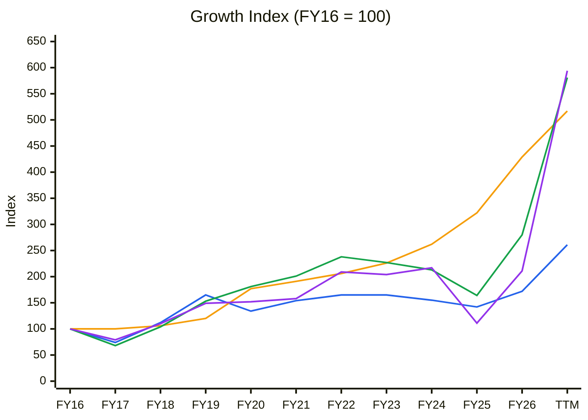
🟦 Revenue · 🟧 Gross Block · 🟩 EBITDA · 🟪 PAT
**Read:** For a decade revenue (🟦) went sideways while fixed assets (🟧) grew 4×. In the last twelve months revenue broke out to index 261 and EBITDA and PAT (🟩🟪) jumped to ~580–590, **above the asset line for the first time since FY22**. The new plant is finally earning. But profit rising 2.8× faster than revenue in one year is the signature of price and operating leverage, not just volume.

**Business inference:** The decade-long build-out of fibre and cable manufacturing is now paying off, and FY27 is the first year the capital base clearly earns its keep. The steepness of the profit line relative to revenue says a large part of today's earnings is a pricing windfall on top of a real volume and mix upgrade. That windfall is the part to discount.

---

## Business Primer

HFCL makes optical fibre (drawing from bought-in and, from 2028, own preform), optical-fibre cables and passive connectivity products for data centres, plus telecom equipment (Wi-Fi, radios, 5G FWA) and defence electronics (thermal weapon sights, fuzes, radars). It also runs a telecom-network EPC business (BharatNet, Army networks, O&M). Customers are global hyperscalers and telcos (exports were ~60% of H1 FY27 revenue), Indian telcos, and government and defence agencies. Revenue is mostly product volume × price (fibre-km sold at globally set prices, with annual price resets in long-term contracts), plus project revenue booked against milestones in EPC. Returns depend on two things: the global optical-fibre price cycle (ROCE has swung 24% → 8% → ~20%) and collecting cash from government-heavy EPC customers.

This is an **asset-heavy cyclical manufacturer with an attached working-capital-heavy contractor**, now in a sharp demand and price upcycle driven by AI data-centre build-outs. The key value driver is fibre-km volume × realisation, with mix moving toward higher-priced data-centre fibre (~US$25/km vs ~US$15 for telco grade, per the Q2 call). The key risks are the fibre and preform price cycle (supply response from 2028), concentration on a handful of hyperscalers, and EPC cash collection. Two structural features colour everything. Profits have historically been booked well before they were collected (11-year CFO/PAT 0.42; H1 FY27 is the first real break in that pattern). And the company is restructuring, with an EY-advised committee weighing an EPC carve-out alongside new defence, aerospace and ammunition ventures.

**New Segment Protocol:** Telecom Equipment OEM block covers HFCL ✓. Top KPIs: order book/revenue, customer concentration, gross margin, CCC (red flag > 200 days).

---

## Module 1 — Broad Market Cycle

Nifty 50 at 22,648 (22 Oct 2026, third straight losing session), India VIX 15.8, inflation and rate worries ([HDFC Sky](https://hdfcsky.com/news/india-vix-ends-at-15-81-as-niftys-third-straight-session-of-losses-keeps-market-volatility-in-focus)). The Nifty is roughly flat since the last report (22,556) and ~6% below June. **Verdict: CAUTIOUS.** FIIs keep adding HFCL (15.7% → 17.2%) against broad India selling. It remains a crowded AI-connectivity trade.

---

## Module 1b — Sector Cycle: Tailwinds & Headwinds

**Secular:** AI and hyperscale data-centre interconnect (high-fibre-count cable, 180µ A2 fibre, in-DC connectivity), telco fibre capex restarting (*"some telcos, which have not come to the market are coming up now"*, Q2 call), BharatNet III, China+1 sourcing, defence indigenisation. India DC capacity 1.6 GW → 6–10 GW by 2030 (MD, Q2 call).
**Cyclical:** Fibre prices rose another ~20% in Q2 (*"I said this in the last quarter also that looks to be stabilizing, but then it has gone up by some 20%"*). Spot preform is at ~US$300/kg, up 600% (*"current prices are insanity… a factor of non-availability"*). HFCL is shielded by pre-contracted preform, but the spot price is a textbook shortage signal.

**Supply response, now quantified:**

| Player | Action | Timing |
|---|---|---|
| HFCL | OF 28 → 43.1 mn fkm, OFC 39 → 62.0 mn fkm, preform 600 MT; ₹1,800 Cr | Jul–Oct 2028 |
| Global peers | "+40–50% capacity" announced (analyst, Q2 call, not disputed by MD) | 2027–28 |
| STL | Q2 FY27 OPM 32%, PAT ₹517 Cr. The whole Indian group is at peak margins at once | Now |

**Sector-wide valuation signal:**

| Company | CMP | 52-wk low | Multiple of low | P/E | Latest OPM |
|---|---|---|---|---|---|
| STL (Sterlite Tech) | ₹891 (28 Oct) | ₹84.6 | 10.5× | 61× | 32% (Q2) |
| HFCL | ₹246 (28 Oct) | ₹59.8 | 4.1× | 43.7× | 25% (Q2) |
| Vindhya Telelinks | ₹2,777 (9 Oct) | ₹960 | 2.9× | 14.0× | 7% (TTM, 9 Oct) |
| Birla Cable | ₹367 (9 Oct) | ₹104 | 3.5× | 23.8× | 10% (TTM, 9 Oct) |

*Source: Screener.in. Vindhya and Birla Cable not refreshed (9 Oct).* Two listed fibre makers printing decade-high margins in the same quarter, while both are adding capacity, is the Chancellor capital-cycle "capital floods in" phase. CY5 (industry capacity vs demand) and CY6 (fibre price per km) are still **not charted**: no sourced time series exists, and the chart rules forbid estimates.

**Secular vs cyclical decomposition (TTM revenue +101%):** roughly 40–50pp secular (AI-DC volume, exports, connectivity, telco restart) and 50–60pp cyclical (price, plus a depressed FY25–Q1 FY26 base). **Durable baseline growth: 15–18%** (raised from 12–15% on the connectivity and defence adjacencies).

**Sector cycle verdict: STRONG TAILWIND (12–18 months), late-stage in pricing and valuation terms.**

---

## Module 1c — Stock Cycle: Company Positioning

### C2 — Quarterly YoY Revenue Growth

| Quarter | Q3FY25 | Q4FY25 | Q1FY26 | Q2FY26 | Q3FY26 | Q4FY26 | Q1FY27 | Q2FY27 |
|---|---|---|---|---|---|---|---|---|
| Revenue (₹ Cr) | 1,012 | 801 | 871 | 1,043 | 1,211 | 1,824 | 1,915 | 2,542 |
| YoY % | −1.9 | −39.6 | −24.8 | −4.7 | +19.7 | +127.7 | +119.9 | +143.6 |
| EBITDA ex-OI (₹ Cr) | 152 | −37 | 28 | 190 | 228 | 314 | 414 | 630 |
| OPM % | 15 | −4.6 | 3.3 | 18 | 19 | 17 | 22 | 25 |

*Source: Screener.in quarterly (consolidated); Q2 FY27 tallied to the results filing (revenue ₹2,541.79 Cr).*

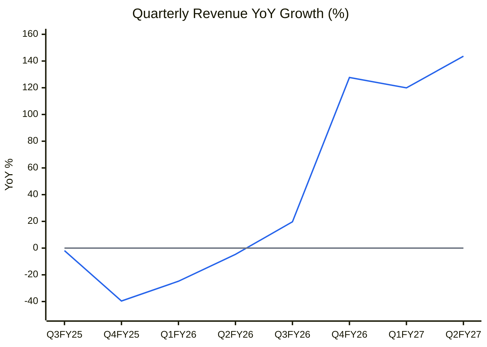
🟦 Revenue YoY % · ⬜ zero line
**Read:** The previous report expected Q2 to decelerate to ~60% YoY against a "normal" base (₹1,043 Cr). It **accelerated to +144%** instead. Q2 FY26 was not a crisis quarter, so the base-effect argument no longer explains the growth. This is genuine acceleration, with **+33% QoQ** on top.

**Business inference:** Demand and pricing are running ahead of everyone's models, including management's (guidance raised twice). The next test is Q3: the MD expects QoQ growth, but guidance implies H2 *below* Q2. Any flattening in H2 will show how much of Q2 was price.

### Volume / price / mix
The MD would not split Q2 growth into volume and price (*"If I give that, it would be an incorrect statement"*). What we know: fibre runs at 100%+ utilisation (volume capped until the 38.5 mn fkm stage commissions), prices rose ~20% QoQ, and mix moved to DC fibre (65–75% of telecom revenue) and to connectivity (~₹300 Cr in Q2, nil in Q1). **With fibre volume capped, most of the QoQ growth must be price and mix.** Mix is durable; price is not.

### Segment economics (consolidated, results filing)

| ₹ Cr | Q2FY26 | Q1FY27 | Q2FY27 | H1FY27 | FY26 |
|---|---|---|---|---|---|
| Telecom products revenue | 490 | 1,590 | **2,322** | 3,912 | 3,233 |
| — segment PBIT | 123 | 484 | **716** | 1,200 | 764 |
| — PBIT margin | 25% | 30% | **31%** | 31% | 24% |
| Defence revenue | 30 | 24 | 55 | 79 | 77 |
| Turnkey contracts (EPC) revenue | 507 | 280 | **136** | 416 | 1,573 |
| — segment result | +36 | −88 | **−123** | −210 | −113 |

**Read:** All the profit comes from telecom products (31% PBIT margin). EPC revenue has collapsed (−73% YoY) while it books losses on unbilled BharatNet work. Defence is still tiny (H1 ₹79 Cr vs ₹500–600 Cr target). Management guides combined EPC losses of ₹75–100 Cr over Q3+Q4 and a profit from Q1 FY28.

### CY7 — EBITDA Margin & ROCE vs Their Own Cycle

| | FY16 | FY17 | FY18 | FY19 | FY20 | FY21 | FY22 | FY23 | FY24 | FY25 | FY26 | H1FY27 |
|---|---|---|---|---|---|---|---|---|---|---|---|---|
| EBITDA margin % | 10 | 9 | 9 | 9 | 13 | 12 | 14 | 13 | 13 | 11 | 15 | 23 |
| ROCE % | 24 | 13 | 18 | 24 | 21 | 20 | 19 | 15 | 13 | 8 | 11 | ~20 (TTM) |

EBITDA margin: median 12%, SD 2.1 → band 9.9–14.1%. ROCE: median 18%, SD 5.1 → band 12.9–23.1%. *H1 FY27 margin = (414 + 630) / 4,457 (ex-other income). TTM ROCE = (PBT ₹1,237 Cr + interest ₹253 Cr) / average capital employed ~₹7,270 Cr.*

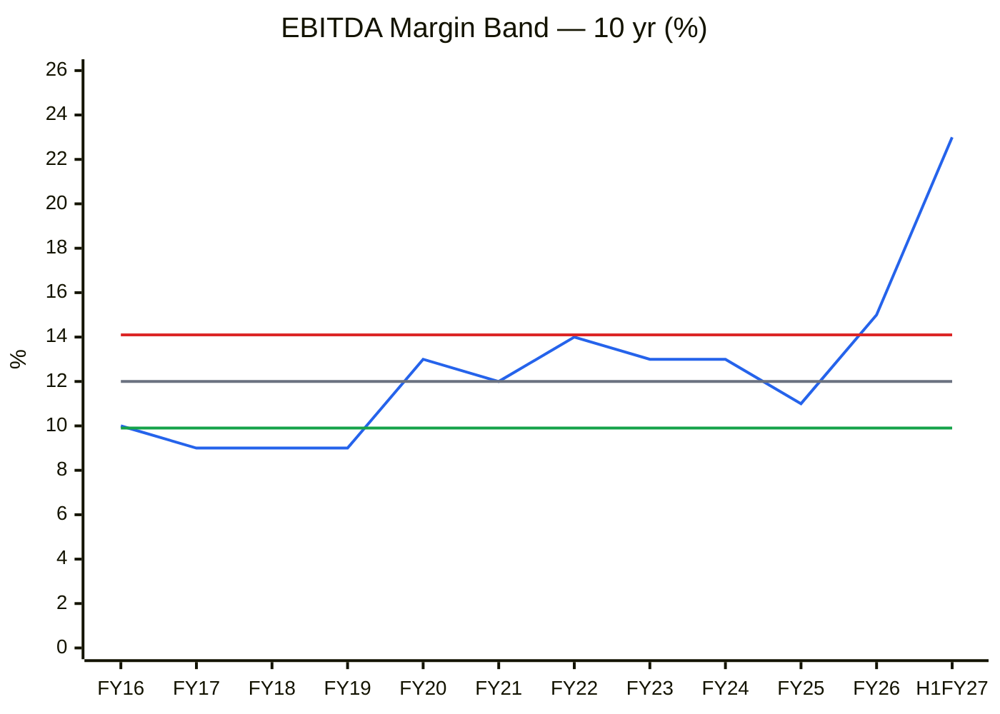
🟦 EBITDA margin · ⬜ Median 12% · 🟥 +1SD 14.1% · 🟩 −1SD 9.9%
**Read:** The H1 margin (23%, Q2 25%) is **~5 SD above** the decade median. ROCE (~20%) is just *above* its median, not at an extreme, because the capital base has doubled. Margins are at an extreme; returns are only normal.

**Business inference:** Part of the margin gain is structural: product mix is ~91% product, exports, DC fibre and connectivity. A reasonable through-cycle margin is now ~18–20% (up from ~17% in the last report, on the connectivity mix). The rest (5–7pp) is shortage rent that the 2028 supply wave will compete away.

**Stock cycle classification: LATE CYCLE / PEAK-MARGIN UPSWING (unchanged)**, now with genuine cash generation. Per the framework: +5–10pp wider MoS, × 0.5 position size.

**Operating leverage:** DOL ≈ contribution / EBIT. With ~₹700–800 Cr of fixed cost (employees ₹520 Cr annualised, plus overheads) against TTM EBIT ~₹1,390 Cr, DOL ≈ 1.5–1.6×. DFL = 1,490 / (1,490 − 253) ≈ 1.2×. **DTL ≈ 1.9×: a 10% revenue miss means ~19% lower EPS.** ICR TTM 5.9× (safe).

**Guidance accuracy:** see the WTT scorecard (Module 4). **Score 0.75, MODERATE.** Pattern: sandbagging on financials, slippage on M&A and defence.

---

## Module 2 — Industry Structure & Capital Cycle

Five Forces: moderate entry barriers (rising for DC-grade fibre and in-DC connectivity qualification), moderate supplier power (preform scarce; HFCL protected by 12–24 month contracts until its own 300 → 600 MT comes on stream), **high buyer power** (hyperscalers and governments), low substitutes, high rivalry (STL, Chinese majors, Corning/Prysmian). **Verdict: Neutral, improving at the margin.** Hyperscaler qualification gives some stickiness, but buyers still reset prices annually (*"Year-to-year, we examine the prices and redo the prices. It can go down, it can go up"*, Q2 call).

**Capital cycle:** HFCL capex/depreciation ~4× in H1 FY27 (₹436 Cr capex vs ₹105 Cr D&A), plus ₹820 Cr of new approvals (14 Sep). Peers have re-rated 3–10× and are adding capacity. **Signal: capital flooding in. The deteriorating-returns phase starts when the 2028 capacity lands.** *(CY8 industry chart not built: peer capex series not compiled.)*

---

## Module 3 — Business Quality & Moat

**Greenwald:** (1) cost advantage **partial, strengthening** (preform-to-connectivity integration from 2028; a "mid-term" preform cost solution from CY27, which management declined to describe); (2) customer captivity **weak-to-moderate** (hyperscaler qualification and in-DC connectivity certification add switching friction; annual price resets limit it); (3) local scale **moderate** (top-2 Indian OFC). **Buffett 10% price test: passes in the shortage, fails through the cycle.** **Moat: NARROW** (unchanged).

### C4 — Margin trend

| % | FY16 | FY17 | FY18 | FY19 | FY20 | FY21 | FY22 | FY23 | FY24 | FY25 | FY26 | H1FY27 |
|---|---|---|---|---|---|---|---|---|---|---|---|---|
| EBITDA margin | 10 | 9 | 9 | 9 | 13 | 12 | 14 | 13 | 13 | 11 | 15 | 23 |
| PAT margin | 5.4 | 5.8 | 5.3 | 4.9 | 6.2 | 5.6 | 6.9 | 6.7 | 7.6 | 4.3 | 6.6 | 14.4 |

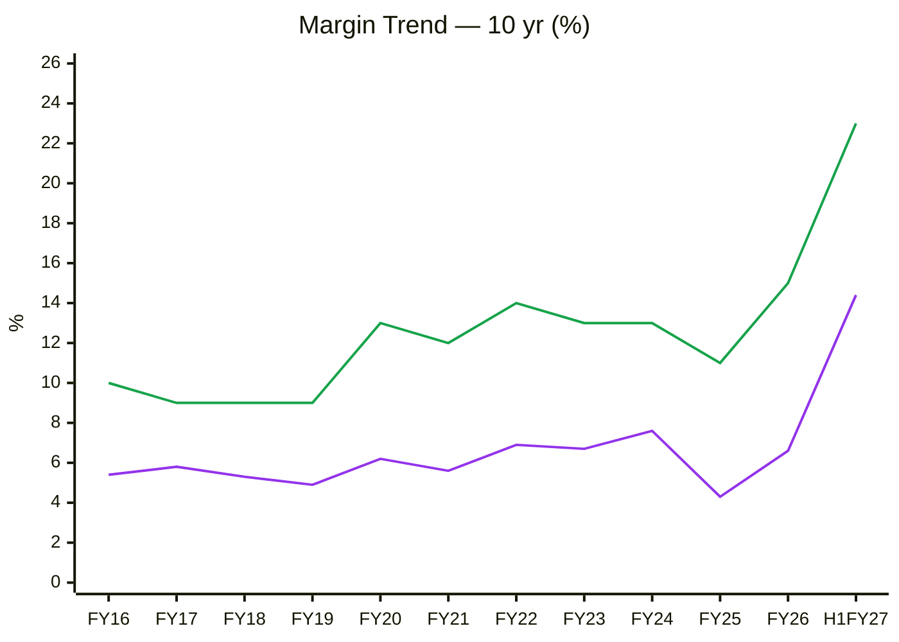
🟩 EBITDA margin · 🟪 PAT margin
**Read:** The EBITDA-to-PAT gap is unchanged in points (~8.5pp), but PAT now keeps 63% of EBITDA vs 44% in FY26. PAT margin more than doubled to 14.4% because interest (₹105 Cr in H1) and depreciation (₹128 Cr) are now small against ₹1,103 Cr of H1 EBITDA.

**Business inference:** At this scale the balance sheet no longer absorbs the operating gains. Every incremental rupee of margin now reaches EPS almost in full, which is why EPS is so sensitive to fibre pricing in both directions (DTL ~1.9×).

**Fisher 15-point:** 32/45 (+1 on point 14, open communication: the MD named the EPC loss and his own pricing misjudgement). Integrity: Pass.

---

## Module 4 — Management & Capital Allocation

### C9 — Promoter & institutional holding (12 quarters)

| % | Dec23 | Mar24 | Jun24 | Sep24 | Dec24 | Mar25 | Jun25 | Sep25 | Dec25 | Mar26 | Jun26 | Sep26 |
|---|---|---|---|---|---|---|---|---|---|---|---|---|
| Promoters | 37.84 | 37.69 | 37.63 | 36.24 | 35.90 | 34.37 | 31.58 | 30.02 | 28.29 | 28.29 | 28.29 | 28.29 |
| FIIs | 8.18 | 7.66 | 7.02 | 6.68 | 6.70 | 6.97 | 7.75 | 7.48 | 7.48 | 7.08 | 15.74 | 17.24 |
| DIIs | 4.55 | 5.68 | 7.39 | 8.69 | 10.96 | 13.26 | 14.04 | 13.57 | 9.07 | 8.57 | 10.92 | 10.39 |

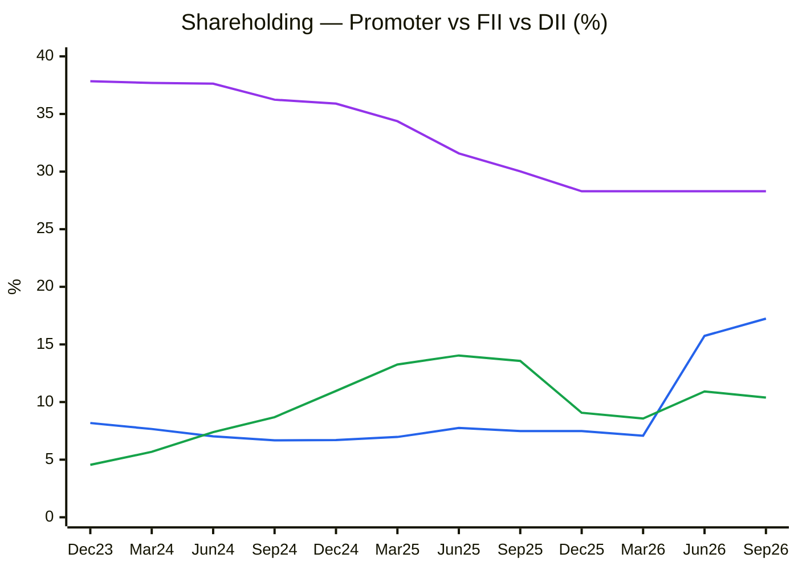
🟪 Promoters · 🟦 FIIs · 🟩 DIIs
**Read:** The promoter line has been **flat at 28.29% for four quarters**: the selling (−9.6pp from Sep-23 to Dec-25) has stopped. FIIs went 7.1% → 17.2% in two quarters, while DIIs have trimmed slightly. Promoters hold 7.5 Cr warrants at ₹74 (25% paid, ₹138.75 Cr received May-2026; balance due by Nov-2027).

**Business inference:** Insider behaviour has moved from distribution to accumulation, at a large discount to the market. That is mildly bullish for alignment but dilutive for minorities (~4.9% when exercised). Foreign institutions now own the marginal share, which makes the stock sensitive to global AI-capex sentiment.

| Item | Reading |
|---|---|
| Pledge | Not verified from a primary filing (aggregators cite ~50 lakh shares, ~0.3% of equity). Low risk on available data |
| Dilution | 153 Cr shares; +7.5 Cr warrants (₹74) → 160.5 Cr diluted. QIP ₹550 Cr (Dec-25) |
| Dividend payout | ~4% of FY26 PAT (₹14.4 Cr paid in H1) |
| RPT | No new concerns surfaced; capital allocation now spans fibre, connectivity, EPC, defence electronics, aerostructures (acquisition), ammunition (1,000-acre AP complex) |
| Capital allocation | **Average** (up from Poor-to-Average): capex now matched by operating cash; sprawl into defence/ammunition is the drift risk |
| Monitoring agency | ₹90 Cr of QIP/warrant proceeds deferred to 31-Dec-2026 (minor) |

### Walk the Talk Scorecard

| Quarter guided | Statement | Guided | Actual | Verdict |
|---|---|---|---|---|
| FY25 calls | FY26 order book / exports build | Strong order intake | OB ₹9,967 → ₹21,206 Cr; exports 41% | ✅ |
| FY25 | No warning of the Q4 FY25 collapse | — | Q4 FY25 OPM −4.6% | ❌ |
| Q4FY26 | FY27 revenue growth ~20% | +20% | H1 +133%; FY now ≥ +80% | ✅ (sandbagged) |
| Q1FY27 | FY27 revenue growth 40% | +40% | Tracking ≥ +80% | ✅ (sandbagged) |
| Q1FY27 | FY27 EBITDA margin > 20% | > 20% | H1 24.75% | ✅ |
| Q1FY27 | Telecom-product margins ~30% sustainable | ~30% | Segment PBIT 31% | ✅ |
| Q1FY27 | Aerospace acquisition "advanced stage" | Close soon | Now "this quarter" (Q3) | ⚠️ |
| FY26 | Defence ~₹500 Cr FY27 | ₹500 Cr | H1 ₹79 Cr; relies on the acquisition | ⚠️ (pending, at risk) |
| Q1FY27 | DC connectivity ₹700–800 Cr FY27 | ₹800 Cr | Q2 ~₹300 Cr | ⏳ |
| Q2FY27 | Debt "will substantially go down" by Mar-27/28 | ↓ | Borrowings ₹1,713 → ₹1,840 Cr in H1 | ⏳ (watch) |

**WTT Score: 0.75 / 1.00 (MODERATE).** Resolved points: 8 · Hits 5 · Near misses 2 · Misses 1 · Reversals 0.
**Key pattern:** Sandbagging on revenue and margin guidance (beat twice); slippage on M&A and defence timelines.
**Insider action:** Promoter warrants at ₹74 (May-2026); no promoter sales since Dec-2025 → **NEUTRAL-TO-BULLISH**.
**DCF impact:** Financial guidance used as a floor (no haircut); defence guidance haircut 40% (₹300–350 Cr FY27).
**Overall management credibility: MODERATE** (B on the concall grade: delivers on numbers, absolute in tone about margins).

---

## Module 5 — Financial Forensics

| Test | FY26 (previous report) | H1 FY27 (now) |
|---|---|---|
| CFO vs PAT | CFO −₹378 Cr vs PAT ₹329 Cr | **CFO +₹455 Cr vs PAT ₹640 Cr (0.71×)**; cash generated ₹575 Cr before tax |
| Working-capital absorption | n/a | ₹509 Cr (receivables +₹418 Cr, other current/contract assets +₹317 Cr, inventory +₹128 Cr, payables +₹179 Cr) |
| Sloan accrual (CF) | +12.6% (red) | (640 − 455 + 448) / avg TA 9,521 = **6.6% for the half** (~13% annualised), now **capex-led**, not accrual-led |
| Debtor days | 163 | ~108 (H1 annualised) |
| CCC | 218 | **~135** (H1 annualised proxy) |
| Beneish M | ~−1.9 (grey) | DSRI ≈ 0.66 (receivables growing far slower than sales) → improves to ~−2.3 (unlikely manipulator), est. |
| Altman Z'' | ~3.0 | ~3.6 (safe; higher EBIT and retained earnings) |
| Piotroski F | ~4/9 | ~6/9 (CFO > 0, ROA up, margin up, AT up; leverage up slightly, dilution via warrants, accruals still > 0) |
| Auditor | Not reviewed | FY26 KAMs reviewed: revenue recognition and contract assets (₹906 Cr), receivable credit risk, intangibles (₹408 Cr under development). **No qualification / EOM.** Limited review on H1 |
| Contingent liabilities | Gap | LCs ₹358 Cr · bank guarantees ₹764 Cr · disputed claims ₹74 Cr (Mar-26) |

### C7 — Cumulative PAT vs Cumulative CFO (₹ Cr)

| | FY16 | FY17 | FY18 | FY19 | FY20 | FY21 | FY22 | FY23 | FY24 | FY25 | FY26 | H1FY27 |
|---|---|---|---|---|---|---|---|---|---|---|---|---|
| Cum. PAT | 156 | 280 | 452 | 684 | 921 | 1,167 | 1,493 | 1,811 | 2,149 | 2,322 | 2,651 | 3,291 |
| Cum. CFO | 0 | 136 | 343 | 377 | 549 | 694 | 899 | 1,134 | 1,089 | 1,485 | 1,107 | 1,562 |

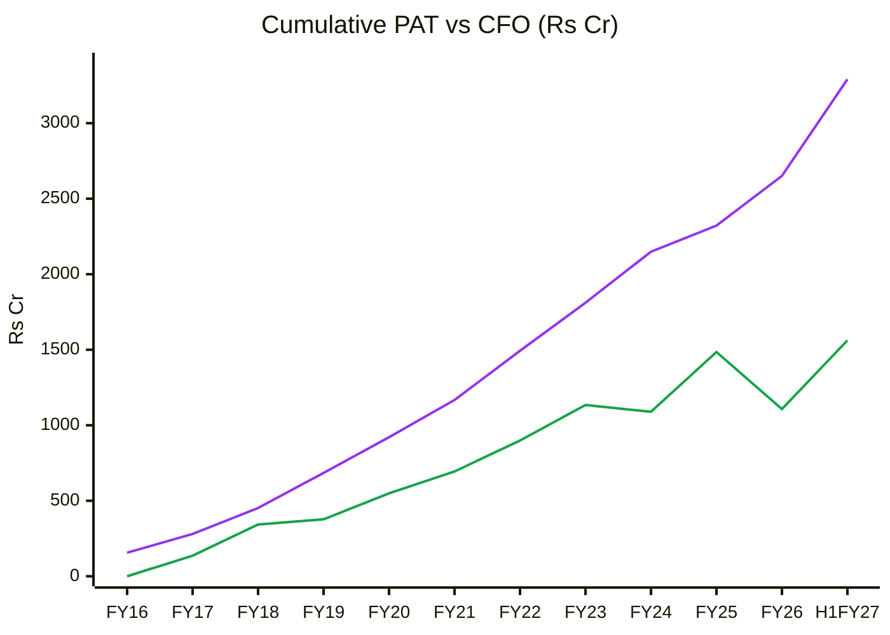
🟪 Cumulative PAT · 🟩 Cumulative CFO
**Read:** The gap stopped widening in H1 FY27: CFO (+₹455 Cr) recovered 71% of PAT, the best half-year conversion in the record. The cumulative ratio is still only **0.47**, so about ₹1,700 Cr of historic profit remains tied up in receivables, contract assets and inventory.

**Business inference:** The export-product business collects faster than government EPC. As products grow to ~91% of revenue, the historic cash leak is closing at the margin. One half-year is not a trend: the full-year FY27 CFO and the EPC milestone billing in H2 are the confirmation.

### C8 — Working-capital days

| Days | FY19 | FY20 | FY21 | FY22 | FY23 | FY24 | FY25 | FY26 | H1FY27 (ann.) |
|---|---|---|---|---|---|---|---|---|---|
| Debtor | 113 | 153 | 215 | 146 | 145 | 181 | 170 | 163 | 108 |
| Inventory | 41 | 96 | 65 | 98 | 113 | 135 | 145 | 191 | 116 |
| Payable | 134 | 227 | 262 | 173 | 131 | 141 | 174 | 136 | 89 |
| CCC | 20 | 22 | 18 | 72 | 127 | 175 | 141 | 218 | 135 |

*H1 FY27 proxy: Sep-26 balances (results filing) on annualised H1 revenue ₹8,914 Cr, scaled to Screener's FY26 cost denominator. Contract assets (in other current assets, +₹317 Cr in H1) are not in CCC; include them and the cycle is ~25 days longer.*

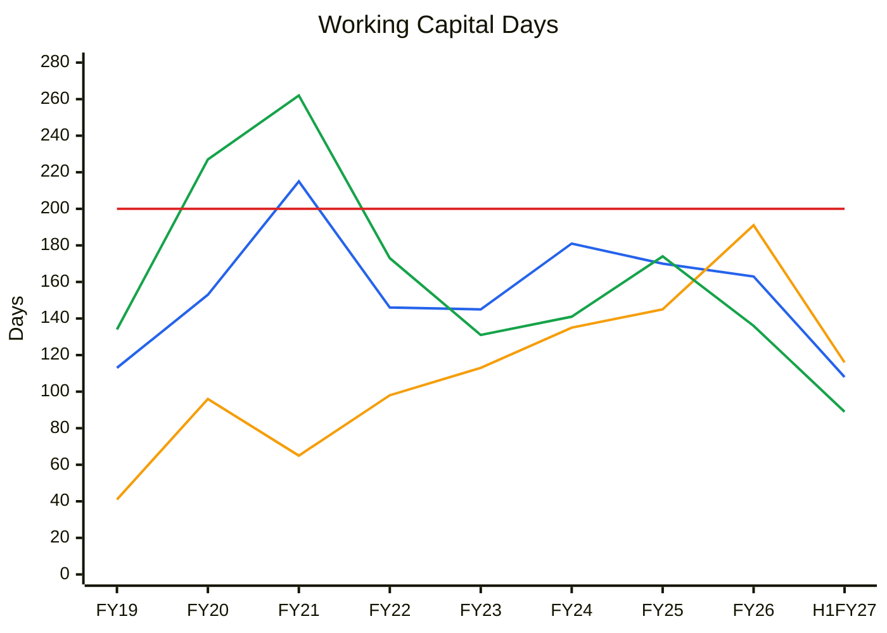
🟦 Debtor days · 🟧 Inventory days · 🟩 Payable days · 🟥 200-day CCC red-flag line *(CCC itself: 218 → ~135, in the table)*
**Read:** Receivable and inventory days both fell sharply as revenue scaled faster than balances. Hyperscaler and export customers pay faster than BharatNet. Payable days fell too (suppliers still not financing growth), so the improvement is entirely on the asset side.

**Business inference:** Mix shift, not supplier financing, is shortening the cash cycle, which makes the improvement more durable. The risk is the reverse: if the product cycle softens and EPC grows again as a share of revenue, days will rebuild.

**Forensic verdict: MINOR-TO-MODERATE CONCERNS (upgraded from Significant).**
- CFO < 0: **resolved provisionally** (H1 +₹455 Cr; needs full-year confirmation).
- CCC > 200: **resolved** (~135).
- Promoter selling: **resolved** (four quarters flat, warrants).
- Sloan > 10%: **still open**, but now capex-driven.
**Unresolved count: 1 + 1 provisional → the "forensic ≥ 3" hard stop no longer applies.**

---

## Module 6 — Earnings Quality & Financial Statements

**ROIC (TTM):** NOPAT = (TTM EBITDA ₹1,586 Cr + OI ₹97 Cr − D&A ₹194 Cr) × 0.75 ≈ ₹1,117 Cr ÷ invested capital (equity ₹5,755 Cr + debt ₹1,909 Cr incl. buyers' credit + leases ₹29 Cr − cash/liquid ₹636 Cr) ≈ ₹7,060 Cr = **~15.8%** vs WACC ~12%. **Positive economic profit (~₹270 Cr TTM) for the first time since FY22.** At a through-cycle 19% EBITDA margin the same capital earns ~11–12%, i.e. only at WACC.

### C5 — ROCE vs WACC

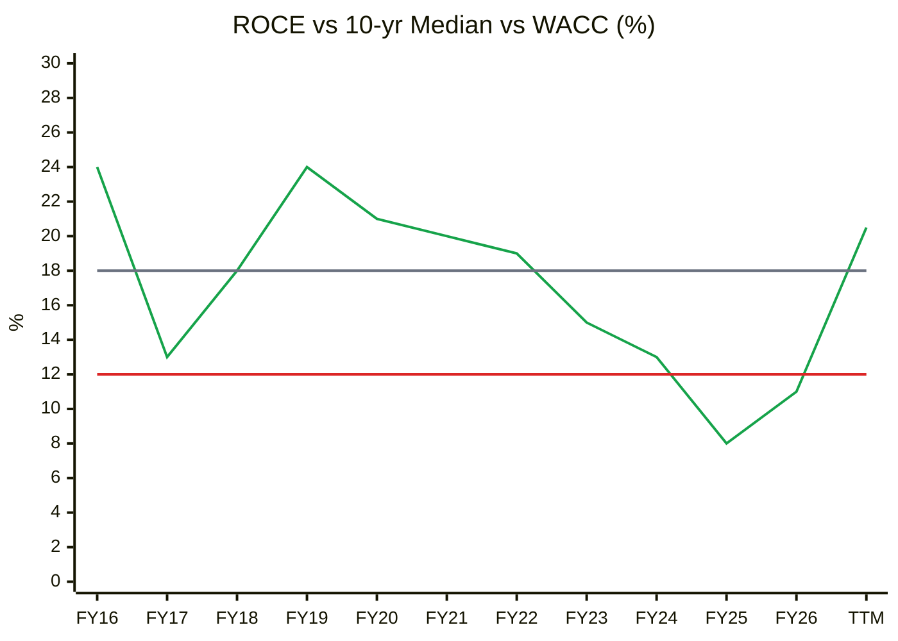
🟩 ROCE (pre-tax) · ⬜ 10-yr median 18% · 🟥 WACC 12%
**Read:** ROCE jumped from 11% to ~20.5% (TTM), back above the decade median and well above WACC, on peak margins.

**Business inference:** The asset base can earn above its cost of capital, but so far only at shortage pricing. The question for valuation is not whether ROCE can be 20% (it is now) but whether it holds at 15%+ when margins normalise. On the asset-turnover math below, that requires ~19–20% margins.

### C6 — Asset Turnover (Revenue / Gross Block)

| | FY16 | FY17 | FY18 | FY19 | FY20 | FY21 | FY22 | FY23 | FY24 | FY25 | FY26 | TTM |
|---|---|---|---|---|---|---|---|---|---|---|---|---|
| AT (×) | 6.19 | 4.58 | 6.56 | 8.51 | 4.68 | 4.99 | 4.95 | 4.52 | 3.67 | 2.72 | 2.49 | ~3.1 |

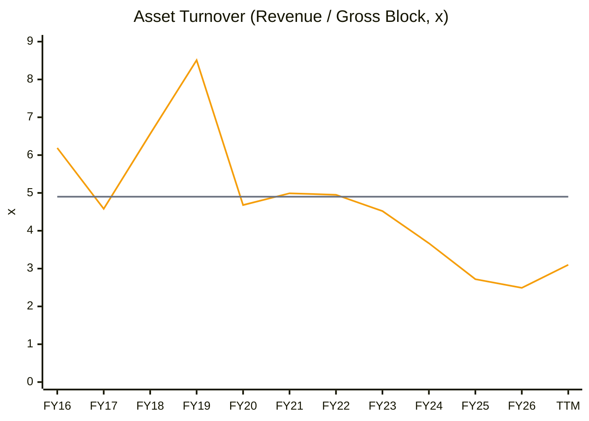
🟧 AT · ⬜ 10-yr average 4.9×
**Read:** After five years of decline, AT turned up to ~3.1× (TTM; ~4× on the Q2 run-rate) as revenue outran the asset base. The ₹1,800 Cr programme will push gross block toward ~₹4,300 Cr by FY29, so AT falls back toward ~2.8× unless realisations hold.

**Business inference:** Today's AT is flattered by peak prices on fully used capacity. The base case should still anchor on ~3× sustainable AT, not the Q2 run-rate.

### DuPont (summary)
FY26 → TTM Sep-26: EBIT margin 12.3% → ~19.9%; asset turnover (Rev/TA) 0.56 → ~0.79; equity multiplier 1.81 → ~1.77; interest burden 0.64 → ~0.83; ROE 7.0% → **~17%**. **Verdict: the ROE recovery is entirely operational** (margin and AT up, leverage flat to down). That is the right kind of improvement, but it is cyclical in its margin component.

**O'Glove flags: 2/15** (Sloan; inventory build in absolute terms), down from 4/15.

---

## Module 7 — Industry KPIs & Peer Analysis

| KPI (Telecom Equipment OEM block) | HFCL | Healthy | Red flag | Status |
|---|---|---|---|---|
| Order book / TTM revenue | 3.9× headline / **2.2× firm** | > 1.5× | < 0.7× | ✅ (firm cover falling as revenue scales) |
| Book-to-bill (Q2 implied) | ~1.9× (₹4,788 Cr inflow / ₹2,542 Cr revenue) | > 1.0× | < 0.7× | ✅ |
| Cash conversion cycle | ~135 days (H1 ann.) | < 120 | > 200 | ⚠️ improving |
| Customer concentration | Top customer 13% of FY26 revenue (FY25: three customers 47%); ~70% of export OFC book from hyperscalers | < 30% | > 50% | ✅ / ⚠️ hyperscaler cluster |
| Export share | ~60% of H1 revenue; 57% of order book | — | — | ✅ |

### Order Book Tracker (27 BSE Reg 30 filings since Apr 2024; ledger and snapshots in sections 5–6 below)
*Generated 2026-10-28 by scripts/order_book_tracker.py from 27 order announcements (1 follow-up excluded) and 13 period snapshots. No new order filings since 1-Sep-2026 (BSE announcements checked to 28-Oct). (est.) = tracked estimate.*

#### 1. Disclosed vs tracked order book (reconciliation)

| Period | Revenue (₹ Cr) | Order book (₹ Cr) | Announced inflow | of which Framework | Implied inflow | Announced coverage | OB cover (× TTM rev) | Source |
|---|---|---|---|---|---|---|---|---|
| FY22 | 4,727 | 5,300 | — | — | — | — | 1.1 | CARE Ratings Jul-2022 |
| FY23 | 4,743 | 7,010 | — | — | 6,453 | — | 1.5 | Company disclosure (The Machine Maker) |
| FY24 | 4,465 | 7,685 | — | — | 5,140 | — | 1.7 | Company disclosure (DSIJ) |
| Q1FY25 | 1,158 | 6,592 (est.) | 65 | — | — | — | 1.4 | Screener revenue |
| Q2FY25 | 1,094 | 5,498 (est.) | 0 | — | — | — | 1.2 | Screener revenue |
| Q3FY25 | 1,012 | 10,410 | 0 | — | 5,924 | 0% | 2.3 | Q3FY25 results (Muthoot Securities) |
| Q4FY25 | 801 | 9,967 | 4,713 | — | 358 | 1,317% | 2.5 | FY25 results (prior report) |
| Q1FY26 | 871 | 9,503 (est.) | 407 | — | — | — | 2.5 | Screener revenue |
| Q2FY26 | 1,043 | 9,981 | 460 | — | 1,521 | 30% | 2.7 | Q2FY26 results (Muthoot Securities) |
| Q3FY26 | 1,211 | 11,125 | 1,241 | — | 2,355 | 53% | 2.8 | Q3FY26 results (Muthoot Securities) |
| Q4FY26 | 1,824 | 21,206 | 10,262 | 10,159 | 11,905 | 86% | 4.3 | Q4FY26 results |
| Q1FY27 | 1,915 | 26,665 | 4,542 | — | 7,374 | 62% | 4.4 | Q1FY27 results (Business Standard) |
| Q2FY27 | 2,542 | 28,911 | 3,789 | 2,329 | 4,788 | 79% | 3.9 | Q2FY27 investor presentation (BSE 19-Oct-2026) |

*Implied inflow = OB(t) − OB(t−1) + order-linked revenue(t). Announced coverage = announced ÷ implied.*

#### 2. Announced orders aggregated by quarter

| Quarter | # orders | Total (₹ Cr) | Firm | Framework | Largest single | Export | Govt/PSU/Defence | Private domestic |
|---|---|---|---|---|---|---|---|---|
| Q1FY25 | 1 | 65 | 65 | 0 | 65 | 0 | 0 | 65 |
| Q4FY25 | 3 | 4,713 | 4,713 | 0 | 2,501 | 0 | 4,713 | 0 |
| Q1FY26 | 4 | 407 | 407 | 0 | 174 | 59 | 174 | 174 |
| Q2FY26 | 2 | 460 | 460 | 0 | 358 | 358 | 102 | 0 |
| Q3FY26 | 3 | 1,241 | 1,241 | 0 | 656 | 1,241 | 0 | 0 |
| Q4FY26 | 3 | 10,262 | 103 | 10,159 | 10,159 | 10,201 | 0 | 61 |
| Q1FY27 | 6 | 4,542 | 4,542 | 0 | 2,666 | 290 | 2,801 | 1,450 |
| Q2FY27 | 4 | 3,789 | 1,460 | 2,329 | 2,329 | 3,789 | 0 | 0 |

#### 3. Macro picture

| Metric | Value |
|---|---|
| Latest disclosed order book | ₹28,911 Cr (Q2FY27) |
| Orders announced since that disclosure | ₹0 Cr (0 orders) |
| Tracked order book today | ₹28,911 Cr |
| Order book cover (latest) | 3.9 × TTM revenue |
| Framework / 'potential value' agreements in ledger | ₹12,488 Cr (43% of latest disclosed OB) |
| Firm order book (ex-framework) | ₹16,423 Cr = 2.2× TTM revenue = ~1.6 yrs of the Q2 run-rate |
| Orders announced, last 12 months | ₹19,834 Cr (16 orders; avg ₹1,240 Cr) |
| Top-3 orders (last 12 m) as % of disclosed OB | 52% |

**Geography mix, last 12 months:** Export 78% · Domestic 15% · Unspecified 7%
**Customer type mix, last 12 months:** Export 78% · PSU 14% · Unspecified 7% · Private 1%
**Segment mix, last 12 months:** OFC (high fibre count) 63% · OFC 20% · EPC/Network 13% · Data-centre connectivity 2% · Services/AMC 1%
**Firmness mix, last 12 months:** Framework 63% · Firm 37%
**Presentation split (Q2):** O&M ₹5,070 Cr · Products/Networks balance; 64% OFC/DCI; 57% export. Defence book ~₹1,850 Cr, of which **~₹1,600 Cr sits in the entity being acquired** (unclear whether it is in the ₹28,911 Cr headline; treat as not yet HFCL's).

#### 4. Charts

**OB-1 — Order book vs revenue (TTM), index = 100 at FY22**

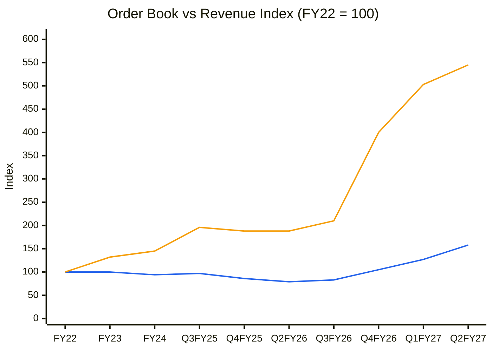
🟦 Revenue (TTM) · 🟧 Order book (disclosed points only; x-axis mixes FY and quarter-ends)
**Read:** For the first time the revenue line (🟦 127 → 158) is rising faster than the order book (🟧 503 → 545). Execution has caught up with the backlog. The book still grew because implied inflow (₹4,788 Cr) exceeded revenue.

**Business inference:** The binding constraint has shifted from demand to capacity. Fibre runs at 100%+, so near-term revenue now depends on price and the 2028 commissioning schedule, not on order wins.

**OB-2 — Order book cover (years of TTM revenue)**

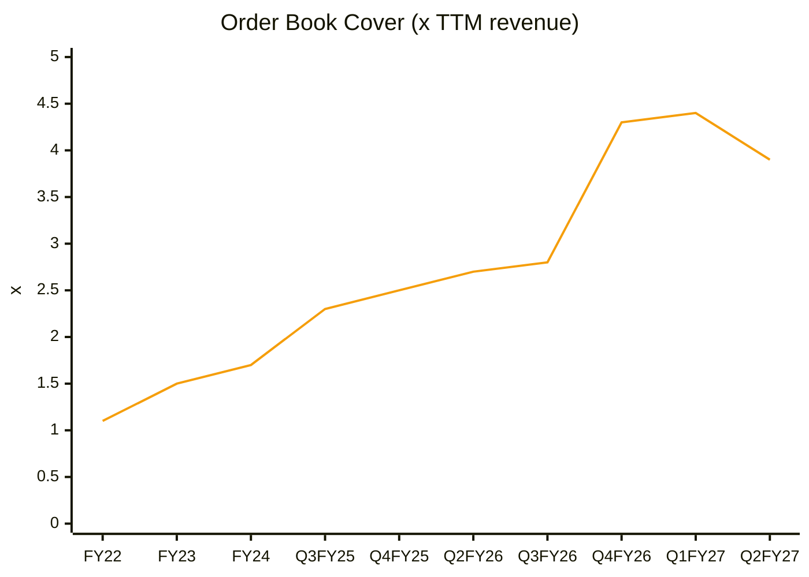
🟧 Order book / TTM revenue
**Read:** Headline cover dipped from 4.4× to 3.9×. **Firm cover (ex-framework) fell from ~2.8× to 2.2×**, about 1.6 years of the Q2 run-rate.

**Business inference:** At the new revenue scale, firm visibility is shorter than the headline suggests. The MD's answer (*"Do you think that I'm going to sitting idle not taking more orders?"*) is fair, but it means FY28 depends on new orders and on the framework agreements delivering at *prevailing* prices.

**OB-3 — Aggregated announced orders vs revenue, by quarter (₹ Cr)**

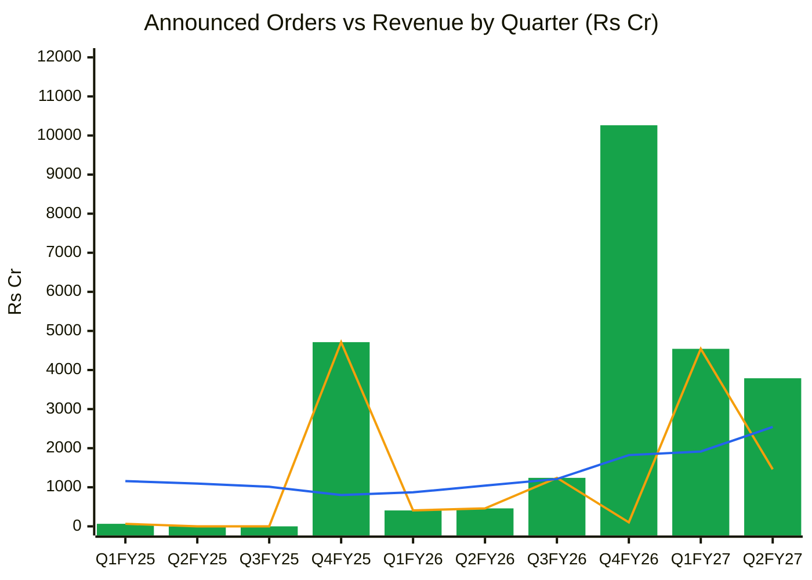
🟩 All announced orders (bars) · 🟧 Firm orders only · 🟦 Revenue
**Read:** In Q2 announced *firm* orders (₹1,460 Cr) fell **below** revenue (₹2,542 Cr) for the first time since Q1 FY26. 61% of the quarter's announcements was the 3-year framework agreement (₹2,329 Cr). Undisclosed orders below the Reg 30 threshold make up the gap (implied inflow ₹4,788 Cr).

**Business inference:** Large, firm, announced wins are getting rarer relative to the revenue base, while framework agreements carry the headline. Order momentum is fine overall but increasingly tied to a few hyperscaler supply contracts priced off the market.

**OB-4 — Implied order inflow (from disclosed order book) vs revenue (₹ Cr)**

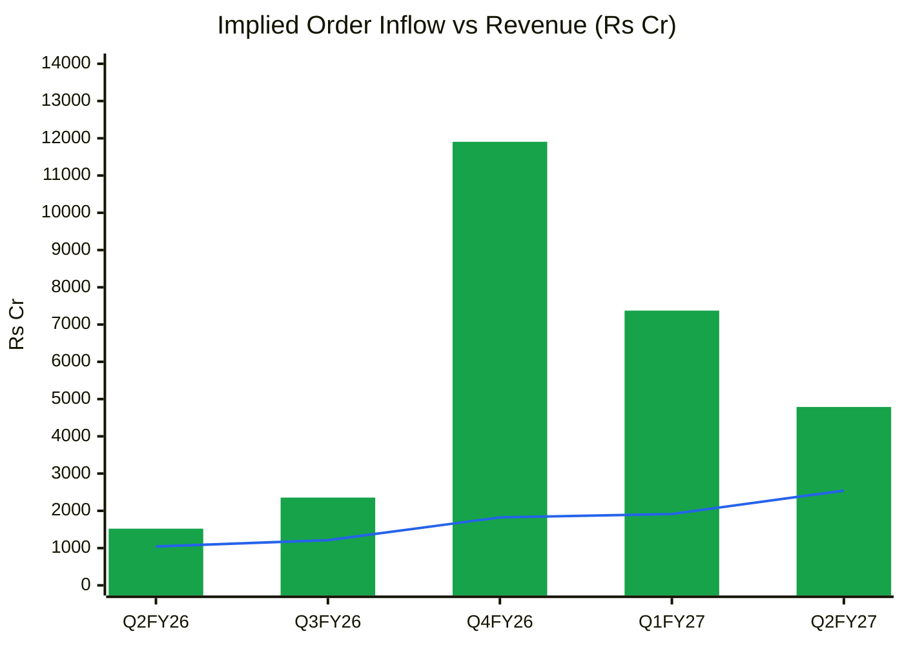
🟩 Implied inflow · 🟦 Revenue
**Read:** Book-to-bill stayed above 1 (1.9× in Q2) but has trended down from the Q4 FY26/Q1 FY27 peaks as revenue rises. This matches the MD's own arithmetic (*"against ₹2,500 crores supply, you have received orders of ₹5,500 crores"*, approximately).

**Business inference:** Orders still outpace execution, so FY27–FY28 revenue is well supported. The fading ratio is the early marker to watch for the cycle turning: when book-to-bill drops below 1 with prices still high, the peak is in.

#### 5. Order Ledger — every announced order (source of truth; the next run appends here)

| order_id | date | customer | customer_type | segment | geography | value_cr | currency | value_fc | firmness | tenor_months | linked_to | source | notes |
|---|---|---|---|---|---|---|---|---|---|---|---|---|---|
| HF-2404-01 | 2024-04-12 | Leading private telecom operator | Private | OFC | Domestic | 64.93 | INR |  | Firm |  |  | [BSE](https://www.bseindia.com/xml-data/corpfiling/AttachHis/8955b3d2-b649-496e-980f-8e99ab2b6637.pdf) | HFCL + HTL POs |
| HF-2501-01 | 2025-01-16 | BSNL (BharatNet III Punjab) | Govt | EPC/Network | Domestic | 2501.30 | INR |  | AWO | 120 |  | [BSE](https://www.bseindia.com/xml-data/corpfiling/AttachHis/fe85112b-28d2-4a23-aa0a-3b67845a2961.pdf) | Advance Work Order; middle-mile design-build-operate |
| HF-2501-02 | 2025-01-23 | RVNL (BharatNet III UP East & West) | PSU | EPC/Network | Domestic | 2167.65 | INR |  | AWO | 120 |  | [BSE](https://www.bseindia.com/xml-data/corpfiling/AttachHis/ddcdaf3c-3a7f-4951-8dce-db8f381d4ebb.pdf) | APOs: OFC + equipment + 10-yr O&M |
| HF-2502-01 | 2025-02-19 | BSNL (BharatNet III Punjab) | Govt | EPC/Network | Domestic | 2501.30 | INR |  | Firm | 120 | HF-2501-01 | [BSE](https://www.bseindia.com/xml-data/corpfiling/AttachHis/1622e88f-4b68-4170-ba40-d53115c70f3c.pdf) | Agreement signed for AWO of 16-Jan-2025 (follow-up; not new inflow) |
| HF-2503-01 | 2025-03-07 | Indian Army | Defence | Defence | Domestic | 44.36 | INR |  | Firm |  |  | [BSE](https://www.bseindia.com/xml-data/corpfiling/AttachHis/348f6ea0-51a4-4105-9dff-508a9004ae31.pdf) | HTL; tactical OFC assemblies |
| HF-2505-01 | 2025-05-12 | Tera Software (ITI consortium; BharatNet WB) | PSU | OFC | Domestic | 157.00 | INR |  | Firm |  |  | [BSE](https://www.bseindia.com/xml-data/corpfiling/AttachHis/490cebee-5463-445f-b221-07dc99479fe3.pdf) |  |
| HF-2505-02 | 2025-05-18 | Overseas telecom company | Export | OFC | Export | 59.19 | USD | 6.91 | Firm |  |  | [BSE](https://www.bseindia.com/xml-data/corpfiling/AttachHis/732ebf6e-521b-404d-a2f8-c28aec5ff74a.pdf) |  |
| HF-2505-03 | 2025-05-18 | ITI Limited | PSU | OFC | Domestic | 17.02 | INR |  | Firm |  |  | [BSE](https://www.bseindia.com/xml-data/corpfiling/AttachHis/732ebf6e-521b-404d-a2f8-c28aec5ff74a.pdf) |  |
| HF-2505-04 | 2025-05-19 | Leading domestic telco (5G) | Private | Telecom equipment | Domestic | 173.72 | INR |  | Firm |  |  | [BSE](https://www.bseindia.com/xml-data/corpfiling/AttachHis/1bb179de-09f5-4b8a-9798-95d555e9bc9c.pdf) |  |
| HF-2508-01 | 2025-08-27 | Indian Army | Defence | Defence | Domestic | 101.82 | INR |  | Firm |  |  | [BSE](https://www.bseindia.com/xml-data/corpfiling/AttachHis/33a642b9-1445-4917-a4d2-c4cb38cf5802.pdf) | HTL; tactical OFC |
| HF-2509-01 | 2025-09-07 | International customers | Export | OFC | Export | 358.38 | USD | 40.65 | Firm |  |  | [BSE](https://www.bseindia.com/xml-data/corpfiling/AttachHis/7c7a043c-1895-40fa-8a05-61142d769268.pdf) | via overseas WOS |
| HF-2510-01 | 2025-10-08 | International customer | Export | OFC | Export | 303.35 | USD | 34.19 | Firm |  |  | [BSE](https://www.bseindia.com/xml-data/corpfiling/AttachHis/28b74f04-50d4-4491-9e20-ee475e39ff04.pdf) | via overseas WOS |
| HF-2510-02 | 2025-10-17 | International customer | Export | OFC | Export | 281.20 | USD | 32.02 | Firm |  |  | [BSE](https://www.bseindia.com/xml-data/corpfiling/AttachHis/f8438e57-4973-4acc-a20d-30ee836d050f.pdf) | via overseas WOS |
| HF-2512-01 | 2025-12-06 | International customer | Export | OFC | Export | 656.10 | USD | 72.96 | Firm |  |  | [BSE](https://www.bseindia.com/xml-data/corpfiling/AttachHis/26de2dbb-b0ac-404a-b3df-78e5460f314d.pdf) | via overseas WOS |
| HF-2602-01 | 2026-02-15 | International customer | Export | OFC | Export | 42.34 | USD | 4.67 | Firm |  |  | [BSE](https://www.bseindia.com/xml-data/corpfiling/AttachHis/4eb5afb4-afaa-4a2b-b317-b4590ceb555f.pdf) |  |
| HF-2602-02 | 2026-02-16 | Leading private telecom operator | Private | OFC | Domestic | 60.95 | INR |  | Firm |  |  | [BSE](https://www.bseindia.com/xml-data/corpfiling/AttachHis/6fccd502-bebc-4526-a6b7-e180b18550ef.pdf) | HFCL + HTL |
| HF-2603-01 | 2026-03-13 | Overseas customer (5-yr supply agreement) | Export | OFC (high fibre count) | Export | 10159.00 | USD | 1100 | Framework | 60 |  | [BSE](https://www.bseindia.com/xml-data/corpfiling/AttachHis/bb5ea9df-a555-4a76-b881-d90281d03ee1.pdf) | Potential value at prevailing prices; first multi-year LTA |
| HF-2604-01 | 2026-04-08 | Tier-1 customer | Unspecified | OFC | Unspecified | 1366.00 | INR |  | Firm |  |  | [BSE](https://www.bseindia.com/xml-data/corpfiling/AttachHis/b0d19019-de62-46b9-862a-10b836eabf0d.pdf) | HTL; customer geography not disclosed |
| HF-2605-01 | 2026-05-04 | Leading private telecom operator | Private | OFC | Domestic | 84.23 | INR |  | Firm |  |  | [BSE](https://www.bseindia.com/xml-data/corpfiling/AttachHis/4eaa2a27-59f6-4504-9a9f-0489442b6f90.pdf) | HFCL + HTL |
| HF-2605-02 | 2026-05-11 | International customers | Export | OFC | Export | 183.95 | USD | 19.32 | Firm |  |  | [BSE](https://www.bseindia.com/xml-data/corpfiling/AttachHis/6a68c1b6-cbf0-4a05-a253-1008bc05f3f0.pdf) |  |
| HF-2605-03 | 2026-05-16 | International customer | Export | OFC | Export | 106.19 | USD | 11.07 | Firm |  |  | [BSE](https://www.bseindia.com/xml-data/corpfiling/AttachHis/64cedede-fca3-4b30-9fa6-b0c0fcc675c3.pdf) | via overseas WOS |
| HF-2605-04 | 2026-05-27 | RailTel (defence data-centre network AMC) | PSU | Services/AMC | Domestic | 135.09 | INR |  | Firm |  |  | [BSE](https://www.bseindia.com/xml-data/corpfiling/AttachHis/e9159735-2f47-4b17-b39d-9f86e4750782.pdf) |  |
| HF-2606-01 | 2026-06-17 | RVNL (BharatNet III UP West) | PSU | EPC/Network | Domestic | 2666.09 | INR |  | Firm | 120 |  | [BSE](https://www.bseindia.com/xml-data/corpfiling/AttachHis/f34b1e18-f4b4-4489-81c1-67788b734131.pdf) | Stated as in addition to Jan-2025 RVNL ₹2,167.65 Cr; incl. 10-yr O&M |
| HF-2607-01 | 2026-07-10 | International customer (DC connectivity) | Export | Data-centre connectivity | Export | 495.80 | USD | 51.98 | Firm |  |  | [BSE](https://www.bseindia.com/xml-data/corpfiling/AttachHis/8d217589-04c2-4237-ab71-f435b687f54b.pdf) | via overseas WOS |
| HF-2607-02 | 2026-07-30 | International customer | Export | OFC | Export | 441.53 | USD | 46.13 | Firm |  |  | [BSE](https://www.bseindia.com/xml-data/corpfiling/AttachHis/47768e2b-ff17-4452-819a-02e86be2ca3b.pdf) | via overseas WOS |
| HF-2608-01 | 2026-08-02 | International customers | Export | OFC | Export | 522.73 | USD | 54.81 | Firm |  |  | [BSE](https://www.bseindia.com/xml-data/corpfiling/AttachHis/91868cf9-d269-4e4f-bd12-37b0b8ed8c8a.pdf) |  |
| HF-2609-01 | 2026-09-01 | Overseas customer (3-yr supply agreement) | Export | OFC (high fibre count) | Export | 2329.00 | USD | 244 | Framework | 36 |  | [BSE](https://www.bseindia.com/xml-data/corpfiling/AttachHis/3d3249f1-1d6c-491b-8a40-200e0c3c441d.pdf) | Estimated contract value over tenure |

#### 6. Order Book Snapshots — revenue and disclosed order book per period

| period | revenue_cr | revenue_ttm_cr | order_book_cr | order_linked_share | as_of_date | source |
|---|---|---|---|---|---|---|
| FY22 | 4727 | 4727 | 5300 | 1 |  | CARE Ratings Jul-2022 |
| FY23 | 4743 | 4743 | 7010 | 1 |  | Company disclosure (The Machine Maker) |
| FY24 | 4465 | 4465 | 7685 | 1 |  | Company disclosure (DSIJ) |
| Q1FY25 | 1158 | 4628 |  | 1 |  | Screener revenue |
| Q2FY25 | 1094 | 4611 |  | 1 |  | Screener revenue |
| Q3FY25 | 1012 | 4591 | 10410 | 1 |  | Q3FY25 results (Muthoot Securities) |
| Q4FY25 | 801 | 4065 | 9967 | 1 |  | FY25 results (prior report) |
| Q1FY26 | 871 | 3778 |  | 1 |  | Screener revenue |
| Q2FY26 | 1043 | 3727 | 9981 | 1 |  | Q2FY26 results (Muthoot Securities) |
| Q3FY26 | 1211 | 3926 | 11125 | 1 |  | Q3FY26 results (Muthoot Securities) |
| Q4FY26 | 1824 | 4949 | 21206 | 1 |  | Q4FY26 results |
| Q1FY27 | 1915 | 5993 | 26665 | 1 |  | Q1FY27 results (Business Standard) |
| Q2FY27 | 2542 | 7492 | 28911 | 1 |  | Q2FY27 investor presentation (BSE 19-Oct-2026) |

*Every number above traces to the ledger / snapshot rows (source column).*

**Order-book verdict:** Headline cover 3.9× · **firm cover 2.2× (~1.6 yrs at the Q2 run-rate)** · framework ₹12,488 Cr = 43% · top-3 orders 52% of book · Q2 implied book-to-bill 1.9× · mix 78% export over 12 months.
**Forward link (Module 11):** FY27 revenue ≈ H1 ₹4,457 Cr + H2 ~₹5,100–5,400 Cr (Q2 run-rate held to modest growth; capacity-capped) → **~₹9,600–9,900 Cr**. Guidance (≥ ₹8,900 Cr) is a floor. FY28 needs new firm orders plus framework call-offs; capacity additions only land in FY29.

### Peer comparison

| Metric | HFCL (28 Oct) | STL (28 Oct) | Vindhya Telelinks (9 Oct) | Birla Cable (9 Oct) | Tejas Networks (9 Oct) |
|---|---|---|---|---|---|
| Mcap (₹ Cr) | 37,683 | 45,810 | 3,290 | 1,101 | 8,037 |
| P/E (TTM) | 43.4 | 61.1 | 14.0 | 23.8 | loss |
| ROCE % (FY26) | 10.8 (TTM ~20) | 7.7 | 8.2 | 9.0 | −14.6 |
| Latest-quarter OPM % | 25 | 32 | 7 (TTM) | 10 (TTM) | −50 (TTM) |
| CCC (days) | ~135 (H1) | 16 (FY26) | 283 | 124 | n/m |

### C12 — P/E vs Peers

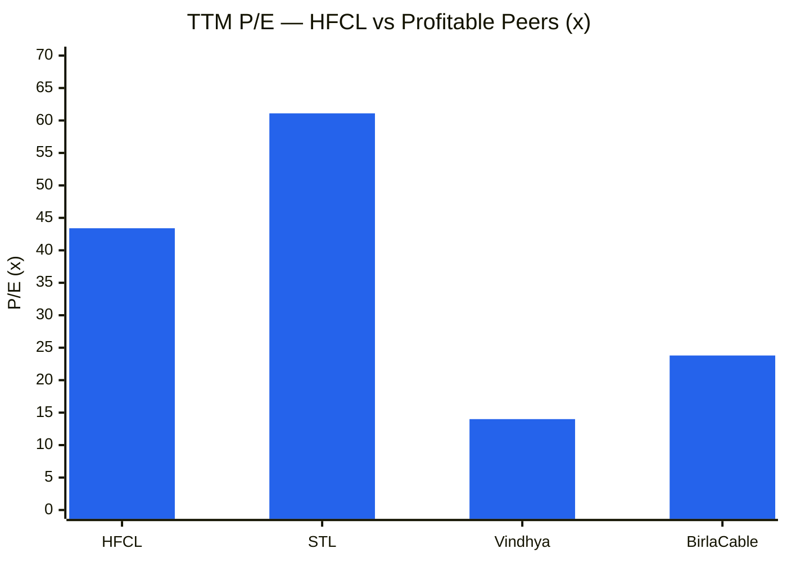
**Read:** The gap to STL has narrowed (STL's P/E fell from 220× to 61× as its earnings exploded too). Both fibre majors now trade at 40–60× *peak-quarter-annualised* earnings ~2–3× lower.

**Business inference:** The market has stopped paying any multiple and is now paying a peak-earnings multiple on peak earnings for the whole group. HFCL is the better-margin, better-cash name, but relative cheapness against STL is not a margin of safety.

---

## Module 8 — Market Size & Market Share

India OFC market ~₹8,000–10,000 Cr (+12–15%); global optical fibre/cable ~$12–15 bn, with AI-DC interconnect the fastest-growing slice; India defence electronics ~₹15,000–20,000 Cr (+20%) (June report sources, not re-sourced: ⚠️). FY26 revenue from outside India was ₹2,047 Cr (41%, AR FY26), and exports grew ~493% YoY in Q2 (MD). TTM revenue growth (+101%) is far above any market growth, so HFCL is taking global share, **but at least half the growth is price.** Share gains in hyperscaler fibre are structural (qualification, China+1). Share gains measured in rupees are inflated by the cycle.

---

## Module 9 — Valuation: PIE First, Then DCF

**CMP ₹246 (28 Oct 2026) · Mcap ₹37,683 Cr · net debt ~₹1,270 Cr · EV ~₹38,950 Cr · TTM EPS ₹5.67 · P/E 43.7× · P/B 6.6× · EV/TTM EBITDA 24.6× · FY27E P/E ~27×.**

### PIE
Perpetual-growth shortcut: g = (EV × 12% − NOPAT₀) / (EV + NOPAT₀) = (38,953 × 0.12 − 1,117) / (38,953 + 1,117) = **8.9% perpetual NOPAT growth** from a **peak-margin** TTM base (was 10.1% on 9 Oct). Explicit reverse DCF (WACC 11.5%, g 6%, RONIC 16%, WC 30% of Δrevenue): even **40% revenue CAGR to ~₹26,600 Cr by FY31 at a 21% steady-state margin gives only ₹173/share.** To justify ₹246 the price needs margins near today's ~25% *and* >35% growth for five years, or terminal returns far above HFCL's history.

| PIE driver | Market-implied | My base case | Gap |
|---|---|---|---|
| Revenue CAGR FY26–31 | ~35–40% (to ₹22,000–26,000 Cr) | ~23% (to ₹13,900 Cr) | **Market optimistic** |
| Steady-state EBITDA margin | ~24–25% (Q2 run-rate held) | 18% terminal (19–21% FY28–29) | **Market optimistic** |
| Working capital / Δrevenue | ≤ 20% | 25–35% (H1 ~20%; FY24–26 > 60%) | Market slightly optimistic |

**Expectations treadmill:** To beat its own PIE, HFCL must (a) hold ≥ 24% EBITDA margins *through* the 2028 supply wave, (b) grow revenue > 30% a year to FY31 (capacity reaches 62 mn fkm only by mid-2028), and (c) keep CCC < 140 days. (c) is now plausible; (a) contradicts the cycle.
**Triggers:** **+** Q3 revenue > ₹2,542 Cr with OPM ≥ 25%; full-year CFO > ₹800 Cr; EPC carve-out; defence acquisition closing with H2 defence revenue > ₹300 Cr; new firm hyperscaler orders. **−** First QoQ decline in fibre realisations; book-to-bill < 1; preform contract reset at spot; hyperscaler capex cut; another equity raise.
**SVAR:** Bear ₹60 → **76%** (> 40% = unfavourable; was 82%).

### Own DCF (5-yr explicit, FY27–31; WC as % of Δrevenue)

| ₹/share | WACC 12%, g 6%, WC 35% | 11.5%, 6%, WC 30% | 11%, 6.5%, WC 25% |
|---|---|---|---|
| Bear (rev ₹9,800 Cr FY31; margin 22% → 15%) | 31 | 35 | 42 |
| **Base (₹13,900 Cr; 24% → 18%)** | **68** | **76** | **91** |
| Bull (₹17,000 Cr; 25% → 22%) | 111 | 125 | 149 |

*160.5 Cr diluted shares; net debt ₹1,270 Cr; capex ₹900/800/500/450/450 Cr (base); terminal RONIC 16%. Base DCF up ~60% vs 9 Oct (₹42–75) on the higher earnings base and lower WC intensity.*
**Read:** The DCF still sits far below the price because it assumes margins mean-revert to 18% and returns on new capital fade to ~16%. The market is capitalising today's margins in perpetuity.

### Relative (2-year, FY28E EPS × multiple)
FY27E: revenue ₹9,600 Cr, EBITDA 24%, PAT ~₹1,440 Cr, EPS ~₹8.97 → **forward P/E 27×**. FY28E base EPS ~₹8.66 (flat: price normalisation starts to offset volume and mix).

### CY1 — P/E Band

| | FY16 | FY17 | FY18 | FY19 | FY20 | FY21 | FY22 | FY23 | FY24 | FY25 | FY26 | Oct-26 |
|---|---|---|---|---|---|---|---|---|---|---|---|---|
| P/E (×) | 5.7 | 12.8 | 26.6 | 16.5 | 3.9 | 20.8 | 31.4 | 28.5 | 44.1 | 30.9 | 56.6 | 43.7 |

Band from the 9 Oct report (532 weekly obs): median 27.2×, SD 18.2 → 9.0–45.4×. Refreshed Screener series (492 positive obs, 28 Oct): **median 29.0×; current 43.7× = 82nd percentile** (was 97th).

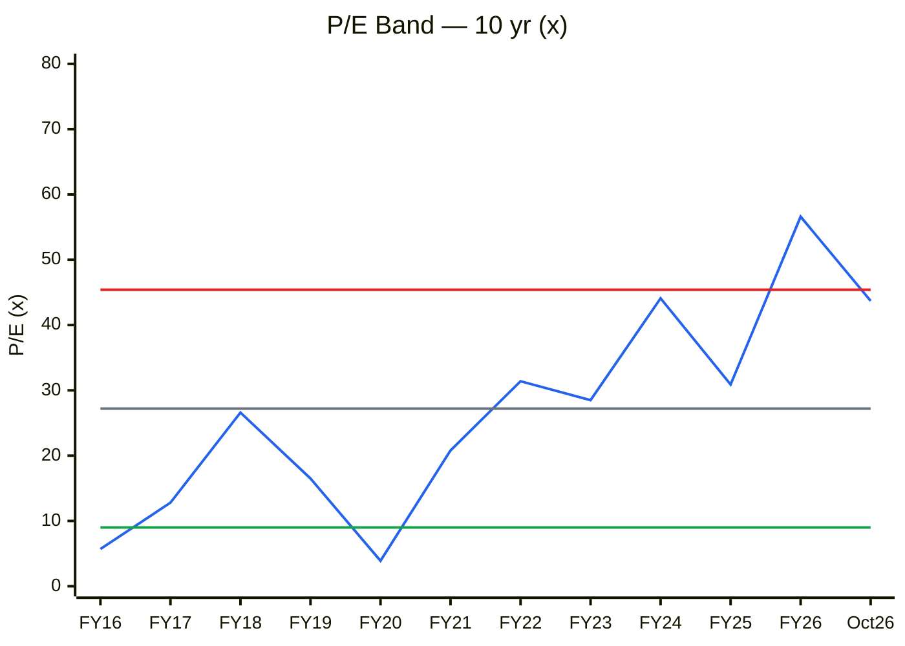
🟦 P/E · ⬜ Median 27.2× · 🟥 +1SD 45.4× · 🟩 −1SD 9.0×
**Read:** P/E de-rated from 68.5× to 43.7× in three weeks, back just inside +1SD, because EPS rose 50% while the price fell 5%. But the denominator is now peak-cycle EPS. A median P/E on peak EPS is not cheap; it is the classic cyclical trap.

**Business inference:** Valuation risk has moved from the multiple to the earnings. If margins normalise to ~19%, TTM-equivalent EPS falls ~25–30%, and today's 44× becomes ~60× on normal earnings.

### CY2 — P/B Band

| | FY16 | FY17 | FY18 | FY19 | FY20 | FY21 | FY22 | FY23 | FY24 | FY25 | FY26 | Oct-26 |
|---|---|---|---|---|---|---|---|---|---|---|---|---|
| P/B (×) | 2.4 | 1.9 | 3.3 | 2.4 | 0.8 | 2.0 | 5.4 | 3.0 | 3.7 | 2.7 | 2.5 | 6.6 |
| ROE (%) | 18.2 | 13.7 | 16.1 | 17.7 | 15.2 | 13.7 | 13.8 | 10.8 | 9.6 | 4.3 | 7.3 | ~17 TTM |

Median 2.9× (9 Oct band; refreshed Screener median 3.1×), SD 1.5 → 1.4–4.4×; **current 6.6× = 96th percentile.**

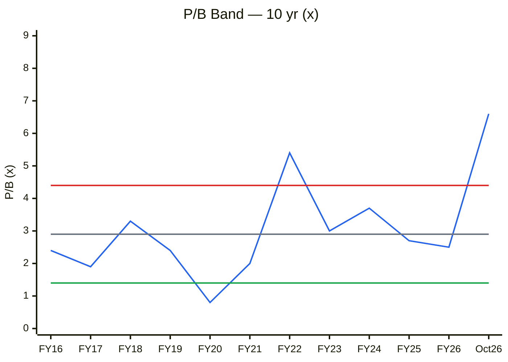
🟦 P/B · ⬜ Median 2.9× · 🟥 +1SD 4.4× · 🟩 −1SD 1.4×
**Read:** P/B fell from 8.1× to 6.6× as book value grew (QIP and profit), but it is still ~50% above +1SD and 22% above the FY22 bubble high. Justified P/B = (ROE − g) / (Ke − g): at today's 17% ROE (Ke 12.5%, g 7%) = **1.8×**; at a 22% sustained ROE = 2.7×. **6.6× prices a sustained ROE of ~43%.**

**Business inference:** Even after the best half-year in the company's history, the equity is priced for returns roughly double what HFCL is earning at the top of the cycle.

### CY4 — Price vs EPS Index (FY16 = 100)

| | FY16 | FY17 | FY18 | FY19 | FY20 | FY21 | FY22 | FY23 | FY24 | FY25 | FY26 | Oct-26 |
|---|---|---|---|---|---|---|---|---|---|---|---|---|
| Price (₹) | 16.9 | 12.8 | 25.9 | 22.6 | 8.8 | 26.4 | 81.0 | 61.0 | 91.8 | 79.1 | 71.7 | 246 |
| EPS (₹; TTM for Oct-26) | 1.26 | 0.99 | 1.35 | 1.73 | 1.77 | 1.86 | 2.27 | 2.18 | 2.29 | 1.23 | 2.04 | 5.67 |

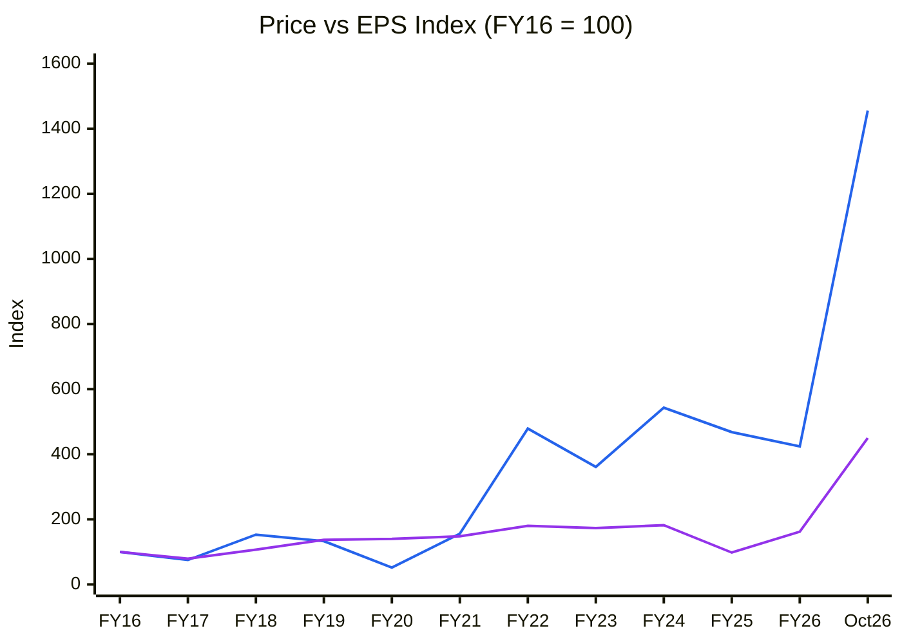
🟦 Price index · 🟪 EPS index
**Read:** EPS (🟪) jumped from 299 to 450 in one quarter, the steepest earnings move of the decade, and narrowed the price-to-earnings gap from 5.1× to 3.2×. The price is still 3.2× ahead of its FY16 relationship to earnings.

**Business inference:** Earnings are finally doing the work, which validates part of the re-rating. But the stock has already priced in several more quarters of this pace. The post-result price fall (₹265 → ₹246) on a large beat says the market's bar is now higher than management's guidance.

### C13 — 2-year Scenario Targets (FY28E EPS × multiple; 160.5 Cr shares)

| Scenario | Driver | FY28E revenue | EBITDA margin | FY28E EPS | P/E | Target | Prob. |
|---|---|---|---|---|---|---|---|
| Bear | Fibre price cycle turns in FY28 (supply wave, hyperscaler capex pause); EPC drag | ₹8,000 Cr | 15% | ₹3.32 | 18× | **₹60** | 25% |
| Base | FY27 ₹9,600 Cr; FY28 +15%; margin normalising to 21%; defence ~₹1,000 Cr | ₹11,000 Cr | 21% | ₹8.66 | 27× | **₹234** | 50% |
| Bull | Pricing holds; connectivity ₹2,000 Cr; defence ₹2,000 Cr; EPC carved out | ₹12,500 Cr | 25% | ₹12.42 | 30× | **₹373** | 25% |
| **Expected value** | | | | | | **₹225** | |

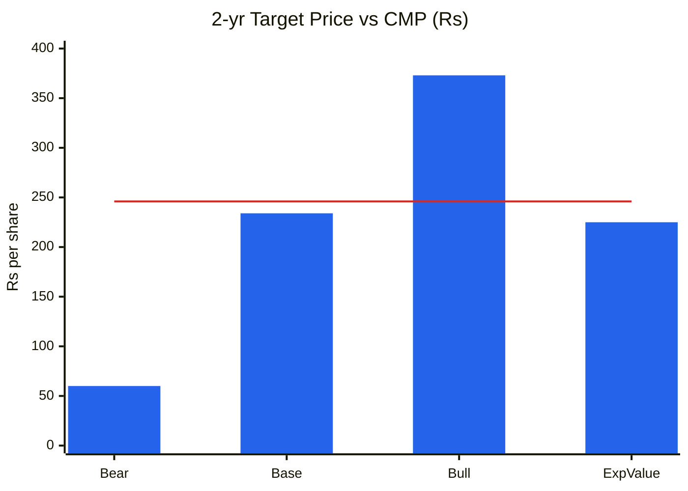
🟦 Scenario price · 🟥 CMP ₹246
**Read:** Every scenario moved up sharply (bear ₹47 → ₹60, base ₹172 → ₹234, bull ₹306 → ₹373) because the earnings base roughly doubled. The base case is now within 5% of the price, but the expected value (₹225) is still 9% below it. **U/D = (373 − 246) / (246 − 60) = 0.68:1.**

**Business inference:** The market has caught up with the base case and is pricing a probability-weighted outcome tilted to the bull scenario: sustained pricing plus a successful defence ramp. Without a durable answer to the 2028 supply wave, the asymmetry is still unfavourable.

### Cycle Position Dashboard

| Dimension | Current | 10-yr median | Percentile | Signal |
|---|---|---|---|---|
| P/E | 43.7× | 29.0× | 82% | Expensive |
| P/B | 6.6× | 3.1× | 96% | **Extreme** |
| EBITDA margin | 25% (Q2) / 23% (H1) | 12% | 100% | **Peak** |
| ROCE | ~20.5% (TTM) | 18% | ~65% | Above median |
| Asset turnover | ~3.1× (TTM) | 4.9× | ~15% | Structurally lower (mix) |
| Cash conversion cycle | ~135 days | 72 | ~65% | Normalising |
| Fibre price / preform spot | +20% QoQ / +600% | — | — | **Shortage pricing** |
| Sector margins | STL 32%, HFCL 25% (same quarter) | — | — | **Group-wide peak** |
| Order book cover (firm) | 2.2× | 1.7× (FY22–25) | ~70% | Strong but thinning |
| **Overall cycle position** | | | | **LATE CYCLE: peak margins and pricing; earnings catching up with valuation** |

Consistent with Module 1b (strong tailwind, late pricing stage) and Module 1c (late cycle / peak margin).

**Graham number:** √(22.5 × 5-yr avg EPS ₹2.0 × BV ₹36.9) = **₹41**. **MoS: negative** (−5% vs base relative, −70% vs base DCF).

---

## Module 10 — Technical Stage

| Item | Reading (Screener, 28 Oct 2026) |
|---|---|
| Price | ₹246; 52-wk ₹59.8–282 |
| 50-DMA / 200-DMA | ~₹235 / ~₹176, both rising; price 5% / 40% above |
| Weekly path | 206 (28 Sep) → 272 (7 Oct) → 244 (15 Oct) → 265 (21 Oct, post-results) → 245 (26 Oct) |
| Pattern | Wide, volatile range ₹205–282 since late Aug; **sold off after a record beat** |
| RS vs Nifty | Strong over 6 months; **negative over 3 weeks** (−5% vs Nifty ~flat) |
| Institutions | FII 15.7 → 17.2%, DII 10.9 → 10.4% (Sep qtr) |

**Stage 2 (advancing), but losing momentum.** The 30-week MA is still rising and the price is above it, but the sell-the-news reaction and a two-month ₹205–282 range are early Stage 2 → 3 warning signs. **Stop for holders:** weekly close < ₹205 (Sep swing low).
**CANSLIM:** C ✓ (Q2 EPS +448%) · A ✗ (3-yr EPS FY23–26 flat) · N ✓ (connectivity, defence) · S ✗ (warrants) · L ✓ · I ✓ (FII rising) · M ✗ (Nifty cautious) → **4 / 7.**

---

## Module 11 — Forward View

### Capex & gross block (C14)

| ₹ Cr | FY22 | FY23 | FY24 | FY25 | FY26 | FY27E | FY28E | FY29E |
|---|---|---|---|---|---|---|---|---|
| Gross Block | 955 | 1,050 | 1,216 | 1,495 | 1,989 | 2,900 | 3,700 | 4,300 |
| Revenue | 4,727 | 4,743 | 4,465 | 4,065 | 4,949 | 9,600 | 11,000 | 12,100 |
| AT (×) | 4.95 | 4.52 | 3.67 | 2.72 | 2.49 | 3.31 | 2.97 | 2.81 |

*Capex: ₹1,800 Cr fibre/OFC/preform programme (OF/OFC Jul-2028, preform Oct-2028) + AP ammunition Phase 1 ₹230 Cr + connectivity unit ₹215 Cr + maintenance. H1 FY27 actual capex ₹436 Cr. Excludes the aerospace acquisition (consideration not disclosed).*

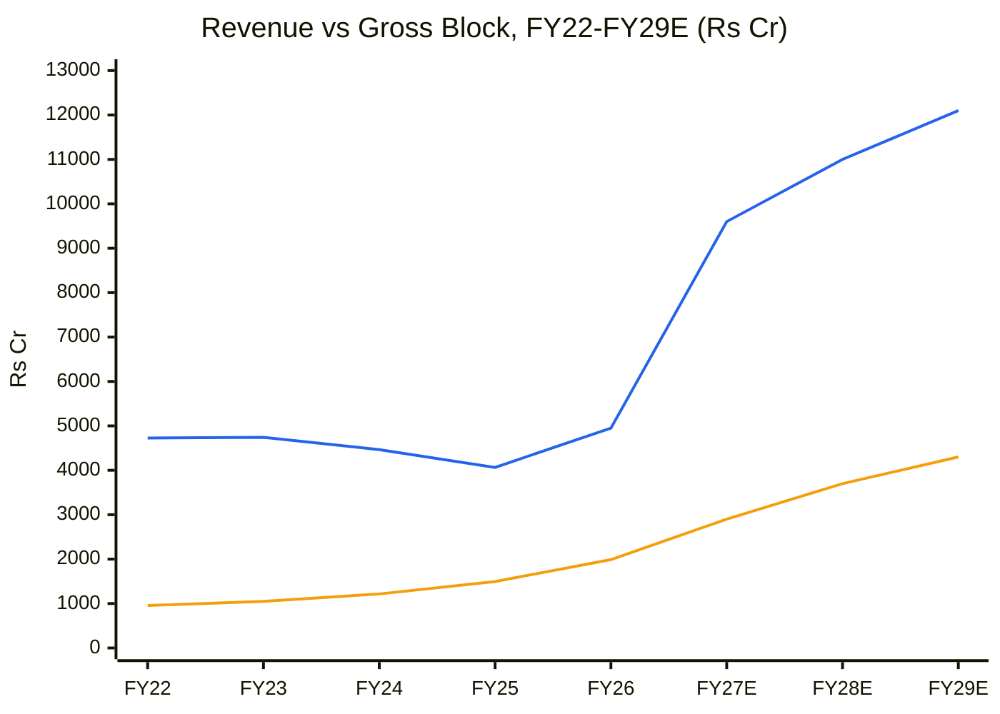
🟦 Revenue · 🟧 Gross block
**Read:** FY27 revenue nearly doubles on existing plant (AT 3.3×). FY28–29 revenue growth (+15%, +10%) is slower than gross-block growth (+28%, +16%) because new capacity commissions only from mid-2028 and prices are assumed to ease. **Incremental ROIC** on ~₹2,300 Cr growth capex + ~₹1,900 Cr incremental WC: ΔEBIT FY26–29 ~₹1,340 Cr × 0.75 / ₹4,200 Cr ≈ **24% at base margins; ~15% if margins fall to 15%.** Value-creating unless the bear case plays out.

**Business inference:** This capacity cycle is being funded mostly from operating cash, which is the main improvement over the FY22–26 build. The risk is timing: HFCL's largest additions arrive in the same window as global ones.

### Base-case earnings

| ₹ Cr | FY27E | FY28E | FY29E |
|---|---|---|---|
| Revenue | 9,600 | 11,000 | 12,100 |
| EBITDA (margin, ex-OI) | 2,300 (24%) | 2,310 (21%) | 2,300 (19%) |
| D&A / Interest / Other income | 220 / 250 / 110 | 290 / 240 / 100 | 350 / 220 / 100 |
| PAT (tax 26%) | ~1,440 | ~1,390 | ~1,350 |
| EPS (₹, 160.5 Cr sh) | 8.97 | 8.66 | 8.43 |
| Capex | 900 | 800 | 500 |
| ΔWC (25% / 30% / 30% of Δrev) | ~1,160 | ~420 | ~330 |
| FCF | **≈ −400** | ≈ +460 | ≈ +870 |
| Debt / EBITDA | ~0.8× | ~0.7× | ~0.6× |
| ICR (EBIT / interest) | ~8.3× | ~8.4× | ~8.9× |

**FCF inflection: FY28** (pulled forward from FY29). **Debt ceiling: safe** (< 1× EBITDA). No equity needed beyond the warrant balance (₹416 Cr due by Nov-2027).

### Catalysts
1. **Q3 FY27 (Jan 2027):** revenue > ₹2,542 Cr at ≥ 25% OPM, which would confirm the MD's "growth in Q3" over the guidance floor.
2. **EPC restructuring decision (Nov 2026):** carve-out or sale of the loss-making turnkey segment; EY-advised board committee.
3. **Aerospace acquisition closing (Q3 FY27)** with ~₹1,600 Cr export book; defence H2 revenue run-rate.
4. **Full-year FY27 CFO > ₹800 Cr**, which would confirm that the cash leak is fixed.
5. **Own-preform "mid-term solution" (CY27)** and the 600 MT plant (Oct-2028): structural margin support.

### Risks
1. **Fibre/preform price cycle turns** as the 2027–28 global supply wave arrives: **High** (FY28–29).
2. **Margin mean-reversion from 25% toward 18–20%**, EPS −25–30%: **High** over 2 years.
3. **Hyperscaler concentration / capex pause** (~70% of the export OFC book; one US$1.1 bn framework agreement): **Medium**.
4. **EPC losses and BharatNet collections** (₹210 Cr H1 loss; government receivable KAM): **Medium**.
5. **Diversification drift** (aerostructures, ammunition, radars) diluting returns: **Medium**.

**Thesis:** HFCL has proven it can earn real returns and real cash at the top of an AI-driven fibre cycle, and it has fixed much of its working-capital problem through mix. The price, however, already capitalises those peak margins as permanent, two years before its own and the industry's supply wave lands. The investment case needs either a cheaper entry or evidence that ≥ 20% margins survive falling fibre prices.

---

## Checklist Summary
**Section 0 (Existing Report Protocol):** 5 / 5 (base read; validation table; git mv to 2026-10-28; filed; themes + index)
**Section A (Business Quality):** 16 / 18 (scuttlebutt beyond filings and pledge level still not verified)
**Section B (Forensics):** 9 / 9 (KAMs now reviewed)
**Section C (Financial Statements):** 11 / 12 (peer DuPont not rebuilt)
**Section D (KPIs & Peers):** 7 / 7 (customer concentration closed)
**Section E (Market Size & Share):** 5 / 7 (TAM figures carried from June)
**Section F (Valuation):** 10 / 10
**Section G (Technical Stage):** 8 / 8
**Section H (Forward View):** 22 / 28 (segment-level AT and capex not separated; acquisition consideration unknown)
**Section I (Charts):** 4 / 5 (CY5, CY6, CY8 omitted by rule: no sourced industry series)
**Order Book Tracker:** Run (Q2 FY27 snapshot added; ledger carried forward; no new filings)
**Hard Stops Triggered:** (1) **Upside/downside < 1.5:1** (0.68:1). *Lifted since 9 Oct:* forensic red flags ≥ 3.

---

## Investment Decision
**Recommendation:** **AVOID at ₹246 → WATCHLIST**
**Five-category verdict:** Avoid at CMP (U/D hard stop). On fundamentals alone this is now closer to *Quality at Wrong Price, late-cycle*.
**Conviction Score:** 4.5 / 10 (Cycle 0.3 · Industry 0.5 · Moat 0.9 · Management 0.6 · Financial quality 1.2 · Valuation 0.3 · Technical 0.7)
**Suggested Position Size:** 0% at CMP. In the buy zone: max 2% (late-cycle × 0.5 modifier).
**Entry Price Range:** **₹110–120** (U/D ≥ 2:1 against ₹234 base / ₹60 bear needs ≤ ₹118; ≈ 13× FY27E EPS; ≈ 3.2× book)
**Stop-Loss (existing holders):** weekly close < ₹205
**Target Price (Base, 2-yr):** ₹234 · **Expected value:** ₹225
**Review Triggers:**
- *Upgrade (thesis path, without waiting for price):* Q3 and Q4 FY27 OPM ≥ 22% **with** evidence that realisations held QoQ; FY27 CFO > ₹800 Cr; EPC carved out; book-to-bill > 1.2× with new *firm* hyperscaler orders. Any two would lift the base multiple to ~32× (base ~₹280) and turn U/D toward 1:1.
- *Further caution:* first QoQ fall in telecom-product segment margin below 27%; book-to-bill < 1; preform contracts resetting at spot; CCC back above 180 days; further equity issuance; Stage 2 → 3 (weekly close < ₹205).

---

## Data Sources & Citations
- [BSE — Q2 FY27 financial results incl. segment, balance sheet and cash-flow statements (19-Oct-2026)](https://www.bseindia.com/xml-data/corpfiling/AttachHis/2e9e286f-aad3-4a3f-aa7d-72edbfa7323e.pdf)
- [BSE — Q2 FY27 investor presentation](https://www.bseindia.com/xml-data/corpfiling/AttachHis/52bcff6e-34cb-4d4b-88ca-a59046342f27.pdf) · [Q2 FY27 earnings-call transcript (19-Oct, filed 26-Oct)](https://www.bseindia.com/xml-data/corpfiling/AttachHis/476f5fb2-41fb-4fb2-9460-a53d12da4eb9.pdf) · [Q1 FY27 transcript](https://www.bseindia.com/xml-data/corpfiling/AttachHis/bbc45887-fdfd-4470-8565-f5f5b09fee2d.pdf)
- [BSE — ₹820 Cr additional capex approval, capacity table (14-Sep-2026)](https://www.bseindia.com/xml-data/corpfiling/AttachHis/30091642-b8de-40b0-bf41-6a90e4a06cca.pdf)
- [BSE — Annual Report FY26 (KAMs, contingent liabilities, customer concentration)](https://www.bseindia.com/xml-data/corpfiling/AttachHis/60894750-bb6f-4e13-8e70-876062e55b18.pdf)
- [BSE — Monitoring agency report Q2 FY27](https://www.bseindia.com/xml-data/corpfiling/AttachHis/e0d2d12c-7418-47f6-a206-341e1f225369.pdf) · [HFCL Connectivity Systems incorporation (22-Oct)](https://www.bseindia.com/xml-data/corpfiling/AttachHis/9f0ca894-84b1-43d7-8c5f-45b3472f07c8.pdf) · [Nivetti stake-sale extension (1-Oct)](https://www.bseindia.com/xml-data/corpfiling/AttachHis/ea5d2ca9-f30b-44ef-bc4f-f697e2a584f5.pdf)
- [Screener.in — HFCL consolidated](https://www.screener.in/company/HFCL/consolidated/): quarterly, shareholding (Sep-26), ratios, price/DMA and P/E–P/B series (28 Oct 2026) · [Screener — STL](https://www.screener.in/company/STLTECH/consolidated/) (28 Oct)
- [HDFC Sky — Nifty / VIX 22-Oct-2026](https://hdfcsky.com/news/india-vix-ends-at-15-81-as-niftys-third-straight-session-of-losses-keeps-market-volatility-in-focus)
- Carried from earlier versions: [CARE Ratings Jul-2022](https://www.careratings.com/upload/CompanyFiles/PR/06072022070116_HFCL_Limited.pdf) · [DSIJ](https://insights.dsij.in/dsijarticledetail/rs-7678-crore-order-book-this-multibagger-telecom-infrastructure-company-bags-new-orders-worth-rs-6493-crore-37599) · [The Machine Maker](https://themachinemaker.com/news/hfcl-aims-for-%e2%82%b910000-crore-revenue-with-global-expansion-and-defence-growth/) · [FilingReader — warrants](https://filingreader.com/news-wire/mumbai/2026-05-25/hfcl-raises-inr-13875-crore-through-promoter-warrant-allotment) · [Angel One — MN Ventures sale](https://www.angelone.in/news/stocks-share-market/hfcl-share-price-gain-over-2-percent-despite-promoter-reducing-stake) · [Voice&Data — ₹215 Cr AI unit](https://www.voicendata.com/artificialintelligence/hfcl-posts-record-q1-fy27-results-approves-rs-215-cr-ai-investment-12187806) · Peer ratios for Vindhya, Birla Cable, Tejas (Screener, 9 Oct 2026)
- Companion: `Concall analysis/Result_analysis/Q2FY27/HFCL_Q2FY27_concall-analysis.md` (28 Oct 2026)

**Remaining data gaps:** current promoter pledge from a primary filing; aerospace-acquisition consideration and whether its ₹1,600 Cr book sits in the headline order book; volume/price split of growth (refused on the call); industry fibre capacity and price series (CY5/CY6); segment-level gross block.

---
*Report generated by Stock Fundamental Analysis Skill v3.3 | Indian Markets Context*
*Save path: C:\Users\anubh\Documents\Anubhav\Stock Analysis\Stock Analysis\Technology-and-Electronics\Telecom-Equipment-and-Infrastructure\*
*DISCLAIMER: For informational purposes only; not investment advice. FY27E–FY29E, DCF and scenario values are the analyst model's estimates.*
